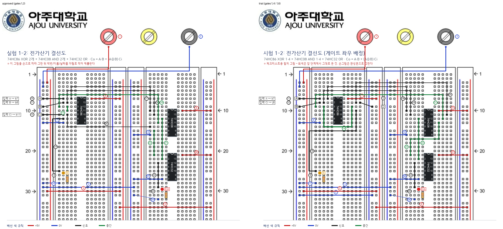
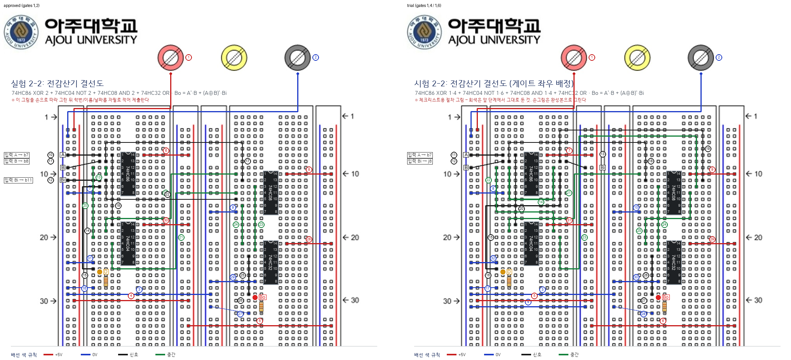

# 실험03 균형 결선 격리 시험 — 측정 (2026-09-20)

설계: `docs/plans/2026-09-20-실험03-균형결선-격리시험-설계.md`. 시험 빌더는 `tmp/실험03_균형/배치.py`(gitignore).

## 전가산기



가닥 수: 승인본 27 · 시험 28

| 칩 | 자리 | 쪽 | 승인본 | 시험 | 시험 홀 |
|---|---|---|---|---|---|
| 74HC86 | 좌 7행 | 왼쪽(a~d) | 11 | 7 | 좌 b7 좌 d7 좌 b8 좌 c8 좌 a9 좌 c9 좌 b13 |
| 74HC86 | 좌 7행 | 오른쪽(g~j) | 1 | 5 | 좌 g7 좌 i8 좌 j8 좌 h9 좌 i10 |
| 74HC08 | 우 10행 | 왼쪽(a~d) | 7 | 4 | 우 a10 우 b11 우 d12 우 a16 |
| 74HC08 | 우 10행 | 오른쪽(g~j) | 1 | 4 | 우 g10 우 i11 우 h12 우 g13 |
| 74HC32 | 우 21행 | 왼쪽(a~d) | 4 | 4 | 우 b21 우 d22 우 c23 우 d27 |
| 74HC32 | 우 21행 | 오른쪽(g~j) | 1 | 1 | 우 g21 |

## 전감산기



가닥 수: 승인본 31 · 시험 32

| 칩 | 자리 | 쪽 | 승인본 | 시험 | 시험 홀 |
|---|---|---|---|---|---|
| 74HC86 | 좌 7행 | 왼쪽(a~d) | 11 | 7 | 좌 b7 좌 d7 좌 b8 좌 c8 좌 a9 좌 c9 좌 b13 |
| 74HC86 | 좌 7행 | 오른쪽(g~j) | 1 | 5 | 좌 g7 좌 i8 좌 j8 좌 h9 좌 i10 |
| 74HC08 | 우 10행 | 왼쪽(a~d) | 7 | 4 | 우 a10 우 b11 우 d12 우 a16 |
| 74HC08 | 우 10행 | 오른쪽(g~j) | 1 | 4 | 우 g10 우 i11 우 h12 우 g13 |
| 74HC04 | 좌 18행 | 왼쪽(a~d) | 5 | 3 | 좌 d18 좌 c19 좌 a24 |
| 74HC04 | 좌 18행 | 오른쪽(g~j) | 1 | 3 | 좌 g18 좌 h19 좌 i20 |
| 74HC32 | 우 21행 | 왼쪽(a~d) | 4 | 4 | 우 b21 우 d22 우 c23 우 d27 |
| 74HC32 | 우 21행 | 오른쪽(g~j) | 1 | 1 | 우 g21 |

## 통과 기준 판정

기준 번호는 `docs/plans/2026-09-20-실험03-균형결선-격리시험-설계.md` 「통과 기준」 1~5 를 그대로 따른다.

| # | 기준 | 판정 | 근거 |
|---|---|---|---|
| 1 | 6장이 R1~R7 위반 없이 뽑힌다 | **통과** | `run.py --compare` 가 `시험_전가산기_1단계_XOR`·`시험_전가산기_2단계_Co경로`·`시험_전감산기_0단계_걷기`·`시험_전감산기_1단계_NOT`·`시험_전가산기`·`시험_전감산기` 6장을 첫 실행에서 뽑았다. R1~R7 도 레일 연결성도 한 번도 안 걸렸다 |
| 2 | 완성본 모든 칩·쪽 ≤ 8 | **통과** | 위 표의 여덟 면 최댓값 = 74HC86 왼쪽 **7** (한도 8 에서 1 남음). 나머지 일곱 면은 1~5 |
| 3 | 걷는 가닥이 정확히 둘 | **통과** | 걷기 보드 출력 `걷는 가닥: ['좌 d7 → 우 a10 · 입력 A 갈래 -> 74HC08 pin 1', '좌 a9 → 우 h12 · A⊕B (74HC86 pin 3) -> 74HC08 pin 12 (AND2)']`, `새 번호: 7` — 정확히 둘 |
| 4 | 가닥 수 승인본 +3 이내 | **통과** | 전가산기 27 → 28(**+1**), 전감산기 31 → 32(**+1**). 늘어난 하나는 좌 GND↔좌 중앙 GND 브리지뿐 — 한도 +3 안 |
| 5 | 74HC86 좌우 밀도가 눈으로 갈린다 | **통과** | 나란히 그림에서 승인본은 74HC86 오른쪽(g~j)에 pin 14 급전선 한 가닥만 붙어 사실상 비어 있고 왼쪽에만 초록·검정이 겹쳐 쌓인다. 시험본은 오른쪽에 초록 사슬(pin 12·13)과 `Ci → j8` 검정 가닥이 올라와 양옆이 확연히 갈린다 |

**5개 중 5개 통과.** 기준 2 도 기준 4 도 깨지지 않았으므로 `SIDE_LEAD_MAX = 8` 도, "게이트 나누기가
가닥을 늘리지 않는다"는 전제도 이번 시험에서는 반증되지 않았다.

## 발견

### (a) Task 1 RED — 승인본은 `legacy` 도장이 없으면 첫 완성본에서 R7 에 걸린다

승인본 `보고서/실험03/결선도/배치.py` 를 복사해 `density_policy = 'legacy'` 네 줄만 지우고
(`grep -c density_policy` = `0`) 돌렸더니, 1단계 XOR 보드는 뽑히고 **전가산기 완성본에서 멈췄다**
(`tmp/실험03_균형/RED.txt`):

```
AssertionError: 그림대로 꽂을 수 없다:
  R7 칩 한쪽 밀집: 74HC86(좌 7행) 왼쪽 11리드 > 8: 좌 b7, 좌 d7, 좌 b8, 좌 c8, 좌 a9, 좌 c9, 좌 c10, 좌 b11, 좌 c11, 좌 b12, 좌 b13
```

설계가 예상한 그대로다.

### (b) 브리지를 뺐을 때 R5 가 막았는가 — 막았다

`_x3_frame` 의 `bb.bridge_rails(c['gnd'], c['mid_gnd'], 31, kind='gnd')` 를 잠시 주석 처리하자
문구와 끊긴 레일 이름까지 설계 예상대로 나왔다:

```
AssertionError: 0V 레일이 끊겨 있다 — 브리지가 없다: 좌 중앙GND레일 / 우 중앙GND레일+좌 GND레일
  레일쌍 넷은 별개 스트립이다. bridge_rails() 로 이어라.
```

브리지는 곧바로 되살렸고 재실행에서 6장이 다시 정상으로 뽑혔다. 이 브리지가 시험본에만 하나 더
필요한 이유는 Ci/Bi 를 f쪽 pin 13 으로 넣으면서 좌 중앙 GND 레일을 쓰게 되기 때문이다 —
기준 4 의 +1 가닥이 바로 이것이다.

### (c) 실제로 걸린 위반과 고친 방법 — **routing 수정 없음(0건)**

설계의 빌더 코드를 한 글자도 고치지 않고 넣었더니 첫 실행에서 6장이 전부 뽑혔다. R1~R7 도
레일 연결성도 걸리지 않아 「고치는 순환」은 돌 일이 없었다. 통로(좌 3·4·5·6·14·15·16·17행,
440·452 차선)는 설계대로 서로 부딪히지 않았다.

고친 것은 **번호 원 자리 네 군데뿐**이다 — 배선 좌표(홀·경로)는 하나도 안 건드린 `marker_at`
이동이다. 원 중심에서 다른 배선까지의 거리를 전수 검사해(번호 원 반지름 8px, 행 간격 16.345px,
6px 미만을 「덮는다」로 봄) 옮겼다:

| # | 회로 | 배선 | before | after | 왜 |
|---|---|---|---|---|---|
| 20 | fs | `입력 A 갈래 -> 74HC04 pin 1` | `(c['d']+16, L(15))` | `(c['d']+16, L(15)+8)` | `D -> LED1` 가로선 위 0px |
| 22 | fs | `A⊕B -> 74HC04 pin 13 (NOT2)` | `(c['a']-20, L(13))` | `(c['a']-20, L(11))` | `pin 7 -> GND 레일` 위 0px |
| 21 | fa | `A⊕B -> 74HC08 pin 12 (AND2)` | `(r['h']+14, L(8))` | `(r['g']-14, L(8))` | `입력 Ci 갈래` 세로선에서 2px |
| 14 | fa·fs | `XOR1 출력 A⊕B -> XOR2 입력` | `(c['f'], L(14)+12)` | `(c['f'], L(14)+8)` | 15행 LED1 급전선에서 5px → 9px |

### (d) 눈 검사 결과

1. **74HC86 양쪽에 선이 나뉘었다.** 승인본의 왼쪽 11가닥 덩어리가 시험본에선 왼쪽 7·오른쪽 5 로
   갈라져 왼쪽이 눈에 띄게 얇아졌다(기준 5 판정 근거).
2. **f쪽 입력 배지 `Ci`/`Bi` 자리 문제 없음.** 좌 중앙 VCC(484)와 우 중앙 GND(542) 사이 여백 안
   9행 부근에 앉아 홀을 안 가리고, 번호 원 ⑬ 과도 18px 떨어져 있다.
3. **번호 원끼리 겹침 실질적으로 없음.** 중심 간 17px 미만인 쌍은 `#11~#12` 하나뿐이고 정확히
   16.0px — 접하기만 하고 겹치지 않는다. 게다가 `_input_jumper` 가 A·B 입력에 기본으로 놓는
   자리라 **승인본에도 똑같이 16.0px 로 있다**.
4. **사슬이 칩 몸통 위를 안 지난다.** 두 장 모두 어떤 배선도 칩 검은 몸통을 가로지르지 않는다.

**남은 눈에 걸리는 것**(모두 R7 이 보지 않는 자리):

- `A⊕B → XOR2` 의 칩 아래 우회(c9→c14→h14→h9)가 굵기 4 로 74HC86 을 **초록 사각형으로 빙 두른
  모양**이 돼서, 처음 보면 배선이 아니라 칩 강조 테두리처럼 읽힐 여지가 있다. 승인본에 없던 인상이다.
- 전감산기 좌 블록 **14~20행이 가로 네 줄 + 세로 네 줄의 격자**로 상당히 빽빽하다. 칩 사이 공간이라
  R7 에 안 걸린다. R7 을 통과했다고 그림이 성긴 것은 아니라는 뜻이다. 번호 원을 놓을 「빈 행」이
  없어 위 (c) 의 네 군데를 반행씩 밀어 겨우 맞췄다.
- fs 의 `(A⊕B)'` 배선(좌 i20 → 25행 → 452 차선 → 4행 → 우 h4 → h12)이 보드를 거의 세로로 다
  훑는다. 통과는 하지만 한 가닥 치고 경로가 길다.
- fa `#7`(좌 `pin 14 -> +5V`), fs `#31`(좌 74HC04 `pin 14 -> +5V`) VCC 번호 원이 각각
  `A⊕B -> 74HC08 pin 12`·`A' -> 74HC08 pin 1` 에서 **5px** 로 접한다. 엔진 `connect_power` 가
  스스로 놓는 자리라 `배치.py` 에서 옮길 수단이 없다(`gnd_marker_at` 만 있고 vcc 인자가 없다).
  둘 다 접선 수준이고 숫자는 읽힌다.

### (e) 규칙에 대한 의견 (Task 2 구현자의 의견)

Task 2 구현자는 **`SIDE_LEAD_MAX = 8` 이 지금 회로에는 넉넉한 편(느슨)** 이라고 본다. 최댓값이
74HC86 왼쪽 7 로 한도에서 1 남았고 나머지 일곱 면은 1~5 다. 한도 8 은 배치를 빡빡하게 몰아세운 게
아니라 **게이트를 좌우로 나누라는 방향만** 강제하고 나머지 자유도를 남겼다 — 그리고 그는 이것을
좋은 설계로 평가한다. 6 으로 조였다면 74HC86 왼쪽(전원 2 + 입력 2 + XOR1 출력 갈래 2 + …)이 쿼드
게이트 하나를 쓰는 것만으로 걸려 배정이 아니라 슬롯 자체를 흔들어야 했을 것이고, 10 이었다면
승인본의 11 만 잡고 9~10 짜리 밀집은 통과시켰을 것이다. 8 은 「쿼드 칩 한쪽에 게이트 둘을 몰면
걸리고 하나씩 나누면 통과한다」는 경계에 잘 맞아 있다는 것이 그의 판단이다.

다만 그는 **R7 을 통과해도 그림이 성글다는 보장은 아니라고** 덧붙인다 — 칩 사이 행(좌 14~17행)의
밀집과 번호 원 놓을 자리 부족은 R7 이 보지 않는다. 한도를 더 조이기보다 「한 행을 가로지르는
배선 수」 같은 **별개의 지표**가 필요한 자리로 본다.

**칩 아래 우회(`c9 → c14 → h14 → h9`)에 대해서는, 손으로 그리기 충분히 합리적**이라는 것이 그의
의견이다. 직선 네 토막에 직각 꺾임뿐이라 자 하나로 따라 그릴 수 있고, 14행이라는 단일 행을
가로지르므로 몇 행에서 건너가는지가 한눈에 읽힌다. 실제로 꽂을 때도 칩 몸통을 넘는 점퍼보다
안전하다(칩 위 선은 칩을 뽑을 때 걸리고 핀을 가려 육안 검사를 방해한다). 유일하게 신경 쓸 점은
위 (d) 의 「칩을 두른 사각형으로 보인다」는 인상인데, 손그림에서 14행 가로 구간을 칩 하단에서 한 행
더 떨어뜨리거나 번호 ⑭ 를 눈에 띄게 찍어 두면 해소된다고 본다. 굵기 4 를 3 으로 낮추는 것도
한 방법이겠으나 이번 시험 범위(게이트 배정과 R7)와는 별개 사안이라 손대지 않았다.

**결론: 규칙 변경은 필요 없다.** `SIDE_LEAD_MAX = 8` 과 게이트 좌우 배정은 이번 격리 시험에서
의도한 대로 작동했고, 남은 밀집은 R7 이 재는 대상이 아니라 별개 지표가 다룰 문제다.
