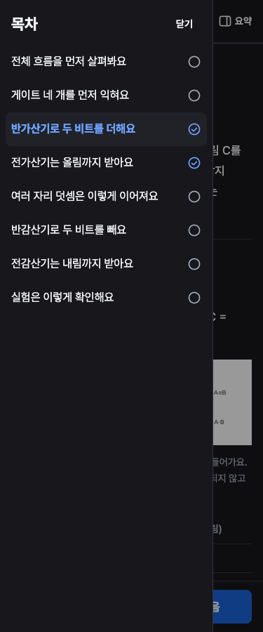
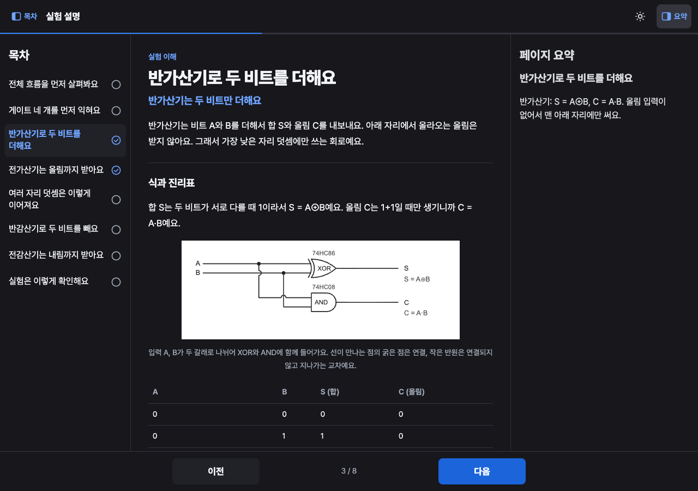

# 복습노트 탐색 분리 검증 — 2026-10-10

## 최종 결과: 목차 아래에 토픽 목록만 표시

마지막 요청에 따라 왼쪽의 `실험 이해`/`문제와 풀이` 섹션 링크도 제거했다. `목차` 제목 바로 아래에 들여쓰기 없는 토픽/문항 목록만 표시하며, 개별 읽음/풂 체크는 유지한다. 전체 링크를 정적 HTML에 생성해 JS 비활성에서도 토픽으로 이동할 수 있다. JS는 기존 정적 링크와 화면을 연결하며, 잘못된 토픽·location hash도 초기 화면을 비우지 않는다.

최종 검증: 관련 테스트 `53 passed`(46.33초), 전체 테스트 `2802 passed, 9 skipped, 22 warnings`(72.99초), 5개 팩 검사 통과, 본문 바이트 동일, standalone 참조 0, 반복 갱신 변경 0. 최종 정적 목록 변경을 새 리뷰어(gpt-6-astra)가 확인했으며 수정할 정확성 문제는 없었다. 변경 전 백업은 `output/backups/navigation-flat-topics-2026-10-10/`에 보존했다. 아래 이전 단계의 설명은 구현 이력이며, 현재 화면은 이 절과 화면 증거를 따른다.

## 최종 후속 수정: 소제목·진행 합계 제거

추가 요청에 따라 `이 페이지 목차` 소제목, 읽은 토픽/푼 문제 진행 합계와 막대를 제거했다. 왼쪽에는 `목차` 제목과 섹션·토픽 목록만 표시한다. 개별 읽음/풂 체크와 저장 기록은 유지한다. 기존 HTML 5개·동봉 템플릿 10개·공통 템플릿·갱신기·검사기·스킬 문서에 반영했다. 관련 Python/실제 Chrome 검사 `53 passed`(35.59초), 팩 check 5개 통과, 본문 바이트 보존, standalone leftovers=0, 반복 갱신 변경 0을 확인했다. 제거 전 백업은 `output/backups/navigation-remove-summary-2026-10-10/`이다.

아래는 앞선 변경의 검증 이력이다. 최종 UI는 이 절을 따른다.

## 최종 후속 수정: 자료 이동 제거

사용자의 후속 요청에 따라 실험01~05의 실험설명과 공통/동봉 note·legacy review 템플릿에서 자료 이동 제목·문서 링크·구분선을 제거했다. 현재 왼쪽 패널에는 이 페이지 목차, 진행 표시, 섹션과 토픽만 남는다. 생성기·검사기·갱신기·스킬 문서도 같은 규칙으로 변경했다.

후속 관련 검증은 브라우저 매트릭스를 포함해 `53 passed`(38.04초)다. 5개 팩 check 통과, 본문 바이트 동일, standalone 5개 leftovers=0, 반복 갱신 변경 0을 확인했다. 제거 전 백업은 `output/backups/navigation-remove-documents-2026-10-10/`에 보존했다. 화면 증거는 최종 상태로 갱신했다.

아래 항목은 자료 이동을 분리했던 최초 구현의 검증 이력이다. 현재 UI 규칙은 위 후속 수정과 갱신된 스펙을 따른다.

## 반영 결과

페이지 이동과 문서 내부 목차를 두 nav로 분리했다. 표시 순서는 자료 이동 → 구분선 → 이 페이지 목차 → 진행 숫자/막대 → 섹션 → 12px 들여쓴 토픽 목록이다. 현재 페이지와 현재 토픽/읽음 표시는 각각의 탐색 영역에서 구별된다.

| 팩 | 실험설명 HTML | 기출문제 HTML | 기출풀이 HTML | 동봉 note/review 템플릿 |
|---|---|---|---|---|
| 실험01 | 수정·검사 통과 | 검사·바이트 동일 | 검사·바이트 동일 | 두 개 갱신 |
| 실험02 | 수정·검사 통과 | 검사·바이트 동일 | 검사·바이트 동일 | 두 개 갱신 |
| 실험03 | 수정·검사 통과 | 검사·바이트 동일 | 검사·바이트 동일 | 두 개 갱신 |
| 실험04 | 수정·검사 통과 | 검사·바이트 동일 | 검사·바이트 동일 | 두 개 갱신 |
| 실험05 | 수정·검사 통과 | 검사·바이트 동일 | 검사·바이트 동일 | 두 개 갱신 |

학습 HTML 15개를 조사했고 같은 탐색 패널이 있는 실험설명 5개를 수정했다. 별도 A4 워크북 10개에는 이 패널이 없으며 파일 바이트를 보존했다. 각 실험설명 `<main>`의 바이트도 백업과 동일하다. 그 밖의 그림·원문 증거·문항 payload·MD·manifest 등 모든 팩 파일은 동봉 템플릿 두 개를 제외하고 동일하다. 다른 저장소 upstream과 해시 고정 workbook 스냅샷을 수정하지 않았다.

공통 생성기·검사기, 로컬 note/legacy review 템플릿, navigation_upgrade 명령, standalone 내보내기, 학습팩/standalone 스킬 문서와 검증 지침을 함께 갱신했다.

## 테스트와 실제 화면

- 기존 생성기/검사기/standalone 기준 테스트 15개 통과 후 신규 실패 테스트를 확인하고 구현했다.
- 최종 관련 Python 테스트: `27 passed`.
- Chrome에서 실험01~05 × 375px/1280px × light/dark, 20조건을 확인했다. 문서 링크, 내부 토픽 선택, 뒤로가기, 새로고침 후 읽음 상태, 요약, 두 nav의 모바일 닫기, 키보드 포커스, 패널 내 가로 넘침, 이미지와 KaTeX, 인쇄 패널 숨김을 검사했다.
- JS 비활성 모바일/데스크톱 두 조건에서 탐색 링크가 표시된다. 기존 모바일의 no-JS 패널 숨김을 이번 탐색 보존 조건에 맞춰 수정했다.
- 없는 section hash와 잘못된 인코딩 hash, 잘못된 location hash 세 조건을 확인했다. 잘못된 인코딩도 초기 화면을 비우지 않는다.
- legacy 두 문서 팩을 실제 브라우저에서 확인했다. 현대 팩의 기출문제 링크를 legacy에 추가하지 않는다.
- 실험04 MUX 위젯의 S/I0/I1 8조합을 네 화면/테마 조건에서 조작해 출력과 예상값을 대조했다.
- 전체 테스트: `2801 passed, 9 skipped, 22 warnings`(63.14초). 명령: `env TMPDIR=/private/tmp uv run --with pytest --with pytest-xdist --with playwright --with pypdf --with pymupdf --with pillow python -m pytest -n 4 --dist loadgroup`. 마지막에 추가한 legacy 브라우저 테스트와 보강한 MUX/포커스 검사는 별도 실행에서 `5 passed`였다. 새 코드가 바뀐 후 관련 Python 27개도 다시 통과했다.
- 9개 skip은 기존 환경 의존 검사이고, 경고는 PyMuPDF Swig 타입과 기존 Pillow getdata 사용의 deprecation이다. skip을 검증 통과로 포함하지 않았다.

처음 전체 실행에서는 변경하지 않은 `test_merge_lab_report_warns_when_body_cannot_be_removed` 한 개가 실패했다. 기본 macOS 임시 경로의 `/var`→`/private/var` alias 때문에 삭제 실패 모의 함수의 Path 비교가 어긋났다. 해당 테스트와 merge_report.py는 수정하지 않았고, canonical `TMPDIR=/private/tmp`로 단독 실행과 전체 실행을 다시 확인해 통과했다.

## 독립 코드 리뷰

fresh-context 리뷰어(gpt-6-astra)가 URI decode 예외 처리 누락 한 건(P2)을 찾았다. `#%` section과 location hash가 빈 화면을 만드는 실패를 회귀 테스트로 재현한 뒤, 로컬 템플릿·갱신기·기존 HTML에서 decode 예외를 처리했다. 해당 세 테스트 RED→GREEN 후 전체 테스트를 다시 실행했다. 다른 구체적 결함이나 판단 보류 항목은 없었다. 이번 리뷰는 탐색 코드 리뷰이며 과목 내용의 independent 검토 상태를 변경하지 않았다.

## 백업과 재실행

- 최초 원본 전체 팩 백업: `output/backups/navigation-2026-10-10/실험01`~`실험05`.
- no-JS 개선 전 백업: `output/backups/navigation-nojs-2026-10-10/`.
- URI 예외 개선 전 백업: `output/backups/navigation-hash-2026-10-10/`.
- 마지막 `python3 -m scripts.lab.review_pack.navigation_upgrade --all`: `5 packs inspected; 0 files would change`.
- 백업/검증용 대형 파일은 로컬 `.git/info/exclude`로만 제외했으며 보존했다. 저장소 ignore 정책을 변경하지 않았다.
- 테스트 출력과 원본 보존 해시: `output/validation/navigation/`. 최종 standalone 실험설명 5개도 이 폴더에서 확인했고 모두 leftovers=0이다. 기존 저장소/Downloads의 별도 standalone은 발견되지 않았다.
- 계획·설계 문서를 포함한 변경을 작업 트리에 남겼다. 이 기록 작성 당시 커밋·push 전 상태였다. 사용자의 마지막 요청에 따라 검증 완료 후 이번 작업을 커밋·push한다.

## 화면 증거

실험03의 반가산기 토픽을 선택한 상태를 확인했다. 모바일은 drawer 이동이 끝난 후 캡처했다.

