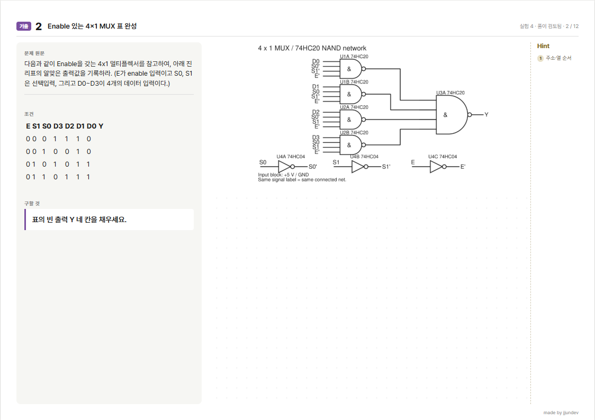
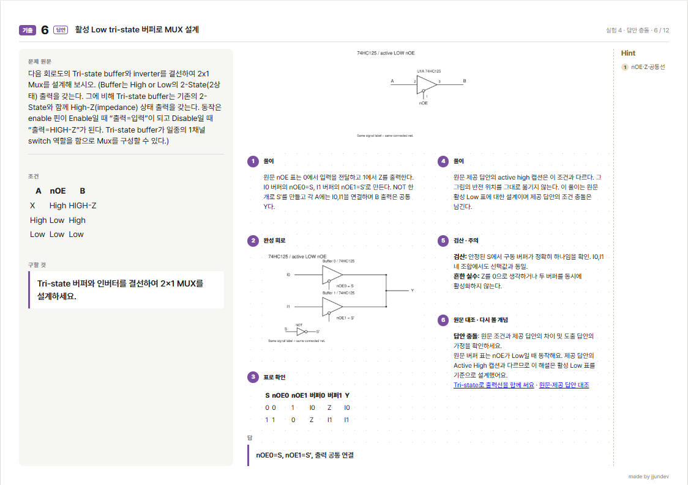
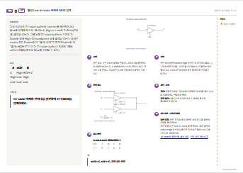
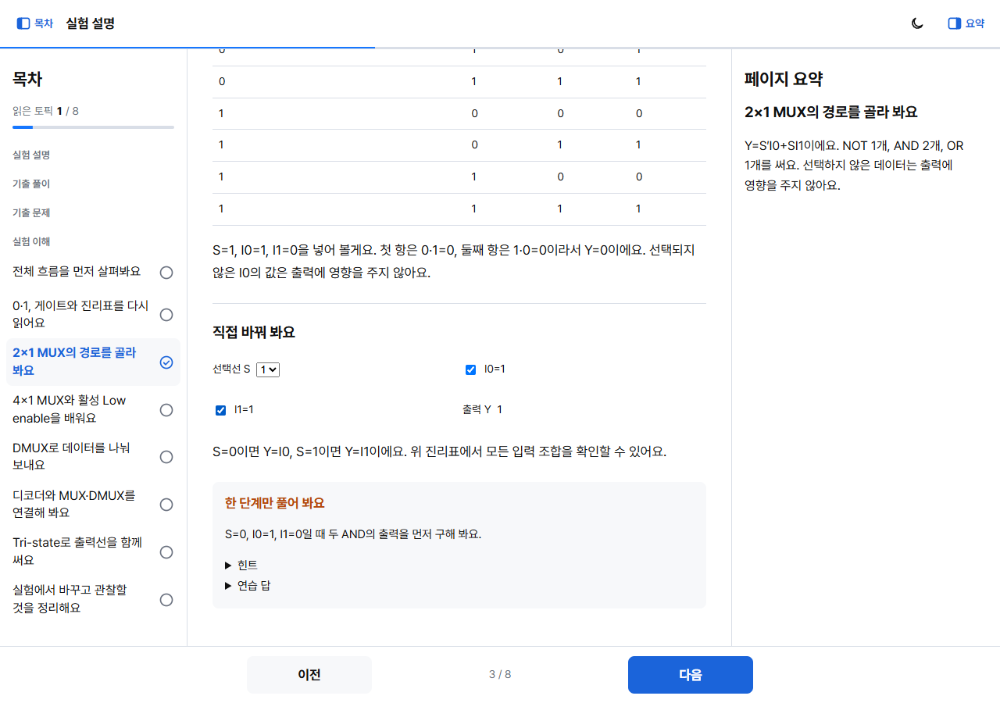

# 실험04 문제지·해설지 검증

검증 stage: `tmp/review-pack/실험04-workbook-20261001-c`. 기존 Native 구현 및 격리 워크트리 사용. 원본 문제은행 고정 필드·증거 이미지·실험설명 본문/6 SVG 보존.

## 기능 검증

- `python -m pytest tests -k review_pack -n 0 -q`: 260 passed, 2083 deselected.
- 문제 12개/보류 3개; IDs·순서·조건·문제 그림·힌트가 두 판에서 일치.
- 9 SVG/9 PNG를 직접 재작성하고 원문 극성·게이트 수·nOE·접속·버스와 대조. PNG 인쇄 크기 300dpi ±2px 확인.
- 새 이미지 래스터화에서 MuPDF class 스타일 미적용을 발견: 명시적 paint 속성으로 수정. white gate/실제 wire pixel 회귀 테스트 RED→GREEN.
- 두 HTML은 1280×900/375×812에서 data-ready=true, data-overflow='', 이미지 decode·KaTeX·콘솔 오류 0, offline reload, Hint 링크, 표/최종 답 경계 통과.
- 인쇄 문제지 12쪽/해설지 13쪽(힌트 모음 포함), 모든 쪽 297×210mm. 25쪽 PNG를 직접 확인했으며 내용 잘림 없음.
- 기존 설명의 8토픽·유효 light/dark 테마·pager·이미지·수식·MUX 8조합 및 콘솔 확인.
- 긴 Tri-state 해설은 대조/복습을 한 단계로 묶고 검산/주의를 같은 단계에 배치. 문단·그림·조건을 삭제하지 않고 템플릿의 단계 여백만 중복되지 않게 함.
- 문항별 짧은 힌트는 문제지 띠에서 바로 식별되도록 각각 다른 이름표를 사용.

## 화면 증거






## 템플릿·검토 대상

{
  "stage": "tmp\\review-pack\\실험04-workbook-20261001-c",
  "viewports": [
    {
      "sheet": "problems",
      "width": 1280,
      "height": 900,
      "ready": true,
      "overflow": "",
      "offline": true
    },
    {
      "sheet": "answers",
      "width": 1280,
      "height": 900,
      "ready": true,
      "overflow": "",
      "offline": true
    },
    {
      "sheet": "problems",
      "width": 375,
      "height": 812,
      "ready": true,
      "overflow": "",
      "offline": true
    },
    {
      "sheet": "answers",
      "width": 375,
      "height": 812,
      "ready": true,
      "overflow": "",
      "offline": true
    }
  ],
  "prints": [
    {
      "sheet": "problems",
      "pages": 12,
      "size_mm": [
        297,
        210
      ]
    },
    {
      "sheet": "answers",
      "pages": 13,
      "size_mm": [
        297,
        210
      ]
    }
  ],
  "artifacts": {
    "실험04_기출문제.html": "096fffd187d12b0723d8b44d2153db53696d7673333112717e3e48312de11f14",
    "실험04_기출풀이.html": "5c33b3dace09fac9b092659d7909b23f5b13d543ba02ed5b1316bca6913fdc6b"
  },
  "console_errors": []
}

## 전체 검사와 독립 리뷰

전체 실행: `python -m pytest tests -n 0 -q`: 2329 passed, 20 failed, 4 skipped, 1082 subtests passed. 실패는 lab_config, lab_figure_export, lab_html2pdf, merge_report, trace_guide에 있으며 이 작업에서 해당 모듈을 수정하지 않았다. 변경 전 175a6f8 코드의 별도 사본에서 같은 실패를 재현해 비교한다. 실제 실패 목록과 독립 리뷰 결과는 발행 전 이 문서에 기록한다.

## 기준선 실패 대조

175a6f8의 별도 사본에 같은 배포 교안·아카이브 교안을 놓고 실패한 테스트만 실행했다. **20 failed, 1 passed**이며 FAILED/SUBFAILED 노드 집합이 현재 전체 검사와 정확히 같았다. 실패 모듈 코드는 git diff에서 변경되지 않았다.

```text
SUBFAILED(n=1) tests/test_lab_config.py::TestManualCandidates::test_아카이브_후보가_열_개_다_실재한다
SUBFAILED(n=2) tests/test_lab_config.py::TestManualCandidates::test_아카이브_후보가_열_개_다_실재한다
SUBFAILED(n=3) tests/test_lab_config.py::TestManualCandidates::test_아카이브_후보가_열_개_다_실재한다
SUBFAILED(n=4) tests/test_lab_config.py::TestManualCandidates::test_아카이브_후보가_열_개_다_실재한다
SUBFAILED(n=5) tests/test_lab_config.py::TestManualCandidates::test_아카이브_후보가_열_개_다_실재한다
SUBFAILED(n=6) tests/test_lab_config.py::TestManualCandidates::test_아카이브_후보가_열_개_다_실재한다
SUBFAILED(n=7) tests/test_lab_config.py::TestManualCandidates::test_아카이브_후보가_열_개_다_실재한다
SUBFAILED(n=8) tests/test_lab_config.py::TestManualCandidates::test_아카이브_후보가_열_개_다_실재한다
SUBFAILED(n=9) tests/test_lab_config.py::TestManualCandidates::test_아카이브_후보가_열_개_다_실재한다
SUBFAILED(n=10) tests/test_lab_config.py::TestManualCandidates::test_아카이브_후보가_열_개_다_실재한다
FAILED tests/test_lab_config.py::TestManualCandidates::test_아카이브_후보에는_실험_기반_경로가_붙지_않는다
FAILED tests/test_lab_config.py::TestManualCandidates::test_주차_폴더_사본이_아카이브보다_먼저다
FAILED tests/test_lab_config.py::TestManualCandidates::test_파일_이름은_0_을_채우지_않는다
FAILED tests/test_lab_config.py::ExperimentBaseTest::test_기반이_두_입구_전부에_적용된다
FAILED tests/test_lab_figure_export.py::CaptureCopy::test_dump_dom_은_원본이_아니라_사본을_연다
FAILED tests/test_lab_html2pdf.py::TestSuccessRule::test_clean_exit_without_a_file_still_fails
FAILED tests/test_lab_html2pdf.py::TestSuccessRule::test_nonzero_exit_and_stderr_noise_still_succeed
FAILED tests/test_merge_report.py::TestIntegration::test_merge_lab_report_clean_body_false_keeps_file
FAILED tests/test_merge_report.py::TestIntegration::test_merge_lab_report_with_explicit_body_cleans_by_default
FAILED tests/test_trace_guide.py::Pdf::test_실험04_는_층마다_한_쪽 - Assertio...
```

독립 리뷰: [원문과 수정 판정](logic-lab-review-pack-question-workbook-review.md). Critical 0, Important 1(문제 링크 검사), Minor 0. Important를 12개 회귀 입력으로 재현하고 차단했다.
