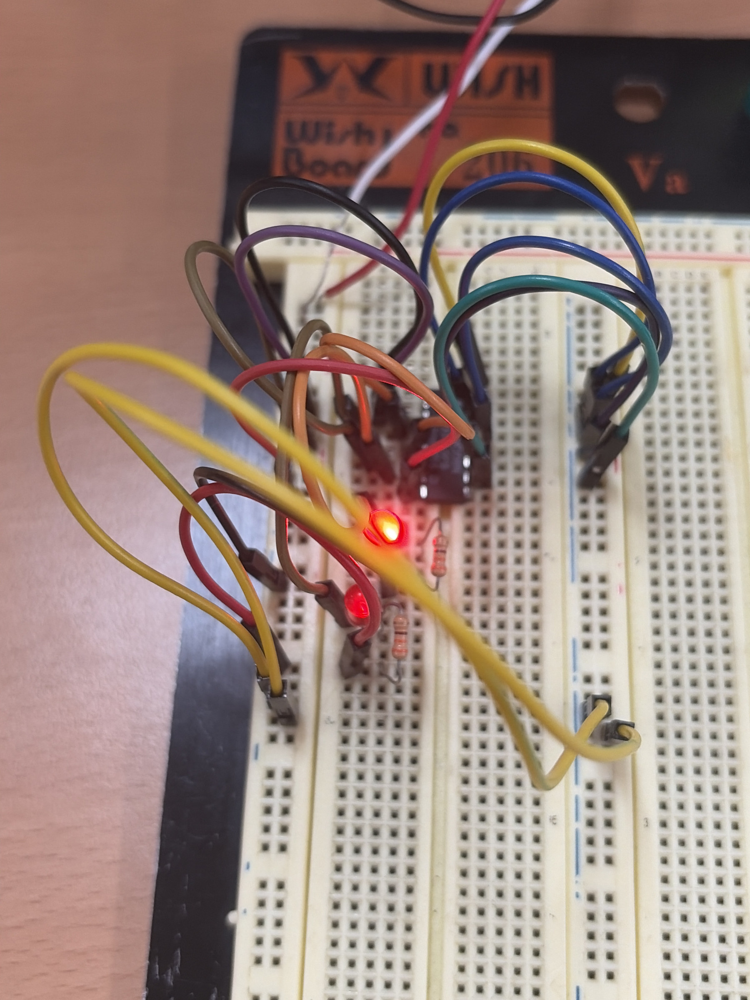
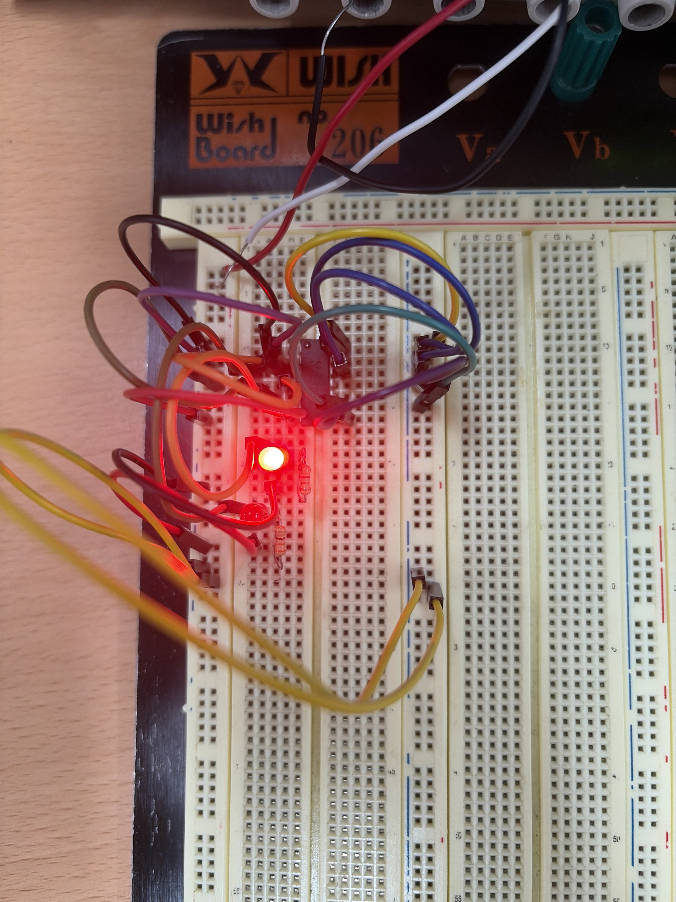
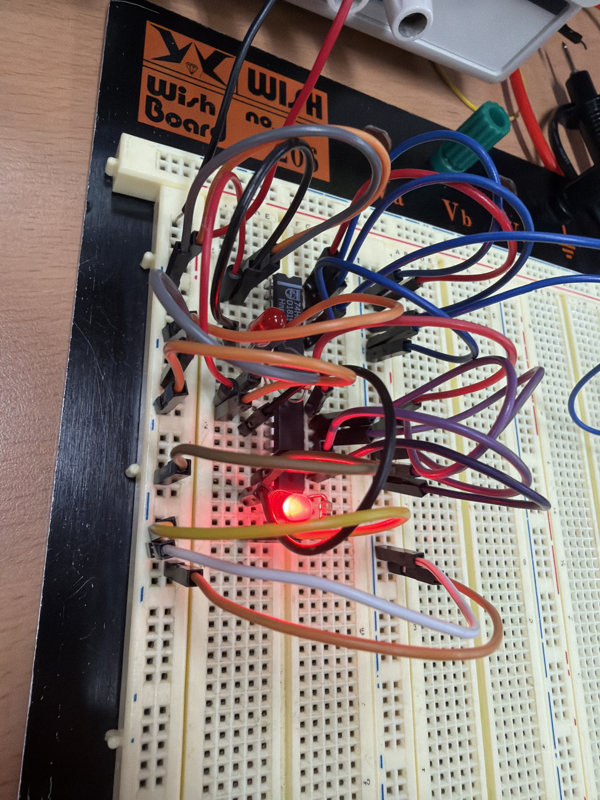
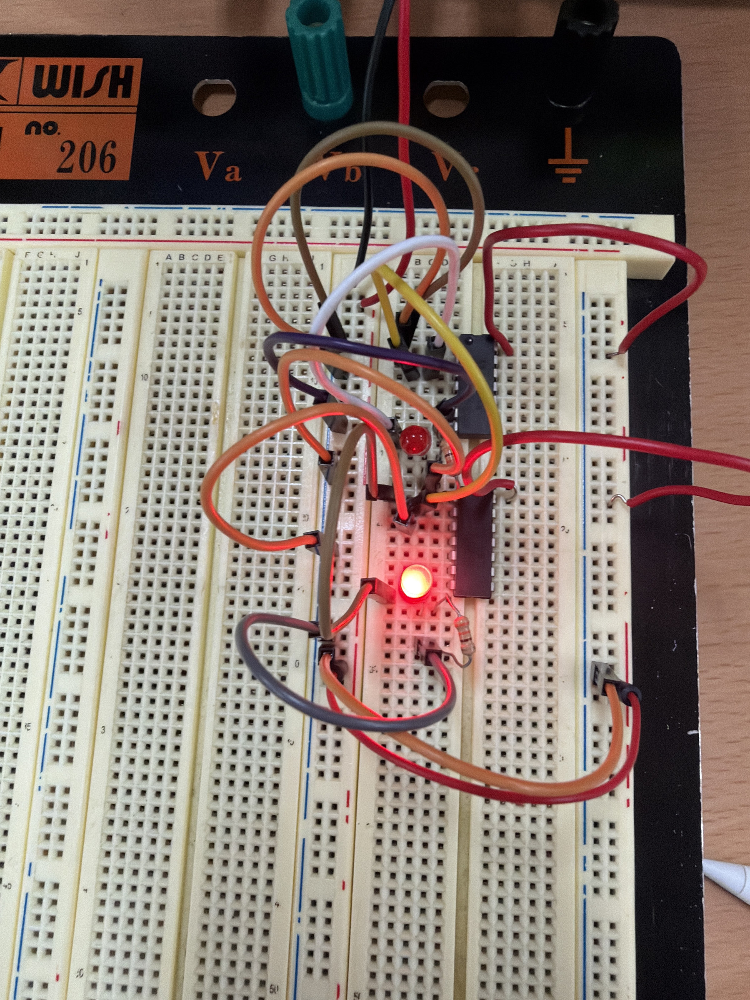
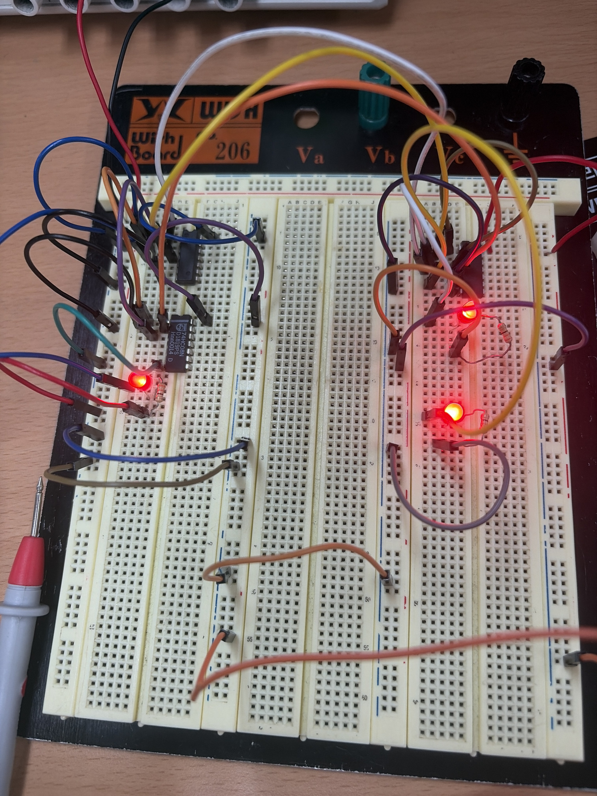

<table_of_contents color="gray"/>
<empty-block/>
# 실험 결과
조교님 지시에 따라 실험 1-1 부터 2-2 까지의 3입력 게이트는 여덟 조합 가운데 네 조합씩만 넣어 보았고, 실험 3 의 복합 논리회로는 네 조합을 전부 넣어 보았다. 출력은 발광다이오드가 켜지면 1, 꺼지면 0 으로 읽었다. 아래 표에서 `(미확인)` 은 시험하지 않은 행이고, 시험한 행은 모두 예상값과 일치했으므로 예상값을 그대로 적었다.
<empty-block/>
## 실험 1-1) 3-input AND gate
74HC08 의 2입력 AND 두 개를 두 단으로 이은 회로다. 앞단 출력 `L1` 이 `A·B`, 뒷단 출력 `L2` 가 `A·B·C` 다.

- **3-input AND 진리표**
	<table header-row="true">
<tr>
<td>A</td>
<td>B</td>
<td>C</td>
<td>L1</td>
<td>L2</td>
</tr>
<tr>
<td>0</td>
<td>0</td>
<td>0</td>
<td>0</td>
<td>0</td>
</tr>
<tr>
<td>0</td>
<td>0</td>
<td>1</td>
<td>(미확인)</td>
<td>(미확인)</td>
</tr>
<tr>
<td>0</td>
<td>1</td>
<td>0</td>
<td>(미확인)</td>
<td>(미확인)</td>
</tr>
<tr>
<td>0</td>
<td>1</td>
<td>1</td>
<td>(미확인)</td>
<td>(미확인)</td>
</tr>
<tr>
<td>1</td>
<td>0</td>
<td>0</td>
<td>0</td>
<td>0</td>
</tr>
<tr>
<td>1</td>
<td>0</td>
<td>1</td>
<td>(미확인)</td>
<td>(미확인)</td>
</tr>
<tr>
<td>1</td>
<td>1</td>
<td>0</td>
<td>1</td>
<td>0</td>
</tr>
<tr>
<td>1</td>
<td>1</td>
<td>1</td>
<td>1</td>
<td>1</td>
</tr>
	</table>
시험한 네 행은 모두 예상과 일치했다. A=B=1, C=0 에서 중간단 LED 만 켜지고 최종단은 꺼져 있다가, C 를 1 로 올리자 최종단까지 켜지는 것으로 두 단이 제대로 이어졌음을 확인했다.
<empty-block/>
## 실험 1-2) 3-input OR gate
74HC32 의 2입력 OR 두 개를 같은 구조로 이은 회로다. `L1` 이 `A+B`, `L2` 가 `A+B+C` 다.

- **3-input OR 진리표**
	<table header-row="true">
<tr>
<td>A</td>
<td>B</td>
<td>C</td>
<td>L1</td>
<td>L2</td>
</tr>
<tr>
<td>0</td>
<td>0</td>
<td>0</td>
<td>0</td>
<td>0</td>
</tr>
<tr>
<td>0</td>
<td>0</td>
<td>1</td>
<td>0</td>
<td>1</td>
</tr>
<tr>
<td>0</td>
<td>1</td>
<td>0</td>
<td>(미확인)</td>
<td>(미확인)</td>
</tr>
<tr>
<td>0</td>
<td>1</td>
<td>1</td>
<td>(미확인)</td>
<td>(미확인)</td>
</tr>
<tr>
<td>1</td>
<td>0</td>
<td>0</td>
<td>1</td>
<td>1</td>
</tr>
<tr>
<td>1</td>
<td>0</td>
<td>1</td>
<td>(미확인)</td>
<td>(미확인)</td>
</tr>
<tr>
<td>1</td>
<td>1</td>
<td>0</td>
<td>(미확인)</td>
<td>(미확인)</td>
</tr>
<tr>
<td>1</td>
<td>1</td>
<td>1</td>
<td>1</td>
<td>1</td>
</tr>
	</table>
시험한 네 행은 모두 예상과 일치했다. 세 입력이 모두 0 일 때만 최종단이 꺼졌고, C 하나만 1 이어도 앞단은 꺼진 채 뒷단만 켜져 뒷단이 C 를 따로 받고 있음을 볼 수 있었다.
<empty-block/>
## 실험 2-1) 3-input NAND gate
앞단은 74HC08 의 AND 그대로 두고, 뒷단만 74HC00 의 NAND 로 바꾼 회로다. `L1` 이 `A·B`, `L2` 가 `(A·B·C)'` 다.

- **3-input NAND 진리표**
	<table header-row="true">
<tr>
<td>A</td>
<td>B</td>
<td>C</td>
<td>L1</td>
<td>L2</td>
</tr>
<tr>
<td>0</td>
<td>0</td>
<td>0</td>
<td>0</td>
<td>1</td>
</tr>
<tr>
<td>0</td>
<td>0</td>
<td>1</td>
<td>0</td>
<td>1</td>
</tr>
<tr>
<td>0</td>
<td>1</td>
<td>0</td>
<td>(미확인)</td>
<td>(미확인)</td>
</tr>
<tr>
<td>0</td>
<td>1</td>
<td>1</td>
<td>0</td>
<td>1</td>
</tr>
<tr>
<td>1</td>
<td>0</td>
<td>0</td>
<td>(미확인)</td>
<td>(미확인)</td>
</tr>
<tr>
<td>1</td>
<td>0</td>
<td>1</td>
<td>(미확인)</td>
<td>(미확인)</td>
</tr>
<tr>
<td>1</td>
<td>1</td>
<td>0</td>
<td>1</td>
<td>1</td>
</tr>
<tr>
<td>1</td>
<td>1</td>
<td>1</td>
<td>(미확인)</td>
<td>(미확인)</td>
</tr>
	</table>
시험한 네 행은 모두 예상과 일치했다. 다만 최종단이 0 이 되는 유일한 행인 A=B=C=1 은 시험 대상에 들어 있지 않아서, 이 회로에서 출력이 꺼지는 경우는 직접 보지 못했다. 그 대신 세 입력이 모두 0 인데도 최종단이 켜지는 것으로 뒷단이 AND 가 아니라 NAND 로 동작하고 있음은 확인했다.
<empty-block/>
## 실험 2-2) 3-input NOR gate
앞단을 74HC32 의 OR, 뒷단을 74HC02 의 NOR 로 바꾼 회로다. `L1` 이 `A+B`, `L2` 가 `(A+B+C)'` 다.

- **3-input NOR 진리표**
	<table header-row="true">
<tr>
<td>A</td>
<td>B</td>
<td>C</td>
<td>L1</td>
<td>L2</td>
</tr>
<tr>
<td>0</td>
<td>0</td>
<td>0</td>
<td>0</td>
<td>1</td>
</tr>
<tr>
<td>0</td>
<td>0</td>
<td>1</td>
<td>0</td>
<td>0</td>
</tr>
<tr>
<td>0</td>
<td>1</td>
<td>0</td>
<td>1</td>
<td>0</td>
</tr>
<tr>
<td>0</td>
<td>1</td>
<td>1</td>
<td>(미확인)</td>
<td>(미확인)</td>
</tr>
<tr>
<td>1</td>
<td>0</td>
<td>0</td>
<td>(미확인)</td>
<td>(미확인)</td>
</tr>
<tr>
<td>1</td>
<td>0</td>
<td>1</td>
<td>(미확인)</td>
<td>(미확인)</td>
</tr>
<tr>
<td>1</td>
<td>1</td>
<td>0</td>
<td>1</td>
<td>0</td>
</tr>
<tr>
<td>1</td>
<td>1</td>
<td>1</td>
<td>(미확인)</td>
<td>(미확인)</td>
</tr>
	</table>
시험한 네 행은 모두 예상과 일치했다. 최종단이 켜지는 유일한 행인 세 입력 0 을 포함해, C 만 1 인 경우와 B 만 1 인 경우를 각각 넣어 뒷단이 앞단 출력과 C 를 모두 받아 뒤집고 있음을 확인했다. 74HC02 의 핀 배치가 다른 칩과 반대인 점을 미리 알고 꽂았기 때문에 이 회로에서는 배선 문제가 없었다.
<empty-block/>
## 실험 3) 복합 논리회로
입력 A·B 두 개에 출력 X·Y·Z 세 개가 달린 회로다. 74HC04 인버터 두 개, 74HC08 AND 하나, 74HC32 OR 두 개를 썼다. `Z = (A'·B)'`, `X = A + Z`, `Y = A + B` 다.

- **복합 논리회로 진리표**
	<table header-row="true">
<tr>
<td>A</td>
<td>B</td>
<td>X</td>
<td>Y</td>
<td>Z</td>
</tr>
<tr>
<td>0</td>
<td>0</td>
<td>1</td>
<td>0</td>
<td>1</td>
</tr>
<tr>
<td>0</td>
<td>1</td>
<td>0</td>
<td>1</td>
<td>0</td>
</tr>
<tr>
<td>1</td>
<td>0</td>
<td>1</td>
<td>1</td>
<td>1</td>
</tr>
<tr>
<td>1</td>
<td>1</td>
<td>1</td>
<td>1</td>
<td>1</td>
</tr>
	</table>
위 표는 최종 결과다. 처음 회로를 완성했을 때는 네 조합 중 세 조합은 예상대로 켜졌지만, A=B=1 조합만은 아무리 해도 LED 가 예상대로 켜지지 않았다. 조교님과 함께 회로를 단계별로 해체하며 확인한 결과 74HC08 칩 자체의 불량으로 판명되었고, 새 칩으로 바꾸자 즉시 네 조합 모두 예상과 일치했다. 자세한 경위는 결과 분석과 고찰에 적었다.
<empty-block/>
<empty-block/>
# 예비 비교
예비보고서에서는 실험 1-1 부터 2-2 까지 여덟 조합을 모두 넣어 진리표를 채우는 것으로 계획했다. 실제 실험에서는 조교님 지시에 따라 항목마다 네 조합만 넣었으므로, 시험한 범위 안에서만 비교했다. 시험한 스무 행 가운데 예상값과 다른 행은 최종적으로 하나도 없었다.
- **3입력 AND·OR·NAND·NOR**: 예비보고서에 적은 예상 진리표와 시험한 행이 전부 일치했다. 예비보고서에서 중간단 LED 를 단 이유로 든 "두 단이 살아 있는지 눈으로 확인한다" 는 목적도 실제로 유효했다. AND 에서 A=B=1, C=0 을 넣었을 때 중간단만 켜지는 것과, OR·NOR 에서 C 만 1 을 넣었을 때 중간단은 꺼진 채 뒷단만 반응하는 것을 바로 볼 수 있었다.
- **복합 논리회로**: 최종 결과는 예비보고서의 예상 진리표와 네 행 모두 일치했다. 다만 처음에는 A=B=1 조합에서 예상과 다른 결과가 나왔고, 그 원인은 배선이 아니라 74HC08 칩 불량이었다.
- **예비보고서에서 걱정했던 것과 실제로 문제가 된 것이 달랐다.** 예비보고서는 74HC02 의 핀 배치가 반대라는 점, 74HC32 의 핀 배치를 실물로 확인해야 한다는 점, 쓰지 않는 입력을 GND 로 내리는 것, LED 전류 같은 배선과 소자 쪽 주의사항을 나열했다. 실제로는 이 항목들에서 문제가 생기지 않았고, 74HC32 는 표준 핀 배치 그대로여서 예비보고서의 결선표대로 꽂아도 됐다. 정작 발목을 잡은 것은 예비보고서에서 전혀 고려하지 않았던 칩 자체의 불량이었다.
- **예비보고서에서 미리 적어 둔 X 와 Z 의 항등 관계**는 결과에서 그대로 확인되었다. 네 조합 모두에서 X LED 와 Z LED 가 같은 상태였다.
<empty-block/>
<empty-block/>
# 결과 분석
## 3입력 게이트의 캐스케이드 구성
2입력 게이트 두 개를 두 단으로 이어 3입력 게이트를 만드는 방식은 결합법칙 `(A·B)·C = A·B·C`, `(A+B)+C = A+B+C` 에 기댄다. 실험 1-1 과 1-2 의 결과는 이 관계를 그대로 보여 준다. AND 에서는 앞단 출력 `A·B` 가 1 인 상태에서 C 가 0 이면 최종 출력이 0 이고 C 가 1 이면 1 이 되었고, OR 에서는 앞단 출력 `A+B` 가 0 인 상태에서 C 하나만으로 최종 출력이 1 이 되었다. 두 경우 모두 뒷단이 앞단 출력을 한쪽 입력으로, C 를 다른 쪽 입력으로 정확히 받고 있다는 뜻이다.
NAND 와 NOR 는 앞단은 그대로 두고 뒷단만 반전 게이트로 바꾼 것이므로, 앞단 LED 의 동작은 AND·OR 때와 같고 뒷단 LED 만 반대로 움직여야 한다. 실험 2-1 에서 세 입력이 모두 0 인데 최종단이 켜진 것, 실험 2-2 에서 세 입력이 모두 0 일 때만 최종단이 켜지고 C 하나만 1 이 되어도 꺼진 것이 그 증거다. 다만 NAND 에서 최종 출력이 0 이 되는 A=B=C=1 은 시험 대상에서 빠져 있어서, 74HC00 이 두 입력이 모두 1 일 때 출력을 실제로 내리는지는 이번 실험에서 직접 보지 못했다. 시험한 네 행만으로는 "출력이 항상 1 인 회로" 와 NAND 를 구별할 수 없다는 점은 아쉬운 부분이다.
<empty-block/>
## 복합 논리회로의 부울대수와 X·Z 항등
복합 논리회로의 세 출력을 드모르간 법칙으로 정리하면 `Z = (A'·B)' = A + B'`, `X = A + Z = A + A + B' = A + B'`, `Y = A + B` 다. 즉 X 와 Z 는 식이 같고, 결과표에서도 네 조합 모두 X 와 Z 가 같은 값이었다. OR 게이트에 `A` 를 한 번 더 넣는 것은 멱등법칙 `A + A = A` 에 의해 아무 효과가 없으므로, X 를 만드는 74HC32 게이트는 사실상 Z 를 그대로 통과시키는 버퍼 역할만 한다. 회로도 그대로 꽂아서 실제로 그렇게 동작하는 것을 확인한 셈이다.
Y 는 A 와 B 를 바로 OR 한 것이라 A=B=0 일 때만 0 이고, X·Z 는 `A + B'` 라 A=0, B=1 일 때만 0 이다. 네 조합 가운데 세 LED 가 모두 켜지는 조합이 둘(A=1 인 두 경우), 하나만 꺼지는 조합이 둘이라는 결과가 이 식과 맞는다.
<empty-block/>
## A=B=1 에서만 어긋났던 원인
처음 회로를 완성했을 때 A=B=1 조합만 예상대로 켜지지 않았다. 이 회로에서 A=1 이면 X 와 Y 는 각각 `A + Z`, `A + B` 라 74HC08 을 거치지 않고도 1 이 되므로, 74HC08 의 불량이 드러날 수 있는 출력은 `Z = (A'·B)'` 뿐이다. A=B=1 일 때 74HC08 에 들어가는 입력은 `A' = 0` 과 `B = 1` 이고 정상이라면 출력 0, 따라서 Z 는 1 이 되어야 한다. 이 조합에서만 어긋났다는 것은 AND 게이트가 이 입력 조건에서 제대로 0 을 내지 못했다는 뜻이다.
원인 후보로 먼저 배선 오류와 입력 핀이 떠 있는 경우를 의심했다. 그러나 나머지 세 조합은 모두 정상이었고, 회로를 단계별로 다시 해체해 확인해도 배선에는 문제가 없었다. 조교님과 함께 칩 단위로 확인한 끝에 74HC08 칩 불량으로 판단했고, 새 칩으로 바꾸자 아무것도 손대지 않은 배선 그대로 네 조합이 모두 맞았다. 배선을 고치지 않고 칩만 바꿔서 해결됐다는 것이 칩 불량이 원인이었다는 가장 확실한 근거다.
칩 불량을 실험 마지막에야 발견한 이유는 칩을 미리 시험할 때 00·01·10 세 조합만 넣고 11 을 넣지 않았기 때문이다. 게이트 하나가 특정 입력 조건에서만 잘못 동작하면 나머지 조합만으로는 정상으로 보이므로, 칩을 시험할 때는 진리표의 모든 행을 넣어 봐야 한다는 것을 이번 실험에서 배웠다.
<empty-block/>
<empty-block/>
# 고찰
이번 실험의 목적은 기본 게이트의 동작을 진리표로 확인하고, 게이트를 이어 붙여 원하는 논리회로를 만드는 법칙을 익히는 것이었다. 시험한 모든 행이 예상 진리표와 일치했고, 2입력 게이트 두 개로 3입력 게이트를 만드는 결합법칙, 뒷단만 바꿔 NAND·NOR 를 얻는 방법, 드모르간 법칙과 멱등법칙으로 복합 회로의 출력을 정리하는 과정을 실제 회로에서 확인했다. 조교님 지시로 여덟 조합 중 네 조합만 시험한 항목이 있어 진리표 전체를 채우지는 못했지만, 목적 자체는 달성했다고 본다.
첫 실험이라 결선도가 복잡하다는 것은 알고 있었지만, 막상 보드에 꽂으니 선이 촘촘해서 실수할 가능성이 높아 보였다. 첫 시도에서는 일단 전부 꽂고 불이 들어오는지 봤는데 들어오지 않았고, 보드가 이미 너무 복잡해서 어디가 잘못됐는지 찾는 것이 불가능했다. 그래서 전부 빼고, 모듈처럼 한 단씩 꽂아 문제가 없음을 확인한 뒤 다음 단으로 넘어가는 방식으로 다시 작업했다. 비교적 간단한 앞의 네 실험은 이 방식으로 문제없이 끝났다.
예상과 달랐던 것은 실험 3 이었다. 네 조합 중 세 조합은 켜졌는데 A=B=1 조합만 아무리 해도 LED 가 예상대로 켜지지 않았다. 진리표상 말이 안 되는 결과였고, 칩을 각각 테스트한 뒤 합친 것이라 더 이상했다. 조교님과 함께 하나씩 해체하며 디버깅한 결과 74HC08 칩 불량이었다. 처음 칩을 테스트할 때 00·01·10 만 넣고 11 을 넣지 않은 것이 원인이었고, 앞의 네 실험에서도 하필 11 이 들어가는 경우를 빼고 시험한 탓에 마지막에야 드러났다. 조교님이 새 칩을 가져다주자 바로 해결됐다.
이번 실험에서 새로 안 것은 두 가지다. 첫째, 칩은 모든 입력 조합을 철저히 테스트해야 하고, 회로는 모듈 단위로 테스트하며 하나씩 합쳐야 한다. 부분만 확인한 칩은 정상이라고 믿을 수 없고, 한꺼번에 꽂은 회로는 문제가 생겼을 때 원인을 찾을 수 없다. 둘째, 예비보고서의 결선도도 모듈 단위 테스트를 가정해 단계별로 그려 두면 실험 시간이 훨씬 줄 것 같다. 또 앞 실험과 뒤 실험의 회로가 비슷한 경우가 많으므로, 결선도를 그릴 때 앞 실험의 선을 최대한 살리는 방향으로 미리 계획해 두면 배선을 다시 꽂는 시간을 아낄 수 있겠다.