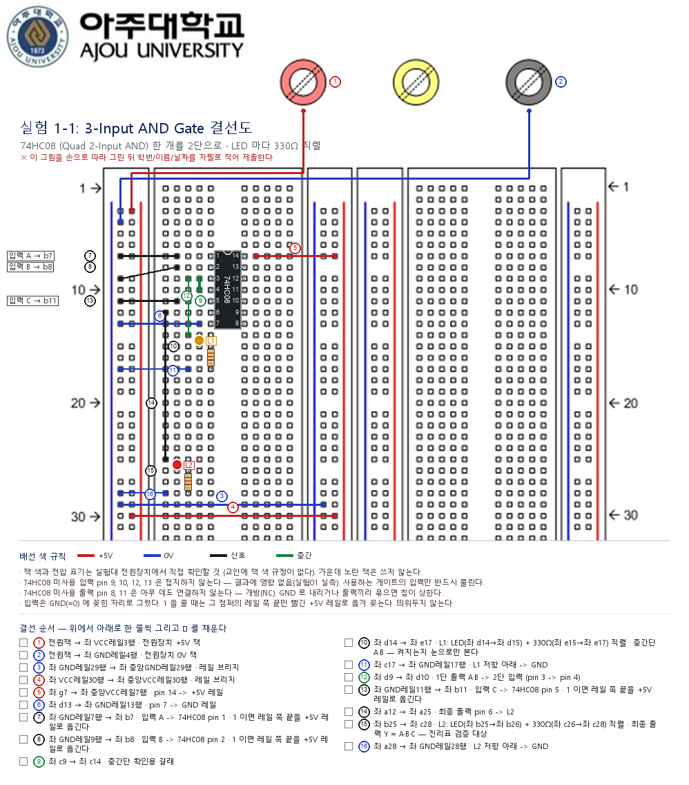
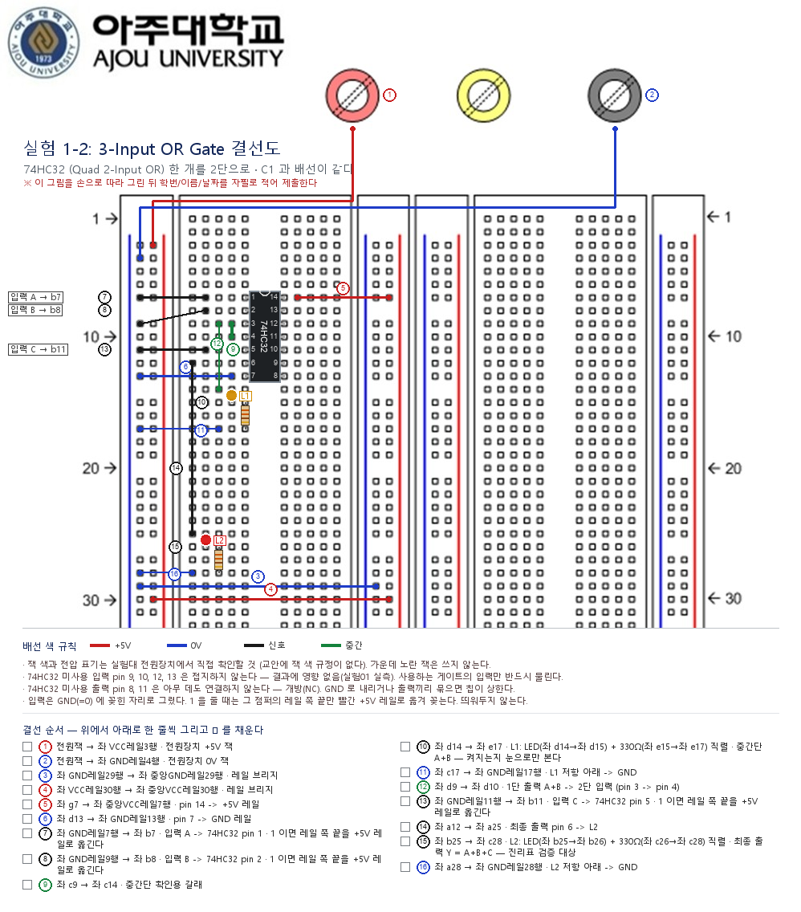
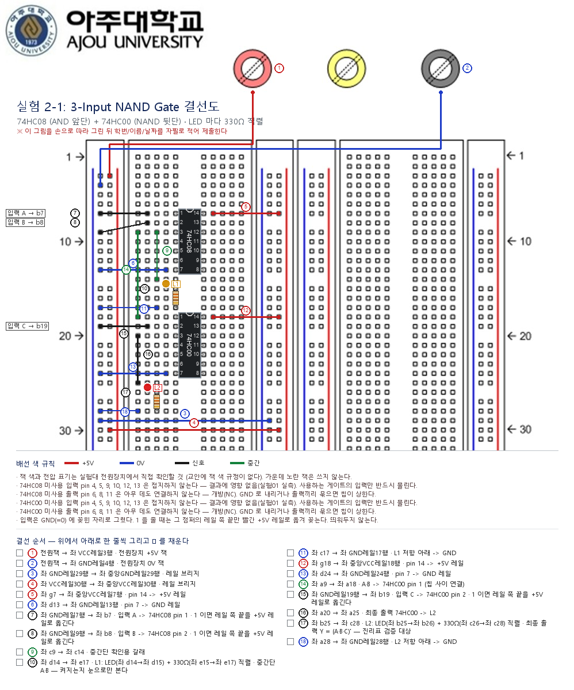
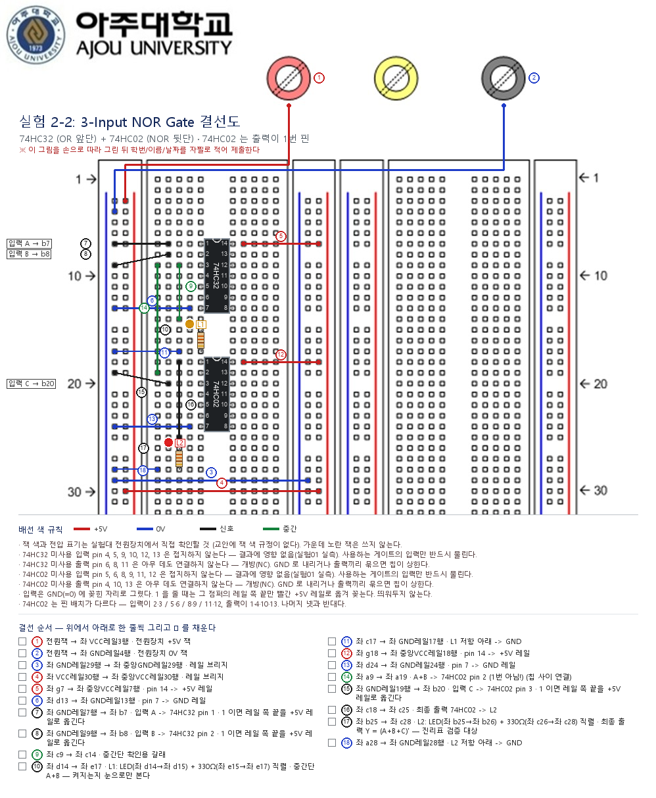
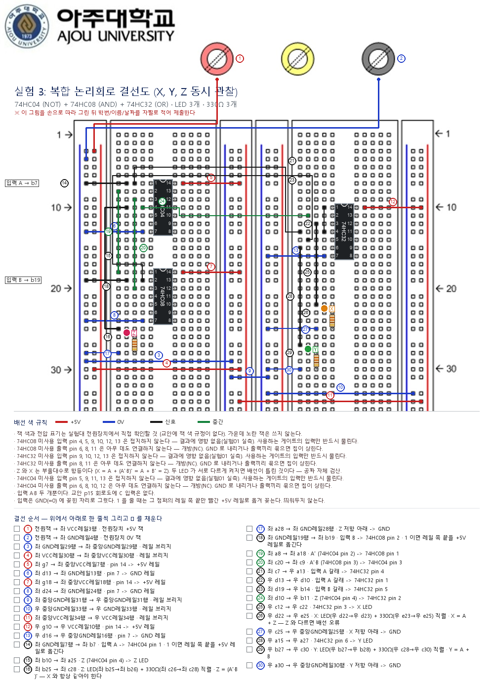

# 실험1 Basic Gates 예비보고서

<table_of_contents color="gray"/>

<empty-block/>
# 실험 목적

논리 게이트가 하는 연산을 이해하고, 그 게이트들을 이어 붙여 원하는 논리 회로를 만드는 법칙을 익히는 것이 이번 실험의 목적이다. 강의노트는 목적을 게이트 자체의 이해와 회로 구성 법칙의 이해로 나누고, 뒤쪽에 부울식과 드모르간 법칙을 든다.

실제로 손에 쥐는 칩에는 2입력 게이트만 들어 있다. 그래서 이번 실험은 2입력 게이트 두 개를 두 단으로 이어 3입력 AND·OR·NAND·NOR 를 만들고, 출력을 발광다이오드로 읽어 진리표를 채우는 순서로 진행한다. 마지막으로 인버터·AND·OR 를 섞은 복합 논리회로를 구성해 세 출력을 한꺼번에 관찰한다.

<empty-block/>
<empty-block/>
# 실험 이론
## 논리 레벨

강의노트는 논리값을 L(Low)과 H(High) 두 가지로 정의한다. L 은 논리값 0 이고 물리적으로 0 V 이며, H 는 논리값 1 이고 물리적으로 3~5 V 다. 즉 게이트가 다루는 값은 두 개뿐이고, 그 사이의 전압은 어느 쪽으로도 보장되지 않는다.

이번 실험은 5 V 단일 전원을 쓴다. 입력 핀을 +5 V 에 물리면 H(1), GND 에 물리면 L(0) 이다. 출력은 발광다이오드로 읽는데, 켜져 있으면 H, 꺼져 있으면 L 이다.

아래 이론표는 강의노트가 쓴 L·H 표기를 그대로 옮겼고, 실험에서 직접 채울 3입력 진리표는 0·1 로 적었다. 두 표기는 같은 것을 가리킨다.

<empty-block/>
## 기본 게이트

이번 실험 회로에 실제로 들어가는 게이트는 AND·OR·NOT·NAND·NOR 다섯 가지다.

- **AND** (`C = A·B`)
	| A | B | C |
	|---|---|---|
	| L | L | L |
	| L | H | L |
	| H | L | L |
	| H | H | H |
- **OR** (`C = A+B`)
	| A | B | C |
	|---|---|---|
	| L | L | L |
	| L | H | H |
	| H | L | H |
	| H | H | H |
- **NOT** (`C = A'`)
	| A | C |
	|---|---|
	| L | H |
	| H | L |
- **NAND** (`C = (A·B)'`)
	| A | B | C |
	|---|---|---|
	| L | L | H |
	| L | H | H |
	| H | L | H |
	| H | H | L |
- **NOR** (`C = (A+B)'`)
	| A | B | C |
	|---|---|---|
	| L | L | H |
	| L | H | L |
	| H | L | L |
	| H | H | L |

<empty-block/>
## 결합법칙과 3입력 게이트 구성

칩에 든 게이트는 모두 2입력인데 이번 실험이 만들 것은 3입력 게이트다. 두 단으로 이어 붙이는 방법이 성립하는 근거는 AND 와 OR 의 결합법칙이다.

- `(A·B)·C = A·(B·C) = A·B·C`
- `(A+B)+C = A+(B+C) = A+B+C`

괄호를 어디에 묶어도 값이 같으므로, 앞단 AND 로 `A·B` 를 먼저 만들고 그 출력을 뒷단 AND 의 한 입력으로 넣어 `C` 와 묶으면 3입력 AND 가 된다. OR 도 마찬가지다.

3입력 NAND 와 NOR 는 사정이 다르다. `(A·B·C)'` 는 앞단까지 반전시켜 얻을 수 있는 형태가 아니다. 앞단을 NAND 로 두면 뒷단에 들어가는 값이 `A·B` 가 아니라 `(A·B)'` 가 되어 식이 어긋난다. 그래서 앞단은 반전 없는 AND 로 두고 뒷단만 NAND 로 바꾼다. 앞단이 `A·B` 를 그대로 넘기고 뒷단이 `((A·B)·C)' = (A·B·C)'` 를 한 번에 만든다. NOR 도 앞단 OR, 뒷단 NOR 로 같은 방식이다.

<empty-block/>
## 드모르간 법칙

강의노트는 NAND 와 NOR 의 부울식에 드모르간 법칙을 함께 적어 둔다.

- `(A·B)' = A' + B'`
- `(A+B)' = A' · B'`

곱의 보수는 보수들의 합이고, 합의 보수는 보수들의 곱이다. 이번 실험에서 이 법칙이 실제로 쓰이는 자리는 복합 논리회로의 `Z` 출력이다. `Z` 는 AND 출력 `A'·B` 를 인버터로 뒤집은 것이므로 `Z = (A'·B)'` 인데, 드모르간을 적용하면 `Z = A + B'` 가 된다. 인버터와 AND 를 거쳐 만든 출력이 결과만 놓고 보면 OR 게이트 하나와 같다는 뜻이다.

<empty-block/>
## 멱등법칙과 중복 출력

복합 논리회로의 `X` 는 입력 `A` 와 위의 `Z` 를 OR 로 묶은 것이다. `Z = A + B'` 를 대입하면 `X = A + (A + B') = (A + A) + B' = A + B'` 가 되고, 여기서 쓴 `A + A = A` 가 OR 의 멱등법칙이다.

정리하면 `X` 와 `Z` 는 게이트 구성이 다른데도 같은 식이다. 어떤 입력을 넣어도 두 출력은 항상 같은 값을 낸다. 이 성질은 배선을 검사하는 데 그대로 쓸 수 있어서, `X` 쪽 LED 와 `Z` 쪽 LED 가 서로 다르게 켜지면 진리표를 채우기 전에 배선을 먼저 되짚어야 한다.

<empty-block/>
<empty-block/>
# 실험 부품
## 준비물

| 품목 | 규격 | 수량 | 비고 |
|---|---|---|---|
| 전압원 | +5 V | 1 | 모든 IC 의 전원 핀에 공급 |
| 74HC00 | quad 2-input NAND, DIP-14 | 1 | 3입력 NAND 의 뒷단 |
| 74HC02 | quad 2-input NOR, DIP-14 | 1 | 3입력 NOR 의 뒷단. 핀 배치가 나머지와 다르다 |
| 74HC04 | hex inverter, DIP-14 | 1 | 인버터가 한 칩에 6개라 복합회로의 두 인버터는 한 칩으로 잡힌다 |
| 74HC08 | quad 2-input AND, DIP-14 | 1 | 3입력 AND, 3입력 NAND 앞단, 복합회로에 공용 |
| 74HC32 | quad 2-input OR, DIP-14 | 1 | 3입력 OR, 3입력 NOR 앞단, 복합회로에 공용 |
| 74HC86 | quad 2-input XOR, DIP-14 | 1 | 이번 실험 항목에는 쓰지 않는다 |
| 발광다이오드 | — | 3 | 복합회로가 X·Y·Z 세 출력을 동시에 본다 |
| 저항 | 330 Ω | 3 | 발광다이오드 애노드에 직렬로 넣는다 |
| 브레드보드 | — | 1 | IC 와 배선을 올린다 |
| 점퍼선 | — | 적당량 | 입력을 +5 V·GND 에 물리고 단 사이를 잇는다 |

<empty-block/>
## 핀 배치

| IC | 게이트1 | 게이트2 | 게이트3 | 게이트4 | VCC | GND |
|---|---|---|---|---|---|---|
| 74HC00 (quad NAND) | 1,2 → 3 | 4,5 → 6 | 9,10 → 8 | 12,13 → 11 | 14 | 7 |
| 74HC08 (quad AND) | 1,2 → 3 | 4,5 → 6 | 9,10 → 8 | 12,13 → 11 | 14 | 7 |
| 74HC32 (quad OR) | 1,2 → 3 | 4,5 → 6 | 9,10 → 8 | 12,13 → 11 | 14 | 7 |
| **74HC02 (quad NOR)** | 2,3 → 1 | 5,6 → 4 | 8,9 → 10 | 11,12 → 13 | 14 | 7 |

74HC04 는 인버터 6개짜리라 배치가 다르다. 1→2, 3→4, 5→6, 9→8, 11→10, 13→12 이고 VCC 는 14번, GND 는 7번이다.

강의노트에는 핀 배치가 실려 있지 않다. 위 배치는 74HC 계열 DIP-14 의 표준 배치를 따른 것이므로 실물 IC 로 확인이 필요하다. 특히 74HC02 는 출력이 앞쪽 핀에 오는 유일한 칩이라, 나머지 셋과 같은 감각으로 꽂으면 입력과 출력이 통째로 어긋난다.

<empty-block/>
<empty-block/>
# 실험 과정 및 예상 결과
## 실험 1-1) 3-input AND gate 구성

74HC08 의 2입력 AND 두 개를 두 단으로 잇는다. 앞단이 `A·B` 를 만들고, 뒷단이 그 출력과 `C` 를 받아 최종 출력을 낸다. 앞단 출력 `L1` 에는 중간 단이 살아 있는지 눈으로 보기 위한 LED 를, 뒷단 출력 `L2` 에는 진리표를 읽을 최종 LED 를 단다. 입력 A·B·C 를 여덟 가지 조합으로 모두 넣어 가며 `L2` 를 읽는다.

- **3-input AND** (`Y = A·B·C`)
	| A | B | C | Y |
	|---|---|---|---|
	| 0 | 0 | 0 | 0 |
	| 0 | 0 | 1 | 0 |
	| 0 | 1 | 0 | 0 |
	| 0 | 1 | 1 | 0 |
	| 1 | 0 | 0 | 0 |
	| 1 | 0 | 1 | 0 |
	| 1 | 1 | 0 | 0 |
	| 1 | 1 | 1 | 1 |

<empty-block/>
## 실험 1-2) 3-input OR gate 구성

강의노트가 이 항목에 별도 회로도를 준다. 74HC32 의 2입력 OR 두 개를 같은 두 단 구조로 잇는다. 앞단이 `A+B` 를 만들고, 뒷단이 그 출력과 `C` 를 받아 `A+B+C` 를 낸다. LED `L1`·`L2` 의 자리와 여덟 조합을 넣는 절차는 실험 1-1 과 같다.

- **3-input OR** (`Y = A+B+C`)
	| A | B | C | Y |
	|---|---|---|---|
	| 0 | 0 | 0 | 0 |
	| 0 | 0 | 1 | 1 |
	| 0 | 1 | 0 | 1 |
	| 0 | 1 | 1 | 1 |
	| 1 | 0 | 0 | 1 |
	| 1 | 0 | 1 | 1 |
	| 1 | 1 | 0 | 1 |
	| 1 | 1 | 1 | 1 |

<empty-block/>
## 실험 2-1) 3-input NAND gate 구성

앞단은 실험 1-1 의 AND 그대로 두고 뒷단만 NAND 로 바꾼다. 74HC08 이 `A·B` 를 만들고 74HC00 이 그 출력과 `C` 를 받아 최종 출력을 낸다. 앞단·뒷단 LED 는 앞 항목과 같은 자리에 단다.

- **3-input NAND** (`Y = (A·B·C)'`)
	| A | B | C | Y |
	|---|---|---|---|
	| 0 | 0 | 0 | 1 |
	| 0 | 0 | 1 | 1 |
	| 0 | 1 | 0 | 1 |
	| 0 | 1 | 1 | 1 |
	| 1 | 0 | 0 | 1 |
	| 1 | 0 | 1 | 1 |
	| 1 | 1 | 0 | 1 |
	| 1 | 1 | 1 | 0 |

<empty-block/>
## 실험 2-2) 3-input NOR gate 구성

실험 2-1 과 같은 두 단 구조에서 앞단을 74HC32, 뒷단을 74HC02 로 바꾼다. 74HC32 가 `A+B` 를 만들고 74HC02 가 그 출력과 `C` 를 받아 `(A+B+C)'` 를 낸다. 74HC02 는 입력과 출력 핀의 순서가 나머지 칩과 반대이므로, 꽂기 전에 핀 번호를 다시 세어 본다.

- **3-input NOR** (`Y = (A+B+C)'`)
	| A | B | C | Y |
	|---|---|---|---|
	| 0 | 0 | 0 | 1 |
	| 0 | 0 | 1 | 0 |
	| 0 | 1 | 0 | 0 |
	| 0 | 1 | 1 | 0 |
	| 1 | 0 | 0 | 0 |
	| 1 | 0 | 1 | 0 |
	| 1 | 1 | 0 | 0 |
	| 1 | 1 | 1 | 0 |

<empty-block/>
## 실험 3) 복합 논리회로 구성

입력은 A·B 두 개이고 출력은 X·Y·Z 세 개다. `A` 를 인버터로 뒤집어 `A'` 를 만들고, `A'` 와 `B` 를 AND 로 묶은 뒤 두 번째 인버터로 다시 뒤집어 `Z` 를 얻는다. `X` 는 `A` 와 `Z` 를 OR 로 묶은 것이고, `Y` 는 `A` 와 `B` 를 OR 로 묶은 것이다. 입력이 둘뿐이므로 넣어 볼 조합은 네 가지다.

세 출력을 부울대수로 정리하면 다음과 같다.

- `X = A + (A'·B)' = A + A + B' = A + B'`
- `Y = A + B`
- `Z = (A'·B)' = A + B'`

- **복합 논리회로** (`X = A + (A'·B)'`, `Y = A + B`, `Z = (A'·B)'`)
	| A | B | X | Y | Z |
	|---|---|---|---|---|
	| 0 | 0 | 1 | 0 | 1 |
	| 0 | 1 | 0 | 1 | 0 |
	| 1 | 0 | 1 | 1 | 1 |
	| 1 | 1 | 1 | 1 | 1 |

<empty-block/>
<empty-block/>
# 회로 결선도
## 공통 결선 규칙

- 모든 IC 는 14번 핀을 +5 V 에, 7번 핀을 GND 에 연결한다.
- 쓰지 않는 **입력** 핀은 전부 GND 로 내린다. 띄워 두면 입력이 뜬 상태가 되어 출력이 흔들린다.
- 쓰지 않는 **출력** 핀은 아무 데도 연결하지 않고 그대로 둔다. 출력끼리 묶거나 GND 로 내리면 칩이 상한다.
- 입력 A·B·C 는 점퍼선으로 +5 V(=1) 또는 GND(=0) 에 직접 물린다.
- 발광다이오드는 애노드 쪽에 330 Ω 저항을 직렬로 넣고 캐소드를 GND 로 내린다. 강의노트가 다이오드를 연결할 때 330 Ω 저항이 필수라고 못박아 두었다.
- 74HC08 과 74HC32 는 여러 항목에 걸쳐 나오지만 같은 칩을 항목마다 다시 배선해 쓰는 것이다. 다섯 회로를 브레드보드에 동시에 올리지는 않는다.

<empty-block/>
## 실험 1-1) 3-input AND gate 결선

- **3-input AND** (`Y = A·B·C`)
	| IC | 핀 | 연결 |
	|---|---|---|
	| 74HC08 | 1 | 입력 A |
	| 74HC08 | 2 | 입력 B |
	| 74HC08 | 3 | 같은 칩 4번 핀, 그리고 중간 LED |
	| 74HC08 | 5 | 입력 C |
	| 74HC08 | 6 | 최종 LED |
	| 74HC08 | 9, 10, 12, 13 | GND |
	| 74HC08 | 8, 11 | 개방 |

<empty-block/>
## 실험 1-2) 3-input OR gate 결선

- **3-input OR** (`Y = A+B+C`)
	| IC | 핀 | 연결 |
	|---|---|---|
	| 74HC32 | 1 | 입력 A |
	| 74HC32 | 2 | 입력 B |
	| 74HC32 | 3 | 같은 칩 4번 핀, 그리고 중간 LED |
	| 74HC32 | 5 | 입력 C |
	| 74HC32 | 6 | 최종 LED |
	| 74HC32 | 9, 10, 12, 13 | GND |
	| 74HC32 | 8, 11 | 개방 |

<empty-block/>
## 실험 2-1) 3-input NAND gate 결선

- **3-input NAND** (`Y = (A·B·C)'`)
	| IC | 핀 | 연결 |
	|---|---|---|
	| 74HC08 | 1 | 입력 A |
	| 74HC08 | 2 | 입력 B |
	| 74HC08 | 3 | 74HC00 의 1번 핀, 그리고 중간 LED |
	| 74HC08 | 4, 5, 9, 10, 12, 13 | GND |
	| 74HC08 | 6, 8, 11 | 개방 |
	| 74HC00 | 1 | 74HC08 의 3번 핀 |
	| 74HC00 | 2 | 입력 C |
	| 74HC00 | 3 | 최종 LED |
	| 74HC00 | 4, 5, 9, 10, 12, 13 | GND |
	| 74HC00 | 6, 8, 11 | 개방 |

<empty-block/>
## 실험 2-2) 3-input NOR gate 결선

- **3-input NOR** (`Y = (A+B+C)'`)
	| IC | 핀 | 연결 |
	|---|---|---|
	| 74HC32 | 1 | 입력 A |
	| 74HC32 | 2 | 입력 B |
	| 74HC32 | 3 | 74HC02 의 2번 핀, 그리고 중간 LED |
	| 74HC32 | 4, 5, 9, 10, 12, 13 | GND |
	| 74HC32 | 6, 8, 11 | 개방 |
	| 74HC02 | 2 | 74HC32 의 3번 핀 |
	| 74HC02 | 3 | 입력 C |
	| 74HC02 | 1 | 최종 LED |
	| 74HC02 | 5, 6, 8, 9, 11, 12 | GND |
	| 74HC02 | 4, 10, 13 | 개방 |

<empty-block/>
## 실험 3) 복합 논리회로 결선

- **복합 논리회로** (`X`, `Y`, `Z`)
	| IC | 핀 | 연결 |
	|---|---|---|
	| 74HC04 | 1 | 입력 A |
	| 74HC04 | 2 | 74HC08 의 1번 핀 (`A'`) |
	| 74HC04 | 3 | 74HC08 의 3번 핀 (`A'·B`) |
	| 74HC04 | 4 | 74HC32 의 2번 핀, 그리고 Z LED |
	| 74HC04 | 5, 9, 11, 13 | GND |
	| 74HC04 | 6, 8, 10, 12 | 개방 |
	| 74HC08 | 1 | 74HC04 의 2번 핀 |
	| 74HC08 | 2 | 입력 B |
	| 74HC08 | 3 | 74HC04 의 3번 핀 |
	| 74HC08 | 4, 5, 9, 10, 12, 13 | GND |
	| 74HC08 | 6, 8, 11 | 개방 |
	| 74HC32 | 1 | 입력 A |
	| 74HC32 | 2 | 74HC04 의 4번 핀 (`Z`) |
	| 74HC32 | 3 | X LED |
	| 74HC32 | 4 | 입력 A |
	| 74HC32 | 5 | 입력 B |
	| 74HC32 | 6 | Y LED |
	| 74HC32 | 9, 10, 12, 13 | GND |
	| 74HC32 | 8, 11 | 개방 |

<empty-block/>
## 실험 전 확인할 사항

- 74HC32 의 핀 배치는 강의노트에 실려 있지 않아 표준 배치로 적어 두었다. 실물 IC 로 확인이 필요하다.
- 74HC02 는 출력이 1·4·10·13 번 핀이라 나머지 칩과 반대다. 이 실험에서 가장 나오기 쉬운 배선 실수이므로 전원을 넣기 전에 한 번 더 센다.
- 강의노트가 입력 스위치를 따로 지정하지 않는다. 점퍼선을 +5 V·GND 에 직접 물리는 방식으로 진행하되, 실험실 키트에 딥스위치가 있으면 그쪽이 여덟 조합을 넣기에 편하다.
- 330 Ω 을 달았을 때 발광다이오드에 흐르는 전류는 대략 9 mA 로, 게이트 출력이 직접 감당하기에 작은 값은 아니다. 강의노트 지시대로 직접 구동하되 LED 가 눈에 띄게 어두우면 이 지점을 먼저 의심한다.
- 쓰지 않는 입력 핀을 모두 GND 로 내렸는지 전원을 넣기 전에 확인한다.

<empty-block/>
<empty-block/>
# 출처 및 참고문헌

- 논리회로실험 강의노트
- 논리회로실험 IC 특성 분석 가이드
- Nexperia. 74HC00; 74HCT00 — Quad 2-input NAND gate. Rev. 11, 2025-04-29.
  https://assets.nexperia.com/documents/data-sheet/74HC_HCT00.pdf
- Nexperia. 74HC02; 74HCT02 — Quad 2-input NOR gate. Rev. 9, 2024-02-15.
  https://assets.nexperia.com/documents/data-sheet/74HC_HCT02.pdf
- Nexperia. 74HC04; 74HCT04 — Hex inverter. Rev. 10, 2024-02-16.
  https://assets.nexperia.com/documents/data-sheet/74HC_HCT04.pdf
- Nexperia. 74HC08; 74HCT08 — Quad 2-input AND gate. Rev. 9, 2024-02-16.
  https://assets.nexperia.com/documents/data-sheet/74HC_HCT08.pdf
- Nexperia. 74HC32; 74HCT32 — Quad 2-input OR gate. Rev. 10, 2025-04-30.
  https://assets.nexperia.com/documents/data-sheet/74HC_HCT32.pdf
