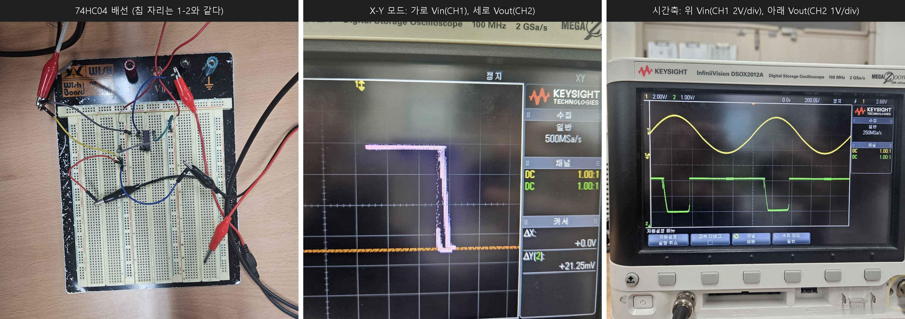
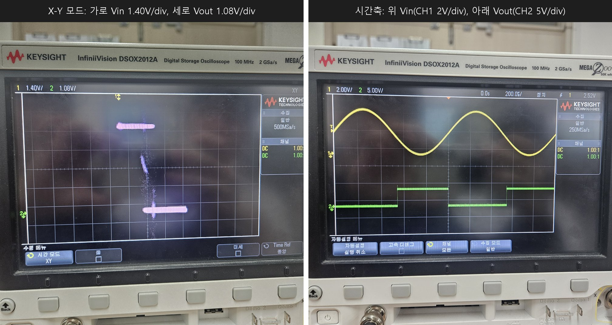

# 실험2 CMOS 회로의 전기적 특성 결과보고서

<table_of_contents color="gray"/>

<empty-block/>
# 실험 결과

두 항목 모두 오실로스코프를 X-Y 모드로 두어 입력 전압에 대한 출력 전압 곡선을 화면에 그렸고, 같은 상태를 시간축 화면으로도 한 장씩 찍어 두었다. 함수발생기는 사인파 약 1kHz, Vpp 5V, offset 2.5V로 설정했고, 시간축 화면의 CH1 파형에서 Vin이 실제로 0V 근처에서 5V 근처까지 오가는 것을 먼저 확인했다. 조교님 공지에 따라 강의노트의 실험 2(CMOS의 AC 특성)는 하지 않았다. 두 항목 모두 조교님이 화면을 확인하고 넘어갔다. 아래에 적은 전압값은 실험 뒤에 화면 사진의 눈금과 채널 마커 위치에서 읽은 참고값이라 오차가 있다.

<empty-block/>
## 실험 1-1) Inverter의 입출력 특성 확인

74HC04의 첫 번째 게이트(1번 핀에서 2번 핀) 하나에 사인파를 넣고, CH1을 1번 핀, CH2를 2번 핀에 물려 X-Y 모드로 본 회로다. 쓰지 않는 입력 3·5번 핀은 GND에, 9·11·13번 핀은 VCC에 묶었다.

- **관측 조건과 읽은 값**
	| 항목 | 값 |
	|---|---|
	| 시간축 화면 | CH1 2.00V/div, CH2 1.00V/div, 200µs/div, 프로브 1:1, DC 결합 |
	| X-Y 화면 | CH1이 가로축, CH2가 세로축. 눈금 표시부가 사진에 잘려 V/div는 읽지 못했다 |
	| Vin 범위 | 약 0V~5V, 주기 약 1ms |
	| 곡선 모양 | 왼쪽 위 수평선에서 한 번 떨어져 오른쪽 아래 수평선으로 이어지는 한 줄기 |
	| 전이 위치 | 사인파 정점에 가까운 쪽. 눈금값은 그 자리에서 읽지 못했다 |

X-Y 화면의 곡선은 왼쪽 위의 수평선에서 시작해 한 번 떨어진 뒤 오른쪽 아래의 수평선으로 끝나는 한 줄기였다. Vin이 낮은 동안 Vout이 HIGH에 머물고 Vin이 높아지면 LOW로 내려간다는 인버터의 기본 동작이 그대로 보였고, 올라갈 때와 내려갈 때의 궤적이 겹쳐 한 줄로 보였다. 시간축 화면에서는 사인파 입력에 대해 출력이 사각파로 나왔고, 사인파가 정점 근처에 있는 동안 LOW였다. Vout이 떨어지는 에지는 완만한 경사를 그렸고 올라오는 에지는 급했다. 전이가 일어나는 Vin의 눈금값은 그 자리에서 읽어 두지 않았고, 사진에서 뒤늦게 읽은 값은 X-Y 사진의 눈금 표시부가 잘려 있어 신뢰하기 어려워 표에 적지 않았다.

<empty-block/>
## 실험 1-2) Schmitt-trigger의 입출력 특성 확인

전원을 끄고 74HC04를 뽑아 같은 자리에 74HC14를 꽂은 회로다. 배선과 신호원, X-Y 모드는 실험 1-1 그대로 두었다.

- **관측 조건과 읽은 값**
	| 항목 | 값 |
	|---|---|
	| 시간축 화면 | CH1 2.00V/div, CH2 5.00V/div, 200µs/div, 프로브 1:1, DC 결합 |
	| X-Y 화면 | CH1 1.40V/div (가로축), CH2 1.08V/div (세로축) |
	| Vin 범위 | 약 0V~5V, 주기 약 1ms |
	| VT+ (고리의 오른쪽 세로 에지) | 약 2.5V |
	| VT- (고리의 왼쪽 세로 에지) | 약 1.6V |
	| VH (고리의 가로 폭) | 약 0.9V |
	| Vout 진폭 | 약 5V |

X-Y 화면에는 예상대로 닫힌 고리가 그려졌다. 위쪽 가로선은 Vin이 0V 근처에서 약 2.5V까지, 아래쪽 가로선은 약 1.6V에서 약 4.9V까지 이어졌고, 두 가로선의 겹치는 구간 양 끝에 세로 에지가 하나씩 섰다. 오른쪽 에지가 Vin이 올라갈 때 Vout이 떨어지는 VT+, 왼쪽 에지가 내려갈 때 Vout이 올라오는 VT-다. 시간축 화면에서는 Vout이 한 주기의 절반 동안 LOW인 사각파였고 양쪽 에지 모두 급했다. Vout은 0V 근처와 5V 근처를 오갔다. 실험 1-1의 한 줄기 곡선과 달리 올라갈 때와 내려갈 때의 궤적이 갈라진 것이 화면에서 바로 구별됐다.

<empty-block/>
<empty-block/>
# 실험 사진

항목마다 오실로스코프 화면 사진을 한 장에 모았다. 각 사진 위의 띠에 그 사진이 무엇인지 적었다. 화면 위쪽 띠의 눈금이 판독 조건이고, 시간축 화면의 노란 파형이 CH1(Vin), 초록 파형이 CH2(Vout)다. 실험 1-1에는 완성한 배선 사진도 함께 넣었다. 실험 1-2는 칩만 갈아 끼웠으므로 배선은 같다.

<empty-block/>
## 실험 1-1) Inverter의 입출력 특성 확인

<empty-block/>
## 실험 1-2) Schmitt-trigger의 입출력 특성 확인

<empty-block/>
<empty-block/>
# 예비보고서와의 비교

예비보고서에서는 실험 1-1의 곡선이 왼쪽 위에서 오른쪽 아래로 떨어지는 한 줄기이고, 실험 1-2의 곡선이 닫힌 고리라고 예상했다. 두 곡선 모두 예상한 모양으로 나왔다.

- **실험 1-1**: 곡선이 한 줄기이고 양 끝이 수평이며 올라갈 때와 내려갈 때의 궤적이 겹친다는 예상이 그대로 맞았다. 예비보고서는 전이 구간을 눈금으로 읽어 VILmax 1.35V와 VIHmin 3.15V 사이에 놓이는지 확인하기로 했는데, 실험 중에 눈금값을 읽어 두지 않아 이 확인은 하지 못했다.
- **실험 1-2**: 예비보고서에 옮겨 둔 데이터시트 범위(VCC 4.5V 기준 VT+ 1.7~3.15V, VT- 0.9~2.0V, VH 0.4~1.4V)와 견주면 읽은 값 VT+ 약 2.5V, VT- 약 1.6V, VH 약 0.9V가 모두 범위 안이고 대표값에 가깝다. 두 칩의 핀 배치가 같아 선을 하나도 옮기지 않고 칩만 갈아 끼우면 된다는 예상도 그대로였다.
- **예비보고서에서 미리 확인하기로 한 것들**: 함수발생기의 출력 임피던스 설정에 따라 진폭이 달라질 수 있다는 걱정은 CH1로 Vin을 먼저 보는 것으로 해소했고, Vpp는 5V 근처였다. 실험실 오실로스코프에서 X-Y 모드로 들어가는 경로는 강의노트가 안내한 대로 수평 메뉴의 시간 모드에서 XY를 고르는 것이었고, CH1이 가로축이라는 것도 화면 위쪽 가장자리에 CH1 마커, 왼쪽 가장자리에 CH2 마커가 뜨는 것으로 확인했다.

<empty-block/>
<empty-block/>
# 결과 분석
## 인버터 곡선의 모양

CMOS 인버터는 VCC 쪽의 PMOS와 GND 쪽의 NMOS가 직렬로 놓인 구조라, 입력이 충분히 낮으면 PMOS만 켜져 출력이 VCC에 붙고 충분히 높으면 NMOS만 켜져 출력이 GND에 붙는다. X-Y 곡선의 양 끝이 수평인 것은 이 두 상태이고, 가운데의 급한 전이는 두 트랜지스터가 동시에 켜지는 좁은 입력 구간이다. 이 구간에서 인버터는 이득이 큰 증폭기처럼 동작하므로 입력이 조금만 움직여도 출력이 크게 움직인다. 실험 1-1의 곡선이 한 번만 떨어지는 한 줄기인 것은 보통 인버터에 문턱이 하나뿐이기 때문이다. 다만 시간축 화면에서 Vout이 LOW인 시간이 한 주기의 약 1/4에 그쳤고 X-Y 곡선의 전이도 사인파 정점에 가까운 쪽에 있었으므로, 정성적으로는 전이가 예비보고서가 예상한 1.35V~3.15V 구간보다 높은 Vin 쪽에 있어 보였다. 눈금 표시부가 잘려 값으로 확정하지는 못했다.

떨어지는 에지가 완만한 경사로 보인 것은 입력이 전이 구간을 느리게 지나기 때문으로 본다. 1kHz 사인파는 입력이 전이 구간을 지나는 데 수십 µs가 걸리고, 그동안 출력이 전이 구간 안의 중간 전압에 머물러 시간축 화면에 경사로 나타난다. 이 점은 추가 공부에서 데이터시트의 입력 천이 속도 규격과 함께 다시 본다.

<empty-block/>
## 슈미트 트리거의 고리

슈미트 트리거는 출력 상태를 입력단에 되먹여 문턱을 두 개로 만든다. 출력이 HIGH인 동안에는 입력이 VT+를 넘어야 LOW로 바뀌고, 일단 LOW가 되면 입력이 VT- 아래로 내려가야 HIGH로 돌아온다. 그래서 X-Y 곡선에서 위쪽 가로선은 VT+까지, 아래쪽 가로선은 VT-부터 이어지고 그 사이가 겹쳐 고리가 된다. 읽은 값은 VT+ 약 2.5V, VT- 약 1.6V, VH 약 0.9V였다.

데이터시트는 VCC 4.5V에서 VT+ 대표값 2.38V, VT- 1.4V, VH 0.98V를, VCC 6.0V에서 3.14V, 1.89V, 1.25V를 준다. 이번 실험의 5V는 두 열 사이이므로 대표값도 그 사이의 약 2.6V, 1.55V, 1.07V쯤으로 볼 수 있고, 읽은 값이 여기에 0.2V 안에서 들어맞는다. 시간축 화면에서 출력이 반 주기에 가깝게 LOW였던 것도 이 두 문턱으로 설명된다. 두 문턱의 중점은 약 2.05V로 사인파의 중심 2.5V보다 아래에 있지만, 폭이 0.9V로 좁아 계산상 LOW 구간은 한 주기의 약 56%가 되고, 이 차이는 화면 눈금으로는 구별하기 어렵다.

<empty-block/>
## 두 곡선의 비교

강의노트는 슈미트 트리거를 히스테리시스로 ABNORMAL 영역을 없앤 인버터라고 설명한다. 실험 1-2의 고리는 이 설명을 그대로 보여 준다. 보통 인버터라면 입력이 VILmax와 VIHmin 사이에 머무는 동안 출력이 보장되지 않지만, 슈미트 트리거는 그 구간 안에서도 직전 상태를 그대로 유지하므로 출력이 항상 HIGH 아니면 LOW다. 실험 1-2의 두 문턱 1.6V와 2.5V는 74HC04의 ABNORMAL 구간 1.35V~3.15V 안쪽에 놓여 있어서, 같은 사인파 입력에 대해 슈미트 트리거는 사인파 중심 근처에서 깨끗하게 두 번 전이했고 양쪽 에지가 모두 급했다. 실험 1-1의 완만한 하강 에지와 대비되는 점이다.

<empty-block/>
<empty-block/>
# 고찰

이번 실험의 목적은 논리 소자의 논리 레벨 판정과 슈미트 트리거의 동작, CMOS 회로의 DC 특성을 실제 전압 눈금 위에서 확인하는 것이었다. 두 곡선을 X-Y 화면에 그려 나란히 비교한다는 계획은 그대로 이루어졌고, 인버터의 한 줄기 곡선과 슈미트 트리거의 고리가 모두 예상한 모양으로 나왔으며 슈미트 트리거의 두 문턱은 데이터시트 범위 안이었다. 목적은 달성했다고 본다.

실험 자체는 막힌 데 없이 순조롭게 진행됐다. 실험 1에 비해 배선이 훨씬 단순했고, 실험 1-2는 칩만 갈아 끼우면 되어 시간이 거의 들지 않았다. 실험 중에는 예상과 다르다고 느낀 것이 없어 바꿔 본 것이 없다. 인버터의 전이 위치가 예상보다 높은 쪽에 있어 보인다는 점은 보고서를 쓰면서 사진을 다시 보고서야 알았다.

아쉬운 것은 인버터의 전이 전압을 그 자리에서 읽어 두지 않은 점이다. 곡선이 예상한 모양이라 그대로 넘어갔는데, 보고서를 쓰면서 예비보고서가 계획한 "전이 구간이 VILmax와 VIHmin 사이에 드는지" 확인을 하지 못했다는 것을 알았다. 사진에서 뒤늦게 읽으려 해도 X-Y 사진의 눈금 표시부가 잘려 있어 값을 믿을 수 없었다.

이번에 배운 것은 화면의 모양만 보고 넘어가면 안 된다는 점이다. 곡선이 예상한 모양이더라도 전이 전압과 출력 진폭을 그 자리에서 눈금으로 읽어 예상값과 맞춰 봐야 비교가 완성된다. 다음 실험부터는 파형 사진을 찍을 때 눈금 표시부가 잘리지 않게 찍고, 읽은 값을 그 자리에서 적어 두려 한다.

<empty-block/>
<empty-block/>
# 추가 공부
## 느린 입력과 입력 천이 속도 규격

실험 1-1에서 인버터의 하강 에지가 완만하게 나온 것을 데이터시트의 권장 동작 조건에서 다시 보았다. 74HC04 데이터시트는 입력 천이 속도 Δt/ΔV의 최대값을 VCC 2.0V에서 625ns/V, 4.5V에서 139ns/V, 6.0V에서 83ns/V로 정해 두었다. 입력이 1V 변하는 데 139ns보다 오래 걸리면 안 된다는 뜻이다. 반면 74HC14 데이터시트의 권장 동작 조건에는 이 항목이 없다. 슈미트 트리거는 입력이 아무리 느리게 변해도 된다는 뜻이다.

이번 실험의 입력은 진폭 2.5V, 주파수 약 1kHz의 사인파다. 사인파의 기울기가 가장 큰 중심에서도 기울기는 2π × 1000 × 2.5 ≈ 15.7V/ms, 곧 1V당 약 64µs다. 규격 139ns/V의 460배쯤 느리다. 입력이 74HC04의 전이 구간인 VILmax 1.35V에서 VIHmin 3.15V까지 1.8V를 지나는 데 가장 빠른 곳에서도 약 115µs가 걸린다. 그동안 PMOS와 NMOS가 동시에 켜져 관통 전류가 흐르고 출력은 두 전원 사이의 중간 전압에 머문다. 데이터시트가 천이 속도를 제한하는 이유가 바로 이것이고, 실험 1-1은 74HC04를 그 조건 밖에서 쓴 것이다. 강의노트가 실험 1-1 바로 뒤에 슈미트 트리거를 붙여 둔 것도 느린 입력이 보통 인버터에서 어떤 문제를 만들고 슈미트 트리거가 그것을 어떻게 없애는지 보라는 뜻으로 읽힌다.

<empty-block/>
## 74HC14 문턱 전압을 회로 조건에 대입하기

74HC14 데이터시트의 전달 특성표는 VCC 4.5V와 6.0V에서만 문턱을 준다. 25°C에서 VT+는 4.5V일 때 최소 1.7V, 대표 2.38V, 최대 3.15V이고 6.0V일 때 2.1V, 3.14V, 4.2V다. VT-는 4.5V일 때 0.9V, 1.4V, 2.0V이고 6.0V일 때 1.2V, 1.89V, 2.6V다. VH는 4.5V일 때 0.4V, 0.98V, 1.4V이고 6.0V일 때 0.6V, 1.25V, 1.6V다. 세 값 모두 VCC에 거의 비례해 커지므로, 이번 실험의 5V 조건은 두 열을 직선으로 이어 대표값 VT+ 약 2.63V, VT- 약 1.56V, VH 약 1.07V로 어림할 수 있다. 읽은 값 2.5V, 1.6V, 0.9V가 여기서 0.2V 안에 있다.

이 문턱을 회로에 대입하면 잡음 여유가 나온다. 출력이 LOW인 동안 입력이 VT- 1.6V 아래로 내려가기 전까지는 출력이 바뀌지 않으므로, 입력이 VT+ 2.5V 근처에 있을 때 최대 0.9V의 잡음이 실려도 출력은 그대로다. 보통 인버터는 문턱이 하나라 문턱 근처의 작은 잡음도 출력에 그대로 나타난다. 데이터시트가 74HC14에만 입력 천이 속도 제한을 두지 않은 것과, 실험 1-2의 시간축 화면에서 양쪽 에지가 모두 급했던 것이 같은 이유에서 나온다. 문턱을 넘는 순간 되먹임이 입력의 남은 여정과 무관하게 출력을 끝까지 밀어 버리기 때문이다.

<empty-block/>
<empty-block/>
# 출처 및 참고문헌

- 논리회로실험 강의노트
- 논리회로실험 IC 특성 분석 가이드
- Nexperia. 74HC04; 74HCT04 — Hex inverter. Rev. 10, 2024-02-16. https://assets.nexperia.com/documents/data-sheet/74HC_HCT04.pdf
- Nexperia. 74HC14; 74HCT14 — Hex inverting Schmitt trigger. Rev. 10, 2024-02-29. https://assets.nexperia.com/documents/data-sheet/74HC_HCT14.pdf
