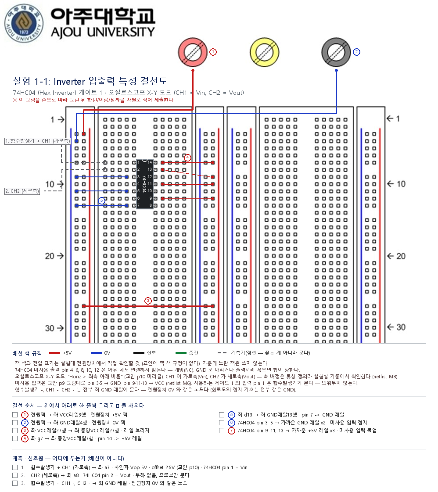
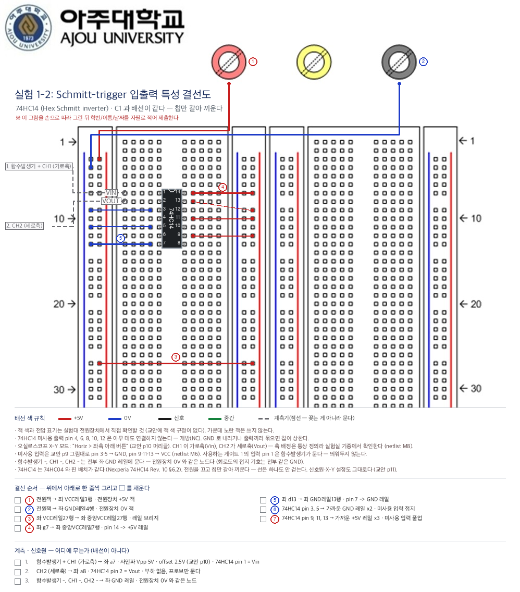

# 실험2 CMOS 회로의 전기적 특성 예비보고서

<table_of_contents color="gray"/>

<empty-block/>
# 실험 목적

논리 기호로만 다루던 CMOS 소자가 실제 전압과 시간의 눈금에서 어떻게 동작하는지 확인하는 것이 이번 실험의 목적이다. 이번 실험에서는 강의노트가 드는 목표 가운데 논리 소자의 논리 레벨(L 또는 H) 판정, 슈미트 트리거 인버터의 동작 원리, CMOS 회로의 DC 특성을 확인한다.

실험은 74HC04 인버터 한 개에 사인파를 넣고 오실로스코프를 X-Y 모드로 두어 입력 전압에 대한 출력 전압 곡선을 화면에 그리는 데서 시작한다. 같은 자리에 74HC14 슈미트 트리거 인버터를 갈아 끼워 두 곡선을 비교한다.

<empty-block/>
<empty-block/>
# 실험 이론
## 논리 레벨 판정과 잡음 여유

논리 소자가 입력을 HIGH와 LOW로 판정하는 경계는 한 점이 아니라 띠다. 강의노트는 VCC와 GND 사이를 네 전압으로 나눈다.

- VOHmin: HIGH를 출력할 때의 최소 허용 전압
- VIHmin: HIGH로 입력받을 때의 최소 입력 전압
- VILmax: LOW로 입력받을 때의 최대 입력 전압
- VOLmax: LOW를 출력할 때의 최대 허용 전압

출력 규격이 입력 규격보다 안쪽에 있어서, 앞단 출력이 VOHmin 이상이면 배선에서 VOHmin과 VIHmin의 차만큼 전압이 깎여도 다음 단이 HIGH로 읽는다. LOW 쪽도 마찬가지로 VILmax와 VOLmax의 차만큼 여유가 있다. 이 두 간격이 DC 잡음 여유다. VILmax와 VIHmin 사이는 ABNORMAL 구간으로, 여기 머무는 입력은 HIGH도 LOW도 아니어서 출력이 어느 쪽일지 보장되지 않는다.

실험 1-1에서 X-Y 화면에 그려지는 곡선이 이 정의를 그대로 보여 준다. 입력이 VILmax 아래에 있는 동안 출력은 VCC 근처에 머물고, VIHmin을 넘으면 GND 근처로 내려간다.

<empty-block/>
## CMOS 인버터의 구조

CMOS 인버터는 VCC 쪽의 PMOS와 GND 쪽의 NMOS가 직렬로 놓인 구조다. 입력이 LOW면 PMOS만 켜져 출력을 VCC로 끌어올리고, 입력이 HIGH면 NMOS만 켜져 출력을 GND로 끌어내린다. 정상 상태에서는 둘 중 하나가 반드시 꺼져 있고 꺼진 쪽의 저항은 1MΩ을 넘으므로, 출력은 VCC나 GND에 거의 붙고 정적 전류는 거의 흐르지 않는다. 실험 1-1의 곡선 양 끝이 수평인 이유가 이것이다.

켜진 쪽 트랜지스터도 이상적인 스위치가 아니라 저항으로 동작한다. 그래서 출력에서 전류를 끌어 쓸수록 켜진 쪽 저항에 전압이 걸려 출력이 VCC나 GND에서 조금씩 멀어진다.

CMOS 입력은 임피던스가 매우 높아 아무 데도 물리지 않으면 주변 전하에 따라 ABNORMAL 구간을 떠돈다. 그러면 PMOS와 NMOS가 동시에 켜져 전류가 새고 출력이 흔들리므로, 강의노트는 쓰지 않는 입력도 반드시 VCC 또는 GND에 묶으라고 주의를 준다.

<empty-block/>
## 슈미트 트리거와 히스테리시스

보통 인버터는 문턱이 하나라 입력이 그 근처에서 잡음으로 떨리면 출력도 따라 떨린다. 슈미트 트리거 인버터는 문턱을 두 개 둔다. 입력이 올라갈 때는 VT+를 넘어야 출력이 LOW로 떨어지고, 내려갈 때는 VT- 아래로 내려가야 출력이 HIGH로 돌아온다. 두 문턱의 차가 히스테리시스 폭 VH다(VH = VT+ - VT-).

한 번 넘어간 출력은 입력이 반대쪽 문턱까지 되돌아가기 전에는 바뀌지 않으므로, VH보다 작은 잡음은 출력에 나타나지 않는다. 강의노트는 이것을 히스테리시스로 ABNORMAL 영역을 제거한 인버터라고 설명한다. 천천히 변하는 사인파를 넣어도 출력은 깨끗한 사각파가 된다.

X-Y 화면에서 보통 인버터의 곡선이 한 줄기인 것과 달리, 슈미트 트리거는 올라갈 때와 내려갈 때 전이 위치가 달라 닫힌 고리를 그린다. 고리의 오른쪽 세로 에지가 VT+, 왼쪽이 VT-, 가로 폭이 VH다.

<empty-block/>
## 데이터시트 규격값

강의노트에는 전압 규격이 실려 있지 않아 두 IC의 규격은 제조사 데이터시트에서 옮겼다. 데이터시트는 VCC 2.0V·4.5V·6.0V 세 지점에서 규정하고 이번 실험이 쓰는 5.0V 열은 없으므로, 아래 표는 5.0V에 가장 가까운 4.5V, 25°C 값이다. 4.5V 값을 5V 규격이라고 부르지는 않는다.

- **74HC04 DC 특성** (VCC 4.5V)
	| 항목 | 조건 | Min | Typ | Max | 단위 |
	|---|---|---|---|---|---|
	| VIH | | 3.15 | 2.4 | - | V |
	| VIL | | - | 2.1 | 1.35 | V |
	| VOH | IO = -20μA | 4.4 | 4.5 | - | V |
	| VOH | IO = -4.0mA | 3.98 | 4.32 | - | V |
	| VOL | IO = 20μA | - | 0 | 0.1 | V |
	| VOL | IO = 4.0mA | - | 0.15 | 0.26 | V |
- **74HC14 문턱 전압** (VCC 4.5V)
	| 항목 | Min | Typ | Max | 단위 |
	|---|---|---|---|---|
	| VT+ | 1.7 | 2.38 | 3.15 | V |
	| VT- | 0.9 | 1.4 | 2.0 | V |
	| VH | 0.4 | 0.98 | 1.4 | V |

VIH의 Min과 VIL의 Max가 보장되는 판정 경계다. 3.15V 위는 반드시 HIGH로, 1.35V 아래는 반드시 LOW로 읽히고 실제 전이는 그 사이에서 일어난다. 부하 전류가 4mA로 커지면 VOH는 내려가고 VOL은 올라가는데, 이것이 켜진 트랜지스터가 저항으로 동작한다는 앞 절의 설명이 규격에 나타난 자리다. 74HC14의 출력 전압 규격은 74HC04와 같고, 다른 것은 입력 쪽에 두 문턱이 있다는 점뿐이다.

<empty-block/>
<empty-block/>
# 실험 부품
## 준비물

| 품목 | 규격 | 수량 | 비고 |
|---|---|---|---|
| 전압원 | +5V | 1 | 두 IC의 전원 핀에 공급 |
| 오실로스코프 | 2채널, 프로브 2개 | 1 | X-Y 모드로 입력·출력 전압 곡선을 본다 |
| 함수발생기 | 사인파 | 1 | 사인파 Vpp 5V·offset 2.5V |
| 74HC04 | hex inverter, DIP-14 | 2 | 실험 1-1에서 한 개를 쓴다 |
| 74HC14 | hex inverting Schmitt trigger, DIP-14 | 1 | 실험 1-2에서 74HC04 자리에 갈아 끼운다 |
| 브레드보드 | | 1 | IC와 배선을 올린다 |
| 점퍼선 | | 적당량 | 전원·신호 배선과 미사용 입력 처리 |

<empty-block/>
## 핀 배치

| IC | 게이트1 | 게이트2 | 게이트3 | 게이트4 | 게이트5 | 게이트6 | VCC | GND |
|---|---|---|---|---|---|---|---|---|
| 74HC04 (hex inverter) | 1 → 2 | 3 → 4 | 5 → 6 | 9 → 8 | 11 → 10 | 13 → 12 | 14 | 7 |
| 74HC14 (hex Schmitt inverter) | 1 → 2 | 3 → 4 | 5 → 6 | 9 → 8 | 11 → 10 | 13 → 12 | 14 | 7 |

강의노트 회로도는 74HC04의 14핀 전부에 1A~6Y 이름과 번호를 적어 두었고, 74HC14는 1·2·7·14번만 적혀 있다. 데이터시트로 확인하면 74HC14의 핀 배치는 74HC04와 같아서, 실험 1-2에서 배선을 하나도 바꾸지 않고 칩만 갈아 끼울 수 있다.

<empty-block/>
<empty-block/>
# 실험 과정 및 예상 결과
## 실험 1-1) Inverter의 입출력 특성 확인

74HC04의 첫 번째 게이트(1번 핀에서 2번 핀)만 쓴다. VCC에 5V를 걸고 1번 핀에 사인파 Vpp 5V, offset 2.5V를 넣는다. 오실로스코프 CH1을 1번 핀에, CH2를 2번 핀에 물리고 X-Y 모드로 바꾼다. 사인파의 offset을 2.5V로 두는 것은 입력이 0V에서 5V까지를 빠짐없이 천천히 훑게 하기 위해서다.

X-Y 모드는 시간축을 끄고 CH1을 가로축, CH2를 세로축으로 쓰므로 화면에 그려지는 것이 입력 전압에 대한 출력 전압 곡선이다. 두 파형을 시간축으로 나란히 보면 출력이 사각파라는 것만 보이고 전이가 어느 입력 전압에서 일어나는지는 읽을 수 없다.

곡선은 왼쪽 위(Vin 0V 근처, Vout 5V 근처)에서 오른쪽 아래(Vin 5V 근처, Vout 0V 근처)로 떨어지는 한 줄기로 나올 것이다. 양 끝은 거의 수평이고 가운데 전이 구간만 가파르다. 사인파가 올라갈 때와 내려갈 때의 궤적이 겹쳐 한 줄로 보이는 것이 정상이다. 전이가 일어나는 Vin 구간을 눈금으로 읽어 두고, 규격의 VILmax 1.35V와 VIHmin 3.15V 사이에 놓이는지 확인한다. 전이 중심의 정확한 값은 강의노트가 주지 않으므로 화면에서 읽은 값을 쓴다.

<empty-block/>
## 실험 1-2) Schmitt-trigger의 입출력 특성 확인

전원을 끄고 74HC04를 뽑아 같은 자리에 74HC14를 꽂는다. 배선·신호원·X-Y 모드는 실험 1-1 그대로 둔다. 두 칩의 핀 배치가 같으므로 선은 하나도 옮기지 않는다.

Vin이 올라갈 때와 내려갈 때 전이 전압이 달라 곡선이 닫힌 고리를 그릴 것이다. 고리의 오른쪽 세로 에지가 VT+, 왼쪽이 VT-이고 가로 폭이 VH다. 두 에지의 Vin 눈금을 읽어 두고, 데이터시트 범위(VCC 4.5V 기준 VT+ 1.7~3.15V, VT- 0.9~2.0V, VH 0.4~1.4V) 안에 드는지 본다. 실험 1-1의 한 줄기 곡선과 나란히 놓고 보면 슈미트 트리거가 전이 구간을 어떻게 갈라 놓는지 눈으로 비교된다.

<empty-block/>
<empty-block/>
# 회로 결선도
## 공통 결선 규칙

- 두 IC 모두 14번 핀을 +5V에, 7번 핀을 GND에 연결한다.
- 쓰지 않는 입력 핀은 강의노트 주의사항대로 VCC 또는 GND에 묶는다. 강의노트 그림을 따라 3·5번 핀은 GND로, 9·11·13번 핀은 VCC로 묶고 하나도 띄워 두지 않는다.
- 쓰지 않는 출력 핀은 아무 데도 연결하지 않고 개방한다.
- GND는 한 점이다. 전원 장치의 -, 함수발생기의 -, CH1·CH2 프로브의 접지 클립, IC 7번 핀을 모두 같은 GND 레일에 묶는다. 회로도에 접지 기호가 여러 개 그려져 있지만 전부 같은 GND다.
- 두 회로는 브레드보드의 같은 자리를 쓴다. 신호원 입력은 칩의 1번 핀, 전원은 14번·7번 핀으로 회로가 바뀌어도 그대로다. 실험 1-2는 칩만 갈아 끼운다. 칩을 뽑고 꽂을 때는 전원을 끈다.

<empty-block/>
## 실험 1-1) Inverter의 입출력 특성 확인 결선

| 소자 | 핀 | 연결 |
|---|---|---|
| 74HC04 | 1 | 함수발생기 +, 그리고 CH1 프로브 (VIN) |
| 74HC04 | 2 | CH2 프로브 (VOUT) |
| 74HC04 | 3, 5 | GND |
| 74HC04 | 9, 11, 13 | +5V |
| 74HC04 | 4, 6, 8, 10, 12 | 개방 |

<empty-block/>
## 실험 1-2) Schmitt-trigger의 입출력 특성 확인 결선

| 소자 | 핀 | 연결 |
|---|---|---|
| 74HC14 | 1 | 함수발생기 +, 그리고 CH1 프로브 (VIN) |
| 74HC14 | 2 | CH2 프로브 (VOUT) |
| 74HC14 | 3, 5 | GND |
| 74HC14 | 9, 11, 13 | +5V |
| 74HC14 | 4, 6, 8, 10, 12 | 개방 |

<empty-block/>
## 실험 전 확인할 사항

- 함수발생기를 회로에 물린 뒤 CH1로 Vin이 실제로 Vpp 5V인지 먼저 본다. 출력 임피던스 설정(50Ω 또는 High-Z)에 따라 표시값과 실제 진폭이 다를 수 있다.
- 지급된 칩의 각인을 확인한다. 제조사가 Nexperia가 아니면 비교할 데이터시트를 그 제조사 것으로 바꾼다.
- 실험실 오실로스코프에서 X-Y 모드로 들어가는 경로와 CH1이 가로축인지 확인한다. 강의노트는 Horiz 메뉴의 좌측 아래 버튼이라고 안내한다.

<empty-block/>
<empty-block/>
# 출처 및 참고문헌

- 논리회로실험 강의노트
- 논리회로실험 IC 특성 분석 가이드
- Nexperia. 74HC04; 74HCT04 — Hex inverter. Rev. 10, 2024-02-16.
  https://assets.nexperia.com/documents/data-sheet/74HC_HCT04.pdf
- Nexperia. 74HC14; 74HCT14 — Hex inverting Schmitt trigger. Rev. 10, 2024-02-29.
  https://assets.nexperia.com/documents/data-sheet/74HC_HCT14.pdf
