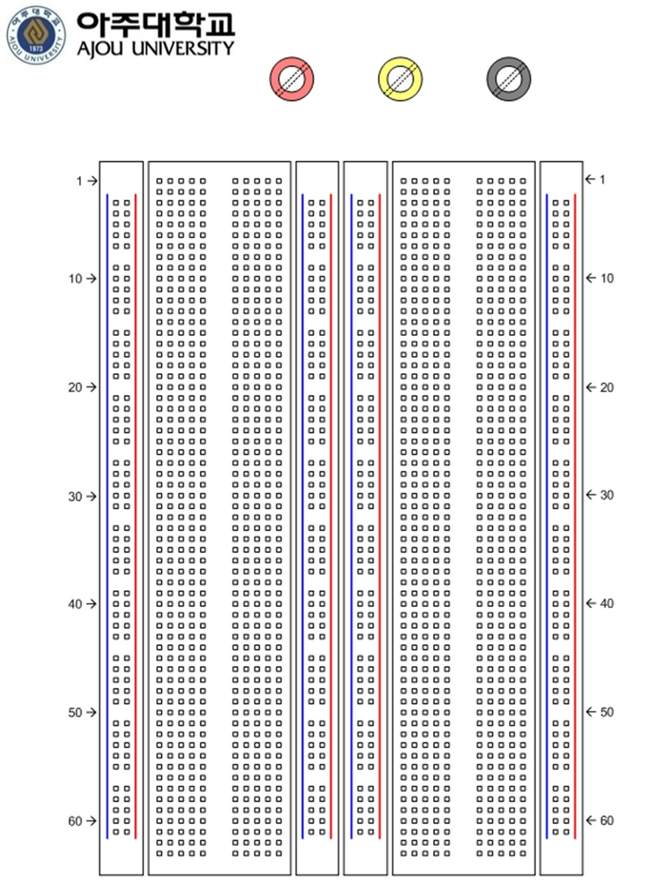

# 실험3 가산기 & 감산기 예비보고서

<table_of_contents color="gray"/>

<empty-block/>
# 실험 목적

강의노트는 이번 실험의 목표를 두 가지로 든다. 논리 게이트를 조합해 가산기(adder)와 감산기(subtracter)를 직접 구성하는 것, 그리고 디지털 시스템의 기본 요소인 가산기와 감산기의 구조 및 동작 원리를 이해하는 것이다.

실험은 네 회로를 차례로 만든다. 먼저 XOR 과 AND 만으로 반가산기를 구성하고, 그 반가산기 두 개에 OR 하나를 더해 전가산기로 넓힌다. 이어서 XOR·AND 에 NOT 을 더해 반감산기를 만들고, 같은 방식으로 반감산기 두 개와 OR 하나를 묶어 전감산기를 완성한다. 앞의 회로가 뒤의 회로의 부품이 되는 구성이라, 네 항목은 서로 떨어진 실험이 아니라 한 줄기로 이어진다.

<empty-block/>
<empty-block/>
# 실험 이론
## 사용하는 논리 게이트

이번 실험이 쓰는 게이트는 XOR·AND·OR·NOT 넷이다. 각 게이트의 동작은 데이터시트의 function table 이 입력과 출력을 H(high)와 L(low)로 규정한다. 이 실험은 양논리(positive logic)를 쓰므로 H 를 1, L 을 0 으로 읽으며, 아래의 모든 진리표도 그렇게 0 과 1 로 적는다.

- **기본 게이트의 진리표**
	| A | B | A·B | A+B | A⊕B | A' |
	|---|---|---|---|---|---|
	| 0 | 0 | 0 | 0 | 0 | 1 |
	| 0 | 1 | 0 | 1 | 1 | 1 |
	| 1 | 0 | 0 | 1 | 1 | 0 |
	| 1 | 1 | 1 | 1 | 0 | 0 |

<empty-block/>
## 반가산기와 전가산기

2진수 한 자리 덧셈은 0+0=0, 0+1=1, 1+0=1, 1+1=10 이고 마지막 경우에만 자리올림이 생긴다. 두 비트 A 와 B 를 더해 합 S 와 자리올림 C 를 내는 회로가 반가산기다. 위 네 경우를 그대로 읽으면 S 는 두 입력이 서로 다를 때만 1 이고 C 는 둘 다 1 일 때만 1 이므로, 부울식으로 정리하면 다음과 같다.

- `S = A ⊕ B`
- `C = A · B`

XOR 하나와 AND 하나면 반가산기가 완성된다.

여러 자리 덧셈에서는 아랫자리에서 올라온 자리올림 `Ci` 까지 세 비트를 더해야 하고, 그 회로가 전가산기다. 먼저 A 와 B 를 반가산기로 더해 부분합 `A⊕B` 와 자리올림 `A·B` 를 얻고, 그 부분합에 `Ci` 를 다시 반가산기로 더하면 최종 합과 두 번째 자리올림 `(A⊕B)·Ci` 가 나온다. 두 자리올림 중 하나라도 1 이면 최종 자리올림이 1 이므로 마지막에 OR 로 묶는다.

- `S = A ⊕ B ⊕ Ci`
- `Co = A·B + (A⊕B)·Ci`

`Co` 의 두 항은 동시에 1 이 될 수 없다. `A·B = 1` 이려면 A 와 B 가 둘 다 1 이어야 하는데 그러면 `A⊕B = 0` 이라 둘째 항이 0 이기 때문이다. 두 입력이 동시에 1 인 경우가 없으면 OR 과 XOR 의 출력이 같으므로, 마지막 게이트 자리에 XOR 을 꽂아도 진리표는 여덟 행이 그대로 나온다. 이 실수는 출력만 봐서는 드러나지 않는다.

<empty-block/>
## 반감산기와 전감산기

2진수 한 자리 뺄셈 A − B 는 0−0=0, 1−0=1, 1−1=0 이고, 0−1 일 때만 윗자리에서 1 을 빌려 와 차 1 과 빌림 1 을 낸다. 차 D 와 빌림 `Bo` 를 내는 회로가 반감산기다. D 는 두 비트가 서로 다를 때 1 이므로 가산기의 합과 같은 XOR 이고, 빌림은 A 가 0 이면서 B 가 1 인 한 경우에만 1 이므로 A 를 반전해 B 와 AND 한 것이다.

- `D = A ⊕ B`
- `Bo = A' · B`

가산기와 달리 감산기는 두 입력이 대칭이 아니다. 인버터가 A 쪽에 붙느냐 B 쪽에 붙느냐에 따라 빌림의 값이 뒤바뀌므로, 어느 입력을 반전하는지가 이 회로에서 가장 중요한 지점이다.

전감산기는 아랫자리에 빌려준 1 을 뜻하는 `Bi` 까지 받아 세 비트를 처리한다. 전가산기와 같은 구조로 반감산기 두 개와 OR 하나를 쓴다. 앞단이 A 와 B 로 `A⊕B` 와 `A'·B` 를 만들고, 뒷단은 `A⊕B` 를 앞단의 A 자리에, `Bi` 를 B 자리에 놓아 최종 차와 두 번째 빌림 `(A⊕B)'·Bi` 를 만든다.

- `D = A ⊕ B ⊕ Bi`
- `Bo = A'·B + (A⊕B)'·Bi`

여기서도 두 항은 동시에 1 이 될 수 없다. `A'·B = 1` 이려면 A 가 0 이고 B 가 1 이어야 하는데 그러면 `A⊕B = 1` 이라 `(A⊕B)' = 0` 이다. 전가산기의 마지막 OR 자리와 사정이 같다.

<empty-block/>
<empty-block/>
# 실험 부품
## 준비물

| 부품 | 규격 | 수량 | 비고 |
|---|---|---|---|
| 7486 | quad 2-input XOR, DIP-14 | 1 | 네 회로 모두에서 합과 차를 만든다 |
| 7408 | quad 2-input AND, DIP-14 | 1 | 자리올림·빌림 항을 만든다 |
| 7432 | quad 2-input OR, DIP-14 | 1 | 전가산기·전감산기에서 두 자리올림(빌림)을 합친다 |
| 7404 | hex inverter, DIP-14 | 1 | 반감산기·전감산기에서 입력을 반전한다 |
| LED | — | 2 | 두 출력의 논리값을 표시한다 |
| 저항 | 330 Ω | 2 | LED 전류를 제한한다 |
| 브레드보드 | — | 1 | 회로를 꽂는다 |
| 점퍼선 | — | 적당량 | 입력을 전원·접지에 직결하고 게이트 사이를 잇는다 |
| 직류 전원 공급기 | +5 V | 1 | IC 전원 |

<empty-block/>
## IC 핀 배치

| IC | 게이트별 입력 → 출력 핀 | VCC | GND |
|---|---|---|---|
| 7486 (XOR) | 1,2 → 3 · 4,5 → 6 · 9,10 → 8 · 12,13 → 11 | 14 | 7 |
| 7408 (AND) | 1,2 → 3 · 4,5 → 6 · 9,10 → 8 · 12,13 → 11 | 14 | 7 |
| 7432 (OR) | 1,2 → 3 · 4,5 → 6 · 9,10 → 8 · 12,13 → 11 | 14 | 7 |
| 7404 (NOT) | 1 → 2 · 3 → 4 · 5 → 6 · 9 → 8 · 11 → 10 · 13 → 12 | 14 | 7 |

강의노트의 회로도는 게이트 기호만 그리고 핀 번호를 적지 않으므로, 위 배치는 제조사 데이터시트의 핀 도해에서 확인했다. 쿼드 게이트 세 종은 핀 배치가 완전히 같아서, 배선이 맞더라도 칩을 서로 바꿔 꽂으면 회로가 멀쩡히 동작하면서 출력만 달라진다. 꽂기 전에 칩 윗면의 각인을 눈으로 읽어 구별해야 한다.

<empty-block/>
<empty-block/>
# 실험 과정 및 예상 결과
네 항목 모두 입력은 점퍼선으로 +5 V(=1) 또는 GND(=0) 에 직결해 주고, 출력은 LED 점등으로 읽는다. 강의노트의 결과 쪽은 항목마다 입력 한 조합만 예로 들면서 모든 입력 조합에 대해 올바른 결과를 확인하라고 덧붙이므로, 아래 예상 진리표는 입력 조합을 빠짐없이 적었다.

<empty-block/>
## 반가산기(Half Adder) 구성

7486 의 XOR 게이트 하나와 7408 의 AND 게이트 하나를 쓴다. 입력 A 와 B 를 두 게이트에 나란히 넣고, XOR 출력을 합 S 로, AND 출력을 자리올림 C 로 삼는다. 두 출력에 LED 를 하나씩 달아 놓고 A 와 B 를 네 조합으로 바꿔 가며 점등을 읽는다.

- **반가산기 예상 진리표** (`S = A⊕B`, `C = A·B`)
	| A | B | S | C |
	|---|---|---|---|
	| 0 | 0 | 0 | 0 |
	| 0 | 1 | 1 | 0 |
	| 1 | 0 | 1 | 0 |
	| 1 | 1 | 0 | 1 |

<empty-block/>
## 전가산기(Full Adder) 구성

반가산기 두 개와 OR 하나로 구성한다. 앞단 반가산기가 A 와 B 로 부분합 `A⊕B` 와 자리올림 `A·B` 를 만들고, 뒷단 반가산기가 그 부분합과 `Ci` 를 받아 최종 합 S 와 두 번째 자리올림 `(A⊕B)·Ci` 를 만든다. 두 자리올림을 OR 로 묶은 것이 `Co` 다. XOR 두 개는 7486 한 패키지에서, AND 두 개는 7408 한 패키지에서 뽑아 쓰고 OR 만 7432 를 새로 꽂는다.

- **전가산기 예상 진리표** (`S = A⊕B⊕Ci`, `Co = A·B + (A⊕B)·Ci`)
	| A | B | Ci | S | Co |
	|---|---|---|---|---|
	| 0 | 0 | 0 | 0 | 0 |
	| 0 | 0 | 1 | 1 | 0 |
	| 0 | 1 | 0 | 1 | 0 |
	| 0 | 1 | 1 | 0 | 1 |
	| 1 | 0 | 0 | 1 | 0 |
	| 1 | 0 | 1 | 0 | 1 |
	| 1 | 1 | 0 | 0 | 1 |
	| 1 | 1 | 1 | 1 | 1 |

<empty-block/>
## 반감산기(Half Subtracter) 구성

7486 의 XOR 하나가 차 D 를 내고, 7404 의 인버터 하나로 A 를 반전한 뒤 7408 의 AND 로 B 와 곱해 빌림을 낸다. 인버터는 A 쪽에만 붙는다. 강의노트의 진리표는 이 빌림 출력을 입력과 같은 글자 `B` 로 적어 두었는데, 한 표 안에서 입력과 구별되도록 이 보고서에서는 `Bo` 로 적는다.

- **반감산기 예상 진리표** (`D = A⊕B`, `Bo = A'·B`)
	| A | B | D | Bo |
	|---|---|---|---|
	| 0 | 0 | 0 | 0 |
	| 0 | 1 | 1 | 1 |
	| 1 | 0 | 1 | 0 |
	| 1 | 1 | 0 | 0 |

<empty-block/>
## 전감산기(Full Subtracter) 구성

반감산기 두 개와 OR 하나로 구성한다. 앞단이 A 와 B 로 `A⊕B` 와 `A'·B` 를 만들고, 뒷단은 `A⊕B` 를 반전해 `Bi` 와 AND 하여 `(A⊕B)'·Bi` 를 만든다. 뒷단에서 인버터로 들어가는 쪽이 `A⊕B` 이고 AND 로 곧장 들어가는 쪽이 `Bi` 라는 점이 앞단과 같은 모양이다. 두 빌림을 OR 로 묶은 것이 `Bo` 이고, 최종 차 D 는 뒷단 XOR 이 낸다. 강의노트 회로도는 이 차 출력을 `D_o` 로 라벨하지만 같은 쪽 진리표 머리글은 `D` 이므로 `D` 로 통일해 적는다.

- **전감산기 예상 진리표** (`D = A⊕B⊕Bi`, `Bo = A'·B + (A⊕B)'·Bi`)
	| A | B | Bi | D | Bo |
	|---|---|---|---|---|
	| 0 | 0 | 0 | 0 | 0 |
	| 0 | 0 | 1 | 1 | 1 |
	| 0 | 1 | 0 | 1 | 1 |
	| 0 | 1 | 1 | 0 | 1 |
	| 1 | 0 | 0 | 1 | 0 |
	| 1 | 0 | 1 | 0 | 0 |
	| 1 | 1 | 0 | 0 | 0 |
	| 1 | 1 | 1 | 1 | 1 |

<empty-block/>
<empty-block/>
# 회로 결선도
## 공통 결선 규칙

- 네 IC 는 모두 DIP-14 이고 14번 핀이 VCC, 7번 핀이 GND 다. 14번을 +5 V 레일에, 7번을 접지 레일에 연결한다.
- 입력 A·B·Ci·Bi 는 점퍼선으로 +5 V(=1) 또는 GND(=0) 에 직결한다.
- 쓰지 않는 게이트의 입력핀은 모두 GND 로 내린다. 뜬 입력은 논리값이 정해지지 않아 출력이 불안정해진다.
- 쓰지 않는 게이트의 출력핀은 개방한다. 출력끼리 묶거나 전원·접지에 물리면 칩이 손상된다.
- 출력 LED 는 애노드 쪽에 330 Ω 을 직렬로 넣고 캐소드를 GND 로 내린다.
- 한 입력이 여러 게이트로 갈라져 들어가는 자리가 많다. 한 갈래를 빠뜨려도 나머지 출력은 정상으로 보이므로, 노드마다 나가는 줄 수를 세고 넘어간다.

<empty-block/>
## 반가산기(Half Adder) 결선

| 소자 | 핀 | 연결 |
|---|---|---|
| 7486 (XOR) | 14 | +5 V |
| 7486 (XOR) | 7 | GND |
| 7486 (XOR) | 1 | 입력 A |
| 7486 (XOR) | 2 | 입력 B |
| 7486 (XOR) | 3 | 출력 S — 330 Ω 직렬 후 LED 애노드, 캐소드 GND |
| 7486 (XOR) | 4, 5, 9, 10, 12, 13 | GND (미사용 입력) |
| 7486 (XOR) | 6, 8, 11 | 개방 (미사용 출력) |
| 7408 (AND) | 14 | +5 V |
| 7408 (AND) | 7 | GND |
| 7408 (AND) | 1 | 입력 A |
| 7408 (AND) | 2 | 입력 B |
| 7408 (AND) | 3 | 출력 C — 330 Ω 직렬 후 LED 애노드, 캐소드 GND |
| 7408 (AND) | 4, 5, 9, 10, 12, 13 | GND (미사용 입력) |
| 7408 (AND) | 6, 8, 11 | 개방 (미사용 출력) |

<empty-block/>
## 전가산기(Full Adder) 결선

| 소자 | 핀 | 연결 |
|---|---|---|
| 7486 (XOR) | 14 | +5 V |
| 7486 (XOR) | 7 | GND |
| 7486 (XOR) | 1 | 입력 A |
| 7486 (XOR) | 2 | 입력 B |
| 7486 (XOR) | 3 | `A⊕B` — 7486 4번과 7408 4번 두 곳으로 나간다 |
| 7486 (XOR) | 4 | 7486 3번 |
| 7486 (XOR) | 5 | 입력 Ci |
| 7486 (XOR) | 6 | 출력 S — 330 Ω 직렬 후 LED 애노드, 캐소드 GND |
| 7486 (XOR) | 9, 10, 12, 13 | GND (미사용 입력) |
| 7486 (XOR) | 8, 11 | 개방 (미사용 출력) |
| 7408 (AND) | 14 | +5 V |
| 7408 (AND) | 7 | GND |
| 7408 (AND) | 1 | 입력 A |
| 7408 (AND) | 2 | 입력 B |
| 7408 (AND) | 3 | 7432 1번 — `A·B` |
| 7408 (AND) | 4 | 7486 3번 — `A⊕B` |
| 7408 (AND) | 5 | 입력 Ci |
| 7408 (AND) | 6 | 7432 2번 — `(A⊕B)·Ci` |
| 7408 (AND) | 9, 10, 12, 13 | GND (미사용 입력) |
| 7408 (AND) | 8, 11 | 개방 (미사용 출력) |
| 7432 (OR) | 14 | +5 V |
| 7432 (OR) | 7 | GND |
| 7432 (OR) | 1 | 7408 3번 |
| 7432 (OR) | 2 | 7408 6번 |
| 7432 (OR) | 3 | 출력 Co — 330 Ω 직렬 후 LED 애노드, 캐소드 GND |
| 7432 (OR) | 4, 5, 9, 10, 12, 13 | GND (미사용 입력) |
| 7432 (OR) | 6, 8, 11 | 개방 (미사용 출력) |

<empty-block/>
## 반감산기(Half Subtracter) 결선

| 소자 | 핀 | 연결 |
|---|---|---|
| 7486 (XOR) | 14 | +5 V |
| 7486 (XOR) | 7 | GND |
| 7486 (XOR) | 1 | 입력 A |
| 7486 (XOR) | 2 | 입력 B |
| 7486 (XOR) | 3 | 출력 D — 330 Ω 직렬 후 LED 애노드, 캐소드 GND |
| 7486 (XOR) | 4, 5, 9, 10, 12, 13 | GND (미사용 입력) |
| 7486 (XOR) | 6, 8, 11 | 개방 (미사용 출력) |
| 7404 (NOT) | 14 | +5 V |
| 7404 (NOT) | 7 | GND |
| 7404 (NOT) | 1 | 입력 A |
| 7404 (NOT) | 2 | 7408 1번 — `A'` |
| 7404 (NOT) | 3, 5, 9, 11, 13 | GND (미사용 입력) |
| 7404 (NOT) | 4, 6, 8, 10, 12 | 개방 (미사용 출력) |
| 7408 (AND) | 14 | +5 V |
| 7408 (AND) | 7 | GND |
| 7408 (AND) | 1 | 7404 2번 — `A'` |
| 7408 (AND) | 2 | 입력 B |
| 7408 (AND) | 3 | 출력 Bo — 330 Ω 직렬 후 LED 애노드, 캐소드 GND |
| 7408 (AND) | 4, 5, 9, 10, 12, 13 | GND (미사용 입력) |
| 7408 (AND) | 6, 8, 11 | 개방 (미사용 출력) |

<empty-block/>
## 전감산기(Full Subtracter) 결선

| 소자 | 핀 | 연결 |
|---|---|---|
| 7486 (XOR) | 14 | +5 V |
| 7486 (XOR) | 7 | GND |
| 7486 (XOR) | 1 | 입력 A |
| 7486 (XOR) | 2 | 입력 B |
| 7486 (XOR) | 3 | `A⊕B` — 7486 4번과 7404 3번 두 곳으로 나간다 |
| 7486 (XOR) | 4 | 7486 3번 |
| 7486 (XOR) | 5 | 입력 Bi |
| 7486 (XOR) | 6 | 출력 D — 330 Ω 직렬 후 LED 애노드, 캐소드 GND |
| 7486 (XOR) | 9, 10, 12, 13 | GND (미사용 입력) |
| 7486 (XOR) | 8, 11 | 개방 (미사용 출력) |
| 7404 (NOT) | 14 | +5 V |
| 7404 (NOT) | 7 | GND |
| 7404 (NOT) | 1 | 입력 A |
| 7404 (NOT) | 2 | 7408 1번 — `A'` |
| 7404 (NOT) | 3 | 7486 3번 — `A⊕B` |
| 7404 (NOT) | 4 | 7408 4번 — `(A⊕B)'` |
| 7404 (NOT) | 5, 9, 11, 13 | GND (미사용 입력) |
| 7404 (NOT) | 6, 8, 10, 12 | 개방 (미사용 출력) |
| 7408 (AND) | 14 | +5 V |
| 7408 (AND) | 7 | GND |
| 7408 (AND) | 1 | 7404 2번 — `A'` |
| 7408 (AND) | 2 | 입력 B |
| 7408 (AND) | 3 | 7432 1번 — `A'·B` |
| 7408 (AND) | 4 | 7404 4번 — `(A⊕B)'` |
| 7408 (AND) | 5 | 입력 Bi |
| 7408 (AND) | 6 | 7432 2번 — `(A⊕B)'·Bi` |
| 7408 (AND) | 9, 10, 12, 13 | GND (미사용 입력) |
| 7408 (AND) | 8, 11 | 개방 (미사용 출력) |
| 7432 (OR) | 14 | +5 V |
| 7432 (OR) | 7 | GND |
| 7432 (OR) | 1 | 7408 3번 |
| 7432 (OR) | 2 | 7408 6번 |
| 7432 (OR) | 3 | 출력 Bo — 330 Ω 직렬 후 LED 애노드, 캐소드 GND |
| 7432 (OR) | 4, 5, 9, 10, 12, 13 | GND (미사용 입력) |
| 7432 (OR) | 6, 8, 11 | 개방 (미사용 출력) |

<empty-block/>
## 실험 전 확인할 사항

- 공급 전압. 강의노트가 전압을 지정하지 않아 +5 V 로 잡았다. 실험실 전원 공급기 설정과 조교 지시를 먼저 확인한다.
- 칩 계열. 강의노트 본문은 7486·7408·7432·7404 라는 TTL 표기를 쓰지만 결과 쪽 사진의 실물 각인은 74HC 계열로 보인다. 핀 배치는 두 계열이 같아 결선은 그대로지만 전기적 특성이 다르므로, 받은 칩의 각인을 읽어 계열을 확정한다.
- 지급되는 칩 개수. 종류당 한 개로 보고 항목마다 다시 배선하는 것으로 계획했다. 같은 칩을 두 개 이상 받으면 회로를 나눠 꽂을 수 있다.
- 7486·7408·7432 는 핀 배치가 완전히 같다. 배선이 맞아도 칩을 바꿔 꽂으면 회로가 동작하면서 출력만 달라지므로 각인을 읽고 꽂는다.
- 전가산기와 전감산기의 마지막 OR 자리는 XOR 로 바꿔 꽂아도 진리표가 그대로 나온다. 표로는 판정할 수 없으니 각인으로 확인한다.
- 반가산기의 XOR 자리에 OR 을 꽂으면 A 와 B 가 둘 다 1 인 행에서만 S 가 어긋난다. 그 행을 반드시 확인한다.
- 반감산기의 인버터는 A 쪽에 붙는다. B 쪽에 붙이면 D 는 네 행이 다 맞는 채로 `Bo` 의 둘째·셋째 행만 서로 바뀌어 나온다.
- 전감산기의 7404 는 두 인버터가 서로 다른 신호를 받는다. 1번 핀은 입력 A 를, 3번 핀은 `A⊕B` 를 받으므로 둘을 바꿔 꽂으면 빌림 항이 통째로 어긋난다.
- LED 위치와 저항값. 강의노트가 LED 를 지정하지 않아 출력 두 개에 하나씩 달고 330 Ω 을 직렬로 넣기로 했다. 키트의 저항값과 조교 지시를 확인한다.
- 입력 소자. 강의노트가 스위치를 지정하지 않아 점퍼선 직결로 계획했다. 딥스위치를 쓰라는 지시가 있으면 그쪽을 따른다.

<empty-block/>
## 브레드보드 작도

위 결선표를 아래 브레드보드 판면에 옮겨 항목마다 손으로 그려 둔다.

<empty-block/>
<empty-block/>
# 출처 및 참고문헌

- 논리회로실험 강의노트
- 논리회로실험 IC 특성 분석 가이드
- Texas Instruments. SN5486, SN54LS86A, SN54S86, SN7486, SN74LS86A, SN74S86 — Quadruple 2-Input Exclusive-OR Gates. SDLS124, 1972년 12월 발행 / 1988년 3월 개정. https://www.ti.com/lit/ds/symlink/sn54s86.pdf
- Texas Instruments. SN5408, SN54LS08, SN54S08, SN7408, SN74LS08, SN74S08 — Quadruple 2-Input Positive-AND Gates. SDLS033, 1983년 12월 발행 / 1988년 3월 개정. https://www.ti.com/lit/ds/symlink/sn74ls08.pdf
- Texas Instruments. SN5432, SN54LS32, SN54S32, SN7432, SN74LS32, SN74S32 — Quadruple 2-Input Positive-OR Gates. SDLS100, 1983년 12월 발행 / 1988년 3월 개정. https://www.ti.com/lit/ds/symlink/sn7432.pdf
- Texas Instruments. SN5404, SN54LS04, SN54S04, SN7404, SN74LS04, SN74S04 — Hex Inverters. SDLS029C, 1983년 12월 발행 / 2004년 1월 개정. https://www.ti.com/lit/ds/symlink/sn7404.pdf
