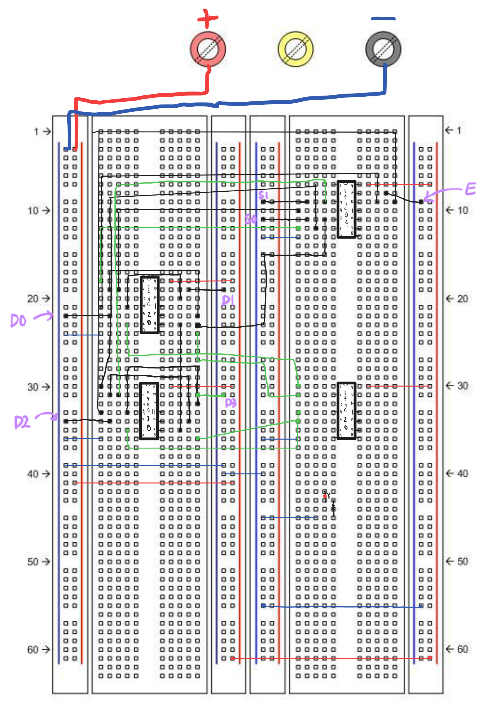
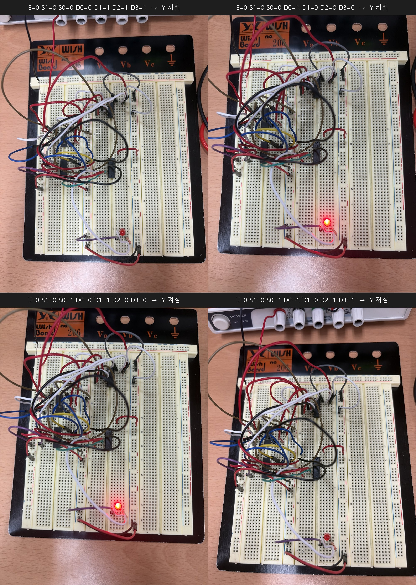
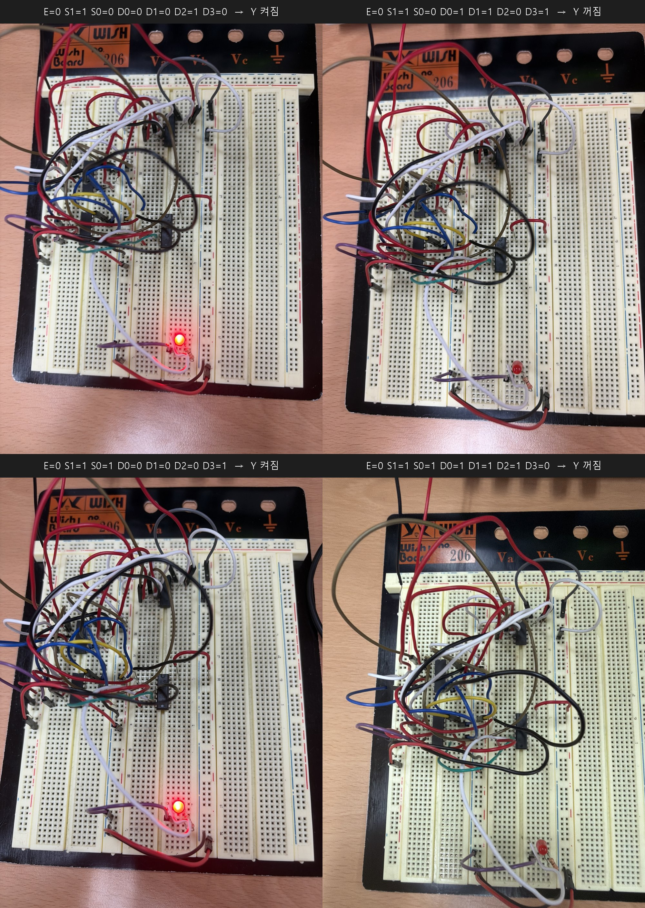
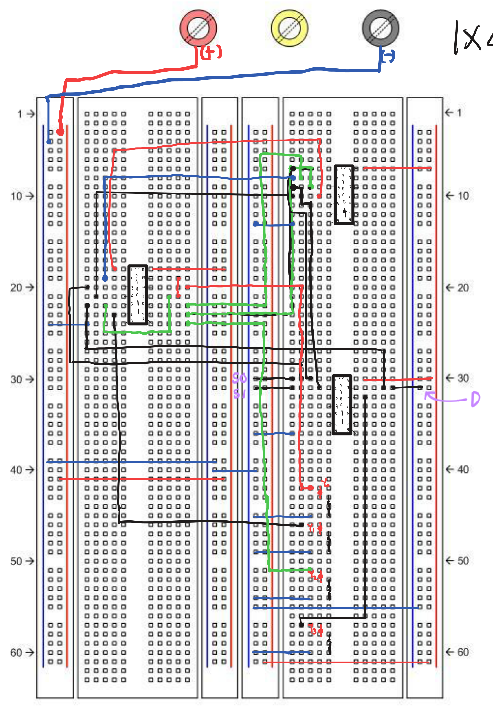
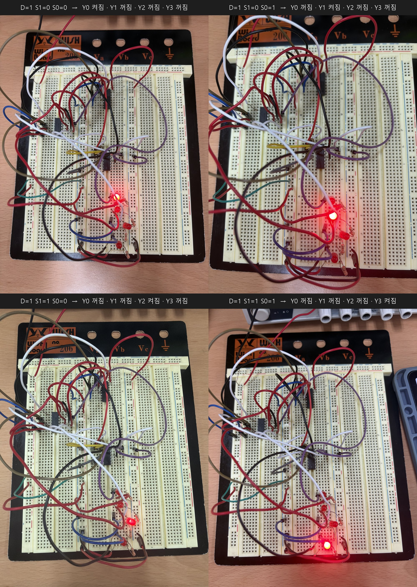

# 실험4 Multiplexer & Demultiplexer 결과보고서

<table_of_contents color="gray"/>

<empty-block/>
# 실험 결과

조교님 공지에 따라 강의노트의 실험 1-2와 2-2(74HC153·74HC139를 쓰는 IC 활용)는 하지 않고, 게이트로 직접 짜는 4x1 MUX와 1x4 DMUX 두 회로만 만들었다. 입력은 점퍼선을 +5V 레일에 꽂으면 1, GND 레일에 꽂으면 0으로 주었고, 출력은 발광다이오드가 켜지면 1, 꺼지면 0으로 읽었다. 두 회로의 열네 행이 모두 예상값과 일치했으므로 아래 표에는 예상값을 그대로 적었다.

<empty-block/>
## 실험 1-1) Enable을 갖는 4x1 MUX

74HC04 인버터 셋으로 E', S1', S0'를 만들고, 74HC20의 4입력 NAND 네 개가 각각 E'와 선택 조합 하나, 데이터 입력 하나를 받아 곱항의 보수를 낸다. 세 번째 74HC20의 NAND 하나가 이 넷을 다시 묶은 것이 Y = E'·(S1'·S0'·D0 + S1'·S0·D1 + S1·S0'·D2 + S1·S0·D3)이다.

- **Enable을 갖는 4x1 MUX 진리표**
	| E | S1 | S0 | D0 | D1 | D2 | D3 | Y |
	|---|----|----|----|----|----|----|---|
	| 1 | X | X | X | X | X | X | 0 |
	| 0 | 0 | 0 | 0 | 1 | 1 | 1 | 0 |
	| 0 | 0 | 0 | 1 | 0 | 0 | 0 | 1 |
	| 0 | 0 | 1 | 1 | 0 | 1 | 1 | 0 |
	| 0 | 0 | 1 | 0 | 1 | 0 | 0 | 1 |
	| 0 | 1 | 0 | 1 | 1 | 0 | 1 | 0 |
	| 0 | 1 | 0 | 0 | 0 | 1 | 0 | 1 |
	| 0 | 1 | 1 | 1 | 1 | 1 | 0 | 0 |
	| 0 | 1 | 1 | 0 | 0 | 0 | 1 | 1 |

아홉 행이 모두 예상과 일치했다.

<empty-block/>
## 실험 2-1) Enable을 갖는 1x4 DMUX

74HC04 인버터 둘로 S1', S0'를 만들고, 74HC11의 3입력 AND 네 개가 선택 조합 하나와 D를 하나씩 받는다. 첫 번째 74HC11의 세 AND가 Y0 = D·S1'·S0', Y1 = D·S1'·S0, Y2 = D·S1·S0'를, 두 번째 74HC11의 AND 하나가 Y3 = D·S1·S0를 낸다.

- **Enable을 갖는 1x4 DMUX 진리표**
	| D | S1 | S0 | Y0 | Y1 | Y2 | Y3 |
	|---|----|----|----|----|----|----|
	| 0 | X | X | 0 | 0 | 0 | 0 |
	| 1 | 0 | 0 | 1 | 0 | 0 | 0 |
	| 1 | 0 | 1 | 0 | 1 | 0 | 0 |
	| 1 | 1 | 0 | 0 | 0 | 1 | 0 |
	| 1 | 1 | 1 | 0 | 0 | 0 | 1 |

다섯 행이 모두 예상과 일치했다. 발광다이오드를 Y0부터 Y3까지 위에서 아래로 늘어놓았는데, D=1인 네 행에서 선택 조합 00, 01, 10, 11을 각각 넣었을 때 Y0, Y1, Y2, Y3 자리의 발광다이오드가 하나씩만 켜졌고 나머지 셋은 꺼져 있었다. 다만 이 표는 회로를 처음 완성했을 때의 결과가 아니라 전원 단락을 고친 뒤의 결과다. 경위는 결과 분석에 적었다.

<empty-block/>
<empty-block/>
# 실험 사진

항목마다 예비보고서의 결선도를 먼저 싣고, 그 아래에 시험한 입력 조합의 사진을 모았다. 각 사진 위의 띠에 그때 넣은 입력과 관찰한 발광다이오드 상태를 적었다. 사진은 E=0인 여덟 행과 D=1인 네 행만 남겼고, 입력이 X인 E=1 행과 D=0 행은 찍지 않았다. 4x1 MUX는 보드 아래쪽의 발광다이오드 하나가 Y이고, 1x4 DMUX는 같은 자리부터 아래로 늘어선 넷이 위에서부터 Y0, Y1, Y2, Y3이다.

<empty-block/>
## 실험 1-1) Enable을 갖는 4x1 MUX

<empty-block/>
## 실험 2-1) Enable을 갖는 1x4 DMUX

<empty-block/>
<empty-block/>
# 예비보고서와의 비교

예비보고서에서는 강의노트 진리표를 회로도의 게이트 논리로 다시 따져 4x1 MUX 아홉 행과 1x4 DMUX 다섯 행의 출력을 예상했다. 열네 행이 모두 예상과 일치했다.

- **진리표**: 강의노트가 출력을 정해 준 열두 행은 강의노트 값 그대로 나왔다.
- **X로 적힌 출력**: 강의노트는 E=1 행과 D=0 행의 출력을 X로 두었지만, 예비보고서에서는 회로도대로라면 그 행의 출력이 나머지 입력과 상관없이 0이라고 보고 0으로 예상했다. 실제로 두 행 모두 발광다이오드가 꺼져 있었다. 그 이유는 결과 분석에 적었다.
- **예상하지 못한 문제**: 실험 중 생긴 두 문제, 1x4 DMUX를 처음 완성했을 때의 전원 단락과 조교님 확인 때의 입력 위치 착각은 둘 다 회로 설계가 아니라 손작업과 읽기에서 생겼다. 그래서 진리표의 예상값과 결과 사이에는 차이로 남지 않았다.

<empty-block/>
<empty-block/>
# 결과 분석

## NAND 두 단이 AND-OR와 같은 이유

Y = E'·(S1'·S0'·D0 + S1'·S0·D1 + S1·S0'·D2 + S1·S0·D3)는 곱항 넷을 OR로 모은 식이다. 곱항을 P0~P3이라 하면 드모르간 법칙에 따라 P0 + P1 + P2 + P3 = (P0'·P1'·P2'·P3')'이고, 괄호 안의 Pi'가 앞단 NAND의 출력, 바깥 보수가 뒷단 NAND다. 그래서 74HC20 한 종류로 두 단을 모두 채울 수 있었다.

선택 조합 S1S0는 네 곱항 가운데 정확히 하나만 살린다. 예를 들어 S1S0=01이면 S1'·S0가 1인 P1만 D1을 그대로 지나보내고 나머지 셋은 0이 되므로 Y = D1이다. 강의노트의 시험 행은 선택된 입력과 나머지 셋을 늘 반대 값으로 두었기 때문에, 어느 조합에서든 다른 곱항이 1을 하나라도 새어 보냈다면 Y가 선택된 입력과 다르게 나왔을 것이다. 여덟 행이 모두 맞았으니 네 곱항 각각이 자기 선택 조합에서만 열렸다고 볼 수 있다.

E'는 네 곱항에 모두 들어간다. E=1이면 E'=0이라 앞단 NAND 넷이 데이터와 상관없이 모두 1을 내고, 1만 넷 받은 뒷단 NAND는 0을 낸다. 강의노트가 X로 둔 E=1 행의 출력이 이 회로에서는 0으로 정해지는 이유가 이것이다.

<empty-block/>
## 1x4 DMUX는 Enable이 달린 2-4 디코더다

Y0~Y3의 네 식에서 D를 빼면 S1'·S0', S1'·S0, S1·S0', S1·S0가 남는다. 이 넷은 선택 조합마다 정확히 하나만 1이 되는 2-4 디코더의 출력이고, 여기에 D를 곱하면 D가 고른 출력 하나로만 나간다. D=0이면 네 AND가 모두 0을 내므로 강의노트가 X로 둔 D=0 행도 이 회로에서는 네 출력이 모두 0이다. D가 데이터이면서 동시에 Enable 역할을 하는 셈이고, 강의노트가 D를 "Enable & Data Input"이라 부른 것과 맞는다. D=1인 네 행에서 발광다이오드가 늘 하나만 켜진 것도 네 곱항이 서로 겹치지 않기 때문이다.

<empty-block/>
## 전원공급기가 CC 모드로 넘어간 문제

1x4 DMUX를 다 꽂고 5V를 넣자 전원공급기가 CV가 아니라 CC로 표시되며 출력 전압이 0.03V로 떨어졌다. 전원공급기는 설정한 전압을 내다가 부하가 전류 한도 이상을 끌면 CC 모드로 넘어가 한도 전류를 유지할 만큼만 전압을 낮춘다. 0.03V까지 내려갔다는 것은 부하 저항이 거의 0Ω, 즉 +5V와 GND 사이에 저항 없는 길이 생겼다는 뜻이다. 회로를 살펴보니 왼쪽 블록 위쪽 74HC11의 오른쪽 열에 꽂힌 선들 가운데 피복을 너무 길게 벗긴 두 선의 끝이 서로 닿아 있었고, 두 선의 끝을 잘라 떨어뜨리자 CV 모드로 돌아와 정상 동작했다.

어느 두 선이었는지는 기억하지 못해 결선도로 좁혀 보았다. 그 칩 오른쪽 열에는 14번 핀에서 전원 레일로 가는 +5V 선이 하나 있고, 나머지는 신호선이다. 0.03V가 나오려면 이 +5V 선이 GND에 곧바로 이어진 선과 닿아야 한다. 신호선 가운데 그런 선은 레일에 직접 꽂는 입력 D와 S1에 이어진 선뿐이고, 당시 D는 GND 쪽에 꽂혀 있었다. D를 11번 핀에서 13번 핀으로 이어 주는 점퍼는 위쪽 끝이 +5V 선이 지나는 행 바로 아래 칸에 꽂혀 있고, 회로의 마지막 단계에서 꽂은 선이기도 하다. 그래서 14번 핀의 +5V 선과 이 D 점퍼가 닿았다고 보는 것이 가장 그럴듯하다. 출력선이 +5V 선에 닿았다면 게이트의 출력단 저항이 사이에 끼어 0.03V까지 떨어질 수 없다는 점도 이 추정을 받친다. 이 부분은 데이터시트 값으로 따져 추가 공부에 적었다. 다만 S1도 0이었다면 S1 선이 닿았을 가능성은 남고, 결국 추정이다.

<empty-block/>
<empty-block/>
# 고찰

이번 실험의 목적은 멀티플렉서와 디멀티플렉서를 이해하고, 게이트로 회로를 직접 구성해 동작을 확인하는 것이었다. 4x1 MUX와 1x4 DMUX의 열네 행이 모두 예상 진리표와 일치했고, 강의노트가 X로 둔 행도 회로대로 0이 나오는 것을 확인했다. IC 기반 구성은 조교님 공지로 이번 학기에는 하지 않았지만, 게이트로 짜는 부분의 목적은 달성했다고 본다.

막혔던 것은 2-1이었다. 회로를 다 꽂고 DC 5V를 인가했는데 전원공급기가 CV가 아니라 CC로 표시되며 전압이 0.03V로 떴다. 5V로 설정했는데 출력이 5V가 아니었던 것이다. 원인은 피복이 너무 길게 벗겨진 두 선이 서로 닿은 것이었고, 두 선의 끝부분을 잘라 서로 닿지 않게 했더니 CV 모드로 정상 동작했다. 어느 두 선이었는지는 결과 분석에서 따져 보았다.

예상과 달랐던 것은 2-1에서 조교님께 확인받을 때였다. S0와 S1을 반대로 착각해 처음에는 결과가 이상하게 나온 줄 알았다. 결선도를 다시 보니 S0 입력이 S1보다 한 행 위에 있었고, 이를 바로 읽자 결과는 예상과 같았다.

새로 안 것은 세 가지다. 회로도의 입력 위치는 S0와 S1처럼 이웃한 행을 헷갈리지 않도록 주의해야 한다. 그리고 전원공급기의 설정 전압은 상한일 뿐이라, CC 표시와 함께 전압이 0에 가깝게 떨어지면 그것 자체가 단락이 생겼다는 신호다. 점퍼 끝은 브레드보드 구멍 깊이만큼만 벗겨야 한다.

<empty-block/>
<empty-block/>
# 추가 공부

## 선택 신호 두 개가 뒤바뀌면 진리표에 어떻게 나타나는가

조교님 확인 때 S0와 S1을 바꿔 읽은 일을 계기로, 두 선택 신호가 뒤바뀌었을 때 각 회로의 결과가 어떻게 달라지는지 따져 보았다. 선택 조합을 번호 i = 2·S1 + S0로 보면 S1과 S0를 맞바꾸는 것은 i의 두 비트를 맞바꾸는 것이라 0과 3은 그대로이고 1과 2만 서로 바뀐다. 두 회로의 구조가 다르므로 하나씩 따로 보았다.

4x1 MUX에서는 S1S0=01을 넣었다고 생각했을 때 실제로는 D2가, 10을 넣었다고 생각했을 때는 D1이 Y로 나온다. 강의노트의 시험 행은 선택된 입력과 나머지 셋을 늘 반대 값으로 두므로, 엉뚱한 입력이 선택되면 Y는 반드시 뒤집힌다. 따라서 S1S0가 01과 10인 네 행이 모두 틀리고, 00과 11인 네 행은 맞게 나온다. 만약 시험 행에서 D1과 D2를 같은 값으로 두었다면 이 착각은 결과에 전혀 드러나지 않았을 것이다. 또 D1과 D2의 점퍼를 서로 바꿔 꽂은 경우에도 똑같은 네 행이 똑같이 틀린다. 출력만 보아서는 선택 신호가 바뀐 것인지 데이터 입력이 바뀐 것인지 가릴 수 없다.

1x4 DMUX에서는 S1S0=01일 때 Y2가, 10일 때 Y1이 켜지고, 00과 11은 제자리에서 켜진다. 결과 표로 보면 Y1 열과 Y2 열을 맞바꾼 것과 정확히 같다. 그래서 이 표 하나로는 입력을 잘못 읽었는지, 선택 신호 선을 바꿔 꽂았는지, Y1과 Y2의 발광다이오드를 바꿔 달았는지 구별되지 않는다. 출력 쪽에서 구별되지 않는 고장은 출력이 아닌 곳을 봐야 가려진다. 이번에 결선도에서 입력의 실제 위치를 다시 확인한 것이 그 방법이었고, 확인하고 나니 회로에는 문제가 없었다.

두 회로 모두 선택 조합 00과 11만으로는 두 선택 신호가 바뀐 것을 찾을 수 없고, 01과 10에서만 드러난다. 선택 신호를 맞게 연결했는지 볼 때는 두 비트가 서로 다른 조합을 반드시 넣어야 하고, 4x1 MUX라면 그 조합에서 선택된 입력과 바뀌어 선택될 입력의 값이 달라야 한다.

<empty-block/>
## 74HC11의 출력단 저항으로 본 단락 후보

결과 분석에서 출력선이 +5V 선과 닿았다면 0.03V까지 떨어지지 않는다고 했다. 이것을 74HC11 데이터시트 값으로 따져 보았다. 데이터시트는 VCC가 2.0V, 4.5V, 6.0V일 때만 값을 보증하므로 5V보다 낮아 보수적인 4.5V 열을 본다.

정적 특성표(25°C, VCC = 4.5V)에서 HIGH 출력 전압 VOH는 출력 전류 4.0mA일 때 최소 3.98V, 대표 4.32V이고, LOW 출력 전압 VOL은 4.0mA일 때 대표 0.15V, 최대 0.26V다. 이 값으로 출력단의 등가 저항을 어림하면 HIGH 쪽은 대표값으로 (4.5 − 4.32) / 4.0mA = 45Ω, 보증치로 130Ω이고, LOW 쪽은 0.15 / 4.0mA ≈ 38Ω, 보증치로 65Ω이다. 74HC04와 74HC20의 정적 특성표도 같은 조건에서 같은 값이다.

LOW를 내고 있던 출력선이 +5V 선에 닿았다고 하면, 전원에서 본 경로는 +5V에서 출력단의 LOW 쪽 트랜지스터를 지나 GND로 가는 38Ω 남짓의 저항이다. 전원공급기가 CC 모드로 넘어가 이 경로 양단을 0.03V로 맞추려면 전류 한도가 0.03V / 38Ω ≈ 0.8mA 이하여야 한다. 그런데 단락을 고친 뒤 전류 한도를 그대로 둔 채 발광다이오드가 켜지며 CV 모드로 동작했다. 330Ω 저항에 1V만 걸려도 3mA가 흐르므로 전류 한도는 0.8mA보다 훨씬 컸고, 따라서 출력선이 닿은 경우라면 전압은 0.03V가 아니라 그보다 훨씬 높게 남았어야 한다. 0.03V는 레일에 직접 이어진 선끼리 닿은 경우에만 맞는다. 전류 한도를 얼마로 두었는지는 적어 두지 않았지만, 0.1A였다면 단락 경로의 저항은 0.3Ω, 1A였다면 0.03Ω으로 점퍼선과 접점의 저항 정도다.

칩 입장에서도 두 경우는 다르다. 레일끼리 닿은 이번 경우에는 칩의 전원 핀에도 0.03V만 걸리므로 칩을 지나는 전류가 거의 없고, 손상을 걱정할 일이 없다. 반면 출력선이 +5V에 닿았다면 LOW 쪽 트랜지스터로 대표값 기준 5V / 38Ω ≈ 130mA, 보증치 기준으로도 5V / 65Ω ≈ 77mA가 흐르려 한다. 데이터시트 한계값 표의 출력 전류 IO는 ±25mA, GND 핀 전류 IGND는 −50mA가 절대 최대 정격이라 둘 다 넘는다. 전원의 전류 한도가 이보다 높게 잡혀 있었다면 단락이 일어나도 전압이 크게 떨어지지 않아 눈치채기 어렵고, 그 사이 칩이 정격을 넘는 전류를 견뎌야 했을 것이다.

정상 동작에서는 여유가 충분하다. 같은 표에서 정지 상태의 전원 전류 ICC는 25°C, VCC = 6.0V 조건에서 칩당 최대 2μA이고, 발광다이오드 전류는 330Ω에 5V가 다 걸린다고 쳐도 5V / 330Ω ≈ 15mA 남짓이라 출력 전류 정격 25mA 안쪽이다. 1x4 DMUX는 한 번에 발광다이오드가 많아야 하나만 켜지므로 회로 전체가 끄는 전류도 15mA 남짓이다. 그래서 전류 한도를 이보다 조금 넉넉하면서 출력 전류 정격 25mA보다는 낮게, 예를 들어 20mA쯤으로 잡아 두면 출력선이 레일에 닿는 단락이 나도 칩에 흐르는 전류가 정격 안에서 막히고, 전원공급기는 CC 모드로 넘어가 단락을 알려 준다.

<empty-block/>
<empty-block/>
# 출처 및 참고문헌

- 논리회로실험 강의노트
- 논리회로실험 IC 특성 분석 가이드
- Nexperia. 74HC04; 74HCT04 — Hex inverter. Rev. 10, 2024-02-16. https://assets.nexperia.com/documents/data-sheet/74HC_HCT04.pdf
- Nexperia. 74HC11; 74HCT11 — Triple 3-input AND gate. Rev. 9, 2024-02-21. https://assets.nexperia.com/documents/data-sheet/74HC_HCT11.pdf
- Nexperia. 74HC20 — Dual 4-input NAND gate. Rev. 7, 2024-03-14. https://assets.nexperia.com/documents/data-sheet/74HC20.pdf
