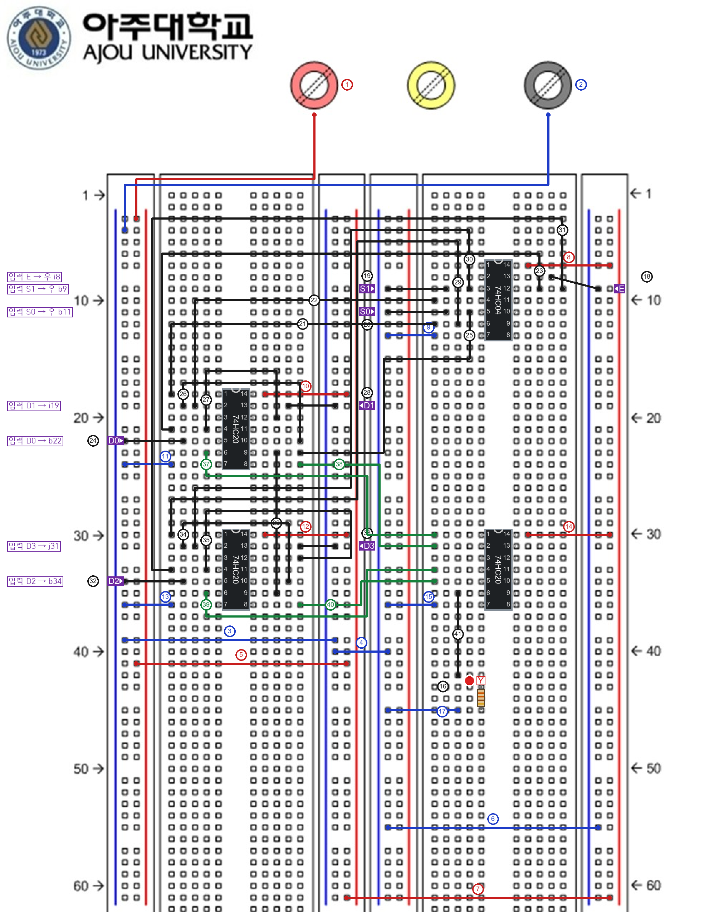
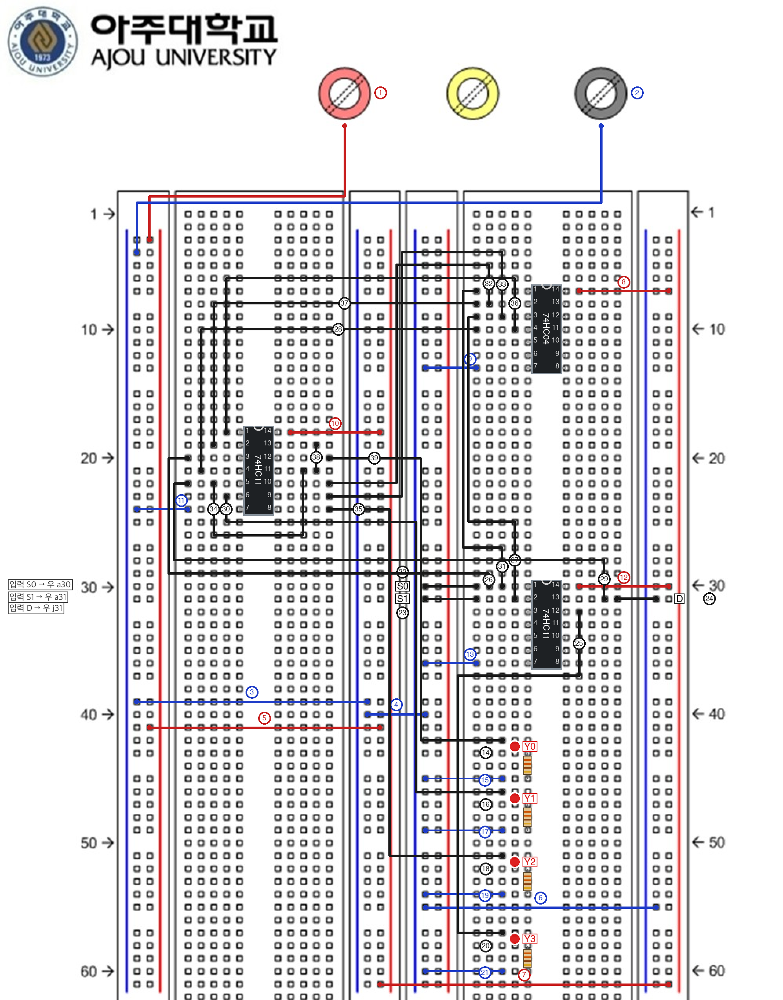

# 실험4 Multiplexer & Demultiplexer 예비보고서

<table_of_contents color="gray"/>

<empty-block/>
# 실험 목적

멀티플렉서와 디멀티플렉서의 동작을 이해하고, 논리 게이트만으로 두 회로를 직접 구성해 동작을 확인하는 것이 이번 실험의 목적이다.

실험은 Enable 입력이 있는 4x1 MUX에서 시작한다. 74HC04로 E·S1·S0를 반전하고, 74HC20의 4입력 NAND 네 개로 선택 조합마다 데이터 입력 하나를 고른 뒤, 다섯 번째 NAND로 그 결과를 모아 출력 Y를 만든다. 이어 MUX의 신호선을 모두 걷고 74HC11의 3입력 AND 네 개로 1x4 DMUX를 새로 구성한다. 두 회로 모두 출력에 발광다이오드를 달고, 입력을 5V와 GND에 번갈아 물려 가며 강의노트의 진리표와 맞는지 확인한다.

<empty-block/>
<empty-block/>
# 실험 이론
## 멀티플렉서

멀티플렉서(Multiplexer, MUX)는 여러 입력 신호 가운데 하나를 골라 출력선 하나로 내보내는 회로다. 강의노트는 이를 데이터 선택기라고 부르며, 컴퓨터 안에서 읽거나 쓸 데이터의 주소를 고르거나 ALU에 들어갈 피연산자를 고르는 자리에 쓰인다고 설명한다. 여러 데이터 연결을 신호 채널 하나로 모을 수 있어 배선 비용도 줄어든다.

MUX는 2ⁿ개의 입력, n개의 선택 신호, 출력 1개로 구성된다. 이번 실험의 4x1 MUX는 입력 I0~I3 넷과 선택 신호 S1·S0 둘을 가진다. S1S0가 00이면 I0, 01이면 I1, 10이면 I2, 11이면 I3가 출력으로 나간다. 선택 조합마다 해당하는 곱항 하나만 1이 될 수 있으므로 출력은 네 곱항의 합이다.

- Y = S1'·S0'·I0 + S1'·S0·I1 + S1·S0'·I2 + S1·S0·I3

<empty-block/>
## 디멀티플렉서

디멀티플렉서(Demultiplexer, DMUX)는 MUX와 반대로 입력 하나를 여러 출력선 가운데 한 곳으로 보내는 데이터 분배기다. 강의노트는 특정 주소에 데이터를 저장하거나, 특정 장치에만 명령을 전달하거나, 오디오 신호를 스피커와 헤드폰 중 한쪽으로 보내는 경우를 예로 든다.

DMUX는 입력 1개, n개의 선택 신호, 2ⁿ개의 출력으로 구성된다. 1x4 DMUX는 선택 신호 S1·S0가 가리키는 출력 하나에만 입력 I를 그대로 내보내고 나머지 셋은 0으로 둔다.

- D0 = S1'·S0'·I
- D1 = S1'·S0·I
- D2 = S1·S0'·I
- D3 = S1·S0·I

실험 회로에서는 입력 I를 D로, 출력 D0~D3을 Y0~Y3으로 부른다. 출력마다 곱항이 하나뿐이라 OR 없이 3입력 AND 네 개로 회로가 끝난다.

<empty-block/>
## Enable 입력

Enable은 회로 전체를 동작시키거나 멈추는 입력이다. 4x1 MUX 회로의 E는 0일 때 동작하는 Active Low 입력이다. E를 인버터로 한 번 뒤집은 E'를 네 곱항에 모두 곱하므로, E가 1이면 E'가 0이 되어 어떤 입력을 선택해도 출력이 나가지 않는다.

- Y = E'·(S1'·S0'·D0 + S1'·S0·D1 + S1·S0'·D2 + S1·S0·D3)

1x4 DMUX에는 Enable이 따로 없고, 데이터 입력 D가 Enable을 겸한다. D가 0이면 네 AND 모두 0을 내고, D가 1이면 선택된 출력 하나만 1이 된다.

<empty-block/>
## 사용하는 게이트

이번 회로에는 NOT, 4입력 NAND, 3입력 AND 세 가지 게이트가 들어가며, 각각 74HC04·74HC20·74HC11에 들어 있다. 강의노트에는 게이트별 진리표가 없어 아래 표는 제조사 데이터시트의 function table을 옮겼다. 데이터시트는 H와 L로 적지만 이 실험은 H를 1, L을 0으로 읽는 양논리를 쓰므로 0과 1로 바꿔 적었다. X는 어느 값이든 상관없다는 뜻이다.

- **NOT** (Y = A')
	| A | Y |
	|---|---|
	| 0 | 1 |
	| 1 | 0 |
- **4입력 NAND** (Y = (A·B·C·D)')
	| A | B | C | D | Y |
	|---|---|---|---|---|
	| 0 | X | X | X | 1 |
	| X | 0 | X | X | 1 |
	| X | X | 0 | X | 1 |
	| X | X | X | 0 | 1 |
	| 1 | 1 | 1 | 1 | 0 |
- **3입력 AND** (Y = A·B·C)
	| A | B | C | Y |
	|---|---|---|---|
	| 0 | X | X | 0 |
	| X | 0 | X | 0 |
	| X | X | 0 | 0 |
	| 1 | 1 | 1 | 1 |

<empty-block/>
## NAND 두 단으로 만든 MUX

MUX 식은 곱항 넷을 OR로 합친 꼴이지만, 강의노트 회로도는 AND와 OR 대신 NAND만 두 단으로 쓴다. 드모르간 법칙으로 보면 두 구성이 같다. 네 곱항을 P0~P3라 하면 앞단 NAND 네 개는 각각 P0'~P3'를 내고, 뒷단 NAND는 이 넷을 받아 (P0'·P1'·P2'·P3')' = P0 + P1 + P2 + P3를 낸다.

- 앞단 NAND 출력: (E'·S1'·S0'·D0)', (E'·S1'·S0·D1)', (E'·S1·S0'·D2)', (E'·S1·S0·D3)'
- 뒷단 NAND 출력: Y = E'·S1'·S0'·D0 + E'·S1'·S0·D1 + E'·S1·S0'·D2 + E'·S1·S0·D3

곱항마다 E'·선택 신호 둘·데이터 입력 하나로 입력이 네 개씩이라 앞단에 4입력 NAND가 필요하고, 합칠 곱항도 넷이라 뒷단도 4입력 NAND 하나로 된다. 74HC20 한 칩에 4입력 NAND가 두 개 들어 있으므로 앞단에 두 칩, 뒷단에 한 칩을 쓴다.

<empty-block/>
<empty-block/>
# 실험 부품
## 준비물

| 품목 | 규격 | 수량 | 비고 |
|---|---|---|---|
| 전압원 | +5V | 1 | 모든 IC의 전원 핀과 입력에 공급 |
| 74HC04 | hex inverter, DIP-14 | 1 | MUX에서 인버터 셋, DMUX에서 둘. 한 칩을 두 회로가 차례로 쓴다 |
| 74HC20 | dual 4-input NAND, DIP-14 | 3 | MUX. 세 번째 칩은 게이트 하나만 쓴다 |
| 74HC11 | triple 3-input AND, DIP-14 | 2 | DMUX. 두 번째 칩은 게이트 하나만 쓴다 |
| 74HC139 | dual 2-to-4 line decoder/demultiplexer | | 이번 실험 항목에는 쓰지 않는다 |
| 74HC153 | dual 4-input multiplexer | | 이번 실험 항목에는 쓰지 않는다 |
| 발광다이오드 | | 4 | MUX는 출력 Y에 하나, DMUX는 Y0~Y3에 넷을 모두 쓴다 |
| 저항 | 330Ω | 4 | 발광다이오드 애노드에 직렬로 넣는다 |
| 브레드보드 | | 1 | IC와 배선을 올린다 |
| 점퍼선 | | 적당량 | 입력을 +5V·GND에 물리고 게이트 사이를 잇는다 |

<empty-block/>
## 핀 배치

| IC | 게이트1 | 게이트2 | 게이트3 | VCC | GND | 미연결 |
|---|---|---|---|---|---|---|
| 74HC20 (dual 4-input NAND) | 1,2,4,5 → 6 | 9,10,12,13 → 8 | | 14 | 7 | 3, 11 |
| 74HC11 (triple 3-input AND) | 1,2,13 → 12 | 3,4,5 → 6 | 9,10,11 → 8 | 14 | 7 | |

74HC04는 인버터 6개짜리로 1→2, 3→4, 5→6, 9→8, 11→10, 13→12이고 VCC는 14번, GND는 7번이다.

강의노트 회로도에는 게이트마다 신호 핀 번호가 적혀 있고, 모두 데이터시트의 배치와 일치한다. 전원 핀과 미연결 핀은 회로도에 없어 데이터시트에서 확인했다. 74HC20은 3번과 11번이 내부에 연결되지 않은 빈 다리라서 첫 게이트의 입력이 1·2·4·5번으로 한 칸 건너뛴다. 74HC11의 첫 게이트는 세 번째 입력이 13번, 출력이 12번이라 칩 반대편 줄에 있다.

<empty-block/>
<empty-block/>
# 실험 과정 및 예상 결과
## 실험 1-1) Enable을 갖는 4x1 MUX - 회로 구현

74HC04로 E·S1·S0를 반전해 E'·S1'·S0'를 만든다. 74HC20 두 칩의 NAND 네 개에는 각각 E'와 선택 조합 하나, 데이터 입력 하나를 넣는다. 첫 번째 NAND는 S0'·S1'·D0, 두 번째는 S0·S1'·D1, 세 번째는 S0'·S1·D2, 네 번째는 S0·S1·D3를 받는다. 세 번째 74HC20의 NAND 하나가 네 출력을 모아 Y를 내고, Y에 330Ω 저항과 발광다이오드를 단다.

먼저 E를 1로 두고 다른 입력을 바꿔도 LED가 꺼져 있는지 본다. 강의노트 진리표는 이 행의 출력을 X로 적었지만, 이 회로에서는 E'가 0이 되어 앞단 NAND 네 개가 모두 1을 내고 뒷단 NAND가 0을 내므로 LED는 꺼져 있어야 한다. 이어 E를 0으로 두고 선택 조합마다 두 행씩 확인한다. 선택된 데이터 입력만 0과 1로 바꾸고 나머지 셋은 그 반대 값으로 두므로, 선택되지 않은 입력이 Y에 새어 나오지 않는지도 함께 볼 수 있다.

- **Enable을 갖는 4x1 MUX** (Y = E'·(S1'·S0'·D0 + S1'·S0·D1 + S1·S0'·D2 + S1·S0·D3))
	| E | S1 | S0 | D0 | D1 | D2 | D3 | Y |
	|---|---|---|---|---|---|---|---|
	| 1 | X | X | X | X | X | X | 0 |
	| 0 | 0 | 0 | 0 | 1 | 1 | 1 | 0 |
	| 0 | 0 | 0 | 1 | 0 | 0 | 0 | 1 |
	| 0 | 0 | 1 | 1 | 0 | 1 | 1 | 0 |
	| 0 | 0 | 1 | 0 | 1 | 0 | 0 | 1 |
	| 0 | 1 | 0 | 1 | 1 | 0 | 1 | 0 |
	| 0 | 1 | 0 | 0 | 0 | 1 | 0 | 1 |
	| 0 | 1 | 1 | 1 | 1 | 1 | 0 | 0 |
	| 0 | 1 | 1 | 0 | 0 | 0 | 1 | 1 |

<empty-block/>
## 실험 2-1) Enable을 갖는 1x4 DMUX - 회로 구현

전원을 끄고 MUX의 신호선을 모두 뽑은 뒤 74HC20 세 개를 빼고 74HC11 두 개를 꽂는다. 74HC04는 그대로 두고 S0와 S1을 반전하는 인버터 두 개만 새로 배선한다. 74HC11의 AND 네 개는 모두 D를 받고, 선택 조합으로 첫 번째는 S1'·S0', 두 번째는 S1'·S0, 세 번째는 S1·S0', 네 번째는 S1·S0를 받는다. 네 출력이 Y0~Y3이고 각각 330Ω 저항과 발광다이오드를 단다.

D가 0이면 S1과 S0를 어떻게 바꿔도 LED 네 개가 모두 꺼져 있어야 한다. 강의노트 진리표는 이 행의 출력도 X로 적었지만, AND 네 개가 모두 D를 입력으로 받으므로 회로대로라면 전부 0이다. D를 1로 두고 S1S0를 00부터 11까지 바꾸면 켜지는 LED가 Y0에서 Y3까지 한 칸씩 옮겨 가야 한다.

- **Enable을 갖는 1x4 DMUX** (Y0 = D·S1'·S0', Y1 = D·S1'·S0, Y2 = D·S1·S0', Y3 = D·S1·S0)
	| D | S1 | S0 | Y0 | Y1 | Y2 | Y3 |
	|---|---|---|---|---|---|---|
	| 0 | X | X | 0 | 0 | 0 | 0 |
	| 1 | 0 | 0 | 1 | 0 | 0 | 0 |
	| 1 | 0 | 1 | 0 | 1 | 0 | 0 |
	| 1 | 1 | 0 | 0 | 0 | 1 | 0 |
	| 1 | 1 | 1 | 0 | 0 | 0 | 1 |

<empty-block/>
<empty-block/>
# 회로 결선도
## 공통 결선 규칙

- 모든 IC는 14번 핀을 +5V에, 7번 핀을 GND에 연결한다. 74HC20의 3번과 11번 핀에는 아무것도 꽂지 않는다.
- 쓰는 게이트의 입력은 반드시 어딘가에 물린다. 쓰지 않는 게이트의 입력은 강의노트가 처리를 따로 지시하지 않아 개방해 두는데, 실험1에서 접지를 생략해도 결과에 영향이 없었다. 쓰지 않는 출력 핀은 아무 데도 연결하지 않는다. 출력끼리 묶거나 GND로 내리면 정격을 넘는 전류가 흐른다.
- 입력 E·S1·S0·D0~D3·D는 점퍼선으로 +5V(=1) 또는 GND(=0)에 직접 물린다. 강의노트 회로도는 입력마다 스위치를 그리지만 준비물에 스위치가 없어 점퍼선으로 대신한다. 전기적으로는 같은 0과 1이다.
- 발광다이오드는 애노드 쪽에 330Ω 저항을 직렬로 넣고 캐소드를 GND로 내린다. MUX에서는 LED1 하나만 Y에 연결하고, DMUX에서는 LED1~LED4를 Y0~Y3에 연결한다. LED 네 사슬은 처음에 한꺼번에 꽂아 두고 두 회로에서 같은 자리를 쓴다.
- 핀 번호와 칩 번호(U1~U4)는 강의노트 회로도를 따른다. 다만 MUX의 E 인버터는 회로도의 1→2번 대신 13→12번 게이트를 쓴다. 74HC04 한쪽 줄에 입력 셋과 출력 셋, 갈래선이 몰려 배선이 겹치기 때문이고, 같은 칩의 같은 인버터라 논리는 달라지지 않는다.
- 한 신호가 여러 핀으로 가면 첫 목적지 핀에서 다음 목적지로 이어 간다. 표에서 "같은 칩 10번 핀"처럼 적은 것이 그 이어 간 선이고, 전기적으로는 한 점이다.
- 칩을 꽂거나 뽑을 때는 전원을 끈다.

<empty-block/>
## 실험 1-1) Enable을 갖는 4x1 MUX - 회로 구현 결선

| 소자 | 핀 | 연결 |
|---|---|---|
| U4 (74HC04) | 3 | 입력 S1, U2의 2번 핀 |
| U4 (74HC04) | 4 | U1의 2번 핀 (S1') |
| U4 (74HC04) | 5 | 입력 S0, U1의 9번 핀 |
| U4 (74HC04) | 6 | U1의 1번 핀, U2의 1번 핀 (S0') |
| U4 (74HC04) | 12 | U1의 4번 핀, U2의 4번 핀 (E') |
| U4 (74HC04) | 13 | 입력 E |
| U4 (74HC04) | 1, 2, 8, 9, 10, 11 | 개방 |
| U1 (74HC20) | 1 | U4의 6번 핀 (S0') |
| U1 (74HC20) | 2 | U4의 4번 핀, 같은 칩 10번 핀 (S1') |
| U1 (74HC20) | 4 | U4의 12번 핀, 같은 칩 12번 핀 (E') |
| U1 (74HC20) | 5 | 입력 D0 |
| U1 (74HC20) | 6 | U3의 1번 핀 ((E'·S1'·S0'·D0)') |
| U1 (74HC20) | 8 | U3의 2번 핀 ((E'·S1'·S0·D1)') |
| U1 (74HC20) | 9 | U4의 5번 핀, U2의 9번 핀 (S0) |
| U1 (74HC20) | 10 | 같은 칩 2번 핀 (S1') |
| U1 (74HC20) | 12 | 같은 칩 4번 핀 (E') |
| U1 (74HC20) | 13 | 입력 D1 |
| U1 (74HC20) | 3, 11 | 미연결 |
| U2 (74HC20) | 1 | U4의 6번 핀 (S0') |
| U2 (74HC20) | 2 | U4의 3번 핀, 같은 칩 10번 핀 (S1) |
| U2 (74HC20) | 4 | U4의 12번 핀, 같은 칩 12번 핀 (E') |
| U2 (74HC20) | 5 | 입력 D2 |
| U2 (74HC20) | 6 | U3의 4번 핀 ((E'·S1·S0'·D2)') |
| U2 (74HC20) | 8 | U3의 5번 핀 ((E'·S1·S0·D3)') |
| U2 (74HC20) | 9 | U1의 9번 핀 (S0) |
| U2 (74HC20) | 10 | 같은 칩 2번 핀 (S1) |
| U2 (74HC20) | 12 | 같은 칩 4번 핀 (E') |
| U2 (74HC20) | 13 | 입력 D3 |
| U2 (74HC20) | 3, 11 | 미연결 |
| U3 (74HC20) | 1 | U1의 6번 핀 |
| U3 (74HC20) | 2 | U1의 8번 핀 |
| U3 (74HC20) | 4 | U2의 6번 핀 |
| U3 (74HC20) | 5 | U2의 8번 핀 |
| U3 (74HC20) | 6 | LED1 (Y) |
| U3 (74HC20) | 8, 9, 10, 12, 13 | 개방 |
| U3 (74HC20) | 3, 11 | 미연결 |

<empty-block/>
## 실험 2-1) Enable을 갖는 1x4 DMUX - 회로 구현 결선

| 소자 | 핀 | 연결 |
|---|---|---|
| U3 (74HC04) | 1 | U2의 1번 핀 (S0) |
| U3 (74HC04) | 2 | U1의 10번 핀, U1의 2번 핀 (S0') |
| U3 (74HC04) | 3 | U2의 2번 핀, U1의 9번 핀 (S1) |
| U3 (74HC04) | 4 | U1의 4번 핀, U1의 1번 핀 (S1') |
| U3 (74HC04) | 5, 6, 8, 9, 10, 11, 12, 13 | 개방 |
| U1 (74HC11) | 1 | U3의 4번 핀 (S1') |
| U1 (74HC11) | 2 | U3의 2번 핀 (S0') |
| U1 (74HC11) | 3 | U2의 1번 핀 (S0) |
| U1 (74HC11) | 4 | U3의 4번 핀 (S1') |
| U1 (74HC11) | 5 | U2의 13번 핀, 같은 칩 11번 핀 (D) |
| U1 (74HC11) | 6 | LED2 (Y1) |
| U1 (74HC11) | 8 | LED3 (Y2) |
| U1 (74HC11) | 9 | U3의 3번 핀 (S1) |
| U1 (74HC11) | 10 | U3의 2번 핀 (S0') |
| U1 (74HC11) | 11 | 같은 칩 5번 핀, 같은 칩 13번 핀 (D) |
| U1 (74HC11) | 12 | LED1 (Y0) |
| U1 (74HC11) | 13 | 같은 칩 11번 핀 (D) |
| U2 (74HC11) | 1 | 입력 S0, U1의 3번 핀, U3의 1번 핀 |
| U2 (74HC11) | 2 | 입력 S1, U3의 3번 핀 |
| U2 (74HC11) | 12 | LED4 (Y3) |
| U2 (74HC11) | 13 | 입력 D, U1의 5번 핀 |
| U2 (74HC11) | 3, 4, 5, 6, 8, 9, 10, 11 | 개방 |

강의노트의 DMUX 회로도는 MUX와 칩 번호를 따로 매겨 74HC04를 U3으로 적는다. 이 U3은 MUX의 U4와 같은 칩이다.

<empty-block/>
## 실험 전 확인할 사항

- 강의노트 준비물에 74HC04만 수량이 없다. 한 칩을 두 회로가 차례로 쓰는 것으로 보고 배선했으니, 지급된 수량을 먼저 확인한다. 두 개여도 결선은 같다.
- 칩의 각인을 확인한다. 74HC 계열이면 제조사가 달라도 핀 배치는 같지만, 74HCT나 74LS면 전기 특성이 달라 비교할 데이터시트를 바꾼다.
- 74HC20의 입력은 1·2·4·5번과 9·10·12·13번이다. 3번과 11번에 선을 꽂지 않았는지 전원을 넣기 전에 다시 본다.
- 74HC11의 첫 게이트는 입력 1·2·13번, 출력 12번이다. 12번과 13번을 바꿔 꽂으면 Y0가 나오지 않는다.
- MUX의 E 인버터가 13→12번 게이트인지 본다. 강의노트대로 1→2번에 꽂아도 동작은 같지만 결선도와 달라진다.
- LED가 진리표와 어긋나면 앞단 NAND와 AND가 S0와 S0' 중 어느 쪽을 받는지부터 확인한다. 같은 신호의 반전형과 비반전형이 칩마다 번갈아 들어가 헷갈리기 쉽다.
- 330Ω을 달았을 때 발광다이오드 전류는 대략 9mA다. 74HC 출력의 High 전압은 데이터시트에서 4mA까지만 규정되어 있어, LED가 눈에 띄게 어두우면 이 지점을 먼저 본다.
- 조교가 미사용 입력의 접지나 풀업, 또는 입력 스위치 사용을 지시하면 그대로 따른다.

<empty-block/>
<empty-block/>
# 출처 및 참고문헌

- 논리회로실험 강의노트
- 논리회로실험 IC 특성 분석 가이드
- Nexperia. 74HC04; 74HCT04 — Hex inverter. Rev. 10, 2024-02-16.
  https://assets.nexperia.com/documents/data-sheet/74HC_HCT04.pdf
- Nexperia. 74HC11; 74HCT11 — Triple 3-input AND gate. Rev. 9, 2024-02-21.
  https://assets.nexperia.com/documents/data-sheet/74HC_HCT11.pdf
- Nexperia. 74HC20 — Dual 4-input NAND gate. Rev. 7, 2024-03-14.
  https://assets.nexperia.com/documents/data-sheet/74HC20.pdf
