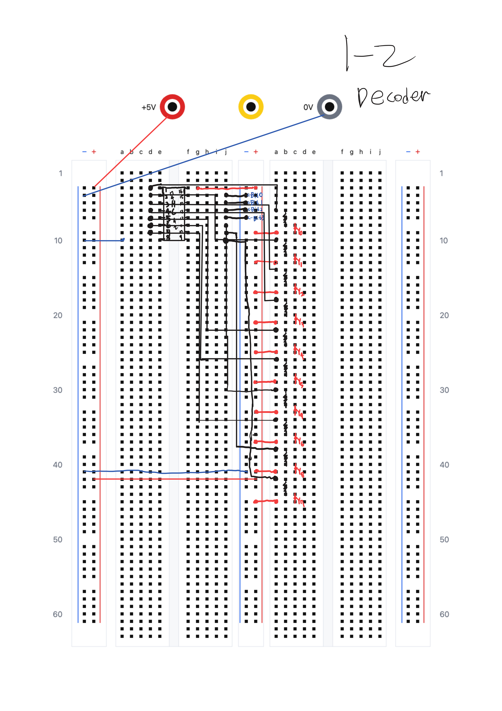
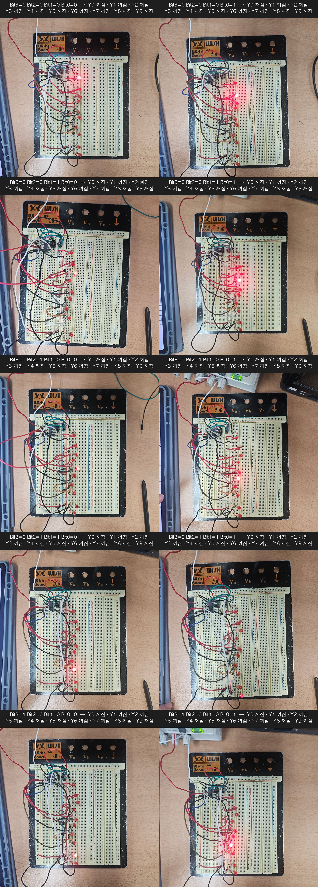
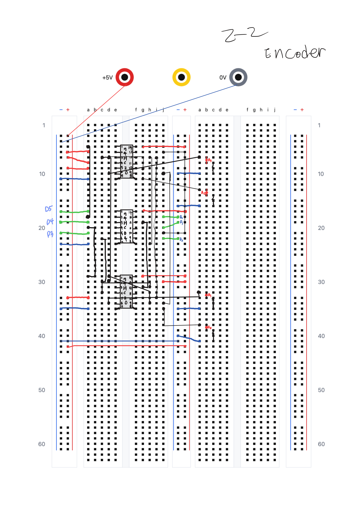
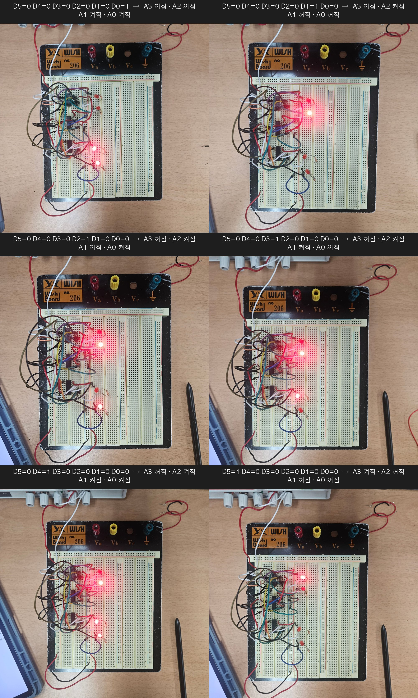

# 실험5 Decoder & Encoder 결과보고서

<table_of_contents color="gray"/>

<empty-block/>
# 실험 결과

조교님 공지에 따라 강의노트의 네 항목 가운데 실험 1-2와 2-2만 진행했다. 74HC42 한 칩으로 만든 BCD to Decimal Decoder를 먼저 확인하고, 그 회로를 모두 걷은 뒤 74HC04와 74HC20 두 개로 Decimal to Excess-3 Code Encoder를 새로 꽂았다. 입력은 점퍼선을 +5V 레일에 꽂으면 1, GND 레일에 꽂으면 0으로 주었다. 두 회로의 열여섯 행이 모두 예상값과 일치했으므로 아래 표에는 예상값을 그대로 적었다.

<empty-block/>
## 실험 1-2) BCD to Decimal Decoder (4x16 Decoder)

74HC42의 입력 A, B, C, D(15·14·13·12번 핀)에 Bit0~Bit3를 물리고, 출력 Y0~Y9마다 +5V에서 발광다이오드와 330Ω을 거쳐 출력 핀으로 들어가게 달았다. 74HC42는 고른 출력 하나만 0으로 내리는 Active Low 출력이라, 표에서 0인 칸의 발광다이오드가 켜지고 1인 칸은 꺼진다. 출력이 열 개라 표를 Y0~Y4와 Y5~Y9 둘로 나눴다.

- **BCD to Decimal Decoder 진리표, Y0~Y4**
	| Bit3 | Bit2 | Bit1 | Bit0 | Y0 | Y1 | Y2 | Y3 | Y4 |
	|---|---|---|---|---|---|---|---|---|
	| 0 | 0 | 0 | 0 | 0 | 1 | 1 | 1 | 1 |
	| 0 | 0 | 0 | 1 | 1 | 0 | 1 | 1 | 1 |
	| 0 | 0 | 1 | 0 | 1 | 1 | 0 | 1 | 1 |
	| 0 | 0 | 1 | 1 | 1 | 1 | 1 | 0 | 1 |
	| 0 | 1 | 0 | 0 | 1 | 1 | 1 | 1 | 0 |
	| 0 | 1 | 0 | 1 | 1 | 1 | 1 | 1 | 1 |
	| 0 | 1 | 1 | 0 | 1 | 1 | 1 | 1 | 1 |
	| 0 | 1 | 1 | 1 | 1 | 1 | 1 | 1 | 1 |
	| 1 | 0 | 0 | 0 | 1 | 1 | 1 | 1 | 1 |
	| 1 | 0 | 0 | 1 | 1 | 1 | 1 | 1 | 1 |
- **BCD to Decimal Decoder 진리표, Y5~Y9**
	| Bit3 | Bit2 | Bit1 | Bit0 | Y5 | Y6 | Y7 | Y8 | Y9 |
	|---|---|---|---|---|---|---|---|---|
	| 0 | 0 | 0 | 0 | 1 | 1 | 1 | 1 | 1 |
	| 0 | 0 | 0 | 1 | 1 | 1 | 1 | 1 | 1 |
	| 0 | 0 | 1 | 0 | 1 | 1 | 1 | 1 | 1 |
	| 0 | 0 | 1 | 1 | 1 | 1 | 1 | 1 | 1 |
	| 0 | 1 | 0 | 0 | 1 | 1 | 1 | 1 | 1 |
	| 0 | 1 | 0 | 1 | 0 | 1 | 1 | 1 | 1 |
	| 0 | 1 | 1 | 0 | 1 | 0 | 1 | 1 | 1 |
	| 0 | 1 | 1 | 1 | 1 | 1 | 0 | 1 | 1 |
	| 1 | 0 | 0 | 0 | 1 | 1 | 1 | 0 | 1 |
	| 1 | 0 | 0 | 1 | 1 | 1 | 1 | 1 | 0 |

열 행이 모두 예상과 일치했다. 어느 입력에서든 켜진 발광다이오드는 하나뿐이었다. 발광다이오드는 출력 핀이 놓인 줄 순서대로 꽂아 위에서부터 Y0~Y5, Y9, Y6, Y8, Y7 순이었는데, 0000부터 0101까지는 켜진 자리가 맨 위에서 한 칸씩 내려가다가 0110에서 여덟 번째, 0111에서 맨 아래, 1000에서 아홉 번째, 1001에서 일곱 번째 자리로 옮겨 갔다. BCD가 아닌 1010~1111은 이번에 넣어 보지 않아 모든 출력이 꺼지는지는 확인하지 못했다. 두 표는 불량 발광다이오드 두 개를 바꾼 뒤의 결과이고, 경위는 결과 분석에 적었다.

<empty-block/>
## 실험 2-2) Decimal to Excess-3 Code Encoder

74HC04의 인버터 여섯 개로 D0~D5를 반전하고, 74HC20 두 개의 4입력 NAND 네 개가 그 가운데 필요한 것을 모아 A3~A0를 낸다. 식으로는 A3 = (D5')', A2 = (D4'·D3'·D2'·D1')', A1 = (D4'·D3'·D0')', A0 = (D4'·D2'·D0')'이고, 이번에는 출력에서 330Ω과 발광다이오드를 거쳐 GND로 내렸으므로 1인 칸에서 발광다이오드가 켜진다.

- **Decimal to Excess-3 Code Encoder 진리표**
	| D5 | D4 | D3 | D2 | D1 | D0 | A3 | A2 | A1 | A0 |
	|---|---|---|---|---|---|---|---|---|---|
	| 0 | 0 | 0 | 0 | 0 | 1 | 0 | 0 | 1 | 1 |
	| 0 | 0 | 0 | 0 | 1 | 0 | 0 | 1 | 0 | 0 |
	| 0 | 0 | 0 | 1 | 0 | 0 | 0 | 1 | 0 | 1 |
	| 0 | 0 | 1 | 0 | 0 | 0 | 0 | 1 | 1 | 0 |
	| 0 | 1 | 0 | 0 | 0 | 0 | 0 | 1 | 1 | 1 |
	| 1 | 0 | 0 | 0 | 0 | 0 | 1 | 0 | 0 | 0 |

여섯 행이 모두 예상과 일치했다. 발광다이오드 넷을 위에서부터 A3, A2, A1, A0 순으로 놓았는데, 1로 올리는 입력을 D0에서 D4까지 옮겨 갈 때 맨 위의 A3는 계속 꺼져 있었고, D5를 올렸을 때만 A3 하나가 켜지고 아래 셋이 모두 꺼졌다. 이 표는 너무 깊게 꽂힌 선을 다시 꽂은 뒤의 결과다. 경위는 결과 분석에 적었다.

<empty-block/>
<empty-block/>
# 실험 사진

항목마다 예비보고서에서 그린 결선도를 먼저 싣고, 그 아래에 시험한 입력 조합의 사진을 한 장에 모았다. 각 사진 위의 띠에 그때 넣은 입력과 관찰한 발광다이오드 상태를 적었다. BCD to Decimal Decoder는 칩 오른쪽에 세로로 늘어선 열 개가 위에서부터 Y0~Y5, Y9, Y6, Y8, Y7이고, Excess-3 인코더는 칩 오른쪽의 네 개가 위에서부터 A3, A2, A1, A0이다.

<empty-block/>
## 실험 1-2) BCD to Decimal Decoder (4x16 Decoder)

<empty-block/>
## 실험 2-2) Decimal to Excess-3 Code Encoder

<empty-block/>
<empty-block/>
# 예비보고서와의 비교

예비보고서에서는 74HC42의 기능과 인코더 회로도의 게이트 논리로 디코더 열 행과 인코더 여섯 행의 출력을 예상했다. 열여섯 행이 모두 예상과 일치했다.

- **BCD to Decimal Decoder**: 입력 0000~1001에서 같은 번호의 출력 하나만 0이 되어 그 발광다이오드만 켜질 것이라는 예상 그대로였다. 예비보고서에서 시간이 남으면 넣어 보겠다고 한 1010~1111은 하지 못했다.
- **Excess-3 인코더**: 10진수 0~5를 넣었을 때 출력이 그 수에 3을 더한 0011~1000으로 나왔다. 강의노트 회로도의 입력이 D0~D5뿐이라 6~9는 예비보고서에서도 다루지 않았고, 이번에도 넣을 수 없었다.
- **발광다이오드 밝기**: 예비보고서에서는 330Ω을 달았을 때 발광다이오드 전류를 대략 9mA로 어림하면서, 74HC 출력 전압이 데이터시트에 4mA까지만 규정돼 있어 어둡게 켜질 수 있다고 보았다. 실제로는 두 회로 모두 켜진 발광다이오드가 사진에서 바로 구별될 만큼 밝았다.
- **예상하지 못한 문제**: 디코더의 불량 발광다이오드 두 개와 인코더에서 전압원 출력이 2.5V로 떨어진 일은 회로 설계가 아니라 부품과 손작업에서 생겼다. 둘 다 고친 뒤에 표를 채웠으므로 예상값과 결과 사이에는 차이로 남지 않았다.

<empty-block/>
<empty-block/>
# 결과 분석

## 디코더 출력이 하나만 0이 되는 이유

74HC42의 출력 Yk는 입력이 k일 때의 최소항을 반전한 것이다. 예를 들어 Y5 = (Bit3'·Bit2·Bit1'·Bit0)'이라 입력이 0101일 때만 괄호 안이 1이 되어 Y5가 0으로 내려간다. 최소항은 입력 조합마다 정확히 하나만 1이 되므로, 어떤 BCD 입력을 넣어도 0이 되는 출력은 하나뿐이다. 이 출력에 발광다이오드의 캐소드 쪽을 330Ω을 거쳐 물리고 애노드를 +5V에 두었기 때문에, 출력이 0인 자리에서만 +5V에서 출력 핀으로 전류가 흘러 불이 켜지고 1인 아홉 자리는 양 끝 전압이 같아 꺼진다. 강의노트가 말한 Negative Logic, 곧 0을 켜짐으로 읽는 방식이 이 배선으로 구현된 것이다.

발광다이오드가 위에서부터 Y0~Y5, Y9, Y6, Y8, Y7 순으로 놓인 것은 74HC42의 핀 배치 때문이다. Y0~Y6는 칩 왼쪽 열의 1~7번 핀이지만 Y7~Y9는 오른쪽 열의 9~11번 핀이라, 출력 핀이 놓인 줄에 맞춰 발광다이오드를 꽂으면 아래쪽 세 자리의 순서가 바뀐다. 0110 이후 켜지는 자리가 아래위로 오간 것은 이 배치를 따른 것이고 회로의 문제가 아니다.

<empty-block/>
## NOT과 NAND가 Excess-3 코드를 내는 이유

인코더의 식은 드모르간 법칙으로 펴면 A3 = D5, A2 = D4 + D3 + D2 + D1, A1 = D4 + D3 + D0, A0 = D4 + D2 + D0이다. 출력 비트마다 그 비트가 1이 되는 10진수를 OR로 모은 식이라, 입력을 하나만 1로 두면 그 수의 Excess-3 코드가 그대로 나온다. 예를 들어 D2만 1이면 D2가 들어간 A2와 A0만 1이 되어 0101이다. 74HC20은 입력이 넷인 NAND라 A1, A0처럼 모을 신호가 셋인 게이트는 남는 입력 하나를, A3처럼 하나뿐인 게이트는 셋을 +5V에 묶었다. 1은 AND의 항등원이라 묶은 입력은 결과에 영향을 주지 않고, 표에서도 그 게이트들의 출력이 예상과 어긋난 행은 없었다.

D5만 1이고 나머지가 0이면 D4~D0의 반전이 모두 1이라 A2, A1, A0를 내는 세 NAND가 모두 0을 낸다. 1000이 나온 행에서 A3 하나만 켜진 것은 A3가 D5 하나에만, 아래 세 비트가 D0~D4에만 매여 있기 때문이다.

<empty-block/>
## 불량 발광다이오드 두 개

디코더를 다 꽂고 입력을 바꿔 가자 두 입력에서 그 번호의 발광다이오드가 켜지지 않았다. 다른 입력에서는 맞는 자리 하나만 켜졌으므로 입력 쪽이 아니라 그 두 출력 쪽 문제라고 보고 발광다이오드를 새 것으로 바꿨고, 바꾸자 두 자리 모두 켜졌다. 회로가 칩 하나에 출력 열 개가 따로따로 달린 구조라 범위를 빨리 좁힐 수 있었다. 왜 증상만으로 출력 쪽이라고 말할 수 있는지는 추가 공부에서 고장 모델로 따져 보았다.

<empty-block/>
## 전압원 출력이 2.5V로 내려간 문제

인코더를 꽂고 전원을 넣자 5V로 맞춘 전압원의 표시가 CV에서 CC로 바뀌며 출력이 2.5V로 내려갔다. 전압원은 부하가 전류 한도 이상을 끌면 CC 모드로 넘어가 한도 전류만 흐르도록 전압을 낮추므로, 회로 어딘가에 평소보다 훨씬 많은 전류가 흐르는 길이 생겼다는 뜻이다. 실험3에서 선을 너무 깊게 꽂아 문제가 생긴 적이 있어 그 가능성을 먼저 떠올렸고, 깊게 꽂힌 선 하나를 찾아 다시 꽂자 정상으로 돌아왔다. 어느 선이었는지는 적어 두지 못했다.

선을 깊게 꽂은 것만으로 왜 전류 길이 생겼는지 따져 보았다. 브레드보드 구멍 아래의 금속 클립은 같은 줄 다섯 구멍끼리만 이어 주므로, 선이 클립 안에 물려 있는 한 깊이는 결선을 바꾸지 못한다. 선 끝이 클립 아래로 빠져 바닥판에 닿았다면 바닥판을 통해 다른 넷과 이어질 수 있고, 이것이 깊이 때문에 생길 수 있는 거의 유일한 경로다. 다만 바닥판이 무엇과 이어져 있는지는 확인하지 못했다.

2.5V라는 값도 실마리가 된다. 실험4에서 피복이 길게 벗겨진 두 선이 닿아 +5V와 GND가 곧바로 이어졌을 때는 같은 전압원이 0.03V까지 떨어졌다. 이번에 전압이 그 절반 가까이에 머물렀다는 것은 단락 경로에 무시할 수 없는 저항이 끼어 있었다는 뜻이다. 그 저항으로는 두 가지를 생각할 수 있다. 하나는 +5V 선이 바닥판에 닿았지만 접촉이 나빠 접촉 저항이 컸던 경우이고, 다른 하나는 게이트 출력에 이어진 선이 닿아 출력단 트랜지스터가 그 저항 노릇을 한 경우다. 전류 한도를 얼마로 두었는지 적어 두지 않아 둘을 가르지는 못했다. 두 번째 경우가 수치로 성립하는지는 추가 공부에서 데이터시트 값으로 따져 보았다.

<empty-block/>
<empty-block/>
# 고찰

이번 실험의 목적은 디코더와 인코더의 동작 원리를 이해하고, BCD to Decimal Decoder와 Decimal to Excess-3 Code Encoder를 구성해 동작을 확인하는 것이었다. 디코더 열 행에서 입력값과 같은 번호의 발광다이오드 하나만 켜졌고, 인코더 여섯 행에서 그 수에 3을 더한 코드가 나와 열여섯 행이 모두 예상 진리표와 일치했다. 조교님 공지로 1-1과 2-1은 하지 않았지만 진행한 두 항목의 목적은 달성했다고 본다.

막혔던 것은 두 항목에서 하나씩이었다. 1-2에서는 발광다이오드가 많아서 그런지 불량이 두 개나 있었다. 2-2에서는 지난번 실험과 비슷하게 선 하나를 너무 깊게 꽂은 것이 문제가 되어 5V 전압원의 출력이 2.5V로 내려갔다. 증상과 원인은 결과 분석에 적었다.

1-2는 불량 발광다이오드 두 개를 새 것으로 바꿔 해결했고, 2-2는 깊게 꽂힌 선을 다시 꽂아 고쳤다.

새로 안 것은 두 가지다. 1-2는 회로가 하나뿐이라 발광다이오드에 문제가 있음을 빨리 추론할 수 있었다. 2-2는 이미 한 번 겪은 문제라 그 가능성을 바로 떠올릴 수 있었다.

<empty-block/>
<empty-block/>
# 추가 공부

## 출력만 보고 불량 위치를 좁히는 방법

불량 발광다이오드를 빨리 찾은 이유를 단일 고착 고장 모델로 다시 보았다. 회로의 선 하나가 늘 0이나 늘 1로 굳는 고장을 가정하고, 이번에 넣은 BCD 열 행에서 발광다이오드가 어떻게 켜질지 74HC42의 기능표로 따졌다.

입력 쪽 고장은 늘 엉뚱한 자리를 켠다. Bit0가 0으로 굳으면 0001을 넣어도 0000으로 읽혀 Y1 대신 Y0가 켜지고, 열 행 전체로 보면 Y0, Y2, Y4, Y6, Y8이 두 번씩 켜지고 홀수 자리는 한 번도 켜지지 않는다. Bit1이나 Bit2가 1로 굳으면 1000과 1001이 1010, 1011이나 1100, 1101로 읽혀 BCD가 아닌 코드가 되므로 두 행에서 아무것도 켜지지 않는다. 그래도 나머지 여덟 행 가운데 네 행은 다른 자리가 켜진다. Bit3가 1로 굳으면 0010~0111의 여섯 행이 모두 어두워지고 0000과 0001은 Y8, Y9로 잘못 켜진다. 여덟 가지 입력 고착 고장 모두 열 행 가운데 적어도 두 행에서 틀린 자리가 켜졌다.

출력 쪽 고장은 다르다. Yk 핀이 1로 굳거나, 그 출력에 달린 발광다이오드나 저항이 끊기면 입력 k인 행에서만 아무것도 켜지지 않고 나머지 아홉 행은 정상이다. Yk가 0으로 굳으면 반대로 그 발광다이오드가 늘 켜져 다른 아홉 행에서는 두 개가 켜진다. 이번 증상은 두 행에서만 아무것도 켜지지 않고 나머지는 모두 맞았으므로, 입력 쪽 단일 고장으로는 설명되지 않고 두 출력 쪽에 문제가 있었다고 바로 좁힐 수 있었다. 출력이 하나만 켜지는 회로라서 행마다 볼 자리가 하나뿐이고, 어긋난 행이 곧 어긋난 출력을 가리킨다.

다만 출력만 보아서는 Yk 핀이 1로 굳은 칩 고장과 그 발광다이오드의 불량이 구별되지 않는다. 둘 다 그 행에서만 불이 꺼지는 같은 증상을 낸다. 이번에 발광다이오드를 갈아 끼운 것은 이 둘을 가르는 시험이었고, 바꾸자 켜졌으므로 칩이 아니라 발광다이오드 문제였다. 출력 핀 전압을 재는 방법도 있지만 부품 하나를 바꿔 보는 쪽이 더 빨랐다.

인코더는 한 행에 여러 출력이 켜지는 회로라 같은 방법으로 따지면 결과가 다르다. A0 발광다이오드가 끊기면 0, 2, 4를 넣은 세 행에서 맨 아래 하나만 꺼지고 나머지 비트는 맞게 나온다. 어떤 행이 틀렸는지보다 어느 비트가 여러 행에 걸쳐 같이 틀렸는지를 봐야 위치가 좁혀진다.

<empty-block/>
## 74HC 출력단으로 본 2.5V

결과 분석에서 게이트 출력이 단락 경로에 끼었다면 전압이 0V까지 떨어지지 않고 중간에 머물 수 있다고 했다. 이것을 74HC04와 74HC20 데이터시트 값으로 따져 보았다. 두 데이터시트의 정적 특성표는 같은 조건에서 같은 값을 주고, VCC가 2.0V, 4.5V, 6.0V일 때만 값을 보증하므로 5V보다 낮아 보수적인 4.5V 열을 본다.

25°C, VCC = 4.5V에서 HIGH 출력 전압 VOH는 출력 전류 4.0mA일 때 최소 3.98V, 대표 4.32V다. 출력단 HIGH 쪽의 등가 저항을 어림하면 대표값으로 (4.5 − 4.32) / 4.0mA = 45Ω, 보증치로 (4.5 − 3.98) / 4.0mA = 130Ω이다. HIGH를 내던 게이트 출력이 바닥판을 거쳐 GND에 닿았다면 전압원에서 본 경로는 +5V에서 이 출력단을 지나 GND로 가는 45~130Ω이다. 전압원이 CC 모드에서 이 경로 양단을 2.5V로 맞추려면 전류 한도가 2.5V / 45Ω ≈ 56mA에서 2.5V / 130Ω ≈ 19mA 사이여야 한다. 74HC04는 이번 회로에서 한 번에 입력 하나만 1이라 인버터 여섯 개 가운데 다섯이 늘 HIGH를 내고 있었으므로, 인버터 출력선 하나가 닿았다면 어느 입력에서든 이 상황이 생겼을 것이다.

이 범위가 그럴듯한지 정상 동작 전류와 견주어 보았다. 인코더는 0111을 내는 행에서 발광다이오드 셋이 동시에 켜지고, 예비보고서에서 어림한 대로 하나에 9mA쯤이면 27mA 남짓이다. 다시 꽂은 뒤 이 행도 정상으로 켜졌으니 전류 한도는 적어도 그보다 컸고, 위 범위와 겹치는 27~56mA 사이였을 것이다. 정확히 얼마로 두었는지 적어 두지 않았으므로 이 계산은 추정이다. 또 출력단 저항은 4mA 조건의 값을 늘려 쓴 것이라, 수십 mA가 흐를 때의 실제 저항과는 다를 수 있다.

이 경우라면 칩에는 무리가 갔다. 같은 데이터시트의 한계값 표에서 출력 전류 IO의 절대 최대 정격은 ±25mA, 칩 전체의 ICC는 50mA인데, 56mA가 출력 하나로 흘렀다면 둘 다 넘는다. 다시 꽂은 뒤 여섯 행이 모두 맞게 나와 눈에 띄는 손상은 없었지만, 정격을 넘긴 칩은 나중에 다른 실험에서 쓸 때 먼저 의심해 볼 필요가 있다.

전압이 2.5V로 내려가 있던 동안 회로가 어떻게 동작했을지도 보았다. 권장 동작 조건의 VCC 범위는 2.0~6.0V라 2.5V에서도 논리 자체는 동작 범위 안이다. VCC = 2.0V에서 HIGH 입력으로 인정되는 최소 전압 VIH가 1.5V이므로, 입력을 +5V 레일에 꽂은 점퍼도 레일이 2.5V로 내려간 상태에서 여전히 1로 읽혔을 것이다. 대신 발광다이오드 사슬에 걸리는 전압이 절반으로 줄어 평소보다 훨씬 어둡게 켜졌을 것이다. 실험4에서 정리한 것과 마찬가지로 전류 한도를 정상 동작 전류보다 조금 넉넉한 정도로만 잡아 두면, 이런 단락이 났을 때 칩에 흐르는 전류를 정격 근처에서 막을 수 있다.

<empty-block/>
<empty-block/>
# 출처 및 참고문헌

- 논리회로실험 강의노트
- 논리회로실험 IC 특성 분석 가이드
- Nexperia. 74HC04; 74HCT04 — Hex inverter. Rev. 10, 2024-02-16. https://assets.nexperia.com/documents/data-sheet/74HC_HCT04.pdf
- Nexperia. 74HC20 — Dual 4-input NAND gate. Rev. 7, 2024-03-14. https://assets.nexperia.com/documents/data-sheet/74HC20.pdf
- Nexperia. 74HC42 — BCD to decimal decoder. Rev. 4, 2024-03-26. https://assets.nexperia.com/documents/data-sheet/74HC42.pdf
