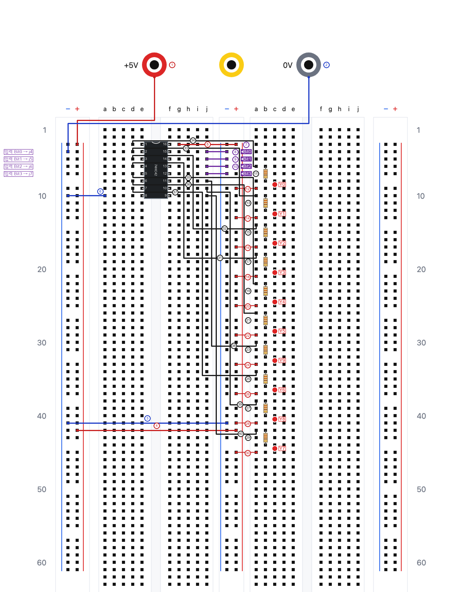
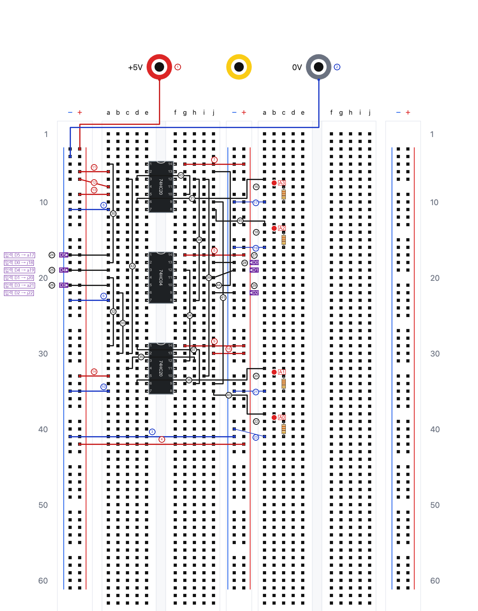

# 실험5 Decoder & Encoder 예비보고서

<table_of_contents color="gray"/>

<empty-block/>
# 실험 목적

디코더와 인코더의 동작 원리를 이해하고, 두 회로를 실제로 활용하는 예로 BCD to Decimal Decoder와 Decimal to Excess-3 Code Encoder를 구성해 동작을 확인하는 것이 이번 실험의 목적이다.

실험은 74HC42 한 칩으로 만드는 BCD to Decimal Decoder에서 시작한다. 4비트 BCD 입력 Bit3~Bit0를 0000부터 1001까지 바꿔 가며 출력 Y0~Y9 가운데 입력값에 해당하는 LED 하나만 켜지는지 본다. 이어 디코더 회로를 모두 걷고 74HC04와 74HC20 두 개로 Decimal to Excess-3 Code Encoder를 새로 구성한다. 10진수 입력 D0~D5를 하나씩 1로 올리면서 출력 A3~A0가 그 수에 3을 더한 4비트 코드로 나오는지 확인한다.

<empty-block/>
<empty-block/>
# 실험 이론
## 디코더

디코더(Decoder)는 n비트 이진 코드를 받아 최대 2ⁿ개의 서로 다른 출력 가운데 하나를 활성화하는 조합 논리회로다. 입력이 n개, 출력이 m개면 nXm 디코더라고 부른다. 강의노트는 메모리의 특정 공간에 접근하거나 입출력 장치 하나를 고르거나 명령어의 이진 코드를 해석하는 자리에 디코더가 쓰인다고 설명한다. 각 출력은 입력 조합 하나에 대응하는 최소항이므로, 입력 조합마다 활성화되는 출력은 많아야 하나다.

BCD to Decimal Decoder는 4비트 BCD 코드 0000~1001을 받아 10진수 0~9에 해당하는 출력 하나를 고른다. 이번 실험에서 쓰는 74HC42는 입력 A·B·C·D(A가 최하위 비트)와 출력 Y0~Y9를 가진 BCD to Decimal Decoder다. 강의노트 항목 제목은 4x16 Decoder이지만 74HC42의 출력은 열 개이고, 데이터시트 function table에 따르면 BCD가 아닌 입력 1010~1111에서는 출력이 모두 1이다.

74HC42의 출력은 선택된 하나만 0으로 내려가고 나머지는 1을 유지하는 Active Low 출력이다. 강의노트는 이를 Negative Logic, 곧 0을 Active(On)로, 1을 Inactive(Off)로 해석하는 방식으로 설명한다. 따라서 출력 Yk는 입력이 k일 때의 최소항을 반전한 값이다.

- Y0 = (Bit3'·Bit2'·Bit1'·Bit0')'
- Y5 = (Bit3'·Bit2·Bit1'·Bit0)'
- Y9 = (Bit3·Bit2'·Bit1'·Bit0)'

출력이 0일 때 LED가 켜지게 하려면 LED의 애노드를 +5V에 두고 캐소드 쪽을 저항을 거쳐 출력 핀에 연결한다. 출력이 0이면 +5V에서 출력 핀으로 전류가 흘러 LED가 켜지고, 출력이 1이면 양 끝 전압이 같아 꺼진다.

<empty-block/>
## 인코더와 Excess-3 코드

인코더(Encoder)는 디코더와 반대로, 여러 입력 가운데 활성화된 하나의 위치를 이진 코드로 바꾸는 조합 논리회로다. 입력이 m개, 출력이 n개면 mXn 인코더라고 부른다. 강의노트는 키보드에서 눌린 키의 위치를 이진 코드로 바꾸거나 CPU가 인터럽트의 출처를 식별하는 경우를 예로 든다. 여러 입력이 동시에 1이 되면 출력이 어느 입력도 가리키지 않는 값이 될 수 있어, 이번 실험에서는 한 번에 입력 하나만 1로 둔다.

Excess-3 코드는 BCD 코드에 3(0011)을 더한 4비트 코드다. 10진수 0은 0011, 9는 1100이 된다. Decimal to Excess-3 Code Encoder는 10진수 입력선 하나가 1이 되면 그 수의 Excess-3 코드를 출력한다.

- **Excess-3 코드표**
	| 10진수 | BCD | Excess-3 |
	|---|---|---|
	| 0 | 0000 | 0011 |
	| 1 | 0001 | 0100 |
	| 2 | 0010 | 0101 |
	| 3 | 0011 | 0110 |
	| 4 | 0100 | 0111 |
	| 5 | 0101 | 1000 |
	| 6 | 0110 | 1001 |
	| 7 | 0111 | 1010 |
	| 8 | 1000 | 1011 |
	| 9 | 1001 | 1100 |

강의노트 회로도의 입력은 D0~D5 여섯 개라 이번 회로는 10진수 0~5까지만 다룬다. 출력 비트마다 그 비트가 1이 되는 10진수 입력을 OR로 모으면 회로의 식이 나온다. 예를 들어 A0는 0(0011)·2(0101)·4(0111)에서 1이므로 D0 + D2 + D4다.

- A3 = D5
- A2 = D1 + D2 + D3 + D4
- A1 = D0 + D3 + D4
- A0 = D0 + D2 + D4

<empty-block/>
## 사용하는 게이트

Excess-3 인코더에는 NOT과 4입력 NAND 두 가지 게이트가 들어가며, 각각 74HC04와 74HC20에 들어 있다. 강의노트에는 게이트별 진리표가 없어 아래 표는 제조사 데이터시트의 function table을 옮겼다. 데이터시트는 H와 L로 적지만 이 실험은 H를 1, L을 0으로 읽는 양논리를 쓰므로 0과 1로 바꿔 적었다. X는 어느 값이든 상관없다는 뜻이다.

- **NOT** (Y = A')
	| A | Y |
	|---|---|
	| 0 | 1 |
	| 1 | 0 |
- **4입력 NAND** (Y = (A·B·C·D)')
	| A | B | C | D | Y |
	|---|---|---|---|---|
	| 0 | X | X | X | 1 |
	| X | 0 | X | X | 1 |
	| X | X | 0 | X | 1 |
	| X | X | X | 0 | 1 |
	| 1 | 1 | 1 | 1 | 0 |

<empty-block/>
## NOT과 NAND로 만든 OR

Excess-3 인코더의 식은 모두 OR이지만, 강의노트 회로도는 OR 게이트 대신 입력을 74HC04로 반전한 뒤 74HC20의 NAND로 모은다. 드모르간 법칙에 따라 반전한 입력들의 NAND는 원래 입력들의 OR과 같다.

- A2 = (D4'·D3'·D2'·D1')' = D4 + D3 + D2 + D1
- A1 = (D4'·D3'·D0')' = D4 + D3 + D0
- A0 = (D4'·D2'·D0')' = D4 + D2 + D0
- A3 = (D5')' = D5

74HC20은 입력이 넷인 NAND라 A1·A0처럼 모을 신호가 셋이면 남는 입력 하나를, A3처럼 하나뿐이면 남는 입력 셋을 +5V에 묶는다. 1은 AND의 항등원이라 묶은 입력은 결과에 영향을 주지 않는다.

<empty-block/>
<empty-block/>
# 실험 부품
## 준비물

| 품목 | 규격 | 수량 | 비고 |
|---|---|---|---|
| 전압원 | +5V | 1 | 모든 IC의 전원 핀과 입력에 공급 |
| 74HC04 | hex inverter, DIP-14 | 1 | Excess-3 인코더. 인버터 여섯 개를 모두 쓴다 |
| 74HC08 | quad 2-input AND gate | | 이번 실험 항목에는 쓰지 않는다 |
| 74HC20 | dual 4-input NAND, DIP-14 | 2 | Excess-3 인코더. NAND 네 개를 모두 쓴다 |
| 74HC42 | BCD to decimal decoder, DIP-16 | 1 | BCD to Decimal Decoder |
| 74HC148 | 8x3 Priority Encoder | | 이번 실험 항목에는 쓰지 않는다 |
| 발광다이오드 | | 10 | 디코더는 Y0~Y9에 열 개, 인코더는 A3~A0에 네 개를 쓴다 |
| 저항 | 330Ω | 10 | 발광다이오드마다 하나씩 직렬로 넣는다 |
| 브레드보드 | | 1 | IC와 배선을 올린다 |
| 점퍼선 | | 적당량 | 입력을 +5V·GND에 물리고 게이트 사이를 잇는다 |

<empty-block/>
## 핀 배치

| IC | 입력 | 출력 | VCC | GND | 미연결 |
|---|---|---|---|---|---|
| 74HC42 (BCD to decimal decoder, DIP-16) | A=15, B=14, C=13, D=12 | Y0~Y6 = 1~7, Y7=9, Y8=10, Y9=11 | 16 | 8 | |
| 74HC20 (dual 4-input NAND) | 1,2,4,5 · 9,10,12,13 | 6 · 8 | 14 | 7 | 3, 11 |

74HC04는 인버터 6개짜리로 1→2, 3→4, 5→6, 9→8, 11→10, 13→12이고 VCC는 14번, GND는 7번이다.

강의노트 회로도에는 신호 핀 번호가 적혀 있고, 모두 데이터시트의 배치와 일치한다. 전원 핀과 미연결 핀은 회로도에 없어 데이터시트에서 확인했다. 74HC42는 16핀이라 전원이 16번, GND가 8번이고, 출력 Y7~Y9는 9·10·11번으로 칩 아래쪽에서 위로 올라간다. 74HC20은 3번과 11번이 내부에 연결되지 않은 빈 다리라서 첫 게이트의 입력이 1·2·4·5번으로 한 칸 건너뛴다.

<empty-block/>
<empty-block/>
# 실험 과정 및 예상 결과
## 실험 1-2) BCD to Decimal Decoder (4x16 Decoder)

74HC42의 입력 15·14·13·12번에 Bit0·Bit1·Bit2·Bit3를 물리고, 출력 Y0~Y9마다 +5V, LED, 330Ω 저항을 차례로 이어 출력 핀에 연결한다. 강의노트가 지시한 대로 Output을 Negative Logic으로 구성했으므로 표에서 출력값이 0인 칸의 LED가 켜진다.

Bit3~Bit0를 0000부터 1001까지 차례로 바꾸면서, 입력값과 같은 번호의 LED 하나만 켜지고 나머지 아홉 개는 꺼져 있는지 확인한다. 출력이 열 개라 표를 Y0~Y4와 Y5~Y9 둘로 나눴다. 시간이 남으면 1010~1111도 넣어 보고 LED가 하나도 켜지지 않는지 본다.

- **BCD to Decimal Decoder, Y0~Y4** (Y0 = (Bit3'·Bit2'·Bit1'·Bit0')', Y1 = (Bit3'·Bit2'·Bit1'·Bit0)', Y2 = (Bit3'·Bit2'·Bit1·Bit0')', Y3 = (Bit3'·Bit2'·Bit1·Bit0)', Y4 = (Bit3'·Bit2·Bit1'·Bit0')')
	| Bit3 | Bit2 | Bit1 | Bit0 | Y0 | Y1 | Y2 | Y3 | Y4 |
	|---|---|---|---|---|---|---|---|---|
	| 0 | 0 | 0 | 0 | 0 | 1 | 1 | 1 | 1 |
	| 0 | 0 | 0 | 1 | 1 | 0 | 1 | 1 | 1 |
	| 0 | 0 | 1 | 0 | 1 | 1 | 0 | 1 | 1 |
	| 0 | 0 | 1 | 1 | 1 | 1 | 1 | 0 | 1 |
	| 0 | 1 | 0 | 0 | 1 | 1 | 1 | 1 | 0 |
	| 0 | 1 | 0 | 1 | 1 | 1 | 1 | 1 | 1 |
	| 0 | 1 | 1 | 0 | 1 | 1 | 1 | 1 | 1 |
	| 0 | 1 | 1 | 1 | 1 | 1 | 1 | 1 | 1 |
	| 1 | 0 | 0 | 0 | 1 | 1 | 1 | 1 | 1 |
	| 1 | 0 | 0 | 1 | 1 | 1 | 1 | 1 | 1 |
- **BCD to Decimal Decoder, Y5~Y9** (Y5 = (Bit3'·Bit2·Bit1'·Bit0)', Y6 = (Bit3'·Bit2·Bit1·Bit0')', Y7 = (Bit3'·Bit2·Bit1·Bit0)', Y8 = (Bit3·Bit2'·Bit1'·Bit0')', Y9 = (Bit3·Bit2'·Bit1'·Bit0)')
	| Bit3 | Bit2 | Bit1 | Bit0 | Y5 | Y6 | Y7 | Y8 | Y9 |
	|---|---|---|---|---|---|---|---|---|
	| 0 | 0 | 0 | 0 | 1 | 1 | 1 | 1 | 1 |
	| 0 | 0 | 0 | 1 | 1 | 1 | 1 | 1 | 1 |
	| 0 | 0 | 1 | 0 | 1 | 1 | 1 | 1 | 1 |
	| 0 | 0 | 1 | 1 | 1 | 1 | 1 | 1 | 1 |
	| 0 | 1 | 0 | 0 | 1 | 1 | 1 | 1 | 1 |
	| 0 | 1 | 0 | 1 | 0 | 1 | 1 | 1 | 1 |
	| 0 | 1 | 1 | 0 | 1 | 0 | 1 | 1 | 1 |
	| 0 | 1 | 1 | 1 | 1 | 1 | 0 | 1 | 1 |
	| 1 | 0 | 0 | 0 | 1 | 1 | 1 | 0 | 1 |
	| 1 | 0 | 0 | 1 | 1 | 1 | 1 | 1 | 0 |

<empty-block/>
## 실험 2-2) Decimal to Excess-3 Code Encoder

전원을 끄고 디코더의 배선과 74HC42, LED 사슬 열 개를 모두 뽑은 뒤 74HC04 하나와 74HC20 두 개를 꽂는다. 입력 D5~D0를 74HC04의 인버터 여섯 개로 반전하고, 반전된 신호를 실험 이론에 적은 조합대로 74HC20의 NAND 네 개에 나눠 넣는다. 첫 번째 74HC20의 두 게이트가 A3와 A2를, 두 번째 74HC20의 두 게이트가 A1과 A0를 낸다. 이번에는 출력이 1일 때 LED가 켜지도록 출력, 330Ω 저항, LED, GND 순으로 연결한다.

D0~D5 가운데 하나만 1로 두고 나머지는 0으로 둔 채, 1로 올리는 입력을 D0부터 D5까지 옮겨 간다. 네 LED를 A3·A2·A1·A0 순으로 읽은 값이 그 수에 3을 더한 코드, 곧 0011부터 1000까지로 나와야 한다.

- **Decimal to Excess-3 Code Encoder** (A3 = (D5')', A2 = (D4'·D3'·D2'·D1')', A1 = (D4'·D3'·D0')', A0 = (D4'·D2'·D0')')
	| D5 | D4 | D3 | D2 | D1 | D0 | A3 | A2 | A1 | A0 |
	|---|---|---|---|---|---|---|---|---|---|
	| 0 | 0 | 0 | 0 | 0 | 1 | 0 | 0 | 1 | 1 |
	| 0 | 0 | 0 | 0 | 1 | 0 | 0 | 1 | 0 | 0 |
	| 0 | 0 | 0 | 1 | 0 | 0 | 0 | 1 | 0 | 1 |
	| 0 | 0 | 1 | 0 | 0 | 0 | 0 | 1 | 1 | 0 |
	| 0 | 1 | 0 | 0 | 0 | 0 | 0 | 1 | 1 | 1 |
	| 1 | 0 | 0 | 0 | 0 | 0 | 1 | 0 | 0 | 0 |

<empty-block/>
<empty-block/>
# 회로 결선도
## 공통 결선 규칙

- 74HC42는 16번 핀을 +5V에, 8번 핀을 GND에 연결한다. 74HC04와 74HC20은 14번 핀을 +5V에, 7번 핀을 GND에 연결한다.
- 입력 Bit0~Bit3와 D0~D5는 점퍼선으로 +5V(=1) 또는 GND(=0)에 직접 물린다. 강의노트 회로도는 입력마다 스위치를 그리지만 준비물에 스위치가 없어 점퍼선으로 대신한다. 전기적으로는 같은 0과 1이다.
- 쓰는 게이트의 입력은 반드시 어딘가에 물린다. 74HC20에서 +5V에 묶는 입력(첫 번째 칩의 2·4·5번, 두 번째 칩의 5·13번)도 비워 두지 않고 +5V 레일에 꽂는다. 이번 두 회로는 칩의 입력을 모두 쓰므로 남는 입력 핀은 없다.
- 디코더의 LED는 애노드를 +5V에, 캐소드를 330Ω 저항을 거쳐 출력 핀에 연결한다. 인코더의 LED는 출력 핀에서 330Ω 저항을 거쳐 애노드로 들어가고 캐소드를 GND로 내린다. 두 회로의 LED 방향이 반대라서 인코더를 꽂을 때 LED 사슬도 새로 꽂는다.
- 핀 번호와 칩 번호는 강의노트 회로도를 따른다. 디코더 회로도의 U1은 74HC42이고, 인코더 회로도의 U1은 74HC04, U2와 U3는 74HC20이다.
- 한 신호가 여러 핀으로 가면 첫 목적지 핀에서 다음 목적지로 이어 간다. 표에서 "같은 칩 9번 핀"처럼 적은 것이 그 이어 간 선이고, 전기적으로는 한 점이다.
- 인코더의 D3'는 U3의 2번 핀에서 U2의 10번 핀으로 바로 가지 않고, 내부에 연결되지 않은 U2의 3번 핀을 중간 점으로 거쳐 간다. 칩 몸통을 가로지르는 선을 피하려는 것이고, 3번 핀은 칩 안에서 아무 데도 이어지지 않으므로 논리는 달라지지 않는다.
- 칩을 꽂거나 뽑을 때는 전원을 끈다.

<empty-block/>
## 실험 1-2) BCD to Decimal Decoder (4x16 Decoder) 결선

| 소자 | 핀 | 연결 |
|---|---|---|
| U1 (74HC42) | 15 | 입력 Bit0 |
| U1 (74HC42) | 14 | 입력 Bit1 |
| U1 (74HC42) | 13 | 입력 Bit2 |
| U1 (74HC42) | 12 | 입력 Bit3 |
| U1 (74HC42) | 1 | 330Ω, LED Y0 |
| U1 (74HC42) | 2 | 330Ω, LED Y1 |
| U1 (74HC42) | 3 | 330Ω, LED Y2 |
| U1 (74HC42) | 4 | 330Ω, LED Y3 |
| U1 (74HC42) | 5 | 330Ω, LED Y4 |
| U1 (74HC42) | 6 | 330Ω, LED Y5 |
| U1 (74HC42) | 7 | 330Ω, LED Y6 |
| U1 (74HC42) | 9 | 330Ω, LED Y7 |
| U1 (74HC42) | 10 | 330Ω, LED Y8 |
| U1 (74HC42) | 11 | 330Ω, LED Y9 |

<empty-block/>
## 실험 2-2) Decimal to Excess-3 Code Encoder 결선

| 소자 | 핀 | 연결 |
|---|---|---|
| U1 (74HC04) | 1 | 입력 D5 |
| U1 (74HC04) | 2 | U2의 1번 핀 (D5') |
| U1 (74HC04) | 3 | 입력 D4 |
| U1 (74HC04) | 4 | U3의 1번 핀 (D4') |
| U1 (74HC04) | 5 | 입력 D3 |
| U1 (74HC04) | 6 | U3의 2번 핀 (D3') |
| U1 (74HC04) | 9 | 입력 D2 |
| U1 (74HC04) | 8 | U2의 12번 핀 (D2') |
| U1 (74HC04) | 11 | 입력 D1 |
| U1 (74HC04) | 10 | U2의 13번 핀 (D1') |
| U1 (74HC04) | 13 | 입력 D0 |
| U1 (74HC04) | 12 | U3의 12번 핀 (D0') |
| U2 (74HC20) | 1 | U1의 2번 핀 (D5') |
| U2 (74HC20) | 2, 4, 5 | +5V |
| U2 (74HC20) | 6 | 330Ω, LED A3 |
| U2 (74HC20) | 3 | U3의 2번 핀, 같은 칩 10번 핀 (D3' 중간 점) |
| U2 (74HC20) | 9 | U3의 9번 핀 (D4') |
| U2 (74HC20) | 10 | 같은 칩 3번 핀 (D3') |
| U2 (74HC20) | 12 | U1의 8번 핀, U3의 10번 핀 (D2') |
| U2 (74HC20) | 13 | U1의 10번 핀 (D1') |
| U2 (74HC20) | 8 | 330Ω, LED A2 |
| U2 (74HC20) | 11 | 미연결 |
| U3 (74HC20) | 1 | U1의 4번 핀, 같은 칩 9번 핀 (D4') |
| U3 (74HC20) | 2 | U1의 6번 핀, U2의 3번 핀 (D3') |
| U3 (74HC20) | 4 | 같은 칩 12번 핀 (D0') |
| U3 (74HC20) | 5 | +5V |
| U3 (74HC20) | 6 | 330Ω, LED A1 |
| U3 (74HC20) | 9 | 같은 칩 1번 핀, U2의 9번 핀 (D4') |
| U3 (74HC20) | 10 | U2의 12번 핀 (D2') |
| U3 (74HC20) | 12 | U1의 12번 핀, 같은 칩 4번 핀 (D0') |
| U3 (74HC20) | 13 | +5V |
| U3 (74HC20) | 8 | 330Ω, LED A0 |
| U3 (74HC20) | 3, 11 | 미연결 |

<empty-block/>
## 실험 전 확인할 사항

- 74HC42는 16핀이다. 14핀 칩처럼 14번과 7번에 전원을 꽂지 않았는지, 16번이 +5V, 8번이 GND인지 전원을 넣기 전에 다시 본다.
- 디코더 보드에서 LED는 출력 핀의 줄 순서대로 놓여 위에서부터 Y0~Y5, Y9, Y6, Y8, Y7 순이다. 진리표의 열 순서와 다르므로 LED 이름을 확인하며 읽는다.
- 74HC20의 VCC 묶음 입력(U2의 2·4·5번, U3의 5·13번)이 +5V에 꽂혀 있는지 본다. 하나라도 비면 그 NAND의 출력이 정해지지 않는다.
- U2의 3번에만 D3'를 잇는 선 두 가닥을 꽂고, 나머지 빈 다리 셋(U2의 11번, U3의 3·11번)은 비워 둔다.
- 인코더는 한 신호를 핀에서 핀으로 이어 가므로 중간 선 하나가 빠지면 그 뒤 핀이 모두 뜬다. LED가 진리표와 어긋나면 그 출력이 받는 신호의 선을 인버터 출력부터 따라간다.
- 강의노트 준비물에 74HC04와 74HC42는 수량이 없다. 각각 하나로 보고 배선했으니 지급된 수량을 먼저 확인한다.
- 칩의 각인을 확인한다. 74HC 계열이면 제조사가 달라도 핀 배치는 같지만, 74HCT나 74LS면 전기 특성이 달라 비교할 데이터시트를 바꾼다. 74HC42는 참고한 데이터시트가 SO16 패키지만 싣고 있어 DIP-16 실물의 핀 배치도 함께 확인한다.
- 330Ω을 달았을 때 발광다이오드 전류는 대략 9mA다. 74HC 출력 전압은 데이터시트에서 4mA까지만 규정되어 있어, LED가 눈에 띄게 어두우면 이 지점을 먼저 본다.
- 조교가 입력 스위치 사용이나 다른 입력 조합의 확인을 지시하면 그대로 따른다.

<empty-block/>
<empty-block/>
# 출처 및 참고문헌

- 논리회로실험 강의노트
- 논리회로실험 IC 특성 분석 가이드
- Nexperia. 74HC04; 74HCT04 — Hex inverter. Rev. 10, 2024-02-16.
  https://assets.nexperia.com/documents/data-sheet/74HC_HCT04.pdf
- Nexperia. 74HC20 — Dual 4-input NAND gate. Rev. 7, 2024-03-14.
  https://assets.nexperia.com/documents/data-sheet/74HC20.pdf
- Nexperia. 74HC42 — BCD to decimal decoder. Rev. 4, 2024-03-26.
  https://assets.nexperia.com/documents/data-sheet/74HC42.pdf
