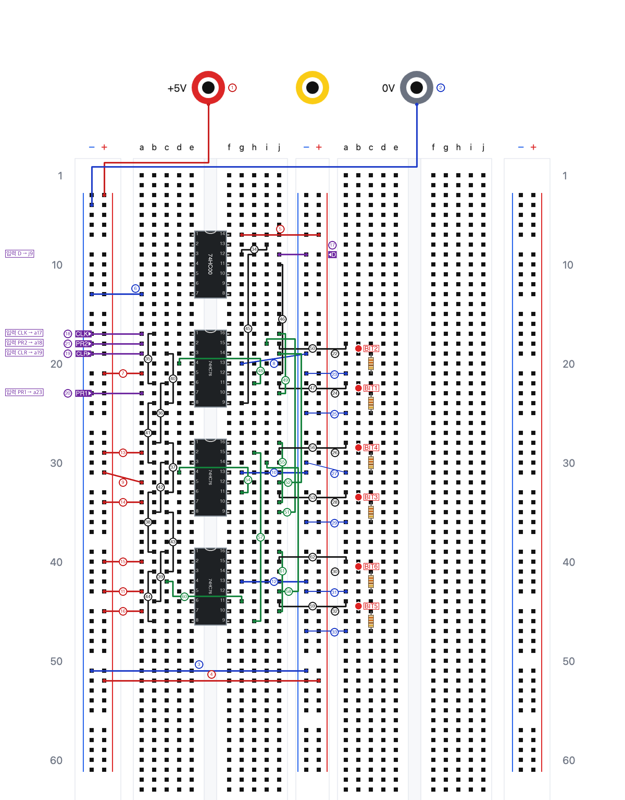

# 실험7 Shift Register 예비보고서

<table_of_contents color="gray"/>

<empty-block/>
# 실험 목적

레지스터의 정보 저장 원리와 클럭에 따른 시프트 동작을 이해한다. JK 플립플롭 여섯 개로 6bit 우측 시프트 레지스터를 구성하고, 직렬 입력이 각 단으로 이동하는 과정을 LED와 오실로스코프로 확인한다. 공통 CLR에 의한 초기화와 PR1·PR2에 의한 강제 SET 동작도 확인한다.

<empty-block/>
<empty-block/>
# 실험 이론
## 레지스터와 직렬 입력

플립플롭 하나는 1bit를 저장하며, 여섯 개를 연결하면 6bit 레지스터가 된다. 각 단의 출력을 다음 단의 입력으로 보내고 공통 클럭을 인가하면 저장된 정보가 한 단씩 이동한다. 이번 회로는 SERIAL DATA를 한 비트씩 입력하고 BIT1~BIT6을 동시에 읽는 직렬 입력·병렬 출력(SIPO) 구조다.

<empty-block/>
## JK 플립플롭의 시프트 동작

CLR과 PR이 모두 1일 때 JK 플립플롭의 다음 상태는 Q(next)=J·Q'+K'·Q로 나타낸다. J=D, K=D'로 연결하면 Q(next)=D가 된다. 첫 단은 NAND 게이트의 두 입력을 SERIAL DATA에 묶어 D'=(D·D)'를 만들고, 나머지 단은 앞단의 Q와 Q'를 각각 J와 K에 연결한다.

여섯 단은 같은 CLK의 하강 에지에서 동작한다. BIT1(next)=SERIAL DATA이며, i=2~6에 대해 BITi(next)=BIT(i−1)(previous)다. 다음 단에는 같은 에지에서 바뀐 새 출력이 아니라 에지 직전의 앞단 출력이 저장된다. 따라서 첫 입력 비트는 여섯 번째 하강 에지 뒤 BIT6에 도달한다.

<empty-block/>
## 초기화와 강제 SET

CLR과 PR은 Active Low인 비동기 입력이다. CLR=0이면 여섯 출력을 0으로 초기화하고, CLR=1로 해제해야 직렬 데이터를 저장할 수 있다. PR1=0은 BIT1을, PR2=0은 BIT2를 클럭과 관계없이 1로 만든다. 해당 PR을 1로 해제하면 저장한 1이 남아 있고 이후 하강 에지부터 이동한다. 초기화 중에는 PR1=PR2=1로 두어 CLR과 PR을 동시에 활성화하지 않는다.

<empty-block/>
<empty-block/>
# 실험 부품
## 준비물

| 부품·장비 | 수량 | 용도 |
|---|---|---|
| 5V 전압원 | 1대 | IC와 논리 입력의 전원 |
| 오실로스코프 | 1대 | CLK의 하강 에지와 신호 레벨 관찰 |
| 클럭 발생 장비 | 1대 | 0~5V 클럭 공급, 제공 장비 확인 |
| 74HC00 | 1개 | NAND 게이트 한 개로 직렬 입력 반전 |
| 74HC76 | 3개 | 패키지당 JK 플립플롭 두 개, 총 여섯 단 |
| 7496 | 수량 미표기 | 이번 실험 항목에는 쓰지 않는다 |
| LED | 6개 | BIT1~BIT6의 Q 출력 표시 |
| 330Ω 저항 | 6개 | 각 LED의 전류 제한 |
| 브레드보드 | 1개 | 회로 구성 |
| 점퍼선·입력 조작 수단 | 필요량 | 신호 연결과 입력 레벨 설정 |

<empty-block/>
## IC 구성과 핀 배치

| IC | 내부 구성 | 입력 핀 | 출력 핀 | VCC | GND |
|---|---|---|---|---|---|
| 74HC00 | 2입력 NAND 4개 | 1·2 / 4·5 / 9·10 / 12·13 | 3 / 6 / 8 / 11 | 14 | 7 |
| 74HC76 | 첫째 JK F/F | CLK 1, PR 2, CLR 3, J 4, K 16 | Q 15, Q' 14 | 5 | 13 |
| 74HC76 | 둘째 JK F/F | CLK 6, PR 7, CLR 8, J 9, K 12 | Q 11, Q' 10 | 5 | 13 |

<empty-block/>
<empty-block/>
# 실험 과정 및 예상 결과
## 실험 1) 6bit Shift Right Register

74HC00 한 개와 74HC76 세 개를 결선하고 각 Q에 LED와 330Ω 저항을 직렬로 연결한다. CLK을 멈춘 상태에서 PR1=PR2=1, CLR=0으로 초기화한 뒤 CLR을 1로 올린다. 초기화 직후 예상 상태는 (BIT1, BIT2, BIT3, BIT4, BIT5, BIT6)=(0, 0, 0, 0, 0, 0)이다.

CLK은 주기 5s 이상(0.2Hz 이하)으로 설정하고 오실로스코프로 하강 에지를 확인한다. SERIAL DATA는 에지 전에 설정하여 에지 전후에 안정되게 유지한다. 예를 들어 초기화 후 1을 한 번, 이어 0을 넣으면 출력의 1은 BIT1, BIT2 순으로 이동한다. 이후에도 0을 입력하면 여섯 번째 에지에서 BIT6에 도달하고 일곱 번째 에지에서 빠져나간다.

PR1과 PR2는 각각 재초기화한 뒤 따로 시험한다. SERIAL DATA=0, CLK=0에서 CLR을 해제하고 해당 PR만 0으로 내린다. PR1 시험의 예상 시작 상태는 (1, 0, 0, 0, 0, 0), PR2 시험은 (0, 1, 0, 0, 0, 0)이다. PR을 1로 해제한 뒤 클럭을 인가하면 이 1이 뒤 단으로 이동한다. PR을 계속 0으로 두면 해당 단이 강제 SET 상태를 유지하므로 한 비트만 이동시키는 경우와 구분한다.

아래 표의 빈칸은 실제 입력과 관측값을 적는 자리다. CLK의 1->0은 하강 에지 한 번이며, 출력 순서는 BIT1~BIT6이다. 입력·제어와 출력 표는 같은 스텝끼리 대조한다.

- **초기화·직렬 입력의 제어 신호**
	| 스텝 | 조작 | SERIAL DATA | CLK | CLR | PR1 | PR2 |
	|---|---|---|---|---|---|---|
	| R0 | CLK 정지, 공통 초기화 | 0 | 0 | 0 | 1 | 1 |
	| R1 | CLR 해제, 에지 없이 관찰 | 0 | 0 | 1 | 1 | 1 |
	| S1 | 첫 데이터 비트를 에지 전에 설정 |  | 1->0 | 1 | 1 | 1 |
	| S2 | 다음 데이터 비트를 에지 전에 설정 |  | 1->0 | 1 | 1 | 1 |
	| S3 | 다음 데이터 비트를 에지 전에 설정 |  | 1->0 | 1 | 1 | 1 |
	| S4 | 다음 데이터 비트를 에지 전에 설정 |  | 1->0 | 1 | 1 | 1 |
	| S5 | 다음 데이터 비트를 에지 전에 설정 |  | 1->0 | 1 | 1 | 1 |
	| S6 | 다음 데이터 비트를 에지 전에 설정 |  | 1->0 | 1 | 1 | 1 |

- **초기화·직렬 입력의 출력 상태**
	| 스텝 | BIT1 | BIT2 | BIT3 | BIT4 | BIT5 | BIT6 |
	|---|---|---|---|---|---|---|
	| R0 |  |  |  |  |  |  |
	| R1 |  |  |  |  |  |  |
	| S1 |  |  |  |  |  |  |
	| S2 |  |  |  |  |  |  |
	| S3 |  |  |  |  |  |  |
	| S4 |  |  |  |  |  |  |
	| S5 |  |  |  |  |  |  |
	| S6 |  |  |  |  |  |  |

- **PR1 강제 SET 및 이동 입력·제어**
	| 스텝 | 조작 | SERIAL DATA | CLK | CLR | PR1 | PR2 |
	|---|---|---|---|---|---|---|
	| R0 | CLK 정지, 재초기화 | 0 | 0 | 0 | 1 | 1 |
	| P1 | CLR 해제 후 PR1만 0, 에지 없이 관찰 | 0 | 0 | 1 | 0 | 1 |
	| P2 | PR1을 1로 해제, 에지 없이 관찰 | 0 | 0 | 1 | 1 | 1 |
	| S1 | 하강 에지 후 관찰 | 0 | 1->0 | 1 | 1 | 1 |
	| S2 | 하강 에지 후 관찰 | 0 | 1->0 | 1 | 1 | 1 |
	| S3 | 하강 에지 후 관찰 | 0 | 1->0 | 1 | 1 | 1 |
	| S4 | 하강 에지 후 관찰 | 0 | 1->0 | 1 | 1 | 1 |
	| S5 | 하강 에지 후 관찰 | 0 | 1->0 | 1 | 1 | 1 |
	| S6 | 하강 에지 후 관찰 | 0 | 1->0 | 1 | 1 | 1 |

- **PR1 강제 SET 및 이동 출력**
	| 스텝 | BIT1 | BIT2 | BIT3 | BIT4 | BIT5 | BIT6 |
	|---|---|---|---|---|---|---|
	| R0 |  |  |  |  |  |  |
	| P1 |  |  |  |  |  |  |
	| P2 |  |  |  |  |  |  |
	| S1 |  |  |  |  |  |  |
	| S2 |  |  |  |  |  |  |
	| S3 |  |  |  |  |  |  |
	| S4 |  |  |  |  |  |  |
	| S5 |  |  |  |  |  |  |
	| S6 |  |  |  |  |  |  |

- **PR2 강제 SET 및 이동 입력·제어**
	| 스텝 | 조작 | SERIAL DATA | CLK | CLR | PR1 | PR2 |
	|---|---|---|---|---|---|---|
	| R0 | CLK 정지, 재초기화 | 0 | 0 | 0 | 1 | 1 |
	| P1 | CLR 해제 후 PR2만 0, 에지 없이 관찰 | 0 | 0 | 1 | 1 | 0 |
	| P2 | PR2를 1로 해제, 에지 없이 관찰 | 0 | 0 | 1 | 1 | 1 |
	| S1 | 하강 에지 후 관찰 | 0 | 1->0 | 1 | 1 | 1 |
	| S2 | 하강 에지 후 관찰 | 0 | 1->0 | 1 | 1 | 1 |
	| S3 | 하강 에지 후 관찰 | 0 | 1->0 | 1 | 1 | 1 |
	| S4 | 하강 에지 후 관찰 | 0 | 1->0 | 1 | 1 | 1 |
	| S5 | 하강 에지 후 관찰 | 0 | 1->0 | 1 | 1 | 1 |

- **PR2 강제 SET 및 이동 출력**
	| 스텝 | BIT1 | BIT2 | BIT3 | BIT4 | BIT5 | BIT6 |
	|---|---|---|---|---|---|---|
	| R0 |  |  |  |  |  |  |
	| P1 |  |  |  |  |  |  |
	| P2 |  |  |  |  |  |  |
	| S1 |  |  |  |  |  |  |
	| S2 |  |  |  |  |  |  |
	| S3 |  |  |  |  |  |  |
	| S4 |  |  |  |  |  |  |
	| S5 |  |  |  |  |  |  |

<empty-block/>
<empty-block/>
# 회로 결선도
## 공통 결선 규칙

U1은 74HC00, U2~U4는 74HC76이다. U1의 전원은 14번과 7번, U2~U4는 각각 5번과 13번에 연결한다. CLK과 CLR은 여섯 플립플롭이 공유하며 발생기와 오실로스코프의 GND를 회로 GND에 연결한다. 배선을 바꿀 때는 전원과 외부 신호 출력을 끈다.

각 Q의 표시 회로는 Q → LED → 330Ω → GND로 구성한다. 완성 배선에서는 각 74HC76의 F/F 2를 BIT1·BIT3·BIT5에, F/F 1을 BIT2·BIT4·BIT6에 사용한다. NAND는 12·13번 입력과 11번 출력을 사용한다. 기능은 강의노트 회로와 같으며 게이트와 플립플롭의 사용 위치를 바꾼 배치다.

<empty-block/>
## 실험 1) 6bit Shift Right Register 결선

| 소자 | 핀 | 연결 | 기능 |
|---|---|---|---|
| U1 (74HC00) | 14 | VCC(+5V) | 전원 |
| U1 (74HC00) | 7 | GND | 접지 |
| U1 (74HC00) | 12 | SERIAL DATA, U1.pin13, U2.pin9 | SERIAL DATA |
| U1 (74HC00) | 13 | U1.pin12 | NAND 입력 묶음 |
| U1 (74HC00) | 11 | U2.pin12 | D 보수 → BIT1 K |
| U1 (74HC00) | 미사용 입력 1, 2, 4, 5, 9, 10 | 접지 생략 | 미사용 입력, 실험 전 처리 확인 |
| U1 (74HC00) | 미사용 출력 3, 6, 8 | 연결하지 않음 | 개방 |
| U2 (74HC76) | 5 | VCC(+5V) | 전원 |
| U2 (74HC76) | 13 | GND | 접지 |
| U2 (74HC76) | 1 | CLK | 공통 CLK |
| U2 (74HC76) | 6 | U2.pin1, U3.pin1 | 공통 CLK |
| U2 (74HC76) | 3 | CLR | 공통 CLR |
| U2 (74HC76) | 8 | U2.pin3, U3.pin3 | 공통 CLR |
| U2 (74HC76) | 7 | PR1 | BIT1 PR |
| U2 (74HC76) | 2 | PR2 | BIT2 PR |
| U2 (74HC76) | 9 | U1.pin12 | BIT1 J |
| U2 (74HC76) | 12 | U1.pin11 | BIT1 K |
| U2 (74HC76) | 11 | U2.pin4, LED BIT1 급전 | BIT1 Q |
| U2 (74HC76) | 10 | U2.pin16 | BIT1 보수 |
| U2 (74HC76) | 4 | U2.pin11 | BIT2 J |
| U2 (74HC76) | 16 | U2.pin10 | BIT2 K |
| U2 (74HC76) | 15 | U3.pin9, LED BIT2 급전 | BIT2 Q |
| U2 (74HC76) | 14 | U3.pin12 | BIT2 보수 |
| U3 (74HC76) | 5 | VCC(+5V) | 전원 |
| U3 (74HC76) | 13 | GND | 접지 |
| U3 (74HC76) | 1 | U2.pin6 | 공통 CLK |
| U3 (74HC76) | 6 | U3.pin1, U4.pin1 | 공통 CLK |
| U3 (74HC76) | 3 | U2.pin8 | 공통 CLR |
| U3 (74HC76) | 8 | U3.pin3, U4.pin3 | 공통 CLR |
| U3 (74HC76) | 7 | VCC(+5V) | BIT3 PR |
| U3 (74HC76) | 2 | VCC(+5V) | BIT4 PR |
| U3 (74HC76) | 9 | U2.pin15 | BIT3 J |
| U3 (74HC76) | 12 | U2.pin14 | BIT3 K |
| U3 (74HC76) | 11 | U3.pin4, LED BIT3 급전 | BIT3 Q |
| U3 (74HC76) | 10 | U3.pin16 | BIT3 보수 |
| U3 (74HC76) | 4 | U3.pin11 | BIT4 J |
| U3 (74HC76) | 16 | U3.pin10 | BIT4 K |
| U3 (74HC76) | 15 | U4.pin9, LED BIT4 급전 | BIT4 Q |
| U3 (74HC76) | 14 | U4.pin12 | BIT4 보수 |
| U4 (74HC76) | 5 | VCC(+5V) | 전원 |
| U4 (74HC76) | 13 | GND | 접지 |
| U4 (74HC76) | 1 | U3.pin6 | 공통 CLK |
| U4 (74HC76) | 6 | U4.pin1 | 공통 CLK |
| U4 (74HC76) | 3 | U3.pin8 | 공통 CLR |
| U4 (74HC76) | 8 | U4.pin3 | 공통 CLR |
| U4 (74HC76) | 7 | VCC(+5V) | BIT5 PR |
| U4 (74HC76) | 2 | VCC(+5V) | BIT6 PR |
| U4 (74HC76) | 9 | U3.pin15 | BIT5 J |
| U4 (74HC76) | 12 | U3.pin14 | BIT5 K |
| U4 (74HC76) | 11 | U4.pin4, LED BIT5 급전 | BIT5 Q |
| U4 (74HC76) | 10 | U4.pin16 | BIT5 보수 |
| U4 (74HC76) | 4 | U4.pin11 | BIT6 J |
| U4 (74HC76) | 16 | U4.pin10 | BIT6 K |
| U4 (74HC76) | 15 | LED BIT6 급전 | BIT6 Q |
| U4 (74HC76) | 14 | 연결하지 않음 | BIT6 보수 / 미사용 출력 |

<empty-block/>
## 실험 전 확인할 사항

- 74HC76의 실물 제조사·노치와 핀 배치를 대조한다. 특히 VCC=5번, GND=13번을 확인하고 해당 제조사 데이터시트로 확인한다. 74HC00도 실물 패키지와 핀 배치를 대조한다.

- 강의노트 그림의 1Hz 표기와 본문의 5s 이상 안내가 다르므로 본문 권장값을 우선 적용하고 실제 클럭 주기를 확인한다. 입력 레벨과 공통 접지를 확인하며 수동 접점의 여러 에지를 한 번으로 세지 않는다.

- PR1은 U2의 7번, PR2는 U2의 2번이다. 그림의 LED 물리 순서는 BIT2·BIT1·BIT4·BIT3·BIT6·BIT5이므로 기록표의 BIT1~BIT6 순서와 대조한다.

- LED 극성과 출력 부하를 확인한다. Q가 LED와 다음 단 J를 동시에 구동할 때의 신호 레벨을 확인하고, 미사용 74HC00 입력의 접지 생략은 일반 CMOS 권장사항과 구분하여 담당자 지침에 맞춘다. 미사용 출력은 연결하지 않는다.

<empty-block/>
<empty-block/>
# 출처 및 참고문헌
- 논리회로실험 강의노트

- 논리회로실험 IC 특성 분석 가이드

- Nexperia. 74HC00; 74HCT00, Quad 2-input NAND gate. 문서번호 74HC_HCT00, Rev. 11, 2025-04-29. https://assets.nexperia.com/documents/data-sheet/74HC_HCT00.pdf

- Renesas Electronics. HD74HC76, Dual J-K Flip-Flops (with Preset and Clear). 문서번호 REJ03D0551-0200 (Previous ADE-205-423), Rev. 2.00, 2005-10-06. https://www.renesas.com/en/document/dst/hd74hc76-datasheet
