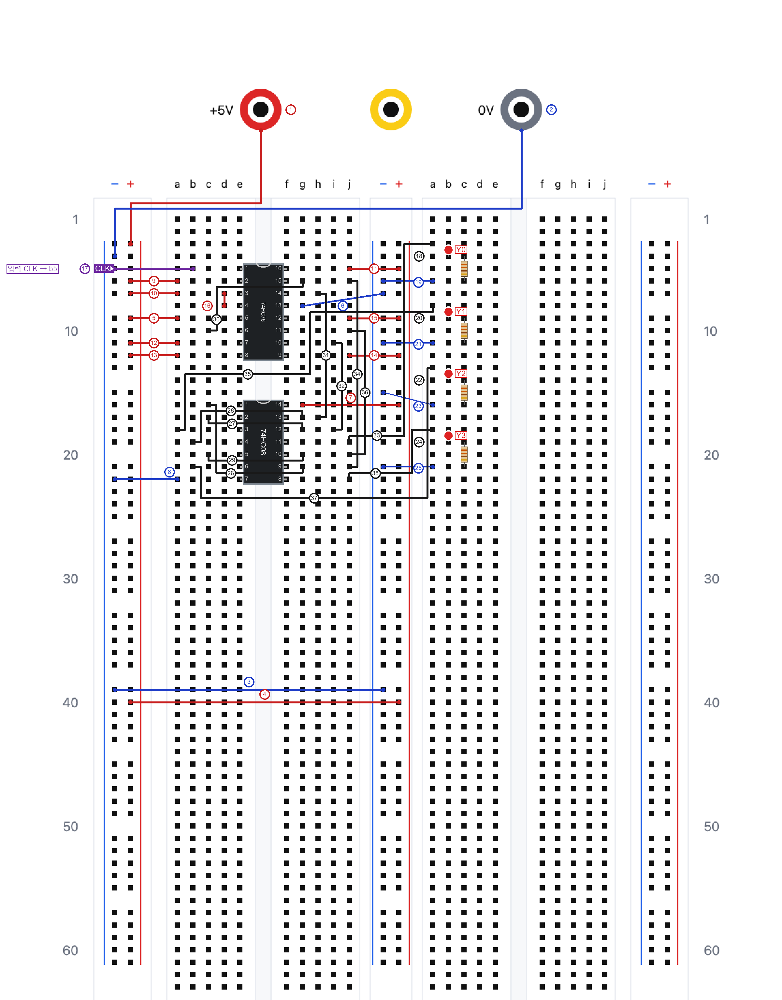
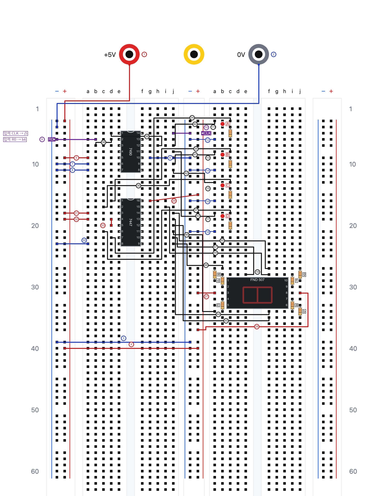

# 실험8 Counter 예비보고서

<table_of_contents color="gray"/>

<empty-block/>
# 실험 목적

레지스터의 구성을 이해하고 카운터의 동작 원리와 특성을 익힌다. 먼저 JK 플립플롭 두 개로 2단 2진 비동기 카운터를 구성해 네 출력이 차례로 켜지는지 확인한다. 이어서 7490으로 BCD 카운터를 구성하고, 7447 디코더와 7-Segment 표시기를 연결해 카운터 값을 숫자로 표시한다.

<empty-block/>
<empty-block/>
# 실험 이론
## 레지스터와 카운터

n bit 레지스터는 n개의 플립플롭으로 구성되며 처리 중인 정보를 임시로 저장한다. 카운터는 클럭 펄스마다 현재 숫자를 갱신해 저장하는 레지스터다. 이번 실험의 두 회로는 이전 플립플롭의 출력이 다음 플립플롭의 클럭으로 전달되는 비동기식이다. 뒤 단은 앞 단이 바뀐 뒤에 바뀌므로 전송 지연이 발생한다.

<empty-block/>
## JK 플립플롭의 Toggle 동작

74HC76의 PR·CL은 Active Low 입력이므로 1로 고정하면 동작에 관여하지 않는다. 이때 다음 상태는 Q(next)=J·Q'+K'·Q이고, J=K=1이면 Q(next)=Q'가 된다. 플립플롭은 하강 에지마다 이전 출력을 뒤집는 T 플립플롭으로 동작한다.

<empty-block/>
## 2단 2진 카운터와 출력 조합

FFA는 CLK의 하강 에지에서, FFB는 A의 하강 에지에서 Toggle한다. A의 주기는 CLK의 2배, B의 주기는 CLK의 4배이므로 1Hz 클럭에서는 네 상태가 1s씩 이어진다. A를 앞에 적으면 AB는 00, 10, 01, 11 순서로 바뀌고, B를 높은 자리로 읽으면 0, 1, 2, 3이 된다. (강의노트 본문은 00, 01, 10, 11로 적었으나 파형과 회로도에 맞추면 A를 앞에 적은 순서는 00, 10, 01, 11이다.)

A가 1에서 0으로 떨어질 때는 B가 뒤따라 바뀌므로 10에서 01로 갈 때 00을, 11에서 00으로 갈 때 01을 잠깐 지난다. 이 짧은 구간이 비동기식의 전송 지연이다.

AND 게이트는 두 입력이 모두 1일 때만 1을 낸다. A, A', B, B'를 네 조합으로 연결하면 Y0=A'·B', Y1=A·B', Y2=A'·B, Y3=A·B가 되고, 네 상태마다 출력 하나만 1이다. Y0~Y3은 강의노트 파형 옆의 출력 번호 0~3을 가리킨다.

<empty-block/>
## BCD 카운터 7490

7490은 INPUT A로 동작하는 2분주 단(QA)과 INPUT B로 동작하는 5분주 단(QB, QC, QD)으로 나뉜다. 클럭을 INPUT A에 넣고 QA를 INPUT B에 연결하면 QA는 입력 하강 에지마다 뒤집히고, QA가 1에서 0으로 떨어질 때마다 뒷단이 한 칸 진행한다. 뒷단이 0~4를 세므로 COUNT는 (QD QC QB의 값)×2+QA가 되어 0부터 9까지 센 뒤 0으로 돌아간다.

R0(1)·R0(2)가 모두 H이면 출력은 0으로, R9(1)·R9(2)가 모두 H이면 9로 고정되며 R9가 우선한다. 이번 회로는 R9 두 핀을 GND에 고정하고 R0 두 핀을 묶어 R0 하나로 조작한다. 그래서 R0=1이면 0을 유지하고 R0=0이면 카운트한다. 아래 표의 X는 don't care다.

- **Truth Table - COUNT**
	| COUNT | QD | QC | QB | QA |
	|---|---|---|---|---|
	| 0 | L | L | L | L |
	| 1 | L | L | L | H |
	| 2 | L | L | H | L |
	| 3 | L | L | H | H |
	| 4 | L | H | L | L |
	| 5 | L | H | L | H |
	| 6 | L | H | H | L |
	| 7 | L | H | H | H |
	| 8 | H | L | L | L |
	| 9 | H | L | L | H |

- **Truth Table - Reset**
	| R0(1) | R0(2) | R9(1) | R9(2) | QD | QC | QB | QA |
	|---|---|---|---|---|---|---|---|
	| H | H | L | X | L | L | L | L |
	| H | H | X | L | L | L | L | L |
	| X | X | H | H | H | L | L | H |
	| X | L | X | L | COUNT | COUNT | COUNT | COUNT |
	| X | L | L | X | COUNT | COUNT | COUNT | COUNT |
	| L | X | X | L | COUNT | COUNT | COUNT | COUNT |
	| L | X | L | X | COUNT | COUNT | COUNT | COUNT |

<empty-block/>
## 7447 디코더와 7-Segment 표시기

7447은 0~9의 4bit 이진수를 입력받아 세그먼트 구동 신호 a~g로 변환한다. 출력은 Active Low 오픈 컬렉터로, 세그먼트를 켤 때 0으로 내려가 전류를 받아들인다. SN7447A의 싱크 전류는 40mA, 출력 최대 전압은 15V다.

FND 507은 Common Anode 표시기다. 공통 단자 3번과 8번에 +5V를 주고 세그먼트 핀을 330Ω을 거쳐 7447 출력에 연결하면, 출력이 0인 세그먼트만 켜진다. Common Cathode 표시기는 이 회로에서 동작하지 않는다.

제어 입력은 0일 때 동작한다. /LT는 모든 세그먼트를 켜고, /BI는 모두 끄며, /RBI는 입력이 0일 때 공백으로 처리한다. 숫자를 그대로 표시하려면 세 핀을 모두 1로 둔다.

<empty-block/>
<empty-block/>
# 실험 부품
## 준비물

| 부품·장비 | 수량 | 용도 |
|---|---|---|
| 5V 전압원 | 1대 | IC와 논리 입력의 전원 |
| 오실로스코프 | 1대 | 클럭 파형과 신호 레벨 확인 |
| 클럭 발생 장비 | 1대 | 0~5V, 1Hz 클럭 공급 |
| 74HC76 | 1개 | JK 플립플롭 두 개로 2단 카운터 구성 |
| 74HC08 | 1개 | AND 게이트 네 개로 AB 조합 출력 |
| 7490 | 1개 | BCD 카운터 |
| 7447 | 1개 | BCD to 7-Segment 디코더 |
| FND 507 | 1개 | Common Anode 7-Segment 표시기 |
| 발광 다이오드 | 4개 | Y0~Y3와 A~D 표시 |
| 330Ω 저항 | 11개 | LED용 4개, 세그먼트용 7개 |
| 브레드보드 | 1개 | 회로 구성 |
| 점퍼선 | 필요량 | 신호 연결, R0과 입력 레벨 설정 |

<empty-block/>
## IC 구성과 핀 배치

| IC | 내부 구성 | 입력 핀 | 출력 핀 | VCC | GND |
|---|---|---|---|---|---|
| 74HC76 | JK F/F 1 | CLK 1, PR 2, CL 3, J 4, K 16 | Q 15, Q' 14 | 5 | 13 |
| 74HC76 | JK F/F 2 | CLK 6, PR 7, CL 8, J 9, K 12 | Q 11, Q' 10 | 5 | 13 |
| 74HC08 | 2입력 AND 4개 | 1·2 / 4·5 / 9·10 / 12·13 | 3 / 6 / 8 / 11 | 14 | 7 |
| 7490 | 2분주 + 5분주 카운터 | INPUT A 14, INPUT B 1, R0 2·3, R9 6·7 | QA 12, QB 9, QC 8, QD 11 | 5 | 10 |
| 7447 | BCD to 7-Segment 디코더 | A 7, B 1, C 2, D 6, /LT 3, /BI·/RBO 4, /RBI 5 | a 13, b 12, c 11, d 10, e 9, f 15, g 14 | 16 | 8 |
| FND 507 | Common Anode 표시기 | A 7, B 6, C 4, D 2, E 1, F 9, G 10, DP 5 | 없음 | 3, 8 | 없음 |

<empty-block/>
<empty-block/>
# 실험 과정 및 예상 결과
## 실험 1) 2단 2진 카운터 (비동기)

74HC76 두 플립플롭의 J·K·PR·CL을 모두 VCC에 고정하고, A를 FFB의 CLK에 연결한다. AB의 네 조합을 74HC08의 네 게이트에 연결한 뒤 각 출력에 LED와 330Ω 저항을 직렬로 잇고, FFA의 CLK에 1Hz 클럭을 넣는다.

LED가 Y0, Y1, Y2, Y3 순서로 1s씩 켜지고 다시 Y0으로 돌아오면 정상이다. 회로에 초기화 입력이 없어 전원 직후의 AB는 정해지지 않으므로, Y0이 켜진 구간을 기준으로 잡고 그 뒤 순서를 대조한다. 표의 1은 LED가 켜진 상태, RUN은 클럭을 계속 넣는 상태다.

- **2단 2진 카운터 출력 순서** (Y0 = A'·B', Y1 = A·B', Y2 = A'·B, Y3 = A·B)
	| 스텝 | 조작 | CLK | Y0 | Y1 | Y2 | Y3 |
	|---|---|---|---|---|---|---|
	| S1 | 전원과 발생기를 켠다. AB=00 구간. Y0이 켜진 때를 기준으로 잡는다 | RUN | 1 | 0 | 0 | 0 |
	| S2 | AB=10 구간 | RUN | 0 | 1 | 0 | 0 |
	| S3 | AB=01 구간 | RUN | 0 | 0 | 1 | 0 |
	| S4 | AB=11 구간 | RUN | 0 | 0 | 0 | 1 |
	| S5 | AB=00 구간으로 복귀 | RUN | 1 | 0 | 0 | 0 |

<empty-block/>
## 실험 3) 7-Segment 표시기를 갖는 BCD 카운터

먼저 BCD Counter를 구성한다. 클럭을 INPUT A에 넣고 QA를 INPUT B로 되돌리며, R9 두 핀은 GND에 잇는다. 출력 QA~QD를 A~D로 하여 LED와 330Ω 저항을 연결한다. R0는 묶은 두 핀을 점퍼로 +5V 또는 GND에 물려 조작한다. R0=1인 동안 클럭이 돌아도 0을 유지하는지 본 뒤 R0을 0으로 내린다. 표의 각 행은 그 값이 보이는 구간이며, 해제 뒤 첫 하강 에지의 시점은 맞추지 않는다.

- **BCD Counter 출력** (COUNT = (QD QC QB의 값)×2 + QA)
	| 스텝 | 조작 | CLK | R0 | A | B | C | D |
	|---|---|---|---|---|---|---|---|
	| R1 | R0 점퍼를 +5V에 꽂고 전원과 발생기를 켠다. 클럭이 돌아도 0을 유지하는지 본다 | RUN | 1 | 0 | 0 | 0 | 0 |
	| N1 | R0 점퍼를 GND로 옮긴 뒤 COUNT 1 구간 | RUN | 0 | 1 | 0 | 0 | 0 |
	| N2 | COUNT 2 구간 | RUN | 0 | 0 | 1 | 0 | 0 |
	| N3 | COUNT 3 구간 | RUN | 0 | 1 | 1 | 0 | 0 |
	| N4 | COUNT 4 구간 | RUN | 0 | 0 | 0 | 1 | 0 |
	| N5 | COUNT 5 구간 | RUN | 0 | 1 | 0 | 1 | 0 |
	| N6 | COUNT 6 구간 | RUN | 0 | 0 | 1 | 1 | 0 |
	| N7 | COUNT 7 구간 | RUN | 0 | 1 | 1 | 1 | 0 |
	| N8 | COUNT 8 구간 | RUN | 0 | 0 | 0 | 0 | 1 |
	| N9 | COUNT 9 구간 | RUN | 0 | 1 | 0 | 0 | 1 |
	| N0 | COUNT 0으로 복귀 | RUN | 0 | 0 | 0 | 0 | 0 |

다음으로 FND가 Common Anode인지 테스트한다. 7447을 꽂기 전에 FND의 3번과 8번을 VCC에 잇고 세그먼트 핀마다 330Ω을 연결한다. 전원을 켜고 GND에 물린 시험선을 저항의 빈 끝에 차례로 대어 해당 세그먼트만 켜지는지 확인한다. 표의 Segment A~G는 세그먼트 a~g이며, 7447 입력 A~D와는 다른 이름이다. 켜지지 않는 행이 있으면 극성과 핀 번호, 접촉을 확인하고 다음 단계로 넘어가지 않는다.

- **FND 507 Common Anode 테스트**
	| 스텝 | 조작 | FND 핀 | 예상 세그먼트 | 실제 세그먼트 |
	|---|---|---|---|---|
	| F1 | pin 7의 330Ω 끝을 GND에 댄다 | 7 | Segment A | |
	| F2 | pin 6의 330Ω 끝을 GND에 댄다 | 6 | Segment B | |
	| F3 | pin 4의 330Ω 끝을 GND에 댄다 | 4 | Segment C | |
	| F4 | pin 2의 330Ω 끝을 GND에 댄다 | 2 | Segment D | |
	| F5 | pin 1의 330Ω 끝을 GND에 댄다 | 1 | Segment E | |
	| F6 | pin 9의 330Ω 끝을 GND에 댄다 | 9 | Segment F | |
	| F7 | pin 10의 330Ω 끝을 GND에 댄다 | 10 | Segment G | |

이어서 BCD to 7-Segment 표시기를 구성한다. 7447의 /LT, /BI, /RBI를 VCC에 잇고 a~g 출력을 앞서 연결한 330Ω에 이은 뒤, 입력 D, C, B, A를 점퍼로 +5V 또는 GND에 물려 표의 값을 차례로 넣는다. 이 표의 A~D는 7447의 입력이다. (강의노트 표 머리는 Input (DBCA)로 되어 있으나 0010이 숫자 2, 0100이 숫자 4이므로 값은 D, C, B, A 순서로 읽는다.) 켜지는 세그먼트 열은 강의노트의 입출력 표를 옮긴 것이다.

- **BCD to 7-Segment 입출력**
	| 스텝 | 조작 | D | C | B | A | 켜지는 세그먼트 | 예상 숫자 | 실제 숫자 |
	|---|---|---|---|---|---|---|---|---|
	| I0 | 입력 점퍼를 표대로 옮긴다 | 0 | 0 | 0 | 0 | abcdef | 0 | |
	| I1 | 입력 점퍼를 표대로 옮긴다 | 0 | 0 | 0 | 1 | bc | 1 | |
	| I2 | 입력 점퍼를 표대로 옮긴다 | 0 | 0 | 1 | 0 | abdeg | 2 | |
	| I3 | 입력 점퍼를 표대로 옮긴다 | 0 | 0 | 1 | 1 | abcdg | 3 | |
	| I4 | 입력 점퍼를 표대로 옮긴다 | 0 | 1 | 0 | 0 | bcfg | 4 | |
	| I5 | 입력 점퍼를 표대로 옮긴다 | 0 | 1 | 0 | 1 | acdfg | 5 | |
	| I6 | 입력 점퍼를 표대로 옮긴다 | 0 | 1 | 1 | 0 | cdefg | 6 | |
	| I7 | 입력 점퍼를 표대로 옮긴다 | 0 | 1 | 1 | 1 | abc | 7 | |
	| I8 | 입력 점퍼를 표대로 옮긴다 | 1 | 0 | 0 | 0 | abcdefg | 8 | |
	| I9 | 입력 점퍼를 표대로 옮기고 d 세그먼트가 켜졌는지도 본다 | 1 | 0 | 0 | 1 | abcdfg | 9 | |

마지막으로 입력 고정선을 뽑고 BCD Counter의 출력 A~D를 7447의 입력 A~D에 연결한다. A·B·C를 먼저 옮기고 D의 고정선은 끝까지 남겨 입력이 뜨지 않게 한다. R0=1에서 숫자 0을 확인한 뒤 R0을 내리면 FND가 1s마다 1부터 9까지 바뀌고 0으로 돌아온다.

- **7-Segment 표시기를 갖는 BCD 카운터**
	| 스텝 | 조작 | CLK | R0 | 예상 숫자 | 실제 숫자 |
	|---|---|---|---|---|---|
	| R1 | 전원을 끄고 최종 결선을 마친 뒤 R0 점퍼를 +5V에 꽂고 전원과 발생기를 켠다. 클럭이 돌아도 0을 유지하는지 본다 | RUN | 1 | 0 | |
	| N1 | R0 점퍼를 GND로 옮긴 뒤 COUNT 1 구간 | RUN | 0 | 1 | |
	| N2 | COUNT 2 구간 | RUN | 0 | 2 | |
	| N3 | COUNT 3 구간 | RUN | 0 | 3 | |
	| N4 | COUNT 4 구간 | RUN | 0 | 4 | |
	| N5 | COUNT 5 구간 | RUN | 0 | 5 | |
	| N6 | COUNT 6 구간 | RUN | 0 | 6 | |
	| N7 | COUNT 7 구간 | RUN | 0 | 7 | |
	| N8 | COUNT 8 구간 | RUN | 0 | 8 | |
	| N9 | COUNT 9 구간. d 세그먼트가 켜졌는지도 본다 | RUN | 0 | 9 | |
	| N0 | COUNT 0으로 복귀 | RUN | 0 | 0 | |

<empty-block/>
<empty-block/>
# 회로 결선도
## 공통 결선 규칙

실험 1의 U1은 74HC76, U2는 74HC08이다. 실험 3의 U1은 7490, U2는 7447, U3는 FND 507이다. 전원핀은 칩마다 다르므로 실험 부품 절의 핀 배치대로 잇는다. 칩을 꽂거나 배선을 바꿀 때는 전원과 발생기 출력을 끄고, 발생기·오실로스코프·회로의 GND는 공통으로 잇는다. 측정 중에 R0과 7447 입력 점퍼를 레일 사이로 옮기는 조작은 전원을 켠 채 한다.

LED 표시 회로는 출력 → LED → 330Ω → GND로 구성해 출력이 1일 때 켠다. 실험 1 회로는 전부 뽑고 실험 3을 새로 구성하며, 실험 3의 네 회로는 앞 회로 위에 차례로 이어 짓는다. 강의노트 회로도는 AND 네 개를 모두 1·2→3번으로 적었으므로 한 패키지의 네 게이트로 나누어 Y0은 12·13→11번, Y1은 1·2→3번, Y2는 4·5→6번, Y3은 9·10→8번을 쓴다. 최종 회로의 7490 출력 네 선은 LED 신호선과 같은 스트립에서 7447 입력으로 간다.

<empty-block/>
## 실험 1) 2단 2진 카운터 (비동기) 결선

| 소자 | 핀 | 연결 | 기능 |
|---|---|---|---|
| U1 (74HC76) | 5 | VCC(+5V) | 전원 |
| U1 (74HC76) | 13 | GND | 접지 |
| U1 (74HC76) | 1 | CLK | FFA CLK |
| U1 (74HC76) | 2 | VCC(+5V) | FFA PR |
| U1 (74HC76) | 3 | VCC(+5V) | FFA CL |
| U1 (74HC76) | 4 | VCC(+5V) | FFA J |
| U1 (74HC76) | 16 | VCC(+5V) | FFA K |
| U1 (74HC76) | 15 | U1.pin6, U2.pin9 | A |
| U1 (74HC76) | 14 | U2.pin13 | A' |
| U1 (74HC76) | 6 | U1.pin15 | FFB CLK |
| U1 (74HC76) | 7 | VCC(+5V) | FFB PR |
| U1 (74HC76) | 8 | VCC(+5V) | FFB CL |
| U1 (74HC76) | 9 | VCC(+5V) | FFB J |
| U1 (74HC76) | 12 | VCC(+5V) | FFB K |
| U1 (74HC76) | 11 | U2.pin10 | B |
| U1 (74HC76) | 10 | U2.pin12 | B' |
| U2 (74HC08) | 14 | VCC(+5V) | 전원 |
| U2 (74HC08) | 7 | GND | 접지 |
| U2 (74HC08) | 13 | U1.pin14, U2.pin4 | A' |
| U2 (74HC08) | 12 | U1.pin10, U2.pin2 | B' |
| U2 (74HC08) | 11 | LED Y0 급전 | Y0 = A'·B' |
| U2 (74HC08) | 1 | U2.pin9 | A |
| U2 (74HC08) | 2 | U2.pin12 | B' |
| U2 (74HC08) | 3 | LED Y1 급전 | Y1 = A·B' |
| U2 (74HC08) | 4 | U2.pin13 | A' |
| U2 (74HC08) | 5 | U2.pin10 | B |
| U2 (74HC08) | 6 | LED Y2 급전 | Y2 = A'·B |
| U2 (74HC08) | 9 | U1.pin15, U2.pin1 | A |
| U2 (74HC08) | 10 | U1.pin11, U2.pin5 | B |
| U2 (74HC08) | 8 | LED Y3 급전 | Y3 = A·B |

<empty-block/>
## 실험 3) 7-Segment 표시기를 갖는 BCD 카운터 결선

- **BCD Counter**
	| 소자 | 핀 | 연결 | 기능 |
	|---|---|---|---|
	| U1 (7490) | 5 | VCC(+5V) | 전원 |
	| U1 (7490) | 10 | GND | 접지 |
	| U1 (7490) | 14 | CLK | INPUT A |
	| U1 (7490) | 1 | U1.pin12 | INPUT B |
	| U1 (7490) | 2 | R0, U1.pin3 | R0(1) |
	| U1 (7490) | 3 | U1.pin2 | R0(2) |
	| U1 (7490) | 6 | GND | R9(1) |
	| U1 (7490) | 7 | GND | R9(2) |
	| U1 (7490) | 12 | U1.pin1, LED A 급전 | QA |
	| U1 (7490) | 9 | LED B 급전 | QB |
	| U1 (7490) | 8 | LED C 급전 | QC |
	| U1 (7490) | 11 | LED D 급전 | QD |
	| U1 (7490) | 미사용 4, 13 | 연결하지 않음 | No Connect |

- **FND Common Anode 테스트**
	| 소자 | 핀 | 연결 | 기능 |
	|---|---|---|---|
	| U3 (FND 507) | 3 | VCC(+5V) | Common Anode |
	| U3 (FND 507) | 8 | VCC(+5V) | Common Anode |
	| U3 (FND 507) | 5 | VCC(+5V) | Decimal Point |
	| U3 (FND 507) | 7 | 330Ω | Segment A |
	| U3 (FND 507) | 6 | 330Ω | Segment B |
	| U3 (FND 507) | 4 | 330Ω | Segment C |
	| U3 (FND 507) | 2 | 330Ω | Segment D |
	| U3 (FND 507) | 1 | 330Ω | Segment E |
	| U3 (FND 507) | 9 | 330Ω | Segment F |
	| U3 (FND 507) | 10 | 330Ω | Segment G |

- **BCD to 7-Segment 표시기**
	| 소자 | 핀 | 연결 | 기능 |
	|---|---|---|---|
	| U2 (7447) | 16 | VCC(+5V) | 전원 |
	| U2 (7447) | 8 | GND | 접지 |
	| U2 (7447) | 3 | VCC(+5V) | /LT |
	| U2 (7447) | 4 | VCC(+5V) | /BI·/RBO |
	| U2 (7447) | 5 | VCC(+5V) | /RBI |
	| U2 (7447) | 7 | +5V 또는 GND | A |
	| U2 (7447) | 1 | +5V 또는 GND | B |
	| U2 (7447) | 2 | +5V 또는 GND | C |
	| U2 (7447) | 6 | +5V 또는 GND | D |
	| U2 (7447) | 13 | 330Ω → U3.pin7 | a |
	| U2 (7447) | 12 | 330Ω → U3.pin6 | b |
	| U2 (7447) | 11 | 330Ω → U3.pin4 | c |
	| U2 (7447) | 10 | 330Ω → U3.pin2 | d |
	| U2 (7447) | 9 | 330Ω → U3.pin1 | e |
	| U2 (7447) | 15 | 330Ω → U3.pin9 | f |
	| U2 (7447) | 14 | 330Ω → U3.pin10 | g |

- **최종 BCD 카운터** (앞 회로에서 바뀌는 핀)
	| 소자 | 핀 | 연결 | 기능 |
	|---|---|---|---|
	| U2 (7447) | 7 | U1.pin12 (7490 QA) | A |
	| U2 (7447) | 1 | U1.pin9 (7490 QB) | B |
	| U2 (7447) | 2 | U1.pin8 (7490 QC) | C |
	| U2 (7447) | 6 | U1.pin11 (7490 QD) | D |

<empty-block/>
## 실험 전 확인할 사항

- 강의노트의 7490 핀맵은 6번·7번을 No Connect로 적었으나 내부 회로와 BCD Counter 회로도, 제조사 데이터시트는 이 두 핀을 R9로 쓴다. 입력이 뜨지 않도록 GND에 잇는다.

- 강의노트의 표시기 회로도는 FND 핀 번호가 Appendix 핀표와 다르다. 그림대로 꽂으면 3번 Anode에 d 신호가 가고 1번 E가 VCC에 묶이므로 Appendix의 FND 507 핀표대로 결선한다. 표시기 이름도 FND 205와 FND 507로 갈리므로 수령한 실물의 각인과 Common Anode 여부를 테스트 단계에서 확인한다.

- 강의노트의 입출력 표는 숫자 9를 abcdfg로 적었으나 SN7447A 데이터시트의 동작표에서 9는 a·b·c·f·g만 켜지고 d가 꺼진다. 예상 표는 강의노트대로 두고, 실험에서는 d 세그먼트의 상태까지 본다.

- 7490과 7447은 강의노트에서 DM7490A·74HC90, SN7447A·74HC47로 표기가 갈린다. 수령한 칩의 각인을 보고 해당 제조사 자료로 핀과 입력 조건을 대조한다. 74HC76도 VCC가 5번, GND가 13번인지 실물과 대조한다.

- 강의노트 준비물의 330Ω은 4개지만 LED 4개와 세그먼트 7개에 11개가 필요하다. 키트 수량을 미리 세고, 모자라면 LED 표시 회로의 저항을 세그먼트로 돌린다. 이 경우 최종 회로의 LED 확인은 생략되며 7개 미만이면 추가로 받아야 한다.

- 강의노트 회로도의 스위치 D0는 준비물에 없어 R0 점퍼로 대신한다. 실험실에 스위치가 있으면 회로도대로 쓴다.

- 발생기는 +5V, 1Hz로만 지정되어 있다. 회로에 잇기 전에 사각파 0~+5V, 주기 1s인지 오실로스코프로 확인한다. 오프셋 +2.5V, 진폭 5Vpp를 설정 예로 쓰되 장비의 표시 단위와 부하 설정을 현장에서 확인한다. 파형 제출이 필요한지도 조교에게 확인한다.

- 7490 출력은 LED를 구동하면서 QA는 INPUT B도, 최종 회로의 네 출력은 7447 입력도 함께 구동한다. 카운트가 표와 다르면 해당 출력의 레벨을 오실로스코프로 보고, LED만 뽑아 다시 확인한다. 최종 회로에서는 LED 급전선이 7447 입력까지 이어지므로 급전선은 남긴다.

- 7447 입력 점퍼는 입출력 표를 마친 뒤 모두 GND 자리로 돌려놓고 최종 회로 결선을 시작한다. FND는 보드 골을 걸쳐 꽂으므로 몸통이 덮는 열과 다리 위치를 실물로 확인한다.

<empty-block/>
<empty-block/>
# 출처 및 참고문헌
- 논리회로실험 강의노트

- 논리회로실험 IC 특성 분석 가이드

- Renesas Electronics. HD74HC76, Dual J-K Flip-Flops (with Preset and Clear). 문서번호 REJ03D0551-0200 (Previous ADE-205-423), Rev. 2.00, 2005-10-06. https://www.renesas.com/en/document/dst/hd74hc76-datasheet

- Texas Instruments. SN74HC08, SN54HC08, Quadruple 2-Input AND Gates. 문서번호 SCLS081J, 1982-12 발행, 2025-02 개정. https://www.ti.com/lit/ds/symlink/sn74hc08.pdf

- Texas Instruments. SN7490A, SN74LS90, Decade, Divide-by-Twelve and Binary Counters. 문서번호 SDLS940A, 1974-03 발행, 1988-03 개정. https://www.ti.com/lit/ds/symlink/sn74ls90.pdf

- Texas Instruments. SN7447A, SN74LS47, BCD-to-Seven-Segment Decoders/Drivers. 문서번호 SDLS111, 1974-03 발행, 1988-03 개정. https://www.ti.com/lit/ds/symlink/sn74ls47.pdf
