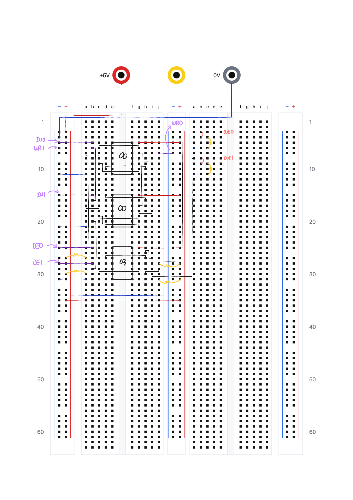
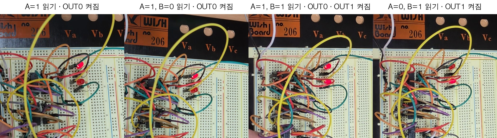
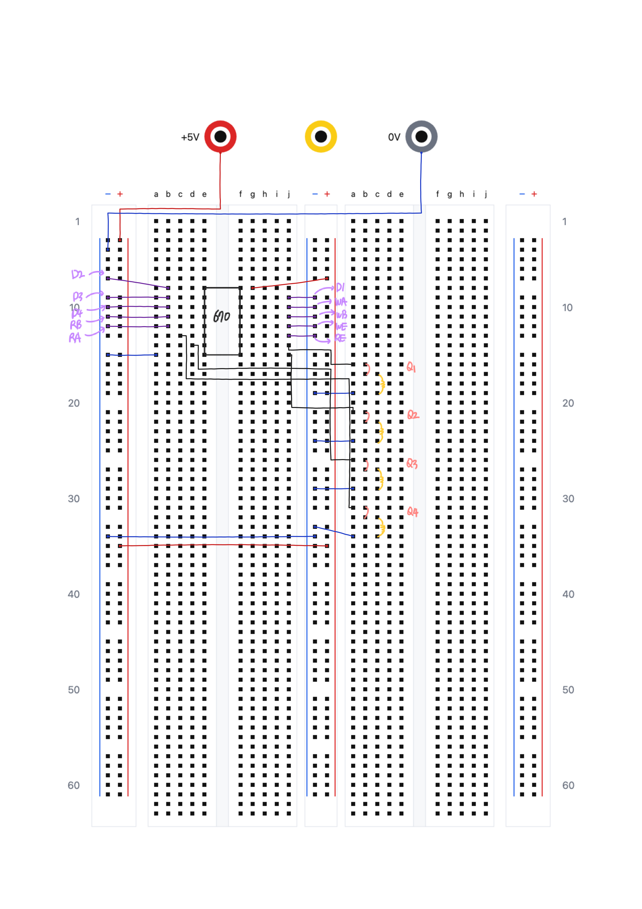
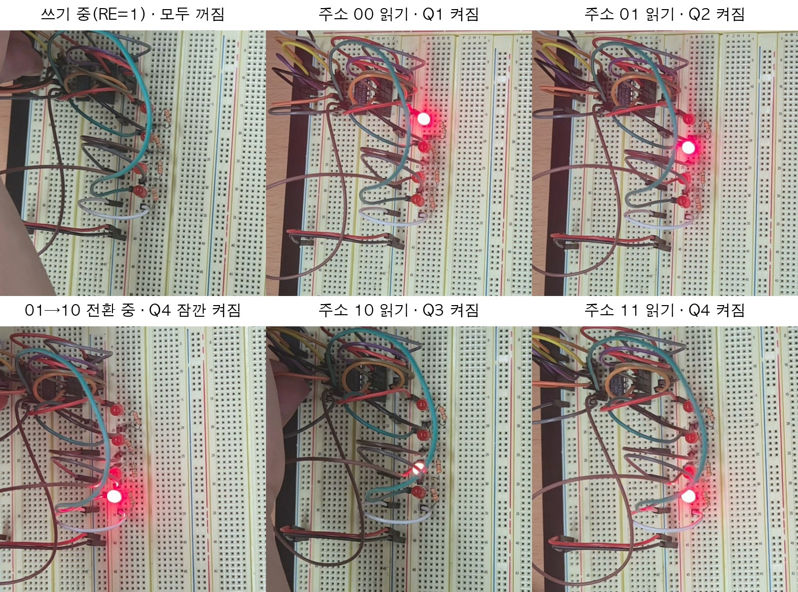

# 실험9 RAM 결과보고서

<table_of_contents color="gray"/>

<empty-block/>
# 실험 결과
## 실험 1) 2bit RAM

74HC00 두 개로 A와 B의 NAND SR Latch를 하나씩 만들고, 74HC03의 네 게이트로 두 읽기 출력단을 만든 회로다. 저장되는 값은 WR1과 같고, 출력은 OUT0=OE0·(A의 Q), OUT1=OE1·(B의 Q)다. A에 1, B에 0, B에 1, A에 0을 차례로 쓰고 쓸 때마다 IN을 내려 저장한 뒤 OE를 올려 읽었다.

- **2bit RAM 쓰기·읽기**
	| 스텝 | 조작 | OE0 | IN0 | WR0 | OE1 | IN1 | WR1 | OUT0 | OUT1 |
	|---|---|---|---|---|---|---|---|---|---|
	| S1 | 모든 입력을 GND에 두고 WR1만 +5V에 둔 채 전원을 켠다 | 0 | 0 | 0 | 0 | 0 | 1 | 0 | 0 |
	| W1 | A에 1 쓰기: IN0을 +5V로 올린다 | 0 | 1 | 0 | 0 | 0 | 1 | 0 | 0 |
	| R1 | IN0을 GND로 내려 저장한 뒤 OE0을 +5V로 올려 A를 읽는다 | 1 | 0 | 0 | 0 | 0 | 1 | 1 | 0 |
	| W2 | B에 0 쓰기: OE0을 내리고 WR0을 +5V, WR1을 GND로 바꾼 뒤 IN1을 올린다 | 0 | 0 | 1 | 0 | 1 | 0 | 0 | 0 |
	| R2 | IN1을 내려 저장한 뒤 OE0·OE1을 올려 A·B를 읽는다 | 1 | 0 | 1 | 1 | 0 | 0 | 1 | 0 |
	| W3 | B에 1 쓰기: OE0·OE1을 내리고 WR0을 GND, WR1을 +5V로 바꾼 뒤 IN1을 올린다 | 0 | 0 | 0 | 0 | 1 | 1 | 0 | 0 |
	| R3 | IN1을 내려 저장한 뒤 OE0·OE1을 올려 A·B를 읽는다 | 1 | 0 | 0 | 1 | 0 | 1 | 1 | 1 |
	| W4 | A에 0 쓰기: OE0·OE1을 내리고 WR0을 +5V, WR1을 GND로 바꾼 뒤 IN0을 올린다 | 0 | 1 | 1 | 0 | 0 | 0 | 0 | 0 |
	| R4 | IN0을 내려 저장한 뒤 OE0·OE1을 올려 A·B를 읽는다 | 1 | 0 | 1 | 1 | 0 | 0 | 0 | 1 |

아홉 스텝 모두 예상과 일치했다. 쓰는 동안에는 OE를 내려 두었기 때문에 두 LED가 모두 꺼져 있었고, IN을 내린 뒤 OE를 올리자 그때 저장된 값이 LED에 나왔다. B에 0을 쓴 뒤 읽었을 때는 OUT0만 켜져 있어, 앞서 A에 쓴 1이 B를 쓰는 동안에도 남아 있었다. B에 1을 쓴 뒤에는 두 LED가 함께 켜졌고, 마지막으로 A에 0을 쓰자 OUT0만 꺼지고 OUT1은 켜진 채로 남았다. 한쪽에 쓰는 동안 다른 쪽 값이 바뀐 경우는 없었다.

실험 도중 전원 공급기가 CC 모드로 넘어간 일이 한 번 있었고, B에 1을 쓰기 전에 선 하나가 빠져 다시 꽂았다. 두 경우 모두 원인을 바로잡은 뒤의 결과가 위 표이며, 경위는 결과 분석에 적었다.

<empty-block/>
## 실험 2) 16bit RAM (IC 74670)

74670 하나로 구성하고 출력 Q1~Q4에 LED를 단 회로다. 주소는 B, A 순서로 적고 데이터는 D4 D3 D2 D1 순서로 적었다. 주소 00, 01, 10, 11에 0001, 0010, 0100, 1000을 쓰는 동안에는 RE를 1로 두어 출력을 껐고, 쓰기를 마친 뒤 RE를 0으로 내리고 읽기 주소를 바꿔 가며 네 word를 읽었다.

- **16bit RAM 쓰기 입력**
	| 스텝 | 조작 | WB | WA | WE | D4 | D3 | D2 | D1 |
	|---|---|---|---|---|---|---|---|---|
	| S1 | WE·RE를 +5V, 나머지를 GND에 둔 뒤 D1만 +5V로 옮기고 전원을 켠다(주소 00, 데이터 0001) | 0 | 0 | 1 | 0 | 0 | 0 | 1 |
	| W1 | WE를 GND로 내려 주소 00에 0001을 쓴다 | 0 | 0 | 0 | 0 | 0 | 0 | 1 |
	| A2 | WE를 먼저 +5V로 올린 뒤 주소 01, 데이터 0010으로 바꾼다 | 0 | 1 | 1 | 0 | 0 | 1 | 0 |
	| W2 | WE를 GND로 내려 주소 01에 쓴다 | 0 | 1 | 0 | 0 | 0 | 1 | 0 |
	| A3 | WE를 먼저 올린 뒤 주소 10, 데이터 0100으로 바꾼다 | 1 | 0 | 1 | 0 | 1 | 0 | 0 |
	| W3 | WE를 GND로 내려 주소 10에 쓴다 | 1 | 0 | 0 | 0 | 1 | 0 | 0 |
	| A4 | WE를 먼저 올린 뒤 주소 11, 데이터 1000으로 바꾼다 | 1 | 1 | 1 | 1 | 0 | 0 | 0 |
	| W4 | WE를 GND로 내려 주소 11에 쓴다 | 1 | 1 | 0 | 1 | 0 | 0 | 0 |
	| H1 | WE를 +5V로 올려 쓰기를 끝낸다 | 1 | 1 | 1 | 1 | 0 | 0 | 0 |
	| R1 | RE를 GND로 내려 주소 00을 읽는다 | 1 | 1 | 1 | 1 | 0 | 0 | 0 |
	| R2 | RA를 +5V로 옮겨 주소 01을 읽는다 | 1 | 1 | 1 | 1 | 0 | 0 | 0 |
	| R3 | RB를 +5V, RA를 GND로 옮겨 주소 10을 읽는다 | 1 | 1 | 1 | 1 | 0 | 0 | 0 |
	| R4 | RA를 +5V로 옮겨 주소 11을 읽는다 | 1 | 1 | 1 | 1 | 0 | 0 | 0 |
- **16bit RAM 읽기 입력과 출력**
	| 스텝 | RB | RA | RE | Q4 | Q3 | Q2 | Q1 |
	|---|---|---|---|---|---|---|---|
	| S1 | 0 | 0 | 1 | 0 | 0 | 0 | 0 |
	| W1 | 0 | 0 | 1 | 0 | 0 | 0 | 0 |
	| A2 | 0 | 0 | 1 | 0 | 0 | 0 | 0 |
	| W2 | 0 | 0 | 1 | 0 | 0 | 0 | 0 |
	| A3 | 0 | 0 | 1 | 0 | 0 | 0 | 0 |
	| W3 | 0 | 0 | 1 | 0 | 0 | 0 | 0 |
	| A4 | 0 | 0 | 1 | 0 | 0 | 0 | 0 |
	| W4 | 0 | 0 | 1 | 0 | 0 | 0 | 0 |
	| H1 | 0 | 0 | 1 | 0 | 0 | 0 | 0 |
	| R1 | 0 | 0 | 0 | 0 | 0 | 0 | 1 |
	| R2 | 0 | 1 | 0 | 0 | 0 | 1 | 0 |
	| R3 | 1 | 0 | 0 | 0 | 1 | 0 | 0 |
	| R4 | 1 | 1 | 0 | 1 | 0 | 0 | 0 |

열세 스텝 모두 예상과 일치했다. 네 번 쓰는 동안 LED는 계속 꺼져 있었고, RE를 내리자 주소 00에서 Q1이 켜졌다. 이후 읽기 주소를 01, 10, 11로 옮길 때마다 켜지는 LED가 Q2, Q3, Q4로 하나씩 옮겨 가, 주소마다 쓴 값이 따로 남아 있었다. 다만 주소 01에서 10으로 옮기는 동안 Q4가 약 6초 동안 혼자 켜졌다가 Q3으로 넘어갔다. 두 주소 비트를 바꾸는 사이에 생긴 중간 상태로 보이며, 결과 분석에서 다루었다.

<empty-block/>
<empty-block/>
# 실험 사진

항목마다 예비보고서에서 그린 결선도를 먼저 싣고, 그 아래에 실험을 촬영한 영상에서 장면을 골라 한 장에 모았다. 사진마다 LED가 보이도록 회로 부분만 잘랐고, 위의 띠에는 그 장면에서 읽은 값과 켜진 LED를 적었다. 실험 1에서는 위 LED가 OUT0, 아래 LED가 OUT1이고, 실험 2에서는 위에서부터 Q1, Q2, Q3, Q4다.

<empty-block/>
## 실험 1) 2bit RAM

<empty-block/>
## 실험 2) 16bit RAM (IC 74670)

<empty-block/>
<empty-block/>
# 예비보고서와의 비교

실험 1은 예비보고서에서 회로도를 따라 세운 예상대로 저장값이 WR1을 따랐고, 출력은 OE를 올린 쪽에서만 나왔다. 예비보고서에서는 강의노트 범례가 WR0을 A의 값, WR1을 B의 값으로 적은 것과 달리 회로도에서는 두 선이 A와 B 양쪽 래치에 함께 들어간다고 보고 쓰는 순서를 정했는데, 그 순서대로 A와 B에 각각 0과 1을 써서 모두 맞게 읽혔으므로 회로도를 읽은 방식이 맞았다고 본다.

예비보고서에서 걱정한 LED 밝기도 문제가 되지 않았다. 74HC03은 출력 1을 10kΩ 풀업으로 만들기 때문에 LED 전류가 약 0.29mA로 작아 어둡게 켜질 수 있다고 보았는데, 실제로는 켜진 LED와 꺼진 LED가 눈으로 충분히 구분됐다.

실험 2는 네 주소에 다른 LED 하나가 켜지도록 값을 골라 둔 덕분에, 읽은 결과만으로 주소 선택과 데이터선 D1~D4, 출력 Q1~Q4가 모두 맞게 이어졌음을 확인할 수 있었다. 예비보고서에서 주소를 바꾸기 전에 WE를 먼저 올리기로 한 것도 그대로 지켰고, 다른 주소의 값이 덮어써진 흔적은 없었다. 읽기 주소를 바꾸는 도중 잠깐 다른 word가 나온 장면이 있었지만, 두 주소 비트를 한 번에 바꿀 수 없어 생기는 중간 상태라 예상할 수 있는 범위였다.

<empty-block/>
<empty-block/>
# 결과 분석

실험 1의 각 래치는 IN이 0이면 S'와 R'가 모두 1이 되어 값을 유지하고, IN이 1일 때만 WR1과 WR0 중 1인 쪽으로 세트 또는 리셋된다. WR은 A와 B에 공통이지만 IN0과 IN1을 동시에 올리지 않았기 때문에, 한 번에 IN을 올린 쪽 래치만 바뀌고 다른 쪽은 그대로 남았다. 쓰는 동안 LED가 꺼져 있던 것은 OE를 0으로 두어 74HC03 출력단이 OE·Q=0을 냈기 때문이고, 쓰기를 마친 뒤 IN을 먼저 내리고 OE를 올렸으므로 LED에는 WR 입력이 아니라 래치에 저장된 값이 나왔다. 마지막 읽기에서 OUT1만 켜진 것이 이를 보여 준다. 그때 WR1은 0이었으므로 WR이 그대로 출력됐다면 OUT1도 꺼져 있어야 했다.

실험 1 도중 전원 공급기가 CC 모드로 넘어간 것은 칩의 VCC 선을 GND 레일로 옮겼기 때문이다. VCC 선이 입력선과 같은 색이어서 입력을 바꾸려다 그 선을 입력선으로 착각했고, 선을 제자리에 다시 꽂자 전원이 정상으로 돌아와 회로가 동작했다. 이 회로에서는 IN, WR, OE 입력과 다른 칩의 출력이 각 칩의 입력 핀에 5V를 걸고 있으므로, 한 칩의 VCC 핀이 GND에 붙으면 그 칩의 입력 보호 다이오드를 거쳐 +5V에서 GND로 큰 전류가 흐를 수 있으므로, 이 전류가 전원 공급기에 설정된 전류 제한을 넘어 CC 모드로 바뀐 것으로 추정된다. 어느 칩의 VCC 선이었는지와 그때 흐른 전류, 보호 다이오드 경로의 실제 전류 여부는 확인하지 못했다.

B에 1을 쓰기 전에는 선 하나가 빠진 것을 발견해 다시 꽂았다. 어느 선이었는지는 확인하지 못했다. 그 직전의 읽기는 예상대로 나왔고, 다시 꽂은 뒤 B에 1을 쓴 단계부터 끝까지도 모두 예상과 같았다.

실험 2의 74670은 쓰기 쪽과 읽기 쪽 주소가 따로 있는 레지스터 파일이다. RE=1인 동안 출력이 고임피던스가 되므로 쓰는 동안 LED에 전류가 흐르지 않아 모두 꺼져 있었다. 쓰기는 WE가 0인 동안 WB·WA가 고른 word가 D1~D4를 따라가는 방식이라, WE를 1로 올린 뒤에 주소와 데이터를 바꿨기 때문에 바꾸는 도중의 값이 다른 word로 들어가지 않았다. 읽은 네 word가 각각 0001, 0010, 0100, 1000으로 서로 겹치지 않았으므로 의도한 주소에만 써졌다고 본다.

주소 01에서 10으로 옮기는 동안 Q4가 켜진 것은 RB와 RA를 바꾼 순서 때문으로 보인다. 실험에서 사용한 실물 칩은 Philips 74HCT670N이며, CD74HCT670 데이터시트의 읽기 기능표에 따르면 읽기 주소 RB·RA에 의한 내부 래치 선택은 WE나 RE 동작과 무관하게 이루어져, RE=0인 동안 주소가 바뀌는 즉시 해당 word가 출력에 나타난다. 01에서 10으로 가려면 두 비트를 모두 바꿔야 하는데, RB를 먼저 올리고 RA를 나중에 내렸다면 그 사이에 주소가 잠깐 11이 되어 word 3의 1000, 곧 Q4가 나온다. 켜진 LED가 주소 11을 읽을 때와 같은 Q4였다는 점이 이 해석과 맞는다. 다만 실제로 두 스위치를 어떤 순서로 바꿨는지는 확인하지 못했다. 이 중간 상태는 스위치를 손으로 옮긴 시간만큼 이어진 것이라 LED로도 보였다. 읽기 순서를 00, 01, 11, 10처럼 한 번에 한 비트만 바뀌게 잡거나, 주소를 바꾸는 동안 RE를 1로 올려 출력을 꺼 두면 다른 word가 나오는 일을 막을 수 있다.

<empty-block/>
<empty-block/>
# 고찰

이번 실험의 목적은 RAM의 쓰기와 읽기 동작을 이해하는 것이었다. 2bit RAM에서는 A와 B에 0과 1을 따로 써서 쓴 값이 그 비트에만 저장되고 다른 비트는 유지되는 것을 확인했고, 74670에서는 네 주소에 쓴 4bit 값이 주소마다 따로 읽히는 것을 확인했다. 두 실험 모두 모든 스텝이 예상과 일치했으므로 목적은 달성했다고 본다.

실험 1에서 막혔던 것은 두 가지다. 전원 공급기가 CC 모드로 넘어갔는데, 입력선과 같은 색이던 칩의 VCC 선을 입력선으로 착각해 GND 레일로 옮겼던 것이 원인이었다. 또 B에 1을 쓸 준비를 하다가 선 하나가 빠졌는데, 어느 선이었는지는 확인하지 못했다. 스텝마다 읽은 결과는 두 실험 모두 예상과 같았다.

VCC 선을 제자리에 다시 꽂자 정상으로 동작했고, 빠진 선은 다시 꽂은 뒤 B에 1을 쓰는 단계부터 이어서 진행했다. 두 일의 경위와 원인은 결과 분석에 적었다.

새로 알게 된 점은 전원선과 입력선이 같은 색이면 입력을 옮기다가 전원선을 잘못 건드릴 수 있다는 것이다.

<empty-block/>
<empty-block/>
# 추가 공부
## 전원 공급기의 CC 모드와 전원핀이 접지된 CMOS 칩

실험실에서 쓰는 전원 공급기는 전압 설정값과 전류 제한값을 함께 가진다. 부하에 흐르는 전류가 전류 제한값보다 작으면 출력 전압을 설정값으로 유지하는 CV(정전압) 모드로 동작하고, 부하 저항이 작아져 설정 전압에서 흘러야 할 전류가 제한값을 넘으면 전류를 제한값에 묶어 두는 CC(정전류) 모드로 바뀐다. CC 모드에서 출력 전압은 제한 전류와 부하 저항의 곱으로 정해지므로, +5V와 GND 사이가 거의 단락된 상태라면 표시 전압이 크게 떨어진다. 실험 중 CC 표시가 켜졌다는 것은 회로 어딘가에 +5V에서 GND로 가는 낮은 저항 경로가 생겼다는 신호다.

CMOS 칩의 입력 핀에는 정전기 보호를 위해 입력에서 VCC 쪽과 GND 쪽으로 각각 다이오드가 달려 있다. 평소에는 입력 전압이 0과 VCC 사이에 있어 두 다이오드가 모두 꺼져 있지만, VCC 핀이 GND에 붙은 상태에서 입력에 5V가 걸리면 입력에서 VCC 쪽으로 가는 다이오드가 켜진다. 그러면 5V 입력선, 보호 다이오드, 접지된 VCC 핀을 거쳐 전류가 흐르고, 입력 점퍼가 여러 개 5V에 꽂혀 있으면 그 전류가 더해진다. 이번 실험의 CC 전환도 이 경로로 설명할 수 있다고 본다. 이렇게 흐르는 전류는 보호 다이오드의 허용 전류를 넘을 수 있어 칩을 상하게 할 수도 있다. 74HC 계열의 입력 보호 다이오드 허용 전류는 데이터시트 확인이 필요하다.

전류 제한값을 회로가 실제로 쓰는 전류보다 조금만 높게 두면, 이런 실수가 생겼을 때 전원 공급기가 곧바로 CC로 넘어가 흐르는 전류를 묶어 두므로 칩을 보호할 수 있다. 예를 들어 실험 2는 74HCT670 하나만 쓰는데, CMOS 계열인 74HCT670은 모든 입력이 VCC 또는 GND에 연결된 정적 상태에서 전원 전류 ICC가 25°C 기준 최대 8μA로 매우 작다(CD74HCT670 기준). 따라서 정상 동작 시 전체 소비 전류의 대부분은 켜진 LED에 흐르는 수 mA 수준의 전류가 차지하므로, 예상 LED 전류 합보다 약간 높게 제한을 두면 정상 동작에는 영향이 없다. 전원선을 빨간색, GND선을 검은색으로 정해 두고 입력선에는 다른 색을 쓰는 것도 같은 실수를 줄이는 방법이다.

<empty-block/>
## 74670 출력의 LED 구동

CD74HCT670 데이터시트의 25°C 전기적 특성(VCC=4.5V)에서 출력이 1일 때 출력 전압 VOH는 무부하에 가까운 CMOS 부하(IO=-0.02mA)에서 최소 4.4V, TTL 부하(IO=-6mA)에서도 최소 3.98V로 보증된다. 절대 최대 정격은 출력 핀당 전류 IO가 ±25mA, 전원 및 접지 전류 ICC가 ±50mA다.

이번 회로는 출력 → LED → 330Ω → GND로 이어져 있다. 예비보고서처럼 LED 순방향 전압을 2V로 잡으면, VCC=4.5V에서 6mA를 내보낼 때 보증되는 최소 출력 전압 3.98V 기준으로도 저항 양단에 1.98V가 걸려 전류가 1.98V ÷ 330Ω = 6.0mA다. 실험에서는 전원 전압 VCC=5V를 썼으므로 출력 하이 전압이 3.98V에서 5V 사이에 놓이고, 출력 전압이 5V에 가깝더라도 (5 - 2)V ÷ 330Ω ≈ 9.1mA를 넘지 않는다. 따라서 실제 LED 전류는 6mA에서 9mA 안팎이 되며, 출력 핀당 최대 정격인 ±25mA보다 한참 작고 네 출력이 동시에 켜지더라도 총합이 36.4mA를 밑돌아 전원 전류 정격 ±50mA 안쪽이다. 이번 실험에서 LED 순방향 전압과 출력 전압은 측정하지 않았다.

실험 1의 LED는 74HC03이 출력 1일 때 내부 출력 트랜지스터가 꺼져 10kΩ 풀업을 거쳐 켜지므로 약 0.29mA밖에 흐르지 않는다. 반면 실험 2의 LED에는 이보다 20배 이상 큰 6mA에서 9mA 안팎의 전류가 흐르므로, 계산대로라면 실험 2의 LED가 더 밝게 켜진다. 실험에 사용한 실물 칩은 Philips 74HCT670N이지만, 원 제조사 자료가 단종되어 동일 품번의 1차 제조사 자료인 TI CD74HCT670 데이터시트 규격으로 계산했다. 제조사에 따른 세부 출력 특성 차이는 있을 수 있다.

<empty-block/>
<empty-block/>
# 출처 및 참고문헌

- 논리회로실험 강의노트
- 논리회로실험 IC 특성 분석 가이드
- Nexperia. 74HC00; 74HCT00 — Quad 2-input NAND gate. Rev. 11, 2025-04-29. https://assets.nexperia.com/documents/data-sheet/74HC_HCT00.pdf
- Nexperia. 74HC03; 74HCT03 — Quad 2-input NAND gate (open drain). Rev. 7, 2024-02-16. https://assets.nexperia.com/documents/data-sheet/74HC_HCT03.pdf
- Texas Instruments. CD54HC670, CD74HC670, CD74HCT670 — High-Speed CMOS Logic 4x4 Register File. 문서번호 SCHS195C, 1998-01 발행, 2003-10 개정. https://www.ti.com/lit/ds/symlink/cd74hc670.pdf
