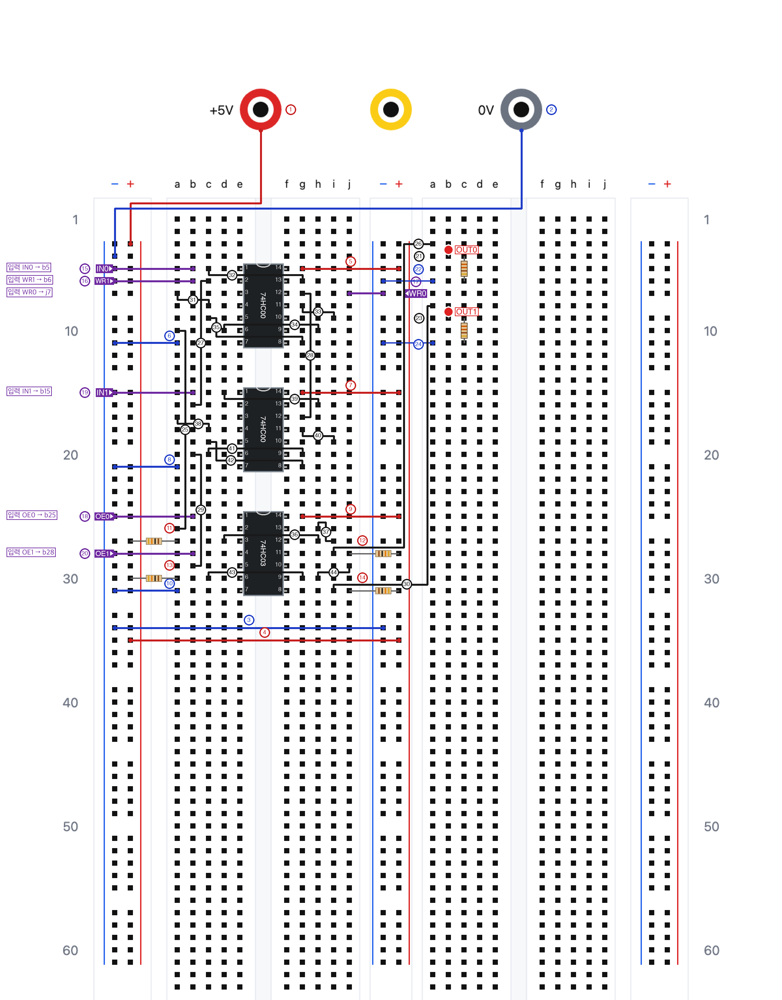
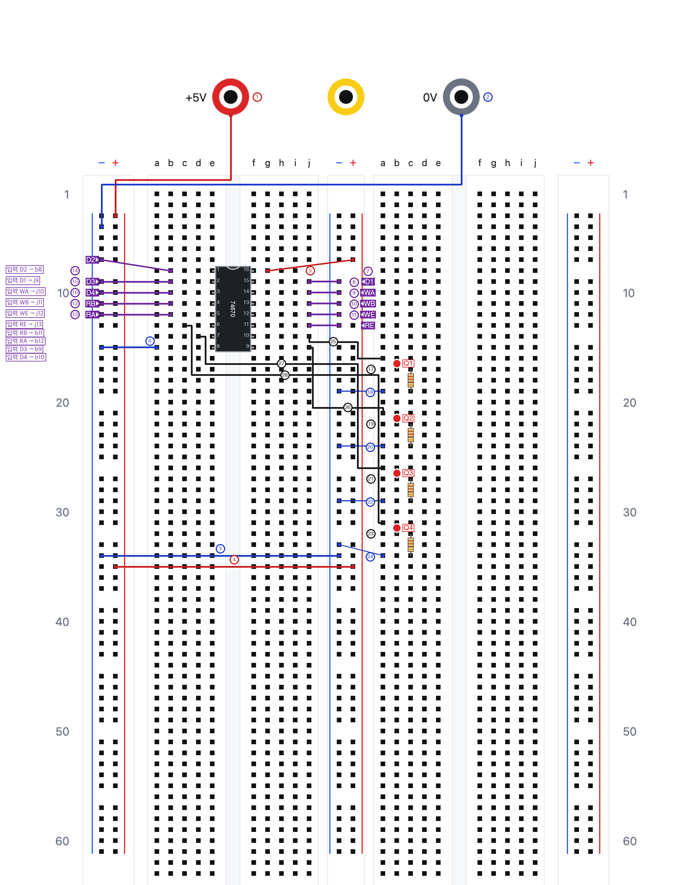

# 실험9 RAM 예비보고서

<table_of_contents color="gray"/>

<empty-block/>
# 실험 목적

RAM의 동작 원리와 특성을 이해한다. 먼저 74HC00으로 만든 NAND SR Latch 두 개와 74HC03 출력단으로 2bit RAM을 구성해 A와 B에 값을 따로 쓰고 읽으며 LED로 결과를 확인한다. 이어서 16bit RAM IC인 74670의 네 주소에 4bit 값을 쓰고 읽은 뒤, 칩의 전원을 끊었다 다시 연결해 저장했던 값이 어떻게 되는지 확인한다.

<empty-block/>
<empty-block/>
# 실험 이론
## RAM

RAM(Random Access Memory)은 기억된 정보를 읽거나 새 정보를 기억시킬 수 있는 메모리다. 메모리 안의 물리적 위치와 관계없이 거의 같은 시간 안에 임의의 위치에 접근해 읽고 쓸 수 있어 Random Access라 부르며, 응용 프로그램의 일시적 로딩이나 데이터의 일시적 저장에 쓰인다. 저장 소자가 전원이 있는 동안만 상태를 유지하므로 전원을 끊으면 내용이 사라지는 휘발성 메모리다.

<empty-block/>
## 1 bit RAM 셀

1 bit RAM은 한 비트를 저장하는 RS 플립플롭에 세 입력을 붙인 구조다. Selection Input은 이 셀을 고르고, Read or Write는 0이면 쓰기, 1이면 읽기를 고른다. 셀이 선택된 쓰기 상태에서는 Input 값이 플립플롭에 저장되고, 읽기 상태에서는 플립플롭이 값을 유지하면서 Output = (Selection Input)·(Read or Write)·Q로 저장값을 내보낸다. 셀이 선택되지 않았거나 쓰기 중이면 Output은 0이다.

<empty-block/>
## NAND SR Latch

RS 플립플롭은 S=1이면 Q를 1로, R=1이면 0으로 만들고, 둘 다 0이면 이전 값을 유지한다. S=R=1은 결과를 정할 수 없어 쓰지 않는다.

- **RS 플립플롭**
	| S | R | Q |
	|---|---|---|
	| 0 | 0 | Q(t-1) |
	| 0 | 1 | 0 |
	| 1 | 0 | 1 |
	| 1 | 1 | X |

실험 1)은 이 플립플롭을 NAND 두 개를 교차 결합한 NAND SR Latch로 만든다. NAND 래치는 입력이 0일 때 동작하므로 S'=0이면 Q=1, R'=0이면 Q=0이 되고, S'=R'=1이면 값을 유지한다. S'=R'=0이면 두 출력이 모두 1이 되어 Q와 Q'가 반대라는 관계가 깨지고, 이어서 두 입력을 함께 1로 되돌리면 어느 쪽으로 정착할지 정할 수 없다. 강의노트가 Write Value를 반드시 반전 관계로 두라고 한 것은 래치에 이 00 입력이 들어가지 않게 하기 위해서다.

<empty-block/>
## 2bit RAM의 쓰기와 읽기

A와 B는 각각 74HC00 한 개로 만들며, 네 NAND 가운데 둘이 래치를 이루고, 나머지 둘이 입력 게이트로 S' = (IN·WR1)', R' = (IN·WR0)'를 만든다. IN=0이면 S'=R'=1이라 래치가 값을 유지하고, IN=1이면 WR1=1, WR0=0일 때 Q=1, WR0=1, WR1=0일 때 Q=0이 된다. 그래서 저장되는 값은 WR1과 같고 WR0과 반대다. (강의노트 범례는 WR0을 A, WR1을 B의 값으로 적었으나, 회로도에서 WR0과 WR1은 A와 B 두 래치에 함께 들어가 WR1이 세트 쪽, WR0이 리셋 쪽 입력이 된다.) WR이 두 비트에 공통이므로 어느 비트에 쓸지는 IN0과 IN1이 고르고, 둘을 함께 1로 올리면 A와 B에 같은 값이 동시에 써진다.

읽기 출력단은 74HC03이다. 첫 게이트가 (OE·Q)'를 만들고, 두 입력을 묶은 둘째 게이트가 이를 다시 뒤집어 OUT = OE·Q가 된다. 1 bit RAM의 Output 식과 같은 꼴이며, OE=0이면 저장값과 관계없이 OUT=0이다. 74HC03은 열린 드레인 출력이라 스스로 1을 내지 못하므로 출력마다 10kΩ 풀업 저항으로 1을 만든다. IN과 OE를 함께 켜면 래치가 WR 값으로 바로 바뀌어 그 값이 출력되므로, 저장된 값을 읽으려면 IN을 내린 뒤에 OE를 올린다.

<empty-block/>
## 74670 레지스터 파일

74670은 4bit word 네 개를 저장하는 16bit 레지스터 파일이다. 쓰기 주소 WA·WB와 읽기 주소 RA·RB가 따로 있어 한 word에 쓰는 동안 다른 word를 읽을 수 있다. WE와 RE는 0일 때 켜진다. 데이터시트의 기능표는 H와 L로 적혀 있어 H=1, L=0으로 읽어 옮겼다.

- **쓰기 기능표**
	| WB | WA | WE | Word 0 | Word 1 | Word 2 | Word 3 |
	|---|---|---|---|---|---|---|
	| 0 | 0 | 0 | Q=D | Q0 | Q0 | Q0 |
	| 0 | 1 | 0 | Q0 | Q=D | Q0 | Q0 |
	| 1 | 0 | 0 | Q0 | Q0 | Q=D | Q0 |
	| 1 | 1 | 0 | Q0 | Q0 | Q0 | Q=D |
	| X | X | 1 | Q0 | Q0 | Q0 | Q0 |
- **읽기 기능표**
	| RB | RA | RE | Q4 | Q3 | Q2 | Q1 |
	|---|---|---|---|---|---|---|
	| 0 | 0 | 0 | W0B4 | W0B3 | W0B2 | W0B1 |
	| 0 | 1 | 0 | W1B4 | W1B3 | W1B2 | W1B1 |
	| 1 | 0 | 0 | W2B4 | W2B3 | W2B2 | W2B1 |
	| 1 | 1 | 0 | W3B4 | W3B3 | W3B2 | W3B1 |
	| X | X | 1 | Z | Z | Z | Z |

Q=D는 선택한 word의 네 비트가 D1~D4를 따른다는 뜻이고, Q0는 이전 값을 유지한다는 뜻이다. W0B1은 word 0의 첫 비트, Z는 고임피던스다. WE=0인 동안에는 선택된 word가 입력을 계속 따라가므로, WE가 0인 채로 주소를 바꾸면 지나가는 주소에도 값이 써진다. 그래서 주소와 데이터는 WE를 1로 올린 뒤에 바꾼다.

<empty-block/>
<empty-block/>
# 실험 부품
## 준비물

| 부품·장비 | 수량 | 용도 |
|---|---|---|
| 5V 전압원 | 1대 | IC와 논리 입력의 전원 |
| 오실로스코프 | 1대 | 중간 노드의 신호 레벨 확인 |
| 74HC00 | 2개 | A와 B의 NAND SR Latch와 입력 게이트 |
| 74HC03 | 1개 | 2bit RAM의 읽기 출력단 |
| 74670 | 1개 | 16bit RAM |
| 발광 다이오드 | 4개 | 실험 1) OUT0·OUT1, 실험 2) Q1~Q4 표시 |
| 330Ω 저항 | 4개 | LED 직렬 저항 |
| 10kΩ 저항 | 4개 | 74HC03 출력 풀업 |
| 브레드보드 | 1개 | 회로 구성 |
| 점퍼선 | 필요량 | 신호 연결, 입력 레벨 설정 |

<empty-block/>
## IC 구성과 핀 배치

| IC | 내부 구성 | 입력 핀 | 출력 핀 | VCC | GND |
|---|---|---|---|---|---|
| 74HC00 | 2입력 NAND 4개 | 1·2 / 4·5 / 9·10 / 12·13 | 3 / 6 / 8 / 11 | 14 | 7 |
| 74HC03 | 2입력 NAND 4개 (열린 드레인) | 1·2 / 4·5 / 9·10 / 12·13 | 3 / 6 / 8 / 11 | 14 | 7 |
| 74670 | 4×4 레지스터 파일 | D1 15, D2 1, D3 2, D4 3, WA 14, WB 13, WE 12, RA 5, RB 4, RE 11 | Q1 10, Q2 9, Q3 7, Q4 6 | 16 | 8 |

<empty-block/>
<empty-block/>
# 실험 과정 및 예상 결과
## 실험 1) 2bit RAM

74HC00 두 개로 A와 B의 래치를, 74HC03으로 두 출력단을 만들고 OUT0·OUT1에 LED를 단다. 쓰기는 WR0과 WR1을 반대로 둔 채 쓸 쪽의 IN만 1로 올리고, IN을 0으로 내려 저장한 뒤 OE를 1로 올려 읽는다. WR은 IN0과 IN1이 모두 0일 때만 바꾼다. (강의노트 주의사항 1의 IN0 = IN1'는 글자 그대로 따르면 둘 중 하나가 늘 1이어서 IN을 접지해 저장하라는 주의사항 3과 함께 지킬 수 없으므로, IN0과 IN1을 동시에 1로 두지 않는다는 뜻으로 읽었다.)

A에 1, B에 0, B에 1, A에 0을 차례로 써서 각 비트에 0과 1을 한 번씩 쓰고, 한쪽을 쓰는 동안 다른 쪽 값이 유지되는지 본다. 전원 직후의 래치 값은 정해지지 않으므로 아직 쓰지 않은 비트의 OE는 0으로 둔다. 표의 OUT은 LED가 켜지면 1이다.

- **2bit RAM 쓰기·읽기** (저장값 = WR1, OUT0 = OE0·A의 Q, OUT1 = OE1·B의 Q)
	| 스텝 | 조작 | OE0 | IN0 | WR0 | OE1 | IN1 | WR1 | OUT0 | OUT1 |
	|---|---|---|---|---|---|---|---|---|---|
	| S1 | 모든 입력을 GND에 두고 WR1만 +5V에 둔 채 전원을 켠다 | 0 | 0 | 0 | 0 | 0 | 1 | 0 | 0 |
	| W1 | A에 1 쓰기: IN0을 +5V로 올린다 | 0 | 1 | 0 | 0 | 0 | 1 | 0 | 0 |
	| R1 | IN0을 GND로 내려 저장한 뒤 OE0을 +5V로 올려 A를 읽는다 | 1 | 0 | 0 | 0 | 0 | 1 | 1 | 0 |
	| W2 | B에 0 쓰기: OE0을 내리고 WR0을 +5V, WR1을 GND로 바꾼 뒤 IN1을 올린다 | 0 | 0 | 1 | 0 | 1 | 0 | 0 | 0 |
	| R2 | IN1을 내려 저장한 뒤 OE0·OE1을 올려 A·B를 읽는다 | 1 | 0 | 1 | 1 | 0 | 0 | 1 | 0 |
	| W3 | B에 1 쓰기: OE0·OE1을 내리고 WR0을 GND, WR1을 +5V로 바꾼 뒤 IN1을 올린다 | 0 | 0 | 0 | 0 | 1 | 1 | 0 | 0 |
	| R3 | IN1을 내려 저장한 뒤 OE0·OE1을 올려 A·B를 읽는다 | 1 | 0 | 0 | 1 | 0 | 1 | 1 | 1 |
	| W4 | A에 0 쓰기: OE0·OE1을 내리고 WR0을 +5V, WR1을 GND로 바꾼 뒤 IN0을 올린다 | 0 | 1 | 1 | 0 | 0 | 0 | 0 | 0 |
	| R4 | IN0을 내려 저장한 뒤 OE0·OE1을 올려 A·B를 읽는다 | 1 | 0 | 1 | 1 | 0 | 0 | 0 | 1 |

<empty-block/>
## 실험 2) 16bit RAM (IC 74670)

74670의 출력 Q1~Q4에 LED를 단다. 주소는 B, A 순서로 적어 01은 WB(또는 RB)=0, WA(또는 RA)=1이고, 데이터는 D4 D3 D2 D1 순서로 적는다. 주소 00, 01, 10, 11에 0001, 0010, 0100, 1000을 차례로 써서 주소마다 다른 LED 하나가 켜지게 했다. 주소를 잘못 고르거나 데이터선 하나가 끊기면 엉뚱한 LED가 켜지거나 꺼진 채로 남아 바로 드러난다. 쓰는 동안은 RE=1로 출력을 꺼 두고, 쓰기를 마치면 RE를 0으로 내리고 읽기 주소를 바꿔 가며 네 word를 읽는다. RE=1인 행의 Q는 출력이 고임피던스라 LED가 꺼진 상태를 0으로 적었다.

- **16bit RAM 쓰기 입력**
	| 스텝 | 조작 | WB | WA | WE | D4 | D3 | D2 | D1 |
	|---|---|---|---|---|---|---|---|---|
	| S1 | WE·RE를 +5V, 나머지를 GND에 둔 뒤 D1만 +5V로 옮기고 전원을 켠다(주소 00, 데이터 0001) | 0 | 0 | 1 | 0 | 0 | 0 | 1 |
	| W1 | WE를 GND로 내려 주소 00에 0001을 쓴다 | 0 | 0 | 0 | 0 | 0 | 0 | 1 |
	| A2 | WE를 먼저 +5V로 올린 뒤 주소 01, 데이터 0010으로 바꾼다 | 0 | 1 | 1 | 0 | 0 | 1 | 0 |
	| W2 | WE를 GND로 내려 주소 01에 쓴다 | 0 | 1 | 0 | 0 | 0 | 1 | 0 |
	| A3 | WE를 먼저 올린 뒤 주소 10, 데이터 0100으로 바꾼다 | 1 | 0 | 1 | 0 | 1 | 0 | 0 |
	| W3 | WE를 GND로 내려 주소 10에 쓴다 | 1 | 0 | 0 | 0 | 1 | 0 | 0 |
	| A4 | WE를 먼저 올린 뒤 주소 11, 데이터 1000으로 바꾼다 | 1 | 1 | 1 | 1 | 0 | 0 | 0 |
	| W4 | WE를 GND로 내려 주소 11에 쓴다 | 1 | 1 | 0 | 1 | 0 | 0 | 0 |
	| H1 | WE를 +5V로 올려 쓰기를 끝낸다 | 1 | 1 | 1 | 1 | 0 | 0 | 0 |
	| R1 | RE를 GND로 내려 주소 00을 읽는다 | 1 | 1 | 1 | 1 | 0 | 0 | 0 |
	| R2 | RA를 +5V로 옮겨 주소 01을 읽는다 | 1 | 1 | 1 | 1 | 0 | 0 | 0 |
	| R3 | RB를 +5V, RA를 GND로 옮겨 주소 10을 읽는다 | 1 | 1 | 1 | 1 | 0 | 0 | 0 |
	| R4 | RA를 +5V로 옮겨 주소 11을 읽는다 | 1 | 1 | 1 | 1 | 0 | 0 | 0 |
- **16bit RAM 읽기 입력과 출력** (RE = 0일 때 Q4 Q3 Q2 Q1 = 주소 RB RA의 word)
	| 스텝 | RB | RA | RE | Q4 | Q3 | Q2 | Q1 |
	|---|---|---|---|---|---|---|---|
	| S1 | 0 | 0 | 1 | 0 | 0 | 0 | 0 |
	| W1 | 0 | 0 | 1 | 0 | 0 | 0 | 0 |
	| A2 | 0 | 0 | 1 | 0 | 0 | 0 | 0 |
	| W2 | 0 | 0 | 1 | 0 | 0 | 0 | 0 |
	| A3 | 0 | 0 | 1 | 0 | 0 | 0 | 0 |
	| W3 | 0 | 0 | 1 | 0 | 0 | 0 | 0 |
	| A4 | 0 | 0 | 1 | 0 | 0 | 0 | 0 |
	| W4 | 0 | 0 | 1 | 0 | 0 | 0 | 0 |
	| H1 | 0 | 0 | 1 | 0 | 0 | 0 | 0 |
	| R1 | 0 | 0 | 0 | 0 | 0 | 0 | 1 |
	| R2 | 0 | 1 | 0 | 0 | 0 | 1 | 0 |
	| R3 | 1 | 0 | 0 | 0 | 1 | 0 | 0 |
	| R4 | 1 | 1 | 0 | 1 | 0 | 0 | 0 |

마지막으로 전원 공급기 출력을 끄고 몇 초 뒤 다시 켠 다음, 쓰기 없이 네 주소를 같은 순서로 읽는다. 74670은 래치로 값을 저장하므로 전원이 끊기면 저장한 값을 잃고, 다시 켰을 때의 값은 정해지지 않는다. 그래서 표의 Q는 비워 두고 본 값을 적는다.

- **전원 재투입 후 읽기**
	| 스텝 | 조작 | RB | RA | RE | Q4 | Q3 | Q2 | Q1 |
	|---|---|---|---|---|---|---|---|---|
	| P1 | 쓰기를 마친 상태에서 전원 공급기 출력을 끄고 몇 초 뒤 다시 켠다. WE는 +5V에 둔 채 쓰지 않는다. RB·RA를 GND로 옮겨 주소 00을 읽는다 | 0 | 0 | 0 | | | | |
	| P2 | 주소 01을 읽는다 | 0 | 1 | 0 | | | | |
	| P3 | 주소 10을 읽는다 | 1 | 0 | 0 | | | | |
	| P4 | 주소 11을 읽는다 | 1 | 1 | 0 | | | | |

<empty-block/>
<empty-block/>
# 회로 결선도
## 공통 결선 규칙

실험 1)의 U1과 U2는 74HC00, U3은 74HC03이고, 실험 2)의 U1은 74670이다. 전원핀은 칩마다 다르므로 실험 부품 절의 핀 배치대로 잇는다. 칩을 꽂거나 배선을 바꿀 때는 전원을 끈다. 입력은 점퍼를 +5V 레일에 꽂으면 1, GND 레일에 꽂으면 0이며, 측정 중에 점퍼를 레일 사이로 옮기는 조작은 전원을 켠 채 한다. LED는 출력 → LED → 330Ω → GND로 이어 출력이 1일 때 켜진다. 실험 1) 회로를 전부 뽑은 뒤 실험 2)를 새로 구성한다. 두 회로 모두 칩의 모든 게이트와 핀을 쓰므로 미사용 핀은 없다.

<empty-block/>
## 실험 1) 2bit RAM 결선

| 소자 | 핀 | 연결 | 기능 |
|---|---|---|---|
| U1 (74HC00) | 14 | VCC(+5V) | 전원 |
| U1 (74HC00) | 7 | GND | 접지 |
| U1 (74HC00) | 1 | IN0, U1 pin 13 | A 세트 쪽 입력 (IN0) |
| U1 (74HC00) | 2 | WR1, U2 pin 2 | A 세트 쪽 입력 (WR1) |
| U1 (74HC00) | 3 | U1 pin 4 | A의 S' |
| U1 (74HC00) | 4 | U1 pin 3 | 래치 입력 |
| U1 (74HC00) | 5 | U1 pin 8 | 래치 되먹임 |
| U1 (74HC00) | 6 | U1 pin 9, U3 pin 2 | A의 Q |
| U1 (74HC00) | 13 | U1 pin 1 | A 리셋 쪽 입력 (IN0) |
| U1 (74HC00) | 12 | WR0, U2 pin 12 | A 리셋 쪽 입력 (WR0) |
| U1 (74HC00) | 11 | U1 pin 10 | A의 R' |
| U1 (74HC00) | 9 | U1 pin 6 | 래치 되먹임 |
| U1 (74HC00) | 10 | U1 pin 11 | 래치 입력 |
| U1 (74HC00) | 8 | U1 pin 5 | A의 Q' |
| U2 (74HC00) | 14 | VCC(+5V) | 전원 |
| U2 (74HC00) | 7 | GND | 접지 |
| U2 (74HC00) | 1 | IN1, U2 pin 13 | B 세트 쪽 입력 (IN1) |
| U2 (74HC00) | 2 | U1 pin 2 | B 세트 쪽 입력 (WR1) |
| U2 (74HC00) | 3 | U2 pin 4 | B의 S' |
| U2 (74HC00) | 4 | U2 pin 3 | 래치 입력 |
| U2 (74HC00) | 5 | U2 pin 8 | 래치 되먹임 |
| U2 (74HC00) | 6 | U2 pin 9, U3 pin 5 | B의 Q |
| U2 (74HC00) | 13 | U2 pin 1 | B 리셋 쪽 입력 (IN1) |
| U2 (74HC00) | 12 | U1 pin 12 | B 리셋 쪽 입력 (WR0) |
| U2 (74HC00) | 11 | U2 pin 10 | B의 R' |
| U2 (74HC00) | 9 | U2 pin 6 | 래치 되먹임 |
| U2 (74HC00) | 10 | U2 pin 11 | 래치 입력 |
| U2 (74HC00) | 8 | U2 pin 5 | B의 Q' |
| U3 (74HC03) | 14 | VCC(+5V) | 전원 |
| U3 (74HC03) | 7 | GND | 접지 |
| U3 (74HC03) | 1 | OE0 | A 읽기 입력 (OE0) |
| U3 (74HC03) | 2 | U1 pin 6 | A 읽기 입력 (A의 Q) |
| U3 (74HC03) | 3 | U3 pin 12, 10kΩ → VCC | (OE0·A의 Q)' |
| U3 (74HC03) | 12 | U3 pin 3, U3 pin 13 | A 출력 게이트 입력 (12·13 묶음) |
| U3 (74HC03) | 13 | U3 pin 12 | A 출력 게이트 입력 |
| U3 (74HC03) | 11 | 10kΩ → VCC, LED OUT0 급전 | OUT0 |
| U3 (74HC03) | 4 | OE1 | B 읽기 입력 (OE1) |
| U3 (74HC03) | 5 | U2 pin 6 | B 읽기 입력 (B의 Q) |
| U3 (74HC03) | 6 | U3 pin 9, 10kΩ → VCC | (OE1·B의 Q)' |
| U3 (74HC03) | 9 | U3 pin 6, U3 pin 10 | B 출력 게이트 입력 (9·10 묶음) |
| U3 (74HC03) | 10 | U3 pin 9 | B 출력 게이트 입력 |
| U3 (74HC03) | 8 | 10kΩ → VCC, LED OUT1 급전 | OUT1 |

<empty-block/>
## 실험 2) 16bit RAM (IC 74670) 결선

| 소자 | 핀 | 연결 | 기능 |
|---|---|---|---|
| U1 (74670) | 16 | VCC(+5V) | 전원 |
| U1 (74670) | 8 | GND | 접지 |
| U1 (74670) | 15 | D1 | Data In 1 |
| U1 (74670) | 1 | D2 | Data In 2 |
| U1 (74670) | 2 | D3 | Data In 3 |
| U1 (74670) | 3 | D4 | Data In 4 |
| U1 (74670) | 14 | WA | Write Address A |
| U1 (74670) | 13 | WB | Write Address B |
| U1 (74670) | 12 | WE | Write Enable (0일 때 켜짐) |
| U1 (74670) | 5 | RA | Read Address A |
| U1 (74670) | 4 | RB | Read Address B |
| U1 (74670) | 11 | RE | Read Enable (0일 때 켜짐) |
| U1 (74670) | 10 | LED Q1 급전 | Data Out 1 |
| U1 (74670) | 9 | LED Q2 급전 | Data Out 2 |
| U1 (74670) | 7 | LED Q3 급전 | Data Out 3 |
| U1 (74670) | 6 | LED Q4 급전 | Data Out 4 |

<empty-block/>
## 실험 전 확인할 사항

- 강의노트 회로도는 각 래치의 Q를 74HC00의 11번에서 내지만, Q가 74HC03 읽기 게이트로 갈 때 칩 반대쪽 줄로 건너가지 않도록 같은 칩 안에서 Q를 내는 게이트와 리셋 쪽 입력 게이트의 자리를 바꿨다. 같은 네 NAND를 같은 관계로 잇는 것이라 동작은 같고, 핀 번호는 위 결선 표를 따른다.
- 강의노트 회로도의 스위치 여섯 개는 준비물에 없어 입력 점퍼로 대신한다. 실험실에 스위치가 있으면 회로도대로 쓴다.
- 74HC03은 출력 1을 10kΩ 풀업이 만들기 때문에 LED 전류도 10kΩ을 지난다. LED 순방향 전압을 2V로 잡으면 약 (5 − 2)V ÷ 10.33kΩ ≈ 0.29mA라 LED가 어둡게 켜질 수 있다. A를 다 구성한 뒤 OUT0이 눈으로 구분되는지 먼저 보고, 구분되지 않으면 조교에게 묻는다. LED 방향을 바꾸면 켜지는 뜻이 뒤집히므로 임의로 바꾸지 않는다.
- 74HC03의 전원핀은 74HC00과 같은 14번·7번으로 잡았다. 꽂기 전에 수령한 칩의 각인을 보고 데이터시트 핀 배치와 맞춰 본다.
- 강의노트는 74670을 계열 없이 적었고, 핀 배치는 SN74LS670 데이터시트와 대조했다. 수령한 칩의 각인이 다른 계열이면 그 데이터시트로 핀과 WE·RE의 극성을 다시 확인한다.
- 휘발성 실험에서 전원을 끄는 방법은 강의노트에 없다. 74670의 16번 선만 뽑으면 +5V 레일에 꽂힌 입력 점퍼가 남으므로 전원 공급기 출력을 끄는 방법을 쓰고, 다른 방법을 지정하는지 조교에게 확인한다.

<empty-block/>
<empty-block/>
# 출처 및 참고문헌

- 논리회로실험 강의노트
- 논리회로실험 IC 특성 분석 가이드
- Nexperia. 74HC00; 74HCT00 — Quad 2-input NAND gate. Rev. 11, 2025-04-29. https://assets.nexperia.com/documents/data-sheet/74HC_HCT00.pdf
- Nexperia. 74HC03; 74HCT03 — Quad 2-input NAND gate (open drain). Rev. 7, 2024-02-16. https://assets.nexperia.com/documents/data-sheet/74HC_HCT03.pdf
- Texas Instruments. SN54LS670, SN74LS670, 4-by-4 Register Files with 3-State Outputs. 문서번호 SDLS193, 1974-03 발행, 1988-03 개정. https://www.ti.com/lit/ds/symlink/sn74ls670.pdf
