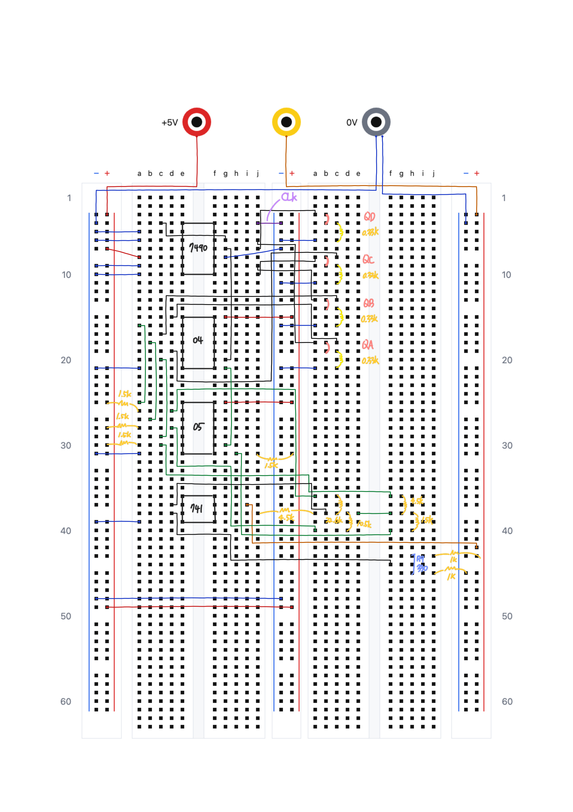

# 실험10 DAC & ADC 예비보고서

<table_of_contents color="gray"/>

<empty-block/>
# 실험 목적

D/A 변환기의 동작 원리와 특성을 이해하고, 그 바탕인 Op-Amp의 증폭·연산 동작과 가중 저항망(Weighted Register Network)을 익힌다. 먼저 7490 카운터의 출력에 LED를 달아 0부터 9까지 정상적으로 세는지 확인한다. 이어서 카운터 출력을 74HC04·74HC05와 가중 저항을 거쳐 LM741 반전 가산 증폭기에 넣고, V+를 GND에 연결했을 때와 전압 분배기에 연결했을 때의 출력 전압을 오실로스코프로 본다. 마지막으로 비트 하나의 연결을 끊거나, 귀환 저항 Rf를 바꾸거나, 가중 저항 하나에 저항을 병렬로 달았을 때 출력 계단이 어떻게 달라지는지 비교한다.

<empty-block/>
<empty-block/>
# 실험 이론
## Op-Amp

Op-Amp는 비반전 입력 V+와 반전 입력 V− 두 개의 차동 입력과 출력 하나를 갖는 직류 결합 고이득 전압 증폭기로, 출력은 Vout = A(V+ − V−)다. 이득 A가 수만에서 수백만에 이르러 피드백 없이 쓰면 두 입력의 작은 차이에도 출력이 전원 전압 쪽으로 치우친다. 출력의 일부를 반전 입력으로 되돌리는 음의 피드백을 걸면 출력은 두 입력 전압이 같아지는 값으로 정해지고, 증폭 정도는 저항으로 결정된다. 반전 입력에 R1을 거쳐 Vin을 넣고 출력과 반전 입력 사이에 Rf를 두면 I = Vin/R1 = −Vout/Rf에서 Vout = −(Rf/R1)Vin이 된다. 어느 쪽이든 소자는 공급 전압 범위 밖의 값을 출력할 수 없다.

<empty-block/>
## 반전 가산 증폭기와 전압 분배기

반전 입력 한 점에 저항 여러 개를 모으면 각 가지의 전류가 합쳐져 Rf로 흐르므로 출력은 입력 전압의 가중합이 된다. V+를 GND에 연결하면 출력은 다음과 같다.

- Vout = −(Rf/R1·V1 + Rf/R2·V2 + Rf/R3·V3 + Rf/R4·V4)

V+가 0V가 아니면 반전 입력도 V+ 전위에 머물러 각 가지의 전류가 (V+ − Vi)/Ri가 되므로 출력은 Vout = V+ + Rf·Σ(V+ − Vi)/Ri로 V+만큼 위로 올라간다.

이번 회로의 LM741은 7번에 +15V, 4번에 GND를 받는 단일 전원으로 동작해 출력이 0V 아래로 내려갈 수 없다. V+ = GND이면 Vi가 모두 0 이상이라 위 식은 늘 0 이하의 값을 주므로, 계단 대신 낮은 전압에 머문 출력이 나온다. 그래서 강의노트는 DAC 출력이 음의 값을 갖지 않도록 V+에 전압 분배기를 둔다. 분배기는 +15V, R10 1kΩ, R9 330Ω 가변저항, R11 1kΩ, GND 순으로 이어지고, 가변저항 가운데 단자의 전압은 15V × 1kΩ/2.33kΩ ≈ 6.4V부터 15V × 1.33kΩ/2.33kΩ ≈ 8.6V까지 바뀐다. 분배 저항을 너무 크게 잡으면 전위차가 낮아져 Op-Amp가 정상적인 출력을 내기 어렵다.

<empty-block/>
## DAC와 가중 저항망

DAC(Digital Analog Converter)는 디지털 신호를 비례하는 아날로그 전압이나 전류로 바꾸는 회로로, Op-Amp와 저항망으로 이진 입력을 아날로그 출력으로 바꾼다. 저항망은 연결 방식에 따라 Weighted type과 Ladder(R2R) type으로 나뉘며, 이번 실험은 Weighted type을 쓴다. 각 비트에 R, 2R, 4R, …, 2^(n−1)R의 저항을 두어 저항이 작은 비트일수록 큰 비중을 갖게 하고, 기준 전압을 VR이라 하면 출력은 다음과 같다.

- Vo = VR × (2^(n−1)·D1 + 2^(n−2)·D2 + … + 2^0·Dn) / (2^n − 1)

이번 회로의 가중 저항은 QA(LSB)부터 QD(MSB)까지 22.6kΩ, 10.5kΩ, 4.5kΩ, 1.5kΩ이다. 각 비트 앞의 1.5kΩ 풀업까지 직렬로 더하면 24.1kΩ, 12kΩ, 6kΩ, 3kΩ로 비가 약 8:4:2:1이어서, V+ = GND일 때 High인 비트가 가산 노드에 보내는 전류는 QA, QB, QC, QD 순으로 약 1:2:4:8이 된다. 강의노트도 비율에는 약간의 오차가 있어도 된다고 한다.

<empty-block/>
## 74HC04와 74HC05 출력단

각 비트가 저항망에 넣는 전압은 정확히 GND 또는 Vcc여야 비중대로 더해진다. 그래서 각 비트를 열린 드레인 인버터인 74HC05와 1.5kΩ 풀업 저항으로 내보낸다. 74HC05는 출력이 Low일 때만 GND로 끌어내리고 High일 때는 출력을 놓아 두므로, High 전압은 풀업 저항이 +5V로 만든다. 74HC05가 값을 뒤집으므로 그 앞에 74HC04 인버터를 하나 더 두어 반전을 상쇄하고, 결국 74HC05 출력은 QA~QD와 같은 논리값을 갖는다.

<empty-block/>
## BCD 카운터 7490

7490은 CLKA로 동작하는 2분주 단(QA)과 CLKB로 동작하는 5분주 단(QB, QC, QD)으로 이루어진다. 클록을 CLKA(14번)에 넣고 QA(12번)를 CLKB(1번)에 이으면 QD QC QB QA가 클록마다 0000, 0001, …, 1001을 센 뒤 0000으로 돌아가는 BCD 카운터가 된다. R01·R02는 둘 다 1일 때 출력을 0으로, R91·R92는 둘 다 1일 때 9로 만드는 입력인데, 이번 회로는 네 핀을 모두 GND에 두어 항상 카운트한다. 초기화 입력이 없으므로 전원을 넣은 직후 어느 값부터 세기 시작할지는 정해지지 않는다.

<empty-block/>
<empty-block/>
# 실험 부품
## 준비물

| 부품·장비 | 수량 | 용도 |
|---|---|---|
| 5V 전압원 | 1대 | 7490·74HC04·74HC05와 풀업 저항의 전원 |
| 15V 전압원 | 1대 | LM741 전원, 전압 분배기 |
| 오실로스코프 | 1대 | DAC 출력 파형과 전압 측정 |
| 신호 발생기 | 1대 | 7490 클록(사각파) 공급 |
| 74HC04 | 1개 | 74HC05의 반전을 상쇄하는 인버터 |
| 74HC05 | 1개 | 열린 드레인 인버터 출력단 |
| 7490 | 1개 | BCD 카운터 |
| LM741 | 2개 | 반전 가산 증폭기. 실험 1)에는 1개를 쓴다 |
| 1kΩ 저항 | 2개 | 전압 분배기 R10·R11 |
| 1.5kΩ 저항 | 5개 | 풀업 R1~R4, MSB 가중 저항 R8 |
| 4.5kΩ 저항 | 2개 | 가중 저항 R7, 귀환 저항 Rf(R12) |
| 10.5kΩ 저항 | 1개 | 가중 저항 R6 |
| 22.6kΩ 저항 | 1개 | LSB 가중 저항 R5 |
| 2.7kΩ 저항 | 1개 | 절차 5의 바꾼 Rf |
| 68kΩ 저항 | 1개 | 절차 6에서 R6에 병렬 연결 |
| 330Ω 가변저항 | 2개 | 전압 분배기 R9. 실험 1)에는 1개를 쓴다 |
| 발광 다이오드 | 4개 | QD~QA 표시 |
| 330Ω 저항 | 4개 | LED 직렬 저항 |
| 브레드보드 | 1개 | 회로 구성 |
| 점퍼선 | 필요량 | 신호 연결, V+ 선택 |

<empty-block/>
## IC 구성과 핀 배치

| IC | 내부 구성 | 입력 핀 | 출력 핀 | 전원 | GND |
|---|---|---|---|---|---|
| 7490 | 2분주 + 5분주 카운터 | CLKA 14, CLKB 1, R01 2, R02 3, R91 6, R92 7 | QA 12, QB 9, QC 8, QD 11 | 5 (+5V) | 10 |
| 74HC04 | 인버터 6개 | 1 / 3 / 5 / 9 / 11 / 13 | 2 / 4 / 6 / 8 / 10 / 12 | 14 (+5V) | 7 |
| 74HC05 | 열린 드레인 인버터 6개 | 1 / 3 / 5 / 9 / 11 / 13 | 2 / 4 / 6 / 8 / 10 / 12 | 14 (+5V) | 7 |
| LM741 | Op-Amp 1개 | 반전 2, 비반전 3 | 6 | 7 (+15V) | 4 |

<empty-block/>
<empty-block/>
# 실험 과정 및 예상 결과
## 실험 1) DAC

강의노트의 실험 1)은 여섯 절차로 진행한다. 클록은 사각파, 진폭 5V, 오프셋 2.5V로 넣고 절차 1은 주기 1s, 절차 2·3은 주파수 1.0kHz이고, 설정이 따로 없는 절차 4~6도 1.0kHz로 이어 간다. 출력은 오실로스코프 프로브를 DAC OUTPUT(LM741 6번)과 GND에 물려 DC 결합으로 보고, 파형을 그릴 때는 화면의 V/div와 s/div를 함께 적는다.

절차 1에서는 7490 출력 QD~QA에 LED를 달아 1Hz 클록에서 0~9가 차례로 나오는지 본다. 네 LED가 모두 꺼진 구간을 COUNT 0으로 잡고 그 뒤 순서를 대조한다. 표의 1은 LED가 켜진 상태, RUN은 클록을 계속 넣는 상태다.

- **7490 BCD 카운터 출력** (QD가 MSB, QA가 LSB)
	| 스텝 | 조작 | CLK | QD | QC | QB | QA |
	|---|---|---|---|---|---|---|
	| S1 | 전원과 발생기를 켠다. 네 LED가 모두 꺼진 구간을 COUNT 0으로 잡는다 | RUN | 0 | 0 | 0 | 0 |
	| S2 | COUNT 1 구간 | RUN | 0 | 0 | 0 | 1 |
	| S3 | COUNT 2 구간 | RUN | 0 | 0 | 1 | 0 |
	| S4 | COUNT 3 구간 | RUN | 0 | 0 | 1 | 1 |
	| S5 | COUNT 4 구간 | RUN | 0 | 1 | 0 | 0 |
	| S6 | COUNT 5 구간 | RUN | 0 | 1 | 0 | 1 |
	| S7 | COUNT 6 구간 | RUN | 0 | 1 | 1 | 0 |
	| S8 | COUNT 7 구간 | RUN | 0 | 1 | 1 | 1 |
	| S9 | COUNT 8 구간 | RUN | 1 | 0 | 0 | 0 |
	| S10 | COUNT 9 구간 | RUN | 1 | 0 | 0 | 1 |
	| S11 | COUNT 0으로 복귀 | RUN | 0 | 0 | 0 | 0 |

절차 2와 3은 회로를 모두 연결한 뒤 V+의 연결만 바꿔 출력 파형을 그리고 최소·최대·피크-피크 전압을 잰다. 절차 2(V+ = GND)는 실험 이론에 적은 대로 출력이 0V 아래로 내려갈 수 없어, 계단이 아니라 낮은 전압에 머문 거의 평평한 선이 나올 것으로 예상한다. 절차 3(V+ = 분배기)은 강의노트의 예상 결과대로 내림차순 계단이 나와야 한다. 비트가 Low인 가지는 가산 노드에서 V+/Ri의 전류를 빼내지만 High가 되면 그 전류가 (V+ − 5V)/(1.5kΩ + Ri)로 줄어든다. 출력이 공급 전압 범위 안에 있다면 카운트가 커질수록 Rf로 흐르는 전류가 줄어 출력이 한 단씩 내려가고, COUNT 9에서 0으로 넘어갈 때 가장 높은 단으로 되돌아간다. V+가 0V가 아니라 비트마다 줄어드는 전류가 1:2:4:8 비율을 그대로 따르지 않으므로 단 높이는 고르지 않을 수 있다. 한 주기는 열 단이고, 1.0kHz 클록이면 한 단이 1ms, 한 주기가 10ms다. 회로도 저항값으로 한 이상 계산에서는 출력이 +15V를 넘어 이 계단이 그대로 보이지 않을 수 있으며, 그 셈은 실험 전 확인할 사항에 적었다.

- **DAC 출력 전압** (단위 V)
	| 스텝 | 조작 | 최소 | 최대 | 피크-피크 |
	|---|---|---|---|---|
	| 2 | V+(LM741 3번)를 GND에 연결하고 1.0kHz 클록에서 DAC OUTPUT을 본다 | | | |
	| 3 | V+를 가변저항 R9의 가운데 단자로 옮기고 같은 조건에서 본다 | | | |

절차 4~6은 절차 3의 회로에서 한 곳씩 바꾸고, 다음 절차로 가기 전에 원래대로 되돌린다. 절차 4는 74HC04 2번과 74HC05 1번 사이(QA), 4번과 3번 사이(QB), 6번과 5번 사이(QC)를 한 번에 하나씩 끊고 파형을 그린다. 끊긴 74HC05 입력은 떠 있게 되어 그 비트의 출력이 정해지지 않으므로 파형을 미리 정하지 않는다. 떠 있는 입력이 한 레벨에 머문다면 그 비트의 기여가 일정해져 그 비트가 바뀌는 자리의 단이 사라지거나 높이가 달라질 것이다.

절차 5는 Rf(R12)를 4.5kΩ에서 2.7kΩ으로 바꾼다. 출력이 공급 전압 범위 안에 있는 단에서는 비트 하나가 바뀔 때 출력이 움직이는 양은 그 가지의 전류 변화에 Rf를 곱한 값이므로 단 높이가 2.7/4.5 = 0.6배로 줄고, Vout = V+ + Rf·Σ(V+ − Vi)/Ri의 둘째 항도 함께 줄어 계단 전체가 아래로 내려온다. 절차 3의 파형과 나란히 그려 단 높이를 비교한다.

절차 6은 Rf를 4.5kΩ으로 되돌린 뒤 QB 가지의 10.5kΩ에 68kΩ을 병렬로 단다. 합성 저항이 10.5 × 68 / 78.5 ≈ 9.1kΩ으로 작아져 QB의 비중이 커지므로, 출력이 공급 전압 범위 안에 있다면 QB가 바뀌는 COUNT 1→2, 3→4, 5→6, 7→8의 단 높이가 다른 단과 달라질 것으로 예상한다. 이 역시 절차 3의 파형과 나란히 그려 단 높이가 고른지 비교한다.

<empty-block/>
<empty-block/>
# 회로 결선도
## 공통 결선 규칙

U1은 7490, U2는 74HC04, U3은 74HC05, U4는 LM741이다. 전원핀은 칩마다 다르므로 실험 부품 절의 핀 배치대로 잇는다. +15V는 LM741 7번과 분배기 R10에만 연결하고, 7490·74HC04·74HC05와 풀업 저항은 +5V에 잇는다. 74HC05의 절대 최대 전원 전압은 7V라 +15V가 로직 칩에 닿으면 안 된다. 5V·15V 전원과 신호 발생기, 오실로스코프의 GND는 모두 공통으로 잇는다. 칩을 꽂거나 배선을 바꿀 때는 전원과 발생기 출력을 끈다.

7490 회로를 먼저 만들고 그 위에 DAC 회로를 이어 지으며, 절차 4~6은 완성된 회로에서 한 곳씩 바꿨다가 되돌린다. LED는 7490 출력 → LED → 330Ω → GND로 이어 출력이 1일 때 켜지게 하고, 절차 2 이후에도 그대로 둔다. V+는 LM741 3번에 한쪽 끝을 꽂은 점퍼 하나로 고르며, 다른 끝을 절차 2에서는 GND 레일에, 절차 3~6에서는 R9 가운데 단자에 꽂는다. 쓰지 않는 74HC04·74HC05의 입력 11·13번, 7490의 4·13번(NC), LM741의 1·5·8번은 비워 둔다.

<empty-block/>
## 실험 1) DAC 결선

- **7490 카운터와 LED** (절차 1)
	| 소자 | 핀 | 연결 | 기능 |
	|---|---|---|---|
	| U1 (7490) | 5 | VCC(+5V) | 전원 |
	| U1 (7490) | 10 | GND | 접지 |
	| U1 (7490) | 14 | 신호 발생기 출력 | CLKA |
	| U1 (7490) | 1 | U1 pin 12 | CLKB |
	| U1 (7490) | 2 | GND | R01 |
	| U1 (7490) | 3 | GND | R02 |
	| U1 (7490) | 6 | GND | R91 |
	| U1 (7490) | 7 | GND | R92 |
	| U1 (7490) | 12 | U1 pin 1, LED QA 급전 | QA (LSB) |
	| U1 (7490) | 9 | LED QB 급전 | QB |
	| U1 (7490) | 8 | LED QC 급전 | QC |
	| U1 (7490) | 11 | LED QD 급전 | QD (MSB) |
	| U1 (7490) | 4, 13 | 연결하지 않음 | NC |
- **DAC 회로의 IC** (절차 2·3)
	| 소자 | 핀 | 연결 | 기능 |
	|---|---|---|---|
	| U2 (74HC04) | 14 | VCC(+5V) | 전원 |
	| U2 (74HC04) | 7 | GND | 접지 |
	| U2 (74HC04) | 1 | U1 pin 12 | QA 입력 |
	| U2 (74HC04) | 2 | U3 pin 1 | QA' |
	| U2 (74HC04) | 3 | U1 pin 9 | QB 입력 |
	| U2 (74HC04) | 4 | U3 pin 3 | QB' |
	| U2 (74HC04) | 5 | U1 pin 8 | QC 입력 |
	| U2 (74HC04) | 6 | U3 pin 5 | QC' |
	| U2 (74HC04) | 9 | U1 pin 11 | QD 입력 |
	| U2 (74HC04) | 8 | U3 pin 9 | QD' |
	| U2 (74HC04) | 11, 13 | 연결하지 않음 | 미사용 입력 |
	| U3 (74HC05) | 14 | VCC(+5V) | 전원 |
	| U3 (74HC05) | 7 | GND | 접지 |
	| U3 (74HC05) | 1 | U2 pin 2 | 입력 |
	| U3 (74HC05) | 2 | R1 → +5V, R5 → 가산 노드 | QA 비트 출력 |
	| U3 (74HC05) | 3 | U2 pin 4 | 입력 |
	| U3 (74HC05) | 4 | R2 → +5V, R6 → 가산 노드 | QB 비트 출력 |
	| U3 (74HC05) | 5 | U2 pin 6 | 입력 |
	| U3 (74HC05) | 6 | R3 → +5V, R7 → 가산 노드 | QC 비트 출력 |
	| U3 (74HC05) | 9 | U2 pin 8 | 입력 |
	| U3 (74HC05) | 8 | R4 → +5V, R8 → 가산 노드 | QD 비트 출력 |
	| U3 (74HC05) | 11, 13 | 연결하지 않음 | 미사용 입력 |
	| U4 (LM741) | 7 | +15V | 양전원 |
	| U4 (LM741) | 4 | GND | 음전원 |
	| U4 (LM741) | 2 | 가산 노드, R12 한쪽 끝 | 반전 입력 |
	| U4 (LM741) | 3 | V+ 점퍼 → GND(절차 2) 또는 R9 가운데 단자(절차 3~6) | 비반전 입력 (V+) |
	| U4 (LM741) | 6 | R12 다른 쪽 끝, 오실로스코프 | DAC OUTPUT |
	| U4 (LM741) | 1, 5, 8 | 연결하지 않음 | OFFSET NULL, NC |
- **DAC 회로의 저항**
	| 저항 | 값 | 한쪽 끝 | 다른 쪽 끝 |
	|---|---|---|---|
	| R1 | 1.5kΩ | +5V | U3 pin 2 |
	| R2 | 1.5kΩ | +5V | U3 pin 4 |
	| R3 | 1.5kΩ | +5V | U3 pin 6 |
	| R4 | 1.5kΩ | +5V | U3 pin 8 |
	| R5 | 22.6kΩ | U3 pin 2 | 가산 노드 (U4 pin 2) |
	| R6 | 10.5kΩ | U3 pin 4 | 가산 노드 (U4 pin 2) |
	| R7 | 4.5kΩ | U3 pin 6 | 가산 노드 (U4 pin 2) |
	| R8 | 1.5kΩ | U3 pin 8 | 가산 노드 (U4 pin 2) |
	| R12 (Rf) | 4.5kΩ | U4 pin 2 | U4 pin 6 |
	| R10 | 1kΩ | +15V | R9 한쪽 고정 단자 |
	| R9 | 330Ω 가변 | R10 | R11 (가운데 단자는 V+ 점퍼 자리) |
	| R11 | 1kΩ | R9 다른 쪽 고정 단자 | GND |
- **절차 4~6의 회로 변경**
	| 절차 | 바꾸는 것 | 되돌리기 |
	|---|---|---|
	| 4 | U2 pin 2 → U3 pin 1 선의 U3 쪽 끝을 뽑는다 | 파형을 그린 뒤 다시 꽂는다 |
	| 4 | U2 pin 4 → U3 pin 3 선의 U3 쪽 끝을 뽑는다 | 파형을 그린 뒤 다시 꽂는다 |
	| 4 | U2 pin 6 → U3 pin 5 선의 U3 쪽 끝을 뽑는다 | 파형을 그린 뒤 다시 꽂는다 |
	| 5 | R12 4.5kΩ을 뽑고 같은 자리에 2.7kΩ을 꽂는다 | 4.5kΩ으로 되돌린다 |
	| 6 | R6(10.5kΩ) 양 끝에 68kΩ을 덧꽂는다 | 68kΩ을 뽑는다 |

<empty-block/>
## 실험 전 확인할 사항

- 강의노트 회로도는 LM741 7번을 라벨 없는 단자로 끝낸다. 같은 강의노트의 LM741 데이터시트 그림이 7번을 양전원(V+)으로 적어 +15V에 연결했으며, 실험 당일 조교에게 확인한다.
- 회로도는 IC를 7404·7405로, 준비물은 74HC04·74HC05로 적는다. 핀 번호는 같지만 7490은 TTL이고 74HC04의 High 입력 문턱은 VCC 4.5V에서 3.15V라, 수령한 칩의 각인을 확인한다. 7490 출력은 LED와 74HC04 입력을 함께 구동하므로 절차 2 이후 카운트나 계단이 이상하면 7490 출력과 74HC04 출력을 오실로스코프로 함께 보고, 그래도 다르면 LED 급전선을 뽑고 다시 본다.
- 클록 설정은 강의노트에 오실로스코프 설정으로 적혀 있고, 진폭 5V가 Vpp인지 피크값인지 나와 있지 않다. 5Vpp면 0~+5V지만 5V 피크면 −2.5V~+7.5V가 되므로, 회로에 잇기 전에 오실로스코프로 최소 0V, 최대 +5V를 확인하고 아니면 진폭을 맞춘다.
- 절차 1의 LED와 LED용 330Ω 저항은 강의노트 준비물 목록에 없어 키트에 있는지 미리 확인한다.
- 회로도의 저항값으로 이상적인 계산을 하면, V+가 분배기의 가장 낮은 값(약 6.4V)이고 COUNT 9일 때도 출력이 6.4V + 4.5kΩ × 2.6mA ≈ 18V로 LM741 전원 +15V를 넘는다. 실제 칩의 출력 저항과 LM741 출력 한계 때문에 결과는 다를 수 있지만, 절차 3에서 출력이 한 값에 붙어 계단이 보이지 않으면 R9를 양 끝까지 돌린 두 자리의 최소·최대를 적고 분배기 저항값을 조교에게 확인한다.
- 강의노트는 절차 5의 Rf 변경과 절차 6의 병렬 저항이 누적인지 적지 않는다. 절차 5가 끝나면 Rf를 4.5kΩ으로 되돌린 뒤 절차 6을 하고, 조교가 누적으로 하라고 하면 절차 6 파형 옆에 Rf 2.7kΩ 상태임을 적는다.

<empty-block/>
<empty-block/>
# 출처 및 참고문헌

- 논리회로실험 강의노트

- 논리회로실험 IC 특성 분석 가이드

- Nexperia. 74HC04; 74HCT04 — Hex inverter. Rev. 10, 2024-02-16. https://assets.nexperia.com/documents/data-sheet/74HC_HCT04.pdf

- Texas Instruments. SN74HC05, SN54HC05, Hex Inverters With Open-Drain Outputs. 문서번호 SCLS080F, 1984-03 발행, 2021-04 개정. https://www.ti.com/lit/ds/symlink/sn74hc05.pdf

- Texas Instruments. SN7490A, SN74LS90, Decade, Divide-by-Twelve and Binary Counters. 문서번호 SDLS940A, 1974-03 발행, 1988-03 개정. https://www.ti.com/lit/ds/symlink/sn74ls90.pdf

- Texas Instruments. LM741 Operational Amplifier. 문서번호 SNOSC25D, 1998-05 발행, 2015-10 개정. https://www.ti.com/lit/ds/symlink/lm741.pdf
