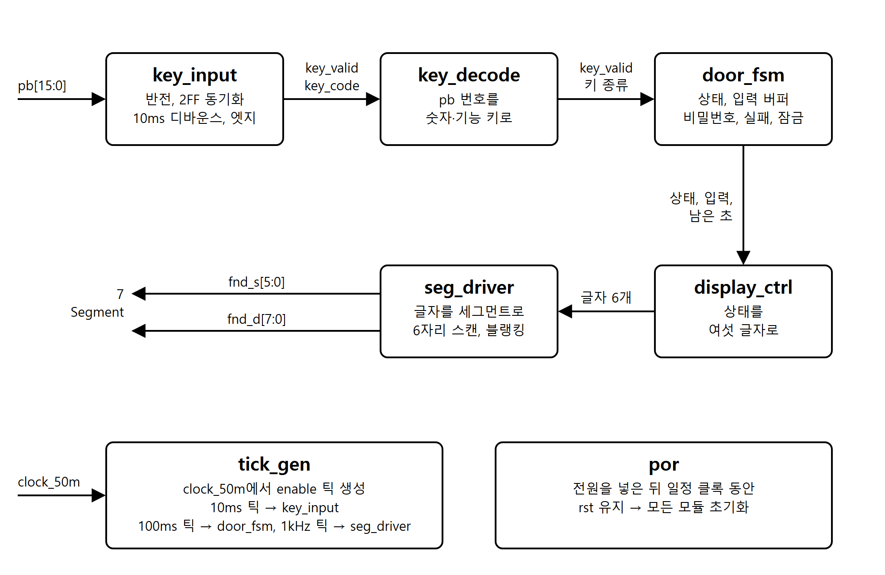
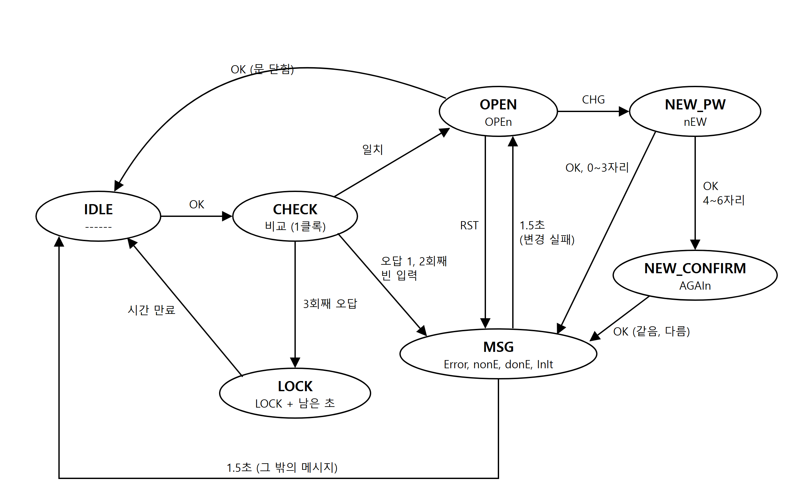
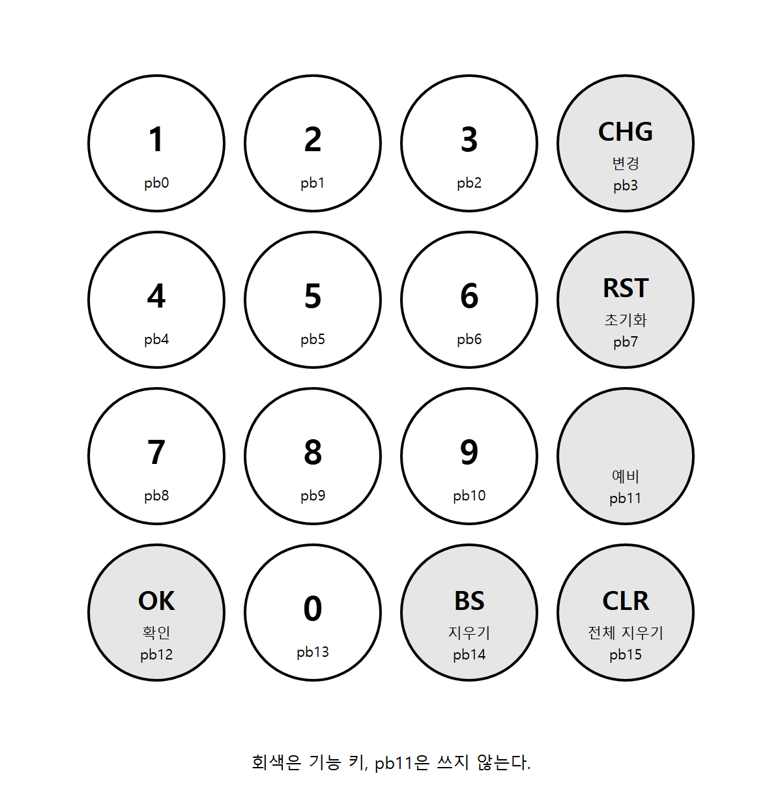

# FPGA 설계 Digital Door Lock 설계 계획서

<table_of_contents color="gray"/>

<empty-block/>
# 설계 목표
FPGA Kit의 7 Segment 모듈과 Keypad 모듈을 이용해 비밀번호 입력과 인증이 가능한 디지털 도어락을 Verilog로 설계한다. 숫자 키로 최대 6자리 비밀번호를 입력해 7 Segment에 표시하고, 확인 키를 누르면 저장된 비밀번호와 비교해 일치하면 OPEN, 일치하지 않으면 ERROR를 띄우며, 3회 연속으로 틀리면 일정 시간 동안 입력을 막는 LOCK 상태로 전환한다. 비밀번호 변경과 초기화, 6자리 초과 입력이나 빈 입력 확인 같은 예외 처리를 모두 구현하고, 추가 구현으로 입력 편집(Backspace, Clear), LOCK 남은 시간 표시와 잠금 시간 점증, 새 비밀번호 두 번 확인 입력을 완성한다.

<empty-block/>
<empty-block/>
# 과제 요구사항 분석 및 구현 방안
## 요구사항 정의

| R | 요구사항 | 구현 방안 |
|---|---|---|
| R1 | 숫자 버튼(0~9)으로 최대 6자리 비밀번호를 입력하고, 입력한 숫자를 7 Segment에 표시한다 | 숫자 키를 누를 때마다 입력 버퍼(4비트 6칸과 길이)에 왼쪽부터 채우고 같은 자리에 숫자를 띄운다. 1~6자리까지 받는다 |
| R2 | "확인" 버튼을 누르면 비밀번호를 검증한다 | OK(pb12)를 누르면 CHECK 상태에서 입력 버퍼와 저장된 비밀번호를 길이까지 함께 비교한다 |
| R3 | 미리 설정된 비밀번호와 일치하면 "OPEN"을 표시한다 | OPEN 상태로 가서 "OPEn"을 띄우고, 실패 횟수를 0으로 되돌린다 |
| R4 | 비밀번호가 일치하지 않으면 "ERROR"를 표시한다 | 실패 횟수를 1 올리고 "Error"를 1.5초 띄운 뒤 입력 대기로 돌아간다. 7 Segment로는 R을 대문자로 그릴 수 없어 소문자 r을 쓴다 |
| R5 | 잘못된 비밀번호를 3회 연속 입력하면 LOCK 상태가 된다(입력 불가, 일정 시간 이후 재입력 가능) | 세 번째 오답에서 LOCK으로 가서 모든 키를 무시하고, 잠금 시간이 끝나면 실패 횟수와 입력 버퍼를 비우고 입력 대기로 돌아간다 |
| R6 | 비밀번호를 변경할 수 있다 | OPEN에서 CHG(pb3)를 누르면 새 비밀번호를 4~6자리로 두 번 입력받아, 두 입력이 같을 때만 저장한다 |
| R7 | 비밀번호를 초기화할 수 있다 | OPEN에서 RST(pb7)를 누르면 비밀번호를 기본값 "1234"로 되돌리고 "InIt"를 띄운다 |
| R8 | 6자리를 넘는 입력, 비밀번호 없이 확인을 누르는 경우 등의 예외를 처리한다 | 7번째 숫자부터는 받지 않고, 빈 입력에서 OK를 누르면 "nonE"를 띄우며 오답으로 세지 않는다. 항목별 동작은 아래 평가 항목 표에 정리했다 |

<empty-block/>
## 평가 항목별 동작

| E | 평가 항목 | 동작 | 관련 R |
|---|---|---|---|
| E1 | 비밀번호가 맞으면 열리고, 틀리면 ERROR가 나는지 | 맞으면 "OPEn", 틀리면 "Error"를 1.5초 띄우고 입력 대기로 돌아간다 | R2, R3, R4 |
| E2 | 잘못된 비밀번호를 3회 연속 입력하면 LOCK 상태가 되는지 | 실패 횟수가 2인 상태에서 또 틀리면 "Error"를 거치지 않고 바로 LOCK으로 간다. 표시는 "LOCK10"부터 1초마다 줄어든다 | R5 |
| E3 | 1번째 LOCK 이후 2번째 LOCK이 작동하는지 | LOCK이 풀릴 때 실패 횟수를 0으로 되돌리므로 다시 세 번 틀리면 같은 경로로 LOCK에 들어간다. 두 번째 잠금은 20초다 | R5 |
| E4 | 비밀번호 변경 시 이전 비밀번호를 입력했을 때의 동작 | 변경이 끝나면 저장값이 새 비밀번호로 바뀌므로 이전 비밀번호는 "Error"가 되고 오답 1회로 센다 | R6 |
| E5 | 아무 숫자도 입력하지 않고 OK를 누르는 경우 | "nonE"를 띄우고 입력 대기로 돌아간다. 오답으로 세지 않는다 | R8 |
| E6 | 비밀번호 변경에서 새 비밀번호를 하나도 안 넣고 OK를 누른 경우 | "Error"를 띄우고 비밀번호는 그대로 둔 채 OPEN으로 돌아간다. 1~3자리만 넣고 OK를 눌러도 같다 | R6, R8 |
| E7 | 비밀번호 초기화 기능 | OPEN에서 RST를 누르면 "InIt"를 띄우고, 이후 "1234"로 열린다 | R7 |
| E8 | 비밀번호 6자리 초과 입력 | 7번째 숫자부터는 버퍼에 넣지 않고 표시도 그대로 둔다. 오답으로 세지 않는다 | R1, R8 |
| E9 | LOCK 동안 모든 입력을 무시하고, 해제 직후 정상 입력이 되는지 | LOCK 동안은 키 입력을 받지 않는다. 키는 누르는 순간 한 번만 들어오므로 잠금 중에 누르고 있던 키가 해제 뒤에 입력되지도 않는다. 해제되면 "------"로 돌아가 바로 입력할 수 있다 | R5 |
| E10 | OPEN, 비밀번호 변경, 비밀번호 틀림 이후 다시 비밀번호가 변경되는지 | 변경이 끝나면 입력 대기로 돌아가 다시 잠긴다. 잠긴 상태에서 CHG는 무시되고, 새 비밀번호로 다시 열면 OPEN에서 다시 변경할 수 있다 | R6 |

<empty-block/>
## 키 배치

| | 열0 | 열1 | 열2 | 열3 |
|---|---|---|---|---|
| 행0 | 1 (pb0) | 2 (pb1) | 3 (pb2) | 변경 CHG (pb3) |
| 행1 | 4 (pb4) | 5 (pb5) | 6 (pb6) | 초기화 RST (pb7) |
| 행2 | 7 (pb8) | 8 (pb9) | 9 (pb10) | 예비 (pb11) |
| 행3 | 확인 OK (pb12) | 0 (pb13) | 지우기 BS (pb14) | 전체 지우기 CLR (pb15) |

숫자 키는 실제 도어락처럼 왼쪽 위부터 1~9를 두고 0을 맨 아래 가운데에 둔다. 기능 키는 오른쪽 열과 맨 아래 줄에 모았고 pb11은 쓰지 않는다. 키패드의 16개 입력은 눌렀을 때 0이 되므로 반전해서 쓴다.

<empty-block/>
## 상태와 표시

| 상태 | 표시 | 전이 |
|---|---|---|
| IDLE (입력 대기) | "------", 숫자를 누르면 왼쪽부터 채운다 | 숫자는 버퍼에 넣고(6개까지), OK는 CHECK로, BS와 CLR은 버퍼를 고친다 |
| CHECK | 없음(1클록) | 일치하면 OPEN. 불일치하면 실패 횟수를 올리고 3회째면 LOCK, 아니면 "Error" 후 IDLE. 버퍼가 비었으면 "nonE" 후 IDLE이고 실패 횟수는 그대로 |
| OPEN | "OPEn" | OK는 IDLE(다시 잠금), CHG는 NEW_PW, RST는 "1234"로 복원하고 "InIt" 후 IDLE |
| NEW_PW | "nEW", 숫자를 누르면 입력 숫자로 바뀐다 | 4~6자리에서 OK는 NEW_CONFIRM, 0~3자리에서 OK는 "Error" 후 OPEN |
| NEW_CONFIRM | "AGAIn", 숫자를 누르면 입력 숫자로 바뀐다 | 첫 입력과 같으면 저장하고 "donE" 후 IDLE, 다르면 "Error" 후 OPEN(비밀번호 유지) |
| MSG | "Error", "nonE", "donE", "InIt" 중 하나 | 1.5초 동안 키를 무시하고 정해 둔 다음 상태로 간다 |
| LOCK | "LOCK"과 남은 초 2자리(예 "LOCK09") | 모든 키를 무시하고, 시간이 다 되면 실패 횟수를 0으로, 버퍼를 비우고 IDLE |

입력은 1~6자리이고 7번째 숫자부터는 무시하며 오답으로 세지 않는다. 새 비밀번호는 4~6자리이고, 기본값과 초기화값은 "1234"다. 잠금 시간은 LOCK_SEC=10을 기준으로 잠길 때마다 10→20→40초로 늘어나 40초에서 멈추고, 비밀번호를 한 번 맞히면 다시 10초로 돌아간다. 메시지는 1.5초 동안 띄운다. 키 입력은 10ms 간격으로 두 번 같은 값이 읽혀야 받아들이고, 7 Segment 여섯 자리는 1kHz로 한 자리씩 돌아가며 켠다. 시간 상수는 모두 parameter로 두어 시뮬레이션에서 줄일 수 있게 한다.

K, G, W는 7 Segment로 정확히 그릴 수 없어 가장 비슷한 모양으로 대신하고, 보드에서 읽히는지 확인한다.

<empty-block/>
## 추가 구현

| A | 기능 | 동작 | 완료 기준 |
|---|---|---|---|
| A1 | 입력 편집(Backspace, Clear) | BS(pb14)는 마지막 숫자 하나를 지우고 CLR(pb15)은 입력을 모두 지운다. 입력 대기, 새 비밀번호 입력, 확인 입력에서만 동작하고 빈 입력에서 BS는 아무 일도 하지 않는다 | "123"을 넣고 BS를 누르면 "12"만 남고, CLR을 누르면 "------"로 돌아간다 |
| A2 | LOCK 남은 시간 표시와 잠금 시간 점증 | LOCK 동안 남은 초를 오른쪽 두 자리에 1초마다 줄여 표시하고, 잠길 때마다 잠금 시간을 10→20→40초로 늘린다. 40초에서 멈추고 한 번 맞히면 10초로 돌아간다 | 두 번째 LOCK에서 "LOCK20"부터 1초마다 줄어든다 |
| A3 | 새 비밀번호 두 번 확인 | 변경할 때 새 비밀번호를 두 번 입력받아 같을 때만 저장한다 | 두 번째 입력을 다르게 넣으면 "Error"가 뜨고, 이후에도 기존 비밀번호로만 열린다 |

Backspace와 Clear는 둘 다 입력을 고치는 기능이라 하나로 묶었다.

<empty-block/>
<empty-block/>
# 예상 문제점 및 해결 방안
| 문제 | 해결 방안 | 근거 |
|---|---|---|
| 키를 한 번 눌러도 접점이 떨려(채터링) 여러 번 눌린 것으로 읽힐 수 있고, 두 키를 동시에 누르면 어느 키인지 정할 수 없다 | 10ms 간격으로 두 번 읽어 같을 때만 받고, 정확히 한 키만 눌렸을 때만 입력으로 인정한다. 누르는 순간에만 key_valid를 1클록 낸다 | 예제 코드도 키 입력을 두 번 연속 읽어 비교한다(example.v 81행) |
| 키패드 입력은 50MHz 클록과 상관없이 바뀌므로 플립플롭이 준안정 상태에 빠질 수 있다 | 입력을 플립플롭 두 단으로 동기화한 뒤 쓴다 | 버튼 신호가 FPGA 핀으로 바로 들어온다 |
| 예제 코드는 카운터 비트 init_counter[20]과 init_counter[16]을 클록으로 써서 클록이 셋으로 나뉘고, 그 사이로 신호가 오갈 때 타이밍을 보장하기 어렵다 | 모든 플립플롭을 50MHz 클록 하나로 돌리고, 느린 동작은 tick_gen이 만드는 1클록짜리 enable 틱으로 조절한다 | example.v 69~73행, 81행, 822행 |
| 예제 코드의 감지 목록 없는 always 블록은 시뮬레이터에서 시간이 흐르지 않는 무한 반복이 되어 시뮬레이션이 멈춘다 | 같은 동작을 assign 연속 할당으로 바꾼다 | example.v 69~73행 |
| 핀맵에 리셋 핀이 없어 처음 상태로 되돌릴 방법이 없고, 초기값이 없는 레지스터는 시뮬레이션에서 값이 정해지지 않는다 | por 모듈이 전원을 넣은 뒤 일정 클록 동안 rst를 유지해 모든 레지스터를 초기값(비밀번호 "1234", 실패 횟수 0)으로 만든다 | 핀맵에 clock_50m, fnd_d, fnd_s, pb만 있다 |
| 여섯 자리를 돌아가며 켤 때 자리를 바꾸는 순간 앞 자리의 세그먼트가 다음 자리에 잠깐 비치는 잔상이 생길 수 있다 | 자리를 바꿀 때 세그먼트를 잠깐 모두 끈 뒤 다음 자리를 켠다 | 여섯 자리가 세그먼트 선 fnd_d[7:0]를 함께 쓴다 |
| K, G, W는 7 Segment로 정확히 그릴 수 없다 | 가장 비슷한 모양으로 대신하고 보드에서 읽히는지 확인한다 | 세그먼트가 7개뿐이다 |
| LOCK 10초나 메시지 1.5초를 50MHz 시뮬레이션에서 그대로 기다리면 너무 오래 걸린다 | 시간 상수를 parameter로 두고 테스트벤치에서만 작은 값으로 바꾼다 | 10초는 5억 클록이다 |

<empty-block/>
## 검증 방법

시간 상수를 parameter로 줄인 Questa 테스트벤치에서 평가 항목 E1~E10의 키 입력을 순서대로 재생하고, 단계마다 화면에 나갈 여섯 글자를 기대값과 비교한다. 시뮬레이션이 모두 맞으면 보드에 올려 같은 순서로 직접 눌러 보고, 7 Segment 글자 모양과 키 반응처럼 시뮬레이션으로 볼 수 없는 것은 보드에서 확인한다.

<empty-block/>
<empty-block/>
# 프로젝트 동작 블록 다이어그램
## 모듈 블록 다이어그램

키패드 입력 pb[15:0]은 key_input에서 반전, 동기화, 디바운스를 거쳐 한 번 누를 때마다 key_valid 한 클록과 키 번호가 되고, key_decode가 이를 숫자 0~9와 OK, CHG, RST, BS, CLR로 바꾼다. door_fsm은 이 키로 상태를 바꾸면서 입력 버퍼, 비밀번호, 실패 횟수, 잠금 시간을 관리하고, display_ctrl이 현재 상태를 여섯 글자로 만들어 seg_driver가 7 Segment에 한 자리씩 돌아가며 내보낸다. 모든 모듈은 clock_50m 하나로 동작하며, tick_gen이 만드는 틱으로 느린 동작의 속도를 맞추고 por 모듈이 전원을 넣은 직후 전체를 초기화한다.

<empty-block/>
## 상태도

입력 대기(IDLE)에서 OK를 누르면 CHECK가 한 클록 동안 비교해 OPEN, MSG, LOCK 중 하나로 보낸다. 비밀번호 변경은 OPEN에서만 시작되고 NEW_PW와 NEW_CONFIRM 두 단계를 거쳐야 저장된다. MSG는 Error, nonE, donE, InIt를 1.5초 보여 준 뒤 변경 실패일 때만 OPEN으로, 나머지는 IDLE로 돌아간다. 각 상태의 표시와 전이 조건은 상태와 표시 표에 정리했다.

<empty-block/>
## 키 배치

숫자 키는 실제 도어락과 같은 순서로 두어 평가 때 바로 누를 수 있게 했고, 기능 키는 회색으로 구분했다. 각 키의 pb 번호는 키 배치 표와 같다.

<empty-block/>
<empty-block/>
# 조원 역할 분담
## 담당

| 조원 | 담당 모듈 | 담당 작업 |
|---|---|---|
| 신현준 | door_fsm | 상태 전이와 비밀번호 저장, 실패 횟수와 잠금 시간 관리, Questa 테스트벤치 작성과 E1~E10 시뮬레이션 |
| 최승민 | key_input, key_decode, display_ctrl, seg_driver | 키 입력 처리와 키 해석, 상태별 표시 글자와 7 Segment 구동, 보드 시연 |

<empty-block/>
## 일정

| 날짜 | 목표 |
|---|---|
| 11/27 | 모듈별 시뮬레이션 완료 |
| 12/4 | 보드 통합, E1~E10과 추가 구현 점검 |
| 12/11 | 구두 평가 |

<empty-block/>
<empty-block/>
# 조교님께 확인할 사항
아래 세 가지는 조교님께 여쭈어 확정한 뒤 구현에 반영한다.

- 초기화를 비밀번호가 맞아 열린 상태(OPEN)에서만 허용했는데, 잠긴 상태에서도 초기화가 되어야 하는지
- 평가 항목의 "비밀번호 변경 시 이전 비밀번호를 입력했을 때"가 변경을 마친 뒤 이전 비밀번호로 여는 경우인지, 변경 도중 새 비밀번호 자리에 이전 비밀번호를 넣는 경우인지
- 아무 숫자 없이 OK를 누른 경우를 오답 횟수에 넣지 않았는데, 넣어야 하는지

<empty-block/>
<empty-block/>
# 출처 및 참고문헌
- 논리회로실험 설계과제 공지 (2026-2)

- 논리회로실험 설계 환경구축 및 실습

- [추가자료] 7 Segment 출력개수 수정 방법

- [추가자료] pin map 작성법

- 설계 자료 예제 코드(example.v)와 FPGA pin map

- Terasic. DE0-Nano User Manual.
