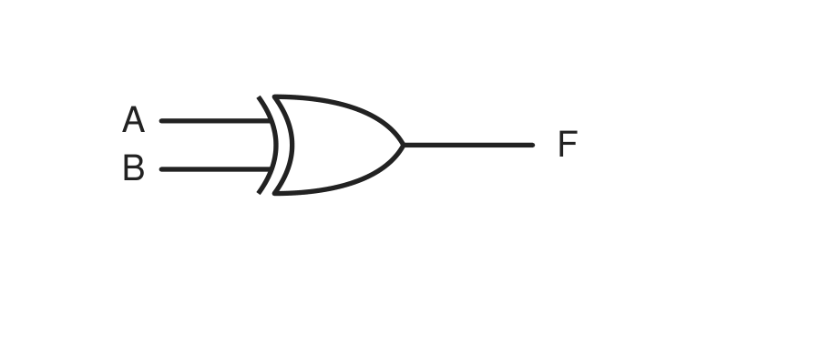
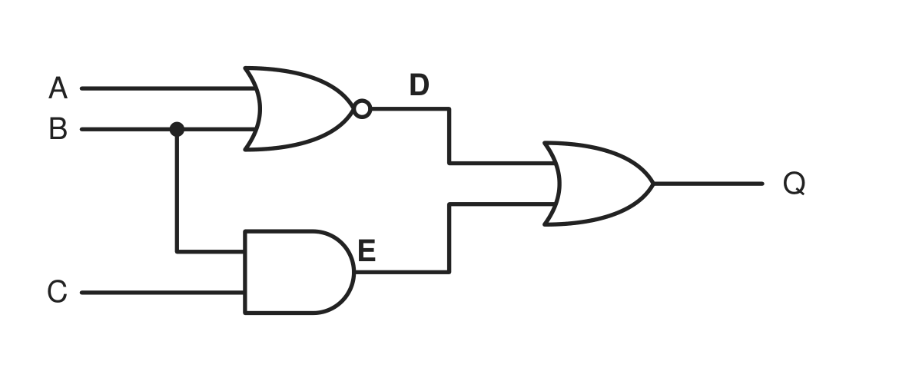
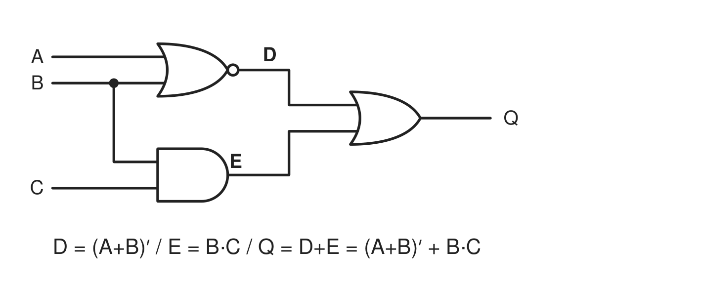
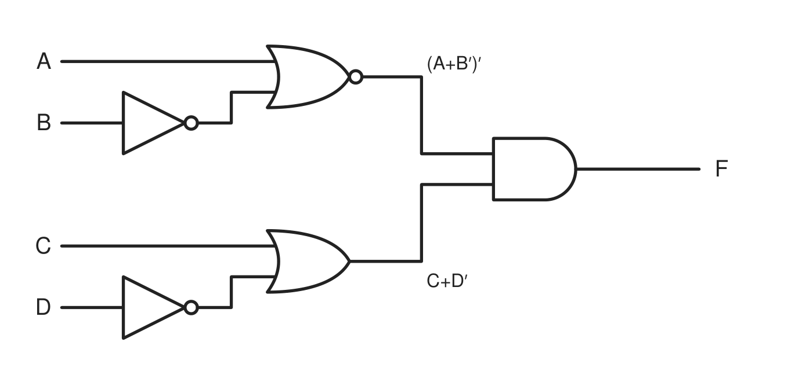
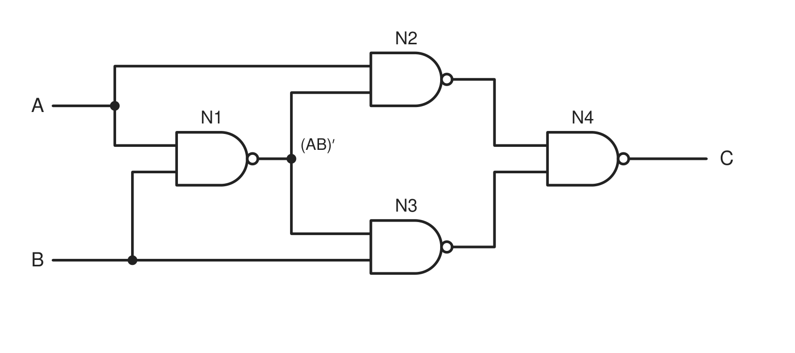
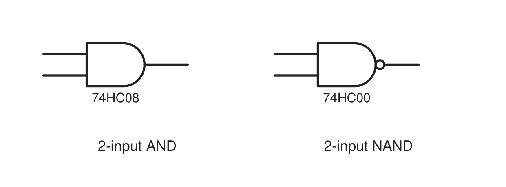
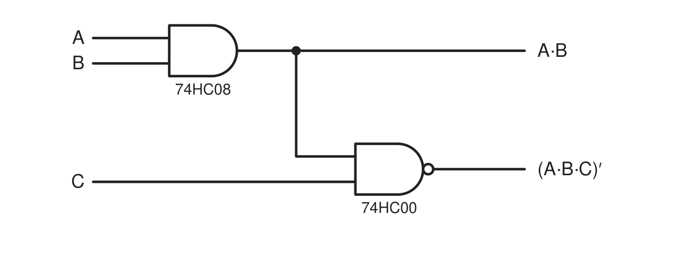
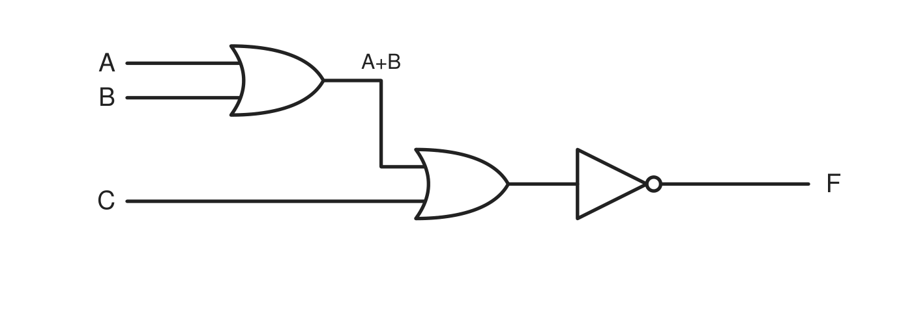
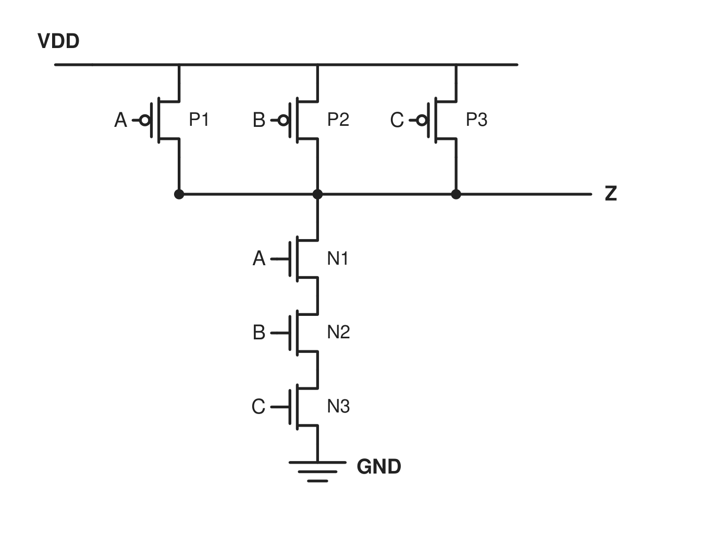

# 실험 1 · 기출 풀이

[실험 설명](실험01_실험설명.md) · [문제/해설](실험01_기출문제.md)

## 1. 3입력 게이트 진리표 (4행)
기출 · 실험 1 · 풀이 검토됨

### 문제 원문
다음 3 Input Logic Gate의 진리표를 완성하시오.(0 = low, 1 = high)

### 조건
| A | B | C | AND 출력 | OR 출력 | NOR 출력 | XOR 출력 |
| --- | --- | --- | --- | --- | --- | --- |
| 0 | 0 | 0 |  |  |  |  |
| 0 | 0 | 1 |  |  |  |  |
| 1 | 0 | 1 |  |  |  |  |
| 1 | 1 | 1 |  |  |  |  |

### 구할 것
빈칸 네 열을 모두 채우세요. 원문은 입력 4행만 제시해요.

### 힌트 · 접근 순서
행마다 1의 개수를 먼저 세어 보세요. AND는 전부 1인지, OR는 하나라도 1인지, NOR는 OR의 반대인지, XOR는 1이 홀수 개인지를 각각 판단해요.

### 풀이 1 · 풀이
각 행을 따로 계산해요. 000은 1이 0개라서 AND 0, OR 0, NOR 1, XOR 0이에요. 001과 101은 각각 1이 1개, 2개예요.

### 풀이 2 · 표로 정리
| A | B | C | AND 출력 | OR 출력 | NOR 출력 | XOR 출력 |
| --- | --- | --- | --- | --- | --- | --- |
| 0 | 0 | 0 | 0 | 0 | 1 | 0 |
| 0 | 0 | 1 | 0 | 1 | 0 | 1 |
| 1 | 0 | 1 | 0 | 1 | 0 | 0 |
| 1 | 1 | 1 | 1 | 1 | 0 | 1 |

### 풀이 3 · 검산
**검산:** AND 열의 1은 A=B=C=1 행뿐이에요. OR 열의 0은 A=B=C=0 행뿐이에요. NOR 열은 OR 열을 뒤집은 값이에요. XOR 열은 각 행의 1 개수가 홀수인지로 다시 세요.

### 풀이 4 · 흔한 실수
**흔한 실수:** 3입력 XOR를 “둘 이상 다르면 1” 같은 2입력 규칙으로 읽는 거예요. 1이 두 개인 행(011, 101, 110)은 0이고, 셋인 행(111)은 1이에요.

### 최종 답
표의 AND, OR, NOR, XOR 열은 000→0,0,1,0 / 001→0,1,0,1 / 101→0,1,0,0 / 111→1,1,0,1이에요.

### 출처
- [from_the_past/정리/퀴즈/실험1/실험1 퀴즈 기출_단답형.pdf](../../../from_the_past/%EC%A0%95%EB%A6%AC/%ED%80%B4%EC%A6%88/%EC%8B%A4%ED%97%981/%EC%8B%A4%ED%97%981%20%ED%80%B4%EC%A6%88%20%EA%B8%B0%EC%B6%9C_%EB%8B%A8%EB%8B%B5%ED%98%95.pdf#page=1)

## 2. 3입력 게이트 진리표 (8행)
기출 · 실험 1 · 풀이 검토됨

### 문제 원문
다음 진리표를 완성하시오. (3 input, 0 = low, 1 = high)

### 조건
| A | B | C | AND 출력 | OR 출력 | NOR 출력 | XOR 출력 |
| --- | --- | --- | --- | --- | --- | --- |
| 0 | 0 | 0 |  |  |  |  |
| 0 | 0 | 1 |  |  |  |  |
| 0 | 1 | 0 |  |  |  |  |
| 0 | 1 | 1 |  |  |  |  |
| 1 | 0 | 0 |  |  |  |  |
| 1 | 0 | 1 |  |  |  |  |
| 1 | 1 | 0 |  |  |  |  |
| 1 | 1 | 1 |  |  |  |  |

### 구할 것
여덟 행의 AND, OR, NOR, XOR 출력을 모두 채우세요.

### 힌트 · 접근 순서
열마다 규칙을 정하고 위에서 아래로 채워요. 먼저 AND와 OR, 그다음 NOR는 OR의 반대로 구하세요.

### 풀이 1 · 풀이
AND는 111에서만 1이에요. OR는 000에서만 0이에요. NOR는 OR를 뒤집어 000에서만 1이에요. XOR는 1이 홀수 개인 001, 010, 100, 111에서 1이에요.

### 풀이 2 · 표로 정리
| A | B | C | AND 출력 | OR 출력 | NOR 출력 | XOR 출력 |
| --- | --- | --- | --- | --- | --- | --- |
| 0 | 0 | 0 | 0 | 0 | 1 | 0 |
| 0 | 0 | 1 | 0 | 1 | 0 | 1 |
| 0 | 1 | 0 | 0 | 1 | 0 | 1 |
| 0 | 1 | 1 | 0 | 1 | 0 | 0 |
| 1 | 0 | 0 | 0 | 1 | 0 | 1 |
| 1 | 0 | 1 | 0 | 1 | 0 | 0 |
| 1 | 1 | 0 | 0 | 1 | 0 | 0 |
| 1 | 1 | 1 | 1 | 1 | 0 | 1 |

### 풀이 3 · 검산
**검산:** AND 열의 1은 A=B=C=1 행뿐이에요. OR 열의 0은 A=B=C=0 행뿐이에요. NOR 열은 OR 열을 뒤집은 값이에요. XOR 열은 각 행의 1 개수가 홀수인지로 다시 세요.

### 풀이 4 · 흔한 실수
**흔한 실수:** 3입력 XOR를 “둘 이상 다르면 1” 같은 2입력 규칙으로 읽는 거예요. 1이 두 개인 행(011, 101, 110)은 0이고, 셋인 행(111)은 1이에요.

### 최종 답
AND는 111만 1, OR는 000만 0, NOR는 000만 1, XOR는 001·010·100·111에서 1이에요.

### 출처
- [from_the_past/정리/퀴즈/실험1/실험1 퀴즈 풀이_수기메모.jpg](../../../from_the_past/%EC%A0%95%EB%A6%AC/%ED%80%B4%EC%A6%88/%EC%8B%A4%ED%97%981/%EC%8B%A4%ED%97%981%20%ED%80%B4%EC%A6%88%20%ED%92%80%EC%9D%B4_%EC%88%98%EA%B8%B0%EB%A9%94%EB%AA%A8.jpg)
- [from_the_past/정리/퀴즈/실험1/실험1 퀴즈 예상문제_v1.pdf](../../../from_the_past/%EC%A0%95%EB%A6%AC/%ED%80%B4%EC%A6%88/%EC%8B%A4%ED%97%981/%EC%8B%A4%ED%97%981%20%ED%80%B4%EC%A6%88%20%EC%98%88%EC%83%81%EB%AC%B8%EC%A0%9C_v1.pdf#page=1)
- [from_the_past/정리/퀴즈/실험1/실험1 퀴즈 예상문제_v2.pdf](../../../from_the_past/%EC%A0%95%EB%A6%AC/%ED%80%B4%EC%A6%88/%EC%8B%A4%ED%97%981/%EC%8B%A4%ED%97%981%20%ED%80%B4%EC%A6%88%20%EC%98%88%EC%83%81%EB%AC%B8%EC%A0%9C_v2.pdf#page=1)
- [from_the_past/정리/퀴즈/실험1/실험1 퀴즈 종합_기출문제 (3p).pdf](../../../from_the_past/%EC%A0%95%EB%A6%AC/%ED%80%B4%EC%A6%88/%EC%8B%A4%ED%97%981/%EC%8B%A4%ED%97%981%20%ED%80%B4%EC%A6%88%20%EC%A2%85%ED%95%A9_%EA%B8%B0%EC%B6%9C%EB%AC%B8%EC%A0%9C%20%283p%29.pdf#page=2)
- [from_the_past/정리/퀴즈/실험1/원본_docx/실험1.doc](../../../from_the_past/%EC%A0%95%EB%A6%AC/%ED%80%B4%EC%A6%88/%EC%8B%A4%ED%97%981/%EC%9B%90%EB%B3%B8_docx/%EC%8B%A4%ED%97%981.doc)

## 3. 2입력 XOR 진리표
기출 · 실험 1 · 풀이 검토됨

### 문제 원문
아래 2-input XOR gate의 Truth table을 완성 하시오. (3점)

### 조건
| A | B | C |
| --- | --- | --- |
| L | L |  |
| L | H |  |
| H | L |  |
| H | H |  |

### 구할 것
출력 C를 L 또는 H로 채우세요. 그림 1은 XOR gate이고, 그림 2의 Truth Table은 위 표로 옮겼어요.

### 힌트 · 접근 순서
XOR는 두 입력이 서로 다른지 같은지만 보면 돼요. 같은 행과 다른 행을 나눠 보세요.

### 풀이 1 · 풀이
A와 B가 같은 행(L L, H H)은 출력이 L이에요. 다른 행(L H, H L)은 출력이 H예요.

### 풀이 2 · 표로 정리
| A | B | C |
| --- | --- | --- |
| L | L | L |
| L | H | H |
| H | L | H |
| H | H | L |

### 풀이 3 · 검산
**검산:** A⊕B = A′B + AB′에 대입해요. L은 0, H는 1로 읽으면 01과 10에서만 1이에요.

### 풀이 4 · 흔한 실수
**흔한 실수:** H H를 H로 쓰는 거예요. 그건 OR의 값이에요. XOR는 둘 다 H이면 L이에요.

### 최종 답
C는 위에서부터 L, H, H, L이에요.

### 출처
- [from_the_past/정리/퀴즈/실험1/실험1 퀴즈 기출_문제.pdf](../../../from_the_past/%EC%A0%95%EB%A6%AC/%ED%80%B4%EC%A6%88/%EC%8B%A4%ED%97%981/%EC%8B%A4%ED%97%981%20%ED%80%B4%EC%A6%88%20%EA%B8%B0%EC%B6%9C_%EB%AC%B8%EC%A0%9C.pdf#page=1)
- [from_the_past/정리/퀴즈/실험1/실험1 퀴즈 기출_정답.pdf](../../../from_the_past/%EC%A0%95%EB%A6%AC/%ED%80%B4%EC%A6%88/%EC%8B%A4%ED%97%981/%EC%8B%A4%ED%97%981%20%ED%80%B4%EC%A6%88%20%EA%B8%B0%EC%B6%9C_%EC%A0%95%EB%8B%B5.pdf#page=1)
- [from_the_past/정리/퀴즈/실험1/원본_docx/퀴즈1_답.docx](../../../from_the_past/%EC%A0%95%EB%A6%AC/%ED%80%B4%EC%A6%88/%EC%8B%A4%ED%97%981/%EC%9B%90%EB%B3%B8_docx/%ED%80%B4%EC%A6%881_%EB%8B%B5.docx)

## 4. XOR 게이트 기호, 진리표, 논리식
기출 · 실험 1 · 풀이 검토됨

### 문제 원문
1-1) 2 input 1 output XOR Gate의 Logic symbol (Gate)을 그리고 truth Table 을 작성하시오.

1-2) XOR Gate의 Logic function을 작성하시오. (빈칸 F = ____)

### 구할 것
입력을 A, B, 출력을 F라 하고 XOR 기호와 진리표를 그린 뒤, F의 논리식을 쓰세요.

### 힌트 · 접근 순서
기호는 OR 모양에 입력 쪽 곡선이 하나 더 있는 모양이에요. 논리식은 출력이 1인 행을 하나씩 식으로 쓴 뒤 합쳐요.

### 풀이 1 · 1-1 기호와 진리표

| A | B | F |
| --- | --- | --- |
| 0 | 0 | 0 |
| 0 | 1 | 1 |
| 1 | 0 | 1 |
| 1 | 1 | 0 |

### 풀이 2 · 1-2 논리식
출력이 1인 행은 01과 10이에요. 01은 A′·B, 10은 A·B′이라서 두 식을 OR로 합쳐요.

$$F=A\oplus B=\overline{A}B+A\overline{B}$$

### 풀이 3 · 검산
**검산:** A=1, B=1을 넣으면 A′B=0, AB′=0이라서 F=0이에요. 진리표와 같아요.

### 풀이 4 · 흔한 실수
**흔한 실수:** 기호의 입력 쪽 곡선을 빼먹어 OR 기호로 그리는 거예요. 곡선이 하나 더 있으면 XOR예요.

### 최종 답
F = A⊕B = A′B + AB′이고, 진리표는 0, 1, 1, 0이에요.

### 출처
- [from_the_past/정리/퀴즈/실험1/실험1 퀴즈 기출_채점본.jpg](../../../from_the_past/%EC%A0%95%EB%A6%AC/%ED%80%B4%EC%A6%88/%EC%8B%A4%ED%97%981/%EC%8B%A4%ED%97%981%20%ED%80%B4%EC%A6%88%20%EA%B8%B0%EC%B6%9C_%EC%B1%84%EC%A0%90%EB%B3%B8.jpg)

## 5. Switching Algebra로 식 간단히 하기
기출 · 실험 1 · 풀이 검토됨

### 문제 원문
아래의 Switching Algebra를 사용하여 다음 식을 최대한 간단히 하시오

### 조건
**Switching Algebra Axioms & Theorems** (EECC341 - Shaaban). 원문 표를 글자로 옮겼어요.

**A1** X=0 if X≠1 ｜ A1′: X=1 if X≠0

**A2** If X=0, then X′=1 ｜ A2′: if X=1, then X′=0

**A3** 0·0 = 0 ｜ A3′: 1+1 = 1

**A4** 1·1 = 1 ｜ A4′: 0+0 = 0

**A5** 0·1 = 1·0 = 0 ｜ A5′: 1+0 = 0+1 = 1

**T1 Identities** X+0 = X ｜ T1′: X·1 = X

**T2 Null elements** X+1 = 1 ｜ T2′: X·0 = 0

**T3 Idempotency** X+X = X ｜ T3′: X·X = X

**T4 Involution** (X′)′ = X

**T5 Complements** X+X′ = 1 ｜ T5′: X·X′ = 0

**T6 Commutativity** X+Y = Y+X ｜ T6′: X·Y = Y·X

**T7 Associativity** (X+Y)+Z = X+(Y+Z) ｜ T7′: (X·Y)·Z = X·(Y·Z)

**T8 Distributivity** X·Y+X·Z = X·(Y+Z) ｜ T8′: (X+Y)·(X+Z) = X+Y·Z

**T9 Covering** X+X·Y = X ｜ T9′: X·(X+Y) = X

**T10 Combining** X·Y+X·Y′ = X ｜ T10′: (X+Y)·(X+Y′) = X

**T11 Consensus** X·Y+X′·Z+Y·Z = X·Y+X′·Z ｜ T11′: (X+Y)·(X′+Z)·(Y+Z) = (X+Y)·(X′+Z)

**T12 Generalized idempotency** X+X+…+X = X ｜ T12′: X·X·…·X = X

**T13 DeMorgan’s theorems** (X₁·X₂·…·Xₙ)′ = X₁′+X₂′+…+Xₙ′ ｜ T13′: (X₁+X₂+…+Xₙ)′ = X₁′·X₂′·…·Xₙ′

**T14 Generalized DeMorgan’s theorem** [F(X₁,X₂,…,Xₙ,+,·)]′ = F(X₁′,X₂′,…,Xₙ′,·,+)

**문제:**

$$(\overline{V}+X)\cdot\big(W\cdot(\overline{Y}+Z)\big)+(\overline{V}+X)\cdot\overline{\big(W\cdot(\overline{Y}+Z)\big)}$$

### 구할 것
위 식을 위 규칙으로 최대한 간단히 하세요.

### 힌트 · 접근 순서
식에서 반복되는 덩어리를 찾아 한 글자로 바꿔 보세요. 어떤 덩어리와 그 덩어리의 반대가 같은 곱 안에 있는지 보세요.

### 풀이 1 · 덩어리 찾기
P = V′+X, Q = W·(Y′+Z)라고 두면 식은 P·Q + P·Q′ 꼴이에요. 둘째 항의 윗줄은 Q 전체에만 걸려 있어요.

### 풀이 2 · 규칙 적용
T10(Combining) X·Y+X·Y′=X를 쓰면 P·Q+P·Q′=P예요. 직접 풀면 P·(Q+Q′)=P·1=P이고 T8, T5, T1′을 차례로 쓴 거예요.

### 풀이 3 · 원래 문자로
$$(\overline{V}+X)\cdot Q+(\overline{V}+X)\cdot\overline{Q}=\overline{V}+X$$

### 풀이 4 · 검산
**검산:** V=1, X=0이면 V′+X=0이라 식 전체가 0이에요. V=0이면 V′+X=1이고 Q와 Q′ 중 하나만 1이라서 식이 1이에요. 둘 다 V′+X와 같아요.

### 풀이 5 · 흔한 실수
**흔한 실수:** Q를 전개해 W·Y′+W·Z로 바꾸다 길을 잃는 거예요. 전개할 필요 없이 Q를 한 덩어리로 보고 T10을 쓰면 돼요.

### 최종 답
V′+X

### 출처
- [from_the_past/정리/퀴즈/실험1/실험1 퀴즈 기출_단답형.pdf](../../../from_the_past/%EC%A0%95%EB%A6%AC/%ED%80%B4%EC%A6%88/%EC%8B%A4%ED%97%981/%EC%8B%A4%ED%97%981%20%ED%80%B4%EC%A6%88%20%EA%B8%B0%EC%B6%9C_%EB%8B%A8%EB%8B%B5%ED%98%95.pdf#page=1)
- [from_the_past/정리/퀴즈/실험1/실험1 퀴즈 예상문제_v1.pdf](../../../from_the_past/%EC%A0%95%EB%A6%AC/%ED%80%B4%EC%A6%88/%EC%8B%A4%ED%97%981/%EC%8B%A4%ED%97%981%20%ED%80%B4%EC%A6%88%20%EC%98%88%EC%83%81%EB%AC%B8%EC%A0%9C_v1.pdf#page=2)
- [from_the_past/정리/퀴즈/실험1/실험1 퀴즈 예상문제_v2.pdf](../../../from_the_past/%EC%A0%95%EB%A6%AC/%ED%80%B4%EC%A6%88/%EC%8B%A4%ED%97%981/%EC%8B%A4%ED%97%981%20%ED%80%B4%EC%A6%88%20%EC%98%88%EC%83%81%EB%AC%B8%EC%A0%9C_v2.pdf#page=3)
- [from_the_past/정리/퀴즈/실험1/실험1 퀴즈 종합_기출문제 (3p).pdf](../../../from_the_past/%EC%A0%95%EB%A6%AC/%ED%80%B4%EC%A6%88/%EC%8B%A4%ED%97%981/%EC%8B%A4%ED%97%981%20%ED%80%B4%EC%A6%88%20%EC%A2%85%ED%95%A9_%EA%B8%B0%EC%B6%9C%EB%AC%B8%EC%A0%9C%20%283p%29.pdf#page=3)
- [from_the_past/정리/퀴즈/실험1/원본_docx/실험1.doc](../../../from_the_past/%EC%A0%95%EB%A6%AC/%ED%80%B4%EC%A6%88/%EC%8B%A4%ED%97%981/%EC%9B%90%EB%B3%B8_docx/%EC%8B%A4%ED%97%981.doc)

## 6. 드모르간으로 식 전개
기출 · 실험 1 · 풀이 검토됨

### 문제 원문
De Morgan 식을 사용하여 다음을 전개 하여라.

### 구할 것
$$\overline{(\overline{A}+\overline{B}+\overline{C})\cdot(\overline{D}\cdot\overline{E})}$$

윗줄 없이 전개한 식을 쓰세요.

### 힌트 · 접근 순서
가장 큰 윗줄을 먼저 쪼개요. 쪼갠 뒤 각 덩어리에 남은 윗줄도 하나씩 처리하세요.

### 풀이 1 · 바깥 윗줄 쪼개기
전체는 두 덩어리의 곱이에요. 곱의 윗줄은 각 덩어리의 윗줄을 OR로 합친 거예요.

$$\overline{(\overline{A}+\overline{B}+\overline{C})}+\overline{(\overline{D}\cdot\overline{E})}$$

### 풀이 2 · 안쪽 윗줄 처리
첫 덩어리는 NOR 꼴이라 (A′+B′+C′)′=A·B·C예요. 둘째 덩어리는 (D′·E′)′=D+E예요.

### 풀이 3 · 합치기
$$A\cdot B\cdot C+D+E$$

### 풀이 4 · 검산
**검산:** A=B=C=1, D=E=0이면 원래 식은 (0·1)′=1이고 결과는 1+0+0=1이에요. A=0, D=E=0이면 원래 식은 (1·1)′=0이고 결과도 0이에요.

### 풀이 5 · 흔한 실수
**흔한 실수:** 윗줄을 쪼개고 연산자를 바꾸지 않는 거예요. 곱 위의 윗줄은 합으로, 합 위의 윗줄은 곱으로 바뀌어요.

### 최종 답
A·B·C + D + E

### 출처
- [from_the_past/정리/퀴즈/실험1/실험1 퀴즈 풀이_수기메모.jpg](../../../from_the_past/%EC%A0%95%EB%A6%AC/%ED%80%B4%EC%A6%88/%EC%8B%A4%ED%97%981/%EC%8B%A4%ED%97%981%20%ED%80%B4%EC%A6%88%20%ED%92%80%EC%9D%B4_%EC%88%98%EA%B8%B0%EB%A9%94%EB%AA%A8.jpg)
- [from_the_past/정리/퀴즈/실험1/실험1 퀴즈 예상문제_v1.pdf](../../../from_the_past/%EC%A0%95%EB%A6%AC/%ED%80%B4%EC%A6%88/%EC%8B%A4%ED%97%981/%EC%8B%A4%ED%97%981%20%ED%80%B4%EC%A6%88%20%EC%98%88%EC%83%81%EB%AC%B8%EC%A0%9C_v1.pdf#page=1)
- [from_the_past/정리/퀴즈/실험1/실험1 퀴즈 예상문제_v2.pdf](../../../from_the_past/%EC%A0%95%EB%A6%AC/%ED%80%B4%EC%A6%88/%EC%8B%A4%ED%97%981/%EC%8B%A4%ED%97%981%20%ED%80%B4%EC%A6%88%20%EC%98%88%EC%83%81%EB%AC%B8%EC%A0%9C_v2.pdf#page=3)
- [from_the_past/정리/퀴즈/실험1/실험1 퀴즈 종합_기출문제 (3p).pdf](../../../from_the_past/%EC%A0%95%EB%A6%AC/%ED%80%B4%EC%A6%88/%EC%8B%A4%ED%97%981/%EC%8B%A4%ED%97%981%20%ED%80%B4%EC%A6%88%20%EC%A2%85%ED%95%A9_%EA%B8%B0%EC%B6%9C%EB%AC%B8%EC%A0%9C%20%283p%29.pdf#page=3)
- [from_the_past/정리/퀴즈/실험1/원본_docx/실험1.doc](../../../from_the_past/%EC%A0%95%EB%A6%AC/%ED%80%B4%EC%A6%88/%EC%8B%A4%ED%97%981/%EC%9B%90%EB%B3%B8_docx/%EC%8B%A4%ED%97%981.doc)

## 7. 회로의 D, E, Q 부울식
기출 · 실험 1 · 답안 충돌

### 문제 원문
아래 회로의 D, E, Q의 Boolean equation을 적으시오. (3점)

### 구할 것
D=, E=, Q=를 채우세요.

### 힌트 · 접근 순서
입력에서 출력 쪽으로 게이트를 하나씩 읽어요. B에서 갈라지는 점이 어느 게이트로 가는지 따라가 보세요.

### 풀이 1 · D, E, Q
D는 A와 B를 받는 OR 게이트의 출력인데 출력에 작은 원이 있어서 D=(A+B)′예요. E는 AND 게이트의 출력이고 입력은 B에서 갈라진 선과 C라서 E=B·C예요. Q는 D와 E를 받는 OR 게이트의 출력이라서 Q=D+E=(A+B)′+B·C이고, 드모르간으로 Q=A′B′+BC로도 쓸 수 있어요.

### 풀이 2 · 완성 회로

### 풀이 3 · 검산과 흔한 실수
**검산:** A=0, B=0, C=0이면 D=1이므로 Q=1이에요. A=0, B=1, C=1이면 D=0, E=1이므로 Q=1이에요. A=1, B=1, C=0이면 D=0, E=0이므로 Q=0이에요.

**흔한 실수:** E의 입력을 A와 B로 읽는 거예요. 분기점은 B에만 있고 A는 OR로만 가요.

### 최종 답
D=(A+B)′, E=B·C, Q=(A+B)′+B·C (드모르간으로 Q=A′B′+BC로 써도 같은 답이에요)

### 출처
- [from_the_past/정리/퀴즈/실험1/실험1 퀴즈 기출_문제.pdf](../../../from_the_past/%EC%A0%95%EB%A6%AC/%ED%80%B4%EC%A6%88/%EC%8B%A4%ED%97%981/%EC%8B%A4%ED%97%981%20%ED%80%B4%EC%A6%88%20%EA%B8%B0%EC%B6%9C_%EB%AC%B8%EC%A0%9C.pdf#page=1)
- [from_the_past/정리/퀴즈/실험1/실험1 퀴즈 기출_정답.pdf](../../../from_the_past/%EC%A0%95%EB%A6%AC/%ED%80%B4%EC%A6%88/%EC%8B%A4%ED%97%981/%EC%8B%A4%ED%97%981%20%ED%80%B4%EC%A6%88%20%EA%B8%B0%EC%B6%9C_%EC%A0%95%EB%8B%B5.pdf#page=1)
- [from_the_past/정리/퀴즈/실험1/원본_docx/퀴즈1_답.docx](../../../from_the_past/%EC%A0%95%EB%A6%AC/%ED%80%B4%EC%A6%88/%EC%8B%A4%ED%97%981/%EC%9B%90%EB%B3%B8_docx/%ED%80%B4%EC%A6%881_%EB%8B%B5.docx)
- [from_the_past/정리/퀴즈/실험1/실험1 퀴즈 풀이_수기메모.jpg](../../../from_the_past/%EC%A0%95%EB%A6%AC/%ED%80%B4%EC%A6%88/%EC%8B%A4%ED%97%981/%EC%8B%A4%ED%97%981%20%ED%80%B4%EC%A6%88%20%ED%92%80%EC%9D%B4_%EC%88%98%EA%B8%B0%EB%A9%94%EB%AA%A8.jpg)
- [from_the_past/정리/퀴즈/실험1/실험1 퀴즈 예상문제_v1.pdf](../../../from_the_past/%EC%A0%95%EB%A6%AC/%ED%80%B4%EC%A6%88/%EC%8B%A4%ED%97%981/%EC%8B%A4%ED%97%981%20%ED%80%B4%EC%A6%88%20%EC%98%88%EC%83%81%EB%AC%B8%EC%A0%9C_v1.pdf#page=1)
- [from_the_past/정리/퀴즈/실험1/실험1 퀴즈 예상문제_v2.pdf](../../../from_the_past/%EC%A0%95%EB%A6%AC/%ED%80%B4%EC%A6%88/%EC%8B%A4%ED%97%981/%EC%8B%A4%ED%97%981%20%ED%80%B4%EC%A6%88%20%EC%98%88%EC%83%81%EB%AC%B8%EC%A0%9C_v2.pdf#page=1)
- [from_the_past/정리/퀴즈/실험1/실험1 퀴즈 종합_기출문제 (3p).pdf](../../../from_the_past/%EC%A0%95%EB%A6%AC/%ED%80%B4%EC%A6%88/%EC%8B%A4%ED%97%981/%EC%8B%A4%ED%97%981%20%ED%80%B4%EC%A6%88%20%EC%A2%85%ED%95%A9_%EA%B8%B0%EC%B6%9C%EB%AC%B8%EC%A0%9C%20%283p%29.pdf#page=2)
- [from_the_past/정리/퀴즈/실험1/원본_docx/실험1.doc](../../../from_the_past/%EC%A0%95%EB%A6%AC/%ED%80%B4%EC%A6%88/%EC%8B%A4%ED%97%981/%EC%9B%90%EB%B3%B8_docx/%EC%8B%A4%ED%97%981.doc)

## 8. 식의 논리 다이어그램 그리기
예상문제 · 실험 1 · 풀이 검토됨

### 문제 원문
아래 식의 Logic Diagram을 변형 없이 그리시오.

### 구할 것
$$\overline{(A+\overline{B})}\cdot(C+\overline{D})$$

윗줄은 첫 괄호 (A+B′)에만 걸려 있어요. 식을 간단히 하지 말고 그대로 그리세요.

### 힌트 · 접근 순서
식의 마지막 연산이 출력 게이트예요. 그다음 각 괄호를 앞쪽 게이트로 나눠요. B와 D의 윗줄은 입력 쪽 NOT이에요.

### 풀이 1 · 가장 바깥 연산
두 괄호가 · 로 이어져 있어서 출력은 AND 게이트예요. 입력은 (A+B′)′와 (C+D′)예요.

### 풀이 2 · 안쪽 게이트
(A+B′)′는 B를 NOT한 뒤 A와 NOR해요. (C+D′)는 D를 NOT한 뒤 C와 OR해요. 변형하지 않으니 드모르간을 쓰지 않아요.

### 풀이 3 · 완성 회로

### 풀이 4 · 다른 표기
NOR 기호 대신 OR 게이트 뒤에 NOT을 붙여 그려도 같은 회로예요. 게이트 수는 하나 늘어요.

### 풀이 5 · 검산
**검산:** A=0, B=1, C=0, D=0이면 (0+0)′=1, C+D′=0+1=1이라서 F=1이에요. A=1이면 첫 괄호가 0이라서 F=0이에요. 회로로 따라가도 같아요.

### 풀이 6 · 흔한 실수
**흔한 실수:** 윗줄이 식 전체를 덮는다고 읽어 마지막에 NAND를 쓰는 거예요. 윗줄은 첫 괄호에만 걸려 있어요.

### 최종 답
NOT 2개, NOR 1개, OR 1개, AND 1개로 F=(A+B′)′·(C+D′)를 그려요.

### 출처
- [from_the_past/정리/퀴즈/실험1/실험1 퀴즈 예상문제_v1.pdf](../../../from_the_past/%EC%A0%95%EB%A6%AC/%ED%80%B4%EC%A6%88/%EC%8B%A4%ED%97%981/%EC%8B%A4%ED%97%981%20%ED%80%B4%EC%A6%88%20%EC%98%88%EC%83%81%EB%AC%B8%EC%A0%9C_v1.pdf#page=1)
- [from_the_past/정리/퀴즈/실험1/실험1 퀴즈 예상문제_v2.pdf](../../../from_the_past/%EC%A0%95%EB%A6%AC/%ED%80%B4%EC%A6%88/%EC%8B%A4%ED%97%981/%EC%8B%A4%ED%97%981%20%ED%80%B4%EC%A6%88%20%EC%98%88%EC%83%81%EB%AC%B8%EC%A0%9C_v2.pdf#page=2)
- [from_the_past/정리/퀴즈/실험1/실험1 퀴즈 종합_기출문제 (3p).pdf](../../../from_the_past/%EC%A0%95%EB%A6%AC/%ED%80%B4%EC%A6%88/%EC%8B%A4%ED%97%981/%EC%8B%A4%ED%97%981%20%ED%80%B4%EC%A6%88%20%EC%A2%85%ED%95%A9_%EA%B8%B0%EC%B6%9C%EB%AC%B8%EC%A0%9C%20%283p%29.pdf#page=2)
- [from_the_past/정리/퀴즈/실험1/원본_docx/실험1.doc](../../../from_the_past/%EC%A0%95%EB%A6%AC/%ED%80%B4%EC%A6%88/%EC%8B%A4%ED%97%981/%EC%9B%90%EB%B3%B8_docx/%EC%8B%A4%ED%97%981.doc)

## 9. NAND만으로 XOR 구성
기출 · 실험 1 · 풀이 검토됨

### 문제 원문
NAND gate만을 이용하여 XOR gate를 구성하여라.

### 구할 것
입력 A, B와 출력 C를 가진 회로를 그리세요.

### 힌트 · 접근 순서
XOR를 AND·OR·NOT 식으로 먼저 쓰고, 그 식을 NAND만 나오게 바꿔 보세요. NAND 하나가 여러 곳으로 연결되기도 해요.

### 풀이 1 · 식으로 시작
$$A\oplus B=\overline{A}B+A\overline{B}=\overline{\overline{(A\cdot\overline{AB})}\cdot\overline{(B\cdot\overline{AB})}}$$

첫 등호는 XOR의 정의이고, 둘째 등호는 N1=(AB)′를 공유한 NAND 네 개 구성이에요.

### 풀이 2 · 완성 회로

### 풀이 3 · 표로 확인
| A | B | N1 | N2 | N3 | C |
| --- | --- | --- | --- | --- | --- |
| 0 | 0 | 1 | 1 | 1 | 0 |
| 0 | 1 | 1 | 1 | 0 | 1 |
| 1 | 0 | 1 | 0 | 1 | 1 |
| 1 | 1 | 0 | 1 | 1 | 0 |

### 풀이 4 · 검산
**검산:** 표의 C가 0, 1, 1, 0이라서 XOR 진리표와 같아요.

### 풀이 5 · 흔한 실수
**흔한 실수:** N1의 출력을 한 곳에만 연결하는 거예요. N1은 N2와 N3에 모두 들어가야 해요.

### 최종 답
NAND 네 개: N1=(AB)′, N2=(A·N1)′, N3=(B·N1)′, C=(N2·N3)′. 다른 유효 설계도 인정해요.

### 출처
- [from_the_past/정리/퀴즈/실험1/실험1 퀴즈 기출_단답형.pdf](../../../from_the_past/%EC%A0%95%EB%A6%AC/%ED%80%B4%EC%A6%88/%EC%8B%A4%ED%97%981/%EC%8B%A4%ED%97%981%20%ED%80%B4%EC%A6%88%20%EA%B8%B0%EC%B6%9C_%EB%8B%A8%EB%8B%B5%ED%98%95.pdf#page=1)
- [from_the_past/정리/퀴즈/실험1/실험1 퀴즈 풀이_수기메모.jpg](../../../from_the_past/%EC%A0%95%EB%A6%AC/%ED%80%B4%EC%A6%88/%EC%8B%A4%ED%97%981/%EC%8B%A4%ED%97%981%20%ED%80%B4%EC%A6%88%20%ED%92%80%EC%9D%B4_%EC%88%98%EA%B8%B0%EB%A9%94%EB%AA%A8.jpg)
- [from_the_past/정리/퀴즈/실험1/실험1 퀴즈 예상문제_v1.pdf](../../../from_the_past/%EC%A0%95%EB%A6%AC/%ED%80%B4%EC%A6%88/%EC%8B%A4%ED%97%981/%EC%8B%A4%ED%97%981%20%ED%80%B4%EC%A6%88%20%EC%98%88%EC%83%81%EB%AC%B8%EC%A0%9C_v1.pdf#page=1)
- [from_the_past/정리/퀴즈/실험1/실험1 퀴즈 예상문제_v2.pdf](../../../from_the_past/%EC%A0%95%EB%A6%AC/%ED%80%B4%EC%A6%88/%EC%8B%A4%ED%97%981/%EC%8B%A4%ED%97%981%20%ED%80%B4%EC%A6%88%20%EC%98%88%EC%83%81%EB%AC%B8%EC%A0%9C_v2.pdf#page=1)
- [from_the_past/정리/퀴즈/실험1/실험1 퀴즈 종합_기출문제 (3p).pdf](../../../from_the_past/%EC%A0%95%EB%A6%AC/%ED%80%B4%EC%A6%88/%EC%8B%A4%ED%97%981/%EC%8B%A4%ED%97%981%20%ED%80%B4%EC%A6%88%20%EC%A2%85%ED%95%A9_%EA%B8%B0%EC%B6%9C%EB%AC%B8%EC%A0%9C%20%283p%29.pdf#page=2)
- [from_the_past/정리/퀴즈/실험1/원본_docx/실험1.doc](../../../from_the_past/%EC%A0%95%EB%A6%AC/%ED%80%B4%EC%A6%88/%EC%8B%A4%ED%97%981/%EC%9B%90%EB%B3%B8_docx/%EC%8B%A4%ED%97%981.doc)

## 10. AND와 NAND로 3입력 NAND
기출 · 실험 1 · 풀이 검토됨

### 문제 원문
2-input NAND gate와 AND gate를 활용하여 3-input NAND gate를 구성 하시오. (4점)

### 구할 것
재료는 그림 3의 2-input AND(74HC08)와 그림 4의 2-input NAND(74HC00)예요. A, B, C를 입력으로 하는 회로를 그리세요.

### 힌트 · 접근 순서
3입력 NAND의 식 (A·B·C)′를 쓰고, 안의 A·B·C를 2입력 게이트 둘로 나눠 보세요.

### 풀이 1 · 식
$$\overline{A\cdot B\cdot C}=\overline{(A\cdot B)\cdot C}$$

### 풀이 2 · 완성 회로

첫 게이트는 AND로 A·B를 만들어요. 둘째 게이트는 NAND로 그 결과와 C를 받아요. 이것이 실험 2-1 회로예요.

### 풀이 3 · 표로 확인
A·B가 1인 행은 110과 111뿐이에요. 그중 C가 1인 111에서만 출력이 0이고, 나머지 7행은 모두 1이에요.

### 풀이 4 · 검산
**검산:** 출력이 0인 행은 111뿐이라서 3입력 NAND와 같아요.

### 풀이 5 · 흔한 실수
**흔한 실수:** 첫 게이트도 NAND로 쓰는 거예요. ((AB)′·C)′는 A·B+C′이라서 (ABC)′와 달라요.

### 최종 답
AND(A,B)의 출력과 C를 NAND에 넣으면 출력은 (A·B·C)′예요.

### 출처
- [from_the_past/정리/퀴즈/실험1/실험1 퀴즈 기출_문제.pdf](../../../from_the_past/%EC%A0%95%EB%A6%AC/%ED%80%B4%EC%A6%88/%EC%8B%A4%ED%97%981/%EC%8B%A4%ED%97%981%20%ED%80%B4%EC%A6%88%20%EA%B8%B0%EC%B6%9C_%EB%AC%B8%EC%A0%9C.pdf#page=1)
- [from_the_past/정리/퀴즈/실험1/실험1 퀴즈 기출_정답.pdf](../../../from_the_past/%EC%A0%95%EB%A6%AC/%ED%80%B4%EC%A6%88/%EC%8B%A4%ED%97%981/%EC%8B%A4%ED%97%981%20%ED%80%B4%EC%A6%88%20%EA%B8%B0%EC%B6%9C_%EC%A0%95%EB%8B%B5.pdf#page=1)
- [from_the_past/정리/퀴즈/실험1/원본_docx/퀴즈1_답.docx](../../../from_the_past/%EC%A0%95%EB%A6%AC/%ED%80%B4%EC%A6%88/%EC%8B%A4%ED%97%981/%EC%9B%90%EB%B3%B8_docx/%ED%80%B4%EC%A6%881_%EB%8B%B5.docx)

## 11. OR와 인버터로 3입력 NOR
기출 · 실험 1 · 풀이 검토됨

### 문제 원문
2) OR Gate와 Inverter를 활용하여 3 input NOR Gate의 Logic Diagram을 그리시오.

### 구할 것
입력 A, B, C로 3입력 NOR 회로를 그리세요.

### 힌트 · 접근 순서
NOR는 OR에 NOT을 붙인 거예요. 3입력 OR를 2입력 OR 두 개로 어떻게 만들 수 있는지 먼저 생각해요.

### 풀이 1 · 식
$$\overline{A+B+C}=\overline{(A+B)+C}$$

### 풀이 2 · 완성 회로

첫 OR가 A+B를, 둘째 OR가 (A+B)+C를 만들고, 마지막 인버터가 뒤집어요.

### 풀이 3 · 표로 확인
| A | B | C | A+B+C | 출력 |
| --- | --- | --- | --- | --- |
| 0 | 0 | 0 | 0 | 1 |
| 0 | 0 | 1 | 1 | 0 |
| 0 | 1 | 0 | 1 | 0 |
| 0 | 1 | 1 | 1 | 0 |
| 1 | 0 | 0 | 1 | 0 |
| 1 | 0 | 1 | 1 | 0 |
| 1 | 1 | 0 | 1 | 0 |
| 1 | 1 | 1 | 1 | 0 |

### 풀이 4 · 검산
**검산:** 출력이 1인 행은 000뿐이라서 3입력 NOR와 같아요. 실험 2-2는 마지막 OR와 NOT을 NOR 하나로 합친 구성이에요.

### 풀이 5 · 흔한 실수
**흔한 실수:** 입력마다 인버터를 붙이는 거예요. 그러면 A′+B′+C′가 되어 NOR가 아니에요.

### 최종 답
OR 두 개로 A+B+C를 만들고 인버터를 붙여요. 출력은 (A+B+C)′예요.

### 출처
- [from_the_past/정리/퀴즈/실험1/실험1 퀴즈 기출_채점본.jpg](../../../from_the_past/%EC%A0%95%EB%A6%AC/%ED%80%B4%EC%A6%88/%EC%8B%A4%ED%97%981/%EC%8B%A4%ED%97%981%20%ED%80%B4%EC%A6%88%20%EA%B8%B0%EC%B6%9C_%EC%B1%84%EC%A0%90%EB%B3%B8.jpg)

## 12. CMOS 3입력 NAND 그리기
기출 · 실험 1 · 풀이 검토됨

### 문제 원문
CMOS 3-input NAND gate를 그리시오.

### 구할 것
트랜지스터 수준으로 회로를 그리세요.

### 힌트 · 접근 순서
NAND의 출력이 0이 되는 조건(전부 1)과 1이 되는 조건(하나라도 0)을 각각 스위치 연결 방식으로 바꿔 보세요.

### 풀이 1 · 아래쪽(NMOS)
출력이 0이 되려면 A, B, C가 모두 1이어야 해요. “모두”는 직렬이라서 NMOS 3개를 출력과 GND 사이에 직렬로 놓아요.

### 풀이 2 · 위쪽(PMOS)
출력이 1이 되려면 셋 중 하나라도 0이면 돼요. “하나라도”는 병렬이라서 PMOS 3개를 VDD와 출력 사이에 병렬로 놓아요.

### 풀이 3 · 완성 회로

### 풀이 4 · 검산
**검산:** 111이면 PMOS가 모두 꺼지고 NMOS 경로가 연결되어 Z=0이에요. 011이면 P1이 켜져 VDD와 연결되고 N1이 꺼져 GND 경로가 끊겨서 Z=1이에요.

### 풀이 5 · 흔한 실수
**흔한 실수:** PMOS를 직렬로 놓는 거예요. 그건 NOR 구조예요. NAND는 PMOS 병렬, NMOS 직렬이에요.

### 최종 답
PMOS 3개는 병렬로 VDD와 출력 사이에, NMOS 3개는 직렬로 출력과 GND 사이에 놓고 A, B, C를 각 쌍의 게이트에 연결해요.

### 출처
- [from_the_past/정리/퀴즈/실험1/실험1 퀴즈 풀이_수기메모.jpg](../../../from_the_past/%EC%A0%95%EB%A6%AC/%ED%80%B4%EC%A6%88/%EC%8B%A4%ED%97%981/%EC%8B%A4%ED%97%981%20%ED%80%B4%EC%A6%88%20%ED%92%80%EC%9D%B4_%EC%88%98%EA%B8%B0%EB%A9%94%EB%AA%A8.jpg)
- [from_the_past/정리/퀴즈/실험1/실험1 퀴즈 예상문제_v1.pdf](../../../from_the_past/%EC%A0%95%EB%A6%AC/%ED%80%B4%EC%A6%88/%EC%8B%A4%ED%97%981/%EC%8B%A4%ED%97%981%20%ED%80%B4%EC%A6%88%20%EC%98%88%EC%83%81%EB%AC%B8%EC%A0%9C_v1.pdf#page=2)
- [from_the_past/정리/퀴즈/실험1/실험1 퀴즈 예상문제_v2.pdf](../../../from_the_past/%EC%A0%95%EB%A6%AC/%ED%80%B4%EC%A6%88/%EC%8B%A4%ED%97%981/%EC%8B%A4%ED%97%981%20%ED%80%B4%EC%A6%88%20%EC%98%88%EC%83%81%EB%AC%B8%EC%A0%9C_v2.pdf#page=3)
- [from_the_past/정리/퀴즈/실험1/실험1 퀴즈 종합_기출문제 (3p).pdf](../../../from_the_past/%EC%A0%95%EB%A6%AC/%ED%80%B4%EC%A6%88/%EC%8B%A4%ED%97%981/%EC%8B%A4%ED%97%981%20%ED%80%B4%EC%A6%88%20%EC%A2%85%ED%95%A9_%EA%B8%B0%EC%B6%9C%EB%AC%B8%EC%A0%9C%20%283p%29.pdf#page=3)
- [from_the_past/정리/퀴즈/실험1/원본_docx/실험1.doc](../../../from_the_past/%EC%A0%95%EB%A6%AC/%ED%80%B4%EC%A6%88/%EC%8B%A4%ED%97%981/%EC%9B%90%EB%B3%B8_docx/%EC%8B%A4%ED%97%981.doc)

## 중복·보류·다른 실험 문항

- q-pullup · held: 서술형 한 줄(Pull-up 저항 설명)이고 현재 교안 범위 밖이에요. 개념은 t-cmos 보충 layer에 설명하고 문제 카드로는 수록하지 않았어요.
