# 실험 2 · 기출 풀이

[실험 설명](실험02_실험설명.md) · [문제/해설](실험02_기출문제.md)

## 1. 입력 전압 구간 표시하기
기출 · 실험 2 · 답안 충돌

### 문제 원문
다음 그림은 CMOS의 입력 전압 값의 변화를 나타낸 것이다. 아래 그림에 CMOS inverter의 출력이 High, Low, Abnormal 상태가 되는 구간을 표시하여라.(단, VCC= 5V, VIHmin= 3.5V, VILmax=1.5V, GND=0V이다)

### 조건
$V_{CC}=5\,\mathrm{V}$, $V_{IHmin}=3.5\,\mathrm{V}$, $V_{ILmax}=1.5\,\mathrm{V}$, $GND=0\,\mathrm{V}$이에요. 입력은 GND에 머물다가 직선으로 VCC까지 오른 뒤 VCC로 유지돼요.

### 구할 것
그림의 시간축 위에 High, Low, Abnormal 상태가 되는 구간을 표시하세요.

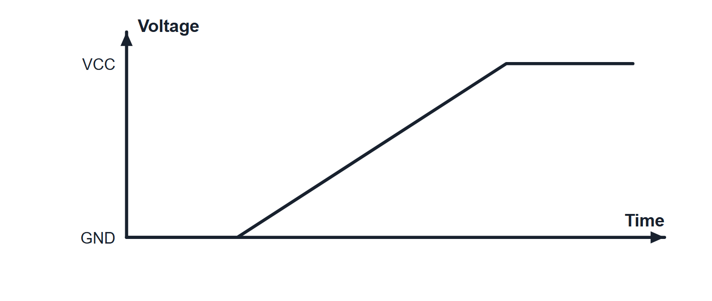

### 힌트 · 접근 순서
먼저 1.5 V와 3.5 V에 가로선을 긋고, 입력선이 그 선을 지나는 시각을 찾아요. 그 시각으로 시간축을 세 구간으로 나눠요.

### 힌트 · 인버터 주의
입력 레벨과 출력 레벨은 인버터에서 서로 반대예요. 문제가 “출력”을 물었는지 확인해요.

### 풀이 1 · 기준선과 구간
$V_{ILmax}=1.5\,\mathrm{V}$, $V_{IHmin}=3.5\,\mathrm{V}$에 가로선을 긋고 입력선이 지나는 시각을 $t_1$, $t_2$라 해요. $t_1$ 이전은 입력 Low, $t_1$~$t_2$는 Abnormal, $t_2$ 이후는 입력 High예요.

### 풀이 2 · 인버터 출력으로 바꾸기
인버터는 입력과 반대로 내보내요. 입력 Low 구간은 출력 High, 입력 High 구간은 출력 Low, 가운데는 출력이 보장되지 않는 Abnormal이에요.

### 풀이 3 · 완성 그림
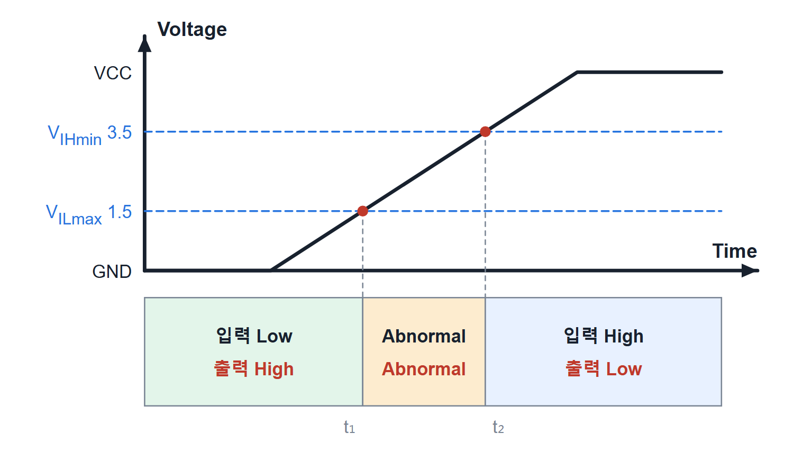

### 풀이 4 · 검산과 흔한 실수
입력 0 V는 Low 구간이고 출력은 5 V 근처예요. 흔한 실수는 출력을 입력과 같은 방향으로 표기하는 거예요. 채점 기준본은 전압 구역을 입력 기준으로 적었으니, 입력·출력 레벨을 함께 적으면 안전해요.

### 풀이 5 · 원문 대조 · 다시 볼 개념
**답안 충돌**: 원문 조건과 제공 답안의 차이 및 도출 답안의 가정을 확인하세요.

제공 답안은 전압 구역(입력 기준) 표기 “Low < 1.5 < abnormal < 3.5 < High”예요. 경계 1.5 V, 3.5 V는 같고 라벨 기준(입력/출력)이 달라 답안 충돌로 표시했어요. 2016 판본은 “CMOS inverter의 출력”, 다른 판본은 “CMOS의 출력”이라 적혀 있어요.

[논리 레벨의 기준 전압 네 개를 읽어요](%EC%8B%A4%ED%97%9802_%EC%8B%A4%ED%97%98%EC%84%A4%EB%AA%85.md#t-levels) · [원문·제공 답안 대조](%EC%9B%90%EB%AC%B8%EA%B3%BC_%EC%A0%80%EC%9E%91%EC%95%88%EB%82%B4.md#q-region)

### 최종 답
$t_1$ 이전: 입력 Low → 출력 High, $t_1$~$t_2$: Abnormal, $t_2$ 이후: 입력 High → 출력 Low. ($t_1$, $t_2$는 입력이 1.5 V, 3.5 V를 지나는 시각이에요.)

### 출처
- [from_the_past/정리/퀴즈/실험2/실험2 퀴즈 기출 2016-1.pdf](../../from_the_past/%EC%A0%95%EB%A6%AC/%ED%80%B4%EC%A6%88/%EC%8B%A4%ED%97%982/%EC%8B%A4%ED%97%982%20%ED%80%B4%EC%A6%88%20%EA%B8%B0%EC%B6%9C%202016-1.pdf#page=1)
- [from_the_past/정리/퀴즈/실험2/실험2 퀴즈 기출_단답형 (1p).pdf](../../from_the_past/%EC%A0%95%EB%A6%AC/%ED%80%B4%EC%A6%88/%EC%8B%A4%ED%97%982/%EC%8B%A4%ED%97%982%20%ED%80%B4%EC%A6%88%20%EA%B8%B0%EC%B6%9C_%EB%8B%A8%EB%8B%B5%ED%98%95%20%281p%29.pdf#page=1)
- [from_the_past/정리/퀴즈/실험2/실험2 퀴즈 예상문제_v3.pdf](../../from_the_past/%EC%A0%95%EB%A6%AC/%ED%80%B4%EC%A6%88/%EC%8B%A4%ED%97%982/%EC%8B%A4%ED%97%982%20%ED%80%B4%EC%A6%88%20%EC%98%88%EC%83%81%EB%AC%B8%EC%A0%9C_v3.pdf#page=1)
- [from_the_past/정리/퀴즈/실험2/실험2 퀴즈 예상문제_v4.pdf](../../from_the_past/%EC%A0%95%EB%A6%AC/%ED%80%B4%EC%A6%88/%EC%8B%A4%ED%97%982/%EC%8B%A4%ED%97%982%20%ED%80%B4%EC%A6%88%20%EC%98%88%EC%83%81%EB%AC%B8%EC%A0%9C_v4.pdf#page=1)
- [from_the_past/정리/퀴즈/실험2/실험2 퀴즈 종합_기출문제 (3p).pdf](../../from_the_past/%EC%A0%95%EB%A6%AC/%ED%80%B4%EC%A6%88/%EC%8B%A4%ED%97%982/%EC%8B%A4%ED%97%982%20%ED%80%B4%EC%A6%88%20%EC%A2%85%ED%95%A9_%EA%B8%B0%EC%B6%9C%EB%AC%B8%EC%A0%9C%20%283p%29.pdf#page=2)
- [from_the_past/정리/퀴즈/실험2/원본_docx/실험 2.docx](../../from_the_past/%EC%A0%95%EB%A6%AC/%ED%80%B4%EC%A6%88/%EC%8B%A4%ED%97%982/%EC%9B%90%EB%B3%B8_docx/%EC%8B%A4%ED%97%98%202.docx)

## 2. CMOS 주요 파라미터 네 가지
예상문제 · 실험 2 · 풀이 검토됨

### 문제 원문
CMOS의 주요 parameters에 대해 설명하여라.

$V_{OHmin}$ : / $V_{IHmin}$ : / $V_{ILmax}$ : / $V_{OLmax}$ :

### 구할 것
네 기호가 무엇을 뜻하는지 각각 설명하세요. (원문은 답 칸이 비어 있어요.)

### 힌트 · 접근 순서
이름을 풀어 읽어요. 첫 글자 V는 전압, I/O는 입력/출력, H/L은 High/Low, min/max는 최소/최대예요.

### 풀이 1 · $V_{OHmin}$
HIGH를 출력할 때 최소 허용 전압이에요. 출력이 이 값 이상이어야 High로 인정돼요.

### 풀이 2 · $V_{IHmin}$
HIGH를 입력 받을 때 최소 입력 전압이에요. 입력이 이 값 이상이면 High로 알아들어요.

### 풀이 3 · $V_{ILmax}$
LOW를 입력 받을 때 최대 입력 전압이에요. 입력이 이 값 이하면 Low로 알아들어요.

### 풀이 4 · $V_{OLmax}$
LOW를 출력할 때 최대 허용 전압이에요. 출력이 이 값 이하여야 Low로 인정돼요.

### 풀이 5 · 그림으로 위치 확인
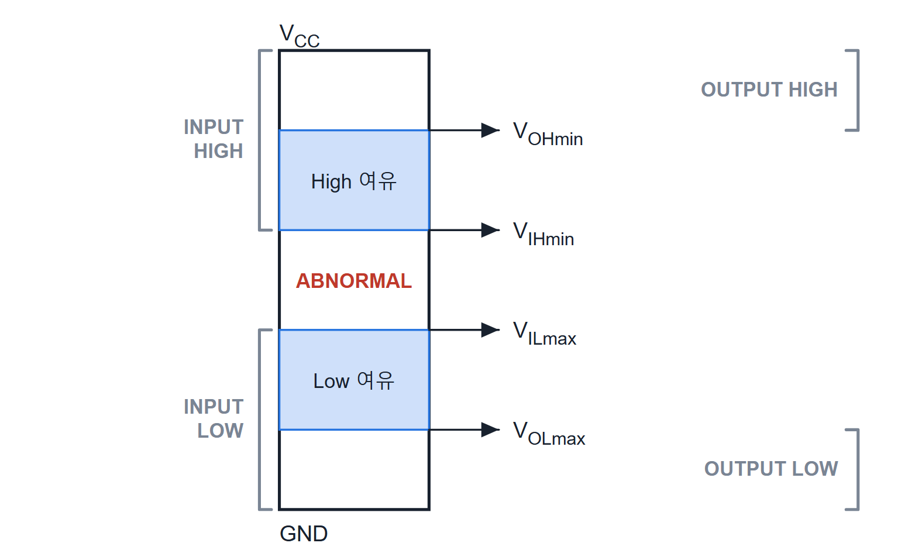

### 풀이 6 · 검산
순서는 $GND < V_{OLmax} < V_{ILmax} < V_{IHmin} < V_{OHmin} < V_{CC}$예요. 입력 기준 사이가 Abnormal이에요.

### 풀이 7 · 흔한 실수
입력 기준과 출력 기준을 서로 바꿔 쓰는 거예요. 입력은 I, 출력은 O로 구분해요.

### 풀이 8 · 원문 대조 · 다시 볼 개념
제공 답안이 없는 문항이에요. 정의는 교안 3쪽의 설명이에요.

[논리 레벨의 기준 전압 네 개를 읽어요](%EC%8B%A4%ED%97%9802_%EC%8B%A4%ED%97%98%EC%84%A4%EB%AA%85.md#t-levels) · [원문·제공 답안 대조](%EC%9B%90%EB%AC%B8%EA%B3%BC_%EC%A0%80%EC%9E%91%EC%95%88%EB%82%B4.md#q-params-4)

### 최종 답
$V_{OHmin}$: HIGH를 출력할 때 최소 허용 전압이에요. 출력이 이 값 이상이어야 High로 인정돼요. / $V_{IHmin}$: HIGH를 입력 받을 때 최소 입력 전압이에요. 입력이 이 값 이상이면 High로 알아들어요. / $V_{ILmax}$: LOW를 입력 받을 때 최대 입력 전압이에요. 입력이 이 값 이하면 Low로 알아들어요. / $V_{OLmax}$: LOW를 출력할 때 최대 허용 전압이에요. 출력이 이 값 이하여야 Low로 인정돼요.

### 출처
- [from_the_past/정리/퀴즈/실험2/실험2 퀴즈 예상문제_v3.pdf](../../from_the_past/%EC%A0%95%EB%A6%AC/%ED%80%B4%EC%A6%88/%EC%8B%A4%ED%97%982/%EC%8B%A4%ED%97%982%20%ED%80%B4%EC%A6%88%20%EC%98%88%EC%83%81%EB%AC%B8%EC%A0%9C_v3.pdf#page=2)
- [from_the_past/정리/퀴즈/실험2/실험2 퀴즈 예상문제_v4.pdf](../../from_the_past/%EC%A0%95%EB%A6%AC/%ED%80%B4%EC%A6%88/%EC%8B%A4%ED%97%982/%EC%8B%A4%ED%97%982%20%ED%80%B4%EC%A6%88%20%EC%98%88%EC%83%81%EB%AC%B8%EC%A0%9C_v4.pdf#page=2)
- [from_the_past/정리/퀴즈/실험2/실험2 퀴즈 종합_기출문제 (3p).pdf](../../from_the_past/%EC%A0%95%EB%A6%AC/%ED%80%B4%EC%A6%88/%EC%8B%A4%ED%97%982/%EC%8B%A4%ED%97%982%20%ED%80%B4%EC%A6%88%20%EC%A2%85%ED%95%A9_%EA%B8%B0%EC%B6%9C%EB%AC%B8%EC%A0%9C%20%283p%29.pdf#page=3)
- [from_the_past/정리/퀴즈/실험2/원본_docx/실험 2.docx](../../from_the_past/%EC%A0%95%EB%A6%AC/%ED%80%B4%EC%A6%88/%EC%8B%A4%ED%97%982/%EC%9B%90%EB%B3%B8_docx/%EC%8B%A4%ED%97%98%202.docx)

## 3. CMOS 주요 파라미터 (VOHmin, VILmax)
기출 · 실험 2 · 풀이 검토됨

### 문제 원문
CMOS의 주요 parameter에 대해 설명하여라.

$V_{OHmin}$ : / $V_{ILmax}$ :

### 구할 것
두 기호를 각각 설명하세요. (원문은 답 칸이 비어 있어요.)

### 힌트 · 접근 순서
이름을 풀어 읽어요. 첫 글자 V는 전압, I/O는 입력/출력, H/L은 High/Low, min/max는 최소/최대예요.

### 풀이 1 · $V_{OHmin}$
HIGH를 출력할 때 최소 허용 전압이에요. 출력이 이 값 이상이어야 High로 인정돼요.

### 풀이 2 · $V_{ILmax}$
LOW를 입력 받을 때 최대 입력 전압이에요. 입력이 이 값 이하면 Low로 알아들어요.

### 풀이 3 · 그림으로 위치 확인

### 풀이 4 · 검산
순서는 $GND < V_{OLmax} < V_{ILmax} < V_{IHmin} < V_{OHmin} < V_{CC}$예요. 입력 기준 사이가 Abnormal이에요.

### 풀이 5 · 흔한 실수
입력 기준과 출력 기준을 서로 바꿔 쓰는 거예요. 입력은 I, 출력은 O로 구분해요.

### 풀이 6 · 원문 대조 · 다시 볼 개념
제공 답안이 없는 문항이에요. 정의는 교안 3쪽의 설명이에요.

[논리 레벨의 기준 전압 네 개를 읽어요](%EC%8B%A4%ED%97%9802_%EC%8B%A4%ED%97%98%EC%84%A4%EB%AA%85.md#t-levels) · [원문·제공 답안 대조](%EC%9B%90%EB%AC%B8%EA%B3%BC_%EC%A0%80%EC%9E%91%EC%95%88%EB%82%B4.md#q-params-2017)

### 최종 답
$V_{OHmin}$: HIGH를 출력할 때 최소 허용 전압이에요. 출력이 이 값 이상이어야 High로 인정돼요. / $V_{ILmax}$: LOW를 입력 받을 때 최대 입력 전압이에요. 입력이 이 값 이하면 Low로 알아들어요.

### 출처
- [from_the_past/정리/퀴즈/실험2/실험2 퀴즈 기출 2017-1.pdf](../../from_the_past/%EC%A0%95%EB%A6%AC/%ED%80%B4%EC%A6%88/%EC%8B%A4%ED%97%982/%EC%8B%A4%ED%97%982%20%ED%80%B4%EC%A6%88%20%EA%B8%B0%EC%B6%9C%202017-1.pdf#page=1)
- [from_the_past/정리/퀴즈/실험2/원본_docx/퀴즈2_2017-1.docx](../../from_the_past/%EC%A0%95%EB%A6%AC/%ED%80%B4%EC%A6%88/%EC%8B%A4%ED%97%982/%EC%9B%90%EB%B3%B8_docx/%ED%80%B4%EC%A6%882_2017-1.docx)

## 4. CMOS 주요 파라미터 (VIHmin, VOLmax)
기출 · 실험 2 · 풀이 검토됨

### 문제 원문
CMOS의 주요 parameters에 대해 설명하여라.

$V_{IHmin}$ : / $V_{OLmax}$ :

### 구할 것
두 기호를 각각 설명하세요. (원문은 답 칸이 비어 있어요.)

### 힌트 · 접근 순서
이름을 풀어 읽어요. 첫 글자 V는 전압, I/O는 입력/출력, H/L은 High/Low, min/max는 최소/최대예요.

### 풀이 1 · $V_{IHmin}$
HIGH를 입력 받을 때 최소 입력 전압이에요. 입력이 이 값 이상이면 High로 알아들어요.

### 풀이 2 · $V_{OLmax}$
LOW를 출력할 때 최대 허용 전압이에요. 출력이 이 값 이하여야 Low로 인정돼요.

### 풀이 3 · 그림으로 위치 확인

### 풀이 4 · 검산
순서는 $GND < V_{OLmax} < V_{ILmax} < V_{IHmin} < V_{OHmin} < V_{CC}$예요. 입력 기준 사이가 Abnormal이에요.

### 풀이 5 · 흔한 실수
입력 기준과 출력 기준을 서로 바꿔 쓰는 거예요. 입력은 I, 출력은 O로 구분해요.

### 풀이 6 · 원문 대조 · 다시 볼 개념
제공 답안이 없는 문항이에요. 정의는 교안 3쪽의 설명이에요.

2016 판본은 시험지 머리글이 “2016-2학기 … 실험 3”이에요.

[논리 레벨의 기준 전압 네 개를 읽어요](%EC%8B%A4%ED%97%9802_%EC%8B%A4%ED%97%98%EC%84%A4%EB%AA%85.md#t-levels) · [원문·제공 답안 대조](%EC%9B%90%EB%AC%B8%EA%B3%BC_%EC%A0%80%EC%9E%91%EC%95%88%EB%82%B4.md#q-params-2016)

### 최종 답
$V_{IHmin}$: HIGH를 입력 받을 때 최소 입력 전압이에요. 입력이 이 값 이상이면 High로 알아들어요. / $V_{OLmax}$: LOW를 출력할 때 최대 허용 전압이에요. 출력이 이 값 이하여야 Low로 인정돼요.

### 출처
- [from_the_past/정리/퀴즈/실험2/실험2 퀴즈 기출 2016-1.pdf](../../from_the_past/%EC%A0%95%EB%A6%AC/%ED%80%B4%EC%A6%88/%EC%8B%A4%ED%97%982/%EC%8B%A4%ED%97%982%20%ED%80%B4%EC%A6%88%20%EA%B8%B0%EC%B6%9C%202016-1.pdf#page=1)

## 5. Schmitt-trigger가 잡음에 덜 민감한 이유
기출 · 실험 2 · 풀이 검토됨

### 문제 원문
Schmitt-trigger inverter의 출력이 입력 잡음에 영향을 덜 받게 되는 이유를 입출력 특성을 이용하여 설명하여라.

### 구할 것
입출력 특성(히스테리시스 곡선)을 이용해 이유를 설명하세요.

### 힌트 · 접근 순서
일반 인버터는 문턱이 하나예요. Schmitt는 문턱이 몇 개이고, 두 문턱 사이에서 출력이 어떻게 되는지 떠올려 봐요.

### 힌트 · 쓸 그림
가로축 입력, 세로축 출력인 곡선에 $V_{T-}$, $V_{T+}$를 표시하면 설명이 쉬워요.

### 풀이 1 · 일반 인버터의 문제
문턱이 하나라서 입력이 그 문턱 근처에서 조금만 흔들려도 출력이 계속 뒤집혀요.

### 풀이 2 · Schmitt의 입출력 특성
올라갈 때는 $V_{T+}$, 내려올 때는 $V_{T-}$에서 출력이 바뀌는 히스테리시스 곡선이에요. 두 문턱 사이(폭 $V_H = V_{T+} - V_{T-}$)에서는 출력이 직전 값을 유지해요.

### 풀이 3 · 잡음이 들어올 때
잡음 때문에 입력이 두 문턱 사이에서만 흔들리면 출력은 바뀌지 않아요. 잡음이 $V_{T+}$를 넘거나 $V_{T-}$ 아래로 내려갈 만큼 클 때만 출력이 바뀌어요.

### 풀이 4 · 그림으로 확인
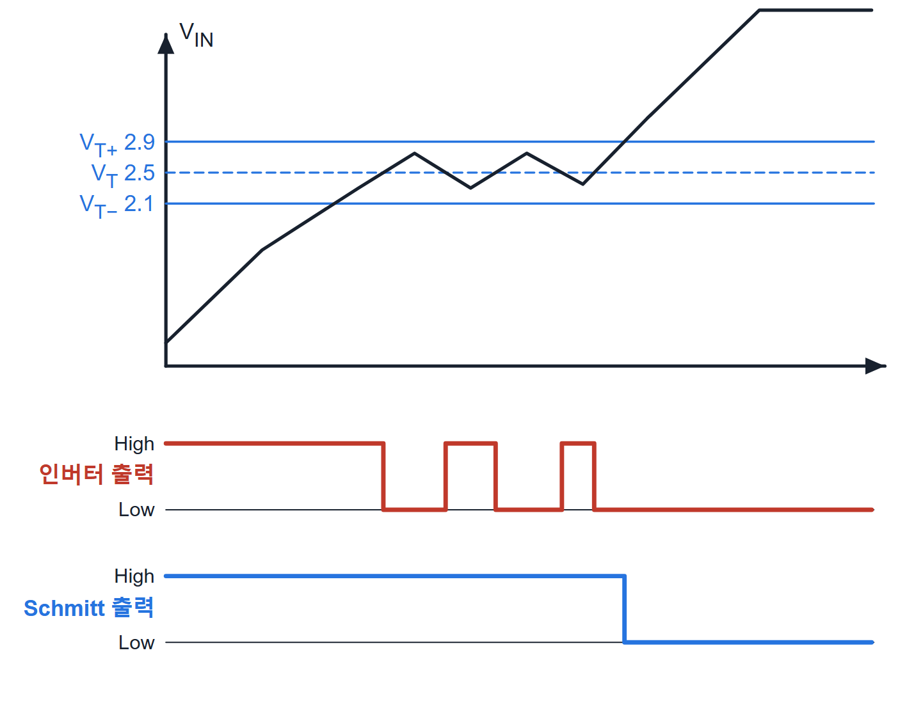

### 풀이 5 · 정리
Schmitt-trigger는 기준치(두 문턱)에 의해 Low, High가 정해지면, 잡음이 Abnormal에 해당하는 두 문턱 사이에서 흔들려도 출력이 유지돼서 영향을 덜 받아요.

### 풀이 6 · 검산
그림에서 입력이 2.3~2.75 V 사이를 오갈 때 인버터 출력은 2.5 V를 지날 때마다 뒤집혀 모두 5번 바뀌지만, Schmitt 출력은 입력이 2.9 V를 넘는 순간 한 번만 바뀌어요.

### 풀이 7 · 흔한 실수
“문턱이 높아서” 또는 “문턱이 낮아서”라고만 쓰는 거예요. 문턱이 두 개이고 그 사이에서 출력이 유지된다는 점을 써야 해요.

### 풀이 8 · 원문 대조 · 다시 볼 개념
제공 답안(채점 기준본): “기준치에 의해 Low, High가 정해졌을 시 잡음이 들어와도 abnormal 영역 내에서까지 값이 유지되므로 영향을 덜 받는다. 의미 맞으면 만점”이에요. 이 풀이와 같은 뜻이에요.

다른 제공 답안은 “hysteresis로 인하여, 새로 입력된 V_i는 이전상태의 V_i를 따라가게 되므로 …”라고 적혀 있어요. 문장 그대로는 입력이 이전 상태를 따라간다는 뜻으로 읽혀서 모호해요. 이 풀이는 “출력이 이전 상태를 유지한다”는 뜻으로 읽었고, 원문 표현은 보존했어요.

[Schmitt-trigger의 히스테리시스를 배워요](%EC%8B%A4%ED%97%9802_%EC%8B%A4%ED%97%98%EC%84%A4%EB%AA%85.md#t-schmitt) · [원문·제공 답안 대조](%EC%9B%90%EB%AC%B8%EA%B3%BC_%EC%A0%80%EC%9E%91%EC%95%88%EB%82%B4.md#q-schmitt-noise)

### 최종 답
상승 문턱 $V_{T+}$와 하강 문턱 $V_{T-}$가 달라서 두 문턱 사이(히스테리시스 폭 $V_H$)의 잡음에는 출력이 바뀌지 않기 때문이에요.

### 출처
- [from_the_past/정리/퀴즈/실험2/실험2 퀴즈 기출 2016-1.pdf](../../from_the_past/%EC%A0%95%EB%A6%AC/%ED%80%B4%EC%A6%88/%EC%8B%A4%ED%97%982/%EC%8B%A4%ED%97%982%20%ED%80%B4%EC%A6%88%20%EA%B8%B0%EC%B6%9C%202016-1.pdf#page=1)
- [from_the_past/정리/퀴즈/실험2/실험2 퀴즈 기출 2017-1.pdf](../../from_the_past/%EC%A0%95%EB%A6%AC/%ED%80%B4%EC%A6%88/%EC%8B%A4%ED%97%982/%EC%8B%A4%ED%97%982%20%ED%80%B4%EC%A6%88%20%EA%B8%B0%EC%B6%9C%202017-1.pdf#page=1)
- [from_the_past/정리/퀴즈/실험2/원본_docx/퀴즈2_2017-1.docx](../../from_the_past/%EC%A0%95%EB%A6%AC/%ED%80%B4%EC%A6%88/%EC%8B%A4%ED%97%982/%EC%9B%90%EB%B3%B8_docx/%ED%80%B4%EC%A6%882_2017-1.docx)
- [from_the_past/정리/퀴즈/실험2/실험2 퀴즈 기출_단답형 (1p).pdf](../../from_the_past/%EC%A0%95%EB%A6%AC/%ED%80%B4%EC%A6%88/%EC%8B%A4%ED%97%982/%EC%8B%A4%ED%97%982%20%ED%80%B4%EC%A6%88%20%EA%B8%B0%EC%B6%9C_%EB%8B%A8%EB%8B%B5%ED%98%95%20%281p%29.pdf#page=1)
- [from_the_past/정리/퀴즈/실험2/실험2 퀴즈 기출_채점본.jpg](../../from_the_past/%EC%A0%95%EB%A6%AC/%ED%80%B4%EC%A6%88/%EC%8B%A4%ED%97%982/%EC%8B%A4%ED%97%982%20%ED%80%B4%EC%A6%88%20%EA%B8%B0%EC%B6%9C_%EC%B1%84%EC%A0%90%EB%B3%B8.jpg)
- [from_the_past/정리/퀴즈/실험2/실험2 퀴즈 예상문제_v3.pdf](../../from_the_past/%EC%A0%95%EB%A6%AC/%ED%80%B4%EC%A6%88/%EC%8B%A4%ED%97%982/%EC%8B%A4%ED%97%982%20%ED%80%B4%EC%A6%88%20%EC%98%88%EC%83%81%EB%AC%B8%EC%A0%9C_v3.pdf#page=1)
- [from_the_past/정리/퀴즈/실험2/실험2 퀴즈 예상문제_v4.pdf](../../from_the_past/%EC%A0%95%EB%A6%AC/%ED%80%B4%EC%A6%88/%EC%8B%A4%ED%97%982/%EC%8B%A4%ED%97%982%20%ED%80%B4%EC%A6%88%20%EC%98%88%EC%83%81%EB%AC%B8%EC%A0%9C_v4.pdf#page=1)
- [from_the_past/정리/퀴즈/실험2/실험2 퀴즈 종합_기출문제 (3p).pdf](../../from_the_past/%EC%A0%95%EB%A6%AC/%ED%80%B4%EC%A6%88/%EC%8B%A4%ED%97%982/%EC%8B%A4%ED%97%982%20%ED%80%B4%EC%A6%88%20%EC%A2%85%ED%95%A9_%EA%B8%B0%EC%B6%9C%EB%AC%B8%EC%A0%9C%20%283p%29.pdf#page=2)
- [from_the_past/정리/퀴즈/실험2/원본_docx/실험 2.docx](../../from_the_past/%EC%A0%95%EB%A6%AC/%ED%80%B4%EC%A6%88/%EC%8B%A4%ED%97%982/%EC%9B%90%EB%B3%B8_docx/%EC%8B%A4%ED%97%98%202.docx)

## 6. 같은 입력에 대한 인버터와 Schmitt 출력
기출 · 실험 2 · 풀이 검토됨

### 문제 원문
아래 그림과 같은 입력이 인버터와 Schmitt-trigger inverter에 입력될 경우 각각의 출력을 그리시오.

### 조건
기준선은 $V_{T+}=2.9$, $V_T=2.5$, $V_{T-}=2.1$이에요. 입력은 0 근처에서 출발해 기준선 주변을 여러 번 오르내린 뒤 5.0 근처 최고점을 지나 0 근처로 내려가요. 인버터는 $V_T$에서, Schmitt는 $V_{T+}$와 $V_{T-}$에서 바뀌어요.

### 구할 것
인버터와 Schmitt-trigger inverter의 출력 파형을 각각 그리세요.

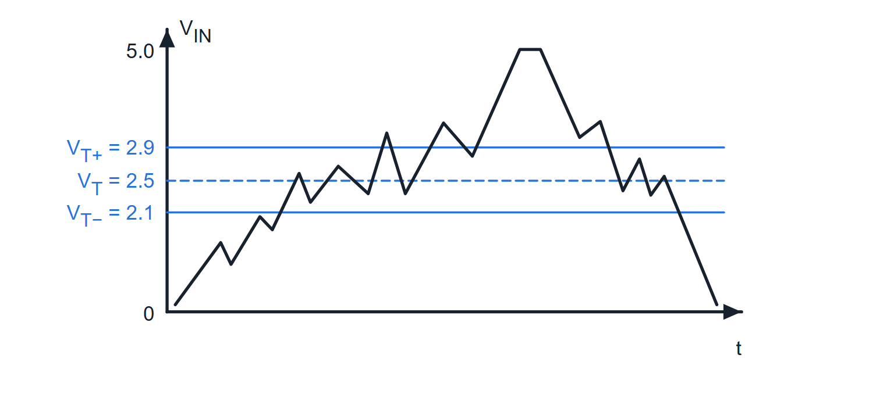

### 힌트 · 접근 순서
입력선이 각 기준선을 지나는 곳마다 세로 점선을 내려 봐요. 일반 인버터는 $V_T$ 하나만, Schmitt는 올라갈 때 $V_{T+}$, 내려올 때 $V_{T-}$만 봐요.

### 힌트 · 시작 상태
입력이 0 근처에서 시작하므로 두 출력은 모두 High에서 시작해요.

### 풀이 1 · 두 출력 따라가기
인버터는 $V_T=2.5$를 지날 때마다 뒤집혀서 12번 바뀌어요. Schmitt는 High에서 시작해 처음으로 $V_{T+}=2.9$ 위로 올라갈 때 Low가 되고, $V_{T-}=2.1$ 아래로 내려가기 전까지 Low를 유지해요. 맨 끝에서 $V_{T-}$ 아래로 내려갈 때 High로 돌아와 모두 2번 바뀌어요.

### 풀이 2 · 완성 그림
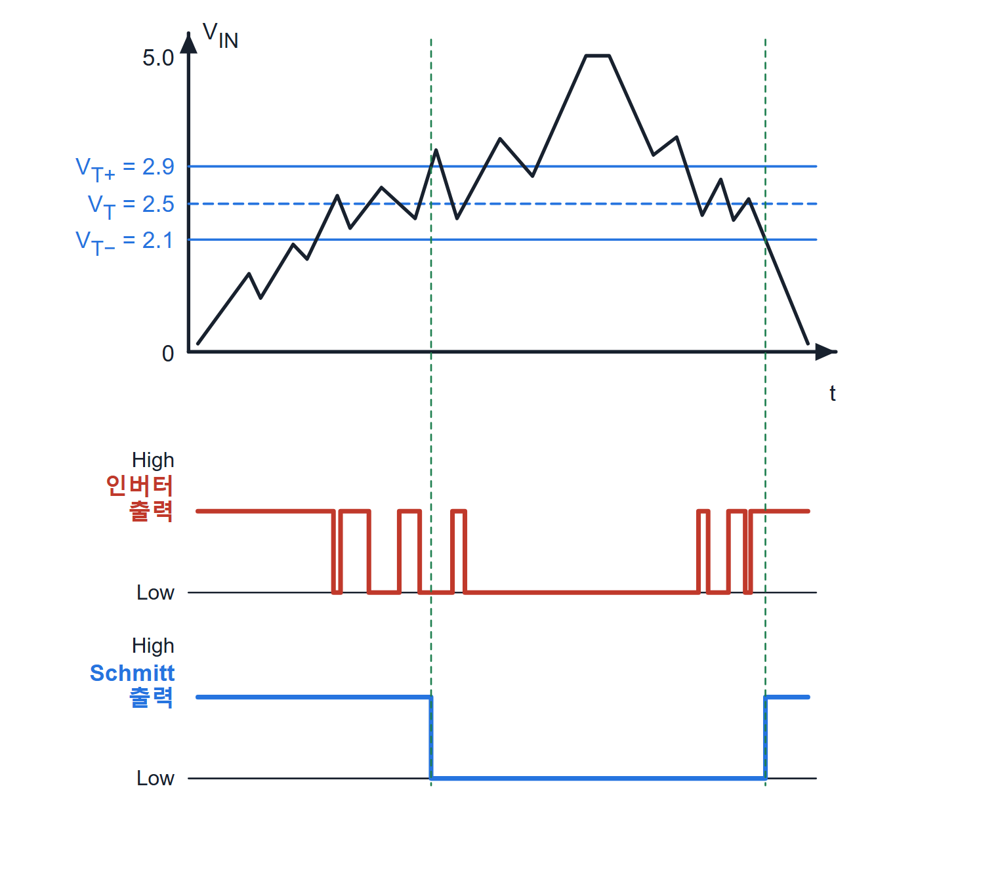

### 풀이 3 · 검산과 흔한 실수
Schmitt가 Low인 동안 입력의 골은 $V_{T-}$보다 높아요. 흔한 실수는 Schmitt도 $V_T$에서 바뀐다고 그리는 거예요.

### 풀이 4 · 원문 대조 · 다시 볼 개념
전이는 원문 그림의 선 높이로 판정했어요. 꼭짓점이 $V_T$ 선을 몇 픽셀만 넘는 두 곳은 해상도 한계에 가까워 12번은 이 읽기를 따른 값이에요.

[Schmitt-trigger의 히스테리시스를 배워요](%EC%8B%A4%ED%97%9802_%EC%8B%A4%ED%97%98%EC%84%A4%EB%AA%85.md#t-schmitt) · [원문·제공 답안 대조](%EC%9B%90%EB%AC%B8%EA%B3%BC_%EC%A0%80%EC%9E%91%EC%95%88%EB%82%B4.md#q-schmitt-waveform)

### 최종 답
인버터: $V_T$를 지날 때마다 High↔Low로 바뀌어 모두 12번 바뀌어요. Schmitt: High에서 시작해 첫 번째 $V_{T+}$ 돌파에서 Low로, 마지막 $V_{T-}$ 하향 돌파에서 High로 단 두 번만 바뀌어요.

### 출처
- [from_the_past/정리/퀴즈/실험2/실험2 퀴즈 기출 2017-1.pdf](../../from_the_past/%EC%A0%95%EB%A6%AC/%ED%80%B4%EC%A6%88/%EC%8B%A4%ED%97%982/%EC%8B%A4%ED%97%982%20%ED%80%B4%EC%A6%88%20%EA%B8%B0%EC%B6%9C%202017-1.pdf#page=1)
- [from_the_past/정리/퀴즈/실험2/원본_docx/퀴즈2_2017-1.docx](../../from_the_past/%EC%A0%95%EB%A6%AC/%ED%80%B4%EC%A6%88/%EC%8B%A4%ED%97%982/%EC%9B%90%EB%B3%B8_docx/%ED%80%B4%EC%A6%882_2017-1.docx)
- [from_the_past/정리/퀴즈/실험2/실험2 퀴즈 예상문제_v3.pdf](../../from_the_past/%EC%A0%95%EB%A6%AC/%ED%80%B4%EC%A6%88/%EC%8B%A4%ED%97%982/%EC%8B%A4%ED%97%982%20%ED%80%B4%EC%A6%88%20%EC%98%88%EC%83%81%EB%AC%B8%EC%A0%9C_v3.pdf#page=2)
- [from_the_past/정리/퀴즈/실험2/실험2 퀴즈 예상문제_v4.pdf](../../from_the_past/%EC%A0%95%EB%A6%AC/%ED%80%B4%EC%A6%88/%EC%8B%A4%ED%97%982/%EC%8B%A4%ED%97%982%20%ED%80%B4%EC%A6%88%20%EC%98%88%EC%83%81%EB%AC%B8%EC%A0%9C_v4.pdf#page=2)
- [from_the_past/정리/퀴즈/실험2/실험2 퀴즈 종합_기출문제 (3p).pdf](../../from_the_past/%EC%A0%95%EB%A6%AC/%ED%80%B4%EC%A6%88/%EC%8B%A4%ED%97%982/%EC%8B%A4%ED%97%982%20%ED%80%B4%EC%A6%88%20%EC%A2%85%ED%95%A9_%EA%B8%B0%EC%B6%9C%EB%AC%B8%EC%A0%9C%20%283p%29.pdf#page=3)
- [from_the_past/정리/퀴즈/실험2/원본_docx/실험 2.docx](../../from_the_past/%EC%A0%95%EB%A6%AC/%ED%80%B4%EC%A6%88/%EC%8B%A4%ED%97%982/%EC%9B%90%EB%B3%B8_docx/%EC%8B%A4%ED%97%98%202.docx)

## 7. Rp와 Rn이 출력에 미치는 영향
기출 · 실험 2 · 풀이 검토됨

### 문제 원문
CMOS의 내부 저항 Rp와 Rn이 CMOS의 출력에 미치는 영향에 대해 설명하여라.

### 조건
CMOS 내부 회로는 VCC와 GND 사이에 $R_p$, $R_n$이 직렬로 있고, 가운데 출력 노드가 resistive load에 이어져 있어요. 입력은 Vin이에요.

### 구할 것
$R_p$와 $R_n$이 출력에 어떤 영향을 주는지 설명하세요.

### 힌트 · 접근 순서
입력이 High일 때와 Low일 때 각각 어느 저항이 켜지는지, 그 저항에 전류가 흐르면 출력 전압이 어떻게 되는지 써 봐요.

### 풀이 1 · 입력 Low (출력 High)
$R_p$가 켜지고 $R_n$은 꺼져요. 전류가 $R_p$를 거쳐 부하로 흘러서(sourcing) $V_{OH} = V_{DD} - \|I_{OH}\|R_p$예요.

### 풀이 2 · 입력 High (출력 Low)
$R_n$이 켜지고 $R_p$는 꺼져요. 부하 쪽 전류가 $R_n$을 거쳐 GND로 흘러서(sinking) $V_{OL} = I_{OL}R_n$이에요. 꺼진 쪽은 1 MΩ 이상이라 전류가 거의 없어요.

### 풀이 3 · 그림
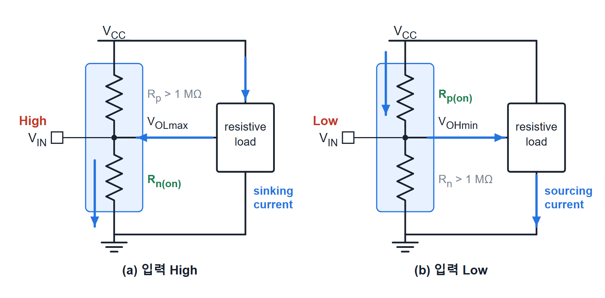

### 풀이 4 · 정리와 검산
저항이 작을수록 출력이 VCC, GND에 가까워 $V_{OHmin}$, $V_{OLmax}$를 지키기 쉬워요. 부하 전류가 0이면 $V_{OH}=V_{DD}$, $V_{OL}=0$이에요. 흔한 실수는 두 저항이 동시에 켜진다고 쓰는 거예요.

### 풀이 5 · 원문 대조 · 다시 볼 개념
제공 답안이 없는 문항이에요. 교안 6쪽의 $R_{n(on)}$, $R_{p(on)}$ 식과 “꺼진 쪽 > 1 MΩ” 표기를 바탕으로 직접 도출했어요.

[Rp와 Rn은 전류가 흐르는 길을 정해요](%EC%8B%A4%ED%97%9802_%EC%8B%A4%ED%97%98%EC%84%A4%EB%AA%85.md#t-rprn) · [원문·제공 답안 대조](%EC%9B%90%EB%AC%B8%EA%B3%BC_%EC%A0%80%EC%9E%91%EC%95%88%EB%82%B4.md#q-rprn-effect)

### 최종 답
켜진 저항(입력 Low면 $R_p$, 입력 High면 $R_n$)에서 전압이 떨어져 출력은 $V_{OH}=V_{DD}-\|I_{OH}\|R_p$, $V_{OL}=I_{OL}R_n$이 돼요. 그래서 저항이 작을수록 출력 레벨이 좋아요.

### 출처
- [from_the_past/정리/퀴즈/실험2/실험2 퀴즈 기출 2016-1.pdf](../../from_the_past/%EC%A0%95%EB%A6%AC/%ED%80%B4%EC%A6%88/%EC%8B%A4%ED%97%982/%EC%8B%A4%ED%97%982%20%ED%80%B4%EC%A6%88%20%EA%B8%B0%EC%B6%9C%202016-1.pdf#page=1)
- [from_the_past/정리/퀴즈/실험2/실험2 퀴즈 예상문제_v3.pdf](../../from_the_past/%EC%A0%95%EB%A6%AC/%ED%80%B4%EC%A6%88/%EC%8B%A4%ED%97%982/%EC%8B%A4%ED%97%982%20%ED%80%B4%EC%A6%88%20%EC%98%88%EC%83%81%EB%AC%B8%EC%A0%9C_v3.pdf#page=1)
- [from_the_past/정리/퀴즈/실험2/실험2 퀴즈 예상문제_v4.pdf](../../from_the_past/%EC%A0%95%EB%A6%AC/%ED%80%B4%EC%A6%88/%EC%8B%A4%ED%97%982/%EC%8B%A4%ED%97%982%20%ED%80%B4%EC%A6%88%20%EC%98%88%EC%83%81%EB%AC%B8%EC%A0%9C_v4.pdf#page=1)
- [from_the_past/정리/퀴즈/실험2/실험2 퀴즈 종합_기출문제 (3p).pdf](../../from_the_past/%EC%A0%95%EB%A6%AC/%ED%80%B4%EC%A6%88/%EC%8B%A4%ED%97%982/%EC%8B%A4%ED%97%982%20%ED%80%B4%EC%A6%88%20%EC%A2%85%ED%95%A9_%EA%B8%B0%EC%B6%9C%EB%AC%B8%EC%A0%9C%20%283p%29.pdf#page=2)
- [from_the_past/정리/퀴즈/실험2/원본_docx/실험 2.docx](../../from_the_past/%EC%A0%95%EB%A6%AC/%ED%80%B4%EC%A6%88/%EC%8B%A4%ED%97%982/%EC%9B%90%EB%B3%B8_docx/%EC%8B%A4%ED%97%98%202.docx)

## 8. Rp 값 유도
기출 · 실험 2 · 풀이 검토됨

### 문제 원문
CMOS의 내부 회로도를 이용하여 내부저항 Rp의 값을 유도하여라.

### 조건
$R_p$는 VCC와 출력 노드 사이의 저항이에요. 출력이 High일 때의 전압 기준은 $V_{OHmin}$, 허용 전류는 $I_{OHmax}$예요.

### 구할 것
$R_p$를 구하는 식을 유도하세요.

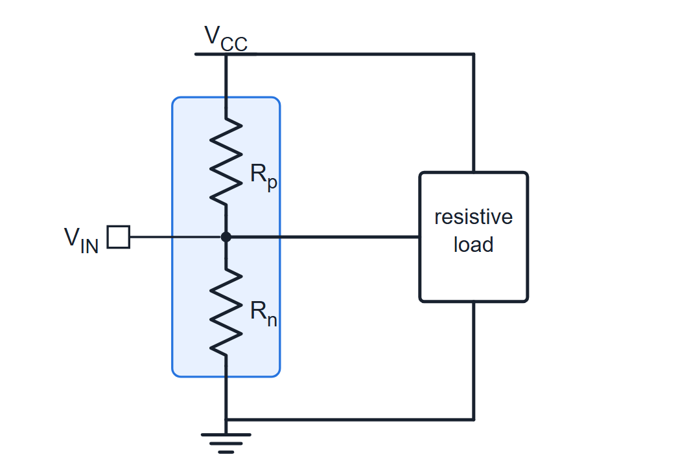

### 힌트 · 접근 순서
출력이 High가 되는 입력 레벨을 먼저 정해요. 그때 전류가 어디서 어디로 흐르는지 그림에 그리고, $R_p$ 양단 전압을 적어 봐요.

### 풀이 1 · 조건과 전류 길
$R_p$가 켜지는 때는 입력 Low, 출력 High예요. 전류(sourcing)는 VCC → $R_p$ → 출력 노드 → 부하 → GND로 흘러요.

### 풀이 2 · 식 세우기
$R_p$ 양단 전압은 $V_{DD}-V_{OH}$, 전류는 $\|I_{OH}\|$예요. 옴의 법칙으로 $V_{DD}-V_{OH}=\|I_{OH}\|R_p$이고, 한계 $V_{OH}=V_{OHmin}$, $\|I_{OH}\|=\|I_{OHmax}\|$에서 $R_{p(on)}$이 정해져요.

### 풀이 3 · 완성 그림
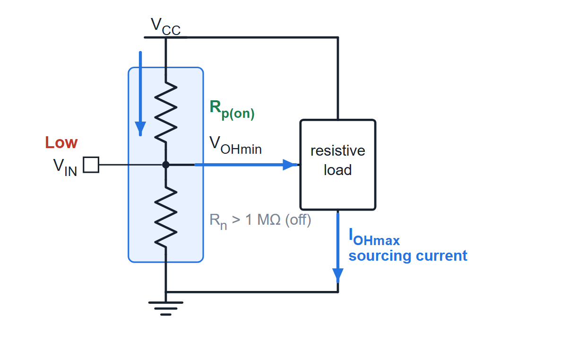

### 풀이 4 · 검산과 흔한 실수
단위는 V/A = Ω예요. 흔한 실수는 그림에 $V_{OHmin}$, $I_{OHmax}$ 위치를 표시하지 않거나 부호를 거꾸로 쓰는 거예요.

### 풀이 5 · 원문 대조 · 다시 볼 개념
2016-2·2017-1 판본의 “전류 흐름 지시 없음” 문항이에요. 같은 식이 q-rp-derive-current의 답이에요.

[Rp와 Rn은 전류가 흐르는 길을 정해요](%EC%8B%A4%ED%97%9802_%EC%8B%A4%ED%97%98%EC%84%A4%EB%AA%85.md#t-rprn) · [원문·제공 답안 대조](%EC%9B%90%EB%AC%B8%EA%B3%BC_%EC%A0%80%EC%9E%91%EC%95%88%EB%82%B4.md#q-rp-derive)

### 최종 답
$R_{p(on)} = \dfrac{V_{DD}-V_{OHmin}}{\|I_{OHmax}\|}$

### 출처
- [from_the_past/정리/퀴즈/실험2/실험2 퀴즈 기출 2016-1.pdf](../../from_the_past/%EC%A0%95%EB%A6%AC/%ED%80%B4%EC%A6%88/%EC%8B%A4%ED%97%982/%EC%8B%A4%ED%97%982%20%ED%80%B4%EC%A6%88%20%EA%B8%B0%EC%B6%9C%202016-1.pdf#page=1)
- [from_the_past/정리/퀴즈/실험2/실험2 퀴즈 기출 2017-1.pdf](../../from_the_past/%EC%A0%95%EB%A6%AC/%ED%80%B4%EC%A6%88/%EC%8B%A4%ED%97%982/%EC%8B%A4%ED%97%982%20%ED%80%B4%EC%A6%88%20%EA%B8%B0%EC%B6%9C%202017-1.pdf#page=1)
- [from_the_past/정리/퀴즈/실험2/원본_docx/퀴즈2_2017-1.docx](../../from_the_past/%EC%A0%95%EB%A6%AC/%ED%80%B4%EC%A6%88/%EC%8B%A4%ED%97%982/%EC%9B%90%EB%B3%B8_docx/%ED%80%B4%EC%A6%882_2017-1.docx)

## 9. Rp 유도: 입력 level별 전류 흐름
기출 · 실험 2 · 풀이 검토됨

### 문제 원문
CMOS의 내부 회로도를 이용하여 내부저항 Rp의 값을 유도하여라.(입력 level에 따른 전류의 흐름을 이용하여 설명하시오)

### 조건
같은 내부 회로(VCC–$R_p$–출력 노드–$R_n$–GND, 출력 노드에 resistive load)를 써요. 입력 레벨에 따라 전류가 흐르는 길을 설명에 포함해요.

### 구할 것
입력 level에 따른 전류의 흐름을 이용해 $R_p$를 유도하세요.

### 힌트 · 접근 순서
입력이 High일 때와 Low일 때 각각 전류가 흐르는 길을 한 줄씩 써 봐요. $R_p$가 쓰이는 쪽에서 식을 세워요.

### 풀이 1 · 입력 High일 때
$R_n$이 켜지고 $R_p$는 꺼져요. 전류는 부하에서 $R_n$을 거쳐 GND로 흘러요. 이 경우는 $R_p$ 식과 상관없어요.

### 풀이 2 · 입력 Low일 때
$R_p$가 켜지고 $R_n$은 꺼져요. 전류는 VCC에서 $R_p$를 거쳐 부하로 흘러요(sourcing). 출력은 High예요.

### 풀이 3 · 식 세우기
$R_p$ 양단 전압은 $V_{DD}-V_{OH}$예요. 한계 조건에서 $V_{OH}=V_{OHmin}$, 전류는 $\|I_{OHmax}\|$예요. $V_{DD}-V_{OHmin} = \|I_{OHmax}\|\cdot R_{p(on)}$이에요.

### 풀이 4 · 완성 그림

### 풀이 5 · 검산
채점 기준본의 그림과 식이 같아요. 그림에는 sourcing current, $R_p$, $V_{OHmin}$, $I_{OHmax}$가 표시돼요.

### 풀이 6 · 흔한 실수
식만 외워서 쓰는 거예요. 채점 메모는 그림에 어디가 $V_{OHmin}$이고 $I_{OHmax}$인지 표시하라고 했어요.

### 풀이 7 · 원문 대조 · 다시 볼 개념
제공 답안(채점 기준본): “sourcing current” 그림과 식 $R_{p(on)}=(V_{DD}-V_{OHmin})/\|I_{OHmax}\|$. 채점 메모는 “그림상 Vcc가 맞음. 식은 강의노트 내용이라 맞게 함. 그림에 $V_{OHmin}$, $I_{OHmax}$ 위치를 표시해야 함. 이번에는 모두 맞는 걸로 채점했다”는 뜻이에요.

원문 문제에는 회로 그림이 이 문항 칸에 없어요. 같은 시험의 다른 문항 그림을 가리키는 것으로 읽었어요.

[Rp와 Rn은 전류가 흐르는 길을 정해요](%EC%8B%A4%ED%97%9802_%EC%8B%A4%ED%97%98%EC%84%A4%EB%AA%85.md#t-rprn) · [원문·제공 답안 대조](%EC%9B%90%EB%AC%B8%EA%B3%BC_%EC%A0%80%EC%9E%91%EC%95%88%EB%82%B4.md#q-rp-derive-current)

### 최종 답
입력 Low: $R_p$ on, 전류는 VCC → $R_p$ → 부하. $R_{p(on)} = \dfrac{V_{DD}-V_{OHmin}}{\|I_{OHmax}\|}$

### 출처
- [from_the_past/정리/퀴즈/실험2/실험2 퀴즈 기출_단답형 (1p).pdf](../../from_the_past/%EC%A0%95%EB%A6%AC/%ED%80%B4%EC%A6%88/%EC%8B%A4%ED%97%982/%EC%8B%A4%ED%97%982%20%ED%80%B4%EC%A6%88%20%EA%B8%B0%EC%B6%9C_%EB%8B%A8%EB%8B%B5%ED%98%95%20%281p%29.pdf#page=1)
- [from_the_past/정리/퀴즈/실험2/실험2 퀴즈 예상문제_v3.pdf](../../from_the_past/%EC%A0%95%EB%A6%AC/%ED%80%B4%EC%A6%88/%EC%8B%A4%ED%97%982/%EC%8B%A4%ED%97%982%20%ED%80%B4%EC%A6%88%20%EC%98%88%EC%83%81%EB%AC%B8%EC%A0%9C_v3.pdf#page=2)
- [from_the_past/정리/퀴즈/실험2/실험2 퀴즈 예상문제_v4.pdf](../../from_the_past/%EC%A0%95%EB%A6%AC/%ED%80%B4%EC%A6%88/%EC%8B%A4%ED%97%982/%EC%8B%A4%ED%97%982%20%ED%80%B4%EC%A6%88%20%EC%98%88%EC%83%81%EB%AC%B8%EC%A0%9C_v4.pdf#page=1)
- [from_the_past/정리/퀴즈/실험2/실험2 퀴즈 종합_기출문제 (3p).pdf](../../from_the_past/%EC%A0%95%EB%A6%AC/%ED%80%B4%EC%A6%88/%EC%8B%A4%ED%97%982/%EC%8B%A4%ED%97%982%20%ED%80%B4%EC%A6%88%20%EC%A2%85%ED%95%A9_%EA%B8%B0%EC%B6%9C%EB%AC%B8%EC%A0%9C%20%283p%29.pdf#page=2)
- [from_the_past/정리/퀴즈/실험2/원본_docx/실험 2.docx](../../from_the_past/%EC%A0%95%EB%A6%AC/%ED%80%B4%EC%A6%88/%EC%8B%A4%ED%97%982/%EC%9B%90%EB%B3%B8_docx/%EC%8B%A4%ED%97%98%202.docx)

## 10. Rn 유도: 입력 level별 전류 흐름
예상문제 · 실험 2 · 풀이 검토됨

### 문제 원문
CMOS의 내부 회로도를 이용하여 내부저항 Rn의 값을 유도하여라.(입력 level에 따른 전류의 흐름을 이용하여 설명하시오)

### 조건
같은 내부 회로를 써요. 출력이 Low일 때의 전압 기준은 $V_{OLmax}$, 허용 전류는 $I_{OLmax}$예요.

### 구할 것
입력 level에 따른 전류의 흐름을 이용해 $R_n$을 유도하세요.

### 힌트 · 접근 순서
$R_p$ 유도와 거울상이에요. 어느 입력 레벨에서 $R_n$이 켜지는지, 전류가 어디서 어디로 가는지 먼저 써 봐요.

### 풀이 1 · 입력 High일 때
$R_n$이 켜지고 $R_p$는 꺼져요(1 MΩ 이상). 출력은 Low예요.

### 풀이 2 · 전류 길
VCC → 부하 → 출력 노드 → $R_n$ → GND로 전류(sinking)가 흘러요.

### 풀이 3 · 식 세우기
$R_n$ 양단 전압이 출력 전압 $V_{OL}$이고 전류는 $I_{OL}$이에요. $V_{OL}=I_{OL}R_n$이에요. 한계에서 $V_{OL}=V_{OLmax}$, $I_{OL}=I_{OLmax}$예요.

### 풀이 4 · 완성 그림
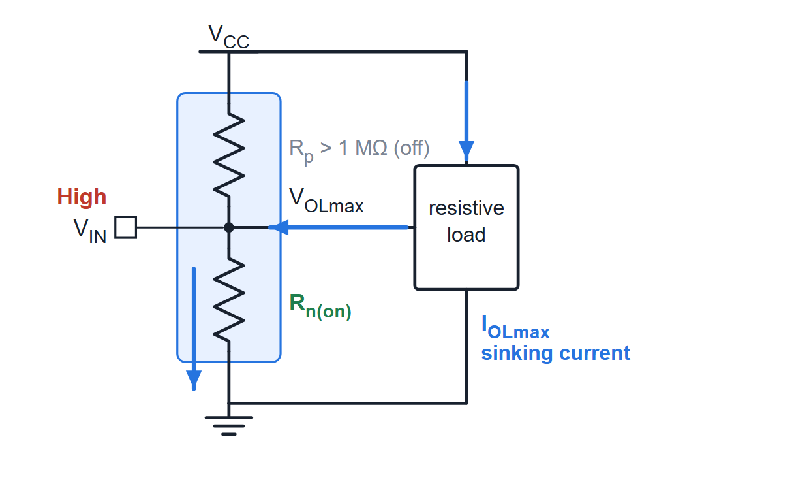

### 풀이 5 · 검산
단위는 V/A = Ω예요. 교안 6쪽 (a) 그림의 $R_{n(on)}=V_{OLmax}/I_{OLmax}$와 같아요. $R_n$은 GND 쪽이라서 분자에 $V_{DD}$가 들어가지 않아요.

### 풀이 6 · 흔한 실수
$R_p$ 식처럼 $V_{DD}-V$를 쓰는 거예요. $R_n$은 GND 기준이라서 $V_{OLmax}$만 써요.

### 풀이 7 · 원문 대조 · 다시 볼 개념
예상문제(제공 답안 없음)예요. 교안 6쪽 (a) 그림의 식으로 확인했어요.

[Rp와 Rn은 전류가 흐르는 길을 정해요](%EC%8B%A4%ED%97%9802_%EC%8B%A4%ED%97%98%EC%84%A4%EB%AA%85.md#t-rprn) · [원문·제공 답안 대조](%EC%9B%90%EB%AC%B8%EA%B3%BC_%EC%A0%80%EC%9E%91%EC%95%88%EB%82%B4.md#q-rn-derive)

### 최종 답
$R_{n(on)} = \dfrac{V_{OLmax}}{I_{OLmax}}$

### 출처
- [from_the_past/정리/퀴즈/실험2/실험2 퀴즈 예상문제_v3.pdf](../../from_the_past/%EC%A0%95%EB%A6%AC/%ED%80%B4%EC%A6%88/%EC%8B%A4%ED%97%982/%EC%8B%A4%ED%97%982%20%ED%80%B4%EC%A6%88%20%EC%98%88%EC%83%81%EB%AC%B8%EC%A0%9C_v3.pdf#page=2)
- [from_the_past/정리/퀴즈/실험2/실험2 퀴즈 예상문제_v4.pdf](../../from_the_past/%EC%A0%95%EB%A6%AC/%ED%80%B4%EC%A6%88/%EC%8B%A4%ED%97%982/%EC%8B%A4%ED%97%982%20%ED%80%B4%EC%A6%88%20%EC%98%88%EC%83%81%EB%AC%B8%EC%A0%9C_v4.pdf#page=1)
- [from_the_past/정리/퀴즈/실험2/실험2 퀴즈 종합_기출문제 (3p).pdf](../../from_the_past/%EC%A0%95%EB%A6%AC/%ED%80%B4%EC%A6%88/%EC%8B%A4%ED%97%982/%EC%8B%A4%ED%97%982%20%ED%80%B4%EC%A6%88%20%EC%A2%85%ED%95%A9_%EA%B8%B0%EC%B6%9C%EB%AC%B8%EC%A0%9C%20%283p%29.pdf#page=3)
- [from_the_past/정리/퀴즈/실험2/원본_docx/실험 2.docx](../../from_the_past/%EC%A0%95%EB%A6%AC/%ED%80%B4%EC%A6%88/%EC%8B%A4%ED%97%982/%EC%9B%90%EB%B3%B8_docx/%EC%8B%A4%ED%97%98%202.docx)

## 11. 전달 지연이 나타나는 이유
기출 · 실험 2 · 풀이 검토됨

### 문제 원문
CMOS의 출력 특성 중 전달지연(Propagation delay)가 나타나는 이유를 설명하여라.

### 구할 것
전달 지연이 나타나는 이유를 설명하세요.

### 힌트 · 접근 순서
이상적인 경우와 실제의 차이를 먼저 써요. 실제 회로에서 출력에 매달려 있는 것이 무엇인지 생각해 봐요.

### 풀이 1 · 이상과 현실
이상적인 인버터는 입력이 바뀌는 순간 출력도 바뀌어서 지연이 없어요. 실제 회로에는 다음 단의 입력 용량 같은 capacitive load $C_L$과 켜진 트랜지스터의 저항 $R$이 있어요.

### 풀이 2 · 왜 시간이 걸리나
용량의 전압은 순간적으로 바뀌지 못해요. 저항을 거쳐 서서히 충전·방전돼서 출력이 입력을 따라 바뀌는 데 시간이 걸려요.

### 풀이 3 · 전달 지연의 정의
입력이 Vcc의 50%를 지나는 때부터 출력이 50%를 지나는 때까지가 전달 지연($t_{PHL}$, $t_{PLH}$)이에요.

### 풀이 4 · 그림
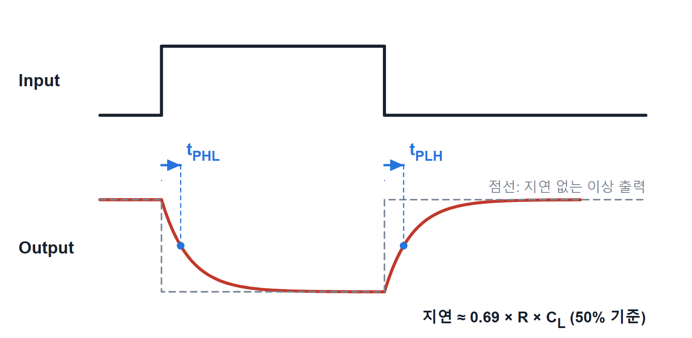

### 풀이 5 · 검산
간단한 RC 모델에서 50% 지연은 $0.69\,RC$예요. $R$이나 $C_L$이 0이면 지연도 0이 되어 이상적인 경우와 같아요.

### 풀이 6 · 흔한 실수
“스위치가 느려서”처럼 소자 이름만 쓰는 거예요. 용량과 저항 때문에 충전·방전에 시간이 걸린다는 이유를 적어야 해요.

### 풀이 7 · 원문 대조 · 다시 볼 개념
제공 답안(채점 기준본): “이론상으론 존재하지 않지만 실제로는 존재하는 capacitive load, 저항 등의 이유로 전달이 지연된다. 의미 맞으면 만점”이에요. 이 풀이와 같은 뜻이에요.

[전달 지연과 천이 시간을 구분해요](%EC%8B%A4%ED%97%9802_%EC%8B%A4%ED%97%98%EC%84%A4%EB%AA%85.md#t-delay) · [원문·제공 답안 대조](%EC%9B%90%EB%AC%B8%EA%B3%BC_%EC%A0%80%EC%9E%91%EC%95%88%EB%82%B4.md#q-prop-delay)

### 최종 답
이론상 지연은 없지만 실제로는 capacitive load와 저항이 있어서 용량을 충전·방전하는 데 시간이 걸리기 때문이에요.

### 출처
- [from_the_past/정리/퀴즈/실험2/실험2 퀴즈 기출_단답형 (1p).pdf](../../from_the_past/%EC%A0%95%EB%A6%AC/%ED%80%B4%EC%A6%88/%EC%8B%A4%ED%97%982/%EC%8B%A4%ED%97%982%20%ED%80%B4%EC%A6%88%20%EA%B8%B0%EC%B6%9C_%EB%8B%A8%EB%8B%B5%ED%98%95%20%281p%29.pdf#page=1)
- [from_the_past/정리/퀴즈/실험2/실험2 퀴즈 예상문제_v3.pdf](../../from_the_past/%EC%A0%95%EB%A6%AC/%ED%80%B4%EC%A6%88/%EC%8B%A4%ED%97%982/%EC%8B%A4%ED%97%982%20%ED%80%B4%EC%A6%88%20%EC%98%88%EC%83%81%EB%AC%B8%EC%A0%9C_v3.pdf#page=2)
- [from_the_past/정리/퀴즈/실험2/실험2 퀴즈 예상문제_v4.pdf](../../from_the_past/%EC%A0%95%EB%A6%AC/%ED%80%B4%EC%A6%88/%EC%8B%A4%ED%97%982/%EC%8B%A4%ED%97%982%20%ED%80%B4%EC%A6%88%20%EC%98%88%EC%83%81%EB%AC%B8%EC%A0%9C_v4.pdf#page=2)
- [from_the_past/정리/퀴즈/실험2/실험2 퀴즈 종합_기출문제 (3p).pdf](../../from_the_past/%EC%A0%95%EB%A6%AC/%ED%80%B4%EC%A6%88/%EC%8B%A4%ED%97%982/%EC%8B%A4%ED%97%982%20%ED%80%B4%EC%A6%88%20%EC%A2%85%ED%95%A9_%EA%B8%B0%EC%B6%9C%EB%AC%B8%EC%A0%9C%20%283p%29.pdf#page=3)
- [from_the_past/정리/퀴즈/실험2/원본_docx/실험 2.docx](../../from_the_past/%EC%A0%95%EB%A6%AC/%ED%80%B4%EC%A6%88/%EC%8B%A4%ED%97%982/%EC%9B%90%EB%B3%B8_docx/%EC%8B%A4%ED%97%98%202.docx)

## 12. 전달 지연과 천이 시간 (묶음)
기출 · 실험 2 · 정답 미확정

### 문제 원문
CMOS의 전달 지연과 천이 시간에 대해 설명하시오.

(1) 전달 지연(Propagation delay)가 나타나는 이유

(2) 천이 시간(Transition time)이 H->L 일때와 L->H일때 다른 이유

### 구할 것
(1)과 (2)를 각각 설명하세요.

### 힌트 · (1)
이상적인 경우와 실제의 차이를 써요.

### 힌트 · (2)
출력이 내려갈 때와 올라갈 때 용량이 어떤 저항을 거쳐 충전·방전되는지 비교해 봐요.

### 풀이 1 · (1) 전달 지연
실제 출력에는 용량 $C_L$과 저항 $R$이 있어서 충전·방전에 시간이 걸려요. 입력 50%에서 출력 50%까지가 전달 지연이에요.

### 풀이 2 · 두 방향의 길
출력이 H→L로 가면 부하 용량이 $R_n$을 통해 방전돼요. L→H로 가면 $R_p$를 통해 충전돼요.

### 풀이 3 · 시간 상수
$R_{n(on)}$과 $R_{p(on)}$이 같지 않으면 시간 상수 $R\cdot C_L$이 달라서 10%에서 90%까지 걸리는 시간이 달라요.

### 풀이 4 · 그림

### 풀이 5 · 검산
$R_n=R_p$이면 두 시간이 같아야 해요. 실제로 다른 것은 저항이 같지 않다는 뜻이에요.

### 풀이 6 · 흔한 실수
(2)에 전달 지연의 이유를 반복해서 쓰는 거예요. (2)는 H→L과 L→H의 “차이”가 이유예요.

### 풀이 7 · 원문 대조 · 다시 볼 개념
**정답 미확정**: 원문 조건과 제공 답안의 차이 및 도출 답안의 가정을 확인하세요.

제공 답안이 없는 문항이에요. (1)은 같은 시험의 q-prop-delay 제공 답안과 같은 내용이에요. (2)는 교안이 $t_r$, $t_f$와 $R_{n(on)}$, $R_{p(on)}$을 따로 정의한 점에서 도출한 해석이고, “pMOS가 약해서 $R_p$가 더 크다”는 일반론은 보충이에요.

[전달 지연과 천이 시간을 구분해요](%EC%8B%A4%ED%97%9802_%EC%8B%A4%ED%97%98%EC%84%A4%EB%AA%85.md#t-delay) · [원문·제공 답안 대조](%EC%9B%90%EB%AC%B8%EA%B3%BC_%EC%A0%80%EC%9E%91%EC%95%88%EB%82%B4.md#q-delay-transition)

### 최종 답
(1) capacitive load와 저항 때문에 충·방전에 시간이 걸려서예요. (2) H→L은 $R_n$으로 방전, L→H는 $R_p$로 충전하고 두 저항이 달라 시간 상수가 다르기 때문이에요.

### 출처
- [from_the_past/정리/퀴즈/실험2/실험2 퀴즈 기출 2017-1.pdf](../../from_the_past/%EC%A0%95%EB%A6%AC/%ED%80%B4%EC%A6%88/%EC%8B%A4%ED%97%982/%EC%8B%A4%ED%97%982%20%ED%80%B4%EC%A6%88%20%EA%B8%B0%EC%B6%9C%202017-1.pdf#page=1)
- [from_the_past/정리/퀴즈/실험2/원본_docx/퀴즈2_2017-1.docx](../../from_the_past/%EC%A0%95%EB%A6%AC/%ED%80%B4%EC%A6%88/%EC%8B%A4%ED%97%982/%EC%9B%90%EB%B3%B8_docx/%ED%80%B4%EC%A6%882_2017-1.docx)

## 13. 천이 시간이 H→L과 L→H에서 다른 이유
예상문제 · 실험 2 · 정답 미확정

### 문제 원문
CMOS에서 천이시간(Transition time)이 H->L일 때와, L->H일 때 timing 특성이 달라지는 이유를 설명하여라.

### 구할 것
H→L과 L→H에서 timing 특성이 다른 이유를 설명하세요.

### 힌트 · 접근 순서
출력이 내려갈 때와 올라갈 때 용량이 거쳐 가는 저항이 무엇인지 비교해 봐요.

### 풀이 1 · 두 방향의 길
출력이 H→L로 가면 부하 용량이 $R_n$을 통해 방전돼요. L→H로 가면 $R_p$를 통해 충전돼요.

### 풀이 2 · 시간 상수
$R_{n(on)}$과 $R_{p(on)}$이 같지 않으면 시간 상수 $R\cdot C_L$이 달라서 10%에서 90%까지 걸리는 시간이 달라요.

### 풀이 3 · 그림

### 풀이 4 · 검산
두 저항이 같다고 놓으면 두 시간이 같아져요. 달라진다는 사실은 저항이 다르다는 뜻이에요.

### 풀이 5 · 흔한 실수
입력 파형이 달라서라고 쓰는 거예요. 같은 입력 에지 기울기여도 출력 쪽 저항이 달라서 생기는 차이예요.

### 풀이 6 · 원문 대조 · 다시 볼 개념
**정답 미확정**: 원문 조건과 제공 답안의 차이 및 도출 답안의 가정을 확인하세요.

예상문제(제공 답안 없음)예요. 교안은 천이 시간의 정의와 $R_{n(on)}$, $R_{p(on)}$ 정의까지만 주었고, 두 저항이 다른 이유(pMOS와 nMOS의 특성 차이)는 일반론이라 보충이에요.

[전달 지연과 천이 시간을 구분해요](%EC%8B%A4%ED%97%9802_%EC%8B%A4%ED%97%98%EC%84%A4%EB%AA%85.md#t-delay) · [원문·제공 답안 대조](%EC%9B%90%EB%AC%B8%EA%B3%BC_%EC%A0%80%EC%9E%91%EC%95%88%EB%82%B4.md#q-transition)

### 최종 답
H→L은 $R_n$을 거쳐 방전, L→H는 $R_p$를 거쳐 충전하는데 두 저항이 같지 않아서 시간 상수가 다르기 때문이에요.

### 출처
- [from_the_past/정리/퀴즈/실험2/실험2 퀴즈 예상문제_v3.pdf](../../from_the_past/%EC%A0%95%EB%A6%AC/%ED%80%B4%EC%A6%88/%EC%8B%A4%ED%97%982/%EC%8B%A4%ED%97%982%20%ED%80%B4%EC%A6%88%20%EC%98%88%EC%83%81%EB%AC%B8%EC%A0%9C_v3.pdf#page=2)
- [from_the_past/정리/퀴즈/실험2/실험2 퀴즈 예상문제_v4.pdf](../../from_the_past/%EC%A0%95%EB%A6%AC/%ED%80%B4%EC%A6%88/%EC%8B%A4%ED%97%982/%EC%8B%A4%ED%97%982%20%ED%80%B4%EC%A6%88%20%EC%98%88%EC%83%81%EB%AC%B8%EC%A0%9C_v4.pdf#page=2)
- [from_the_past/정리/퀴즈/실험2/실험2 퀴즈 종합_기출문제 (3p).pdf](../../from_the_past/%EC%A0%95%EB%A6%AC/%ED%80%B4%EC%A6%88/%EC%8B%A4%ED%97%982/%EC%8B%A4%ED%97%982%20%ED%80%B4%EC%A6%88%20%EC%A2%85%ED%95%A9_%EA%B8%B0%EC%B6%9C%EB%AC%B8%EC%A0%9C%20%283p%29.pdf#page=3)
- [from_the_past/정리/퀴즈/실험2/원본_docx/실험 2.docx](../../from_the_past/%EC%A0%95%EB%A6%AC/%ED%80%B4%EC%A6%88/%EC%8B%A4%ED%97%982/%EC%9B%90%EB%B3%B8_docx/%EC%8B%A4%ED%97%98%202.docx)

## 14. 동작속도를 정하는 두 요소
예상문제 · 실험 2 · 정답 미확정

### 문제 원문
COMS의 동작속도를 결정짓는 2가지 요소와 각 요소에 따른 동작속도에 미치는 영향을 timing diagram을 그려 설명하여라.

### 구할 것
두 요소와 각각의 영향을 timing diagram으로 설명하세요. (원문 표기 COMS를 그대로 옮겼어요.)

### 힌트 · 접근 순서
출력을 바꾸려면 무엇을 충전·방전해야 하고, 그 길에 무엇이 있는지 떠올려요.

### 풀이 1 · 두 요소
켜진 트랜지스터의 저항 $R$($R_p$ 또는 $R_n$)과 출력에 매달린 부하 용량 $C_L$이에요.

### 풀이 2 · 영향
출력은 시간 상수 $\tau=R\cdot C_L$로 서서히 변해요. 둘 중 하나라도 크면 $\tau$가 커져서 천이 시간과 전달 지연이 길어지고 동작속도가 느려요. 둘 중 하나라도 작으면 빨라요.

### 풀이 3 · timing diagram
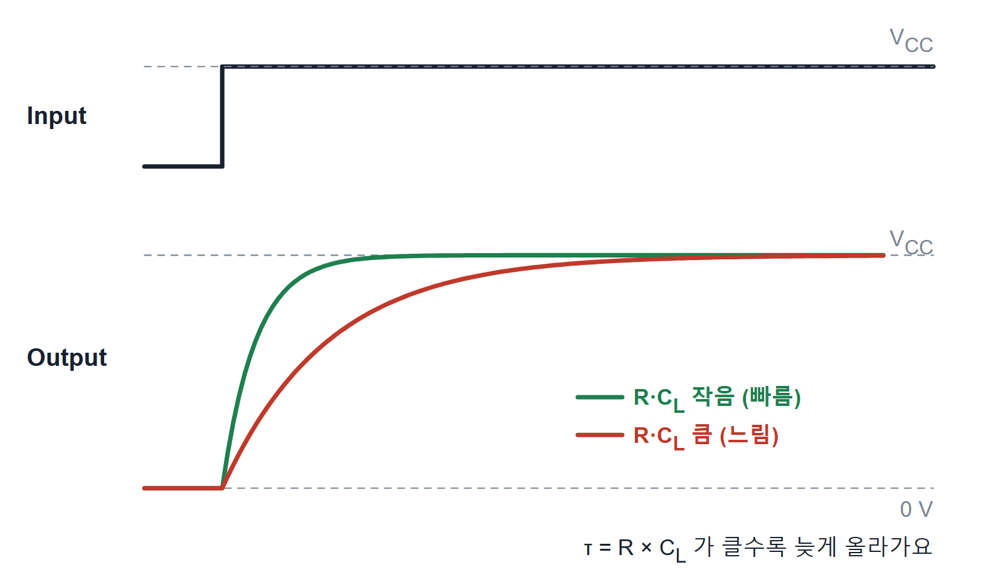

### 풀이 4 · 검산
간단한 RC 모델에서 50% 지연은 $0.69\,RC$, 10~90%는 약 $2.2\,RC$예요. $R$이나 $C_L$이 두 배면 시간도 두 배예요.

### 풀이 5 · 흔한 실수
주파수나 전원 전압 같은 외부 조건만 쓰는 거예요. 문제는 회로 자체가 정하는 두 요소를 물었어요.

### 풀이 6 · 원문 대조 · 다시 볼 개념
**정답 미확정**: 원문 조건과 제공 답안의 차이 및 도출 답안의 가정을 확인하세요.

예상문제(제공 답안 없음)예요. 교안에는 “동작속도를 결정하는 요소” 문장이 없어요. 교안 5·7쪽의 저항($R_n$, $R_p$)과 Capacitive Load($C_L$) 구성에서 도출했고, RC 식은 일반 이론(보충)이에요.

[전달 지연과 천이 시간을 구분해요](%EC%8B%A4%ED%97%9802_%EC%8B%A4%ED%97%98%EC%84%A4%EB%AA%85.md#t-delay) · [원문·제공 답안 대조](%EC%9B%90%EB%AC%B8%EA%B3%BC_%EC%A0%80%EC%9E%91%EC%95%88%EB%82%B4.md#q-speed)

### 최종 답
요소 두 가지는 켜진 저항 $R$과 부하 용량 $C_L$이에요. 곱 $R\cdot C_L$이 클수록 출력이 천천히 변해 동작속도가 느려져요.

### 출처
- [from_the_past/정리/퀴즈/실험2/실험2 퀴즈 예상문제_v3.pdf](../../from_the_past/%EC%A0%95%EB%A6%AC/%ED%80%B4%EC%A6%88/%EC%8B%A4%ED%97%982/%EC%8B%A4%ED%97%982%20%ED%80%B4%EC%A6%88%20%EC%98%88%EC%83%81%EB%AC%B8%EC%A0%9C_v3.pdf#page=3)
- [from_the_past/정리/퀴즈/실험2/실험2 퀴즈 예상문제_v4.pdf](../../from_the_past/%EC%A0%95%EB%A6%AC/%ED%80%B4%EC%A6%88/%EC%8B%A4%ED%97%982/%EC%8B%A4%ED%97%982%20%ED%80%B4%EC%A6%88%20%EC%98%88%EC%83%81%EB%AC%B8%EC%A0%9C_v4.pdf#page=2)
- [from_the_past/정리/퀴즈/실험2/실험2 퀴즈 종합_기출문제 (3p).pdf](../../from_the_past/%EC%A0%95%EB%A6%AC/%ED%80%B4%EC%A6%88/%EC%8B%A4%ED%97%982/%EC%8B%A4%ED%97%982%20%ED%80%B4%EC%A6%88%20%EC%A2%85%ED%95%A9_%EA%B8%B0%EC%B6%9C%EB%AC%B8%EC%A0%9C%20%283p%29.pdf#page=3)
- [from_the_past/정리/퀴즈/실험2/원본_docx/실험 2.docx](../../from_the_past/%EC%A0%95%EB%A6%AC/%ED%80%B4%EC%A6%88/%EC%8B%A4%ED%97%982/%EC%9B%90%EB%B3%B8_docx/%EC%8B%A4%ED%97%98%202.docx)

## 중복·보류·다른 실험 문항

- q-region-graded · held: 채점본 사진의 같은 문장이에요. 인쇄 입력 그래프를 판독하지 못했고(생략본인지 필기에 가려졌는지 미확정) q-region과 같은 그래프라고 확정하지 못해 수록하지 않았어요. 학생 답안·채점 흔적은 원문과_저작안내.md에 보존했어요.

- q-schmitt-waveform-graded · held: 채점본 사진의 같은 문장이에요. 입력이 곡선형이고 기준선 수치를 판독하지 못해 q-schmitt-waveform의 꺾은선 그림과 같은 조건인지 확정하지 못했어요. 수록하지 않았어요.
