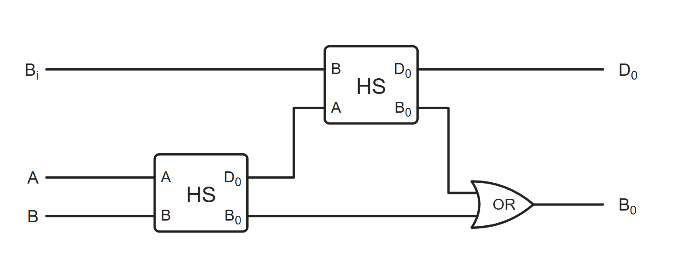
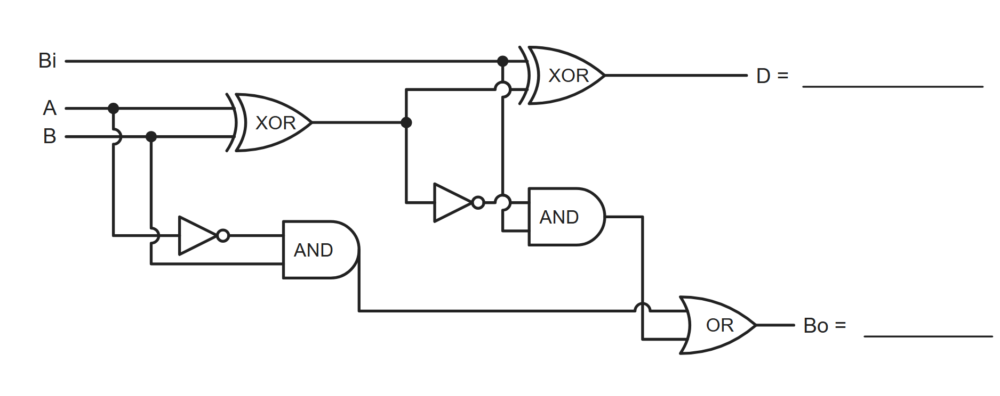

# 실험 3 · 기출 문제

[실험 설명](실험03_실험설명.md) · [문제/해설](실험03_기출풀이.md)

## 1. 반가산기 진리표 채우기
출처 미확인 · 실험 3 · 풀이 검토됨

### 문제 원문
다음은 2개의 2진 입력( x, y) 와 2개의 2진 출력으로 구성되는 반가산기의 진리표이다. 빈칸을 채워 넣어라.

### 조건
| x | y | c | s |
| --- | --- | --- | --- |
| 0 | 0 |  |  |
| 0 | 1 |  |  |
| 1 | 0 |  |  |
| 1 | 1 |  |  |

출력 열의 순서는 c(올림), s(합)예요.

### 구할 것
빈칸을 채우세요.

### 힌트 · 접근 순서
x와 y를 이진수 한 자리로 더하세요. 결과를 두 자리로 쓰고 왼쪽 자리가 올림 c, 오른쪽 자리가 합 s예요.

## 2. 식(1)로 반가산기 설계
예상문제 · 실험 3 · 풀이 검토됨

### 문제 원문
반가산기의 단순화된 부울 함수는 식 (1) 과 같다.

S = x′y + xy′,  C = xy  (1)

식 (1) 을 바탕으로 AND gate 1개 와 XOR gate 1개를 이용하여 반가산기의 회로도를 작성하라.

### 조건
AND gate 1개, XOR gate 1개를 사용해요.

### 구할 것
반가산기의 회로도를 그리세요.

### 힌트 · 접근 순서
S의 식 x′y + xy′가 어떤 게이트의 정의와 같은지 떠올려 보세요.

## 3. 7486·7408로 반가산기 설계
기출 · 실험 3 · 풀이 검토됨

### 문제 원문
XOR(IC 7486)gate와 AND(IC 7408)gate를 이용하여 2-Input Half adder의 게이트 회로도를 설계 하시오. (input : A, B , output: S, Co 로 표현) (3점.)

### 조건
XOR은 IC 7486, AND는 IC 7408을 사용해요. 입력은 A, B이고 출력은 S, Co예요.

### 구할 것
반가산기의 게이트 회로도를 그리세요.

### 힌트 · 접근 순서
반가산기의 진리표에서 S와 Co가 각각 어떤 게이트와 같은 모양인지 비교하세요.

## 4. 반가산기·전가산기의 C, S 역할
기출 · 실험 3 · 풀이 검토됨

### 문제 원문
반가산기, 전가산기 에서의 C, S 출력 각각의 역할을 설명하라. (Describe the roles of C, S in half-adder and full-adder.)

### 구할 것
C 출력과 S 출력이 각각 무엇을 나타내는지 설명하세요.

### 힌트 · 접근 순서
1+1을 이진수로 계산하면 한 자리에 안 들어가요. 오른쪽에 쓰는 값과 왼쪽으로 넘기는 값이 각각 어느 출력인지 생각하세요.

## 5. 반가산기를 LSB에만 쓰는 이유
기출 · 실험 3 · 풀이 검토됨

### 문제 원문
Half adder를 2진수 덧셈에서, 맨 오른쪽 자리(LSB) 계산에만 사용 하는 이유를 Full adder와 비교하여 서술하시오. (3점.)

### 구할 것
이유를 서술하세요.

### 힌트 · 접근 순서
반가산기와 전가산기의 입력 개수를 비교하세요. 맨 오른쪽 자리와 그 윗자리에서 “아래 자리의 올림”이 있는지 없는지 따져 보세요.

## 6. 전가산기와 반가산기의 차이
출처 미확인 · 실험 3 · 풀이 검토됨

### 문제 원문
전가산기와 반가산기의 차이를 간단히 설명하라.

### 구할 것
차이를 간단히 설명하세요.

### 힌트 · 접근 순서
두 회로의 입력 개수가 몇 개씩인지 먼저 세어 보세요.

## 7. 전가산기 진리표 일부 채우기
출처 미확인 · 실험 3 · 풀이 검토됨

### 문제 원문
전가산기는 3개의 입력 비트들의 합을 계산하는 조합회로이며 3개의 입력(x,y,z)과 2개의 출력(c,s) 으로 구성된다. 다음은 전가산기의 진리표 일부이다. 빈칸을 채워라.

### 조건
| x | y | z | C | S |
| --- | --- | --- | --- | --- |
| 0 | 1 | 1 |  |  |
| 1 | 0 | 0 |  |  |
| 1 | 0 | 1 |  |  |

출력 열의 순서는 C(올림), S(합)예요.

### 구할 것
빈칸을 채우세요.

### 힌트 · 접근 순서
세 입력의 1의 개수를 세세요. 1이 한 개면 합 1·올림 0, 두 개면 합 0·올림 1이에요. 이진수로 쓴 결과의 왼쪽 자리가 올림이에요.

## 8. 식(1)로 전가산기 설계
기출 · 실험 3 · 답안 충돌

### 문제 원문
다음은 전가산기의 단순화 된 부울함수이다. (Following equation is a simplified bool function of a full-adder.)

S = x′y′z + x′yz′ + xy′z′ + xyz,  C = xy + yz + zx  (1)

식(1)을 바탕으로 3 개의 AND gate, 1 개의 OR gate, 그리고 2개의 XOR gate 를 사용해서 전가산기의 회로도를 작성하자. (Design a circuit diagram of full-adder using three AND gates, one OR gate, and two XOR gates based on the equation (1).)

### 조건
AND gate 3개, OR gate 1개, XOR gate 2개를 사용해요.

### 구할 것
식(1)에서 S와 C를 만드는 전가산기 회로도를 그리세요.

### 힌트 · 접근 순서
S의 네 항이 입력에서 1이 몇 개일 때 1이 되는지 세어 보세요. 그 패턴을 XOR 두 개로 만들 수 있는지 생각해 보세요.

### 힌트 · 접근 순서
C는 식 그대로 곱 세 개를 합한 꼴이에요. 곱 하나가 AND 게이트 하나이고, 그 세 개를 OR로 합쳐요. 마지막에 게이트 개수를 세어 조건과 맞춰 보세요.

## 9. 반감산기의 단순화 부울 함수
출처 미확인 · 실험 3 · 풀이 검토됨

### 문제 원문
다음은 반감산기의 진리표이다. 이 진리표를 바탕으로 단순화된 부울 함수를 작성하라.

### 조건
| x | y | B | D |
| --- | --- | --- | --- |
| 0 | 0 | 0 | 0 |
| 0 | 1 | 1 | 1 |
| 1 | 0 | 0 | 1 |
| 1 | 1 | 0 | 0 |

표의 입력은 x, y이고 출력은 B(내림), D(차)예요. 이 표는 문제에 주어진 조건이에요.

### 구할 것
B = ____, D = ____ 의 식을 쓰세요.

### 힌트 · 접근 순서
출력이 1인 행마다 입력 조건을 곱(AND)으로 쓰고, 그 곱들을 더하세요(OR). 그다음 줄일 수 있는지 보세요.

## 10. 반감산기 회로 설계
기출 · 실험 3 · 풀이 검토됨

### 문제 원문
다음은 반감산기의 진리표이다. 이 진리표를 바탕으로 AND gate 1개, NOT gate 1개, 그리고 XOR gate 1개를 사용하여 반감산기의 회로도를 작성하여라. (2점.)

### 조건
| x | y | B | D |
| --- | --- | --- | --- |
| 0 | 0 | 0 | 0 |
| 0 | 1 | 1 | 1 |
| 1 | 0 | 0 | 1 |
| 1 | 1 | 0 | 0 |

표의 입력은 x, y이고 출력은 B(내림), D(차)예요. 이 표는 문제에 주어진 조건이에요.

AND gate 1개, NOT gate 1개, XOR gate 1개를 사용해요.

### 구할 것
반감산기의 회로도를 그리세요.

### 힌트 · 접근 순서
D 열이 어떤 게이트의 진리표와 같은지 비교하세요. B 열은 1이 되는 행이 하나뿐이니, 그 행의 조건(x와 y의 값)을 AND와 NOT으로 쓸 수 있는지 생각하세요.

## 11. 반감산기와 전감산기의 차이
예상문제 · 실험 3 · 풀이 검토됨

### 문제 원문
반감산기와 전감산기의 차이를 간단히 서술하라.

### 구할 것
차이를 간단히 서술하세요.

### 힌트 · 접근 순서
두 회로의 입력 개수를 비교하세요. 가산기에서 반가산기와 전가산기가 달랐던 점과 같은 질문이에요.

## 12. 전감산기 간략 회로도로 진리표 채우기
기출 · 실험 3 · 풀이 검토됨

### 문제 원문
다음은 전감산기의 간략화된 회로도이다. 이를 바탕으로 전감산기 진리표의 일부를 채워 넣자. (Following figure is a simplified circuit diagram of full-subtractor. Using the figure below, fill in the blanks of the table.)

### 조건
HS는 반감산기 블록이에요. 입력 열 x, y, z의 순서는 그림의 A, B, Bi로 읽어요(원문에 이 대응이 적혀 있지 않아 가정해요).

| x | y | z | B | D |
| --- | --- | --- | --- | --- |
| 0 | 1 | 1 |  |  |
| 1 | 0 | 0 |  |  |
| 1 | 0 | 1 |  |  |
| 1 | 1 | 0 |  |  |

### 구할 것
표의 출력 B(내림)와 D(차) 빈칸을 채우세요.

### 힌트 · 접근 순서
그림에서 첫 번째 HS는 A와 B를 받아요. 그 차 D0가 둘째 HS의 A 입력으로 가요. 둘째 HS의 B 입력은 Bi예요. 행마다 이 순서로 값을 따라가세요.

### 힌트 · 접근 순서
HS 블록 하나는 D = A⊕B, 내림 = A′B를 내보내요. 최종 내림은 두 HS의 내림을 OR한 값이에요.

## 13. 전감산기 회로의 D, Bo 식
기출 · 실험 3 · 풀이 검토됨

### 문제 원문
아래 Full subtracter 게이트 회로의 출력 D와 Bo의 Boolean equation은? (2점.)

### 구할 것
D = ____, Bo = ____ 의 식을 쓰세요.

### 힌트 · 접근 순서
첫 번째 XOR의 출력에 이름을 하나 붙이세요. 그 이름으로 둘째 XOR과 둘째 AND의 입력을 적으면 D가 먼저 나와요.

### 힌트 · 접근 순서
Bo는 AND 두 개의 출력을 OR한 값이에요. 각 AND의 입력에 NOT이 어느 신호에 붙었는지 확인하세요.

## 14. 전감산기 D, B 출력의 역할
기출 · 실험 3 · 답안 충돌

### 문제 원문
전감산기에서의 D 와 B 출력의 각각의 역할을 설명하라. (Describe the roles of D, B in half-adder and full-subtractor.)

### 조건
원문 국문은 “전감산기”, 영문은 “half-adder and full-subtractor”로 적혀 있어요. 여기서는 전감산기의 두 출력을 설명해요.

### 구할 것
D 출력과 B 출력이 각각 무엇을 나타내는지 설명하세요.

### 힌트 · 접근 순서
입력이 A, B, Bi일 때 “A에서 B와 Bi를 뺀 값”이 어디에 나타나는지, 그리고 뺄 수 없을 때 어디에 표시되는지 나눠서 생각하세요.

## 15. “반감산기·전감산기”의 C, S 역할(표기 불일치)
출처 미확인 · 실험 3 · 정답 미확정

### 문제 원문
반감산기, 전감산기 에서의 C, S 출력 각각의 역할을 설명하라.

### 조건
원문 그대로 옮겼어요. 감산기의 출력은 보통 D(차)와 B(내림)이고 C, S는 가산기의 출력 이름이에요. 이 점은 해설의 원문 대조에서 다뤄요.

### 구할 것
C 출력과 S 출력이 각각 무엇을 나타내는지 설명하세요.

### 힌트 · 접근 순서
회로의 출력 이름이 C, S인 쪽이 가산기인지 감산기인지 먼저 확인하세요. 그다음 각 출력이 “결과의 한 자리”인지 “윗자리로 넘기는 값”인지 나누세요.
