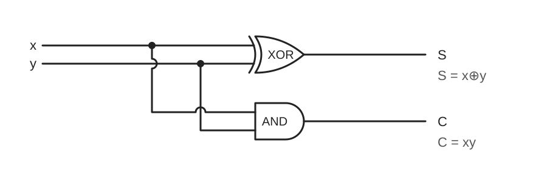
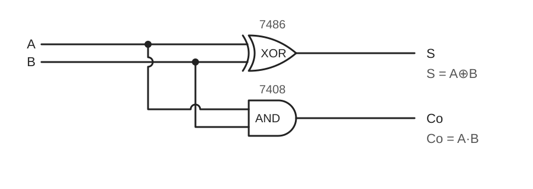
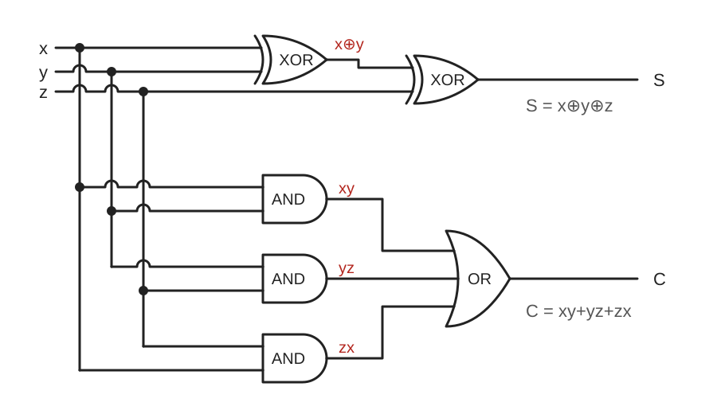
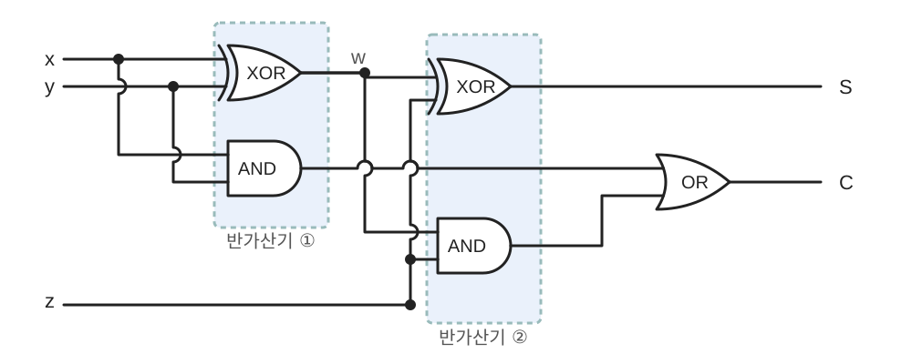
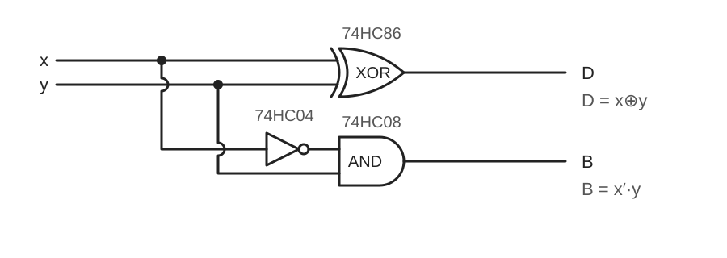
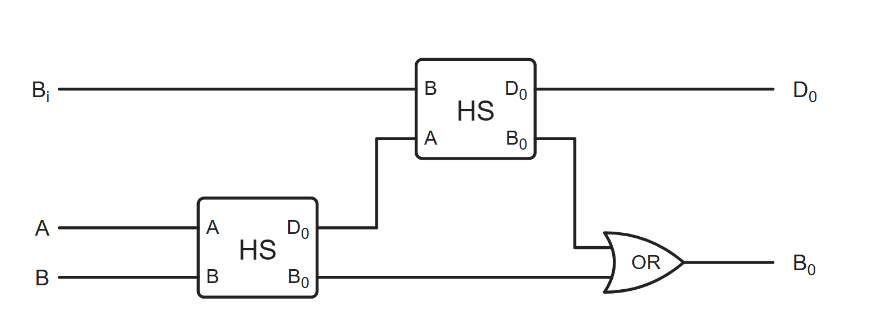
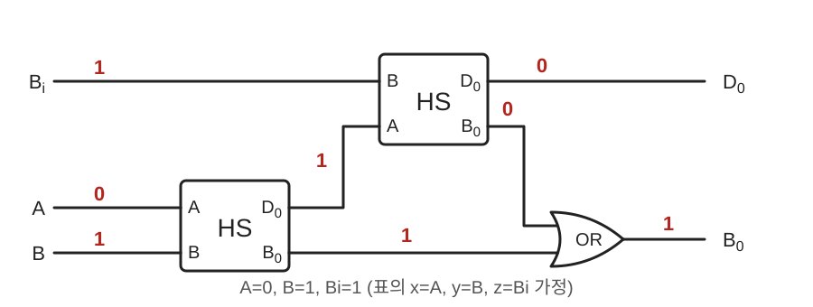
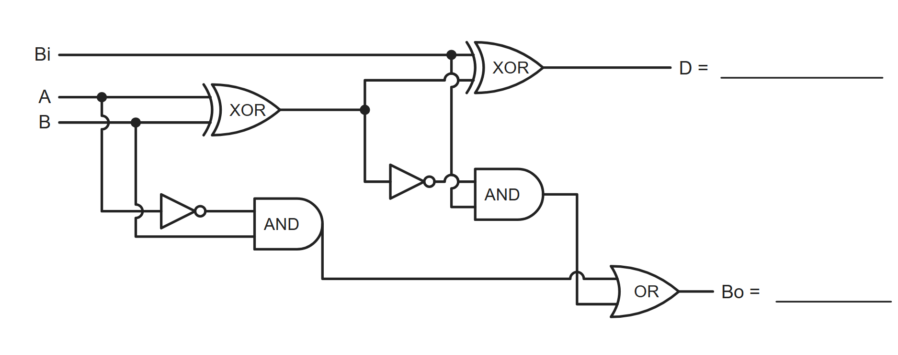
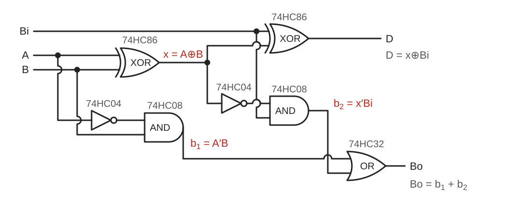

# 실험 3 · 문제 설명

      
첫 줄부터 완성 답과 검산까지 함께 풀어요.

## 문제를 함께 풀어요

### 문제 1 · 반가산기 진리표 채우기

문제 읽기
#### 문제

다음은 2개의 2진 입력( x, y) 와 2개의 2진 출력으로 구성되는 반가산기의 진리표이다. 빈칸을 채워 넣어라.

#### 주어진 조건

| x | y | c | s |
| --- | --- | --- | --- |
| 0 | 0 |  |  |
| 0 | 1 |  |  |
| 1 | 0 |  |  |
| 1 | 1 |  |  |

출력 열의 순서는 c(올림), s(합)예요.

#### 구할 것

빈칸을 채우세요.

이 문제를 보면 떠올려요
1+1=10에서 오른쪽 자리는 s, 왼쪽 올림은 c

문제에 “반가산기의 진리표”와 c, s 빈칸이 보이면 두 비트의 합을 두 자리 이진수로 읽는 것을 떠올려요. 1+1=10에서 오른쪽 0이 s, 왼쪽 1이 c이기 때문이에요.

이 문제에서 할 일
두 입력 비트를 더해 결과를 두 자리 이진수로 읽어요. 오른쪽 자리가 s, 왼쪽 올림이 c예요.

첫 줄을 이렇게 시작해요
첫 행 x=0,y=0에서 0+0=00을 쓰고 c=0,s=0으로 나눠요.

필요한 개념: [반가산기로 두 비트를 더해요](%EC%8B%A4%ED%97%9803_%EC%8B%A4%ED%97%98%EC%84%A4%EB%AA%85.md#t-half-adder)

왜 이렇게 푸는지 함께 따라가요
1+1은 이진수 10이에요. 같은 자리에는 0을 쓰고 윗자리로 1을 올려 보내므로 c=1,s=0이에요. 표가 c,s 순서인지 확인하고 결과의 왼쪽/오른쪽 자리를 그 열에 넣어요.

#### 행마다 더하기

0+0 = 00이라서 c=0, s=0이에요. 0+1 = 01이라서 c=0, s=1이에요. 1+0 = 01이라서 c=0, s=1이에요. 1+1 = 10이라서 c=1, s=0이에요.

#### 완성한 표

| x | y | c | s |
| --- | --- | --- | --- |
| 0 | 0 | 0 | 0 |
| 0 | 1 | 0 | 1 |
| 1 | 0 | 0 | 1 |
| 1 | 1 | 1 | 0 |

완성 답과 검산
(0,0)→c=0, s=0 / (0,1)→c=0, s=1 / (1,0)→c=0, s=1 / (1,1)→c=1, s=0이에요.

각 행에서 x+y=2c+s인지 확인해요. 11행은 2=2×1+0이에요.

s = x⊕y이고 c = x·y예요. (1,1)에서 XOR = 0, AND = 1이라서 표와 같아요.

여기서 헷갈리기 쉬워요
열 순서가 c, s예요. 교안의 표는 S, C 순서라서 순서를 바꿔 쓰기 쉬워요. 열 머리글을 보고 채워요.

이제 설명을 닫고 다시 풀어요
- 첫 행 x=0,y=0에서 0+0=00을 쓰고 c=0,s=0으로 나눠요.
- 앞의 풀이를 보지 않고 문제에서 요구한 모든 표·식·회로·설명을 완성해요.
- 각 행에서 x+y=2c+s인지 확인해요. 11행은 2=2×1+0이에요.

**떠올릴 것:** 1+1=10에서 오른쪽 자리는 s, 왼쪽 올림은 c

**시작:** 첫 행 x=0,y=0에서 0+0=00을 쓰고 c=0,s=0으로 나눠요.

**판단:** 1+1은 이진수 10이에요. 같은 자리에는 0을 쓰고 윗자리로 1을 올려 보내므로 c=1,s=0이에요. 표가 c,s 순서인지 확인하고 결과의 왼쪽/오른쪽 자리를 그 열에 넣어요.

**검산:** 각 행에서 x+y=2c+s인지 확인해요. 11행은 2=2×1+0이에요.

출처: [from_the_past/정리/퀴즈/실험3/실험3 퀴즈 기출_정답.pdf · PDF p1](../../../from_the_past/%EC%A0%95%EB%A6%AC/%ED%80%B4%EC%A6%88/%EC%8B%A4%ED%97%983/%EC%8B%A4%ED%97%983%20%ED%80%B4%EC%A6%88%20%EA%B8%B0%EC%B6%9C_%EC%A0%95%EB%8B%B5.pdf#page=1) · [from_the_past/정리/퀴즈/실험3/실험3 퀴즈 예상문제_v1.pdf · PDF p1](../../../from_the_past/%EC%A0%95%EB%A6%AC/%ED%80%B4%EC%A6%88/%EC%8B%A4%ED%97%983/%EC%8B%A4%ED%97%983%20%ED%80%B4%EC%A6%88%20%EC%98%88%EC%83%81%EB%AC%B8%EC%A0%9C_v1.pdf#page=1) · [from_the_past/정리/퀴즈/실험3/실험3 퀴즈 예상문제_v4.pdf · PDF p1](../../../from_the_past/%EC%A0%95%EB%A6%AC/%ED%80%B4%EC%A6%88/%EC%8B%A4%ED%97%983/%EC%8B%A4%ED%97%983%20%ED%80%B4%EC%A6%88%20%EC%98%88%EC%83%81%EB%AC%B8%EC%A0%9C_v4.pdf#page=1) · [from_the_past/정리/퀴즈/실험3/실험3 퀴즈 종합_기출문제 (5p).pdf · PDF p2](../../../from_the_past/%EC%A0%95%EB%A6%AC/%ED%80%B4%EC%A6%88/%EC%8B%A4%ED%97%983/%EC%8B%A4%ED%97%983%20%ED%80%B4%EC%A6%88%20%EC%A2%85%ED%95%A9_%EA%B8%B0%EC%B6%9C%EB%AC%B8%EC%A0%9C%20%285p%29.pdf#page=2) · [from_the_past/정리/퀴즈/실험3/원본_docx/실험 3.hwp](../../../from_the_past/%EC%A0%95%EB%A6%AC/%ED%80%B4%EC%A6%88/%EC%8B%A4%ED%97%983/%EC%9B%90%EB%B3%B8_docx/%EC%8B%A4%ED%97%98%203.hwp)

### 문제 2 · 식(1)로 반가산기 설계

문제 읽기
#### 문제

반가산기의 단순화된 부울 함수는 식 (1) 과 같다.

S = x′y + xy′,  C = xy  (1)

식 (1) 을 바탕으로 AND gate 1개 와 XOR gate 1개를 이용하여 반가산기의 회로도를 작성하라.

#### 주어진 조건

AND gate 1개, XOR gate 1개를 사용해요.

#### 구할 것

반가산기의 회로도를 그리세요.

이 문제를 보면 떠올려요
x′y+xy′는 XOR 하나, xy는 AND 하나

문제에 “S = x′y + xy′”와 “XOR gate 1개”가 보이면 이 식이 곧 XOR라는 것을 떠올려요. x와 y가 서로 다를 때만 1이라서 XOR 하나로 줄고, C = xy는 AND 하나면 되기 때문이에요.

이 문제에서 할 일
주어진 합과 올림의 식을 허용된 게이트 한 개씩으로 구현해요.

첫 줄을 이렇게 시작해요
S=x′y+xy′가 01 또는 10에서만 1임을 표시하고 S=x⊕y라고 써요.

필요한 개념: [반가산기로 두 비트를 더해요](%EC%8B%A4%ED%97%9803_%EC%8B%A4%ED%97%98%EC%84%A4%EB%AA%85.md#t-half-adder) · [게이트 네 개를 먼저 익혀요](%EC%8B%A4%ED%97%9803_%EC%8B%A4%ED%97%98%EC%84%A4%EB%AA%85.md#t-gates)

왜 이렇게 푸는지 함께 따라가요
XOR 하나로 서로 다른 입력을 골라 S를 만들어요. C=xy는 두 입력 모두 1일 때 1인 AND예요. x,y를 두 게이트에 각각 분기하고 합/올림 출력을 따로 표시하면 돼요.

#### S

x′y + xy′는 x와 y가 서로 다를 때 1이에요. XOR의 정의와 같아서 S = x⊕y이고 XOR 하나로 만들어요.

#### C

C = xy는 AND 하나로 만들어요.

#### 완성 회로

완성 답과 검산
x, y를 XOR에 넣어 S를, AND에 넣어 C를 만들어요.

XOR 1개·AND 1개인지 세고 1+1의 결과가 C=1,S=0인지 확인해요.

x=0, y=1이면 S = 0′·1 + 0·1′ = 1이고 XOR(0,1)도 1이에요. C = 0이에요. x=y=1이면 S = 0, C = 1이에요.

여기서 헷갈리기 쉬워요
x′y + xy′를 NOT 두 개, AND 두 개, OR 하나로 만들면 조건(AND 1개, XOR 1개)에 맞지 않아요. 이 식은 XOR 하나로 줄어요.

이제 설명을 닫고 다시 풀어요
- S=x′y+xy′가 01 또는 10에서만 1임을 표시하고 S=x⊕y라고 써요.
- 앞의 풀이를 보지 않고 문제에서 요구한 모든 표·식·회로·설명을 완성해요.
- XOR 1개·AND 1개인지 세고 1+1의 결과가 C=1,S=0인지 확인해요.

**떠올릴 것:** x′y+xy′는 XOR 하나, xy는 AND 하나

**시작:** S=x′y+xy′가 01 또는 10에서만 1임을 표시하고 S=x⊕y라고 써요.

**판단:** XOR 하나로 서로 다른 입력을 골라 S를 만들어요. C=xy는 두 입력 모두 1일 때 1인 AND예요. x,y를 두 게이트에 각각 분기하고 합/올림 출력을 따로 표시하면 돼요.

**검산:** XOR 1개·AND 1개인지 세고 1+1의 결과가 C=1,S=0인지 확인해요.

출처: [from_the_past/정리/퀴즈/실험3/실험3 퀴즈 예상문제_v1.pdf · PDF p1](../../../from_the_past/%EC%A0%95%EB%A6%AC/%ED%80%B4%EC%A6%88/%EC%8B%A4%ED%97%983/%EC%8B%A4%ED%97%983%20%ED%80%B4%EC%A6%88%20%EC%98%88%EC%83%81%EB%AC%B8%EC%A0%9C_v1.pdf#page=1) · [from_the_past/정리/퀴즈/실험3/실험3 퀴즈 예상문제_v4.pdf · PDF p1](../../../from_the_past/%EC%A0%95%EB%A6%AC/%ED%80%B4%EC%A6%88/%EC%8B%A4%ED%97%983/%EC%8B%A4%ED%97%983%20%ED%80%B4%EC%A6%88%20%EC%98%88%EC%83%81%EB%AC%B8%EC%A0%9C_v4.pdf#page=1) · [from_the_past/정리/퀴즈/실험3/실험3 퀴즈 종합_기출문제 (5p).pdf · PDF p2](../../../from_the_past/%EC%A0%95%EB%A6%AC/%ED%80%B4%EC%A6%88/%EC%8B%A4%ED%97%983/%EC%8B%A4%ED%97%983%20%ED%80%B4%EC%A6%88%20%EC%A2%85%ED%95%A9_%EA%B8%B0%EC%B6%9C%EB%AC%B8%EC%A0%9C%20%285p%29.pdf#page=2) · [from_the_past/정리/퀴즈/실험3/원본_docx/실험 3.hwp](../../../from_the_past/%EC%A0%95%EB%A6%AC/%ED%80%B4%EC%A6%88/%EC%8B%A4%ED%97%983/%EC%9B%90%EB%B3%B8_docx/%EC%8B%A4%ED%97%98%203.hwp)

### 문제 3 · 7486·7408로 반가산기 설계

문제 읽기
#### 문제

XOR(IC 7486)gate와 AND(IC 7408)gate를 이용하여 2-Input Half adder의 게이트 회로도를 설계 하시오. (input : A, B , output: S, Co 로 표현) (3점.)

#### 주어진 조건

XOR은 IC 7486, AND는 IC 7408을 사용해요. 입력은 A, B이고 출력은 S, Co예요.

#### 구할 것

반가산기의 게이트 회로도를 그리세요.

이 문제를 보면 떠올려요
A, B를 갈라 7486 XOR로 S, 7408 AND로 Co

문제에 “XOR(IC 7486)”, “AND(IC 7408)”, “output: S, Co”가 보이면 같은 A, B를 두 게이트에 나눠 넣는 것을 떠올려요. 합은 두 입력이 다를 때 1인 XOR, 올림은 둘 다 1일 때 1인 AND이기 때문이에요.

이 문제에서 할 일
사용할 게이트 종류와 IC 이름이 지정된 반가산기 설계예요. 입력과 출력 이름도 그대로 써요.

첫 줄을 이렇게 시작해요
A,B를 두 게이트에 각각 분기해 XOR(7486) 출력 S, AND(7408) 출력 Co로 표시해요.

필요한 개념: [반가산기로 두 비트를 더해요](%EC%8B%A4%ED%97%9803_%EC%8B%A4%ED%97%98%EC%84%A4%EB%AA%85.md#t-half-adder) · [게이트 네 개를 먼저 익혀요](%EC%8B%A4%ED%97%9803_%EC%8B%A4%ED%97%98%EC%84%A4%EB%AA%85.md#t-gates) · [실험은 이렇게 확인해요](%EC%8B%A4%ED%97%9803_%EC%8B%A4%ED%97%98%EC%84%A4%EB%AA%85.md#t-lab)

왜 이렇게 푸는지 함께 따라가요
IC 전체가 한 게이트라는 뜻은 아니에요. 패키지의 사용 가능한 게이트 하나씩으로 A⊕B와 AB를 만들어요. 이 문제는 게이트 회로도를 요구하므로 핀 번호를 임의로 붙이지 않고 실제 결선 시 데이터시트를 확인해요.

#### 식 정하기

합 S는 두 입력이 다를 때 1이라서 XOR이에요. 올림 Co는 두 입력이 모두 1일 때만 1이라서 AND예요.

#### IC와 연결

A와 B를 7486(XOR)의 두 입력에 연결해서 S를 만들고, 같은 A와 B를 7408(AND)의 두 입력에 연결해서 Co를 만들어요. 입력 A와 B는 각각 두 게이트에 나뉘어 들어가요.

완성 답과 검산
A, B를 XOR(7486)에 넣어 S를, AND(7408)에 넣어 Co를 만들어요.

입력 A,B가 두 게이트 모두에 들어가고 출력 이름이 S,Co인지 확인해요. 11이면 Co=1,S=0이에요.

A=1, B=1이면 S = 0, Co = 1이에요. A=1, B=0이면 S = 1, Co = 0이에요. 반가산기 진리표와 같아요.

여기서 헷갈리기 쉬워요
출력 이름을 C로 쓰지 않도록 주의해요. 이 문제는 Co로 지정했어요. 또 IC의 전원(VCC)과 GND 연결을 빠뜨리면 실제 회로가 동작하지 않아요. 핀 번호는 데이터시트로 확인해요.

이제 설명을 닫고 다시 풀어요
- A,B를 두 게이트에 각각 분기해 XOR(7486) 출력 S, AND(7408) 출력 Co로 표시해요.
- 앞의 풀이를 보지 않고 문제에서 요구한 모든 표·식·회로·설명을 완성해요.
- 입력 A,B가 두 게이트 모두에 들어가고 출력 이름이 S,Co인지 확인해요. 11이면 Co=1,S=0이에요.

**떠올릴 것:** A, B를 갈라 7486 XOR로 S, 7408 AND로 Co

**시작:** A,B를 두 게이트에 각각 분기해 XOR(7486) 출력 S, AND(7408) 출력 Co로 표시해요.

**판단:** IC 전체가 한 게이트라는 뜻은 아니에요. 패키지의 사용 가능한 게이트 하나씩으로 A⊕B와 AB를 만들어요. 이 문제는 게이트 회로도를 요구하므로 핀 번호를 임의로 붙이지 않고 실제 결선 시 데이터시트를 확인해요.

**검산:** 입력 A,B가 두 게이트 모두에 들어가고 출력 이름이 S,Co인지 확인해요. 11이면 Co=1,S=0이에요.

출처: [from_the_past/정리/퀴즈/실험3/실험3 퀴즈 기출_채점본.jpg](../../../from_the_past/%EC%A0%95%EB%A6%AC/%ED%80%B4%EC%A6%88/%EC%8B%A4%ED%97%983/%EC%8B%A4%ED%97%983%20%ED%80%B4%EC%A6%88%20%EA%B8%B0%EC%B6%9C_%EC%B1%84%EC%A0%90%EB%B3%B8.jpg)

### 문제 4 · 반가산기·전가산기의 C, S 역할

문제 읽기
#### 문제

반가산기, 전가산기 에서의 C, S 출력 각각의 역할을 설명하라. (Describe the roles of C, S in half-adder and full-adder.)

#### 구할 것

C 출력과 S 출력이 각각 무엇을 나타내는지 설명하세요.

이 문제를 보면 떠올려요
S는 이 자리의 합, C는 윗자리로 넘기는 올림

문제에 “C, S 출력 각각의 역할”이 보이면 1+1=10을 떠올려요. 오른쪽 0이 이 자리에 남는 합 S, 왼쪽 1이 윗자리로 넘기는 올림 C이기 때문이에요.

이 문제에서 할 일
합과 올림의 역할을 이진수 두 자리 결과에서 설명해요. 반가산기와 전가산기 모두에 적용돼요.

첫 줄을 이렇게 시작해요
1+1=10을 적고 오른쪽 0에 S, 왼쪽 1에 C라고 이름 붙여요.

필요한 개념: [반가산기로 두 비트를 더해요](%EC%8B%A4%ED%97%9803_%EC%8B%A4%ED%97%98%EC%84%A4%EB%AA%85.md#t-half-adder) · [전가산기는 올림까지 받아요](%EC%8B%A4%ED%97%9803_%EC%8B%A4%ED%97%98%EC%84%A4%EB%AA%85.md#t-full-adder)

왜 이렇게 푸는지 함께 따라가요
S는 이 자리에서 남는 합이고 C는 윗자리로 보내는 올림이에요. 전가산기는 A+B+Ci까지 더하므로 1+1+1=11이면 S=1,C=1이에요. C와 S를 하나의 출력으로 합쳐 쓰지 않아요.

#### S의 역할

S(sum)는 입력을 더한 합을 한 자리로 나타낸 값이에요. 반가산기에서 S = A⊕B이고, 전가산기에서 S = A⊕B⊕Ci예요.

#### C의 역할

C(carry)는 한 자리에 안 들어가서 윗자리로 넘기는 올림이에요. 반가산기에서 C = A·B이고, 전가산기에서는 Co = A·B + (A⊕B)·Ci로 쓰기도 해요.

완성 답과 검산
S는 합의 한 자리 값, C는 윗자리로 넘기는 올림이에요.

반가산기는 A+B=2C+S, 전가산기는 A+B+Ci=2C+S인지 예로 확인해요.

A=1, B=1이면 반가산기에서 S = 0, C = 1이에요. 1+1 = 10(이진수)이라서 오른쪽 자리 0이 S, 올림 1이 C예요.

여기서 헷갈리기 쉬워요
S가 두 입력을 단순히 OR한 값이라고 생각하면 안 돼요. 1+1일 때 S는 0이고 올림이 C에 나타나요.

이제 설명을 닫고 다시 풀어요
- 1+1=10을 적고 오른쪽 0에 S, 왼쪽 1에 C라고 이름 붙여요.
- 앞의 풀이를 보지 않고 문제에서 요구한 모든 표·식·회로·설명을 완성해요.
- 반가산기는 A+B=2C+S, 전가산기는 A+B+Ci=2C+S인지 예로 확인해요.

**떠올릴 것:** S는 이 자리의 합, C는 윗자리로 넘기는 올림

**시작:** 1+1=10을 적고 오른쪽 0에 S, 왼쪽 1에 C라고 이름 붙여요.

**판단:** S는 이 자리에서 남는 합이고 C는 윗자리로 보내는 올림이에요. 전가산기는 A+B+Ci까지 더하므로 1+1+1=11이면 S=1,C=1이에요. C와 S를 하나의 출력으로 합쳐 쓰지 않아요.

**검산:** 반가산기는 A+B=2C+S, 전가산기는 A+B+Ci=2C+S인지 예로 확인해요.

출처: [from_the_past/정리/퀴즈/실험3/실험3 퀴즈 기출 2016-1.pdf · PDF p1](../../../from_the_past/%EC%A0%95%EB%A6%AC/%ED%80%B4%EC%A6%88/%EC%8B%A4%ED%97%983/%EC%8B%A4%ED%97%983%20%ED%80%B4%EC%A6%88%20%EA%B8%B0%EC%B6%9C%202016-1.pdf#page=1) · [from_the_past/정리/퀴즈/실험3/실험3 퀴즈 기출_문제.pdf · PDF p1](../../../from_the_past/%EC%A0%95%EB%A6%AC/%ED%80%B4%EC%A6%88/%EC%8B%A4%ED%97%983/%EC%8B%A4%ED%97%983%20%ED%80%B4%EC%A6%88%20%EA%B8%B0%EC%B6%9C_%EB%AC%B8%EC%A0%9C.pdf#page=1) · [from_the_past/정리/퀴즈/실험3/원본_docx/실험3퀴즈_문제.docx](../../../from_the_past/%EC%A0%95%EB%A6%AC/%ED%80%B4%EC%A6%88/%EC%8B%A4%ED%97%983/%EC%9B%90%EB%B3%B8_docx/%EC%8B%A4%ED%97%983%ED%80%B4%EC%A6%88_%EB%AC%B8%EC%A0%9C.docx)

### 문제 5 · 반가산기를 LSB에만 쓰는 이유

문제 읽기
#### 문제

Half adder를 2진수 덧셈에서, 맨 오른쪽 자리(LSB) 계산에만 사용 하는 이유를 Full adder와 비교하여 서술하시오. (3점.)

#### 구할 것

이유를 서술하세요.

이 문제를 보면 떠올려요
LSB 아래엔 받을 올림이 없어 반가산기로 충분

문제에 “맨 오른쪽 자리(LSB)”가 보이면 그 아래에는 자리가 없다는 것을 떠올려요. 받을 올림이 없으니 올림 입력 없는 반가산기로 충분하고, 윗자리는 올림까지 세 비트를 더해야 해서 전가산기가 필요하기 때문이에요.

이 문제에서 할 일
여러 자리 덧셈을 오른쪽에서 시작하면 맨 아래 자리와 윗자리의 입력 개수가 왜 다른지 보이는 문제예요.

첫 줄을 이렇게 시작해요
0011+0001의 맨 오른쪽 1+1=10을 계산하고 올림 1을 바로 왼쪽 자리에 표시해요.

필요한 개념: [반가산기로 두 비트를 더해요](%EC%8B%A4%ED%97%9803_%EC%8B%A4%ED%97%98%EC%84%A4%EB%AA%85.md#t-half-adder) · [여러 자리 덧셈은 이렇게 이어져요](%EC%8B%A4%ED%97%9803_%EC%8B%A4%ED%97%98%EC%84%A4%EB%AA%85.md#t-chain)

왜 이렇게 푸는지 함께 따라가요
LSB 아래에는 자리가 없어 받아야 할 올림도 없어요. 그다음 자리는 원래 두 비트와 아래서 온 올림까지 세 비트를 더해야 하므로 Ci 입력이 있는 전가산기가 필요해요. 단, 외부 carry-in이 있는 회로라면 LSB도 전가산기를 쓸 수 있어요.

#### 비교

반가산기는 입력이 A, B 둘뿐이라서 아래 자리에서 올라오는 올림을 받을 수 없어요. 전가산기는 A, B에 올림 입력 Ci까지 받아서 세 개를 더해요.

#### 이유

외부 carry-in이 없는 이 문제의 맨 오른쪽 자리(LSB)는 그보다 아래 자리가 없어서 받을 올림이 없어요. 그래서 올림 입력이 필요 없는 반가산기로 충분해요. 윗자리는 아래 자리에서 올림이 올라올 수 있어서 전가산기를 써야 해요.

완성 답과 검산
LSB에는 아래 자리에서 오는 올림이 없어서 올림 입력이 없는 반가산기로 충분해요. 윗자리는 아래 자리의 올림을 받아야 해서 전가산기가 필요해요.

둘째 자리 1+0+1을 계산할 수 있는 입력 셋이 필요한지 확인해요. “외부 올림이 없는 경우” 조건도 적어요.

0011 + 0001을 더하면 맨 아래 자리 1+1에서 올림 1이 생겨요. 그 윗자리는 1+0+올림 1을 더해야 해요. 올림을 받는 전가산기가 없으면 이 올림이 사라져요.

여기서 헷갈리기 쉬워요
“반가산기는 계산이 틀리다”라고 쓰면 안 돼요. 반가산기도 두 비트의 합은 정확해요. 올림 입력을 받는 기능이 없다는 점이 이유예요.

이제 설명을 닫고 다시 풀어요
- 0011+0001의 맨 오른쪽 1+1=10을 계산하고 올림 1을 바로 왼쪽 자리에 표시해요.
- 앞의 풀이를 보지 않고 문제에서 요구한 모든 표·식·회로·설명을 완성해요.
- 둘째 자리 1+0+1을 계산할 수 있는 입력 셋이 필요한지 확인해요. “외부 올림이 없는 경우” 조건도 적어요.

**떠올릴 것:** LSB 아래엔 받을 올림이 없어 반가산기로 충분

**시작:** 0011+0001의 맨 오른쪽 1+1=10을 계산하고 올림 1을 바로 왼쪽 자리에 표시해요.

**판단:** LSB 아래에는 자리가 없어 받아야 할 올림도 없어요. 그다음 자리는 원래 두 비트와 아래서 온 올림까지 세 비트를 더해야 하므로 Ci 입력이 있는 전가산기가 필요해요. 단, 외부 carry-in이 있는 회로라면 LSB도 전가산기를 쓸 수 있어요.

**검산:** 둘째 자리 1+0+1을 계산할 수 있는 입력 셋이 필요한지 확인해요. “외부 올림이 없는 경우” 조건도 적어요.

출처: [from_the_past/정리/퀴즈/실험3/실험3 퀴즈 기출_문제.pdf · PDF p1](../../../from_the_past/%EC%A0%95%EB%A6%AC/%ED%80%B4%EC%A6%88/%EC%8B%A4%ED%97%983/%EC%8B%A4%ED%97%983%20%ED%80%B4%EC%A6%88%20%EA%B8%B0%EC%B6%9C_%EB%AC%B8%EC%A0%9C.pdf#page=1) · [from_the_past/정리/퀴즈/실험3/원본_docx/실험3퀴즈_문제.docx](../../../from_the_past/%EC%A0%95%EB%A6%AC/%ED%80%B4%EC%A6%88/%EC%8B%A4%ED%97%983/%EC%9B%90%EB%B3%B8_docx/%EC%8B%A4%ED%97%983%ED%80%B4%EC%A6%88_%EB%AC%B8%EC%A0%9C.docx) · [from_the_past/정리/퀴즈/실험3/실험3 퀴즈 기출_채점본.jpg](../../../from_the_past/%EC%A0%95%EB%A6%AC/%ED%80%B4%EC%A6%88/%EC%8B%A4%ED%97%983/%EC%8B%A4%ED%97%983%20%ED%80%B4%EC%A6%88%20%EA%B8%B0%EC%B6%9C_%EC%B1%84%EC%A0%90%EB%B3%B8.jpg)

### 문제 6 · 전가산기와 반가산기의 차이

문제 읽기
#### 문제

전가산기와 반가산기의 차이를 간단히 설명하라.

#### 구할 것

차이를 간단히 설명하세요.

이 문제를 보면 떠올려요
차이는 아래 자리 올림 Ci를 입력으로 받느냐

문제에 “전가산기와 반가산기의 차이”가 보이면 입력 개수부터 떠올려요. 둘 다 출력은 S와 Co이고, 전가산기만 아래 자리에서 온 올림 Ci까지 받아 세 비트를 더하기 때문이에요.

이 문제에서 할 일
두 회로가 무엇을 입력받는지 비교하면 핵심 차이를 설명할 수 있어요.

첫 줄을 이렇게 시작해요
HA 입력 A,B와 FA 입력 A,B,Ci를 나란히 써요.

필요한 개념: [전가산기는 올림까지 받아요](%EC%8B%A4%ED%97%9803_%EC%8B%A4%ED%97%98%EC%84%A4%EB%AA%85.md#t-full-adder) · [반가산기로 두 비트를 더해요](%EC%8B%A4%ED%97%9803_%EC%8B%A4%ED%97%98%EC%84%A4%EB%AA%85.md#t-half-adder)

왜 이렇게 푸는지 함께 따라가요
반가산기는 두 비트만 더하고 전가산기는 이전 자리에서 온 Ci까지 더해요. 둘 다 출력은 S와 Co 두 개예요. 입력이 늘어 전가산기가 여러 자리 덧셈의 올림을 이어 처리할 수 있어요.

#### 입력의 차이

반가산기는 A, B 두 개를 입력받아요. 전가산기는 A, B에 아래 자리에서 올라온 올림 Ci까지 세 개를 입력받아요.

#### 구성과 쓰임

전가산기는 반가산기 두 개와 OR 게이트로 만들어요. 올림을 받아서 처리할 수 있어서 여러 자리 덧셈의 윗자리에 쓰고, 반가산기는 맨 아래 자리에 써요.

완성 답과 검산
전가산기는 아래 자리의 올림(Ci)까지 입력으로 받아 더하고, 반가산기는 올림 입력 없이 두 비트만 더해요.

Ci=1인 0+0+1을 전가산기는 처리하지만 반가산기에는 Ci를 넣을 단자가 없는지 확인해요.

진리표 행 수로도 확인돼요. 반가산기는 입력 2개라서 4행, 전가산기는 입력 3개라서 8행이에요.

여기서 헷갈리기 쉬워요
출력 개수가 다르다고 쓰면 안 돼요. 둘 다 합과 올림 두 출력이에요. 다른 점은 올림을 입력으로 받느냐예요.

이제 설명을 닫고 다시 풀어요
- HA 입력 A,B와 FA 입력 A,B,Ci를 나란히 써요.
- 앞의 풀이를 보지 않고 문제에서 요구한 모든 표·식·회로·설명을 완성해요.
- Ci=1인 0+0+1을 전가산기는 처리하지만 반가산기에는 Ci를 넣을 단자가 없는지 확인해요.

**떠올릴 것:** 차이는 아래 자리 올림 Ci를 입력으로 받느냐

**시작:** HA 입력 A,B와 FA 입력 A,B,Ci를 나란히 써요.

**판단:** 반가산기는 두 비트만 더하고 전가산기는 이전 자리에서 온 Ci까지 더해요. 둘 다 출력은 S와 Co 두 개예요. 입력이 늘어 전가산기가 여러 자리 덧셈의 올림을 이어 처리할 수 있어요.

**검산:** Ci=1인 0+0+1을 전가산기는 처리하지만 반가산기에는 Ci를 넣을 단자가 없는지 확인해요.

출처: [from_the_past/정리/퀴즈/실험3/실험3 퀴즈 기출_정답.pdf · PDF p1](../../../from_the_past/%EC%A0%95%EB%A6%AC/%ED%80%B4%EC%A6%88/%EC%8B%A4%ED%97%983/%EC%8B%A4%ED%97%983%20%ED%80%B4%EC%A6%88%20%EA%B8%B0%EC%B6%9C_%EC%A0%95%EB%8B%B5.pdf#page=1) · [from_the_past/정리/퀴즈/실험3/실험3 퀴즈 예상문제_v1.pdf · PDF p1](../../../from_the_past/%EC%A0%95%EB%A6%AC/%ED%80%B4%EC%A6%88/%EC%8B%A4%ED%97%983/%EC%8B%A4%ED%97%983%20%ED%80%B4%EC%A6%88%20%EC%98%88%EC%83%81%EB%AC%B8%EC%A0%9C_v1.pdf#page=1) · [from_the_past/정리/퀴즈/실험3/실험3 퀴즈 예상문제_v4.pdf · PDF p1](../../../from_the_past/%EC%A0%95%EB%A6%AC/%ED%80%B4%EC%A6%88/%EC%8B%A4%ED%97%983/%EC%8B%A4%ED%97%983%20%ED%80%B4%EC%A6%88%20%EC%98%88%EC%83%81%EB%AC%B8%EC%A0%9C_v4.pdf#page=1) · [from_the_past/정리/퀴즈/실험3/실험3 퀴즈 종합_기출문제 (5p).pdf · PDF p2](../../../from_the_past/%EC%A0%95%EB%A6%AC/%ED%80%B4%EC%A6%88/%EC%8B%A4%ED%97%983/%EC%8B%A4%ED%97%983%20%ED%80%B4%EC%A6%88%20%EC%A2%85%ED%95%A9_%EA%B8%B0%EC%B6%9C%EB%AC%B8%EC%A0%9C%20%285p%29.pdf#page=2) · [from_the_past/정리/퀴즈/실험3/원본_docx/실험 3.hwp](../../../from_the_past/%EC%A0%95%EB%A6%AC/%ED%80%B4%EC%A6%88/%EC%8B%A4%ED%97%983/%EC%9B%90%EB%B3%B8_docx/%EC%8B%A4%ED%97%98%203.hwp)

### 문제 7 · 전가산기 진리표 일부 채우기

문제 읽기
#### 문제

전가산기는 3개의 입력 비트들의 합을 계산하는 조합회로이며 3개의 입력(x,y,z)과 2개의 출력(c,s) 으로 구성된다. 다음은 전가산기의 진리표 일부이다. 빈칸을 채워라.

#### 주어진 조건

| x | y | z | C | S |
| --- | --- | --- | --- | --- |
| 0 | 1 | 1 |  |  |
| 1 | 0 | 0 |  |  |
| 1 | 0 | 1 |  |  |

출력 열의 순서는 C(올림), S(합)예요.

#### 구할 것

빈칸을 채우세요.

이 문제를 보면 떠올려요
세 비트의 정수 합을 두 자리 이진수 CS로

문제에 “3개의 입력 비트들의 합”과 C, S 빈칸이 보이면 세 비트를 정수로 더해 두 자리 이진수로 바꾸는 것을 떠올려요. 011은 0+1+1=2=10이라 C=1, S=0이 되기 때문이에요.

이 문제에서 할 일
입력 세 비트의 합을 0~3으로 계산하고 두 자리 이진수 CS로 써요.

첫 줄을 이렇게 시작해요
첫 제시 행 011에서 0+1+1=2=10이므로 C=1,S=0이라고 써요.

필요한 개념: [전가산기는 올림까지 받아요](%EC%8B%A4%ED%97%9803_%EC%8B%A4%ED%97%98%EC%84%A4%EB%AA%85.md#t-full-adder)

왜 이렇게 푸는지 함께 따라가요
100의 합은 1이라 01, 101의 합은 2라 10이에요. 먼저 정수 합을 계산하고 이진수 두 자리로 바꾸면 XOR/올림 식을 외우지 않아도 각 칸을 채울 수 있어요.

#### 행마다 더하기

(0,1,1): 0+1+1 = 10이라서 C=1, S=0이에요. (1,0,0): 1+0+0 = 01이라서 C=0, S=1이에요. (1,0,1): 1+0+1 = 10이라서 C=1, S=0이에요.

#### 완성한 표

| x | y | z | C | S |
| --- | --- | --- | --- | --- |
| 0 | 1 | 1 | 1 | 0 |
| 1 | 0 | 0 | 0 | 1 |
| 1 | 0 | 1 | 1 | 0 |

완성 답과 검산
(0,1,1)→C=1, S=0 / (1,0,0)→C=0, S=1 / (1,0,1)→C=1, S=0이에요.

각 행의 x+y+z=2C+S인지 확인하고 출력 열 C,S 순서를 지켜요.

S = x⊕y⊕z이고 C는 1이 두 개 이상일 때 1이에요. (1,0,1)은 1이 두 개라서 C=1이고 XOR 결과는 0이에요.

여기서 헷갈리기 쉬워요
열 순서가 C, S예요. S를 먼저 쓰지 않도록 주의해요. (0,1,1)에서 합을 1로 쓰는 실수도 많아요. 1이 두 개면 합은 0이에요.

이제 설명을 닫고 다시 풀어요
- 첫 제시 행 011에서 0+1+1=2=10이므로 C=1,S=0이라고 써요.
- 앞의 풀이를 보지 않고 문제에서 요구한 모든 표·식·회로·설명을 완성해요.
- 각 행의 x+y+z=2C+S인지 확인하고 출력 열 C,S 순서를 지켜요.

**떠올릴 것:** 세 비트의 정수 합을 두 자리 이진수 CS로

**시작:** 첫 제시 행 011에서 0+1+1=2=10이므로 C=1,S=0이라고 써요.

**판단:** 100의 합은 1이라 01, 101의 합은 2라 10이에요. 먼저 정수 합을 계산하고 이진수 두 자리로 바꾸면 XOR/올림 식을 외우지 않아도 각 칸을 채울 수 있어요.

**검산:** 각 행의 x+y+z=2C+S인지 확인하고 출력 열 C,S 순서를 지켜요.

출처: [from_the_past/정리/퀴즈/실험3/실험3 퀴즈 기출_정답.pdf · PDF p1](../../../from_the_past/%EC%A0%95%EB%A6%AC/%ED%80%B4%EC%A6%88/%EC%8B%A4%ED%97%983/%EC%8B%A4%ED%97%983%20%ED%80%B4%EC%A6%88%20%EA%B8%B0%EC%B6%9C_%EC%A0%95%EB%8B%B5.pdf#page=1) · [from_the_past/정리/퀴즈/실험3/실험3 퀴즈 예상문제_v1.pdf · PDF p2](../../../from_the_past/%EC%A0%95%EB%A6%AC/%ED%80%B4%EC%A6%88/%EC%8B%A4%ED%97%983/%EC%8B%A4%ED%97%983%20%ED%80%B4%EC%A6%88%20%EC%98%88%EC%83%81%EB%AC%B8%EC%A0%9C_v1.pdf#page=2) · [from_the_past/정리/퀴즈/실험3/실험3 퀴즈 예상문제_v4.pdf · PDF p1](../../../from_the_past/%EC%A0%95%EB%A6%AC/%ED%80%B4%EC%A6%88/%EC%8B%A4%ED%97%983/%EC%8B%A4%ED%97%983%20%ED%80%B4%EC%A6%88%20%EC%98%88%EC%83%81%EB%AC%B8%EC%A0%9C_v4.pdf#page=1) · [from_the_past/정리/퀴즈/실험3/실험3 퀴즈 종합_기출문제 (5p).pdf · PDF p3](../../../from_the_past/%EC%A0%95%EB%A6%AC/%ED%80%B4%EC%A6%88/%EC%8B%A4%ED%97%983/%EC%8B%A4%ED%97%983%20%ED%80%B4%EC%A6%88%20%EC%A2%85%ED%95%A9_%EA%B8%B0%EC%B6%9C%EB%AC%B8%EC%A0%9C%20%285p%29.pdf#page=3) · [from_the_past/정리/퀴즈/실험3/원본_docx/실험 3.hwp](../../../from_the_past/%EC%A0%95%EB%A6%AC/%ED%80%B4%EC%A6%88/%EC%8B%A4%ED%97%983/%EC%9B%90%EB%B3%B8_docx/%EC%8B%A4%ED%97%98%203.hwp)

### 문제 8 · 식(1)로 전가산기 설계

문제 읽기
#### 문제

다음은 전가산기의 단순화 된 부울함수이다. (Following equation is a simplified bool function of a full-adder.)

S = x′y′z + x′yz′ + xy′z′ + xyz,  C = xy + yz + zx  (1)

식(1)을 바탕으로 3 개의 AND gate, 1 개의 OR gate, 그리고 2개의 XOR gate 를 사용해서 전가산기의 회로도를 작성하자. (Design a circuit diagram of full-adder using three AND gates, one OR gate, and two XOR gates based on the equation (1).)

#### 주어진 조건

AND gate 3개, OR gate 1개, XOR gate 2개를 사용해요.

#### 구할 것

식(1)에서 S와 C를 만드는 전가산기 회로도를 그리세요.

이 문제를 보면 떠올려요
S의 네 항은 1이 홀수 개, XOR 두 개로 (x⊕y)⊕z

문제에 “S = x′y′z + x′yz′ + xy′z′ + xyz”와 “2개의 XOR gate”가 보이면 S를 XOR 두 개로 잇는 것을 떠올려요. 네 항이 모두 1이 홀수 개인 입력이라 S = (x⊕y)⊕z와 같기 때문이에요.

이 문제에서 할 일
합과 올림의 식을 각각 다른 게이트 묶음으로 만들고 지정 개수를 지켜요.

첫 줄을 이렇게 시작해요
S=(x⊕y)⊕z와 C=xy+yz+zx를 먼저 나눠 적어요.

필요한 개념: [전가산기는 올림까지 받아요](%EC%8B%A4%ED%97%9803_%EC%8B%A4%ED%97%98%EC%84%A4%EB%AA%85.md#t-full-adder) · [게이트 네 개를 먼저 익혀요](%EC%8B%A4%ED%97%9803_%EC%8B%A4%ED%97%98%EC%84%A4%EB%AA%85.md#t-gates)

왜 이렇게 푸는지 함께 따라가요
합 S는 1의 개수가 홀수일 때 1이라 XOR 두 개를 이어 만들어요. 올림은 셋 중 둘 이상이 1일 때 1이므로 세 쌍 xy,yz,zx의 AND를 OR로 합쳐요. OR 한 개 조건은 3입력 OR를 허용한다고 해석해요. 2입력 OR만 허용하면 이 게이트 개수로는 세 항을 한 OR에 넣을 수 없어요.

#### S와 C 정리

S가 1인 입력은 001, 010, 100, 111이에요. 1이 홀수 개인 행들이라서 S = x⊕y⊕z이고 XOR 두 개를 이어서 만들어요. C = xy + yz + zx는 AND 3개로 xy, yz, zx를 만들고 3입력 OR 1개로 합쳐요.

#### 완성 회로

#### 제공 답안과 비교

제공 답안은 반가산기 두 개와 OR 하나예요. C 값은 같지만 AND가 두 개라서 문제의 “AND 3개” 조건과 달라요. 문제가 3입력 OR 하나를 허용한다는 해석이면 위 회로가 조건에 맞아요.

완성 답과 검산
S = (x⊕y)⊕z는 XOR 두 개로, C = xy + yz + zx는 AND 세 개와 OR 하나로 만들어요.

세 AND 출력과 XOR 두 개를 세고, 011에서 C=1,S=0인지 확인해요. 제공 답안의 AND 두 개 설계와 지정 개수를 구별해요.

x=0, y=1, z=1이면 x⊕y = 1이라서 S = 1⊕1 = 0이고 yz = 1이라서 C = 1이에요. 진리표 011과 같아요.

여기서 헷갈리기 쉬워요
답안 충돌: 원문·제공 답안의 조건이나 표기가 도출 결과와 달라요. 아래 풀이의 조건을 명시하고, 제공 답안을 그대로 정답으로 외우지 않아요.

C의 세 항 중 zx를 빼먹기 쉬워요. S를 곱의 합 네 항 그대로 만들면 XOR 2개 조건에 어긋나요.

이제 설명을 닫고 다시 풀어요
- S=(x⊕y)⊕z와 C=xy+yz+zx를 먼저 나눠 적어요.
- 앞의 풀이를 보지 않고 문제에서 요구한 모든 표·식·회로·설명을 완성해요.
- 세 AND 출력과 XOR 두 개를 세고, 011에서 C=1,S=0인지 확인해요. 제공 답안의 AND 두 개 설계와 지정 개수를 구별해요.

**떠올릴 것:** S의 네 항은 1이 홀수 개, XOR 두 개로 (x⊕y)⊕z

**시작:** S=(x⊕y)⊕z와 C=xy+yz+zx를 먼저 나눠 적어요.

**판단:** 합 S는 1의 개수가 홀수일 때 1이라 XOR 두 개를 이어 만들어요. 올림은 셋 중 둘 이상이 1일 때 1이므로 세 쌍 xy,yz,zx의 AND를 OR로 합쳐요. OR 한 개 조건은 3입력 OR를 허용한다고 해석해요. 2입력 OR만 허용하면 이 게이트 개수로는 세 항을 한 OR에 넣을 수 없어요.

**검산:** 세 AND 출력과 XOR 두 개를 세고, 011에서 C=1,S=0인지 확인해요. 제공 답안의 AND 두 개 설계와 지정 개수를 구별해요.

출처: [from_the_past/정리/퀴즈/실험3/실험3 퀴즈 기출 2016-1.pdf · PDF p1](../../../from_the_past/%EC%A0%95%EB%A6%AC/%ED%80%B4%EC%A6%88/%EC%8B%A4%ED%97%983/%EC%8B%A4%ED%97%983%20%ED%80%B4%EC%A6%88%20%EA%B8%B0%EC%B6%9C%202016-1.pdf#page=1) · [from_the_past/정리/퀴즈/실험3/실험3 퀴즈 예상문제_v1.pdf · PDF p1](../../../from_the_past/%EC%A0%95%EB%A6%AC/%ED%80%B4%EC%A6%88/%EC%8B%A4%ED%97%983/%EC%8B%A4%ED%97%983%20%ED%80%B4%EC%A6%88%20%EC%98%88%EC%83%81%EB%AC%B8%EC%A0%9C_v1.pdf#page=1) · [from_the_past/정리/퀴즈/실험3/실험3 퀴즈 예상문제_v4.pdf · PDF p1](../../../from_the_past/%EC%A0%95%EB%A6%AC/%ED%80%B4%EC%A6%88/%EC%8B%A4%ED%97%983/%EC%8B%A4%ED%97%983%20%ED%80%B4%EC%A6%88%20%EC%98%88%EC%83%81%EB%AC%B8%EC%A0%9C_v4.pdf#page=1) · [from_the_past/정리/퀴즈/실험3/실험3 퀴즈 종합_기출문제 (5p).pdf · PDF p3](../../../from_the_past/%EC%A0%95%EB%A6%AC/%ED%80%B4%EC%A6%88/%EC%8B%A4%ED%97%983/%EC%8B%A4%ED%97%983%20%ED%80%B4%EC%A6%88%20%EC%A2%85%ED%95%A9_%EA%B8%B0%EC%B6%9C%EB%AC%B8%EC%A0%9C%20%285p%29.pdf#page=3) · [from_the_past/정리/퀴즈/실험3/원본_docx/실험 3.hwp](../../../from_the_past/%EC%A0%95%EB%A6%AC/%ED%80%B4%EC%A6%88/%EC%8B%A4%ED%97%983/%EC%9B%90%EB%B3%B8_docx/%EC%8B%A4%ED%97%98%203.hwp)

### 문제 9 · 반감산기의 단순화 부울 함수

문제 읽기
#### 문제

다음은 반감산기의 진리표이다. 이 진리표를 바탕으로 단순화된 부울 함수를 작성하라.

#### 주어진 조건

| x | y | B | D |
| --- | --- | --- | --- |
| 0 | 0 | 0 | 0 |
| 0 | 1 | 1 | 1 |
| 1 | 0 | 0 | 1 |
| 1 | 1 | 0 | 0 |

표의 입력은 x, y이고 출력은 B(내림), D(차)예요. 이 표는 문제에 주어진 조건이에요.

#### 구할 것

B = ____, D = ____ 의 식을 쓰세요.

이 문제를 보면 떠올려요
출력이 1인 행을 곱으로, B는 01 행 하나라 x′y

문제에 반감산기 진리표와 “단순화된 부울 함수”가 보이면 출력이 1인 행의 입력 조건을 곱으로 쓰는 것을 떠올려요. B는 (0,1) 행에서만 1이라 x′y이고, D는 01·10 두 행이라 x⊕y가 되기 때문이에요.

이 문제에서 할 일
주어진 진리표에서 출력이 1인 행을 찾아 그 행의 입력 조건을 곱으로 쓰는 문제예요.

첫 줄을 이렇게 시작해요
B열이 1인 행 01을 찾고 “x는 0, y는 1”을 x′y로 써요.

필요한 개념: [반감산기로 두 비트를 빼요](%EC%8B%A4%ED%97%9803_%EC%8B%A4%ED%97%98%EC%84%A4%EB%AA%85.md#t-half-sub)

왜 이렇게 푸는지 함께 따라가요
D가 1인 행은 01과 10이에요. 각각 x′y,xy′라는 조건이므로 OR로 합쳐 D=x′y+xy′=x⊕y예요. 0−1은 윗자리에서 2를 빌려 2−1=1로 계산하므로 차 1과 내림 1이 함께 나와요.

#### B

B가 1인 행은 (x,y) = (0,1) 하나예요. 그 조건은 x′y예요. 그래서 B = x′y예요.

#### D

D가 1인 행은 (0,1)과 (1,0)이에요. 곱은 x′y와 xy′이에요. 합치면 D = x′y + xy′이고, 이는 x⊕y와 같아요.

완성 답과 검산
B = x′y, D = x′y + xy′ (= x⊕y)이에요.

x−y=D−2B라는 관계를 네 행에 넣어 확인해요. 01은 −1=1−2예요.

(1,1)에서 B = 1′·1 = 0이고 D = 1′·1 + 1·1′ = 0이에요. (0,1)에서 B = 0′·1 = 1이고 D = 0′·1 + 0·1′ = 1이에요. 표와 같아요.

여기서 헷갈리기 쉬워요
B = xy′로 쓰면 틀려요. (0,1)에서 1이 나와야 해요. 뺄셈은 순서가 있어서 NOT이 빼지는 수 x에 붙어요.

이제 설명을 닫고 다시 풀어요
- B열이 1인 행 01을 찾고 “x는 0, y는 1”을 x′y로 써요.
- 앞의 풀이를 보지 않고 문제에서 요구한 모든 표·식·회로·설명을 완성해요.
- x−y=D−2B라는 관계를 네 행에 넣어 확인해요. 01은 −1=1−2예요.

**떠올릴 것:** 출력이 1인 행을 곱으로, B는 01 행 하나라 x′y

**시작:** B열이 1인 행 01을 찾고 “x는 0, y는 1”을 x′y로 써요.

**판단:** D가 1인 행은 01과 10이에요. 각각 x′y,xy′라는 조건이므로 OR로 합쳐 D=x′y+xy′=x⊕y예요. 0−1은 윗자리에서 2를 빌려 2−1=1로 계산하므로 차 1과 내림 1이 함께 나와요.

**검산:** x−y=D−2B라는 관계를 네 행에 넣어 확인해요. 01은 −1=1−2예요.

출처: [from_the_past/정리/퀴즈/실험3/실험3 퀴즈 기출_정답.pdf · PDF p1](../../../from_the_past/%EC%A0%95%EB%A6%AC/%ED%80%B4%EC%A6%88/%EC%8B%A4%ED%97%983/%EC%8B%A4%ED%97%983%20%ED%80%B4%EC%A6%88%20%EA%B8%B0%EC%B6%9C_%EC%A0%95%EB%8B%B5.pdf#page=1) · [from_the_past/정리/퀴즈/실험3/실험3 퀴즈 예상문제_v1.pdf · PDF p2](../../../from_the_past/%EC%A0%95%EB%A6%AC/%ED%80%B4%EC%A6%88/%EC%8B%A4%ED%97%983/%EC%8B%A4%ED%97%983%20%ED%80%B4%EC%A6%88%20%EC%98%88%EC%83%81%EB%AC%B8%EC%A0%9C_v1.pdf#page=2) · [from_the_past/정리/퀴즈/실험3/실험3 퀴즈 예상문제_v4.pdf · PDF p2](../../../from_the_past/%EC%A0%95%EB%A6%AC/%ED%80%B4%EC%A6%88/%EC%8B%A4%ED%97%983/%EC%8B%A4%ED%97%983%20%ED%80%B4%EC%A6%88%20%EC%98%88%EC%83%81%EB%AC%B8%EC%A0%9C_v4.pdf#page=2) · [from_the_past/정리/퀴즈/실험3/실험3 퀴즈 종합_기출문제 (5p).pdf · PDF p4](../../../from_the_past/%EC%A0%95%EB%A6%AC/%ED%80%B4%EC%A6%88/%EC%8B%A4%ED%97%983/%EC%8B%A4%ED%97%983%20%ED%80%B4%EC%A6%88%20%EC%A2%85%ED%95%A9_%EA%B8%B0%EC%B6%9C%EB%AC%B8%EC%A0%9C%20%285p%29.pdf#page=4) · [from_the_past/정리/퀴즈/실험3/원본_docx/실험 3.hwp](../../../from_the_past/%EC%A0%95%EB%A6%AC/%ED%80%B4%EC%A6%88/%EC%8B%A4%ED%97%983/%EC%9B%90%EB%B3%B8_docx/%EC%8B%A4%ED%97%98%203.hwp)

### 문제 10 · 반감산기 회로 설계

문제 읽기
#### 문제

다음은 반감산기의 진리표이다. 이 진리표를 바탕으로 AND gate 1개, NOT gate 1개, 그리고 XOR gate 1개를 사용하여 반감산기의 회로도를 작성하여라. (2점.)

#### 주어진 조건

| x | y | B | D |
| --- | --- | --- | --- |
| 0 | 0 | 0 | 0 |
| 0 | 1 | 1 | 1 |
| 1 | 0 | 0 | 1 |
| 1 | 1 | 0 | 0 |

표의 입력은 x, y이고 출력은 B(내림), D(차)예요. 이 표는 문제에 주어진 조건이에요.

AND gate 1개, NOT gate 1개, XOR gate 1개를 사용해요.

#### 구할 것

반감산기의 회로도를 그리세요.

이 문제를 보면 떠올려요
D는 XOR, B=x′y라서 NOT은 x에만

문제에 반감산기 진리표와 “NOT gate 1개”가 보이면 NOT을 어느 입력에 붙일지부터 떠올려요. B는 x=0, y=1일 때만 1이라 x′·y이고, 뺄셈은 순서가 있어서 y에 붙이면 다른 기능이 되기 때문이에요.

이 문제에서 할 일
진리표에서 구한 차와 내림을 허용된 게이트로 각각 만들어요.

첫 줄을 이렇게 시작해요
D=x⊕y, B=x′y를 먼저 쓰고 x에만 NOT을 붙일 위치를 표시해요.

필요한 개념: [반감산기로 두 비트를 빼요](%EC%8B%A4%ED%97%9803_%EC%8B%A4%ED%97%98%EC%84%A4%EB%AA%85.md#t-half-sub) · [게이트 네 개를 먼저 익혀요](%EC%8B%A4%ED%97%9803_%EC%8B%A4%ED%97%98%EC%84%A4%EB%AA%85.md#t-gates)

왜 이렇게 푸는지 함께 따라가요
XOR는 x,y를 그대로 받아 D를 내요. NOT의 출력 x′와 y를 AND에 넣으면 B가 나와요. 뺄셈은 순서가 있으므로 x와 y를 내림 회로에서 바꾸면 다른 기능이 돼요.

#### D

D 열은 x와 y가 다를 때 1이에요. XOR의 진리표와 같아서 D = x⊕y예요.

#### B

B 열은 (x,y) = (0,1)일 때만 1이에요. “x가 0이고 y가 1”이라서 B = x′·y이고, x에 NOT을 붙인 뒤 y와 AND해요.

#### 완성 회로

완성 답과 검산
D = x⊕y를 XOR 하나로, B = x′·y를 NOT 하나(x에)와 AND 하나로 만들어요.

NOT 1개·AND 1개·XOR 1개이고 01에서 B=1,D=1인지 확인해요.

(x,y) = (1,0)이면 D = 1⊕0 = 1이고 B = 1′·0 = 0이에요. (1,1)이면 D = 0, B = 1′·1 = 0이에요. 표와 같아요.

여기서 헷갈리기 쉬워요
NOT을 y에 붙이면 B = x·y′가 돼요. 그러면 (1,0)에서 1이 나와서 표와 달라요. NOT은 x에 붙여요.

이제 설명을 닫고 다시 풀어요
- D=x⊕y, B=x′y를 먼저 쓰고 x에만 NOT을 붙일 위치를 표시해요.
- 앞의 풀이를 보지 않고 문제에서 요구한 모든 표·식·회로·설명을 완성해요.
- NOT 1개·AND 1개·XOR 1개이고 01에서 B=1,D=1인지 확인해요.

**떠올릴 것:** D는 XOR, B=x′y라서 NOT은 x에만

**시작:** D=x⊕y, B=x′y를 먼저 쓰고 x에만 NOT을 붙일 위치를 표시해요.

**판단:** XOR는 x,y를 그대로 받아 D를 내요. NOT의 출력 x′와 y를 AND에 넣으면 B가 나와요. 뺄셈은 순서가 있으므로 x와 y를 내림 회로에서 바꾸면 다른 기능이 돼요.

**검산:** NOT 1개·AND 1개·XOR 1개이고 01에서 B=1,D=1인지 확인해요.

출처: [from_the_past/정리/퀴즈/실험3/실험3 퀴즈 기출_문제.pdf · PDF p1](../../../from_the_past/%EC%A0%95%EB%A6%AC/%ED%80%B4%EC%A6%88/%EC%8B%A4%ED%97%983/%EC%8B%A4%ED%97%983%20%ED%80%B4%EC%A6%88%20%EA%B8%B0%EC%B6%9C_%EB%AC%B8%EC%A0%9C.pdf#page=1) · [from_the_past/정리/퀴즈/실험3/원본_docx/실험3퀴즈_문제.docx](../../../from_the_past/%EC%A0%95%EB%A6%AC/%ED%80%B4%EC%A6%88/%EC%8B%A4%ED%97%983/%EC%9B%90%EB%B3%B8_docx/%EC%8B%A4%ED%97%983%ED%80%B4%EC%A6%88_%EB%AC%B8%EC%A0%9C.docx) · [from_the_past/정리/퀴즈/실험3/실험3 퀴즈 예상문제_v1.pdf · PDF p3](../../../from_the_past/%EC%A0%95%EB%A6%AC/%ED%80%B4%EC%A6%88/%EC%8B%A4%ED%97%983/%EC%8B%A4%ED%97%983%20%ED%80%B4%EC%A6%88%20%EC%98%88%EC%83%81%EB%AC%B8%EC%A0%9C_v1.pdf#page=3) · [from_the_past/정리/퀴즈/실험3/실험3 퀴즈 예상문제_v4.pdf · PDF p2](../../../from_the_past/%EC%A0%95%EB%A6%AC/%ED%80%B4%EC%A6%88/%EC%8B%A4%ED%97%983/%EC%8B%A4%ED%97%983%20%ED%80%B4%EC%A6%88%20%EC%98%88%EC%83%81%EB%AC%B8%EC%A0%9C_v4.pdf#page=2) · [from_the_past/정리/퀴즈/실험3/실험3 퀴즈 종합_기출문제 (5p).pdf · PDF p4](../../../from_the_past/%EC%A0%95%EB%A6%AC/%ED%80%B4%EC%A6%88/%EC%8B%A4%ED%97%983/%EC%8B%A4%ED%97%983%20%ED%80%B4%EC%A6%88%20%EC%A2%85%ED%95%A9_%EA%B8%B0%EC%B6%9C%EB%AC%B8%EC%A0%9C%20%285p%29.pdf#page=4) · [from_the_past/정리/퀴즈/실험3/원본_docx/실험 3.hwp](../../../from_the_past/%EC%A0%95%EB%A6%AC/%ED%80%B4%EC%A6%88/%EC%8B%A4%ED%97%983/%EC%9B%90%EB%B3%B8_docx/%EC%8B%A4%ED%97%98%203.hwp)

### 문제 11 · 반감산기와 전감산기의 차이

문제 읽기
#### 문제

반감산기와 전감산기의 차이를 간단히 서술하라.

#### 구할 것

차이를 간단히 서술하세요.

이 문제를 보면 떠올려요
차이는 아래 자리 내림 Bi를 입력으로 받느냐

문제에 “반감산기와 전감산기의 차이”가 보이면 입력 개수부터 떠올려요. 둘 다 내림 Bo를 출력하고, 전감산기만 아래 자리가 빌려 간 Bi까지 받아 A−B−Bi를 계산하기 때문이에요.

이 문제에서 할 일
아래 자리에서 이미 빌려 간 값을 추가로 빼야 하는지가 반감산기와 전감산기의 차이예요.

첫 줄을 이렇게 시작해요
HS는 A−B, FS는 A−B−Bi라고 먼저 써요.

필요한 개념: [반감산기로 두 비트를 빼요](%EC%8B%A4%ED%97%9803_%EC%8B%A4%ED%97%98%EC%84%A4%EB%AA%85.md#t-half-sub) · [전감산기는 내림까지 받아요](%EC%8B%A4%ED%97%9803_%EC%8B%A4%ED%97%98%EC%84%A4%EB%AA%85.md#t-full-sub)

왜 이렇게 푸는지 함께 따라가요
Bi=1은 아래 자리 계산 때문에 이 자리 값에서 1을 더 빼야 한다는 뜻이에요. 반감산기는 Bi 단자가 없고 전감산기는 그 요청을 받아요. 둘 다 필요하면 윗자리에서 빌려 올 내림을 출력하므로 출력 유무의 차이가 아니에요.

#### 입력의 차이

반감산기는 A, B 두 개를 입력받고, 전감산기는 A, B에 아래 자리가 빌려 간 값(내림 입력 Bi)까지 세 개를 입력받아요.

#### 구성과 쓰임

전감산기는 반감산기 두 개와 OR 게이트로 만들어요. 내림을 받아서 처리하기 때문에 여러 자리 뺄셈의 윗자리에 쓰고, 반감산기는 맨 아래 자리 뺄셈에 써요.

완성 답과 검산
전감산기는 아래 자리에서 빌려 간 값(Bi)까지 입력으로 받아 빼고, 반감산기는 그 입력 없이 두 비트만 빼요.

A=1,B=0,Bi=1이면 전감산기의 차가 0인지 계산하고 반감산기의 1−0=1과 비교해요.

진리표 행 수는 반감산기 4행, 전감산기 8행이에요.

여기서 헷갈리기 쉬워요
“반감산기는 내림을 출력하지 않는다”가 아니에요. 반감산기도 내림 Bo를 출력해요. 다른 점은 아래 자리의 내림을 입력으로 받느냐예요.

이제 설명을 닫고 다시 풀어요
- HS는 A−B, FS는 A−B−Bi라고 먼저 써요.
- 앞의 풀이를 보지 않고 문제에서 요구한 모든 표·식·회로·설명을 완성해요.
- A=1,B=0,Bi=1이면 전감산기의 차가 0인지 계산하고 반감산기의 1−0=1과 비교해요.

**떠올릴 것:** 차이는 아래 자리 내림 Bi를 입력으로 받느냐

**시작:** HS는 A−B, FS는 A−B−Bi라고 먼저 써요.

**판단:** Bi=1은 아래 자리 계산 때문에 이 자리 값에서 1을 더 빼야 한다는 뜻이에요. 반감산기는 Bi 단자가 없고 전감산기는 그 요청을 받아요. 둘 다 필요하면 윗자리에서 빌려 올 내림을 출력하므로 출력 유무의 차이가 아니에요.

**검산:** A=1,B=0,Bi=1이면 전감산기의 차가 0인지 계산하고 반감산기의 1−0=1과 비교해요.

출처: [from_the_past/정리/퀴즈/실험3/실험3 퀴즈 예상문제_v1.pdf · PDF p2](../../../from_the_past/%EC%A0%95%EB%A6%AC/%ED%80%B4%EC%A6%88/%EC%8B%A4%ED%97%983/%EC%8B%A4%ED%97%983%20%ED%80%B4%EC%A6%88%20%EC%98%88%EC%83%81%EB%AC%B8%EC%A0%9C_v1.pdf#page=2) · [from_the_past/정리/퀴즈/실험3/실험3 퀴즈 예상문제_v4.pdf · PDF p2](../../../from_the_past/%EC%A0%95%EB%A6%AC/%ED%80%B4%EC%A6%88/%EC%8B%A4%ED%97%983/%EC%8B%A4%ED%97%983%20%ED%80%B4%EC%A6%88%20%EC%98%88%EC%83%81%EB%AC%B8%EC%A0%9C_v4.pdf#page=2) · [from_the_past/정리/퀴즈/실험3/실험3 퀴즈 종합_기출문제 (5p).pdf · PDF p3](../../../from_the_past/%EC%A0%95%EB%A6%AC/%ED%80%B4%EC%A6%88/%EC%8B%A4%ED%97%983/%EC%8B%A4%ED%97%983%20%ED%80%B4%EC%A6%88%20%EC%A2%85%ED%95%A9_%EA%B8%B0%EC%B6%9C%EB%AC%B8%EC%A0%9C%20%285p%29.pdf#page=3) · [from_the_past/정리/퀴즈/실험3/원본_docx/실험 3.hwp](../../../from_the_past/%EC%A0%95%EB%A6%AC/%ED%80%B4%EC%A6%88/%EC%8B%A4%ED%97%983/%EC%9B%90%EB%B3%B8_docx/%EC%8B%A4%ED%97%98%203.hwp)

### 문제 12 · 전감산기 간략 회로도로 진리표 채우기

문제 읽기
#### 문제

다음은 전감산기의 간략화된 회로도이다. 이를 바탕으로 전감산기 진리표의 일부를 채워 넣자. (Following figure is a simplified circuit diagram of full-subtractor. Using the figure below, fill in the blanks of the table.)

#### 주어진 조건

HS는 반감산기 블록이에요. 입력 열 x, y, z의 순서는 그림의 A, B, Bi로 읽어요(원문에 이 대응이 적혀 있지 않아 가정해요).

| x | y | z | B | D |
| --- | --- | --- | --- | --- |
| 0 | 1 | 1 |  |  |
| 1 | 0 | 0 |  |  |
| 1 | 0 | 1 |  |  |
| 1 | 1 | 0 |  |  |

#### 구할 것

표의 출력 B(내림)와 D(차) 빈칸을 채우세요.

이 문제를 보면 떠올려요
두 HS 블록을 차례로, D=D0⊕Bi, 내림 B=b1+b2

문제에 HS 블록 두 개로 된 “간략화된 회로도”가 보이면 첫 블록 결과를 둘째 블록에 넘겨 따라가는 것을 떠올려요. 둘째 블록이 D0에서 Bi를 빼고, 두 블록 중 하나라도 빌리면 최종 내림이 1이기 때문이에요.

이 문제에서 할 일
반감산기 블록 두 개의 중간 결과를 따라가며 최종 차와 내림을 구해요.

첫 줄을 이렇게 시작해요
그림 대응을 x=A,y=B,z=Bi라고 명시하고 첫 블록 D0=A⊕B, b1=A′B를 적어요.

필요한 개념: [전감산기는 내림까지 받아요](%EC%8B%A4%ED%97%9803_%EC%8B%A4%ED%97%98%EC%84%A4%EB%AA%85.md#t-full-sub)

왜 이렇게 푸는지 함께 따라가요
둘째 블록은 D0에서 Bi를 빼므로 D=D0⊕Bi, b2=D0′Bi예요. 두 블록 중 하나라도 빌림이 필요하면 최종 내림 B=b1+b2예요. 011에서는 첫 차 1·첫 내림 1, 둘째 1−1은 차 0·내림 0이라 B=1,D=0이에요.

#### 규칙과 첫 행

HS(A, B)는 차 = A⊕B, 내림 = A′B예요. (0,1,1)이면 첫 HS는 차 1, 내림 1이에요. 둘째 HS는 A=1, B=1이라서 차 0, 내림 0이에요. 그래서 D = 0, B = 1+0 = 1이에요.

#### 나머지 행

(1,0,0): 첫 HS 차 1·내림 0, 둘째 HS(1,0)은 차 1·내림 0이라 D=1, B=0이에요. (1,0,1): 첫 HS 차 1·내림 0, 둘째 HS(1,1)은 차 0·내림 0이라 D=0, B=0이에요. (1,1,0): 첫 HS 차 0·내림 0, 둘째 HS(0,0)은 차 0·내림 0이라 D=0, B=0이에요.

#### 완성한 표

| x | y | z | B | D |
| --- | --- | --- | --- | --- |
| 0 | 1 | 1 | 1 | 0 |
| 1 | 0 | 0 | 0 | 1 |
| 1 | 0 | 1 | 0 | 0 |
| 1 | 1 | 0 | 0 | 0 |

#### 검산·흔한 실수

(1,0,1)을 식으로 확인해요. D = 1⊕0⊕1 = 0이고 Bo = A′B + (A⊕B)′Bi = 0 + 0·1 = 0이에요. 둘째 HS의 A와 B를 바꾸면 내림이 달라져요. A에는 첫 HS의 D0가, B에는 Bi가 들어가요.

완성 답과 검산
(0,1,1): B=1, D=0 / (1,0,0): B=0, D=1 / (1,0,1): B=0, D=0 / (1,1,0): B=0, D=0이에요.

제시 네 행마다 x−y−z=D−2B인지 확인해요. 101은 1−0−1=0이므로 B=D=0이에요.

여기서 헷갈리기 쉬워요
출력 이름·비트 순서·성립 조건을 문제의 표와 맞춰요. 위의 검산도 함께 확인해요.

이제 설명을 닫고 다시 풀어요
- 그림 대응을 x=A,y=B,z=Bi라고 명시하고 첫 블록 D0=A⊕B, b1=A′B를 적어요.
- 앞의 풀이를 보지 않고 문제에서 요구한 모든 표·식·회로·설명을 완성해요.
- 제시 네 행마다 x−y−z=D−2B인지 확인해요. 101은 1−0−1=0이므로 B=D=0이에요.

**떠올릴 것:** 두 HS 블록을 차례로, D=D0⊕Bi, 내림 B=b1+b2

**시작:** 그림 대응을 x=A,y=B,z=Bi라고 명시하고 첫 블록 D0=A⊕B, b1=A′B를 적어요.

**판단:** 둘째 블록은 D0에서 Bi를 빼므로 D=D0⊕Bi, b2=D0′Bi예요. 두 블록 중 하나라도 빌림이 필요하면 최종 내림 B=b1+b2예요. 011에서는 첫 차 1·첫 내림 1, 둘째 1−1은 차 0·내림 0이라 B=1,D=0이에요.

**검산:** 제시 네 행마다 x−y−z=D−2B인지 확인해요. 101은 1−0−1=0이므로 B=D=0이에요.

출처: [from_the_past/정리/퀴즈/실험3/실험3 퀴즈 기출 2016-1.pdf · PDF p1](../../../from_the_past/%EC%A0%95%EB%A6%AC/%ED%80%B4%EC%A6%88/%EC%8B%A4%ED%97%983/%EC%8B%A4%ED%97%983%20%ED%80%B4%EC%A6%88%20%EA%B8%B0%EC%B6%9C%202016-1.pdf#page=1) · [from_the_past/정리/퀴즈/실험3/실험3 퀴즈 예상문제_v1.pdf · PDF p3](../../../from_the_past/%EC%A0%95%EB%A6%AC/%ED%80%B4%EC%A6%88/%EC%8B%A4%ED%97%983/%EC%8B%A4%ED%97%983%20%ED%80%B4%EC%A6%88%20%EC%98%88%EC%83%81%EB%AC%B8%EC%A0%9C_v1.pdf#page=3) · [from_the_past/정리/퀴즈/실험3/실험3 퀴즈 예상문제_v4.pdf · PDF p3](../../../from_the_past/%EC%A0%95%EB%A6%AC/%ED%80%B4%EC%A6%88/%EC%8B%A4%ED%97%983/%EC%8B%A4%ED%97%983%20%ED%80%B4%EC%A6%88%20%EC%98%88%EC%83%81%EB%AC%B8%EC%A0%9C_v4.pdf#page=3) · [from_the_past/정리/퀴즈/실험3/실험3 퀴즈 종합_기출문제 (5p).pdf · PDF p5](../../../from_the_past/%EC%A0%95%EB%A6%AC/%ED%80%B4%EC%A6%88/%EC%8B%A4%ED%97%983/%EC%8B%A4%ED%97%983%20%ED%80%B4%EC%A6%88%20%EC%A2%85%ED%95%A9_%EA%B8%B0%EC%B6%9C%EB%AC%B8%EC%A0%9C%20%285p%29.pdf#page=5) · [from_the_past/정리/퀴즈/실험3/원본_docx/실험 3.hwp](../../../from_the_past/%EC%A0%95%EB%A6%AC/%ED%80%B4%EC%A6%88/%EC%8B%A4%ED%97%983/%EC%9B%90%EB%B3%B8_docx/%EC%8B%A4%ED%97%98%203.hwp)

### 문제 13 · 전감산기 회로의 D, Bo 식

문제 읽기
#### 문제

아래 Full subtracter 게이트 회로의 출력 D와 Bo의 Boolean equation은? (2점.)

#### 구할 것

D = ____, Bo = ____ 의 식을 쓰세요.

이 문제를 보면 떠올려요
중간 신호에 이름 붙이기, T=A⊕B와 b1=A′B부터

문제에 “Full subtracter 게이트 회로”와 “D와 Bo”가 보이면 긴 회로를 중간 신호로 나누는 것을 떠올려요. D = T⊕Bi, Bo = b1 + T′Bi처럼 단계별로 쓰면 NOT이 어느 선에 붙는지 놓치지 않기 때문이에요.

이 문제에서 할 일
긴 회로를 한 번에 식으로 쓰지 말고 중간 XOR와 두 내림 경로를 나눠 이름 붙여요.

첫 줄을 이렇게 시작해요
첫 XOR 출력 T=A⊕B, 첫 AND 출력 b1=A′B라고 표시해요.

필요한 개념: [전감산기는 내림까지 받아요](%EC%8B%A4%ED%97%9803_%EC%8B%A4%ED%97%98%EC%84%A4%EB%AA%85.md#t-full-sub)

왜 이렇게 푸는지 함께 따라가요
최종 차는 T와 Bi의 XOR예요. 둘째 내림은 T=0일 때 Bi=1인 경우라 b2=T′Bi예요. 끝 OR가 두 내림을 합치므로 Bo=A′B+(A⊕B)′Bi가 돼요. NOT이 어느 선에 붙는지 먼저 확인해요.

#### 중간 신호

첫 XOR: x = A⊕B예요. 첫 AND는 A를 NOT한 값과 B를 받아서 b1 = A′B예요.

#### D

둘째 XOR은 Bi와 x를 받아서 D = x⊕Bi = A⊕B⊕Bi예요.

#### Bo

둘째 AND는 x를 NOT한 값과 Bi를 받아서 b2 = x′·Bi = (A⊕B)′·Bi예요. OR 게이트가 b1과 b2를 합쳐서 Bo = A′B + (A⊕B)′Bi예요.

완성 답과 검산
D = A⊕B⊕Bi, Bo = A′B + (A⊕B)′Bi예요. 같은 값을 주는 간단한 꼴 Bo = A′B + A′Bi + B·Bi도 정답이에요.

A=0,B=0,Bi=1에서 T=0,D=1,b1=0,b2=1,Bo=1인지 단계별로 확인해요.

A=0, B=0, Bi=1이면 x=0이라서 D = 1이고 b1 = 0, b2 = 1·1 = 1이라 Bo = 1이에요. 진리표 001의 D=1, Bo=1과 같아요. A=1, B=1, Bi=1이면 x=0이라서 D = 1이고 b2 = 1이라 Bo = 1이에요.

여기서 헷갈리기 쉬워요
둘째 NOT이 Bi에 붙었다고 읽으면 Bo의 식이 틀려요. 그림에서 NOT은 x가 지나는 선에 붙어 있어요. 또 (A⊕B)′는 XOR 결과 전체의 부정이에요.

이제 설명을 닫고 다시 풀어요
- 첫 XOR 출력 T=A⊕B, 첫 AND 출력 b1=A′B라고 표시해요.
- 앞의 풀이를 보지 않고 문제에서 요구한 모든 표·식·회로·설명을 완성해요.
- A=0,B=0,Bi=1에서 T=0,D=1,b1=0,b2=1,Bo=1인지 단계별로 확인해요.

**떠올릴 것:** 중간 신호에 이름 붙이기, T=A⊕B와 b1=A′B부터

**시작:** 첫 XOR 출력 T=A⊕B, 첫 AND 출력 b1=A′B라고 표시해요.

**판단:** 최종 차는 T와 Bi의 XOR예요. 둘째 내림은 T=0일 때 Bi=1인 경우라 b2=T′Bi예요. 끝 OR가 두 내림을 합치므로 Bo=A′B+(A⊕B)′Bi가 돼요. NOT이 어느 선에 붙는지 먼저 확인해요.

**검산:** A=0,B=0,Bi=1에서 T=0,D=1,b1=0,b2=1,Bo=1인지 단계별로 확인해요.

출처: [from_the_past/정리/퀴즈/실험3/실험3 퀴즈 기출_문제.pdf · PDF p1](../../../from_the_past/%EC%A0%95%EB%A6%AC/%ED%80%B4%EC%A6%88/%EC%8B%A4%ED%97%983/%EC%8B%A4%ED%97%983%20%ED%80%B4%EC%A6%88%20%EA%B8%B0%EC%B6%9C_%EB%AC%B8%EC%A0%9C.pdf#page=1) · [from_the_past/정리/퀴즈/실험3/원본_docx/실험3퀴즈_문제.docx](../../../from_the_past/%EC%A0%95%EB%A6%AC/%ED%80%B4%EC%A6%88/%EC%8B%A4%ED%97%983/%EC%9B%90%EB%B3%B8_docx/%EC%8B%A4%ED%97%983%ED%80%B4%EC%A6%88_%EB%AC%B8%EC%A0%9C.docx) · [from_the_past/정리/퀴즈/실험3/실험3 퀴즈 기출_채점본.jpg](../../../from_the_past/%EC%A0%95%EB%A6%AC/%ED%80%B4%EC%A6%88/%EC%8B%A4%ED%97%983/%EC%8B%A4%ED%97%983%20%ED%80%B4%EC%A6%88%20%EA%B8%B0%EC%B6%9C_%EC%B1%84%EC%A0%90%EB%B3%B8.jpg)

### 문제 14 · 전감산기 D, B 출력의 역할

문제 읽기
#### 문제

전감산기에서의 D 와 B 출력의 각각의 역할을 설명하라. (Describe the roles of D, B in half-adder and full-subtractor.)

#### 주어진 조건

원문 국문은 “전감산기”, 영문은 “half-adder and full-subtractor”로 적혀 있어요. 여기서는 전감산기의 두 출력을 설명해요.

#### 구할 것

D 출력과 B 출력이 각각 무엇을 나타내는지 설명하세요.

이 문제를 보면 떠올려요
전감산기로 읽으면 출력 B는 입력 B가 아닌 내림

문제에 “D 와 B 출력의 각각의 역할”이 보이면 국문 ‘전감산기’ 기준으로 출력 B와 입력 B를 구분하는 것을 떠올려요. 그렇게 읽으면 D는 이 자리의 차, 출력 B(Bo)는 윗자리에서 빌려 와야 한다는 신호이기 때문이에요. 영문·제공 답안과는 엇갈려서 해석을 밝혀 적어요.

이 문제에서 할 일
D는 이 자리의 차, 출력 B는 윗자리에서 빌려야 하는지를 뜻해요. 입력 B와 출력 B를 구분해요.

첫 줄을 이렇게 시작해요
A=0, 입력 B=0, Bi=1을 넣어 0−0−1=-1을 먼저 적어요.

필요한 개념: [전감산기는 내림까지 받아요](%EC%8B%A4%ED%97%9803_%EC%8B%A4%ED%97%98%EC%84%A4%EB%AA%85.md#t-full-sub)

왜 이렇게 푸는지 함께 따라가요
이 자리에서 부족하면 윗자리에서 이진수 10(2)을 빌려요. 그러면 2−1=1이 이 자리 차 D가 되고 빌림 출력 Bo=1이 돼요. 따라서 D는 결과 비트, Bo는 빌림 요청이에요. 원문 국문/영문 회로 이름이 엇갈리므로 여기서는 전감산기로 해석해요.

#### D의 역할

D(difference)는 A−B−Bi의 결과를 한 자리로 나타낸 차예요. D = A⊕B⊕Bi라서 입력에서 1이 홀수 개일 때 1이에요.

#### B(Bo)의 역할

B(내림, borrow)는 그 자리에서 뺄 수 없어서 윗자리에서 빌려 와야 하는지를 나타내요. A가 B와 Bi를 더한 값보다 작을 때 1이에요. Bo = A′B + (A⊕B)′Bi예요.

완성 답과 검산
D는 세 입력을 뺀 차(한 자리 결과), B(Bo)는 윗자리에서 빌려 와야 한다는 내림이에요.

A−B−Bi=D−2Bo인지 확인해요. 예에서는 −1=1−2가 되어 맞아요.

입력 A=0, B=0, Bi=1이면 0−0−1을 뺄 수 없어요. 10−1 = 1이라서 D = 1, Bo = 1이에요. 진리표 001과 같아요.

여기서 헷갈리기 쉬워요
답안 충돌: 원문·제공 답안의 조건이나 표기가 도출 결과와 달라요. 아래 풀이의 조건을 명시하고, 제공 답안을 그대로 정답으로 외우지 않아요.

출력 B를 입력 B와 같은 값으로 생각하면 안 돼요. 출력 B는 내림이에요. 내림은 윗자리에서 빌려 와야 한다는 신호예요.

이제 설명을 닫고 다시 풀어요
- A=0, 입력 B=0, Bi=1을 넣어 0−0−1=-1을 먼저 적어요.
- 앞의 풀이를 보지 않고 문제에서 요구한 모든 표·식·회로·설명을 완성해요.
- A−B−Bi=D−2Bo인지 확인해요. 예에서는 −1=1−2가 되어 맞아요.

**떠올릴 것:** 전감산기로 읽으면 출력 B는 입력 B가 아닌 내림

**시작:** A=0, 입력 B=0, Bi=1을 넣어 0−0−1=-1을 먼저 적어요.

**판단:** 이 자리에서 부족하면 윗자리에서 이진수 10(2)을 빌려요. 그러면 2−1=1이 이 자리 차 D가 되고 빌림 출력 Bo=1이 돼요. 따라서 D는 결과 비트, Bo는 빌림 요청이에요. 원문 국문/영문 회로 이름이 엇갈리므로 여기서는 전감산기로 해석해요.

**검산:** A−B−Bi=D−2Bo인지 확인해요. 예에서는 −1=1−2가 되어 맞아요.

출처: [from_the_past/정리/퀴즈/실험3/실험3 퀴즈 기출 2016-1.pdf · PDF p1](../../../from_the_past/%EC%A0%95%EB%A6%AC/%ED%80%B4%EC%A6%88/%EC%8B%A4%ED%97%983/%EC%8B%A4%ED%97%983%20%ED%80%B4%EC%A6%88%20%EA%B8%B0%EC%B6%9C%202016-1.pdf#page=1) · [from_the_past/정리/퀴즈/실험3/실험3 퀴즈 예상문제_v1.pdf · PDF p3](../../../from_the_past/%EC%A0%95%EB%A6%AC/%ED%80%B4%EC%A6%88/%EC%8B%A4%ED%97%983/%EC%8B%A4%ED%97%983%20%ED%80%B4%EC%A6%88%20%EC%98%88%EC%83%81%EB%AC%B8%EC%A0%9C_v1.pdf#page=3) · [from_the_past/정리/퀴즈/실험3/실험3 퀴즈 예상문제_v4.pdf · PDF p2](../../../from_the_past/%EC%A0%95%EB%A6%AC/%ED%80%B4%EC%A6%88/%EC%8B%A4%ED%97%983/%EC%8B%A4%ED%97%983%20%ED%80%B4%EC%A6%88%20%EC%98%88%EC%83%81%EB%AC%B8%EC%A0%9C_v4.pdf#page=2) · [from_the_past/정리/퀴즈/실험3/실험3 퀴즈 종합_기출문제 (5p).pdf · PDF p4](../../../from_the_past/%EC%A0%95%EB%A6%AC/%ED%80%B4%EC%A6%88/%EC%8B%A4%ED%97%983/%EC%8B%A4%ED%97%983%20%ED%80%B4%EC%A6%88%20%EC%A2%85%ED%95%A9_%EA%B8%B0%EC%B6%9C%EB%AC%B8%EC%A0%9C%20%285p%29.pdf#page=4) · [from_the_past/정리/퀴즈/실험3/원본_docx/실험 3.hwp](../../../from_the_past/%EC%A0%95%EB%A6%AC/%ED%80%B4%EC%A6%88/%EC%8B%A4%ED%97%983/%EC%9B%90%EB%B3%B8_docx/%EC%8B%A4%ED%97%98%203.hwp)

### 문제 15 · “반감산기·전감산기”의 C, S 역할(표기 불일치)

문제 읽기
#### 문제

반감산기, 전감산기 에서의 C, S 출력 각각의 역할을 설명하라.

#### 주어진 조건

원문 그대로 옮겼어요. 감산기의 출력은 보통 D(차)와 B(내림)이고 C, S는 가산기의 출력 이름이에요. 이 점은 해설의 원문 대조에서 다뤄요.

#### 구할 것

C 출력과 S 출력이 각각 무엇을 나타내는지 설명하세요.

이 문제를 보면 떠올려요
가산기 C·S와 감산기 D·Bo, 두 해석부터 나누기

문제에 “반감산기, 전감산기”와 “C, S 출력”이 함께 보이면 가산기와 감산기 두 해석을 먼저 나누는 것을 떠올려요. C, S는 가산기 출력 이름이고 감산기 출력은 D와 Bo라서, 원문 의도가 확정되지 않았기 때문이에요.

이 문제에서 할 일
감산기라는 이름과 가산기 출력 C,S라는 표기가 충돌하므로 해석을 먼저 나눠야 해요.

첫 줄을 이렇게 시작해요
“가산기로 읽으면 S·C, 감산기로 읽으면 D·Bo”라는 두 경우를 먼저 적어요.

필요한 개념: [반감산기로 두 비트를 빼요](%EC%8B%A4%ED%97%9803_%EC%8B%A4%ED%97%98%EC%84%A4%EB%AA%85.md#t-half-sub) · [전감산기는 내림까지 받아요](%EC%8B%A4%ED%97%9803_%EC%8B%A4%ED%97%98%EC%84%A4%EB%AA%85.md#t-full-sub) · [반가산기로 두 비트를 더해요](%EC%8B%A4%ED%97%9803_%EC%8B%A4%ED%97%98%EC%84%A4%EB%AA%85.md#t-half-adder)

왜 이렇게 푸는지 함께 따라가요
가산기라면 1+1=10에서 S=0,C=1이에요. 감산기라면 0−1에서 D=1,Bo=1이에요. 두 회로의 용어를 섞지 않고 각각의 의미를 설명한 뒤 원문의 의도가 확인되어야 최종 채점 답을 확정할 수 있다고 적어요.

#### 가산기로 읽을 때(제공 답안과 같은 해석)

S(sum)는 두 입력의 합을 한 자리로 나타낸 값이고, C(carry)는 윗자리로 넘기는 올림이에요. 제공 답안도 “두 입력의 합에 대한 출력이 S, 캐리가 발생하는지에 대한 출력이 C”라고 해요.

#### 감산기로 읽을 때

감산기의 두 출력은 D와 B예요. D(difference)는 한 자리 차이고, B(Bo, borrow)는 윗자리에서 빌려 와야 하는지를 나타내요. 이 해석이면 “C, S”가 아니라 “D, B”의 역할을 묻는 문제로 바뀌어요.

완성 답과 검산
가산기 해석이면 S는 합, C는 올림이에요. 감산기 해석이면 D는 차, B는 내림이에요. 원문 표기가 가산기/감산기로 엇갈려서 어느 쪽이 의도인지는 확정하지 못했어요.

가산기 예는 A+B=2C+S, 감산기 예는 A−B=D−2Bo로 확인하고 두 해석을 모두 명시해요.

가산기 A=1, B=1이면 S = 0, C = 1이에요. 감산기 A=0, B=1이면 D = 1, 내림 = 1이에요. 두 경우 모두 진리표와 같아요.

여기서 헷갈리기 쉬워요
정답 미확정: 제공 자료만으로 채점 의도나 답안 연결을 확정하지 못했어요. 아래는 명시한 이론·해석에 따른 설명이며 확정된 원문 정답이라는 뜻은 아니에요.

감산기 출력에 C, S 이름을 그대로 붙여 외우면 안 돼요. 감산기의 올림에 해당하는 값은 “내림(borrow)”이에요.

이제 설명을 닫고 다시 풀어요
- “가산기로 읽으면 S·C, 감산기로 읽으면 D·Bo”라는 두 경우를 먼저 적어요.
- 앞의 풀이를 보지 않고 문제에서 요구한 모든 표·식·회로·설명을 완성해요.
- 가산기 예는 A+B=2C+S, 감산기 예는 A−B=D−2Bo로 확인하고 두 해석을 모두 명시해요.

**떠올릴 것:** 가산기 C·S와 감산기 D·Bo, 두 해석부터 나누기

**시작:** “가산기로 읽으면 S·C, 감산기로 읽으면 D·Bo”라는 두 경우를 먼저 적어요.

**판단:** 가산기라면 1+1=10에서 S=0,C=1이에요. 감산기라면 0−1에서 D=1,Bo=1이에요. 두 회로의 용어를 섞지 않고 각각의 의미를 설명한 뒤 원문의 의도가 확인되어야 최종 채점 답을 확정할 수 있다고 적어요.

**검산:** 가산기 예는 A+B=2C+S, 감산기 예는 A−B=D−2Bo로 확인하고 두 해석을 모두 명시해요.

출처: [from_the_past/정리/퀴즈/실험3/실험3 퀴즈 기출_정답.pdf · PDF p1](../../../from_the_past/%EC%A0%95%EB%A6%AC/%ED%80%B4%EC%A6%88/%EC%8B%A4%ED%97%983/%EC%8B%A4%ED%97%983%20%ED%80%B4%EC%A6%88%20%EA%B8%B0%EC%B6%9C_%EC%A0%95%EB%8B%B5.pdf#page=1) · [from_the_past/정리/퀴즈/실험3/실험3 퀴즈 예상문제_v1.pdf · PDF p1](../../../from_the_past/%EC%A0%95%EB%A6%AC/%ED%80%B4%EC%A6%88/%EC%8B%A4%ED%97%983/%EC%8B%A4%ED%97%983%20%ED%80%B4%EC%A6%88%20%EC%98%88%EC%83%81%EB%AC%B8%EC%A0%9C_v1.pdf#page=1) · [from_the_past/정리/퀴즈/실험3/실험3 퀴즈 예상문제_v4.pdf · PDF p1](../../../from_the_past/%EC%A0%95%EB%A6%AC/%ED%80%B4%EC%A6%88/%EC%8B%A4%ED%97%983/%EC%8B%A4%ED%97%983%20%ED%80%B4%EC%A6%88%20%EC%98%88%EC%83%81%EB%AC%B8%EC%A0%9C_v4.pdf#page=1) · [from_the_past/정리/퀴즈/실험3/실험3 퀴즈 종합_기출문제 (5p).pdf · PDF p2](../../../from_the_past/%EC%A0%95%EB%A6%AC/%ED%80%B4%EC%A6%88/%EC%8B%A4%ED%97%983/%EC%8B%A4%ED%97%983%20%ED%80%B4%EC%A6%88%20%EC%A2%85%ED%95%A9_%EA%B8%B0%EC%B6%9C%EB%AC%B8%EC%A0%9C%20%285p%29.pdf#page=2) · [from_the_past/정리/퀴즈/실험3/원본_docx/실험 3.hwp](../../../from_the_past/%EC%A0%95%EB%A6%AC/%ED%80%B4%EC%A6%88/%EC%8B%A4%ED%97%983/%EC%9B%90%EB%B3%B8_docx/%EC%8B%A4%ED%97%98%203.hwp)
