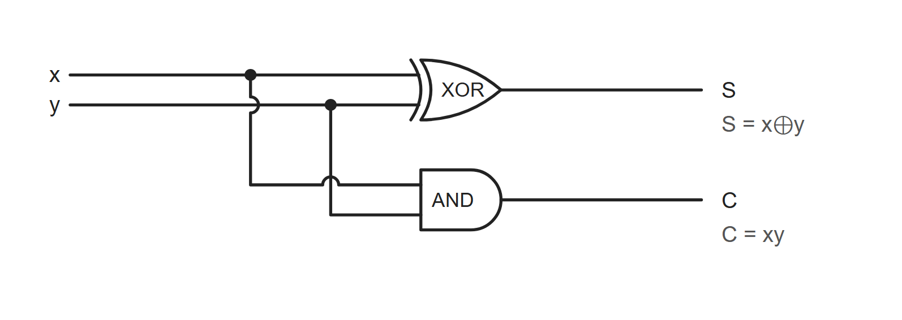
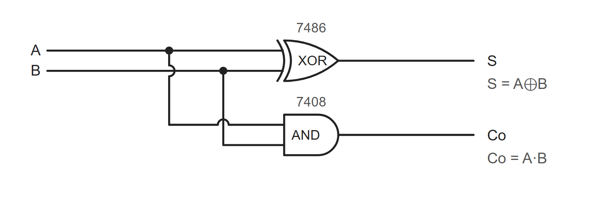
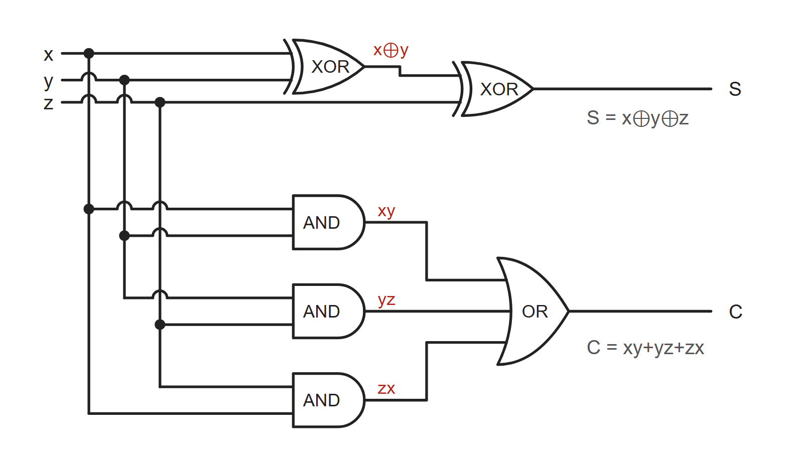
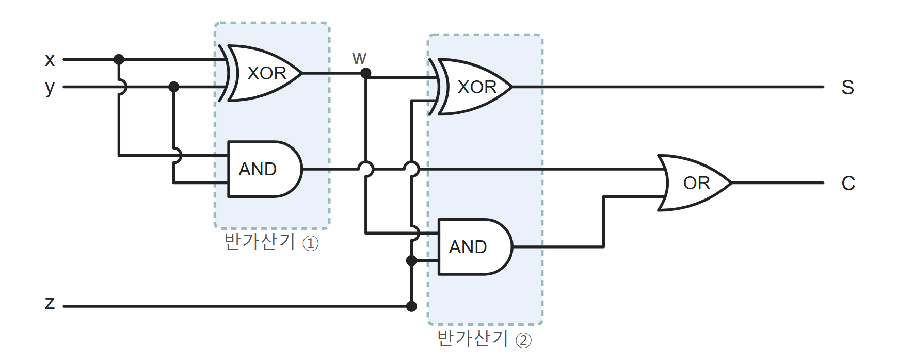
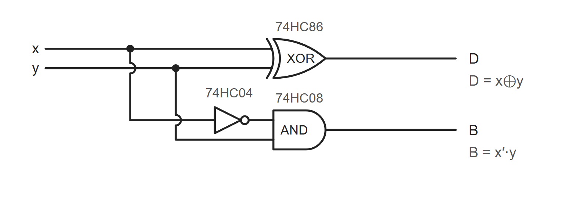
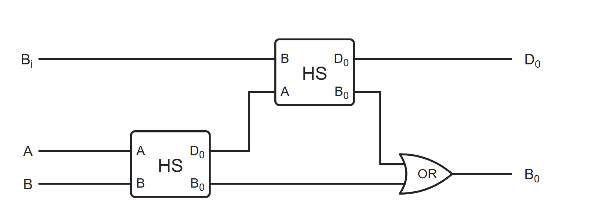
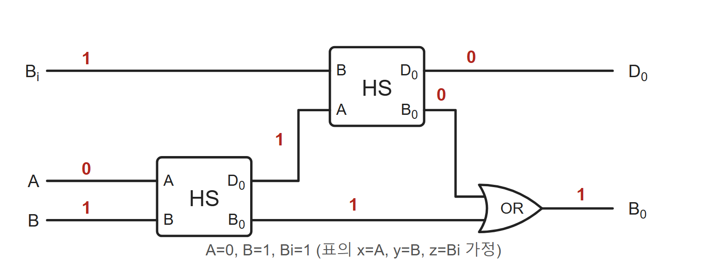
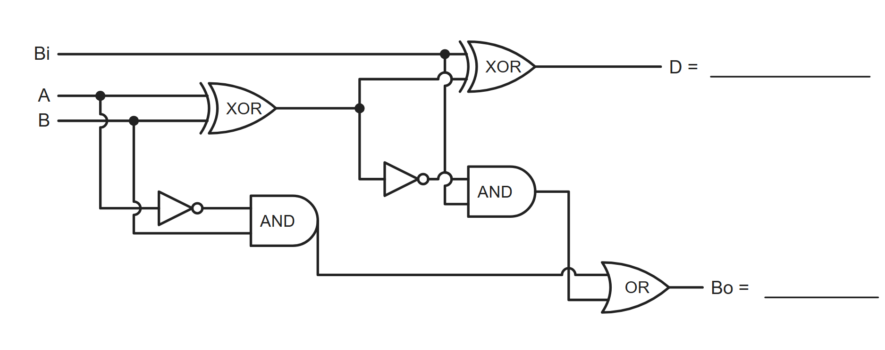
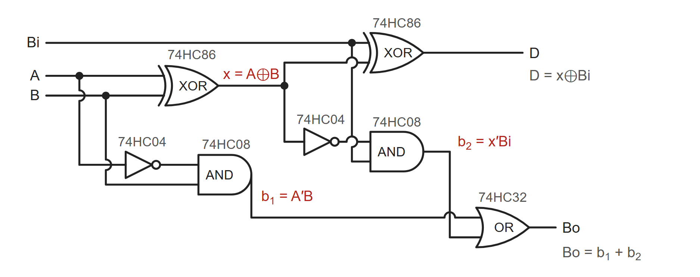

# 실험 3 · 기출 풀이

[실험 설명](실험03_실험설명.md) · [문제/해설](실험03_기출문제.md)

## 1. 반가산기 진리표 채우기
출처 미확인 · 실험 3 · 풀이 검토됨

### 문제 원문
다음은 2개의 2진 입력( x, y) 와 2개의 2진 출력으로 구성되는 반가산기의 진리표이다. 빈칸을 채워 넣어라.

### 조건
| x | y | c | s |
| --- | --- | --- | --- |
| 0 | 0 |  |  |
| 0 | 1 |  |  |
| 1 | 0 |  |  |
| 1 | 1 |  |  |

출력 열의 순서는 c(올림), s(합)예요.

### 구할 것
빈칸을 채우세요.

### 힌트 · 접근 순서
x와 y를 이진수 한 자리로 더하세요. 결과를 두 자리로 쓰고 왼쪽 자리가 올림 c, 오른쪽 자리가 합 s예요.

### 풀이 1 · 행마다 더하기
0+0 = 00이라서 c=0, s=0이에요. 0+1 = 01이라서 c=0, s=1이에요. 1+0 = 01이라서 c=0, s=1이에요. 1+1 = 10이라서 c=1, s=0이에요.

### 풀이 2 · 완성한 표
| x | y | c | s |
| --- | --- | --- | --- |
| 0 | 0 | 0 | 0 |
| 0 | 1 | 0 | 1 |
| 1 | 0 | 0 | 1 |
| 1 | 1 | 1 | 0 |

### 풀이 3 · 검산
s = x⊕y이고 c = x·y예요. (1,1)에서 XOR = 0, AND = 1이라서 표와 같아요.

### 풀이 4 · 흔한 실수
열 순서가 c, s예요. 교안의 표는 S, C 순서라서 순서를 바꿔 쓰기 쉬워요. 열 머리글을 보고 채워요.

### 최종 답
(0,0)→c=0, s=0 / (0,1)→c=0, s=1 / (1,0)→c=0, s=1 / (1,1)→c=1, s=0이에요.

### 출처
- [from_the_past/정리/퀴즈/실험3/실험3 퀴즈 기출_정답.pdf](../../from_the_past/%EC%A0%95%EB%A6%AC/%ED%80%B4%EC%A6%88/%EC%8B%A4%ED%97%983/%EC%8B%A4%ED%97%983%20%ED%80%B4%EC%A6%88%20%EA%B8%B0%EC%B6%9C_%EC%A0%95%EB%8B%B5.pdf#page=1)
- [from_the_past/정리/퀴즈/실험3/실험3 퀴즈 예상문제_v1.pdf](../../from_the_past/%EC%A0%95%EB%A6%AC/%ED%80%B4%EC%A6%88/%EC%8B%A4%ED%97%983/%EC%8B%A4%ED%97%983%20%ED%80%B4%EC%A6%88%20%EC%98%88%EC%83%81%EB%AC%B8%EC%A0%9C_v1.pdf#page=1)
- [from_the_past/정리/퀴즈/실험3/실험3 퀴즈 예상문제_v4.pdf](../../from_the_past/%EC%A0%95%EB%A6%AC/%ED%80%B4%EC%A6%88/%EC%8B%A4%ED%97%983/%EC%8B%A4%ED%97%983%20%ED%80%B4%EC%A6%88%20%EC%98%88%EC%83%81%EB%AC%B8%EC%A0%9C_v4.pdf#page=1)
- [from_the_past/정리/퀴즈/실험3/실험3 퀴즈 종합_기출문제 (5p).pdf](../../from_the_past/%EC%A0%95%EB%A6%AC/%ED%80%B4%EC%A6%88/%EC%8B%A4%ED%97%983/%EC%8B%A4%ED%97%983%20%ED%80%B4%EC%A6%88%20%EC%A2%85%ED%95%A9_%EA%B8%B0%EC%B6%9C%EB%AC%B8%EC%A0%9C%20%285p%29.pdf#page=2)
- [from_the_past/정리/퀴즈/실험3/원본_docx/실험 3.hwp](../../from_the_past/%EC%A0%95%EB%A6%AC/%ED%80%B4%EC%A6%88/%EC%8B%A4%ED%97%983/%EC%9B%90%EB%B3%B8_docx/%EC%8B%A4%ED%97%98%203.hwp)

## 2. 식(1)로 반가산기 설계
예상문제 · 실험 3 · 풀이 검토됨

### 문제 원문
반가산기의 단순화된 부울 함수는 식 (1) 과 같다.

S = x′y + xy′,  C = xy  (1)

식 (1) 을 바탕으로 AND gate 1개 와 XOR gate 1개를 이용하여 반가산기의 회로도를 작성하라.

### 조건
AND gate 1개, XOR gate 1개를 사용해요.

### 구할 것
반가산기의 회로도를 그리세요.

### 힌트 · 접근 순서
S의 식 x′y + xy′가 어떤 게이트의 정의와 같은지 떠올려 보세요.

### 풀이 1 · S
x′y + xy′는 x와 y가 서로 다를 때 1이에요. XOR의 정의와 같아서 S = x⊕y이고 XOR 하나로 만들어요.

### 풀이 2 · C
C = xy는 AND 하나로 만들어요.

### 풀이 3 · 완성 회로

### 풀이 4 · 검산
x=0, y=1이면 S = 0′·1 + 0·1′ = 1이고 XOR(0,1)도 1이에요. C = 0이에요. x=y=1이면 S = 0, C = 1이에요.

### 풀이 5 · 흔한 실수
x′y + xy′를 NOT 두 개, AND 두 개, OR 하나로 만들면 조건(AND 1개, XOR 1개)에 맞지 않아요. 이 식은 XOR 하나로 줄어요.

### 최종 답
x, y를 XOR에 넣어 S를, AND에 넣어 C를 만들어요.

### 출처
- [from_the_past/정리/퀴즈/실험3/실험3 퀴즈 예상문제_v1.pdf](../../from_the_past/%EC%A0%95%EB%A6%AC/%ED%80%B4%EC%A6%88/%EC%8B%A4%ED%97%983/%EC%8B%A4%ED%97%983%20%ED%80%B4%EC%A6%88%20%EC%98%88%EC%83%81%EB%AC%B8%EC%A0%9C_v1.pdf#page=1)
- [from_the_past/정리/퀴즈/실험3/실험3 퀴즈 예상문제_v4.pdf](../../from_the_past/%EC%A0%95%EB%A6%AC/%ED%80%B4%EC%A6%88/%EC%8B%A4%ED%97%983/%EC%8B%A4%ED%97%983%20%ED%80%B4%EC%A6%88%20%EC%98%88%EC%83%81%EB%AC%B8%EC%A0%9C_v4.pdf#page=1)
- [from_the_past/정리/퀴즈/실험3/실험3 퀴즈 종합_기출문제 (5p).pdf](../../from_the_past/%EC%A0%95%EB%A6%AC/%ED%80%B4%EC%A6%88/%EC%8B%A4%ED%97%983/%EC%8B%A4%ED%97%983%20%ED%80%B4%EC%A6%88%20%EC%A2%85%ED%95%A9_%EA%B8%B0%EC%B6%9C%EB%AC%B8%EC%A0%9C%20%285p%29.pdf#page=2)
- [from_the_past/정리/퀴즈/실험3/원본_docx/실험 3.hwp](../../from_the_past/%EC%A0%95%EB%A6%AC/%ED%80%B4%EC%A6%88/%EC%8B%A4%ED%97%983/%EC%9B%90%EB%B3%B8_docx/%EC%8B%A4%ED%97%98%203.hwp)

## 3. 7486·7408로 반가산기 설계
기출 · 실험 3 · 풀이 검토됨

### 문제 원문
XOR(IC 7486)gate와 AND(IC 7408)gate를 이용하여 2-Input Half adder의 게이트 회로도를 설계 하시오. (input : A, B , output: S, Co 로 표현) (3점.)

### 조건
XOR은 IC 7486, AND는 IC 7408을 사용해요. 입력은 A, B이고 출력은 S, Co예요.

### 구할 것
반가산기의 게이트 회로도를 그리세요.

### 힌트 · 접근 순서
반가산기의 진리표에서 S와 Co가 각각 어떤 게이트와 같은 모양인지 비교하세요.

### 풀이 1 · 식 정하기
합 S는 두 입력이 다를 때 1이라서 XOR이에요. 올림 Co는 두 입력이 모두 1일 때만 1이라서 AND예요.

### 풀이 2 · IC와 연결
A와 B를 7486(XOR)의 두 입력에 연결해서 S를 만들고, 같은 A와 B를 7408(AND)의 두 입력에 연결해서 Co를 만들어요. 입력 A와 B는 각각 두 게이트에 나뉘어 들어가요.

### 풀이 3 · 검산
A=1, B=1이면 S = 0, Co = 1이에요. A=1, B=0이면 S = 1, Co = 0이에요. 반가산기 진리표와 같아요.

### 풀이 4 · 흔한 실수
출력 이름을 C로 쓰지 않도록 주의해요. 이 문제는 Co로 지정했어요. 또 IC의 전원(VCC)과 GND 연결을 빠뜨리면 실제 회로가 동작하지 않아요. 핀 번호는 데이터시트로 확인해요.

### 최종 답
A, B를 XOR(7486)에 넣어 S를, AND(7408)에 넣어 Co를 만들어요.

### 출처
- [from_the_past/정리/퀴즈/실험3/실험3 퀴즈 기출_채점본.jpg](../../from_the_past/%EC%A0%95%EB%A6%AC/%ED%80%B4%EC%A6%88/%EC%8B%A4%ED%97%983/%EC%8B%A4%ED%97%983%20%ED%80%B4%EC%A6%88%20%EA%B8%B0%EC%B6%9C_%EC%B1%84%EC%A0%90%EB%B3%B8.jpg)

## 4. 반가산기·전가산기의 C, S 역할
기출 · 실험 3 · 풀이 검토됨

### 문제 원문
반가산기, 전가산기 에서의 C, S 출력 각각의 역할을 설명하라. (Describe the roles of C, S in half-adder and full-adder.)

### 구할 것
C 출력과 S 출력이 각각 무엇을 나타내는지 설명하세요.

### 힌트 · 접근 순서
1+1을 이진수로 계산하면 한 자리에 안 들어가요. 오른쪽에 쓰는 값과 왼쪽으로 넘기는 값이 각각 어느 출력인지 생각하세요.

### 풀이 1 · S의 역할
S(sum)는 입력을 더한 합을 한 자리로 나타낸 값이에요. 반가산기에서 S = A⊕B이고, 전가산기에서 S = A⊕B⊕Ci예요.

### 풀이 2 · C의 역할
C(carry)는 한 자리에 안 들어가서 윗자리로 넘기는 올림이에요. 반가산기에서 C = A·B이고, 전가산기에서는 Co = A·B + (A⊕B)·Ci로 쓰기도 해요.

### 풀이 3 · 검산
A=1, B=1이면 반가산기에서 S = 0, C = 1이에요. 1+1 = 10(이진수)이라서 오른쪽 자리 0이 S, 올림 1이 C예요.

### 풀이 4 · 흔한 실수
S가 두 입력을 단순히 OR한 값이라고 생각하면 안 돼요. 1+1일 때 S는 0이고 올림이 C에 나타나요.

### 최종 답
S는 합의 한 자리 값, C는 윗자리로 넘기는 올림이에요.

### 출처
- [from_the_past/정리/퀴즈/실험3/실험3 퀴즈 기출 2016-1.pdf](../../from_the_past/%EC%A0%95%EB%A6%AC/%ED%80%B4%EC%A6%88/%EC%8B%A4%ED%97%983/%EC%8B%A4%ED%97%983%20%ED%80%B4%EC%A6%88%20%EA%B8%B0%EC%B6%9C%202016-1.pdf#page=1)
- [from_the_past/정리/퀴즈/실험3/실험3 퀴즈 기출_문제.pdf](../../from_the_past/%EC%A0%95%EB%A6%AC/%ED%80%B4%EC%A6%88/%EC%8B%A4%ED%97%983/%EC%8B%A4%ED%97%983%20%ED%80%B4%EC%A6%88%20%EA%B8%B0%EC%B6%9C_%EB%AC%B8%EC%A0%9C.pdf#page=1)
- [from_the_past/정리/퀴즈/실험3/원본_docx/실험3퀴즈_문제.docx](../../from_the_past/%EC%A0%95%EB%A6%AC/%ED%80%B4%EC%A6%88/%EC%8B%A4%ED%97%983/%EC%9B%90%EB%B3%B8_docx/%EC%8B%A4%ED%97%983%ED%80%B4%EC%A6%88_%EB%AC%B8%EC%A0%9C.docx)

## 5. 반가산기를 LSB에만 쓰는 이유
기출 · 실험 3 · 풀이 검토됨

### 문제 원문
Half adder를 2진수 덧셈에서, 맨 오른쪽 자리(LSB) 계산에만 사용 하는 이유를 Full adder와 비교하여 서술하시오. (3점.)

### 구할 것
이유를 서술하세요.

### 힌트 · 접근 순서
반가산기와 전가산기의 입력 개수를 비교하세요. 맨 오른쪽 자리와 그 윗자리에서 “아래 자리의 올림”이 있는지 없는지 따져 보세요.

### 풀이 1 · 비교
반가산기는 입력이 A, B 둘뿐이라서 아래 자리에서 올라오는 올림을 받을 수 없어요. 전가산기는 A, B에 올림 입력 Ci까지 받아서 세 개를 더해요.

### 풀이 2 · 이유
맨 오른쪽 자리(LSB)는 그보다 아래 자리가 없어서 받을 올림이 없어요. 그래서 올림 입력이 필요 없는 반가산기로 충분해요. 윗자리는 아래 자리에서 올림이 올라올 수 있어서 전가산기를 써야 해요.

### 풀이 3 · 검산
0011 + 0001을 더하면 맨 아래 자리 1+1에서 올림 1이 생겨요. 그 윗자리는 1+0+올림 1을 더해야 해요. 올림을 받는 전가산기가 없으면 이 올림이 사라져요.

### 풀이 4 · 흔한 실수
“반가산기는 계산이 틀리다”라고 쓰면 안 돼요. 반가산기도 두 비트의 합은 정확해요. 올림 입력을 받는 기능이 없다는 점이 이유예요.

### 최종 답
LSB에는 아래 자리에서 오는 올림이 없어서 올림 입력이 없는 반가산기로 충분해요. 윗자리는 아래 자리의 올림을 받아야 해서 전가산기가 필요해요.

### 출처
- [from_the_past/정리/퀴즈/실험3/실험3 퀴즈 기출_문제.pdf](../../from_the_past/%EC%A0%95%EB%A6%AC/%ED%80%B4%EC%A6%88/%EC%8B%A4%ED%97%983/%EC%8B%A4%ED%97%983%20%ED%80%B4%EC%A6%88%20%EA%B8%B0%EC%B6%9C_%EB%AC%B8%EC%A0%9C.pdf#page=1)
- [from_the_past/정리/퀴즈/실험3/원본_docx/실험3퀴즈_문제.docx](../../from_the_past/%EC%A0%95%EB%A6%AC/%ED%80%B4%EC%A6%88/%EC%8B%A4%ED%97%983/%EC%9B%90%EB%B3%B8_docx/%EC%8B%A4%ED%97%983%ED%80%B4%EC%A6%88_%EB%AC%B8%EC%A0%9C.docx)
- [from_the_past/정리/퀴즈/실험3/실험3 퀴즈 기출_채점본.jpg](../../from_the_past/%EC%A0%95%EB%A6%AC/%ED%80%B4%EC%A6%88/%EC%8B%A4%ED%97%983/%EC%8B%A4%ED%97%983%20%ED%80%B4%EC%A6%88%20%EA%B8%B0%EC%B6%9C_%EC%B1%84%EC%A0%90%EB%B3%B8.jpg)

## 6. 전가산기와 반가산기의 차이
출처 미확인 · 실험 3 · 풀이 검토됨

### 문제 원문
전가산기와 반가산기의 차이를 간단히 설명하라.

### 구할 것
차이를 간단히 설명하세요.

### 힌트 · 접근 순서
두 회로의 입력 개수가 몇 개씩인지 먼저 세어 보세요.

### 풀이 1 · 입력의 차이
반가산기는 A, B 두 개를 입력받아요. 전가산기는 A, B에 아래 자리에서 올라온 올림 Ci까지 세 개를 입력받아요.

### 풀이 2 · 구성과 쓰임
전가산기는 반가산기 두 개와 OR 게이트로 만들어요. 올림을 받아서 처리할 수 있어서 여러 자리 덧셈의 윗자리에 쓰고, 반가산기는 맨 아래 자리에 써요.

### 풀이 3 · 검산
진리표 행 수로도 확인돼요. 반가산기는 입력 2개라서 4행, 전가산기는 입력 3개라서 8행이에요.

### 풀이 4 · 흔한 실수
출력 개수가 다르다고 쓰면 안 돼요. 둘 다 합과 올림 두 출력이에요. 다른 점은 올림을 입력으로 받느냐예요.

### 최종 답
전가산기는 아래 자리의 올림(Ci)까지 입력으로 받아 더하고, 반가산기는 올림 입력 없이 두 비트만 더해요.

### 출처
- [from_the_past/정리/퀴즈/실험3/실험3 퀴즈 기출_정답.pdf](../../from_the_past/%EC%A0%95%EB%A6%AC/%ED%80%B4%EC%A6%88/%EC%8B%A4%ED%97%983/%EC%8B%A4%ED%97%983%20%ED%80%B4%EC%A6%88%20%EA%B8%B0%EC%B6%9C_%EC%A0%95%EB%8B%B5.pdf#page=1)
- [from_the_past/정리/퀴즈/실험3/실험3 퀴즈 예상문제_v1.pdf](../../from_the_past/%EC%A0%95%EB%A6%AC/%ED%80%B4%EC%A6%88/%EC%8B%A4%ED%97%983/%EC%8B%A4%ED%97%983%20%ED%80%B4%EC%A6%88%20%EC%98%88%EC%83%81%EB%AC%B8%EC%A0%9C_v1.pdf#page=1)
- [from_the_past/정리/퀴즈/실험3/실험3 퀴즈 예상문제_v4.pdf](../../from_the_past/%EC%A0%95%EB%A6%AC/%ED%80%B4%EC%A6%88/%EC%8B%A4%ED%97%983/%EC%8B%A4%ED%97%983%20%ED%80%B4%EC%A6%88%20%EC%98%88%EC%83%81%EB%AC%B8%EC%A0%9C_v4.pdf#page=1)
- [from_the_past/정리/퀴즈/실험3/실험3 퀴즈 종합_기출문제 (5p).pdf](../../from_the_past/%EC%A0%95%EB%A6%AC/%ED%80%B4%EC%A6%88/%EC%8B%A4%ED%97%983/%EC%8B%A4%ED%97%983%20%ED%80%B4%EC%A6%88%20%EC%A2%85%ED%95%A9_%EA%B8%B0%EC%B6%9C%EB%AC%B8%EC%A0%9C%20%285p%29.pdf#page=2)
- [from_the_past/정리/퀴즈/실험3/원본_docx/실험 3.hwp](../../from_the_past/%EC%A0%95%EB%A6%AC/%ED%80%B4%EC%A6%88/%EC%8B%A4%ED%97%983/%EC%9B%90%EB%B3%B8_docx/%EC%8B%A4%ED%97%98%203.hwp)

## 7. 전가산기 진리표 일부 채우기
출처 미확인 · 실험 3 · 풀이 검토됨

### 문제 원문
전가산기는 3개의 입력 비트들의 합을 계산하는 조합회로이며 3개의 입력(x,y,z)과 2개의 출력(c,s) 으로 구성된다. 다음은 전가산기의 진리표 일부이다. 빈칸을 채워라.

### 조건
| x | y | z | C | S |
| --- | --- | --- | --- | --- |
| 0 | 1 | 1 |  |  |
| 1 | 0 | 0 |  |  |
| 1 | 0 | 1 |  |  |

출력 열의 순서는 C(올림), S(합)예요.

### 구할 것
빈칸을 채우세요.

### 힌트 · 접근 순서
세 입력의 1의 개수를 세세요. 1이 한 개면 합 1·올림 0, 두 개면 합 0·올림 1이에요. 이진수로 쓴 결과의 왼쪽 자리가 올림이에요.

### 풀이 1 · 행마다 더하기
(0,1,1): 0+1+1 = 10이라서 C=1, S=0이에요. (1,0,0): 1+0+0 = 01이라서 C=0, S=1이에요. (1,0,1): 1+0+1 = 10이라서 C=1, S=0이에요.

### 풀이 2 · 완성한 표
| x | y | z | C | S |
| --- | --- | --- | --- | --- |
| 0 | 1 | 1 | 1 | 0 |
| 1 | 0 | 0 | 0 | 1 |
| 1 | 0 | 1 | 1 | 0 |

### 풀이 3 · 검산
S = x⊕y⊕z이고 C는 1이 두 개 이상일 때 1이에요. (1,0,1)은 1이 두 개라서 C=1이고 XOR 결과는 0이에요.

### 풀이 4 · 흔한 실수
열 순서가 C, S예요. S를 먼저 쓰지 않도록 주의해요. (0,1,1)에서 합을 1로 쓰는 실수도 많아요. 1이 두 개면 합은 0이에요.

### 최종 답
(0,1,1)→C=1, S=0 / (1,0,0)→C=0, S=1 / (1,0,1)→C=1, S=0이에요.

### 출처
- [from_the_past/정리/퀴즈/실험3/실험3 퀴즈 기출_정답.pdf](../../from_the_past/%EC%A0%95%EB%A6%AC/%ED%80%B4%EC%A6%88/%EC%8B%A4%ED%97%983/%EC%8B%A4%ED%97%983%20%ED%80%B4%EC%A6%88%20%EA%B8%B0%EC%B6%9C_%EC%A0%95%EB%8B%B5.pdf#page=1)
- [from_the_past/정리/퀴즈/실험3/실험3 퀴즈 예상문제_v1.pdf](../../from_the_past/%EC%A0%95%EB%A6%AC/%ED%80%B4%EC%A6%88/%EC%8B%A4%ED%97%983/%EC%8B%A4%ED%97%983%20%ED%80%B4%EC%A6%88%20%EC%98%88%EC%83%81%EB%AC%B8%EC%A0%9C_v1.pdf#page=2)
- [from_the_past/정리/퀴즈/실험3/실험3 퀴즈 예상문제_v4.pdf](../../from_the_past/%EC%A0%95%EB%A6%AC/%ED%80%B4%EC%A6%88/%EC%8B%A4%ED%97%983/%EC%8B%A4%ED%97%983%20%ED%80%B4%EC%A6%88%20%EC%98%88%EC%83%81%EB%AC%B8%EC%A0%9C_v4.pdf#page=1)
- [from_the_past/정리/퀴즈/실험3/실험3 퀴즈 종합_기출문제 (5p).pdf](../../from_the_past/%EC%A0%95%EB%A6%AC/%ED%80%B4%EC%A6%88/%EC%8B%A4%ED%97%983/%EC%8B%A4%ED%97%983%20%ED%80%B4%EC%A6%88%20%EC%A2%85%ED%95%A9_%EA%B8%B0%EC%B6%9C%EB%AC%B8%EC%A0%9C%20%285p%29.pdf#page=3)
- [from_the_past/정리/퀴즈/실험3/원본_docx/실험 3.hwp](../../from_the_past/%EC%A0%95%EB%A6%AC/%ED%80%B4%EC%A6%88/%EC%8B%A4%ED%97%983/%EC%9B%90%EB%B3%B8_docx/%EC%8B%A4%ED%97%98%203.hwp)

## 8. 식(1)로 전가산기 설계
기출 · 실험 3 · 답안 충돌

### 문제 원문
다음은 전가산기의 단순화 된 부울함수이다. (Following equation is a simplified bool function of a full-adder.)

S = x′y′z + x′yz′ + xy′z′ + xyz,  C = xy + yz + zx  (1)

식(1)을 바탕으로 3 개의 AND gate, 1 개의 OR gate, 그리고 2개의 XOR gate 를 사용해서 전가산기의 회로도를 작성하자. (Design a circuit diagram of full-adder using three AND gates, one OR gate, and two XOR gates based on the equation (1).)

### 조건
AND gate 3개, OR gate 1개, XOR gate 2개를 사용해요.

### 구할 것
식(1)에서 S와 C를 만드는 전가산기 회로도를 그리세요.

### 힌트 · 접근 순서
S의 네 항이 입력에서 1이 몇 개일 때 1이 되는지 세어 보세요. 그 패턴을 XOR 두 개로 만들 수 있는지 생각해 보세요.

### 힌트 · 접근 순서
C는 식 그대로 곱 세 개를 합한 꼴이에요. 곱 하나가 AND 게이트 하나이고, 그 세 개를 OR로 합쳐요. 마지막에 게이트 개수를 세어 조건과 맞춰 보세요.

### 풀이 1 · S와 C 정리
S가 1인 입력은 001, 010, 100, 111이에요. 1이 홀수 개인 행들이라서 S = x⊕y⊕z이고 XOR 두 개를 이어서 만들어요. C = xy + yz + zx는 AND 3개로 xy, yz, zx를 만들고 3입력 OR 1개로 합쳐요.

### 풀이 2 · 완성 회로

### 풀이 3 · 검산
x=0, y=1, z=1이면 x⊕y = 1이라서 S = 1⊕1 = 0이고 yz = 1이라서 C = 1이에요. 진리표 011과 같아요.

### 풀이 4 · 제공 답안과 비교
제공 답안은 반가산기 두 개와 OR 하나예요. C 값은 같지만 AND가 두 개라서 문제의 “AND 3개” 조건과 달라요. 문제가 3입력 OR 하나를 허용한다는 해석이면 위 회로가 조건에 맞아요.

### 풀이 5 · 흔한 실수
C의 세 항 중 zx를 빼먹기 쉬워요. S를 곱의 합 네 항 그대로 만들면 XOR 2개 조건에 어긋나요.

### 최종 답
S = (x⊕y)⊕z는 XOR 두 개로, C = xy + yz + zx는 AND 세 개와 OR 하나로 만들어요.

### 출처
- [from_the_past/정리/퀴즈/실험3/실험3 퀴즈 기출 2016-1.pdf](../../from_the_past/%EC%A0%95%EB%A6%AC/%ED%80%B4%EC%A6%88/%EC%8B%A4%ED%97%983/%EC%8B%A4%ED%97%983%20%ED%80%B4%EC%A6%88%20%EA%B8%B0%EC%B6%9C%202016-1.pdf#page=1)
- [from_the_past/정리/퀴즈/실험3/실험3 퀴즈 예상문제_v1.pdf](../../from_the_past/%EC%A0%95%EB%A6%AC/%ED%80%B4%EC%A6%88/%EC%8B%A4%ED%97%983/%EC%8B%A4%ED%97%983%20%ED%80%B4%EC%A6%88%20%EC%98%88%EC%83%81%EB%AC%B8%EC%A0%9C_v1.pdf#page=1)
- [from_the_past/정리/퀴즈/실험3/실험3 퀴즈 예상문제_v4.pdf](../../from_the_past/%EC%A0%95%EB%A6%AC/%ED%80%B4%EC%A6%88/%EC%8B%A4%ED%97%983/%EC%8B%A4%ED%97%983%20%ED%80%B4%EC%A6%88%20%EC%98%88%EC%83%81%EB%AC%B8%EC%A0%9C_v4.pdf#page=1)
- [from_the_past/정리/퀴즈/실험3/실험3 퀴즈 종합_기출문제 (5p).pdf](../../from_the_past/%EC%A0%95%EB%A6%AC/%ED%80%B4%EC%A6%88/%EC%8B%A4%ED%97%983/%EC%8B%A4%ED%97%983%20%ED%80%B4%EC%A6%88%20%EC%A2%85%ED%95%A9_%EA%B8%B0%EC%B6%9C%EB%AC%B8%EC%A0%9C%20%285p%29.pdf#page=3)
- [from_the_past/정리/퀴즈/실험3/원본_docx/실험 3.hwp](../../from_the_past/%EC%A0%95%EB%A6%AC/%ED%80%B4%EC%A6%88/%EC%8B%A4%ED%97%983/%EC%9B%90%EB%B3%B8_docx/%EC%8B%A4%ED%97%98%203.hwp)

## 9. 반감산기의 단순화 부울 함수
출처 미확인 · 실험 3 · 풀이 검토됨

### 문제 원문
다음은 반감산기의 진리표이다. 이 진리표를 바탕으로 단순화된 부울 함수를 작성하라.

### 조건
| x | y | B | D |
| --- | --- | --- | --- |
| 0 | 0 | 0 | 0 |
| 0 | 1 | 1 | 1 |
| 1 | 0 | 0 | 1 |
| 1 | 1 | 0 | 0 |

표의 입력은 x, y이고 출력은 B(내림), D(차)예요. 이 표는 문제에 주어진 조건이에요.

### 구할 것
B = ____, D = ____ 의 식을 쓰세요.

### 힌트 · 접근 순서
출력이 1인 행마다 입력 조건을 곱(AND)으로 쓰고, 그 곱들을 더하세요(OR). 그다음 줄일 수 있는지 보세요.

### 풀이 1 · B
B가 1인 행은 (x,y) = (0,1) 하나예요. 그 조건은 x′y예요. 그래서 B = x′y예요.

### 풀이 2 · D
D가 1인 행은 (0,1)과 (1,0)이에요. 곱은 x′y와 xy′이에요. 합치면 D = x′y + xy′이고, 이는 x⊕y와 같아요.

### 풀이 3 · 검산
(1,1)에서 B = 1′·1 = 0이고 D = 1′·1 + 1·1′ = 0이에요. (0,1)에서 B = 0′·1 = 1이고 D = 0′·1 + 0·1′ = 1이에요. 표와 같아요.

### 풀이 4 · 흔한 실수
B = xy′로 쓰면 틀려요. (0,1)에서 1이 나와야 해요. 뺄셈은 순서가 있어서 NOT이 빼지는 수 x에 붙어요.

### 최종 답
B = x′y, D = x′y + xy′ (= x⊕y)이에요.

### 출처
- [from_the_past/정리/퀴즈/실험3/실험3 퀴즈 기출_정답.pdf](../../from_the_past/%EC%A0%95%EB%A6%AC/%ED%80%B4%EC%A6%88/%EC%8B%A4%ED%97%983/%EC%8B%A4%ED%97%983%20%ED%80%B4%EC%A6%88%20%EA%B8%B0%EC%B6%9C_%EC%A0%95%EB%8B%B5.pdf#page=1)
- [from_the_past/정리/퀴즈/실험3/실험3 퀴즈 예상문제_v1.pdf](../../from_the_past/%EC%A0%95%EB%A6%AC/%ED%80%B4%EC%A6%88/%EC%8B%A4%ED%97%983/%EC%8B%A4%ED%97%983%20%ED%80%B4%EC%A6%88%20%EC%98%88%EC%83%81%EB%AC%B8%EC%A0%9C_v1.pdf#page=2)
- [from_the_past/정리/퀴즈/실험3/실험3 퀴즈 예상문제_v4.pdf](../../from_the_past/%EC%A0%95%EB%A6%AC/%ED%80%B4%EC%A6%88/%EC%8B%A4%ED%97%983/%EC%8B%A4%ED%97%983%20%ED%80%B4%EC%A6%88%20%EC%98%88%EC%83%81%EB%AC%B8%EC%A0%9C_v4.pdf#page=2)
- [from_the_past/정리/퀴즈/실험3/실험3 퀴즈 종합_기출문제 (5p).pdf](../../from_the_past/%EC%A0%95%EB%A6%AC/%ED%80%B4%EC%A6%88/%EC%8B%A4%ED%97%983/%EC%8B%A4%ED%97%983%20%ED%80%B4%EC%A6%88%20%EC%A2%85%ED%95%A9_%EA%B8%B0%EC%B6%9C%EB%AC%B8%EC%A0%9C%20%285p%29.pdf#page=4)
- [from_the_past/정리/퀴즈/실험3/원본_docx/실험 3.hwp](../../from_the_past/%EC%A0%95%EB%A6%AC/%ED%80%B4%EC%A6%88/%EC%8B%A4%ED%97%983/%EC%9B%90%EB%B3%B8_docx/%EC%8B%A4%ED%97%98%203.hwp)

## 10. 반감산기 회로 설계
기출 · 실험 3 · 풀이 검토됨

### 문제 원문
다음은 반감산기의 진리표이다. 이 진리표를 바탕으로 AND gate 1개, NOT gate 1개, 그리고 XOR gate 1개를 사용하여 반감산기의 회로도를 작성하여라. (2점.)

### 조건
| x | y | B | D |
| --- | --- | --- | --- |
| 0 | 0 | 0 | 0 |
| 0 | 1 | 1 | 1 |
| 1 | 0 | 0 | 1 |
| 1 | 1 | 0 | 0 |

표의 입력은 x, y이고 출력은 B(내림), D(차)예요. 이 표는 문제에 주어진 조건이에요.

AND gate 1개, NOT gate 1개, XOR gate 1개를 사용해요.

### 구할 것
반감산기의 회로도를 그리세요.

### 힌트 · 접근 순서
D 열이 어떤 게이트의 진리표와 같은지 비교하세요. B 열은 1이 되는 행이 하나뿐이니, 그 행의 조건(x와 y의 값)을 AND와 NOT으로 쓸 수 있는지 생각하세요.

### 풀이 1 · D
D 열은 x와 y가 다를 때 1이에요. XOR의 진리표와 같아서 D = x⊕y예요.

### 풀이 2 · B
B 열은 (x,y) = (0,1)일 때만 1이에요. “x가 0이고 y가 1”이라서 B = x′·y이고, x에 NOT을 붙인 뒤 y와 AND해요.

### 풀이 3 · 완성 회로

### 풀이 4 · 검산
(x,y) = (1,0)이면 D = 1⊕0 = 1이고 B = 1′·0 = 0이에요. (1,1)이면 D = 0, B = 1′·1 = 0이에요. 표와 같아요.

### 풀이 5 · 흔한 실수
NOT을 y에 붙이면 B = x·y′가 돼요. 그러면 (1,0)에서 1이 나와서 표와 달라요. NOT은 x에 붙여요.

### 최종 답
D = x⊕y를 XOR 하나로, B = x′·y를 NOT 하나(x에)와 AND 하나로 만들어요.

### 출처
- [from_the_past/정리/퀴즈/실험3/실험3 퀴즈 기출_문제.pdf](../../from_the_past/%EC%A0%95%EB%A6%AC/%ED%80%B4%EC%A6%88/%EC%8B%A4%ED%97%983/%EC%8B%A4%ED%97%983%20%ED%80%B4%EC%A6%88%20%EA%B8%B0%EC%B6%9C_%EB%AC%B8%EC%A0%9C.pdf#page=1)
- [from_the_past/정리/퀴즈/실험3/원본_docx/실험3퀴즈_문제.docx](../../from_the_past/%EC%A0%95%EB%A6%AC/%ED%80%B4%EC%A6%88/%EC%8B%A4%ED%97%983/%EC%9B%90%EB%B3%B8_docx/%EC%8B%A4%ED%97%983%ED%80%B4%EC%A6%88_%EB%AC%B8%EC%A0%9C.docx)
- [from_the_past/정리/퀴즈/실험3/실험3 퀴즈 예상문제_v1.pdf](../../from_the_past/%EC%A0%95%EB%A6%AC/%ED%80%B4%EC%A6%88/%EC%8B%A4%ED%97%983/%EC%8B%A4%ED%97%983%20%ED%80%B4%EC%A6%88%20%EC%98%88%EC%83%81%EB%AC%B8%EC%A0%9C_v1.pdf#page=3)
- [from_the_past/정리/퀴즈/실험3/실험3 퀴즈 예상문제_v4.pdf](../../from_the_past/%EC%A0%95%EB%A6%AC/%ED%80%B4%EC%A6%88/%EC%8B%A4%ED%97%983/%EC%8B%A4%ED%97%983%20%ED%80%B4%EC%A6%88%20%EC%98%88%EC%83%81%EB%AC%B8%EC%A0%9C_v4.pdf#page=2)
- [from_the_past/정리/퀴즈/실험3/실험3 퀴즈 종합_기출문제 (5p).pdf](../../from_the_past/%EC%A0%95%EB%A6%AC/%ED%80%B4%EC%A6%88/%EC%8B%A4%ED%97%983/%EC%8B%A4%ED%97%983%20%ED%80%B4%EC%A6%88%20%EC%A2%85%ED%95%A9_%EA%B8%B0%EC%B6%9C%EB%AC%B8%EC%A0%9C%20%285p%29.pdf#page=4)
- [from_the_past/정리/퀴즈/실험3/원본_docx/실험 3.hwp](../../from_the_past/%EC%A0%95%EB%A6%AC/%ED%80%B4%EC%A6%88/%EC%8B%A4%ED%97%983/%EC%9B%90%EB%B3%B8_docx/%EC%8B%A4%ED%97%98%203.hwp)

## 11. 반감산기와 전감산기의 차이
예상문제 · 실험 3 · 풀이 검토됨

### 문제 원문
반감산기와 전감산기의 차이를 간단히 서술하라.

### 구할 것
차이를 간단히 서술하세요.

### 힌트 · 접근 순서
두 회로의 입력 개수를 비교하세요. 가산기에서 반가산기와 전가산기가 달랐던 점과 같은 질문이에요.

### 풀이 1 · 입력의 차이
반감산기는 A, B 두 개를 입력받고, 전감산기는 A, B에 아래 자리가 빌려 간 값(내림 입력 Bi)까지 세 개를 입력받아요.

### 풀이 2 · 구성과 쓰임
전감산기는 반감산기 두 개와 OR 게이트로 만들어요. 내림을 받아서 처리하기 때문에 여러 자리 뺄셈의 윗자리에 쓰고, 반감산기는 맨 아래 자리 뺄셈에 써요.

### 풀이 3 · 검산
진리표 행 수는 반감산기 4행, 전감산기 8행이에요.

### 풀이 4 · 흔한 실수
“반감산기는 내림을 출력하지 않는다”가 아니에요. 반감산기도 내림 Bo를 출력해요. 다른 점은 아래 자리의 내림을 입력으로 받느냐예요.

### 최종 답
전감산기는 아래 자리에서 빌려 간 값(Bi)까지 입력으로 받아 빼고, 반감산기는 그 입력 없이 두 비트만 빼요.

### 출처
- [from_the_past/정리/퀴즈/실험3/실험3 퀴즈 예상문제_v1.pdf](../../from_the_past/%EC%A0%95%EB%A6%AC/%ED%80%B4%EC%A6%88/%EC%8B%A4%ED%97%983/%EC%8B%A4%ED%97%983%20%ED%80%B4%EC%A6%88%20%EC%98%88%EC%83%81%EB%AC%B8%EC%A0%9C_v1.pdf#page=2)
- [from_the_past/정리/퀴즈/실험3/실험3 퀴즈 예상문제_v4.pdf](../../from_the_past/%EC%A0%95%EB%A6%AC/%ED%80%B4%EC%A6%88/%EC%8B%A4%ED%97%983/%EC%8B%A4%ED%97%983%20%ED%80%B4%EC%A6%88%20%EC%98%88%EC%83%81%EB%AC%B8%EC%A0%9C_v4.pdf#page=2)
- [from_the_past/정리/퀴즈/실험3/실험3 퀴즈 종합_기출문제 (5p).pdf](../../from_the_past/%EC%A0%95%EB%A6%AC/%ED%80%B4%EC%A6%88/%EC%8B%A4%ED%97%983/%EC%8B%A4%ED%97%983%20%ED%80%B4%EC%A6%88%20%EC%A2%85%ED%95%A9_%EA%B8%B0%EC%B6%9C%EB%AC%B8%EC%A0%9C%20%285p%29.pdf#page=3)
- [from_the_past/정리/퀴즈/실험3/원본_docx/실험 3.hwp](../../from_the_past/%EC%A0%95%EB%A6%AC/%ED%80%B4%EC%A6%88/%EC%8B%A4%ED%97%983/%EC%9B%90%EB%B3%B8_docx/%EC%8B%A4%ED%97%98%203.hwp)

## 12. 전감산기 간략 회로도로 진리표 채우기
기출 · 실험 3 · 풀이 검토됨

### 문제 원문
다음은 전감산기의 간략화된 회로도이다. 이를 바탕으로 전감산기 진리표의 일부를 채워 넣자. (Following figure is a simplified circuit diagram of full-subtractor. Using the figure below, fill in the blanks of the table.)

### 조건
HS는 반감산기 블록이에요. 입력 열 x, y, z의 순서는 그림의 A, B, Bi로 읽어요(원문에 이 대응이 적혀 있지 않아 가정해요).

| x | y | z | B | D |
| --- | --- | --- | --- | --- |
| 0 | 1 | 1 |  |  |
| 1 | 0 | 0 |  |  |
| 1 | 0 | 1 |  |  |
| 1 | 1 | 0 |  |  |

### 구할 것
표의 출력 B(내림)와 D(차) 빈칸을 채우세요.

### 힌트 · 접근 순서
그림에서 첫 번째 HS는 A와 B를 받아요. 그 차 D0가 둘째 HS의 A 입력으로 가요. 둘째 HS의 B 입력은 Bi예요. 행마다 이 순서로 값을 따라가세요.

### 힌트 · 접근 순서
HS 블록 하나는 D = A⊕B, 내림 = A′B를 내보내요. 최종 내림은 두 HS의 내림을 OR한 값이에요.

### 풀이 1 · 규칙과 첫 행
HS(A, B)는 차 = A⊕B, 내림 = A′B예요. (0,1,1)이면 첫 HS는 차 1, 내림 1이에요. 둘째 HS는 A=1, B=1이라서 차 0, 내림 0이에요. 그래서 D = 0, B = 1+0 = 1이에요.

### 풀이 2 · 나머지 행
(1,0,0): 첫 HS 차 1·내림 0, 둘째 HS(1,0)은 차 1·내림 0이라 D=1, B=0이에요. (1,0,1): 첫 HS 차 1·내림 0, 둘째 HS(1,1)은 차 0·내림 0이라 D=0, B=0이에요. (1,1,0): 첫 HS 차 0·내림 0, 둘째 HS(0,0)은 차 0·내림 0이라 D=0, B=0이에요.

### 풀이 3 · 완성한 표
| x | y | z | B | D |
| --- | --- | --- | --- | --- |
| 0 | 1 | 1 | 1 | 0 |
| 1 | 0 | 0 | 0 | 1 |
| 1 | 0 | 1 | 0 | 0 |
| 1 | 1 | 0 | 0 | 0 |

### 풀이 4 · 검산·흔한 실수
(1,0,1)을 식으로 확인해요. D = 1⊕0⊕1 = 0이고 Bo = A′B + (A⊕B)′Bi = 0 + 0·1 = 0이에요. 둘째 HS의 A와 B를 바꾸면 내림이 달라져요. A에는 첫 HS의 D0가, B에는 Bi가 들어가요.

### 최종 답
(0,1,1): B=1, D=0 / (1,0,0): B=0, D=1 / (1,0,1): B=0, D=0 / (1,1,0): B=0, D=0이에요.

### 출처
- [from_the_past/정리/퀴즈/실험3/실험3 퀴즈 기출 2016-1.pdf](../../from_the_past/%EC%A0%95%EB%A6%AC/%ED%80%B4%EC%A6%88/%EC%8B%A4%ED%97%983/%EC%8B%A4%ED%97%983%20%ED%80%B4%EC%A6%88%20%EA%B8%B0%EC%B6%9C%202016-1.pdf#page=1)
- [from_the_past/정리/퀴즈/실험3/실험3 퀴즈 예상문제_v1.pdf](../../from_the_past/%EC%A0%95%EB%A6%AC/%ED%80%B4%EC%A6%88/%EC%8B%A4%ED%97%983/%EC%8B%A4%ED%97%983%20%ED%80%B4%EC%A6%88%20%EC%98%88%EC%83%81%EB%AC%B8%EC%A0%9C_v1.pdf#page=3)
- [from_the_past/정리/퀴즈/실험3/실험3 퀴즈 예상문제_v4.pdf](../../from_the_past/%EC%A0%95%EB%A6%AC/%ED%80%B4%EC%A6%88/%EC%8B%A4%ED%97%983/%EC%8B%A4%ED%97%983%20%ED%80%B4%EC%A6%88%20%EC%98%88%EC%83%81%EB%AC%B8%EC%A0%9C_v4.pdf#page=3)
- [from_the_past/정리/퀴즈/실험3/실험3 퀴즈 종합_기출문제 (5p).pdf](../../from_the_past/%EC%A0%95%EB%A6%AC/%ED%80%B4%EC%A6%88/%EC%8B%A4%ED%97%983/%EC%8B%A4%ED%97%983%20%ED%80%B4%EC%A6%88%20%EC%A2%85%ED%95%A9_%EA%B8%B0%EC%B6%9C%EB%AC%B8%EC%A0%9C%20%285p%29.pdf#page=5)
- [from_the_past/정리/퀴즈/실험3/원본_docx/실험 3.hwp](../../from_the_past/%EC%A0%95%EB%A6%AC/%ED%80%B4%EC%A6%88/%EC%8B%A4%ED%97%983/%EC%9B%90%EB%B3%B8_docx/%EC%8B%A4%ED%97%98%203.hwp)

## 13. 전감산기 회로의 D, Bo 식
기출 · 실험 3 · 풀이 검토됨

### 문제 원문
아래 Full subtracter 게이트 회로의 출력 D와 Bo의 Boolean equation은? (2점.)

### 구할 것
D = ____, Bo = ____ 의 식을 쓰세요.

### 힌트 · 접근 순서
첫 번째 XOR의 출력에 이름을 하나 붙이세요. 그 이름으로 둘째 XOR과 둘째 AND의 입력을 적으면 D가 먼저 나와요.

### 힌트 · 접근 순서
Bo는 AND 두 개의 출력을 OR한 값이에요. 각 AND의 입력에 NOT이 어느 신호에 붙었는지 확인하세요.

### 풀이 1 · 중간 신호
첫 XOR: x = A⊕B예요. 첫 AND는 A를 NOT한 값과 B를 받아서 b1 = A′B예요.

### 풀이 2 · D
둘째 XOR은 Bi와 x를 받아서 D = x⊕Bi = A⊕B⊕Bi예요.

### 풀이 3 · Bo
둘째 AND는 x를 NOT한 값과 Bi를 받아서 b2 = x′·Bi = (A⊕B)′·Bi예요. OR 게이트가 b1과 b2를 합쳐서 Bo = A′B + (A⊕B)′Bi예요.

### 풀이 4 · 검산
A=0, B=0, Bi=1이면 x=0이라서 D = 1이고 b1 = 0, b2 = 1·1 = 1이라 Bo = 1이에요. 진리표 001의 D=1, Bo=1과 같아요. A=1, B=1, Bi=1이면 x=0이라서 D = 1이고 b2 = 1이라 Bo = 1이에요.

### 풀이 5 · 흔한 실수
둘째 NOT이 Bi에 붙었다고 읽으면 Bo의 식이 틀려요. 그림에서 NOT은 x가 지나는 선에 붙어 있어요. 또 (A⊕B)′는 XOR 결과 전체의 부정이에요.

### 최종 답
D = A⊕B⊕Bi, Bo = A′B + (A⊕B)′Bi예요. 같은 값을 주는 간단한 꼴 Bo = A′B + A′Bi + B·Bi도 정답이에요.

### 출처
- [from_the_past/정리/퀴즈/실험3/실험3 퀴즈 기출_문제.pdf](../../from_the_past/%EC%A0%95%EB%A6%AC/%ED%80%B4%EC%A6%88/%EC%8B%A4%ED%97%983/%EC%8B%A4%ED%97%983%20%ED%80%B4%EC%A6%88%20%EA%B8%B0%EC%B6%9C_%EB%AC%B8%EC%A0%9C.pdf#page=1)
- [from_the_past/정리/퀴즈/실험3/원본_docx/실험3퀴즈_문제.docx](../../from_the_past/%EC%A0%95%EB%A6%AC/%ED%80%B4%EC%A6%88/%EC%8B%A4%ED%97%983/%EC%9B%90%EB%B3%B8_docx/%EC%8B%A4%ED%97%983%ED%80%B4%EC%A6%88_%EB%AC%B8%EC%A0%9C.docx)
- [from_the_past/정리/퀴즈/실험3/실험3 퀴즈 기출_채점본.jpg](../../from_the_past/%EC%A0%95%EB%A6%AC/%ED%80%B4%EC%A6%88/%EC%8B%A4%ED%97%983/%EC%8B%A4%ED%97%983%20%ED%80%B4%EC%A6%88%20%EA%B8%B0%EC%B6%9C_%EC%B1%84%EC%A0%90%EB%B3%B8.jpg)

## 14. 전감산기 D, B 출력의 역할
기출 · 실험 3 · 답안 충돌

### 문제 원문
전감산기에서의 D 와 B 출력의 각각의 역할을 설명하라. (Describe the roles of D, B in half-adder and full-subtractor.)

### 조건
원문 국문은 “전감산기”, 영문은 “half-adder and full-subtractor”로 적혀 있어요. 여기서는 전감산기의 두 출력을 설명해요.

### 구할 것
D 출력과 B 출력이 각각 무엇을 나타내는지 설명하세요.

### 힌트 · 접근 순서
입력이 A, B, Bi일 때 “A에서 B와 Bi를 뺀 값”이 어디에 나타나는지, 그리고 뺄 수 없을 때 어디에 표시되는지 나눠서 생각하세요.

### 풀이 1 · D의 역할
D(difference)는 A−B−Bi의 결과를 한 자리로 나타낸 차예요. D = A⊕B⊕Bi라서 입력에서 1이 홀수 개일 때 1이에요.

### 풀이 2 · B(Bo)의 역할
B(내림, borrow)는 그 자리에서 뺄 수 없어서 윗자리에서 빌려 와야 하는지를 나타내요. A가 B와 Bi를 더한 값보다 작을 때 1이에요. Bo = A′B + (A⊕B)′Bi예요.

### 풀이 3 · 검산
입력 A=0, B=0, Bi=1이면 0−0−1을 뺄 수 없어요. 10−1 = 1이라서 D = 1, Bo = 1이에요. 진리표 001과 같아요.

### 풀이 4 · 흔한 실수
출력 B를 입력 B와 같은 값으로 생각하면 안 돼요. 출력 B는 내림이에요. 내림은 윗자리에서 빌려 와야 한다는 신호예요.

### 최종 답
D는 세 입력을 뺀 차(한 자리 결과), B(Bo)는 윗자리에서 빌려 와야 한다는 내림이에요.

### 출처
- [from_the_past/정리/퀴즈/실험3/실험3 퀴즈 기출 2016-1.pdf](../../from_the_past/%EC%A0%95%EB%A6%AC/%ED%80%B4%EC%A6%88/%EC%8B%A4%ED%97%983/%EC%8B%A4%ED%97%983%20%ED%80%B4%EC%A6%88%20%EA%B8%B0%EC%B6%9C%202016-1.pdf#page=1)
- [from_the_past/정리/퀴즈/실험3/실험3 퀴즈 예상문제_v1.pdf](../../from_the_past/%EC%A0%95%EB%A6%AC/%ED%80%B4%EC%A6%88/%EC%8B%A4%ED%97%983/%EC%8B%A4%ED%97%983%20%ED%80%B4%EC%A6%88%20%EC%98%88%EC%83%81%EB%AC%B8%EC%A0%9C_v1.pdf#page=3)
- [from_the_past/정리/퀴즈/실험3/실험3 퀴즈 예상문제_v4.pdf](../../from_the_past/%EC%A0%95%EB%A6%AC/%ED%80%B4%EC%A6%88/%EC%8B%A4%ED%97%983/%EC%8B%A4%ED%97%983%20%ED%80%B4%EC%A6%88%20%EC%98%88%EC%83%81%EB%AC%B8%EC%A0%9C_v4.pdf#page=2)
- [from_the_past/정리/퀴즈/실험3/실험3 퀴즈 종합_기출문제 (5p).pdf](../../from_the_past/%EC%A0%95%EB%A6%AC/%ED%80%B4%EC%A6%88/%EC%8B%A4%ED%97%983/%EC%8B%A4%ED%97%983%20%ED%80%B4%EC%A6%88%20%EC%A2%85%ED%95%A9_%EA%B8%B0%EC%B6%9C%EB%AC%B8%EC%A0%9C%20%285p%29.pdf#page=4)
- [from_the_past/정리/퀴즈/실험3/원본_docx/실험 3.hwp](../../from_the_past/%EC%A0%95%EB%A6%AC/%ED%80%B4%EC%A6%88/%EC%8B%A4%ED%97%983/%EC%9B%90%EB%B3%B8_docx/%EC%8B%A4%ED%97%98%203.hwp)

## 15. “반감산기·전감산기”의 C, S 역할(표기 불일치)
출처 미확인 · 실험 3 · 정답 미확정

### 문제 원문
반감산기, 전감산기 에서의 C, S 출력 각각의 역할을 설명하라.

### 조건
원문 그대로 옮겼어요. 감산기의 출력은 보통 D(차)와 B(내림)이고 C, S는 가산기의 출력 이름이에요. 이 점은 해설의 원문 대조에서 다뤄요.

### 구할 것
C 출력과 S 출력이 각각 무엇을 나타내는지 설명하세요.

### 힌트 · 접근 순서
회로의 출력 이름이 C, S인 쪽이 가산기인지 감산기인지 먼저 확인하세요. 그다음 각 출력이 “결과의 한 자리”인지 “윗자리로 넘기는 값”인지 나누세요.

### 풀이 1 · 가산기로 읽을 때(제공 답안과 같은 해석)
S(sum)는 두 입력의 합을 한 자리로 나타낸 값이고, C(carry)는 윗자리로 넘기는 올림이에요. 제공 답안도 “두 입력의 합에 대한 출력이 S, 캐리가 발생하는지에 대한 출력이 C”라고 해요.

### 풀이 2 · 감산기로 읽을 때
감산기의 두 출력은 D와 B예요. D(difference)는 한 자리 차이고, B(Bo, borrow)는 윗자리에서 빌려 와야 하는지를 나타내요. 이 해석이면 “C, S”가 아니라 “D, B”의 역할을 묻는 문제로 바뀌어요.

### 풀이 3 · 검산
가산기 A=1, B=1이면 S = 0, C = 1이에요. 감산기 A=0, B=1이면 D = 1, 내림 = 1이에요. 두 경우 모두 진리표와 같아요.

### 풀이 4 · 흔한 실수
감산기 출력에 C, S 이름을 그대로 붙여 외우면 안 돼요. 감산기의 올림에 해당하는 값은 “내림(borrow)”이에요.

### 최종 답
가산기 해석이면 S는 합, C는 올림이에요. 감산기 해석이면 D는 차, B는 내림이에요. 원문 표기가 가산기/감산기로 엇갈려서 어느 쪽이 의도인지는 확정하지 못했어요.

### 출처
- [from_the_past/정리/퀴즈/실험3/실험3 퀴즈 기출_정답.pdf](../../from_the_past/%EC%A0%95%EB%A6%AC/%ED%80%B4%EC%A6%88/%EC%8B%A4%ED%97%983/%EC%8B%A4%ED%97%983%20%ED%80%B4%EC%A6%88%20%EA%B8%B0%EC%B6%9C_%EC%A0%95%EB%8B%B5.pdf#page=1)
- [from_the_past/정리/퀴즈/실험3/실험3 퀴즈 예상문제_v1.pdf](../../from_the_past/%EC%A0%95%EB%A6%AC/%ED%80%B4%EC%A6%88/%EC%8B%A4%ED%97%983/%EC%8B%A4%ED%97%983%20%ED%80%B4%EC%A6%88%20%EC%98%88%EC%83%81%EB%AC%B8%EC%A0%9C_v1.pdf#page=1)
- [from_the_past/정리/퀴즈/실험3/실험3 퀴즈 예상문제_v4.pdf](../../from_the_past/%EC%A0%95%EB%A6%AC/%ED%80%B4%EC%A6%88/%EC%8B%A4%ED%97%983/%EC%8B%A4%ED%97%983%20%ED%80%B4%EC%A6%88%20%EC%98%88%EC%83%81%EB%AC%B8%EC%A0%9C_v4.pdf#page=1)
- [from_the_past/정리/퀴즈/실험3/실험3 퀴즈 종합_기출문제 (5p).pdf](../../from_the_past/%EC%A0%95%EB%A6%AC/%ED%80%B4%EC%A6%88/%EC%8B%A4%ED%97%983/%EC%8B%A4%ED%97%983%20%ED%80%B4%EC%A6%88%20%EC%A2%85%ED%95%A9_%EA%B8%B0%EC%B6%9C%EB%AC%B8%EC%A0%9C%20%285p%29.pdf#page=2)
- [from_the_past/정리/퀴즈/실험3/원본_docx/실험 3.hwp](../../from_the_past/%EC%A0%95%EB%A6%AC/%ED%80%B4%EC%A6%88/%EC%8B%A4%ED%97%983/%EC%9B%90%EB%B3%B8_docx/%EC%8B%A4%ED%97%98%203.hwp)
