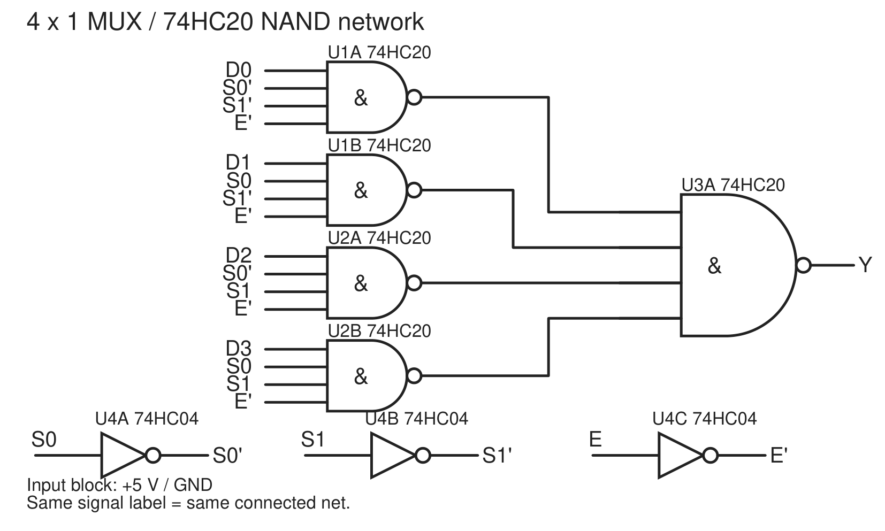
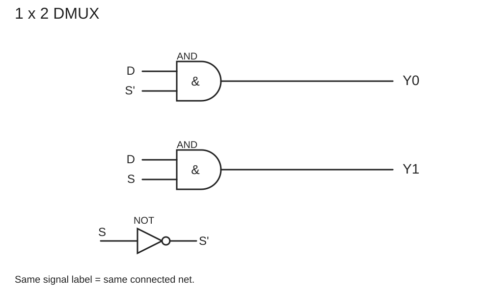
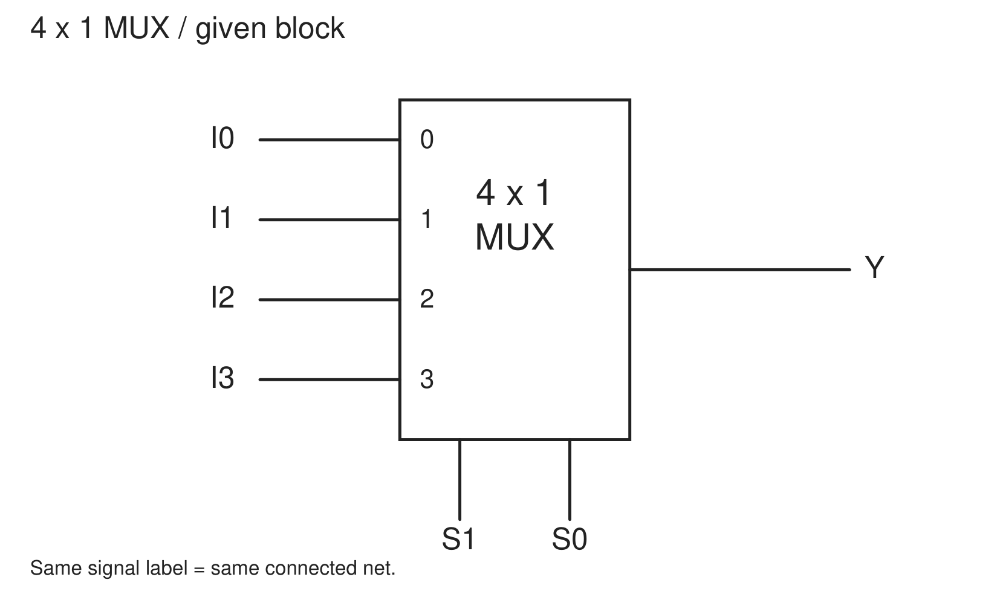
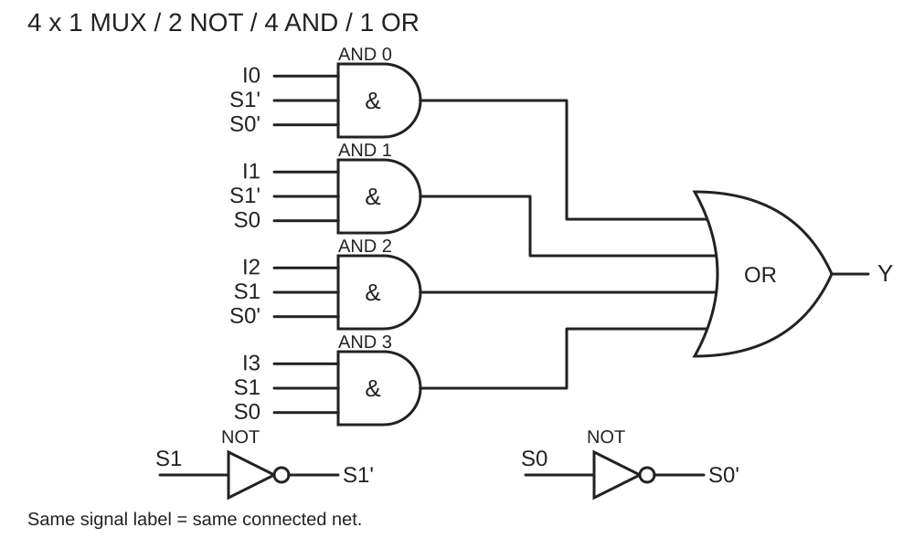
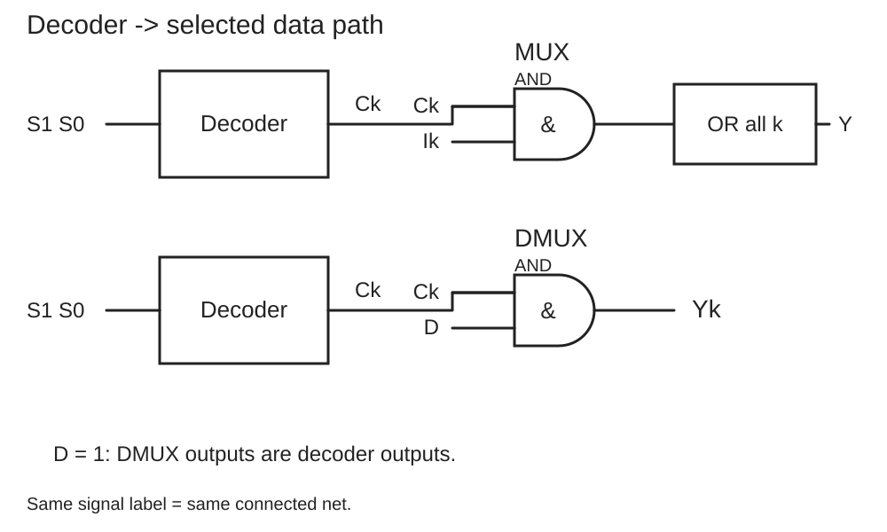
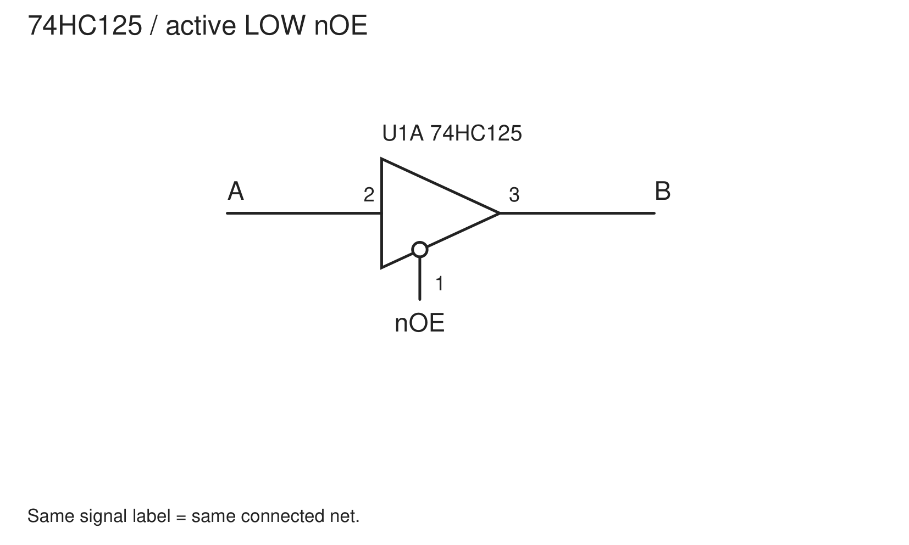
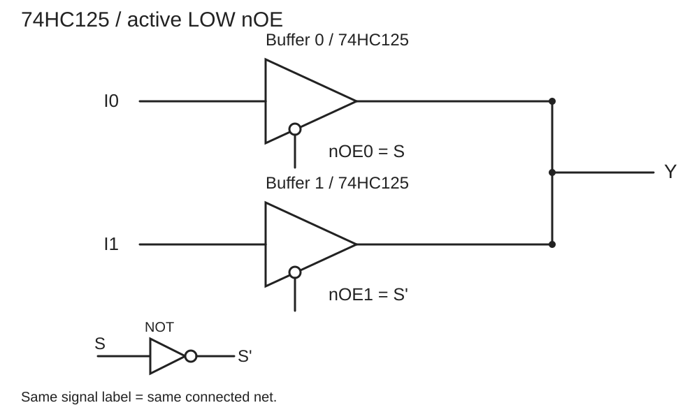
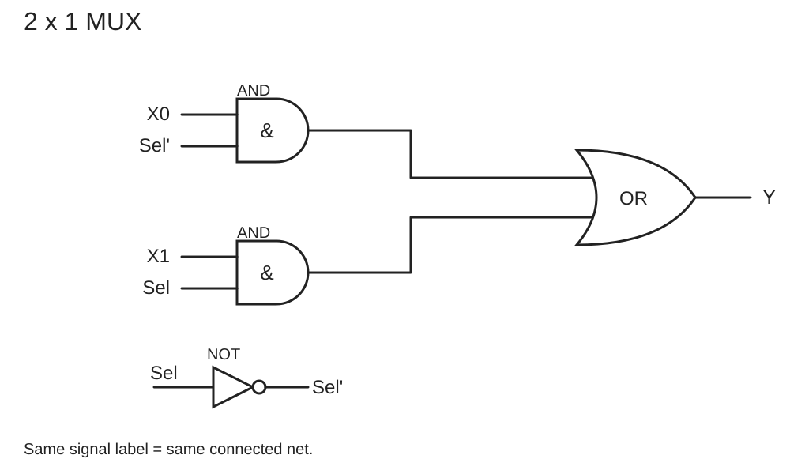

# 실험 4 · 문제 설명

      
첫 줄부터 완성 답과 검산까지 함께 풀어요.

## 문제를 함께 풀어요

### 문제 1 · 2×1 MUX의 게이트 설계

문제 읽기
#### 문제

And gate 2개, Or gate 1개 그리고 Not gate 1개를 가지고 2x1 멀티플렉서의 회로를 설계하고, 그에 맞는 논리식과 진리표를 나타내어라.

#### 구할 것

회로, 논리식, 진리표를 작성하세요.

이 문제에서 할 일
선택선이 0이면 I0, 1이면 I1을 통과시키는 스위치를 게이트로 만들어요. 회로·식·표를 모두 완성해요.

이 문제를 봤을 때 떠올릴 개념과 공식
$Y=S'I_0+SI_1$, 선택선이 고른 AND 항만 OR로 남기기

문제에 “AND 2개, OR 1개, NOT 1개로 2x1 멀티플렉서”가 보이면 $Y=S'I_0+SI_1$을 떠올려요. NOT으로 만든 S′와 S가 두 AND 중 하나만 열어 주고, OR가 열린 항만 출력으로 모으기 때문이에요.

“2×1 MUX”와 NOT 1개·AND 2개·OR 1개라는 조건에서 데이터 선택을 떠올려요. MUX는 여러 데이터 중 하나를 한 출력에 전달해요.

Y=S′I0+SI1에서 S는 선택선, I0·I1은 데이터예요. ′는 NOT, 붙여 쓰기는 AND, +는 OR예요.

이상 조합회로에서 S=0이면 첫 항만, S=1이면 둘째 항만 열려요. 이 선택 조건이 두 AND 경로와 마지막 OR를 정하는 이유예요.

첫 줄을 이렇게 시작해요
S=0→Y=I0, S=1→Y=I1을 두 줄로 쓰고 각 경로가 열리는 조건을 정해요.

필요한 개념: [2×1 MUX의 경로를 골라 봐요](%EC%8B%A4%ED%97%9804_%EC%8B%A4%ED%97%98%EC%84%A4%EB%AA%85.md#t-mux2)

왜 이렇게 푸는지 함께 따라가요
I0 경로는 S=0에서만 열려야 하므로 S′와 I0를 AND해요. I1 경로는 S와 I1을 AND해요. 둘 중 선택된 항만 남으므로 두 항을 OR로 합쳐 Y=S′I0+SI1이 돼요. 001(S=0,I0=0,I1=1)에서는 I1 값에 상관없이 Y=0이에요.

#### 풀이

선택선 S를 한 NOT에 넣어요. 첫 AND에는 S′, I0를 연결하고 둘째 AND에는 S, I1을 연결해요. 두 출력을 한 OR에 연결해요. 게이트 수는 NOT 1, AND 2, OR 1로 요구와 일치해요.

#### 완성 회로

#### 논리식

$$Y=\overline{S}I_0+SI_1$$

#### 표로 확인

| S | I0 | I1 | Y |
| --- | --- | --- | --- |
| 0 | 0 | 0 | 0 |
| 0 | 0 | 1 | 0 |
| 0 | 1 | 0 | 1 |
| 0 | 1 | 1 | 1 |
| 1 | 0 | 0 | 0 |
| 1 | 0 | 1 | 1 |
| 1 | 1 | 0 | 0 |
| 1 | 1 | 1 | 1 |

완성 답과 검산
S′I0+SI1

S=0/1을 식에 대입해 I0/I1이 각각 남는지 확인하고 게이트가 NOT1·AND2·OR1인지 세요.

**검산:** S=0과 1을 따로 대입하면 Y=I0 또는 I1. 8개 입력 조합 전수 확인해요.

여기서 헷갈리기 쉬워요
**흔한 실수:** S를 두 AND에 모두 그대로 넣으면 두 경로가 동시에 열리거나 닫힌다.

이제 설명을 닫고 다시 풀어요
- S=0→Y=I0, S=1→Y=I1을 두 줄로 쓰고 각 경로가 열리는 조건을 정해요.
- 앞의 풀이를 보지 않고 문제에서 요구한 모든 표·식·회로·설명을 완성해요.
- S=0/1을 식에 대입해 I0/I1이 각각 남는지 확인하고 게이트가 NOT1·AND2·OR1인지 세요.

**떠올릴 것:** $Y=S'I_0+SI_1$, 선택선이 고른 AND 항만 OR로 남기기

Y=S′I0+SI1: S=0은 I0, S=1은 I1을 선택해요.

**시작:** S=0→Y=I0, S=1→Y=I1을 두 줄로 쓰고 각 경로가 열리는 조건을 정해요.

**판단:** I0 경로는 S=0에서만 열려야 하므로 S′와 I0를 AND해요. I1 경로는 S와 I1을 AND해요. 둘 중 선택된 항만 남으므로 두 항을 OR로 합쳐 Y=S′I0+SI1이 돼요. 001(S=0,I0=0,I1=1)에서는 I1 값에 상관없이 Y=0이에요.

**검산:** S=0/1을 식에 대입해 I0/I1이 각각 남는지 확인하고 게이트가 NOT1·AND2·OR1인지 세요.

출처: [from_the_past/정리/퀴즈/실험4/실험4 퀴즈 기출 2016-1.pdf · PDF p1](../../../from_the_past/%EC%A0%95%EB%A6%AC/%ED%80%B4%EC%A6%88/%EC%8B%A4%ED%97%984/%EC%8B%A4%ED%97%984%20%ED%80%B4%EC%A6%88%20%EA%B8%B0%EC%B6%9C%202016-1.pdf#page=1) · [from_the_past/정리/퀴즈/실험4/실험4 퀴즈 기출_정답.pdf · PDF p1](../../../from_the_past/%EC%A0%95%EB%A6%AC/%ED%80%B4%EC%A6%88/%EC%8B%A4%ED%97%984/%EC%8B%A4%ED%97%984%20%ED%80%B4%EC%A6%88%20%EA%B8%B0%EC%B6%9C_%EC%A0%95%EB%8B%B5.pdf#page=1) · [from_the_past/정리/퀴즈/실험4/실험4 퀴즈 예상문제_v2.pdf · PDF p1](../../../from_the_past/%EC%A0%95%EB%A6%AC/%ED%80%B4%EC%A6%88/%EC%8B%A4%ED%97%984/%EC%8B%A4%ED%97%984%20%ED%80%B4%EC%A6%88%20%EC%98%88%EC%83%81%EB%AC%B8%EC%A0%9C_v2.pdf#page=1) · [from_the_past/정리/퀴즈/실험4/실험4 퀴즈 예상문제_v3.pdf · PDF p1](../../../from_the_past/%EC%A0%95%EB%A6%AC/%ED%80%B4%EC%A6%88/%EC%8B%A4%ED%97%984/%EC%8B%A4%ED%97%984%20%ED%80%B4%EC%A6%88%20%EC%98%88%EC%83%81%EB%AC%B8%EC%A0%9C_v3.pdf#page=1) · [from_the_past/정리/퀴즈/실험4/실험4 퀴즈 예상문제_v4.pdf · PDF p1](../../../from_the_past/%EC%A0%95%EB%A6%AC/%ED%80%B4%EC%A6%88/%EC%8B%A4%ED%97%984/%EC%8B%A4%ED%97%984%20%ED%80%B4%EC%A6%88%20%EC%98%88%EC%83%81%EB%AC%B8%EC%A0%9C_v4.pdf#page=1) · [from_the_past/정리/퀴즈/실험4/실험4 퀴즈 종합_기출문제 (5p).pdf · PDF p2](../../../from_the_past/%EC%A0%95%EB%A6%AC/%ED%80%B4%EC%A6%88/%EC%8B%A4%ED%97%984/%EC%8B%A4%ED%97%984%20%ED%80%B4%EC%A6%88%20%EC%A2%85%ED%95%A9_%EA%B8%B0%EC%B6%9C%EB%AC%B8%EC%A0%9C%20%285p%29.pdf#page=2) · [from_the_past/정리/퀴즈/실험4/원본_docx/실험 4.docx](../../../from_the_past/%EC%A0%95%EB%A6%AC/%ED%80%B4%EC%A6%88/%EC%8B%A4%ED%97%984/%EC%9B%90%EB%B3%B8_docx/%EC%8B%A4%ED%97%98%204.docx)

### 문제 2 · Enable 있는 4×1 MUX 표 완성

문제 읽기
#### 문제

다음과 같이 Enable을 갖는 4x1 멀티플렉서를 참고하여, 아래 진리표의 알맞은 출력값을 기록하라. (E가 enable 입력이고 S0, S1은 선택입력, 그리고 D0~D3이 4개의 데이터 입력이다.)

#### 주어진 조건

| E | S1 | S0 | D3 | D2 | D1 | D0 | Y |
| --- | --- | --- | --- | --- | --- | --- | --- |
| 0 | 0 | 0 | 1 | 1 | 1 | 0 |  |
| 0 | 0 | 1 | 0 | 0 | 1 | 0 |  |
| 0 | 1 | 0 | 1 | 0 | 1 | 1 |  |
| 0 | 1 | 1 | 0 | 1 | 1 | 1 |  |

#### 구할 것

표의 빈 출력 Y 네 칸을 채우세요.

이 문제에서 할 일
enable이 회로를 허용하는지 먼저 보고, 선택 주소가 고른 데이터 열만 읽어요.

이 문제를 봤을 때 떠올릴 개념과 공식
E=0이 활성, 주소 $2S_1+S_0$번 데이터 열 읽기

문제에 “Enable을 갖는 4x1 멀티플렉서”와 E=0인 행이 보이면 E=0이 활성이고 주소 $2S_1+S_0$번 데이터를 읽는다는 것을 떠올려요. E는 NOT을 거쳐 들어가 0에서 회로를 허용하고, 표가 D3부터 거꾸로 적혀 있어 열 이름으로 찾아야 하기 때문이에요.

“Enable을 갖는 4×1”에서는 주소와 활성 조건을 따로 읽어요. S1이 상위, S0가 하위 비트라 k=2S1+S0가 선택 데이터 Dk의 번호예요.

원문 회로는 E를 반전하므로 E=0에서 활성이고 Y=E′(S1′S0′D0+S1′S0D1+S1S0′D2+S1S0D3)예요. ′는 NOT, +는 OR예요.

이 NAND 두 단계 회로의 이상 논리 계산에서는 E=1이면 모든 첫 NAND 출력이 1이라 마지막 출력은 0이에요. 교안의 비활성 X 표기를 측정값으로 확정하지 않아요. 제시 네 행은 E=0이므로 D3·D2·D1·D0 열에서 선택 이름만 찾아요.

첫 줄을 이렇게 시작해요
E=0이 활성임을 확인한 뒤 첫 행 S1S0=00→D0=0→Y=0을 써요.

필요한 개념: [4×1 MUX와 활성 Low enable을 배워요](%EC%8B%A4%ED%97%9804_%EC%8B%A4%ED%97%98%EC%84%A4%EB%AA%85.md#t-mux4)

왜 이렇게 푸는지 함께 따라가요
선택 주소는 2S1+S0예요. 01이면 D1, 10이면 D2, 11이면 D3이에요. 표는 데이터 열을 D3부터 거꾸로 적었으므로 “몇 번째 칸”보다 열 이름을 찾아야 해요. E=0은 활성 조건이지 출력값 0을 뜻하지 않아요.

#### 풀이

회로의 E는 NOT을 거쳐 들어가므로 E=0에서 활성이에요. 주소 k=2S1+S0로 선택 입력을 찾는다. 출력 열 앞의 데이터 순서가 D3,D2,D1,D0임에 주의해요.

#### 표로 확인

| E | S1S0 | 선택 | 선택 데이터 | Y |
| --- | --- | --- | --- | --- |
| 0 | 00 | D0 | 0 | 0 |
| 0 | 01 | D1 | 1 | 1 |
| 0 | 10 | D2 | 0 | 0 |
| 0 | 11 | D3 | 0 | 0 |

#### 결과

최종 답: 위에서 아래로 0, 1, 0, 0.

완성 답과 검산
0,1,0,0

제시 네 행의 선택 데이터가 0·1·0·0이고 출력도 같은지 확인해요.

**검산:** 각 행에 E′와 네 주소 항을 대입해 선택 항 하나만 남는지 확인해요.

여기서 헷갈리기 쉬워요
**흔한 실수:** 표를 왼쪽부터 D0로 읽거나 enable 0을 비활성으로 읽지 않아요.

이제 설명을 닫고 다시 풀어요
- E=0이 활성임을 확인한 뒤 첫 행 S1S0=00→D0=0→Y=0을 써요.
- 앞의 풀이를 보지 않고 문제에서 요구한 모든 표·식·회로·설명을 완성해요.
- 제시 네 행의 선택 데이터가 0·1·0·0이고 출력도 같은지 확인해요.

**떠올릴 것:** E=0이 활성, 주소 $2S_1+S_0$번 데이터 열 읽기

E=0에서 활성이고 k=2S1+S0로 Dk를 골라요. 비활성 출력 0은 제시 회로의 이상 계산 조건이에요.

**시작:** E=0이 활성임을 확인한 뒤 첫 행 S1S0=00→D0=0→Y=0을 써요.

**판단:** 선택 주소는 2S1+S0예요. 01이면 D1, 10이면 D2, 11이면 D3이에요. 표는 데이터 열을 D3부터 거꾸로 적었으므로 “몇 번째 칸”보다 열 이름을 찾아야 해요. E=0은 활성 조건이지 출력값 0을 뜻하지 않아요.

**검산:** 제시 네 행의 선택 데이터가 0·1·0·0이고 출력도 같은지 확인해요.

출처: [from_the_past/정리/퀴즈/실험4/실험4 퀴즈 기출 2016-1.pdf · PDF p1](../../../from_the_past/%EC%A0%95%EB%A6%AC/%ED%80%B4%EC%A6%88/%EC%8B%A4%ED%97%984/%EC%8B%A4%ED%97%984%20%ED%80%B4%EC%A6%88%20%EA%B8%B0%EC%B6%9C%202016-1.pdf#page=1) · [from_the_past/정리/퀴즈/실험4/실험4 퀴즈 예상문제_v2.pdf · PDF p1](../../../from_the_past/%EC%A0%95%EB%A6%AC/%ED%80%B4%EC%A6%88/%EC%8B%A4%ED%97%984/%EC%8B%A4%ED%97%984%20%ED%80%B4%EC%A6%88%20%EC%98%88%EC%83%81%EB%AC%B8%EC%A0%9C_v2.pdf#page=1) · [from_the_past/정리/퀴즈/실험4/실험4 퀴즈 예상문제_v3.pdf · PDF p1](../../../from_the_past/%EC%A0%95%EB%A6%AC/%ED%80%B4%EC%A6%88/%EC%8B%A4%ED%97%984/%EC%8B%A4%ED%97%984%20%ED%80%B4%EC%A6%88%20%EC%98%88%EC%83%81%EB%AC%B8%EC%A0%9C_v3.pdf#page=1) · [from_the_past/정리/퀴즈/실험4/실험4 퀴즈 예상문제_v4.pdf · PDF p1](../../../from_the_past/%EC%A0%95%EB%A6%AC/%ED%80%B4%EC%A6%88/%EC%8B%A4%ED%97%984/%EC%8B%A4%ED%97%984%20%ED%80%B4%EC%A6%88%20%EC%98%88%EC%83%81%EB%AC%B8%EC%A0%9C_v4.pdf#page=1) · [from_the_past/정리/퀴즈/실험4/실험4 퀴즈 종합_기출문제 (5p).pdf · PDF p2](../../../from_the_past/%EC%A0%95%EB%A6%AC/%ED%80%B4%EC%A6%88/%EC%8B%A4%ED%97%984/%EC%8B%A4%ED%97%984%20%ED%80%B4%EC%A6%88%20%EC%A2%85%ED%95%A9_%EA%B8%B0%EC%B6%9C%EB%AC%B8%EC%A0%9C%20%285p%29.pdf#page=2) · [from_the_past/정리/퀴즈/실험4/원본_docx/실험 4.docx](../../../from_the_past/%EC%A0%95%EB%A6%AC/%ED%80%B4%EC%A6%88/%EC%8B%A4%ED%97%984/%EC%9B%90%EB%B3%B8_docx/%EC%8B%A4%ED%97%98%204.docx)

### 문제 3 · 보충: 1×2 DMUX의 게이트 설계

문제 읽기
#### 문제

And gate 2개, Not gate 1개를 가지고 1x2 디멀티플렉서의 회로를 설계하고, 그에 맞는 논리식과 진리표를 나타내어라.

#### 구할 것

회로, 각 출력의 논리식, 진리표를 작성하세요.

이 문제에서 할 일
입력 데이터 D를 두 출력 중 한 곳으로 보내요. MUX처럼 마지막에 출력을 하나로 합치지 않아요.

이 문제를 봤을 때 떠올릴 개념과 공식
$Y_0=DS'$, $Y_1=DS$, 출력은 합치지 않는 분배

문제에 “AND 2개, NOT 1개로 1x2 디멀티플렉서”가 보이면 $Y_0=DS'$, $Y_1=DS$를 떠올려요. 데이터 D를 선택된 출력 한 곳에만 보내야 해서 MUX처럼 OR로 합치지 않기 때문이에요.

“1×2 DMUX”는 한 데이터 D를 두 출력 중 한 곳에 분배하라는 단서예요. S는 보내는 출력 번호를 골라요.

활성 High AND형 이상 회로에서 Y0=DS′, Y1=DS예요. ′는 NOT이고 곱은 AND예요.

S=0이면 Y0만 D를 따라가고, S=1이면 Y1만 D를 따라가며 선택되지 않은 출력은 0이에요. 두 출력에 각각 AND를 두는 이유이며 D=0이면 선택 출력도 0이에요.

첫 줄을 이렇게 시작해요
S=0→Y0=D,Y1=0과 S=1→Y0=0,Y1=D를 먼저 써요.

필요한 개념: [DMUX로 데이터를 나눠 보내요](%EC%8B%A4%ED%97%9804_%EC%8B%A4%ED%97%98%EC%84%A4%EB%AA%85.md#t-demux)

왜 이렇게 푸는지 함께 따라가요
Y0는 D와 S′를 AND하고 Y1은 D와 S를 AND해요. D=0이면 선택된 출력도 0이고 D=1일 때만 선택 번호에 1이 나타나요. 원래 신호의 두 갈래를 서로 독립된 출력으로 유지해요.

#### 풀이

1×2 회로 설계는 기존의 정의·비교 문제에서 직접 요구되지 않아요. 데이터 분배를 회로로 만드는 연습으로 선별했어요. S를 NOT에 넣어 S′를 만들어요. 첫 AND는 D와 S′를 받아 Y0를 만들고, 둘째 AND는 D와 S를 받아 Y1을 만들어요. 출력 두 개는 서로 묶지 않아요.

#### 완성 회로

#### 논리식

$$Y_0=D\overline{S},\quad Y_1=DS$$

#### 표로 확인

| D | S | Y0 | Y1 |
| --- | --- | --- | --- |
| 0 | 0 | 0 | 0 |
| 0 | 1 | 0 | 0 |
| 1 | 0 | 1 | 0 |
| 1 | 1 | 0 | 1 |

완성 답과 검산
Y0=DS′, Y1=DS

D,S 네 조합을 계산해 00→00,01→00,10→10,11→01(Y0Y1)인지 확인해요.

**검산:** 입력 네 조합을 전수 확인했다. D=1이면 선택 출력만 1이고 D=0이면 둘 다 0이에요.

여기서 헷갈리기 쉬워요
**흔한 실수:** MUX와 달리 출력 둘을 OR로 합치지 않아요.

이제 설명을 닫고 다시 풀어요
- S=0→Y0=D,Y1=0과 S=1→Y0=0,Y1=D를 먼저 써요.
- 앞의 풀이를 보지 않고 문제에서 요구한 모든 표·식·회로·설명을 완성해요.
- D,S 네 조합을 계산해 00→00,01→00,10→10,11→01(Y0Y1)인지 확인해요.

**떠올릴 것:** $Y_0=DS'$, $Y_1=DS$, 출력은 합치지 않는 분배

AND형 DMUX는 Y0=DS′, Y1=DS로 선택 출력에 D를 전달해요.

**시작:** S=0→Y0=D,Y1=0과 S=1→Y0=0,Y1=D를 먼저 써요.

**판단:** Y0는 D와 S′를 AND하고 Y1은 D와 S를 AND해요. D=0이면 선택된 출력도 0이고 D=1일 때만 선택 번호에 1이 나타나요. 원래 신호의 두 갈래를 서로 독립된 출력으로 유지해요.

**검산:** D,S 네 조합을 계산해 00→00,01→00,10→10,11→01(Y0Y1)인지 확인해요.

출처: [from_the_past/정리/퀴즈/실험4/실험4 퀴즈 예상문제_v2.pdf · PDF p1](../../../from_the_past/%EC%A0%95%EB%A6%AC/%ED%80%B4%EC%A6%88/%EC%8B%A4%ED%97%984/%EC%8B%A4%ED%97%984%20%ED%80%B4%EC%A6%88%20%EC%98%88%EC%83%81%EB%AC%B8%EC%A0%9C_v2.pdf#page=1) · [from_the_past/정리/퀴즈/실험4/실험4 퀴즈 예상문제_v3.pdf · PDF p1](../../../from_the_past/%EC%A0%95%EB%A6%AC/%ED%80%B4%EC%A6%88/%EC%8B%A4%ED%97%984/%EC%8B%A4%ED%97%984%20%ED%80%B4%EC%A6%88%20%EC%98%88%EC%83%81%EB%AC%B8%EC%A0%9C_v3.pdf#page=1) · [from_the_past/정리/퀴즈/실험4/실험4 퀴즈 예상문제_v4.pdf · PDF p1](../../../from_the_past/%EC%A0%95%EB%A6%AC/%ED%80%B4%EC%A6%88/%EC%8B%A4%ED%97%984/%EC%8B%A4%ED%97%984%20%ED%80%B4%EC%A6%88%20%EC%98%88%EC%83%81%EB%AC%B8%EC%A0%9C_v4.pdf#page=1) · [from_the_past/정리/퀴즈/실험4/실험4 퀴즈 종합_기출문제 (5p).pdf · PDF p2](../../../from_the_past/%EC%A0%95%EB%A6%AC/%ED%80%B4%EC%A6%88/%EC%8B%A4%ED%97%984/%EC%8B%A4%ED%97%984%20%ED%80%B4%EC%A6%88%20%EC%A2%85%ED%95%A9_%EA%B8%B0%EC%B6%9C%EB%AC%B8%EC%A0%9C%20%285p%29.pdf#page=2) · [from_the_past/정리/퀴즈/실험4/원본_docx/실험 4.docx](../../../from_the_past/%EC%A0%95%EB%A6%AC/%ED%80%B4%EC%A6%88/%EC%8B%A4%ED%97%984/%EC%9B%90%EB%B3%B8_docx/%EC%8B%A4%ED%97%98%204.docx)

### 문제 4 · 보충: 지정 게이트로 4×1 MUX 설계

문제 읽기
#### 문제

다음과 같이 함수표와 블록도를 가지도록 블록도 내부의 회로를 설계하시오. (2개의 NOT, 4개의 3input AND, 1개의 4input OR)

#### 주어진 조건

| S1 | S0 | Y |
| --- | --- | --- |
| 0 | 0 | I0 |
| 0 | 1 | I1 |
| 1 | 0 | I2 |
| 1 | 1 | I3 |

#### 구할 것

지정한 게이트 수로 블록 내부 회로를 설계하세요.

이 문제에서 할 일
네 개의 주소 조건을 만들어 각 입력 하나와 묶고 마지막 OR에 모아요. 지정 게이트 수를 지켜요.

이 문제를 봤을 때 떠올릴 개념과 공식
주소 조건 둘과 데이터 하나를 묶은 3입력 AND 넷 + OR

문제에 “2개의 NOT, 4개의 3input AND, 1개의 4input OR”가 보이면 주소 조건 둘과 데이터 하나를 묶은 AND 항 넷을 떠올려요. 0 비트는 반전선, 1 비트는 원래 선을 쓰면 그 주소에서만 항이 살아나고 OR가 그 항을 출력으로 모으기 때문이에요.

“NOT 2개·3입력 AND 4개·4입력 OR 1개”라는 제약에서 네 주소 minterm을 떠올려요. minterm은 특정 비트 조합에서만 1인 AND 조건이에요.

S1S0=00·01·10·11의 조건은 S1′S0′·S1′S0·S1S0′·S1S0예요. S1은 상위 비트이고 ′는 NOT이에요. 각 조건에 I0·I1·I2·I3를 각각 AND하고 네 항을 OR해요.

선택 비트가 안정된 이상 회로에서는 네 조건 중 하나만 1이므로 선택 입력만 남아요. 원문에 enable이 없어서 E를 추가하지 않고, 반전선 두 개를 공유해야 지정 게이트 수를 지켜요.

첫 줄을 이렇게 시작해요
주소 00에서 I0를 골라야 하므로 첫 항 S1′S0′I0를 적어요.

필요한 개념: [4×1 MUX와 활성 Low enable을 배워요](%EC%8B%A4%ED%97%9804_%EC%8B%A4%ED%97%98%EC%84%A4%EB%AA%85.md#t-mux4)

왜 이렇게 푸는지 함께 따라가요
0 비트는 반전선, 1 비트는 원래 선을 사용하면 해당 주소에서만 두 선택 조건이 모두 1이 돼요. 각 주소 항에 데이터 하나를 AND해 네 3입력 AND를 만들고 그 결과를 4입력 OR에 넣어요. 문제에 없는 enable은 추가하지 않아요.

#### 풀이

기존 4×1 기출은 출력표를 묻지만 이 문항은 지정한 게이트 수로 회로를 설계하게 하므로 선별했어요. NOT 두 개로 S1′와 S0′를 만들어요. 네 3입력 AND에는 각 주소 조건 두 개와 데이터 하나를 넣어요. 네 AND의 출력을 한 4입력 OR로 합쳐요. 원문 함수표에는 enable이 없으므로 E를 추가하지 않아요.

#### 완성 회로

#### 논리식

$$F=\overline{S_1}\overline{S_0}I_0+\overline{S_1}S_0I_1+S_1\overline{S_0}I_2+S_1S_0I_3$$

#### 표로 확인

| AND | 3입력 |
| --- | --- |
| 0 | S1′,S0′,I0 |
| 1 | S1′,S0,I1 |
| 2 | S1,S0′,I2 |
| 3 | S1,S0,I3 |

완성 답과 검산
S1′S0′I0+S1′S0I1+S1S0′I2+S1S0I3

NOT2·3입력 AND4·4입력 OR1을 세고, 주소 10에서 I2 항만 남는지 확인해요.

**검산:** 선택 네 조합과 데이터 열여섯 조합의 총 64조합에서 Y가 선택된 입력과 같아요. 각 AND의 입력은 3개이며 요구한 게이트 수와 일치해요.

여기서 헷갈리기 쉬워요
**흔한 실수:** enable이 추가된 실험의 4입력 NAND 회로와 혼동하지 않아요.

이제 설명을 닫고 다시 풀어요
- 주소 00에서 I0를 골라야 하므로 첫 항 S1′S0′I0를 적어요.
- 앞의 풀이를 보지 않고 문제에서 요구한 모든 표·식·회로·설명을 완성해요.
- NOT2·3입력 AND4·4입력 OR1을 세고, 주소 10에서 I2 항만 남는지 확인해요.

**떠올릴 것:** 주소 조건 둘과 데이터 하나를 묶은 3입력 AND 넷 + OR

네 주소 minterm에 각각 Ik를 AND하고 OR해요. NOT2·3입력 AND4·4입력 OR1, enable 없음이 조건이에요.

**시작:** 주소 00에서 I0를 골라야 하므로 첫 항 S1′S0′I0를 적어요.

**판단:** 0 비트는 반전선, 1 비트는 원래 선을 사용하면 해당 주소에서만 두 선택 조건이 모두 1이 돼요. 각 주소 항에 데이터 하나를 AND해 네 3입력 AND를 만들고 그 결과를 4입력 OR에 넣어요. 문제에 없는 enable은 추가하지 않아요.

**검산:** NOT2·3입력 AND4·4입력 OR1을 세고, 주소 10에서 I2 항만 남는지 확인해요.

출처: [from_the_past/정리/퀴즈/실험4/실험4 퀴즈 예상문제_v2.pdf · PDF p2](../../../from_the_past/%EC%A0%95%EB%A6%AC/%ED%80%B4%EC%A6%88/%EC%8B%A4%ED%97%984/%EC%8B%A4%ED%97%984%20%ED%80%B4%EC%A6%88%20%EC%98%88%EC%83%81%EB%AC%B8%EC%A0%9C_v2.pdf#page=2) · [from_the_past/정리/퀴즈/실험4/실험4 퀴즈 예상문제_v3.pdf · PDF p1](../../../from_the_past/%EC%A0%95%EB%A6%AC/%ED%80%B4%EC%A6%88/%EC%8B%A4%ED%97%984/%EC%8B%A4%ED%97%984%20%ED%80%B4%EC%A6%88%20%EC%98%88%EC%83%81%EB%AC%B8%EC%A0%9C_v3.pdf#page=1) · [from_the_past/정리/퀴즈/실험4/실험4 퀴즈 예상문제_v4.pdf · PDF p1](../../../from_the_past/%EC%A0%95%EB%A6%AC/%ED%80%B4%EC%A6%88/%EC%8B%A4%ED%97%984/%EC%8B%A4%ED%97%984%20%ED%80%B4%EC%A6%88%20%EC%98%88%EC%83%81%EB%AC%B8%EC%A0%9C_v4.pdf#page=1) · [from_the_past/정리/퀴즈/실험4/실험4 퀴즈 종합_기출문제 (5p).pdf · PDF p3](../../../from_the_past/%EC%A0%95%EB%A6%AC/%ED%80%B4%EC%A6%88/%EC%8B%A4%ED%97%984/%EC%8B%A4%ED%97%984%20%ED%80%B4%EC%A6%88%20%EC%A2%85%ED%95%A9_%EA%B8%B0%EC%B6%9C%EB%AC%B8%EC%A0%9C%20%285p%29.pdf#page=3) · [from_the_past/정리/퀴즈/실험4/원본_docx/실험 4.docx](../../../from_the_past/%EC%A0%95%EB%A6%AC/%ED%80%B4%EC%A6%88/%EC%8B%A4%ED%97%984/%EC%9B%90%EB%B3%B8_docx/%EC%8B%A4%ED%97%98%204.docx)

### 문제 5 · 디코더와 MUX·DMUX의 관계

문제 읽기
#### 문제

디코더와 연관지어 멀티플렉서와 디멀티플렉서의 특징을 설명하시오. (디코더(decoder)란 n비트의 2진 코드(code) 값을 입력으로 받아들여 최대 2ⁿ개의 서로 다른 정보로 바꿔 주는 조합 회로를 말한다.)

#### 구할 것

디코더와 연관 지어 MUX와 DMUX의 특징을 설명하세요.

이 문제에서 할 일
디코더가 만든 “선택된 한 줄”을 MUX와 DMUX가 어떻게 활용하는지 설명해요.

이 문제를 봤을 때 떠올릴 개념과 공식
디코더의 선택된 한 줄 $C_k$로 MUX는 모으고 DMUX는 나누기

문제에 “디코더와 연관지어” MUX·DMUX를 설명하라는 말이 보이면 디코더가 만든 선택된 한 줄 $C_k$를 떠올려요. MUX는 $C_k$와 $I_k$를 AND해 합치고, DMUX는 $D$와 $C_k$를 AND해 출력마다 따로 두기 때문이에요.

“디코더와 연관 지어”라는 말에서 이진 주소를 one-hot 선택선으로 해독하는 개념을 떠올려요. one-hot은 여러 선 중 하나만 활성인 상태예요.

활성 High 디코더에서 Ck는 주소 k일 때만 1이에요. n비트 주소는 최대 2ⁿ개 선택을 구분해요. MUX는 Y=ΣCkIk로 모으고 DMUX는 Yk=DCk로 나눠요. Σ는 OR, 곱은 AND예요.

enable이 허용되고 한 주소가 정해진 이상 모델 조건이에요. D=1인 DMUX는 디코더와 같은 선택 출력을 내므로 관계를 설명할 수 있어요. 활성 Low 소자에는 이 식을 극성 확인 없이 그대로 쓰지 않아요.

첫 줄을 이렇게 시작해요
주소 10을 예로 C2=1, C0=C1=C3=0인 디코더 출력을 먼저 적어요.

필요한 개념: [디코더와 MUX·DMUX를 연결해 봐요](%EC%8B%A4%ED%97%9804_%EC%8B%A4%ED%97%98%EC%84%A4%EB%AA%85.md#t-decoder)

왜 이렇게 푸는지 함께 따라가요
MUX는 각 Ck를 데이터 Ik와 AND한 뒤 합쳐 선택 데이터만 Y에 남겨요. DMUX는 각 출력에 D·Ck를 따로 두어 선택된 줄만 D를 따라가게 해요. 디코더는 주소를 선택 신호로 바꾸고, 두 회로는 그 선택 신호로 데이터 경로를 제어해요.

#### 풀이

활성 High 디코더의 출력 Ck는 주소가 k일 때 1이에요. MUX는 각 Ck와 Ik를 AND한 뒤 OR하므로 Y=ΣCkIk. DMUX는 각 출력에 Yk=DCk를 둔다. D=1로 고정한 DMUX는 디코더와 같은 one-hot 출력을 낸다. 별도 데이터 입력 유무와 출력 결합 방식이 차이점이에요.

#### 완성 회로

#### 풀이

n비트 코드는 최대 2ⁿ개 출력 선택을 구분해요. MUX의 n개 선택선과 2ⁿ개 데이터 입력을 혼동하지 않아요.

완성 답과 검산
디코더 선택 신호로 MUX의 항을 합산하거나 DMUX 출력을 분배

주소 10에서 MUX는 Y=I2, DMUX는 Y2=D이고 D=1인 DMUX가 디코더와 같은지 확인해요.

**검산:** 주소 10에서 C2=1, 나머지 0을 넣으면 MUX Y=I2, DMUX Y2=D.

여기서 헷갈리기 쉬워요
**흔한 실수:** 입력·출력 선 수가 2배라는 잘못된 일반화를 피해요.

이제 설명을 닫고 다시 풀어요
- 주소 10을 예로 C2=1, C0=C1=C3=0인 디코더 출력을 먼저 적어요.
- 앞의 풀이를 보지 않고 문제에서 요구한 모든 표·식·회로·설명을 완성해요.
- 주소 10에서 MUX는 Y=I2, DMUX는 Y2=D이고 D=1인 DMUX가 디코더와 같은지 확인해요.

**떠올릴 것:** 디코더의 선택된 한 줄 $C_k$로 MUX는 모으고 DMUX는 나누기

디코더는 주소→one-hot, MUX는 Y=ΣCkIk, DMUX는 Yk=DCk로 데이터를 제어해요.

**시작:** 주소 10을 예로 C2=1, C0=C1=C3=0인 디코더 출력을 먼저 적어요.

**판단:** MUX는 각 Ck를 데이터 Ik와 AND한 뒤 합쳐 선택 데이터만 Y에 남겨요. DMUX는 각 출력에 D·Ck를 따로 두어 선택된 줄만 D를 따라가게 해요. 디코더는 주소를 선택 신호로 바꾸고, 두 회로는 그 선택 신호로 데이터 경로를 제어해요.

**검산:** 주소 10에서 MUX는 Y=I2, DMUX는 Y2=D이고 D=1인 DMUX가 디코더와 같은지 확인해요.

출처: [from_the_past/정리/퀴즈/실험4/실험4 퀴즈 기출 2016-1.pdf · PDF p1](../../../from_the_past/%EC%A0%95%EB%A6%AC/%ED%80%B4%EC%A6%88/%EC%8B%A4%ED%97%984/%EC%8B%A4%ED%97%984%20%ED%80%B4%EC%A6%88%20%EA%B8%B0%EC%B6%9C%202016-1.pdf#page=1) · [from_the_past/정리/퀴즈/실험4/실험4 퀴즈 예상문제_v2.pdf · PDF p3](../../../from_the_past/%EC%A0%95%EB%A6%AC/%ED%80%B4%EC%A6%88/%EC%8B%A4%ED%97%984/%EC%8B%A4%ED%97%984%20%ED%80%B4%EC%A6%88%20%EC%98%88%EC%83%81%EB%AC%B8%EC%A0%9C_v2.pdf#page=3) · [from_the_past/정리/퀴즈/실험4/실험4 퀴즈 예상문제_v3.pdf · PDF p2](../../../from_the_past/%EC%A0%95%EB%A6%AC/%ED%80%B4%EC%A6%88/%EC%8B%A4%ED%97%984/%EC%8B%A4%ED%97%984%20%ED%80%B4%EC%A6%88%20%EC%98%88%EC%83%81%EB%AC%B8%EC%A0%9C_v3.pdf#page=2) · [from_the_past/정리/퀴즈/실험4/실험4 퀴즈 예상문제_v4.pdf · PDF p2](../../../from_the_past/%EC%A0%95%EB%A6%AC/%ED%80%B4%EC%A6%88/%EC%8B%A4%ED%97%984/%EC%8B%A4%ED%97%984%20%ED%80%B4%EC%A6%88%20%EC%98%88%EC%83%81%EB%AC%B8%EC%A0%9C_v4.pdf#page=2) · [from_the_past/정리/퀴즈/실험4/실험4 퀴즈 종합_기출문제 (5p).pdf · PDF p4](../../../from_the_past/%EC%A0%95%EB%A6%AC/%ED%80%B4%EC%A6%88/%EC%8B%A4%ED%97%984/%EC%8B%A4%ED%97%984%20%ED%80%B4%EC%A6%88%20%EC%A2%85%ED%95%A9_%EA%B8%B0%EC%B6%9C%EB%AC%B8%EC%A0%9C%20%285p%29.pdf#page=4) · [from_the_past/정리/퀴즈/실험4/원본_docx/실험 4.docx](../../../from_the_past/%EC%A0%95%EB%A6%AC/%ED%80%B4%EC%A6%88/%EC%8B%A4%ED%97%984/%EC%9B%90%EB%B3%B8_docx/%EC%8B%A4%ED%97%98%204.docx)

### 문제 6 · 활성 Low tri-state 버퍼로 MUX 설계

문제 읽기
#### 문제

다음 회로도의 Tri-state buffer와 inverter를 결선하여 2x1 Mux를 설계해 보시오. (Buffer는 High or Low의 2-State(2상태) 출력을 갖는다. 그에 비해 Tri-state buffer는 기존의 2-State와 함께 High-Z(impedance) 상태 출력을 갖는다. 동작은 enable 핀이 Enable일 때 “출력=입력”이 되고 Disable일 때 “출력=HIGH-Z”가 된다. Tri-state buffer가 일종의 1채널 switch 역할을 함으로 Mux를 구성할 수 있다.)

#### 주어진 조건

| A | nOE | B |
| --- | --- | --- |
| X | High | HIGH-Z |
| High | Low | High |
| Low | Low | Low |

#### 구할 것

Tri-state 버퍼와 인버터를 결선하여 2×1 MUX를 설계하세요.

이 문제에서 할 일
두 출력선을 함께 쓰되 한 버퍼만 구동하고 다른 버퍼는 Z로 빠져야 해요.

이 문제를 봤을 때 떠올릴 개념과 공식
nOE=Low면 출력=입력, nOE=High면 HIGH-Z

문제의 표에 “nOE가 High면 HIGH-Z, Low면 B=A”가 보이면 nOE=Low일 때만 버퍼가 입력을 전달한다는 것을 떠올려요. 공통 출력선에서는 한 버퍼만 구동하고 다른 버퍼는 HIGH-Z로 빠져야 MUX가 되기 때문이에요.

“Tri-state buffer”와 공통 출력선에서는 0·1 외의 High-Z를 떠올려요. Z는 논리 0이 아니라 출력을 구동하지 않는 높은 임피던스 상태예요.

원문 기능표는 nOE=0일 때 B=A, nOE=1일 때 B=Z예요. nOE는 활성 Low 제어라 I0 버퍼에 nOE0=S, I1 버퍼에 nOE1=S′를 연결해요. ′는 NOT이에요.

안정된 S에서 하나만 구동하고 다른 하나가 Z여야 공통선이 선택 데이터를 전달해요. 둘 다 구동하면 다른 값에서 버스 충돌이 생겨요. 실제 전환 지연은 별도이며 제공 답안의 active-high 조건 충돌은 유지해요.

첫 줄을 이렇게 시작해요
nOE=0이면 전달, nOE=1이면 Z라는 원문 표를 먼저 적어요. S=0에서 I0 버퍼가 켜져야 해요.

필요한 개념: [Tri-state로 출력선을 함께 써요](%EC%8B%A4%ED%97%9804_%EC%8B%A4%ED%97%98%EC%84%A4%EB%AA%85.md#t-tristate)

왜 이렇게 푸는지 함께 따라가요
I0의 nOE에 S를 넣으면 S=0에서 I0를 전달해요. I1의 nOE에는 S′를 넣으면 S=0에서 Z가 돼요. S=1이면 역할이 바뀌어요. Z는 0을 강하게 출력하는 것이 아니라 공통선 구동을 멈추는 상태라 다른 버퍼의 값을 방해하지 않아요.

#### 풀이

원문 nOE 표는 0에서 입력을 전달하고 1에서 Z를 출력해요. I0 버퍼의 nOE0=S, I1 버퍼의 nOE1=S′로 만들어요. NOT 한 개로 S′를 만들고 각 A에는 I0,I1을 연결하며 B 출력은 공통 Y다.

#### 완성 회로

#### 표로 확인

| S | nOE0 | nOE1 | 버퍼0 | 버퍼1 | Y |
| --- | --- | --- | --- | --- | --- |
| 0 | 0 | 1 | I0 | Z | I0 |
| 1 | 1 | 0 | Z | I1 | I1 |

#### 풀이

원문 제공 답안의 active high 캡션은 이 조건과 다르다. 그 그림의 반전 위치를 그대로 옮기지 않아요. 이 풀이는 원문 활성 Low 표에 대한 설계이며 제공 답안의 조건 충돌은 남긴다.

#### 검산 · 주의

**검산:** 안정된 S에서 구동 버퍼가 정확히 하나임을 확인. I0,I1 네 조합에서도 선택값과 동일.

**흔한 실수:** Z를 0으로 생각하거나 두 버퍼를 동시에 활성화하지 않아요.

완성 답과 검산
nOE0=S, nOE1=S′, 출력 공통 연결

안정된 S=0/1에서 nOE가 각각 0/1 또는 1/0으로 되어 켜진 버퍼가 하나인지 확인해요. 실제 전환 순간의 지연 충돌은 이상 논리표와 별도예요.

여기서 헷갈리기 쉬워요
답안 충돌: 원문·제공 답안의 조건이나 표기가 도출 결과와 달라요. 아래 풀이의 조건을 명시하고, 제공 답안을 그대로 정답으로 외우지 않아요.

출력 이름·비트 순서·성립 조건을 문제의 표와 맞춰요. 위의 검산도 함께 확인해요.

이제 설명을 닫고 다시 풀어요
- nOE=0이면 전달, nOE=1이면 Z라는 원문 표를 먼저 적어요. S=0에서 I0 버퍼가 켜져야 해요.
- 앞의 풀이를 보지 않고 문제에서 요구한 모든 표·식·회로·설명을 완성해요.
- 안정된 S=0/1에서 nOE가 각각 0/1 또는 1/0으로 되어 켜진 버퍼가 하나인지 확인해요. 실제 전환 순간의 지연 충돌은 이상 논리표와 별도예요.

**떠올릴 것:** nOE=Low면 출력=입력, nOE=High면 HIGH-Z

Z는 0이 아니라 구동 중단이에요. 원문 Low 활성 표에 따라 nOE0=S, nOE1=S′로 하나만 켜요. 답안 충돌은 유지해요.

**시작:** nOE=0이면 전달, nOE=1이면 Z라는 원문 표를 먼저 적어요. S=0에서 I0 버퍼가 켜져야 해요.

**판단:** I0의 nOE에 S를 넣으면 S=0에서 I0를 전달해요. I1의 nOE에는 S′를 넣으면 S=0에서 Z가 돼요. S=1이면 역할이 바뀌어요. Z는 0을 강하게 출력하는 것이 아니라 공통선 구동을 멈추는 상태라 다른 버퍼의 값을 방해하지 않아요.

**검산:** 안정된 S=0/1에서 nOE가 각각 0/1 또는 1/0으로 되어 켜진 버퍼가 하나인지 확인해요. 실제 전환 순간의 지연 충돌은 이상 논리표와 별도예요.

출처: [from_the_past/정리/퀴즈/실험4/실험4 퀴즈 기출 2016-1.pdf · PDF p1](../../../from_the_past/%EC%A0%95%EB%A6%AC/%ED%80%B4%EC%A6%88/%EC%8B%A4%ED%97%984/%EC%8B%A4%ED%97%984%20%ED%80%B4%EC%A6%88%20%EA%B8%B0%EC%B6%9C%202016-1.pdf#page=1) · [from_the_past/정리/퀴즈/실험4/실험4 퀴즈 예상문제_v2.pdf · PDF p3](../../../from_the_past/%EC%A0%95%EB%A6%AC/%ED%80%B4%EC%A6%88/%EC%8B%A4%ED%97%984/%EC%8B%A4%ED%97%984%20%ED%80%B4%EC%A6%88%20%EC%98%88%EC%83%81%EB%AC%B8%EC%A0%9C_v2.pdf#page=3) · [from_the_past/정리/퀴즈/실험4/실험4 퀴즈 예상문제_v3.pdf · PDF p2](../../../from_the_past/%EC%A0%95%EB%A6%AC/%ED%80%B4%EC%A6%88/%EC%8B%A4%ED%97%984/%EC%8B%A4%ED%97%984%20%ED%80%B4%EC%A6%88%20%EC%98%88%EC%83%81%EB%AC%B8%EC%A0%9C_v3.pdf#page=2) · [from_the_past/정리/퀴즈/실험4/실험4 퀴즈 예상문제_v4.pdf · PDF p2](../../../from_the_past/%EC%A0%95%EB%A6%AC/%ED%80%B4%EC%A6%88/%EC%8B%A4%ED%97%984/%EC%8B%A4%ED%97%984%20%ED%80%B4%EC%A6%88%20%EC%98%88%EC%83%81%EB%AC%B8%EC%A0%9C_v4.pdf#page=2) · [from_the_past/정리/퀴즈/실험4/실험4 퀴즈 종합_기출문제 (5p).pdf · PDF p4](../../../from_the_past/%EC%A0%95%EB%A6%AC/%ED%80%B4%EC%A6%88/%EC%8B%A4%ED%97%984/%EC%8B%A4%ED%97%984%20%ED%80%B4%EC%A6%88%20%EC%A2%85%ED%95%A9_%EA%B8%B0%EC%B6%9C%EB%AC%B8%EC%A0%9C%20%285p%29.pdf#page=4) · [from_the_past/정리/퀴즈/실험4/원본_docx/실험 4.docx](../../../from_the_past/%EC%A0%95%EB%A6%AC/%ED%80%B4%EC%A6%88/%EC%8B%A4%ED%97%984/%EC%9B%90%EB%B3%B8_docx/%EC%8B%A4%ED%97%98%204.docx)

### 문제 7 · MUX를 간단히 서술

문제 읽기
#### 문제

멀티플렉서에 대해서 간단하게 서술하시오. (인쇄 배점 2점, 수기 배점 3)

#### 구할 것

멀티플렉서를 간단히 서술하세요.

이 문제에서 할 일
짧은 정의에도 데이터 입력·선택선·출력의 역할을 담아요.

이 문제를 봤을 때 떠올릴 개념과 공식
여러 데이터 입력 중 선택선이 고른 하나를 한 출력으로

문제에 “멀티플렉서에 대해서 간단하게 서술”이 보이면 여러 입력 중 선택선이 고른 하나를 한 출력으로 보낸다는 정의를 떠올려요. 데이터 입력·선택선·출력의 역할이 정의에 모두 들어가야 하기 때문이에요.

“멀티플렉서에 대해 서술”에서는 여러 입력 중 하나를 선택하는 정의를 떠올려요. 데이터 입력은 전달할 값이고 선택선은 경로 번호예요.

2ⁿ→1 MUX는 데이터 입력 2ⁿ개, 선택선 n개, 데이터 출력 1개예요. 4×1이면 S1S0가 주소이고 Y=Ik, k=2S1+S0예요.

기능이 허용된 이상 선택 조건에서 선택 데이터의 0과 1을 모두 전달해요. 정의에 선택선과 데이터 경로를 함께 써야 입력을 모두 더한다는 오해를 피할 수 있어요.

첫 줄을 이렇게 시작해요
“여러 데이터 입력 중 선택선이 지정한 하나를 한 출력으로 전달해요”라고 첫 문장을 써요.

필요한 개념: [2×1 MUX의 경로를 골라 봐요](%EC%8B%A4%ED%97%9804_%EC%8B%A4%ED%97%98%EC%84%A4%EB%AA%85.md#t-mux2)

왜 이렇게 푸는지 함께 따라가요
4×1에서 4는 데이터 입력 개수, 1은 데이터 출력 개수예요. 입력 4개 중 하나를 구별하려면 선택선 2비트가 필요해요. S1S0=01이면 I1의 값이 0이든 1이든 그대로 Y에 나타나요.

#### 풀이

MUX는 선택 신호가 지정한 여러 데이터 입력 중 하나를 골라 하나의 데이터 출력으로 전달하는 조합회로다. 4×1이라면 데이터 입력 4개, 선택선 2개, 데이터 출력 1개다. S1S0=01이면 출력은 I1이에요.

완성 답과 검산
여러 데이터 중 선택한 하나를 한 출력으로 전달

정의가 데이터를 모두 더하거나 출력 1을 강제한다고 말하지 않았는지 확인해요. I1=0이면 Y=0이에요.

**검산:** I1=0일 때 출력도 0. 선택은 출력 1을 강제하는 기능이 아니다.

여기서 헷갈리기 쉬워요
**흔한 실수:** 선택선까지 데이터 입력으로 세거나 입력 데이터를 모두 합산한다고 쓰지 않아요.

이제 설명을 닫고 다시 풀어요
- “여러 데이터 입력 중 선택선이 지정한 하나를 한 출력으로 전달해요”라고 첫 문장을 써요.
- 앞의 풀이를 보지 않고 문제에서 요구한 모든 표·식·회로·설명을 완성해요.
- 정의가 데이터를 모두 더하거나 출력 1을 강제한다고 말하지 않았는지 확인해요. I1=0이면 Y=0이에요.

**떠올릴 것:** 여러 데이터 입력 중 선택선이 고른 하나를 한 출력으로

MUX는 선택선이 지정한 여러 데이터 중 하나를 한 출력에 전달해요. 2ⁿ개 데이터에 선택선 n개가 필요해요.

**시작:** “여러 데이터 입력 중 선택선이 지정한 하나를 한 출력으로 전달해요”라고 첫 문장을 써요.

**판단:** 4×1에서 4는 데이터 입력 개수, 1은 데이터 출력 개수예요. 입력 4개 중 하나를 구별하려면 선택선 2비트가 필요해요. S1S0=01이면 I1의 값이 0이든 1이든 그대로 Y에 나타나요.

**검산:** 정의가 데이터를 모두 더하거나 출력 1을 강제한다고 말하지 않았는지 확인해요. I1=0이면 Y=0이에요.

출처: [from_the_past/정리/퀴즈/실험4/실험4 퀴즈 기출_정답.pdf · PDF p1](../../../from_the_past/%EC%A0%95%EB%A6%AC/%ED%80%B4%EC%A6%88/%EC%8B%A4%ED%97%984/%EC%8B%A4%ED%97%984%20%ED%80%B4%EC%A6%88%20%EA%B8%B0%EC%B6%9C_%EC%A0%95%EB%8B%B5.pdf#page=1) · [from_the_past/정리/퀴즈/실험4/실험4 퀴즈 기출_채점본.jpg](../../../from_the_past/%EC%A0%95%EB%A6%AC/%ED%80%B4%EC%A6%88/%EC%8B%A4%ED%97%984/%EC%8B%A4%ED%97%984%20%ED%80%B4%EC%A6%88%20%EA%B8%B0%EC%B6%9C_%EC%B1%84%EC%A0%90%EB%B3%B8.jpg)

### 문제 8 · DMUX를 간단히 서술 — 기출 여부 미확인

문제 읽기
#### 문제

디멀티플렉서에 대해서 간단하게 서술하시오.

#### 구할 것

디멀티플렉서를 간단히 서술하세요.

이 문제에서 할 일
한 입력 데이터를 선택한 출력 한 곳으로 분배하는 기능을 설명해요.

이 문제를 봤을 때 떠올릴 개념과 공식
하나의 데이터 입력을 선택선이 지정한 출력 한 곳으로

문제에 “디멀티플렉서에 대해서 간단하게 서술”이 보이면 하나의 데이터를 선택선이 지정한 출력 한 곳으로 보낸다는 정의를 떠올려요. 모든 출력에 같은 데이터를 복제하는 것이 아니라 선택된 한 곳에만 분배하기 때문이에요.

“디멀티플렉서에 대해 서술”에서는 한 입력을 선택한 출력으로 보내는 분배 정의를 떠올려요. D는 데이터, 선택선은 목적지 번호예요.

1→2ⁿ DMUX는 데이터 입력 1개, 선택선 n개, 출력 2ⁿ개예요. 활성 High AND형 모델은 Yk=DCk이고 Ck는 선택 주소에서만 1이에요.

이 모델에서 선택 출력은 D를 따르고 나머지는 0이에요. 실제 소자 극성은 기능표로 확인해야 해요. 답안 자료의 정의를 설명하되 기출 문제지 미확인 표시는 유지해요.

첫 줄을 이렇게 시작해요
“하나의 데이터 입력을 선택선이 지정한 출력으로 전달해요”라고 써요.

필요한 개념: [DMUX로 데이터를 나눠 보내요](%EC%8B%A4%ED%97%9804_%EC%8B%A4%ED%97%98%EC%84%A4%EB%AA%85.md#t-demux)

왜 이렇게 푸는지 함께 따라가요
1×4 DMUX에서 주소 10은 출력 Y2를 선택해요. 활성 High AND형 모델이라면 Y2=D이고 나머지는 0이에요. 선택되지 않은 출력을 어떻게 두는지는 실제 소자의 기능표에 따라 달라질 수 있으므로 모델 조건을 함께 써요.

#### 풀이

DMUX는 하나의 데이터 입력을 선택 신호가 지정한 여러 출력 중 하나에 전달하는 조합회로다. 활성 High 이상 모델에서 선택되지 않은 출력은 0이에요. D=1, 주소 10이면 Y2=1, 나머지는 0이에요.

완성 답과 검산
하나의 데이터를 선택한 출력으로 분배

D=0일 때 선택 출력도 0인지, D=1일 때 선택 출력만 1인지 확인해요.

**검산:** D=0에서는 선택 출력도 0임을 식 Yk=DCk로 확인.

여기서 헷갈리기 쉬워요
**흔한 실수:** 모든 출력에 같은 데이터를 동시에 복제한다고 쓰지 않아요.

이제 설명을 닫고 다시 풀어요
- “하나의 데이터 입력을 선택선이 지정한 출력으로 전달해요”라고 써요.
- 앞의 풀이를 보지 않고 문제에서 요구한 모든 표·식·회로·설명을 완성해요.
- D=0일 때 선택 출력도 0인지, D=1일 때 선택 출력만 1인지 확인해요.

**떠올릴 것:** 하나의 데이터 입력을 선택선이 지정한 출력 한 곳으로

DMUX는 한 데이터를 선택 출력으로 분배해요. AND형은 Yk=DCk이며 기출 문제지 미확인 표시는 유지해요.

**시작:** “하나의 데이터 입력을 선택선이 지정한 출력으로 전달해요”라고 써요.

**판단:** 1×4 DMUX에서 주소 10은 출력 Y2를 선택해요. 활성 High AND형 모델이라면 Y2=D이고 나머지는 0이에요. 선택되지 않은 출력을 어떻게 두는지는 실제 소자의 기능표에 따라 달라질 수 있으므로 모델 조건을 함께 써요.

**검산:** D=0일 때 선택 출력도 0인지, D=1일 때 선택 출력만 1인지 확인해요.

출처: [from_the_past/정리/퀴즈/실험4/실험4 퀴즈 기출_정답.pdf · PDF p1](../../../from_the_past/%EC%A0%95%EB%A6%AC/%ED%80%B4%EC%A6%88/%EC%8B%A4%ED%97%984/%EC%8B%A4%ED%97%984%20%ED%80%B4%EC%A6%88%20%EA%B8%B0%EC%B6%9C_%EC%A0%95%EB%8B%B5.pdf#page=1)

### 문제 9 · MUX와 DMUX의 차이 — 기출 여부 미확인

문제 읽기
#### 문제

멀티플렉서와 디멀티플렉서의 차이를 알기 쉽게 서술하시오.

#### 구할 것

MUX와 DMUX의 차이를 설명하세요.

이 문제에서 할 일
데이터가 흐르는 방향을 나란히 비교하되 선택선의 공통 역할도 설명해요.

이 문제를 봤을 때 떠올릴 개념과 공식
MUX는 N→1로 모으고 DMUX는 1→N으로 나누는 데이터 경로

문제에 “멀티플렉서와 디멀티플렉서의 차이”가 보이면 데이터 경로가 N→1인지 1→N인지를 떠올려요. 둘 다 선택선으로 경로를 고르지만 MUX는 입력 쪽을, DMUX는 출력 쪽을 고르기 때문이에요.

“차이를 서술”하면 데이터 방향과 선택선 역할을 함께 비교해요. MUX는 N→1로 모으고 DMUX는 1→N으로 나눠요.

N=2ⁿ이면 둘 다 n비트 선택선이 경로 번호를 골라요. MUX는 Ik→Y, DMUX는 D→Yk라 선택 대상이 각각 입력과 출력이에요.

여기서 선 수는 데이터 경로를 뜻하고 전체 핀 수가 아니에요. 선택되지 않은 MUX 입력 정보는 잃으므로 DMUX를 정보 복원 역함수라고 할 수 없어요. 답안 자료를 근거로 비교하되 기출 문제지 미확인 표시는 유지해요.

첫 줄을 이렇게 시작해요
MUX: I0~I3→Y, DMUX: D→Y0~Y3를 각각 화살표로 그려요.

필요한 개념: [2×1 MUX의 경로를 골라 봐요](%EC%8B%A4%ED%97%9804_%EC%8B%A4%ED%97%98%EC%84%A4%EB%AA%85.md#t-mux2) · [DMUX로 데이터를 나눠 보내요](%EC%8B%A4%ED%97%9804_%EC%8B%A4%ED%97%98%EC%84%A4%EB%AA%85.md#t-demux)

왜 이렇게 푸는지 함께 따라가요
둘 다 선택선 2비트가 네 경로 중 하나를 고르지만 MUX는 입력 쪽을, DMUX는 출력 쪽을 골라요. MUX에서 선택하지 않은 입력 정보가 출력에 보존되지 않으므로 DMUX가 잃은 데이터를 복구하는 역함수라고 부르지는 않아요.

#### 풀이

MUX는 여러 데이터 입력 중 하나를 골라 한 출력에 모은다. DMUX는 한 데이터 입력을 여러 출력 중 한 곳으로 보낸다. 둘 다 선택선으로 경로를 고른다. 4×1 MUX와 1×4 DMUX에는 각각 선택선 2개가 필요하다. 데이터 경로의 N→1과 1→N을 비교하는 것이며 전체 핀 수 비교가 아니다.

완성 답과 검산
MUX N→1, DMUX 1→N (데이터 경로)

주소 10을 넣어 MUX의 I2→Y와 DMUX의 D→Y2를 설명할 수 있는지 확인해요.

**검산:** 주소 10에서 MUX는 I2→Y, DMUX는 D→Y2.

여기서 헷갈리기 쉬워요
**흔한 실수:** 단순 역함수라고 쓰지 않아요. MUX에서 선택되지 않은 입력의 값은 출력에 남지 않아요.

이제 설명을 닫고 다시 풀어요
- MUX: I0~I3→Y, DMUX: D→Y0~Y3를 각각 화살표로 그려요.
- 앞의 풀이를 보지 않고 문제에서 요구한 모든 표·식·회로·설명을 완성해요.
- 주소 10을 넣어 MUX의 I2→Y와 DMUX의 D→Y2를 설명할 수 있는지 확인해요.

**떠올릴 것:** MUX는 N→1로 모으고 DMUX는 1→N으로 나누는 데이터 경로

MUX는 N→1의 입력 선택, DMUX는 1→N의 출력 선택이에요. 기출 문제지 미확인 표시는 유지해요.

**시작:** MUX: I0~I3→Y, DMUX: D→Y0~Y3를 각각 화살표로 그려요.

**판단:** 둘 다 선택선 2비트가 네 경로 중 하나를 고르지만 MUX는 입력 쪽을, DMUX는 출력 쪽을 골라요. MUX에서 선택하지 않은 입력 정보가 출력에 보존되지 않으므로 DMUX가 잃은 데이터를 복구하는 역함수라고 부르지는 않아요.

**검산:** 주소 10을 넣어 MUX의 I2→Y와 DMUX의 D→Y2를 설명할 수 있는지 확인해요.

출처: [from_the_past/정리/퀴즈/실험4/실험4 퀴즈 기출_정답.pdf · PDF p1](../../../from_the_past/%EC%A0%95%EB%A6%AC/%ED%80%B4%EC%A6%88/%EC%8B%A4%ED%97%984/%EC%8B%A4%ED%97%984%20%ED%80%B4%EC%A6%88%20%EA%B8%B0%EC%B6%9C_%EC%A0%95%EB%8B%B5.pdf#page=1)

### 문제 10 · 1×4 DMUX 출력표 — 기출 여부 미확인

문제 읽기
#### 문제

다음과 다음과 같이 Enable을 갖는 1x4 디멀티플렉서를 참고하여, 아래 진리표의 맞은 출력값을 기록하라. (데이터 입력 D는 enable 입력의 역할도 동시에 함을 주목하라)

#### 주어진 조건

아래는 원자료의 입력 조건을 옮기고 학습용 출력란만 비운 전사 표다. 원자료는 이미 답이 채워진 표이다.

| D | S1 | S0 | Y3 | Y2 | Y1 | Y0 |
| --- | --- | --- | --- | --- | --- | --- |
| 0 | X | X |  |  |  |  |
| +5 | 0 | 0 |  |  |  |  |
| +5 | 0 | +5 |  |  |  |  |
| +5 | +5 | 0 |  |  |  |  |
| +5 | +5 | +5 |  |  |  |  |

#### 구할 것

주어진 입력 조건의 출력란을 채우세요.

이 문제에서 할 일
전압 표기를 논리값으로 바꾸고 주소가 지정한 출력에 데이터를 실어 보내요.

이 문제를 봤을 때 떠올릴 개념과 공식
+5는 1로 읽고, D=1이면 주소가 고른 출력 하나만 1

문제 표에 “+5”와 선택입력 S1·S0가 보이면 +5를 1로 바꾸고 D=1인 행에서는 주소가 고른 출력 하나만 1이 된다는 것을 떠올려요. DMUX는 데이터 D를 선택된 출력 한 곳으로 보내고, 표가 Y3부터 적혀 있어 열 이름으로 찾아야 하기 때문이에요.

“1×4”와 +5/0 표기에서는 한 데이터를 네 경로로 분배하는 DMUX를 떠올려요. +5는 High(1), 0은 Low(0)로 읽고 S1은 상위·S0는 하위 비트예요.

활성 High AND형 이상 모델은 Y0=DS1′S0′, Y1=DS1′S0, Y2=DS1S0′, Y3=DS1S0예요. ′는 NOT이에요. 주소 k=2S1+S0의 출력만 D를 따라가요.

이 식에서는 D=0이면 모두 0이지만 원문 표에는 X가 있어요. 회로도 없는 해당 답안 페이지의 X를 Z나 실제 비활성 출력으로 확정하지 않아요. Y3부터 Y0인 열 순서를 지키며 답안 충돌·기출 문제지 미확인 표시를 유지해요.

첫 줄을 이렇게 시작해요
+5를 1, 0을 0으로 적고 D=0인 첫 행은 AND형 이상 모델에서 Y3Y2Y1Y0=0000으로 계산해요.

필요한 개념: [DMUX로 데이터를 나눠 보내요](%EC%8B%A4%ED%97%9804_%EC%8B%A4%ED%97%98%EC%84%A4%EB%AA%85.md#t-demux)

왜 이렇게 푸는지 함께 따라가요
D=1이면 선택 주소 00·01·10·11에 따라 Y0·Y1·Y2·Y3만 1이 돼요. 표가 Y3부터 시작하므로 00행의 1은 맨 오른쪽이에요. 원자료의 X는 그 자료의 표기이며 이를 Z나 실제 비활성 출력으로 확정하지 않아요. 제공 회로가 없으므로 계산값은 AND형 모델 조건을 명시해요.

#### 풀이

원문에서 +5는 High(1), 0은 Low(0)로 읽어요. 이 자료는 출력이 이미 채워진 표를 제공하므로, 문제 영역에는 같은 입력 조건을 옮기고 출력란을 비웠음을 명시했다. D=0에서 원문 출력 X를 계산값과 구분해요.

#### 표로 확인

| D | S1 | S0 | Y3 | Y2 | Y1 | Y0 |
| --- | --- | --- | --- | --- | --- | --- |
| 0 | X | X | 0 | 0 | 0 | 0 |
| 1 | 0 | 0 | 0 | 0 | 0 | 1 |
| 1 | 0 | 1 | 0 | 0 | 1 | 0 |
| 1 | 1 | 0 | 0 | 1 | 0 | 0 |
| 1 | 1 | 1 | 1 | 0 | 0 | 0 |

#### 풀이

Y0=DS1′S0′, Y1=DS1′S0, Y2=DS1S0′, Y3=DS1S0이에요. AND형 이상 DMUX에서 D=0이면 모든 출력은 0이에요. 원문 X 표기는 원문 증거에 보존하고, 0은 해당 이상 모델의 계산 결과로 설명해요. 이 원문 페이지에는 회로도가 없으므로 실제 부품의 비활성 출력이나 측정값을 확정하지 않아요.

완성 답과 검산
Y3Y2Y1Y0: D=0→0000; D=1→0001,0010,0100,1000

D=1의 네 행이 0001·0010·0100·1000이고 D=0의 계산값이 모두 0인지 확인해요.

**검산:** D=1인 네 행에서는 1이 정확히 하나 있고 D=0에서는 모두 0이에요. 표의 출력 열은 Y3부터 Y0까지 거꾸로 배열되어 있어요.

여기서 헷갈리기 쉬워요
답안 충돌: 원문·제공 답안의 조건이나 표기가 도출 결과와 달라요. 아래 풀이의 조건을 명시하고, 제공 답안을 그대로 정답으로 외우지 않아요.

**흔한 실수:** 원문 X를 Z로 바꾸어 읽지 않아요. +5는 논리값 5가 아니다.

이제 설명을 닫고 다시 풀어요
- +5를 1, 0을 0으로 적고 D=0인 첫 행은 AND형 이상 모델에서 Y3Y2Y1Y0=0000으로 계산해요.
- 앞의 풀이를 보지 않고 문제에서 요구한 모든 표·식·회로·설명을 완성해요.
- D=1의 네 행이 0001·0010·0100·1000이고 D=0의 계산값이 모두 0인지 확인해요.

**떠올릴 것:** +5는 1로 읽고, D=1이면 주소가 고른 출력 하나만 1

AND형 이상 모델에서 Yk=D·주소조건, D=0이면 모두 0이에요. 원문 X와 계산값은 구별하고 답안 충돌·기출 미확인을 유지해요.

**시작:** +5를 1, 0을 0으로 적고 D=0인 첫 행은 AND형 이상 모델에서 Y3Y2Y1Y0=0000으로 계산해요.

**판단:** D=1이면 선택 주소 00·01·10·11에 따라 Y0·Y1·Y2·Y3만 1이 돼요. 표가 Y3부터 시작하므로 00행의 1은 맨 오른쪽이에요. 원자료의 X는 그 자료의 표기이며 이를 Z나 실제 비활성 출력으로 확정하지 않아요. 제공 회로가 없으므로 계산값은 AND형 모델 조건을 명시해요.

**검산:** D=1의 네 행이 0001·0010·0100·1000이고 D=0의 계산값이 모두 0인지 확인해요.

출처: [from_the_past/정리/퀴즈/실험4/실험4 퀴즈 기출_정답.pdf · PDF p1](../../../from_the_past/%EC%A0%95%EB%A6%AC/%ED%80%B4%EC%A6%88/%EC%8B%A4%ED%97%984/%EC%8B%A4%ED%97%984%20%ED%80%B4%EC%A6%88%20%EA%B8%B0%EC%B6%9C_%EC%A0%95%EB%8B%B5.pdf#page=1)

### 문제 11 · 채점본 2×1 MUX의 지정 네 행

문제 읽기
#### 문제

And gate 2개, Or gate 1개 그리고 Not gate 1개를 가지고 2x1 멀티플렉서의 회로를 설계하고, 그에 맞는 논리식과 진리표를 작성하시오. (3점)

#### 주어진 조건

| Sel | X0 | X1 | Y |
| --- | --- | --- | --- |
| 0 | 0 | 0 |  |
| 1 | 0 | 1 |  |
| 0 | 1 | 0 |  |
| 1 | 1 | 1 |  |

#### 구할 것

회로와 논리식을 쓰고 지정된 네 행의 출력을 구하세요.

이 문제에서 할 일
일반 MUX 회로를 그린 뒤, 원문이 지정한 네 행만 따로 계산해요.

이 문제를 봤을 때 떠올릴 개념과 공식
$Y=Sel'X_0+SelX_1$, Sel이 고른 데이터 열만 읽기

문제 표에 “Sel, X0, X1” 이름이 보이면 $Y=Sel'X_0+SelX_1$을 떠올려요. Sel=0인 행은 X0 열만, Sel=1인 행은 X1 열만 읽으면 지정된 네 행의 출력이 바로 나오기 때문이에요.

“2×1 설계”와 지정 네 행은 일반 선택 식을 해당 행에 적용하라는 단서예요. Sel은 선택선이고 X0·X1은 데이터예요.

Y=Sel′X0+SelX1에서 ′는 NOT, 곱은 AND, +는 OR예요. Sel=0은 X0, Sel=1은 X1만 남겨 선택 데이터를 전달해요.

이상 조합회로 기준으로 NOT1·AND2·OR1을 사용해요. 원문 Sel,X0,X1의 000·101·010·111 순서를 보존해야 하므로 일반 여덟 행으로 바꾸지 않아요.

첫 줄을 이렇게 시작해요
선택 이름이 Sel임을 확인하고 Y=Sel′X0+SelX1을 첫 줄로 써요.

필요한 개념: [2×1 MUX의 경로를 골라 봐요](%EC%8B%A4%ED%97%9804_%EC%8B%A4%ED%97%98%EC%84%A4%EB%AA%85.md#t-mux2)

왜 이렇게 푸는지 함께 따라가요
Sel=0인 행은 X0 열만, Sel=1인 행은 X1 열만 읽어요. 네 행 000·101·010·111에서는 각각 0·1·1·1이에요. X0와 X1이 같지 않은 행 하나를 골라 선택 동작을 확인하면 규칙이 분명해져요.

#### 풀이

일반 2×1 MUX에서 입력 이름만 X0와 X1, 선택선 이름은 Sel로 바꾼다. NOT으로 Sel′를 만들고, AND 두 개로 X0Sel′와 X1Sel을 만든 뒤 OR로 합쳐 Y를 얻는다.

#### 완성 회로

#### 논리식

$$Y=X_0\overline{Sel}+X_1Sel$$

#### 표로 확인

| Sel | X0 | X1 | 선택 | Y |
| --- | --- | --- | --- | --- |
| 0 | 0 | 0 | X0 | 0 |
| 1 | 0 | 1 | X1 | 1 |
| 0 | 1 | 0 | X0 | 1 |
| 1 | 1 | 1 | X1 | 1 |

#### 결과

최종 출력은 위에서부터 0, 1, 1, 1이에요. 채점본은 지정된 이 네 행을 묻는다. 일반적인 여덟 조합 진리표는 노트에서 확인할 수 있어요.

완성 답과 검산
Y=X0·Sel′+X1·Sel; 0,1,1,1

NOT1·AND2·OR1과 입력 이름을 확인하고 지정 네 행의 출력 0·1·1·1을 다시 선택 데이터와 대조해요.

**검산:** 원문의 인쇄된 입력 조건과 손으로 쓴 출력을 분리하여 네 행을 다시 계산했다.

여기서 헷갈리기 쉬워요
**흔한 실수:** 일반 설계 문항과 지정 입력 조건이 달라 별도의 문항으로 보존해요.

이제 설명을 닫고 다시 풀어요
- 선택 이름이 Sel임을 확인하고 Y=Sel′X0+SelX1을 첫 줄로 써요.
- 앞의 풀이를 보지 않고 문제에서 요구한 모든 표·식·회로·설명을 완성해요.
- NOT1·AND2·OR1과 입력 이름을 확인하고 지정 네 행의 출력 0·1·1·1을 다시 선택 데이터와 대조해요.

**떠올릴 것:** $Y=Sel'X_0+SelX_1$, Sel이 고른 데이터 열만 읽기

Y=Sel′X0+SelX1을 지정 네 행 000·101·010·111에 적용해요. 행 순서는 그대로예요.

**시작:** 선택 이름이 Sel임을 확인하고 Y=Sel′X0+SelX1을 첫 줄로 써요.

**판단:** Sel=0인 행은 X0 열만, Sel=1인 행은 X1 열만 읽어요. 네 행 000·101·010·111에서는 각각 0·1·1·1이에요. X0와 X1이 같지 않은 행 하나를 골라 선택 동작을 확인하면 규칙이 분명해져요.

**검산:** NOT1·AND2·OR1과 입력 이름을 확인하고 지정 네 행의 출력 0·1·1·1을 다시 선택 데이터와 대조해요.

출처: [from_the_past/정리/퀴즈/실험4/실험4 퀴즈 기출_채점본.jpg](../../../from_the_past/%EC%A0%95%EB%A6%AC/%ED%80%B4%EC%A6%88/%EC%8B%A4%ED%97%984/%EC%8B%A4%ED%97%984%20%ED%80%B4%EC%A6%88%20%EA%B8%B0%EC%B6%9C_%EC%B1%84%EC%A0%90%EB%B3%B8.jpg)

### 문제 12 · Active High와 Active Low의 정의

문제 읽기
#### 문제

논리회로에서 다루는 신호는 크게 active high와 active low로 구분된다. Active high와 active low에 대해서 서술하시오. (인쇄 배점 2점, 수기 배점 4)

#### 구할 것

Active High와 Active Low를 각각 서술하세요.

이 문제에서 할 일
논리 전압과 기능 활성 여부를 구별하는 정의 문제예요.

이 문제를 봤을 때 떠올릴 개념과 공식
Active High는 1에서 유효, Active Low는 0에서 유효

문제에 “active high와 active low”가 보이면 기능이 유효해지는 논리값이 1인지 0인지를 떠올려요. 활성은 기능이 일하는 조건을 뜻할 뿐이라 출력값이 0이나 1로 정해진다는 뜻이 아니기 때문이에요.

“active high와 active low”에서는 기능이 유효해지는 제어 수준을 떠올려요. High 활성은 1에서, Low 활성은 0에서 해당 기능이 실행돼요.

enable은 데이터 전달 허용 여부이고 데이터 출력값과 달라요. nOE·윗줄·입력 버블은 Low 활성의 단서이며 최종 판단은 기능표로 확인해요.

어떤 기능을 제어하는 신호인지 지정해야 정의가 성립해요. nOE=0인 버퍼에 A=1을 넣으면 B=1이라 활성 조건 0이 출력 0을 뜻하지 않아요. 이 구별이 두 정의를 정확히 서술하는 이유예요.

첫 줄을 이렇게 시작해요
Active High: 1에서 유효, Active Low: 0에서 유효라고 두 줄을 적어요.

필요한 개념: [4×1 MUX와 활성 Low enable을 배워요](%EC%8B%A4%ED%97%9804_%EC%8B%A4%ED%97%98%EC%84%A4%EB%AA%85.md#t-mux4) · [Tri-state로 출력선을 함께 써요](%EC%8B%A4%ED%97%9804_%EC%8B%A4%ED%97%98%EC%84%A4%EB%AA%85.md#t-tristate)

왜 이렇게 푸는지 함께 따라가요
신호가 enable이면 활성일 때 회로가 일을 한다는 뜻이에요. 출력이 Active Low라는 말이라면 출력 0이 해당 상태가 성립했음을 표시한다는 뜻이에요. “Low 활성”을 입력 데이터가 0이거나 모든 출력이 0이라는 뜻으로 바꾸지 않아요.

#### 풀이

Active High는 신호가 1일 때 해당 기능이 유효하고, Active Low는 0일 때 유효하다는 뜻이에요. 예를 들어 enable이 Active Low이면 0에서 데이터를 통과시키고 1에서 기능을 막는다. 출력이 0인지 1인지는 데이터와 회로의 기능에 따라 별도로 정해진다. 입력의 원형 표시, 윗줄, nOE는 활성 Low의 단서이며 기능표로 확인해요.

완성 답과 검산
기능이 1에서 유효하면 High 활성, 0에서 유효하면 Low 활성

nOE=0인 버퍼에 데이터 1을 넣으면 출력 1을 전달해요. 활성 조건 0과 데이터 출력 1이 함께 가능함을 확인해요.

**검산:** E=0이어도 선택 데이터가 1이면 MUX 출력은 1이에요. Low 활성이라는 이유로 출력을 0이라고 할 수 없어요.

여기서 헷갈리기 쉬워요
**흔한 실수:** 신호의 전압이 높다는 것과 기능이 활성이라는 것을 같은 뜻으로 쓰지 않아요.

이제 설명을 닫고 다시 풀어요
- Active High: 1에서 유효, Active Low: 0에서 유효라고 두 줄을 적어요.
- 앞의 풀이를 보지 않고 문제에서 요구한 모든 표·식·회로·설명을 완성해요.
- nOE=0인 버퍼에 데이터 1을 넣으면 출력 1을 전달해요. 활성 조건 0과 데이터 출력 1이 함께 가능함을 확인해요.

**떠올릴 것:** Active High는 1에서 유효, Active Low는 0에서 유효

High 활성은 1, Low 활성은 0에서 기능이 유효해요. 활성 수준과 데이터 출력값을 구별해요.

**시작:** Active High: 1에서 유효, Active Low: 0에서 유효라고 두 줄을 적어요.

**판단:** 신호가 enable이면 활성일 때 회로가 일을 한다는 뜻이에요. 출력이 Active Low라는 말이라면 출력 0이 해당 상태가 성립했음을 표시한다는 뜻이에요. “Low 활성”을 입력 데이터가 0이거나 모든 출력이 0이라는 뜻으로 바꾸지 않아요.

**검산:** nOE=0인 버퍼에 데이터 1을 넣으면 출력 1을 전달해요. 활성 조건 0과 데이터 출력 1이 함께 가능함을 확인해요.

출처: [from_the_past/정리/퀴즈/실험4/실험4 퀴즈 기출_채점본.jpg](../../../from_the_past/%EC%A0%95%EB%A6%AC/%ED%80%B4%EC%A6%88/%EC%8B%A4%ED%97%984/%EC%8B%A4%ED%97%984%20%ED%80%B4%EC%A6%88%20%EA%B8%B0%EC%B6%9C_%EC%B1%84%EC%A0%90%EB%B3%B8.jpg)
