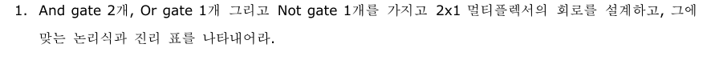
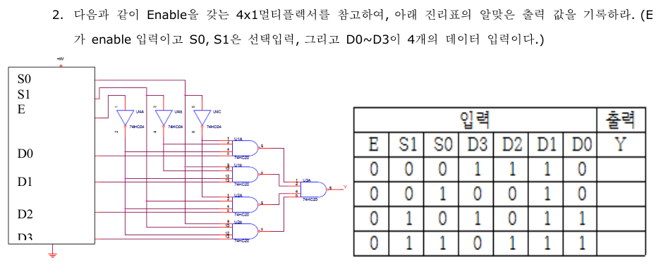
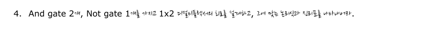
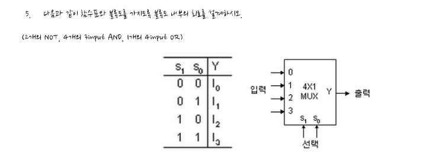
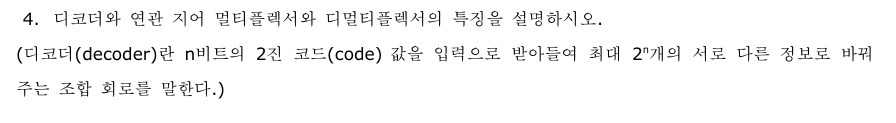
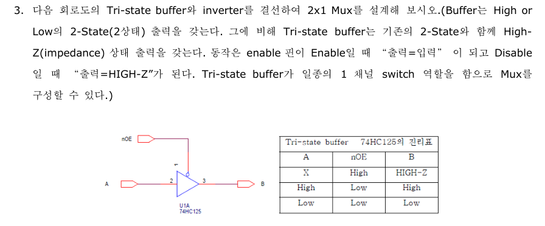
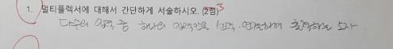
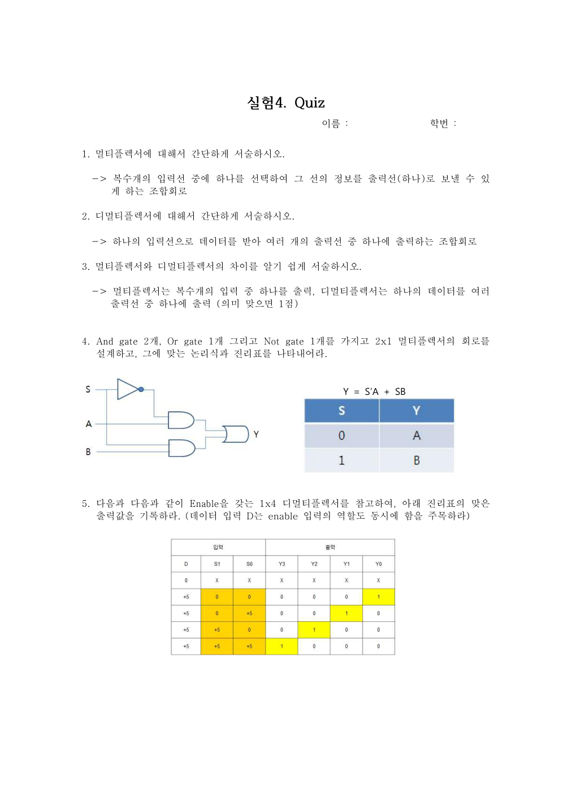
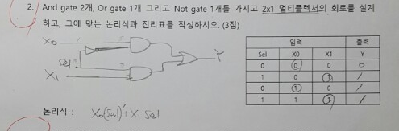
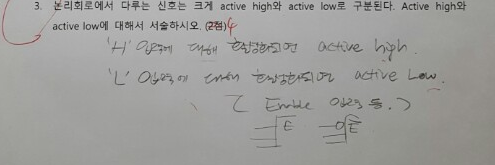

# 실험 4 · Multiplexer & Demultiplexer — 기초부터 실험과 기출까지 · 기출 풀이

      
이번 학기 교안 기준

## 문제와 풀이

### 2×1 MUX의 게이트 설계

실제 기출 · 풀이 검토됨 · current

출처: [from_the_past/정리/퀴즈/실험4/실험4 퀴즈 기출 2016-1.pdf · PDF p1](../../from_the_past/%EC%A0%95%EB%A6%AC/%ED%80%B4%EC%A6%88/%EC%8B%A4%ED%97%984/%EC%8B%A4%ED%97%984%20%ED%80%B4%EC%A6%88%20%EA%B8%B0%EC%B6%9C%202016-1.pdf#page=1) · [from_the_past/정리/퀴즈/실험4/실험4 퀴즈 기출_정답.pdf · PDF p1](../../from_the_past/%EC%A0%95%EB%A6%AC/%ED%80%B4%EC%A6%88/%EC%8B%A4%ED%97%984/%EC%8B%A4%ED%97%984%20%ED%80%B4%EC%A6%88%20%EA%B8%B0%EC%B6%9C_%EC%A0%95%EB%8B%B5.pdf#page=1) · [from_the_past/정리/퀴즈/실험4/실험4 퀴즈 예상문제_v2.pdf · PDF p1](../../from_the_past/%EC%A0%95%EB%A6%AC/%ED%80%B4%EC%A6%88/%EC%8B%A4%ED%97%984/%EC%8B%A4%ED%97%984%20%ED%80%B4%EC%A6%88%20%EC%98%88%EC%83%81%EB%AC%B8%EC%A0%9C_v2.pdf#page=1) · [from_the_past/정리/퀴즈/실험4/실험4 퀴즈 예상문제_v3.pdf · PDF p1](../../from_the_past/%EC%A0%95%EB%A6%AC/%ED%80%B4%EC%A6%88/%EC%8B%A4%ED%97%984/%EC%8B%A4%ED%97%984%20%ED%80%B4%EC%A6%88%20%EC%98%88%EC%83%81%EB%AC%B8%EC%A0%9C_v3.pdf#page=1) · [from_the_past/정리/퀴즈/실험4/실험4 퀴즈 예상문제_v4.pdf · PDF p1](../../from_the_past/%EC%A0%95%EB%A6%AC/%ED%80%B4%EC%A6%88/%EC%8B%A4%ED%97%984/%EC%8B%A4%ED%97%984%20%ED%80%B4%EC%A6%88%20%EC%98%88%EC%83%81%EB%AC%B8%EC%A0%9C_v4.pdf#page=1) · [from_the_past/정리/퀴즈/실험4/실험4 퀴즈 종합_기출문제 (5p).pdf · PDF p2](../../from_the_past/%EC%A0%95%EB%A6%AC/%ED%80%B4%EC%A6%88/%EC%8B%A4%ED%97%984/%EC%8B%A4%ED%97%984%20%ED%80%B4%EC%A6%88%20%EC%A2%85%ED%95%A9_%EA%B8%B0%EC%B6%9C%EB%AC%B8%EC%A0%9C%20%285p%29.pdf#page=2) · [from_the_past/정리/퀴즈/실험4/원본_docx/실험 4.docx](../../from_the_past/%EC%A0%95%EB%A6%AC/%ED%80%B4%EC%A6%88/%EC%8B%A4%ED%97%984/%EC%9B%90%EB%B3%B8_docx/%EC%8B%A4%ED%97%98%204.docx)

[원문·제공 답안 연결·보류 기록](%EC%9B%90%EB%AC%B8%EA%B3%BC_%EC%A0%80%EC%9E%91%EC%95%88%EB%82%B4.md#q-mux2)

And gate 2개, Or gate 1개 그리고 Not gate 1개를 가지고 2x1 멀티플렉서의 회로를 설계하고, 그에 맞는 논리식과 진리표를 나타내어라.

필요한 개념: [2×1 MUX: 경로를 고르는 완성 예제](%EC%8B%A4%ED%97%9804_%EC%8B%A4%ED%97%98%EC%84%A4%EB%AA%85.md#t-mux2)

#### 원문 증거 보기 (답안 포함 가능)

원문과_저작안내.md에 모든 재수록 위치와 답안 연결이 보존되어 있다.

#### 힌트

먼저 선택 경로와 활성 조건을 확정하고, 해당 노트의 식에 입력을 대입한다. 설계 문제는 각 게이트의 입력부터 연결한다.

#### 단계별 풀이·최종 답·검산

선택선 S를 한 NOT에 넣는다. 첫 AND에는 S′, I0를 연결하고 둘째 AND에는 S, I1을 연결한다. 두 출력을 한 OR에 연결한다. 게이트 수는 NOT 1, AND 2, OR 1로 요구와 일치한다.

$$Y=\overline{S}I_0+SI_1$$

| S | I0 | I1 | Y |
| --- | --- | --- | --- |
| 0 | 0 | 0 | 0 |
| 0 | 0 | 1 | 0 |
| 0 | 1 | 0 | 1 |
| 0 | 1 | 1 | 1 |
| 1 | 0 | 0 | 0 |
| 1 | 0 | 1 | 1 |
| 1 | 1 | 0 | 0 |
| 1 | 1 | 1 | 1 |

**검산:** S=0과 1을 따로 대입하면 Y=I0 또는 I1. 8개 입력 조합 전수검사.

**흔한 실수:** S를 두 AND에 모두 그대로 넣으면 두 경로가 동시에 열리거나 닫힌다.

### Enable 있는 4×1 MUX 표 완성

실제 기출 · 풀이 검토됨 · current

출처: [from_the_past/정리/퀴즈/실험4/실험4 퀴즈 기출 2016-1.pdf · PDF p1](../../from_the_past/%EC%A0%95%EB%A6%AC/%ED%80%B4%EC%A6%88/%EC%8B%A4%ED%97%984/%EC%8B%A4%ED%97%984%20%ED%80%B4%EC%A6%88%20%EA%B8%B0%EC%B6%9C%202016-1.pdf#page=1) · [from_the_past/정리/퀴즈/실험4/실험4 퀴즈 예상문제_v2.pdf · PDF p1](../../from_the_past/%EC%A0%95%EB%A6%AC/%ED%80%B4%EC%A6%88/%EC%8B%A4%ED%97%984/%EC%8B%A4%ED%97%984%20%ED%80%B4%EC%A6%88%20%EC%98%88%EC%83%81%EB%AC%B8%EC%A0%9C_v2.pdf#page=1) · [from_the_past/정리/퀴즈/실험4/실험4 퀴즈 예상문제_v3.pdf · PDF p1](../../from_the_past/%EC%A0%95%EB%A6%AC/%ED%80%B4%EC%A6%88/%EC%8B%A4%ED%97%984/%EC%8B%A4%ED%97%984%20%ED%80%B4%EC%A6%88%20%EC%98%88%EC%83%81%EB%AC%B8%EC%A0%9C_v3.pdf#page=1) · [from_the_past/정리/퀴즈/실험4/실험4 퀴즈 예상문제_v4.pdf · PDF p1](../../from_the_past/%EC%A0%95%EB%A6%AC/%ED%80%B4%EC%A6%88/%EC%8B%A4%ED%97%984/%EC%8B%A4%ED%97%984%20%ED%80%B4%EC%A6%88%20%EC%98%88%EC%83%81%EB%AC%B8%EC%A0%9C_v4.pdf#page=1) · [from_the_past/정리/퀴즈/실험4/실험4 퀴즈 종합_기출문제 (5p).pdf · PDF p2](../../from_the_past/%EC%A0%95%EB%A6%AC/%ED%80%B4%EC%A6%88/%EC%8B%A4%ED%97%984/%EC%8B%A4%ED%97%984%20%ED%80%B4%EC%A6%88%20%EC%A2%85%ED%95%A9_%EA%B8%B0%EC%B6%9C%EB%AC%B8%EC%A0%9C%20%285p%29.pdf#page=2) · [from_the_past/정리/퀴즈/실험4/원본_docx/실험 4.docx](../../from_the_past/%EC%A0%95%EB%A6%AC/%ED%80%B4%EC%A6%88/%EC%8B%A4%ED%97%984/%EC%9B%90%EB%B3%B8_docx/%EC%8B%A4%ED%97%98%204.docx)

[원문·제공 답안 연결·보류 기록](%EC%9B%90%EB%AC%B8%EA%B3%BC_%EC%A0%80%EC%9E%91%EC%95%88%EB%82%B4.md#q-mux4)

다음과 같이 Enable을 갖는 4x1 멀티플렉서를 참고하여, 아래 진리표의 알맞은 출력값을 기록하라. (E가 enable 입력이고 S0, S1은 선택입력, 그리고 D0~D3이 4개의 데이터 입력이다.)

| E | S1 | S0 | D3 | D2 | D1 | D0 | Y |
| --- | --- | --- | --- | --- | --- | --- | --- |
| 0 | 0 | 0 | 1 | 1 | 1 | 0 |  |
| 0 | 0 | 1 | 0 | 0 | 1 | 0 |  |
| 0 | 1 | 0 | 1 | 0 | 1 | 1 |  |
| 0 | 1 | 1 | 0 | 1 | 1 | 1 |  |

필요한 개념: [4×1 MUX와 활성 Low enable](%EC%8B%A4%ED%97%9804_%EC%8B%A4%ED%97%98%EC%84%A4%EB%AA%85.md#t-mux4)

#### 원문 증거 보기 (답안 포함 가능)

원문과_저작안내.md에 모든 재수록 위치와 답안 연결이 보존되어 있다.

#### 힌트

먼저 선택 경로와 활성 조건을 확정하고, 해당 노트의 식에 입력을 대입한다. 설계 문제는 각 게이트의 입력부터 연결한다.

#### 단계별 풀이·최종 답·검산

회로의 E는 NOT을 거쳐 들어가므로 E=0에서 활성이다. 주소 k=2S1+S0로 선택 입력을 찾는다. 출력 열 앞의 데이터 순서가 D3,D2,D1,D0임에 주의한다.

| E | S1S0 | 선택 | 선택 데이터 | Y |
| --- | --- | --- | --- | --- |
| 0 | 00 | D0 | 0 | 0 |
| 0 | 01 | D1 | 1 | 1 |
| 0 | 10 | D2 | 0 | 0 |
| 0 | 11 | D3 | 0 | 0 |

최종 답: 위에서 아래로 0, 1, 0, 0.

**검산:** 각 행에 E′와 네 주소 항을 대입해 선택 항 하나만 남음을 확인.

**흔한 실수:** 표를 왼쪽부터 D0로 읽거나 enable 0을 비활성으로 읽지 않는다.

### 보충: 1×2 DMUX의 게이트 설계

기존 예상문제 · 풀이 검토됨 · current

출처: [from_the_past/정리/퀴즈/실험4/실험4 퀴즈 예상문제_v2.pdf · PDF p1](../../from_the_past/%EC%A0%95%EB%A6%AC/%ED%80%B4%EC%A6%88/%EC%8B%A4%ED%97%984/%EC%8B%A4%ED%97%984%20%ED%80%B4%EC%A6%88%20%EC%98%88%EC%83%81%EB%AC%B8%EC%A0%9C_v2.pdf#page=1) · [from_the_past/정리/퀴즈/실험4/실험4 퀴즈 예상문제_v3.pdf · PDF p1](../../from_the_past/%EC%A0%95%EB%A6%AC/%ED%80%B4%EC%A6%88/%EC%8B%A4%ED%97%984/%EC%8B%A4%ED%97%984%20%ED%80%B4%EC%A6%88%20%EC%98%88%EC%83%81%EB%AC%B8%EC%A0%9C_v3.pdf#page=1) · [from_the_past/정리/퀴즈/실험4/실험4 퀴즈 예상문제_v4.pdf · PDF p1](../../from_the_past/%EC%A0%95%EB%A6%AC/%ED%80%B4%EC%A6%88/%EC%8B%A4%ED%97%984/%EC%8B%A4%ED%97%984%20%ED%80%B4%EC%A6%88%20%EC%98%88%EC%83%81%EB%AC%B8%EC%A0%9C_v4.pdf#page=1) · [from_the_past/정리/퀴즈/실험4/실험4 퀴즈 종합_기출문제 (5p).pdf · PDF p2](../../from_the_past/%EC%A0%95%EB%A6%AC/%ED%80%B4%EC%A6%88/%EC%8B%A4%ED%97%984/%EC%8B%A4%ED%97%984%20%ED%80%B4%EC%A6%88%20%EC%A2%85%ED%95%A9_%EA%B8%B0%EC%B6%9C%EB%AC%B8%EC%A0%9C%20%285p%29.pdf#page=2) · [from_the_past/정리/퀴즈/실험4/원본_docx/실험 4.docx](../../from_the_past/%EC%A0%95%EB%A6%AC/%ED%80%B4%EC%A6%88/%EC%8B%A4%ED%97%984/%EC%9B%90%EB%B3%B8_docx/%EC%8B%A4%ED%97%98%204.docx)

[원문·제공 답안 연결·보류 기록](%EC%9B%90%EB%AC%B8%EA%B3%BC_%EC%A0%80%EC%9E%91%EC%95%88%EB%82%B4.md#q-demux2)

And gate 2개, Not gate 1개를 가지고 1x2 디멀티플렉서의 회로를 설계하고, 그에 맞는 논리식과 진리표를 나타내어라.

필요한 개념: [DMUX: 한 값을 지정한 출력으로 분배](%EC%8B%A4%ED%97%9804_%EC%8B%A4%ED%97%98%EC%84%A4%EB%AA%85.md#t-demux)

#### 원문 증거 보기 (답안 포함 가능)

원문과_저작안내.md에 모든 재수록 위치와 답안 연결이 보존되어 있다.

#### 힌트

먼저 선택 경로와 활성 조건을 확정하고, 해당 노트의 식에 입력을 대입한다. 설계 문제는 각 게이트의 입력부터 연결한다.

#### 단계별 풀이·최종 답·검산

1×2 회로 설계는 기존의 정의·비교 문제에서 직접 요구되지 않는다. 데이터 분배를 회로로 만드는 연습으로 선별했다. S를 NOT에 넣어 S′를 만든다. 첫 AND는 D와 S′를 받아 Y0를 만들고, 둘째 AND는 D와 S를 받아 Y1을 만든다. 출력 두 개는 서로 묶지 않는다.

$$Y_0=D\overline{S},\quad Y_1=DS$$

| D | S | Y0 | Y1 |
| --- | --- | --- | --- |
| 0 | 0 | 0 | 0 |
| 0 | 1 | 0 | 0 |
| 1 | 0 | 1 | 0 |
| 1 | 1 | 0 | 1 |

**검산:** 입력 네 조합을 전수 확인했다. D=1이면 선택 출력만 1이고 D=0이면 둘 다 0이다.

**흔한 실수:** MUX와 달리 출력 둘을 OR로 합치지 않는다.

### 보충: 지정 게이트로 4×1 MUX 설계

기존 예상문제 · 풀이 검토됨 · current

출처: [from_the_past/정리/퀴즈/실험4/실험4 퀴즈 예상문제_v2.pdf · PDF p2](../../from_the_past/%EC%A0%95%EB%A6%AC/%ED%80%B4%EC%A6%88/%EC%8B%A4%ED%97%984/%EC%8B%A4%ED%97%984%20%ED%80%B4%EC%A6%88%20%EC%98%88%EC%83%81%EB%AC%B8%EC%A0%9C_v2.pdf#page=2) · [from_the_past/정리/퀴즈/실험4/실험4 퀴즈 예상문제_v3.pdf · PDF p1](../../from_the_past/%EC%A0%95%EB%A6%AC/%ED%80%B4%EC%A6%88/%EC%8B%A4%ED%97%984/%EC%8B%A4%ED%97%984%20%ED%80%B4%EC%A6%88%20%EC%98%88%EC%83%81%EB%AC%B8%EC%A0%9C_v3.pdf#page=1) · [from_the_past/정리/퀴즈/실험4/실험4 퀴즈 예상문제_v4.pdf · PDF p1](../../from_the_past/%EC%A0%95%EB%A6%AC/%ED%80%B4%EC%A6%88/%EC%8B%A4%ED%97%984/%EC%8B%A4%ED%97%984%20%ED%80%B4%EC%A6%88%20%EC%98%88%EC%83%81%EB%AC%B8%EC%A0%9C_v4.pdf#page=1) · [from_the_past/정리/퀴즈/실험4/실험4 퀴즈 종합_기출문제 (5p).pdf · PDF p3](../../from_the_past/%EC%A0%95%EB%A6%AC/%ED%80%B4%EC%A6%88/%EC%8B%A4%ED%97%984/%EC%8B%A4%ED%97%984%20%ED%80%B4%EC%A6%88%20%EC%A2%85%ED%95%A9_%EA%B8%B0%EC%B6%9C%EB%AC%B8%EC%A0%9C%20%285p%29.pdf#page=3) · [from_the_past/정리/퀴즈/실험4/원본_docx/실험 4.docx](../../from_the_past/%EC%A0%95%EB%A6%AC/%ED%80%B4%EC%A6%88/%EC%8B%A4%ED%97%984/%EC%9B%90%EB%B3%B8_docx/%EC%8B%A4%ED%97%98%204.docx)

[원문·제공 답안 연결·보류 기록](%EC%9B%90%EB%AC%B8%EA%B3%BC_%EC%A0%80%EC%9E%91%EC%95%88%EB%82%B4.md#q-design4)

다음과 같이 함수표와 블록도를 가지도록 블록도 내부의 회로를 설계하시오. (2개의 NOT, 4개의 3input AND, 1개의 4input OR)

| S1 | S0 | Y |
| --- | --- | --- |
| 0 | 0 | I0 |
| 0 | 1 | I1 |
| 1 | 0 | I2 |
| 1 | 1 | I3 |

필요한 개념: [4×1 MUX와 활성 Low enable](%EC%8B%A4%ED%97%9804_%EC%8B%A4%ED%97%98%EC%84%A4%EB%AA%85.md#t-mux4)

#### 원문 증거 보기 (답안 포함 가능)

원문과_저작안내.md에 모든 재수록 위치와 답안 연결이 보존되어 있다.

#### 힌트

먼저 선택 경로와 활성 조건을 확정하고, 해당 노트의 식에 입력을 대입한다. 설계 문제는 각 게이트의 입력부터 연결한다.

#### 단계별 풀이·최종 답·검산

기존 4×1 기출은 출력표를 묻지만 이 문항은 지정한 게이트 수로 회로를 설계하게 하므로 선별했다. NOT 두 개로 S1′와 S0′를 만든다. 네 3입력 AND에는 각 주소 조건 두 개와 데이터 하나를 넣는다. 네 AND의 출력을 한 4입력 OR로 합친다. 원문 함수표에는 enable이 없으므로 E를 추가하지 않는다.

$$F=\overline{S_1}\overline{S_0}I_0+\overline{S_1}S_0I_1+S_1\overline{S_0}I_2+S_1S_0I_3$$

| AND | 3입력 |
| --- | --- |
| 0 | S1′,S0′,I0 |
| 1 | S1′,S0,I1 |
| 2 | S1,S0′,I2 |
| 3 | S1,S0,I3 |

**검산:** 선택 네 조합과 데이터 열여섯 조합의 총 64조합에서 Y가 선택된 입력과 같았다. 각 AND의 입력은 3개이며 요구한 게이트 수와 일치한다.

**흔한 실수:** enable이 추가된 실험의 4입력 NAND 회로와 혼동하지 않는다.

### 디코더와 MUX·DMUX의 관계

실제 기출 · 풀이 검토됨 · current

출처: [from_the_past/정리/퀴즈/실험4/실험4 퀴즈 기출 2016-1.pdf · PDF p1](../../from_the_past/%EC%A0%95%EB%A6%AC/%ED%80%B4%EC%A6%88/%EC%8B%A4%ED%97%984/%EC%8B%A4%ED%97%984%20%ED%80%B4%EC%A6%88%20%EA%B8%B0%EC%B6%9C%202016-1.pdf#page=1) · [from_the_past/정리/퀴즈/실험4/실험4 퀴즈 예상문제_v2.pdf · PDF p3](../../from_the_past/%EC%A0%95%EB%A6%AC/%ED%80%B4%EC%A6%88/%EC%8B%A4%ED%97%984/%EC%8B%A4%ED%97%984%20%ED%80%B4%EC%A6%88%20%EC%98%88%EC%83%81%EB%AC%B8%EC%A0%9C_v2.pdf#page=3) · [from_the_past/정리/퀴즈/실험4/실험4 퀴즈 예상문제_v3.pdf · PDF p2](../../from_the_past/%EC%A0%95%EB%A6%AC/%ED%80%B4%EC%A6%88/%EC%8B%A4%ED%97%984/%EC%8B%A4%ED%97%984%20%ED%80%B4%EC%A6%88%20%EC%98%88%EC%83%81%EB%AC%B8%EC%A0%9C_v3.pdf#page=2) · [from_the_past/정리/퀴즈/실험4/실험4 퀴즈 예상문제_v4.pdf · PDF p2](../../from_the_past/%EC%A0%95%EB%A6%AC/%ED%80%B4%EC%A6%88/%EC%8B%A4%ED%97%984/%EC%8B%A4%ED%97%984%20%ED%80%B4%EC%A6%88%20%EC%98%88%EC%83%81%EB%AC%B8%EC%A0%9C_v4.pdf#page=2) · [from_the_past/정리/퀴즈/실험4/실험4 퀴즈 종합_기출문제 (5p).pdf · PDF p4](../../from_the_past/%EC%A0%95%EB%A6%AC/%ED%80%B4%EC%A6%88/%EC%8B%A4%ED%97%984/%EC%8B%A4%ED%97%984%20%ED%80%B4%EC%A6%88%20%EC%A2%85%ED%95%A9_%EA%B8%B0%EC%B6%9C%EB%AC%B8%EC%A0%9C%20%285p%29.pdf#page=4) · [from_the_past/정리/퀴즈/실험4/원본_docx/실험 4.docx](../../from_the_past/%EC%A0%95%EB%A6%AC/%ED%80%B4%EC%A6%88/%EC%8B%A4%ED%97%984/%EC%9B%90%EB%B3%B8_docx/%EC%8B%A4%ED%97%98%204.docx)

[원문·제공 답안 연결·보류 기록](%EC%9B%90%EB%AC%B8%EA%B3%BC_%EC%A0%80%EC%9E%91%EC%95%88%EB%82%B4.md#q-decoder)

디코더와 연관지어 멀티플렉서와 디멀티플렉서의 특징을 설명하시오. (디코더(decoder)란 n비트의 2진 코드(code) 값을 입력으로 받아들여 최대 2ⁿ개의 서로 다른 정보로 바꿔 주는 조합 회로를 말한다.)

필요한 개념: [디코더와 MUX·DMUX의 연결](%EC%8B%A4%ED%97%9804_%EC%8B%A4%ED%97%98%EC%84%A4%EB%AA%85.md#t-decoder)

#### 원문 증거 보기 (답안 포함 가능)

원문과_저작안내.md에 모든 재수록 위치와 답안 연결이 보존되어 있다.

#### 힌트

먼저 선택 경로와 활성 조건을 확정하고, 해당 노트의 식에 입력을 대입한다. 설계 문제는 각 게이트의 입력부터 연결한다.

#### 단계별 풀이·최종 답·검산

활성 High 디코더의 출력 Ck는 주소가 k일 때 1이다. MUX는 각 Ck와 Ik를 AND한 뒤 OR하므로 Y=ΣCkIk. DMUX는 각 출력에 Yk=DCk를 둔다. D=1로 고정한 DMUX는 디코더와 같은 one-hot 출력을 낸다. 별도 데이터 입력 유무와 출력 결합 방식이 차이점이다.

n비트 코드는 최대 2ⁿ개 출력 선택을 구분한다. MUX의 n개 선택선과 2ⁿ개 데이터 입력을 혼동하지 않는다.

**검산:** 주소 10에서 C2=1, 나머지 0을 넣으면 MUX Y=I2, DMUX Y2=D.

**흔한 실수:** 입력·출력 선 수가 2배라는 잘못된 일반화를 피한다.

### 활성 Low tri-state 버퍼로 MUX 설계

실제 기출 · 답안 충돌 · supplement

출처: [from_the_past/정리/퀴즈/실험4/실험4 퀴즈 기출 2016-1.pdf · PDF p1](../../from_the_past/%EC%A0%95%EB%A6%AC/%ED%80%B4%EC%A6%88/%EC%8B%A4%ED%97%984/%EC%8B%A4%ED%97%984%20%ED%80%B4%EC%A6%88%20%EA%B8%B0%EC%B6%9C%202016-1.pdf#page=1) · [from_the_past/정리/퀴즈/실험4/실험4 퀴즈 예상문제_v2.pdf · PDF p3](../../from_the_past/%EC%A0%95%EB%A6%AC/%ED%80%B4%EC%A6%88/%EC%8B%A4%ED%97%984/%EC%8B%A4%ED%97%984%20%ED%80%B4%EC%A6%88%20%EC%98%88%EC%83%81%EB%AC%B8%EC%A0%9C_v2.pdf#page=3) · [from_the_past/정리/퀴즈/실험4/실험4 퀴즈 예상문제_v3.pdf · PDF p2](../../from_the_past/%EC%A0%95%EB%A6%AC/%ED%80%B4%EC%A6%88/%EC%8B%A4%ED%97%984/%EC%8B%A4%ED%97%984%20%ED%80%B4%EC%A6%88%20%EC%98%88%EC%83%81%EB%AC%B8%EC%A0%9C_v3.pdf#page=2) · [from_the_past/정리/퀴즈/실험4/실험4 퀴즈 예상문제_v4.pdf · PDF p2](../../from_the_past/%EC%A0%95%EB%A6%AC/%ED%80%B4%EC%A6%88/%EC%8B%A4%ED%97%984/%EC%8B%A4%ED%97%984%20%ED%80%B4%EC%A6%88%20%EC%98%88%EC%83%81%EB%AC%B8%EC%A0%9C_v4.pdf#page=2) · [from_the_past/정리/퀴즈/실험4/실험4 퀴즈 종합_기출문제 (5p).pdf · PDF p4](../../from_the_past/%EC%A0%95%EB%A6%AC/%ED%80%B4%EC%A6%88/%EC%8B%A4%ED%97%984/%EC%8B%A4%ED%97%984%20%ED%80%B4%EC%A6%88%20%EC%A2%85%ED%95%A9_%EA%B8%B0%EC%B6%9C%EB%AC%B8%EC%A0%9C%20%285p%29.pdf#page=4) · [from_the_past/정리/퀴즈/실험4/원본_docx/실험 4.docx](../../from_the_past/%EC%A0%95%EB%A6%AC/%ED%80%B4%EC%A6%88/%EC%8B%A4%ED%97%984/%EC%9B%90%EB%B3%B8_docx/%EC%8B%A4%ED%97%98%204.docx)

[원문·제공 답안 연결·보류 기록](%EC%9B%90%EB%AC%B8%EA%B3%BC_%EC%A0%80%EC%9E%91%EC%95%88%EB%82%B4.md#q-tri)

다음 회로도의 Tri-state buffer와 inverter를 결선하여 2x1 Mux를 설계해 보시오. (Buffer는 High or Low의 2-State(2상태) 출력을 갖는다. 그에 비해 Tri-state buffer는 기존의 2-State와 함께 High-Z(impedance) 상태 출력을 갖는다. 동작은 enable 핀이 Enable일 때 “출력=입력”이 되고 Disable일 때 “출력=HIGH-Z”가 된다. Tri-state buffer가 일종의 1채널 switch 역할을 함으로 Mux를 구성할 수 있다.)

| A | nOE | B |
| --- | --- | --- |
| X | High | HIGH-Z |
| High | Low | High |
| Low | Low | Low |

필요한 개념: [Tri-state MUX와 출력 충돌](%EC%8B%A4%ED%97%9804_%EC%8B%A4%ED%97%98%EC%84%A4%EB%AA%85.md#t-tristate)

#### 원문 증거 보기 (답안 포함 가능)

원문과_저작안내.md에 모든 재수록 위치와 답안 연결이 보존되어 있다.

#### 힌트

먼저 선택 경로와 활성 조건을 확정하고, 해당 노트의 식에 입력을 대입한다. 설계 문제는 각 게이트의 입력부터 연결한다.

#### 단계별 풀이·최종 답·검산

원문 nOE 표는 0에서 입력을 전달하고 1에서 Z를 출력한다. I0 버퍼의 nOE0=S, I1 버퍼의 nOE1=S′로 만든다. NOT 한 개로 S′를 만들고 각 A에는 I0,I1을 연결하며 B 출력은 공통 Y다.

| S | nOE0 | nOE1 | 버퍼0 | 버퍼1 | Y |
| --- | --- | --- | --- | --- | --- |
| 0 | 0 | 1 | I0 | Z | I0 |
| 1 | 1 | 0 | Z | I1 | I1 |

원문 제공 답안의 active high 캡션은 이 조건과 다르다. 그 그림의 반전 위치를 그대로 옮기지 않는다. 이 풀이는 원문 활성 Low 표에 대한 설계이며 제공 답안의 조건 충돌은 남긴다.

**검산:** 안정된 S에서 구동 버퍼가 정확히 하나임을 확인. I0,I1 네 조합에서도 선택값과 동일.

**흔한 실수:** Z를 0으로 생각하거나 두 버퍼를 동시에 활성화하지 않는다.

#### 답안 대조 기록

제공 답안: None / 도출 답안: nOE0=S, nOE1=S′, 출력 공통 연결. 충돌·불확실성을 확인하세요.

### MUX를 간단히 서술

실제 기출 · 풀이 검토됨 · current

출처: [from_the_past/정리/퀴즈/실험4/실험4 퀴즈 기출_정답.pdf · PDF p1](../../from_the_past/%EC%A0%95%EB%A6%AC/%ED%80%B4%EC%A6%88/%EC%8B%A4%ED%97%984/%EC%8B%A4%ED%97%984%20%ED%80%B4%EC%A6%88%20%EA%B8%B0%EC%B6%9C_%EC%A0%95%EB%8B%B5.pdf#page=1) · [from_the_past/정리/퀴즈/실험4/실험4 퀴즈 기출_채점본.jpg](../../from_the_past/%EC%A0%95%EB%A6%AC/%ED%80%B4%EC%A6%88/%EC%8B%A4%ED%97%984/%EC%8B%A4%ED%97%984%20%ED%80%B4%EC%A6%88%20%EA%B8%B0%EC%B6%9C_%EC%B1%84%EC%A0%90%EB%B3%B8.jpg)

[원문·제공 답안 연결·보류 기록](%EC%9B%90%EB%AC%B8%EA%B3%BC_%EC%A0%80%EC%9E%91%EC%95%88%EB%82%B4.md#q-muxdef)

멀티플렉서에 대해서 간단하게 서술하시오. (인쇄 배점 2점, 수기 배점 3)

필요한 개념: [2×1 MUX: 경로를 고르는 완성 예제](%EC%8B%A4%ED%97%9804_%EC%8B%A4%ED%97%98%EC%84%A4%EB%AA%85.md#t-mux2)

#### 원문 증거 보기 (답안 포함 가능)

원문과_저작안내.md에 모든 재수록 위치와 답안 연결이 보존되어 있다.

#### 힌트

먼저 선택 경로와 활성 조건을 확정하고, 해당 노트의 식에 입력을 대입한다. 설계 문제는 각 게이트의 입력부터 연결한다.

#### 단계별 풀이·최종 답·검산

MUX는 선택 신호가 지정한 여러 데이터 입력 중 하나를 골라 하나의 데이터 출력으로 전달하는 조합회로다. 4×1이라면 데이터 입력 4개, 선택선 2개, 데이터 출력 1개다. S1S0=01이면 출력은 I1이다.

**검산:** I1=0일 때 출력도 0. 선택은 출력 1을 강제하는 기능이 아니다.

**흔한 실수:** 선택선까지 데이터 입력으로 세거나 입력 데이터를 모두 합산한다고 쓰지 않는다.

### DMUX를 간단히 서술 — 기출 여부 미확인

출처 미확인 · 풀이 검토됨 · current

출처: [from_the_past/정리/퀴즈/실험4/실험4 퀴즈 기출_정답.pdf · PDF p1](../../from_the_past/%EC%A0%95%EB%A6%AC/%ED%80%B4%EC%A6%88/%EC%8B%A4%ED%97%984/%EC%8B%A4%ED%97%984%20%ED%80%B4%EC%A6%88%20%EA%B8%B0%EC%B6%9C_%EC%A0%95%EB%8B%B5.pdf#page=1)

[원문·제공 답안 연결·보류 기록](%EC%9B%90%EB%AC%B8%EA%B3%BC_%EC%A0%80%EC%9E%91%EC%95%88%EB%82%B4.md#q-demuxdef)

디멀티플렉서에 대해서 간단하게 서술하시오.

필요한 개념: [DMUX: 한 값을 지정한 출력으로 분배](%EC%8B%A4%ED%97%9804_%EC%8B%A4%ED%97%98%EC%84%A4%EB%AA%85.md#t-demux)

#### 원문 증거 보기 (답안 포함 가능)

원문과_저작안내.md에 모든 재수록 위치와 답안 연결이 보존되어 있다.

#### 힌트

먼저 선택 경로와 활성 조건을 확정하고, 해당 노트의 식에 입력을 대입한다. 설계 문제는 각 게이트의 입력부터 연결한다.

#### 단계별 풀이·최종 답·검산

DMUX는 하나의 데이터 입력을 선택 신호가 지정한 여러 출력 중 하나에 전달하는 조합회로다. 활성 High 이상 모델에서 선택되지 않은 출력은 0이다. D=1, 주소 10이면 Y2=1, 나머지는 0이다.

**검산:** D=0에서는 선택 출력도 0임을 식 Yk=DCk로 확인.

**흔한 실수:** 모든 출력에 같은 데이터를 동시에 복제한다고 쓰지 않는다.

### MUX와 DMUX의 차이 — 기출 여부 미확인

출처 미확인 · 풀이 검토됨 · current

출처: [from_the_past/정리/퀴즈/실험4/실험4 퀴즈 기출_정답.pdf · PDF p1](../../from_the_past/%EC%A0%95%EB%A6%AC/%ED%80%B4%EC%A6%88/%EC%8B%A4%ED%97%984/%EC%8B%A4%ED%97%984%20%ED%80%B4%EC%A6%88%20%EA%B8%B0%EC%B6%9C_%EC%A0%95%EB%8B%B5.pdf#page=1)

[원문·제공 답안 연결·보류 기록](%EC%9B%90%EB%AC%B8%EA%B3%BC_%EC%A0%80%EC%9E%91%EC%95%88%EB%82%B4.md#q-difference)

멀티플렉서와 디멀티플렉서의 차이를 알기 쉽게 서술하시오.

필요한 개념: [2×1 MUX: 경로를 고르는 완성 예제](%EC%8B%A4%ED%97%9804_%EC%8B%A4%ED%97%98%EC%84%A4%EB%AA%85.md#t-mux2) · [DMUX: 한 값을 지정한 출력으로 분배](%EC%8B%A4%ED%97%9804_%EC%8B%A4%ED%97%98%EC%84%A4%EB%AA%85.md#t-demux)

#### 원문 증거 보기 (답안 포함 가능)

원문과_저작안내.md에 모든 재수록 위치와 답안 연결이 보존되어 있다.

#### 힌트

먼저 선택 경로와 활성 조건을 확정하고, 해당 노트의 식에 입력을 대입한다. 설계 문제는 각 게이트의 입력부터 연결한다.

#### 단계별 풀이·최종 답·검산

MUX는 여러 데이터 입력 중 하나를 골라 한 출력에 모은다. DMUX는 한 데이터 입력을 여러 출력 중 한 곳으로 보낸다. 둘 다 선택선으로 경로를 고른다. 4×1 MUX와 1×4 DMUX에는 각각 선택선 2개가 필요하다. 데이터 경로의 N→1과 1→N을 비교하는 것이며 전체 핀 수 비교가 아니다.

**검산:** 주소 10에서 MUX는 I2→Y, DMUX는 D→Y2.

**흔한 실수:** 단순 역함수라고 쓰지 않는다. MUX에서 선택되지 않은 입력의 값은 출력에 남지 않는다.

### 1×4 DMUX 출력표 — 기출 여부 미확인

출처 미확인 · 답안 충돌 · current

출처: [from_the_past/정리/퀴즈/실험4/실험4 퀴즈 기출_정답.pdf · PDF p1](../../from_the_past/%EC%A0%95%EB%A6%AC/%ED%80%B4%EC%A6%88/%EC%8B%A4%ED%97%984/%EC%8B%A4%ED%97%984%20%ED%80%B4%EC%A6%88%20%EA%B8%B0%EC%B6%9C_%EC%A0%95%EB%8B%B5.pdf#page=1)

[원문·제공 답안 연결·보류 기록](%EC%9B%90%EB%AC%B8%EA%B3%BC_%EC%A0%80%EC%9E%91%EC%95%88%EB%82%B4.md#q-demux4)

다음과 다음과 같이 Enable을 갖는 1x4 디멀티플렉서를 참고하여, 아래 진리표의 맞은 출력값을 기록하라. (데이터 입력 D는 enable 입력의 역할도 동시에 함을 주목하라)

아래는 원자료의 입력 조건을 옮기고 학습용 출력란만 비운 전사 표다. 원자료는 이미 답이 채워진 표이다.

| D | S1 | S0 | Y3 | Y2 | Y1 | Y0 |
| --- | --- | --- | --- | --- | --- | --- |
| 0 | X | X |  |  |  |  |
| +5 | 0 | 0 |  |  |  |  |
| +5 | 0 | +5 |  |  |  |  |
| +5 | +5 | 0 |  |  |  |  |
| +5 | +5 | +5 |  |  |  |  |

필요한 개념: [DMUX: 한 값을 지정한 출력으로 분배](%EC%8B%A4%ED%97%9804_%EC%8B%A4%ED%97%98%EC%84%A4%EB%AA%85.md#t-demux)

#### 원문 증거 보기 (답안 포함 가능)

원문과_저작안내.md에 모든 재수록 위치와 답안 연결이 보존되어 있다.

#### 힌트

먼저 선택 경로와 활성 조건을 확정하고, 해당 노트의 식에 입력을 대입한다. 설계 문제는 각 게이트의 입력부터 연결한다.

#### 단계별 풀이·최종 답·검산

원문에서 +5는 High(1), 0은 Low(0)로 읽는다. 이 자료는 출력이 이미 채워진 표를 제공하므로, 문제 영역에는 같은 입력 조건을 옮기고 출력란을 비웠음을 명시했다. D=0에서 원문 출력 X를 계산값과 구분한다.

| D | S1 | S0 | Y3 | Y2 | Y1 | Y0 |
| --- | --- | --- | --- | --- | --- | --- |
| 0 | X | X | 0 | 0 | 0 | 0 |
| 1 | 0 | 0 | 0 | 0 | 0 | 1 |
| 1 | 0 | 1 | 0 | 0 | 1 | 0 |
| 1 | 1 | 0 | 0 | 1 | 0 | 0 |
| 1 | 1 | 1 | 1 | 0 | 0 | 0 |

Y0=DS1′S0′, Y1=DS1′S0, Y2=DS1S0′, Y3=DS1S0이다. AND형 이상 DMUX에서 D=0이면 모든 출력은 0이다. 원문 X 표기는 원문 증거에 보존하고, 0은 해당 이상 모델의 계산 결과로 설명한다. 이 원문 페이지에는 회로도가 없으므로 실제 부품의 비활성 출력이나 측정값을 확정하지 않는다.

**검산:** D=1인 네 행에서는 1이 정확히 하나 있고 D=0에서는 모두 0이다. 표의 출력 열은 Y3부터 Y0까지 거꾸로 배열되어 있다.

**흔한 실수:** 원문 X를 Z로 바꾸어 읽지 않는다. +5는 논리값 5가 아니다.

#### 답안 대조 기록

제공 답안: None / 도출 답안: Y3Y2Y1Y0: D=0→0000; D=1→0001,0010,0100,1000. 충돌·불확실성을 확인하세요.

### 채점본 2×1 MUX의 지정 네 행

실제 기출 · 풀이 검토됨 · current

출처: [from_the_past/정리/퀴즈/실험4/실험4 퀴즈 기출_채점본.jpg](../../from_the_past/%EC%A0%95%EB%A6%AC/%ED%80%B4%EC%A6%88/%EC%8B%A4%ED%97%984/%EC%8B%A4%ED%97%984%20%ED%80%B4%EC%A6%88%20%EA%B8%B0%EC%B6%9C_%EC%B1%84%EC%A0%90%EB%B3%B8.jpg)

[원문·제공 답안 연결·보류 기록](%EC%9B%90%EB%AC%B8%EA%B3%BC_%EC%A0%80%EC%9E%91%EC%95%88%EB%82%B4.md#q-mux2-graded)

And gate 2개, Or gate 1개 그리고 Not gate 1개를 가지고 2x1 멀티플렉서의 회로를 설계하고, 그에 맞는 논리식과 진리표를 작성하시오. (3점)

| Sel | X0 | X1 | Y |
| --- | --- | --- | --- |
| 0 | 0 | 0 |  |
| 1 | 0 | 1 |  |
| 0 | 1 | 0 |  |
| 1 | 1 | 1 |  |

필요한 개념: [2×1 MUX: 경로를 고르는 완성 예제](%EC%8B%A4%ED%97%9804_%EC%8B%A4%ED%97%98%EC%84%A4%EB%AA%85.md#t-mux2)

#### 원문 증거 보기 (답안 포함 가능)

원문과_저작안내.md에 모든 재수록 위치와 답안 연결이 보존되어 있다.

#### 힌트

먼저 선택 경로와 활성 조건을 확정하고, 해당 노트의 식에 입력을 대입한다. 설계 문제는 각 게이트의 입력부터 연결한다.

#### 단계별 풀이·최종 답·검산

일반 2×1 MUX에서 입력 이름만 X0와 X1, 선택선 이름은 Sel로 바꾼다. NOT으로 Sel′를 만들고, AND 두 개로 X0Sel′와 X1Sel을 만든 뒤 OR로 합쳐 Y를 얻는다.

$$Y=X_0\overline{Sel}+X_1Sel$$

| Sel | X0 | X1 | 선택 | Y |
| --- | --- | --- | --- | --- |
| 0 | 0 | 0 | X0 | 0 |
| 1 | 0 | 1 | X1 | 1 |
| 0 | 1 | 0 | X0 | 1 |
| 1 | 1 | 1 | X1 | 1 |

최종 출력은 위에서부터 0, 1, 1, 1이다. 채점본은 지정된 이 네 행을 묻는다. 일반적인 여덟 조합 진리표는 노트에서 확인할 수 있다.

**검산:** 원문의 인쇄된 입력 조건과 손으로 쓴 출력을 분리하여 네 행을 다시 계산했다.

**흔한 실수:** 일반 설계 문항과 지정 입력 조건이 달라 별도의 문항으로 보존한다.

### Active High와 Active Low의 정의

실제 기출 · 풀이 검토됨 · current

출처: [from_the_past/정리/퀴즈/실험4/실험4 퀴즈 기출_채점본.jpg](../../from_the_past/%EC%A0%95%EB%A6%AC/%ED%80%B4%EC%A6%88/%EC%8B%A4%ED%97%984/%EC%8B%A4%ED%97%984%20%ED%80%B4%EC%A6%88%20%EA%B8%B0%EC%B6%9C_%EC%B1%84%EC%A0%90%EB%B3%B8.jpg)

[원문·제공 답안 연결·보류 기록](%EC%9B%90%EB%AC%B8%EA%B3%BC_%EC%A0%80%EC%9E%91%EC%95%88%EB%82%B4.md#q-active-general)

논리회로에서 다루는 신호는 크게 active high와 active low로 구분된다. Active high와 active low에 대해서 서술하시오. (인쇄 배점 2점, 수기 배점 4)

필요한 개념: [4×1 MUX와 활성 Low enable](%EC%8B%A4%ED%97%9804_%EC%8B%A4%ED%97%98%EC%84%A4%EB%AA%85.md#t-mux4) · [Tri-state MUX와 출력 충돌](%EC%8B%A4%ED%97%9804_%EC%8B%A4%ED%97%98%EC%84%A4%EB%AA%85.md#t-tristate)

#### 원문 증거 보기 (답안 포함 가능)

원문과_저작안내.md에 모든 재수록 위치와 답안 연결이 보존되어 있다.

#### 힌트

먼저 선택 경로와 활성 조건을 확정하고, 해당 노트의 식에 입력을 대입한다. 설계 문제는 각 게이트의 입력부터 연결한다.

#### 단계별 풀이·최종 답·검산

Active High는 신호가 1일 때 해당 기능이 유효하고, Active Low는 0일 때 유효하다는 뜻이다. 예를 들어 enable이 Active Low이면 0에서 데이터를 통과시키고 1에서 기능을 막는다. 출력이 0인지 1인지는 데이터와 회로의 기능에 따라 별도로 정해진다. 입력의 원형 표시, 윗줄, nOE는 활성 Low의 단서이며 기능표로 확인한다.

**검산:** E=0이어도 선택 데이터가 1이면 MUX 출력은 1이다. Low 활성이라는 이유로 출력을 0이라고 할 수 없다.

**흔한 실수:** 신호의 전압이 높다는 것과 기능이 활성이라는 것을 같은 뜻으로 쓰지 않는다.

## 중복·보류·다른 실험 문항

- q-active · held: 실제 기출의 활성 신호 정의와 노트의 E 예제로 MUX·DMUX 적용을 다룬다. 새로운 개념 공백을 보충하지 않아 미선별했다.

- q-switch · held: MUX·DMUX의 경로 설명은 실제 정의 기출과 비교 문제로 다룬다. 스위치 비유만으로 새로운 개념 공백을 보충하지 않아 미선별했다.

- q-empty-six · held: 원문에 번호 6만 있고 문항 조건과 본문이 없다. 추측하여 채우지 않고 판독 보류한다.
