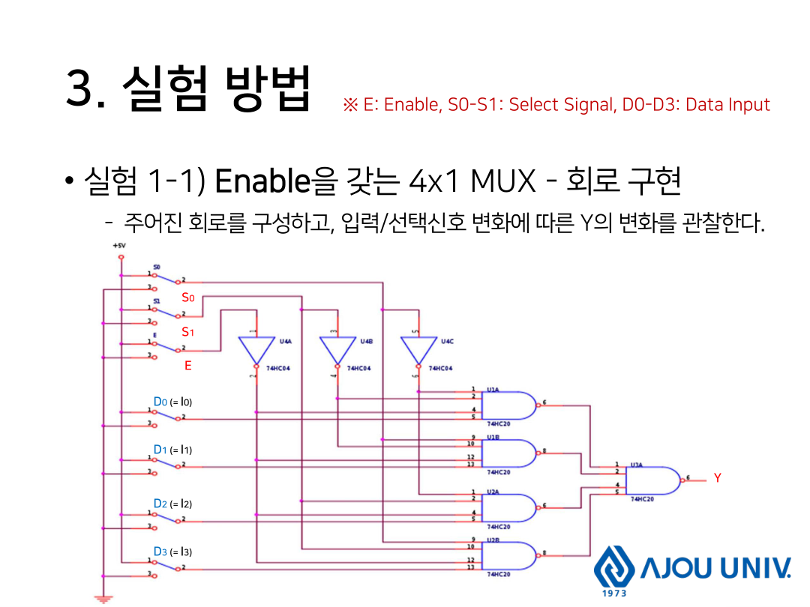
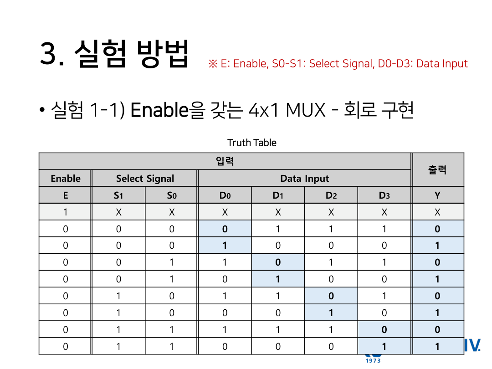
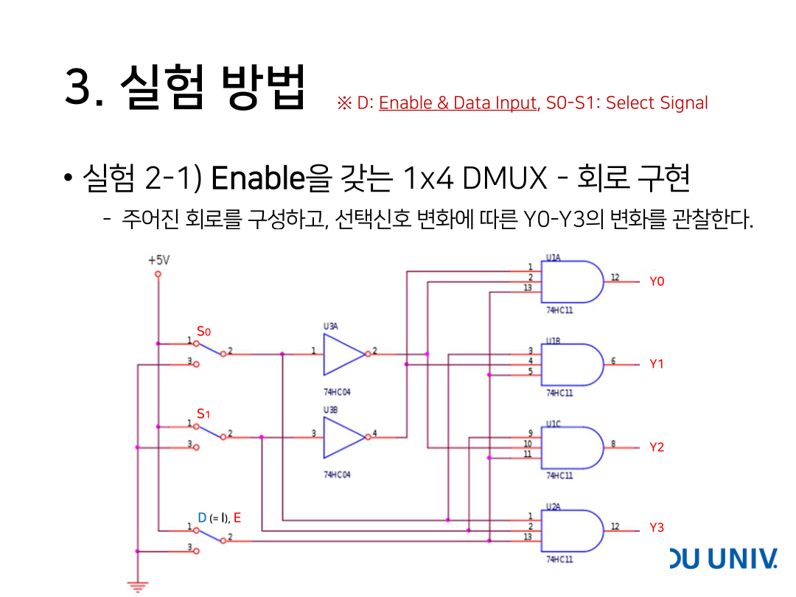
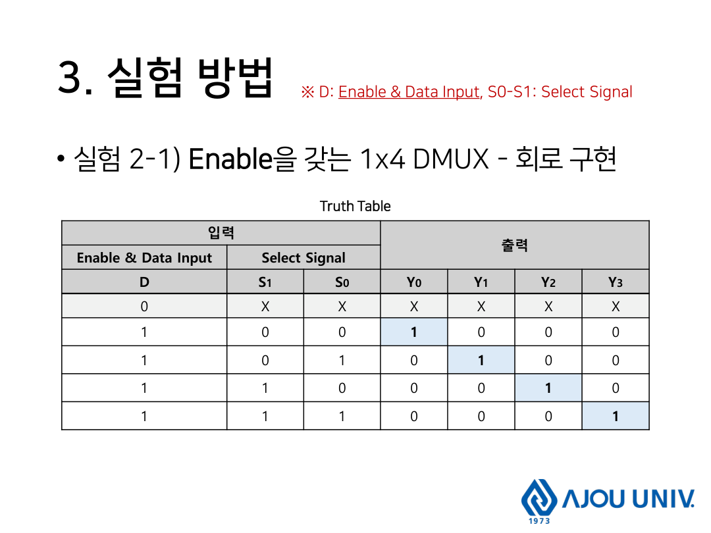

# 실험 4 · Multiplexer & Demultiplexer — 기초부터 실험과 기출까지 · 실험 설명

      
이번 학기 교안 기준

## 실험 이해

### 먼저 보는 전체 그림과 학습 순서

오늘 이해할 것
MUX는 여러 입력 중 하나를 골라 한 출력으로 보낸다. DMUX는 한 입력을 선택한 출력으로 보낸다. 선택선은 데이터를 직접 보내는 선이 아니라 경로를 고르는 주소다.

이 팩의 기준
2026-2에 배포된 교안 파일을 사용하되 표지에는 25-1이라고 적혀 있음을 남긴다. 이번 수행 범위는 공지에 따른 1-1과 2-1이다. 1-2·2-2는 보충이며, 수행 제외를 시험 제외로 단정하지 않는다. 기출 파일명 2016-1의 시험지 헤더는 2017-1이다.

순서: 신호와 게이트 → 2×1 MUX 완성 예제 → 4×1 MUX와 enable → DMUX → 디코더 → tri-state → 실험 조작 → 기출. 문제의 개념 링크로 필요한 설명에 돌아올 수 있다.

자료의 불확실성
회로에서 계산한 이상 출력과 실제 측정은 다르다. 여기에는 측정값을 만들어 넣지 않았다. 원문의 X 출력 표기와 활성 High 답안 그림은 별도 대조하며, 빈 예상문제 6번은 풀지 않는다.

선택선은 경로, 데이터선은 값. 이번 실험은 1-1·2-1. 원문과 계산·측정을 구분한다.

출처: [강의노트/실험4. Multiplexer & Demultiplexer.pdf · PDF p1](../../%EA%B0%95%EC%9D%98%EB%85%B8%ED%8A%B8/%EC%8B%A4%ED%97%984.%20Multiplexer%20&%20Demultiplexer.pdf#page=1) · [강의노트/실험4. Multiplexer & Demultiplexer.pdf · PDF p2](../../%EA%B0%95%EC%9D%98%EB%85%B8%ED%8A%B8/%EC%8B%A4%ED%97%984.%20Multiplexer%20&%20Demultiplexer.pdf#page=2) · [강의노트/실험4. Multiplexer & Demultiplexer.pdf · PDF p7](../../%EA%B0%95%EC%9D%98%EB%85%B8%ED%8A%B8/%EC%8B%A4%ED%97%984.%20Multiplexer%20&%20Demultiplexer.pdf#page=7) · [강의노트/공지사항/2026-09-14_[필독]_논리회로실험_보고서_관련_공지.md](../../%EA%B0%95%EC%9D%98%EB%85%B8%ED%8A%B8/%EA%B3%B5%EC%A7%80%EC%82%AC%ED%95%AD/2026-09-14_%5B%ED%95%84%EB%8F%85%5D_%EB%85%BC%EB%A6%AC%ED%9A%8C%EB%A1%9C%EC%8B%A4%ED%97%98_%EB%B3%B4%EA%B3%A0%EC%84%9C_%EA%B4%80%EB%A0%A8_%EA%B3%B5%EC%A7%80.md)

### 0·1, 게이트와 진리표를 다시 읽기

전압을 두 부류로 읽는다
디지털 회로는 입력 전압을 Low(0) 또는 High(1)로 분류한다. +5V 전원 실험에서 GND와 +5V를 입력으로 쓰지만 모든 중간 전압을 유효한 0·1로 보장하는 것은 아니다. 출력 1은 신호의 논리값이며 LED가 켜지는지는 결선 방향에도 달렸다.

기호부터 정의
A·B는 AND: 둘 다 1일 때만 1. A+B는 OR: 하나라도 1이면 1. A′ 또는 윗줄은 NOT: 0↔1을 뒤집는다. 여기의 +는 숫자 덧셈이 아니므로 1+1=1이다. NAND는 AND의 결과를 반전한다.

| A | B | A·B | A+B | (A·B)′ |
| --- | --- | --- | --- | --- |
| 0 | 0 | 0 | 0 | 1 |
| 0 | 1 | 0 | 1 | 1 |
| 1 | 0 | 0 | 1 | 1 |
| 1 | 1 | 1 | 1 | 0 |

진리표 한 행은 입력을 동시에 정했을 때 출력이 무엇인지 적는다. 입력 3개면 2³=8가지 조합이다. S1S0는 두 비트의 주소: 00=0, 01=1, 10=2, 11=3. S1이 큰 자리다.

X와 Z는 다르다
입력 X는 don’t-care: 그 입력을 0으로 바꾸든 1로 바꾸든 그 행의 결론이 같다는 뜻이다. 알 수 없는 값이라는 뜻으로 쓰는 X와 구분해야 한다. Z는 high impedance로 출력이 선을 적극 구동하지 않는 상태이며 논리 0이 아니다. 출력칸 X만 보고 회로가 Z라고 결론 내리지 않는다.

AND는 둘 다, OR는 하나라도, NOT은 반전. 두 선택선은 네 경로. X와 Z를 구분한다.

출처: [강의노트/실험4. Multiplexer & Demultiplexer.pdf · PDF p4](../../%EA%B0%95%EC%9D%98%EB%85%B8%ED%8A%B8/%EC%8B%A4%ED%97%984.%20Multiplexer%20&%20Demultiplexer.pdf#page=4) · [강의노트/실험4. Multiplexer & Demultiplexer.pdf · PDF p6](../../%EA%B0%95%EC%9D%98%EB%85%B8%ED%8A%B8/%EC%8B%A4%ED%97%984.%20Multiplexer%20&%20Demultiplexer.pdf#page=6)

### 2×1 MUX: 경로를 고르는 완성 예제

두 문 중 하나만 연다
데이터 I0와 I1 중 S=0이면 I0 쪽 문, S=1이면 I1 쪽 문을 연다. 선택된 입력이 0이면 출력도 0이다. 선택되었다는 이유로 무조건 1이 되지 않는다.

식과 회로를 함께 만든다
$$Y=\overline{S}I_0+SI_1$$

S를 NOT에 넣어 S′를 만든다. 첫 AND에는 S′와 I0, 둘째 AND에는 S와 I1을 연결한다. 두 AND 출력을 OR에 넣으면 Y다. S=0이면 S′=1이므로 첫 항은 I0, 둘째 항은 0이다. S=1이면 반대가 된다.

| S | I0 | I1 | Y |
| --- | --- | --- | --- |
| 0 | 0 | 0 | 0 |
| 0 | 0 | 1 | 0 |
| 0 | 1 | 0 | 1 |
| 0 | 1 | 1 | 1 |
| 1 | 0 | 0 | 0 |
| 1 | 0 | 1 | 1 |
| 1 | 1 | 0 | 0 |
| 1 | 1 | 1 | 1 |

예: S=1, I0=1, I1=0. 첫 항 0·1=0, 둘째 항 1·0=0, 합은 0. 선택되지 않은 I0=1은 영향을 주지 않는다.

직접 바꿔 보기
정적 등가: S=0에서는 Y=I0, S=1에서는 Y=I1. 모든 조합의 결과는 위 8행 진리표와 같다.

한 단계 연습
S=0, I0=1, I1=0에서 두 AND 출력을 먼저 써 보자.

#### 힌트

S′=1부터 대입한다.

#### 연습 답

첫 AND=1, 둘째 AND=0, OR=1. Y=I0이므로 검산된다.

이 개념으로 풀 문제: [2×1 MUX의 게이트 설계](%EC%8B%A4%ED%97%9804_%EA%B8%B0%EC%B6%9C%ED%92%80%EC%9D%B4.md#q-mux2) · [MUX를 간단히 서술](%EC%8B%A4%ED%97%9804_%EA%B8%B0%EC%B6%9C%ED%92%80%EC%9D%B4.md#q-muxdef) · [MUX와 DMUX의 차이 — 기출 여부 미확인](%EC%8B%A4%ED%97%9804_%EA%B8%B0%EC%B6%9C%ED%92%80%EC%9D%B4.md#q-difference) · [채점본 2×1 MUX의 지정 네 행](%EC%8B%A4%ED%97%9804_%EA%B8%B0%EC%B6%9C%ED%92%80%EC%9D%B4.md#q-mux2-graded)

Y=S′I0+SI1. NOT 1개, AND 2개, OR 1개. 선택되지 않은 데이터는 무관하다.

출처: [강의노트/실험4. Multiplexer & Demultiplexer.pdf · PDF p3](../../%EA%B0%95%EC%9D%98%EB%85%B8%ED%8A%B8/%EC%8B%A4%ED%97%984.%20Multiplexer%20&%20Demultiplexer.pdf#page=3) · [강의노트/실험4. Multiplexer & Demultiplexer.pdf · PDF p4](../../%EA%B0%95%EC%9D%98%EB%85%B8%ED%8A%B8/%EC%8B%A4%ED%97%984.%20Multiplexer%20&%20Demultiplexer.pdf#page=4)

### 4×1 MUX와 활성 Low enable

주소 두 비트로 네 문을 고른다
주소 S1S0=10이면 세 번째 입력 I2를 고른다. 네 입력을 모두 더하는 것이 아니라 정확히 한 경로만 통과시킨다. E는 회로 전체의 허가 신호다.

네 경로와 회로 구현
$$F=\overline{S_1}\overline{S_0}I_0+\overline{S_1}S_0I_1+S_1\overline{S_0}I_2+S_1S_0I_3$$

| S1 | S0 | 통과하는 항 | F |
| --- | --- | --- | --- |
| 0 | 0 | S1′S0′I0 | I0 |
| 0 | 1 | S1′S0I1 | I1 |
| 1 | 0 | S1S0′I2 | I2 |
| 1 | 1 | S1S0I3 | I3 |

2개의 NOT, 4개의 3입력 AND, 1개의 4입력 OR로 enable 없는 4×1 MUX를 만든다. 각 AND는 주소가 맞을 때만 데이터 값을 통과시킨다. 예: 주소 10, 입력 I0,I1,I2,I3=1,1,0,1이면 F=I2=0이다.

$$Y=\overline{E}F$$

교안 1-1에서 E=0이 동작 상태이고 E=1이면 Y=0이다. E의 반전이 각 경로에 들어간다. 네 4입력 NAND가 각 항을 반전하여 만들고 마지막 NAND가 그 네 출력을 다시 묶는다. 드모르간 법칙 (A′B′C′D′)′=A+B+C+D로 원래 OR와 같아진다. 여기서 각 항에는 E′도 곱해져 있다.

| E | S1S0 | Y(회로 계산) |
| --- | --- | --- |
| 0 | 00 | I0 |
| 0 | 01 | I1 |
| 0 | 10 | I2 |
| 0 | 11 | I3 |
| 1 | XX | 0 |

활성 상태와 출력값은 별개
Active Low는 제어 입력 0에서 해당 기능이 활성이라는 뜻이다. 데이터나 출력이 반드시 Low라는 뜻이 아니다. 활성 상태에서는 선택된 데이터 0·1을 그대로 전달한다. 교안 p9의 E=1 출력은 X로 적혀 있지만, p8 NAND 회로는 0을 도출한다. 원문 X를 실제 미정 출력이나 Z로 해석하지 않는다.

이 개념으로 풀 문제: [Enable 있는 4×1 MUX 표 완성](%EC%8B%A4%ED%97%9804_%EA%B8%B0%EC%B6%9C%ED%92%80%EC%9D%B4.md#q-mux4) · [보충: 지정 게이트로 4×1 MUX 설계](%EC%8B%A4%ED%97%9804_%EA%B8%B0%EC%B6%9C%ED%92%80%EC%9D%B4.md#q-design4) · [Active High와 Active Low의 정의](%EC%8B%A4%ED%97%9804_%EA%B8%B0%EC%B6%9C%ED%92%80%EC%9D%B4.md#q-active-general)

주소 00/01/10/11→I0/I1/I2/I3. 교안 E=0에서 동작. 비활성 출력은 NAND 회로 계산상 0.

출처: [강의노트/실험4. Multiplexer & Demultiplexer.pdf · PDF p4](../../%EA%B0%95%EC%9D%98%EB%85%B8%ED%8A%B8/%EC%8B%A4%ED%97%984.%20Multiplexer%20&%20Demultiplexer.pdf#page=4) · [강의노트/실험4. Multiplexer & Demultiplexer.pdf · PDF p8](../../%EA%B0%95%EC%9D%98%EB%85%B8%ED%8A%B8/%EC%8B%A4%ED%97%984.%20Multiplexer%20&%20Demultiplexer.pdf#page=8) · [강의노트/실험4. Multiplexer & Demultiplexer.pdf · PDF p9](../../%EA%B0%95%EC%9D%98%EB%85%B8%ED%8A%B8/%EC%8B%A4%ED%97%984.%20Multiplexer%20&%20Demultiplexer.pdf#page=9)

### DMUX: 한 값을 지정한 출력으로 분배

하나의 입력을 네 곳 중 한 곳으로
입력 D는 보낼 값이고 S1S0는 목적지다. D=1, 주소 10이면 Y2만 1이며 나머지는 0. D=0이면 선택된 곳도 0이다.

각 출력의 조건을 따로 쓴다
$$Y_0=D\overline{S_1}\overline{S_0},\quad Y_1=D\overline{S_1}S_0$$

$$Y_2=DS_1\overline{S_0},\quad Y_3=DS_1S_0$$

NOT 2개로 주소의 보수를 만들고, 3입력 AND 4개에 D와 해당 주소 조건을 연결한다. MUX와 달리 출력들을 OR로 합치지 않는다. 실험 2-1에서는 D가 데이터와 enable 역할을 겸한다.

| D | S1 | S0 | Y0 | Y1 | Y2 | Y3 |
| --- | --- | --- | --- | --- | --- | --- |
| 0 | 0 | 0 | 0 | 0 | 0 | 0 |
| 0 | 0 | 1 | 0 | 0 | 0 | 0 |
| 0 | 1 | 0 | 0 | 0 | 0 | 0 |
| 0 | 1 | 1 | 0 | 0 | 0 | 0 |
| 1 | 0 | 0 | 1 | 0 | 0 | 0 |
| 1 | 0 | 1 | 0 | 1 | 0 | 0 |
| 1 | 1 | 0 | 0 | 0 | 1 | 0 |
| 1 | 1 | 1 | 0 | 0 | 0 | 1 |

1×2 DMUX는 같은 원리로 Y0=DS′, Y1=DS. NOT 1개와 AND 2개로 충분하다.

원문 표와 이상 논리
교안 p12 및 제공 퀴즈 답안은 D=0 출력칸을 X로 적었다. p11 AND 회로에서 모든 출력은 0으로 결정된다. 출력이 떠 있는 상태가 아니다. 원문은 고쳐 쓰지 않고, 위 표는 게이트에서 도출한 이상값임을 표시한다.

이 개념으로 풀 문제: [보충: 1×2 DMUX의 게이트 설계](%EC%8B%A4%ED%97%9804_%EA%B8%B0%EC%B6%9C%ED%92%80%EC%9D%B4.md#q-demux2) · [DMUX를 간단히 서술 — 기출 여부 미확인](%EC%8B%A4%ED%97%9804_%EA%B8%B0%EC%B6%9C%ED%92%80%EC%9D%B4.md#q-demuxdef) · [MUX와 DMUX의 차이 — 기출 여부 미확인](%EC%8B%A4%ED%97%9804_%EA%B8%B0%EC%B6%9C%ED%92%80%EC%9D%B4.md#q-difference) · [1×4 DMUX 출력표 — 기출 여부 미확인](%EC%8B%A4%ED%97%9804_%EA%B8%B0%EC%B6%9C%ED%92%80%EC%9D%B4.md#q-demux4)

Yk=D×해당 주소 조건. D=0이면 모두 0. 네 출력은 OR로 묶지 않는다.

출처: [강의노트/실험4. Multiplexer & Demultiplexer.pdf · PDF p5](../../%EA%B0%95%EC%9D%98%EB%85%B8%ED%8A%B8/%EC%8B%A4%ED%97%984.%20Multiplexer%20&%20Demultiplexer.pdf#page=5) · [강의노트/실험4. Multiplexer & Demultiplexer.pdf · PDF p6](../../%EA%B0%95%EC%9D%98%EB%85%B8%ED%8A%B8/%EC%8B%A4%ED%97%984.%20Multiplexer%20&%20Demultiplexer.pdf#page=6) · [강의노트/실험4. Multiplexer & Demultiplexer.pdf · PDF p11](../../%EA%B0%95%EC%9D%98%EB%85%B8%ED%8A%B8/%EC%8B%A4%ED%97%984.%20Multiplexer%20&%20Demultiplexer.pdf#page=11) · [강의노트/실험4. Multiplexer & Demultiplexer.pdf · PDF p12](../../%EA%B0%95%EC%9D%98%EB%85%B8%ED%8A%B8/%EC%8B%A4%ED%97%984.%20Multiplexer%20&%20Demultiplexer.pdf#page=12)

### 디코더와 MUX·DMUX의 연결

주소를 네 개의 선택 신호로 풀기
디코더는 주소 10을 “2번만 선택”이라는 네 신호로 바꾼다. 이 선택 신호를 어느 위치에 쓰느냐에 따라 MUX 또는 DMUX를 만들 수 있다.

정확한 관계
활성 High 출력의 2→4 디코더라면 C0=S1′S0′, C1=S1′S0, C2=S1S0′, C3=S1S0이다. MUX는 Y=C0I0+C1I1+C2I2+C3I3. DMUX는 Yk=D·Ck다. DMUX에서 D=1로 고정하면 디코더 동작과 같다. 디코더에 적절한 enable이 있으면 그 입력에 데이터를 넣어 DMUX처럼 사용할 수 있다.

| 구분 | 데이터 입력 수 | 선택 입력 | 데이터 출력 수 |
| --- | --- | --- | --- |
| 4×1 MUX | 4 | 2 | 1 |
| 1×4 DMUX | 1 | 2 | 4 |
| 2→4 디코더 | 별도 데이터 없음 | 2비트 코드 | 4 |

n개 선택선은 최대 2ⁿ개 경로를 구분한다. 데이터선만 비교하면 N→1 또는 1→N으로 보인다. 선택선까지 포함한 신호선 총수는 달라지며 이를 “출력 수가 입력 수의 2배” 같은 규칙으로 바꾸면 틀린다.

극성이 바뀌면 선택 출력도 바뀐다
활성 Low 출력 디코더는 선택된 출력이 0이고 나머지가 1이다. 위 관계식은 활성 High 이상 모델이다. 데이터와 enable의 극성을 확인 없이 서로 바꾸지 않는다.

이 개념으로 풀 문제: [디코더와 MUX·DMUX의 관계](%EC%8B%A4%ED%97%9804_%EA%B8%B0%EC%B6%9C%ED%92%80%EC%9D%B4.md#q-decoder)

디코더는 주소→선택 신호. MUX는 선택·합산, DMUX는 데이터·분배. 경로 수는 2ⁿ.

출처: [강의노트/실험4. Multiplexer & Demultiplexer.pdf · PDF p4](../../%EA%B0%95%EC%9D%98%EB%85%B8%ED%8A%B8/%EC%8B%A4%ED%97%984.%20Multiplexer%20&%20Demultiplexer.pdf#page=4) · [강의노트/실험4. Multiplexer & Demultiplexer.pdf · PDF p6](../../%EA%B0%95%EC%9D%98%EB%85%B8%ED%8A%B8/%EC%8B%A4%ED%97%984.%20Multiplexer%20&%20Demultiplexer.pdf#page=6)

### Tri-state MUX와 출력 충돌

꺼진 출력은 선에서 손을 뗀다
일반 버퍼는 입력을 그대로 출력한다. Tri-state 버퍼는 활성일 때만 값을 구동하고 비활성이면 Z로 선에서 손을 뗀다. 두 버퍼 출력선을 공유할 때 하나만 구동해야 한다.

원문 74HC125 조건으로 설계
| 입력 A | nOE | 출력 B |
| --- | --- | --- |
| X | 1 | Z |
| 0 | 0 | 0 |
| 1 | 0 | 1 |

위 표는 기출 원문의 제공 조건이다. nOE=0에서 활성이다. S=0→I0, S=1→I1을 원하면 I0 버퍼의 nOE0=S, I1 버퍼의 nOE1=S′로 연결한다. 각 데이터는 해당 A 입력으로, 두 B 출력은 공통 Y로 연결한다.

| S | nOE0 | nOE1 | I0 버퍼 | I1 버퍼 | Y |
| --- | --- | --- | --- | --- | --- |
| 0 | 0 | 1 | I0 | Z | I0 |
| 1 | 1 | 0 | Z | I1 | I1 |

두 출력 모두 Z이면 Y가 유효한 0·1로 결정되지 않는다. 둘 다 활성인데 서로 다른 값을 구동하면 충돌한다. 선택 전환 순간의 지연까지 보장하는 설계는 별도 검토가 필요하며 이 표는 안정된 선택값의 이상 동작이다.

제공 답안과 극성이 다르다
예상문제 답안 그림의 캡션은 active high enables다. 그 연결을 활성 Low nOE 문제에 그대로 쓰면 선택 입력의 의미가 뒤집힌다. 활성 High 버퍼라면 OE0=S′, OE1=S가 맞다. IC 핀 번호와 정격은 여기서 추가로 단정하지 않는다.

이 개념으로 풀 문제: [활성 Low tri-state 버퍼로 MUX 설계](%EC%8B%A4%ED%97%9804_%EA%B8%B0%EC%B6%9C%ED%92%80%EC%9D%B4.md#q-tri) · [Active High와 Active Low의 정의](%EC%8B%A4%ED%97%9804_%EA%B8%B0%EC%B6%9C%ED%92%80%EC%9D%B4.md#q-active-general)

nOE는 0에서 활성. nOE0=S, nOE1=S′. Z는 0이 아니며 동시에 두 출력을 켜면 충돌할 수 있다.

출처: [from_the_past/정리/퀴즈/실험4/실험4 퀴즈 기출 2016-1.pdf · PDF p1](../../from_the_past/%EC%A0%95%EB%A6%AC/%ED%80%B4%EC%A6%88/%EC%8B%A4%ED%97%984/%EC%8B%A4%ED%97%984%20%ED%80%B4%EC%A6%88%20%EA%B8%B0%EC%B6%9C%202016-1.pdf#page=1) · [from_the_past/정리/퀴즈/실험4/실험4 퀴즈 예상문제_v2.pdf · PDF p3](../../from_the_past/%EC%A0%95%EB%A6%AC/%ED%80%B4%EC%A6%88/%EC%8B%A4%ED%97%984/%EC%8B%A4%ED%97%984%20%ED%80%B4%EC%A6%88%20%EC%98%88%EC%83%81%EB%AC%B8%EC%A0%9C_v2.pdf#page=3) · [from_the_past/정리/퀴즈/실험4/실험4 퀴즈 예상문제_v3.pdf · PDF p2](../../from_the_past/%EC%A0%95%EB%A6%AC/%ED%80%B4%EC%A6%88/%EC%8B%A4%ED%97%984/%EC%8B%A4%ED%97%984%20%ED%80%B4%EC%A6%88%20%EC%98%88%EC%83%81%EB%AC%B8%EC%A0%9C_v3.pdf#page=2) · [from_the_past/정리/퀴즈/실험4/실험4 퀴즈 예상문제_v4.pdf · PDF p2](../../from_the_past/%EC%A0%95%EB%A6%AC/%ED%80%B4%EC%A6%88/%EC%8B%A4%ED%97%984/%EC%8B%A4%ED%97%984%20%ED%80%B4%EC%A6%88%20%EC%98%88%EC%83%81%EB%AC%B8%EC%A0%9C_v4.pdf#page=2) · [from_the_past/정리/퀴즈/실험4/실험4 퀴즈 종합_기출문제 (5p).pdf · PDF p4](../../from_the_past/%EC%A0%95%EB%A6%AC/%ED%80%B4%EC%A6%88/%EC%8B%A4%ED%97%984/%EC%8B%A4%ED%97%984%20%ED%80%B4%EC%A6%88%20%EC%A2%85%ED%95%A9_%EA%B8%B0%EC%B6%9C%EB%AC%B8%EC%A0%9C%20%285p%29.pdf#page=4) · [from_the_past/정리/퀴즈/실험4/원본_docx/실험 4.docx](../../from_the_past/%EC%A0%95%EB%A6%AC/%ED%80%B4%EC%A6%88/%EC%8B%A4%ED%97%984/%EC%9B%90%EB%B3%B8_docx/%EC%8B%A4%ED%97%98%204.docx)

### 실험 1-1·2-1: 무엇을 바꾸고 무엇을 관찰할까

회로가 식대로 경로를 고르는지 확인
회로를 결선하는 목적은 NAND나 AND의 출력 하나만 보는 것이 아니라 선택된 데이터가 지정된 출력에 도달하는지 확인하는 것이다. 공급 전원과 공통 GND를 확인하고 전원을 끈 상태에서 결선한다.

1-1 MUX의 조작과 예상
교안 준비물은 5V 전원, 74HC04·74HC20 등이다. 회로 1-1은 NOT 3개와 4입력 NAND 5개를 쓴다. 74HC20 한 패키지에는 해당 NAND가 2개 있으므로 3패키지를 사용한다. 선택선 S1,S0와 E를 반전하고 각 주소 조건·데이터·E′를 NAND에 넣는다. 마지막 NAND가 Y를 만든다.

교안 p8 원문. 검산은 t-mux4의 식을 따른다.

E=0을 유지한다. 주소를 00→01→10→11로 바꾸면서 선택 입력만 0 또는 1로 바꾼다. Y가 그 입력을 따라야 한다. 선택되지 않은 데이터만 바꿔도 Y는 같아야 한다. 마지막으로 E=1로 바꾸면 회로 계산상 Y=0이다. 원문 표의 출력 X와 구분해 관찰값을 기록한다.

#### 교안 p9 원문 표

2-1 DMUX의 조작과 예상
NOT 2개, 3입력 AND 4개를 사용한다. 74HC11은 3입력 AND 3개가 들어 있으므로 2패키지가 필요하다. D=1에서 S1S0를 순서대로 바꾸면 Y0→Y1→Y2→Y3만 차례로 1이 된다. D=0으로 바꾸면 모두 0이 되어야 한다.

교안 p11 원문. 출력 넷을 따로 관찰한다.

#### 교안 p12 원문 표

예상과 다르면 주소 두 비트가 뒤바뀌었는지, 인버터 출력과 원 입력을 혼동했는지, E 또는 D의 활성 조건이 맞는지 순서대로 확인한다. LED 점등과 논리 1의 관계는 실제 결선에 따라 확인한다. 교안에는 LED 결선 위치가 명시되지 않았으므로 점등을 곧 논리 1이라고 단정하지 않는다.

교안의 IC 활용은 보충
교안 1-2는 74HC153, 2-2는 74HC139를 활용한다. 이번 수행은 제외되지만 이론·시험 범위 제외를 뜻하지 않는다. 특히 74HC139의 교안 표는 선택 출력 Low를 사용하므로 2-1의 활성 High AND 출력과 같은 표를 쓰지 않는다. 실제 IC 결선이나 핀 확인은 해당 교안·정확한 데이터시트가 필요하다.

MUX: 선택된 입력만 바꾸고 Y 확인. DMUX: D=1에서 출력 하나씩, D=0에서 전부 0. 예상값과 측정값을 구분한다.

출처: [강의노트/실험4. Multiplexer & Demultiplexer.pdf · PDF p7](../../%EA%B0%95%EC%9D%98%EB%85%B8%ED%8A%B8/%EC%8B%A4%ED%97%984.%20Multiplexer%20&%20Demultiplexer.pdf#page=7) · [강의노트/실험4. Multiplexer & Demultiplexer.pdf · PDF p8](../../%EA%B0%95%EC%9D%98%EB%85%B8%ED%8A%B8/%EC%8B%A4%ED%97%984.%20Multiplexer%20&%20Demultiplexer.pdf#page=8) · [강의노트/실험4. Multiplexer & Demultiplexer.pdf · PDF p9](../../%EA%B0%95%EC%9D%98%EB%85%B8%ED%8A%B8/%EC%8B%A4%ED%97%984.%20Multiplexer%20&%20Demultiplexer.pdf#page=9) · [강의노트/실험4. Multiplexer & Demultiplexer.pdf · PDF p11](../../%EA%B0%95%EC%9D%98%EB%85%B8%ED%8A%B8/%EC%8B%A4%ED%97%984.%20Multiplexer%20&%20Demultiplexer.pdf#page=11) · [강의노트/실험4. Multiplexer & Demultiplexer.pdf · PDF p12](../../%EA%B0%95%EC%9D%98%EB%85%B8%ED%8A%B8/%EC%8B%A4%ED%97%984.%20Multiplexer%20&%20Demultiplexer.pdf#page=12) · [강의노트/실험4. Multiplexer & Demultiplexer.pdf · PDF p10](../../%EA%B0%95%EC%9D%98%EB%85%B8%ED%8A%B8/%EC%8B%A4%ED%97%984.%20Multiplexer%20&%20Demultiplexer.pdf#page=10) · [강의노트/실험4. Multiplexer & Demultiplexer.pdf · PDF p13](../../%EA%B0%95%EC%9D%98%EB%85%B8%ED%8A%B8/%EC%8B%A4%ED%97%984.%20Multiplexer%20&%20Demultiplexer.pdf#page=13) · [강의노트/실험4. Multiplexer & Demultiplexer.pdf · PDF p14](../../%EA%B0%95%EC%9D%98%EB%85%B8%ED%8A%B8/%EC%8B%A4%ED%97%984.%20Multiplexer%20&%20Demultiplexer.pdf#page=14)
