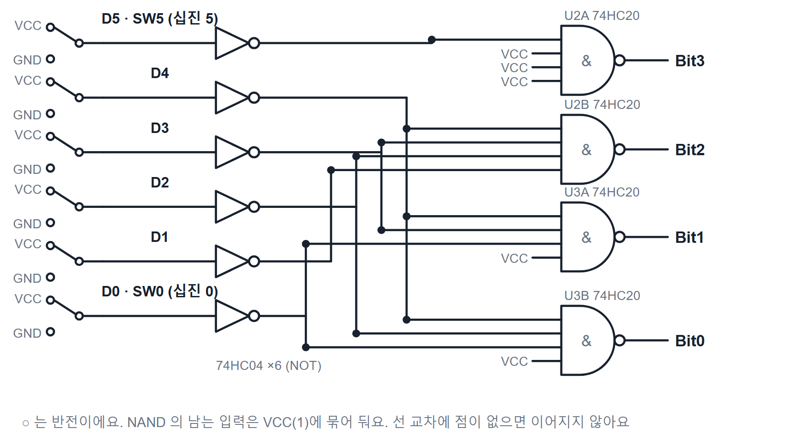
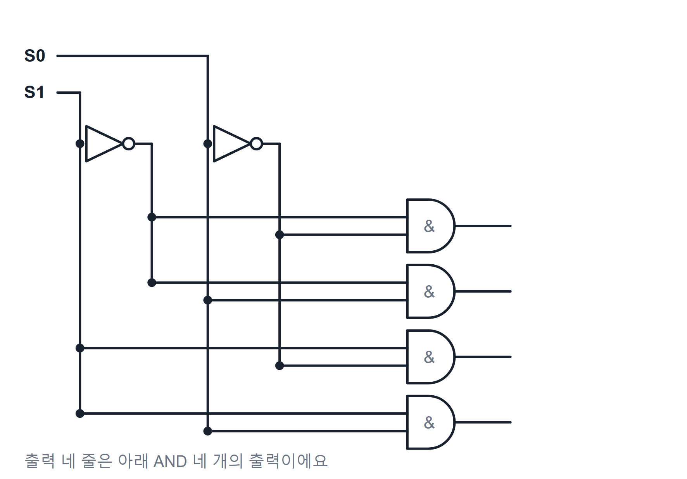
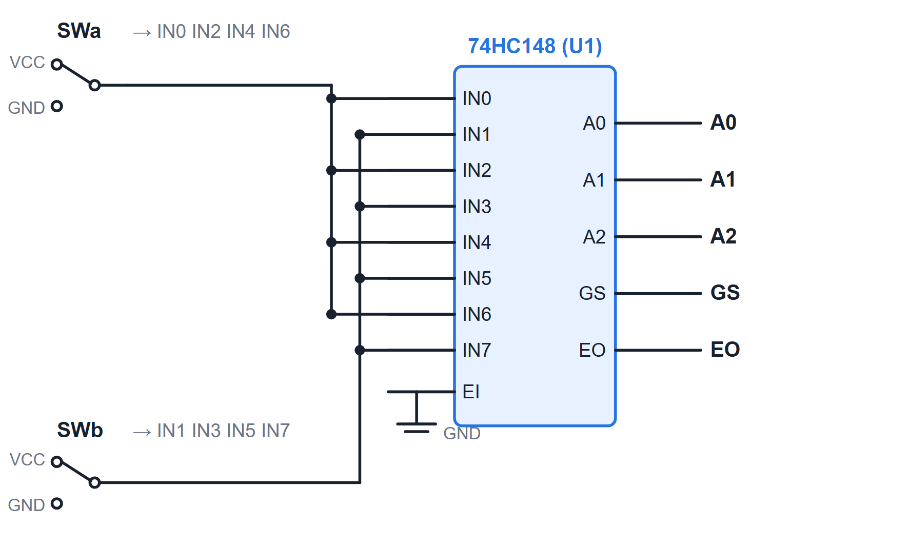

# 실험 5 · 기출 문제

[실험 설명](실험05_실험설명.md) · [문제/해설](실험05_기출풀이.md)

## 1. 3×8 디코더의 진리표
예상문제 · 실험 5 · 풀이 검토됨

### 문제 원문
3X8 Decoder의 Truth table을 완성하시오.

| A | D7 | D6 | D5 | D4 | D3 | D2 | D1 | D0 |
| --- | --- | --- | --- | --- | --- | --- | --- | --- |
| 000 | 0 | 0 | 0 | 0 | 0 | 0 | 0 | 1 |
| 001 |  |  |  |  |  |  |  |  |
| 010 |  |  |  |  |  |  |  |  |
| 011 |  |  |  |  |  |  |  |  |
| 100 |  |  |  |  |  |  |  |  |
| 101 |  |  |  |  |  |  |  |  |
| 110 |  |  |  |  |  |  |  |  |
| 111 |  |  |  |  |  |  |  |  |

(원문 표의 첫 행 A=000은 이미 채워져 있어요.)

### 조건
A는 세 비트 A2A1A0이고 출력은 D7~D0 여덟 줄이에요.

### 구할 것
A=001부터 111까지 일곱 행의 D7~D0을 채우세요.

### 힌트 · 읽는 법
A를 이진수에서 십진수로 바꿔 보세요. 그 번호의 출력 하나만 1이에요.

## 2. 8×3 우선순위 인코더 — 한 줄만 켜진 입력
예상문제 · 실험 5 · 풀이 검토됨

### 문제 원문
8X3 Priority Encoder의 Truth table을 완성하시오

| D | A2 | A1 | A0 |
| --- | --- | --- | --- |
| 0000 0001 | 0 | 0 | 0 |
| 0000 0010 |  |  |  |
| 0000 0100 |  |  |  |
| 0000 1000 |  |  |  |
| 0001 0000 |  |  |  |
| 0010 0000 |  |  |  |
| 0100 0000 |  |  |  |
| 1000 0000 |  |  |  |

(원문 표의 첫 행은 이미 채워져 있어요.)

### 조건
D는 D7…D0 여덟 비트이고, 각 행에서 한 비트만 1이에요. 출력은 A2A1A0예요.

### 구할 것
나머지 일곱 행의 A2A1A0를 채우세요.

### 힌트 · 1의 위치
각 행에서 1이 있는 자리의 번호를 먼저 찾아요. 오른쪽 끝이 D0이에요.

## 3. 8×3 우선순위 인코더 — 여러 비트가 켜진 입력
기출 · 실험 5 · 풀이 검토됨

### 문제 원문
8X3 Priority Encoder의 Truth table을 완성하시오

Fill in the blanks of the 3x8 priority decoder.

| D | A2 | A1 | A0 |
| --- | --- | --- | --- |
| 0000 0001 | 0 | 0 | 0 |
| 0011 1010 |  |  |  |
| 0101 1110 |  |  |  |
| 0001 1101 |  |  |  |
| 0110 0100 |  |  |  |
| 1111 1111 |  |  |  |

(원문 표의 첫 행은 이미 채워져 있어요.)

### 조건
D는 D7…D0 여덟 비트예요. 원문에는 우선순위 방향이 적혀 있지 않아요. 이 자료는 교안의 74HC148 표처럼 번호가 큰 입력이 우선이라고 읽어요. 영어 문장은 3x8 priority decoder라고 쓰여 있지만 한국어 문장과 표는 8×3 우선순위 인코더예요.

### 구할 것
나머지 다섯 행의 A2A1A0를 채우세요.

### 힌트 · 먼저 볼 비트
여러 비트가 1이에요. 왼쪽(D7 쪽)부터 처음으로 1이 나오는 자리를 찾아요.

## 4. 2×4 디코더의 게이트 설계
기출 · 실험 5 · 풀이 검토됨

### 문제 원문
2x4 Decoder의 회로를 설계하시오.(Not gate 2개, 2-input And gate 4개)

Design a circuit diagram of 2x4 decoder. (2 NOT gates, 4 2-input AND gates)

### 조건
입력은 I1, I0 두 개, 출력은 O0~O3 네 개예요. 출력 Ok는 I1I0가 k를 이진수로 쓴 값일 때만 1이에요.

### 구할 것
NOT 2개와 2입력 AND 4개로 회로를 그리고 논리식을 쓰세요.

### 힌트 · 출력마다 한 조합
네 출력이 각각 입력 조합 하나만 1로 만들어야 해요. 조합마다 I1과 I0 중 어느 쪽에 NOT을 붙일지 정해 보세요.

## 5. 4×2 인코더의 NAND 설계
기출 · 실험 5 · 풀이 검토됨

### 문제 원문
4x2 Encoder의 회로를 설계하시오.(Not gate 4개, 4-input nand gate 3개, 2-input nand gate 2개)

Design a circuit diagram of 2x4 Encoder. (4 NOT gates, 3 4-input NAND gates, 2 2-input NAND gates)

### 조건
입력 D0~D3 중 한 줄만 1이라고 가정하고, 출력은 상위 비트 A와 하위 비트 B로 두어요. 영어 문장은 2x4라고 쓰였지만 한국어 문장과 게이트 수에 맞춰 4×2 인코더로 읽어요.

### 구할 것
주어진 게이트 수로 회로를 그리고 A, B의 논리식을 쓰세요.

### 힌트 · 식부터
D0~D3의 번호 0~3을 이진수로 쓰고, A와 B가 1이 되는 번호를 찾으세요. 그다음 NAND 두 단계가 OR을 만든다는 점을 떠올려요.

## 6. Excess-3 코드의 특징과 사용 이유
기출 · 실험 5 · 풀이 검토됨

### 문제 원문
Excess-3 코드의 특징과 사용이유에 대해서 설명하시오.

Describe the characteristics of Excess-3 code. And explain the reason why the Excess-3 code is used.

### 구할 것
Excess-3 코드가 무엇인지, 어떤 특징이 있어 왜 쓰는지 설명하세요.

### 힌트 · 비교할 것
BCD와 비교하세요. 각 코드에 더해진 값이 무엇이고, 비트를 뒤집으면 어떤 수가 되는지 몇 개만 계산해 보세요.

## 7. Excess-3 인코더 회로의 진리표(네 행)
기출 · 실험 5 · 풀이 검토됨

### 문제 원문
10진 Excess 3코드 Encoder의 회로를 보고 Truth table을 완성하시오.()

Referring to the circuit diagram below (decimal excess-3 code encoder), fill in the blanks of the truth table.

| SW | Bit3 | Bit2 | Bit1 | Bit0 |
| --- | --- | --- | --- | --- |
| 000001 |  |  |  |  |
| 000100 |  |  |  |  |
| 010000 |  |  |  |  |
| 100000 |  |  |  |  |

### 조건
회로는 아래 그림과 같아요. SW5~SW0은 십진수 5~0을 나타내는 스위치이고 NOT 6개와 4입력 NAND 4개(74HC20)로 되어 있어요. 스위치를 VCC에 연결하면 그 입력은 1, 아니면 0이에요. 표의 SW 열은 왼쪽부터 SW5, SW4, …, SW0의 값이에요. NAND의 남는 입력은 VCC에 연결돼 있어요.

### 구할 것
표의 Bit3~Bit0 값을 채우세요.

### 힌트 · 식으로 바꾸기
NAND 앞의 NOT과 드모르간 법칙을 이용하면 각 Bit가 어떤 스위치들의 OR인지 알 수 있어요. 한 스위치만 1인 행에서는 그 스위치가 들어간 Bit만 1이에요.

## 8. Excess-3 인코더 회로의 진리표(여섯 행)
예상문제 · 실험 5 · 풀이 검토됨

### 문제 원문
10진 Excess 3코드 Encoder의 회로를 보고 Truth table을 완성하시오.()

| SW | Bit3 | Bit2 | Bit1 | Bit0 |
| --- | --- | --- | --- | --- |
| 000001 |  |  |  |  |
| 000010 |  |  |  |  |
| 000100 |  |  |  |  |
| 001000 |  |  |  |  |
| 010000 |  |  |  |  |
| 100000 |  |  |  |  |

### 조건
회로는 아래 그림과 같아요. SW5~SW0은 십진수 5~0을 나타내는 스위치이고 NOT 6개와 4입력 NAND 4개(74HC20)로 되어 있어요. 스위치를 VCC에 연결하면 그 입력은 1, 아니면 0이에요. 표의 SW 열은 왼쪽부터 SW5, SW4, …, SW0의 값이에요. NAND의 남는 입력은 VCC에 연결돼 있어요.

### 구할 것
표의 Bit3~Bit0 값을 채우세요.

### 힌트 · 식으로 바꾸기
NAND 앞의 NOT과 드모르간 법칙을 이용하면 각 Bit가 어떤 스위치들의 OR인지 알 수 있어요. 한 스위치만 1인 행에서는 그 스위치가 들어간 Bit만 1이에요.

## 9. 1-out-of-4 코드를 Excess-3로 변환
출처 미확인 · 실험 5 · 풀이 검토됨

### 문제 원문
다음 1-out-of-4 코드를 Excess-3 코드로 변환 하시오.

| D0D1D2D3 |  | Excess-3 |
| --- | --- | --- |
| 1000 | -> |  |
| 0100 | -> |  |
| 0010 | -> |  |

### 조건
1-out-of-4 코드는 네 비트 중 한 비트만 1인 코드(one-hot)예요. D0D1D2D3에서 왼쪽이 D0이고, 1이 있는 자리의 번호가 십진수 0~3을 뜻해요.

### 구할 것
세 행을 Excess-3 코드(4비트)로 바꾸세요.

### 힌트 · 번호 먼저
각 행에서 1이 몇 번째 자리(D0부터)인지 십진수로 바꾼 다음, Excess-3 코드의 정의를 적용하세요.

## 10. 우선순위 인코더와 Binary 인코더의 비교
기출 · 실험 5 · 풀이 검토됨

### 문제 원문
Priority encoder의 특징을 Binary encoder와 비교하여 설명하시오.

### 구할 것
여러 입력이 동시에 1일 때 두 인코더의 출력이 어떻게 다른지 설명하세요.

### 힌트 · 동시 입력
입력 두 개가 동시에 1인 경우를 하나 정해 두 인코더에 각각 넣어 보세요.

## 11. 디코더 회로로 1 to 4 디멀티플렉서 만들기
출처 미확인 · 실험 5 · 풀이 검토됨

### 문제 원문
아래의 2 to 4 Decoder의 Gate 회로를 활용하여 1 to 4 Demultiplexer의 Gate회로를 작성하시오.

### 조건
그림은 선택 입력 S0, S1과 NOT 2개, 2입력 AND 4개로 이루어진 2 to 4 디코더 게이트 회로예요. 출력 네 줄에는 이름이 없어요.

### 구할 것
데이터 입력 D를 추가해 1 to 4 디멀티플렉서의 게이트 회로를 그리고 출력 식을 쓰세요.

### 힌트 · 바꿀 곳
디코더의 출력은 선택된 한 줄만 1이에요. 그 1 대신 데이터 D가 나오게 하려면 각 AND에 무엇을 더해야 할지 생각하세요.

## 12. 디코더로 DMUX 만들기와 두 회로의 차이
기출 · 실험 5 · 풀이 검토됨

### 문제 원문
2. 아래의 2 to 4 Decoder의 Gate 회로를 활용하여 1 to 4 Demultiplexer의 Gate회로를 작성하시오.(2점.)

두 회로 간에 어떠한 차이가 있는가?(2점.) (총 4점)

### 조건
원문의 회로 그림은 채점 표시가 섞여 있어 이 문제지에는 싣지 않았어요. 그림은 선택 입력 S0, S1과 NOT 2개, 2입력 AND 4개로 이루어진 2 to 4 디코더 게이트 회로예요.

### 구할 것
(1) 디코더 회로를 활용해 1 to 4 디멀티플렉서 회로를 작성하세요. (2) 두 회로 사이의 차이를 설명하세요.

### 힌트 · 차이를 볼 곳
두 회로의 입력 신호 종류와 개수, AND 게이트의 입력 수, 출력이 켜지는 조건을 각각 비교해 보세요.

## 13. 74HC148 우선순위 인코더의 진리표
출처 미확인 · 실험 5 · 풀이 검토됨

### 문제 원문
아래 회로는 74HC148을 활용하여 설계한 8x3 Priority Encoder 이다. 아래의 Table을 완성하시오.

| E1 | 0 | 1 | 2 | 3 | 4 | 5 | 6 | 7 | A2 | A1 | A0 |
| --- | --- | --- | --- | --- | --- | --- | --- | --- | --- | --- | --- |
| L | H | H | H | H | H | H | H | H | H | H | H |
| L | L | H | L | H | L | H | L | H |  |  |  |
| L | H | L | H | L | H | L | H | L |  |  |  |

(원문 표의 첫 행은 출력까지 이미 채워져 있어요. 표 머리 input은 E1, 0~7, output은 A2 A1 A0예요.)

### 조건
스위치 두 개가 IN0~IN7을 짝수 번호끼리, 홀수 번호끼리 묶어 구동하고, EI(표의 E1)는 GND에 연결돼 있어요. 74HC148은 입력, EI, 출력이 모두 Low가 활성인 칩이에요. 번호가 큰 입력이 우선이에요(교안 p11).

### 구할 것
둘째 행과 셋째 행의 A2 A1 A0를 H 또는 L로 채우세요.

### 힌트 · 세 단계
Low인 입력을 모두 찾고, 그중 번호가 가장 큰 입력을 고른 다음, 그 번호를 이진수로 쓴 뒤 비트를 뒤집어 H/L로 바꿔요.

## 14. 2×4 디코더 회로의 진리표
출처 미확인 · 실험 5 · 풀이 검토됨

### 문제 원문
1. 2X4 Decoder의 회로를 보고 Truth table을 완성하시오.

### 조건
원문 회로 그림은 해설이 같은 쪽에 섞여 있어 이 문제지에는 싣지 않고 글로 옮겼어요. 스위치 SW1(= bit0)과 SW2(= bit1)가 입력이고, 스위치를 VCC에 연결하면 1이에요. U1A(74HC04)는 SW1을, U1B는 SW2를 반전해요. 네 AND(74HC08)의 출력은 저항 330Ω을 거쳐 LED D1~D4에 연결돼 있고, 출력이 1이면 해당 LED가 켜져요.

| 게이트 | 입력 1 | 입력 2 | 출력 |
| --- | --- | --- | --- |
| U2A (74HC08) | SW1 | SW2 | D1 |
| U2B | U1A 출력 (SW1 반전) | SW2 | D2 |
| U2C | SW1 | U1B 출력 (SW2 반전) | D3 |
| U2D | U1A 출력 | U1B 출력 | D4 |

### 구할 것
bit0, bit1의 네 가지 조합마다 D1~D4의 값을 채우세요. (표의 입력은 bit0, bit1 순서로 00, 10, 01, 11이에요.)

### 힌트 · 출력별 식
먼저 D1~D4 각각이 bit0와 bit1의 어떤 AND인지 식으로 쓰세요. 그다음 입력 조합을 하나씩 넣어요.

## 15. Decoder를 설명
출처 미확인 · 실험 5 · 풀이 검토됨

### 문제 원문
Decoder에 대해서 설명하시오.

### 구할 것
디코더가 무엇인지 입력과 출력을 포함해 설명하세요.

### 힌트 · 담을 내용
입력 비트 수와 출력 개수의 관계, 그리고 출력 중 몇 개가 활성화되는지를 써요.

## 16. Encoder를 설명
출처 미확인 · 실험 5 · 풀이 검토됨

### 문제 원문
Encoder에 대해서 설명하시오.

### 구할 것
인코더가 무엇인지 입력과 출력을 포함해 설명하세요.

### 힌트 · 담을 내용
디코더와 반대 방향이라는 점과 입력 개수와 출력 비트 수의 관계를 써요.

## 17. 8×3 인코더 진리표
출처 미확인 · 실험 5 · 풀이 검토됨

### 문제 원문
8X3 Encoder 진리표작성

### 조건
입력 D7~D0 중 한 줄만 1이라고 가정해요. 출력은 A2A1A0예요.

### 구할 것
입력 여덟 가지에 대한 진리표를 작성하세요.

### 힌트 · 행 만들기
행마다 D0부터 D7까지 한 줄씩 1로 두고, 그 번호를 이진수로 바꿔 출력에 써요.

## 18. Priority Encoder의 사용 이유
출처 미확인 · 실험 5 · 풀이 검토됨

### 문제 원문
Priority Encoder에 대해서 설명하시오(사용이유)

### 구할 것
우선순위 인코더를 왜 쓰는지 설명하세요.

### 힌트 · 문제 상황
일반 인코더에 입력 두 개가 동시에 들어오면 어떤 코드가 나오는지 하나만 계산해 보세요.

## 19. 우선순위 인코더 IC의 출력 핀
출처 미확인 · 실험 5 · 풀이 검토됨

### 문제 원문
74HC143은 Priority Encoder이다. 각 Output port A0, A1, A2, GS, EO에 대해서 설명하시오.

### 조건
원문은 칩 이름을 74HC143으로 적었어요. 교안에서 쓰는 우선순위 인코더 IC는 74HC148이고, 핀 이름 A0~A2, GS, EO가 같아서 74HC148의 핀으로 읽어요.

### 구할 것
다섯 출력 핀의 역할을 각각 설명하세요.

### 힌트 · 나눠 보기
A0~A2는 하나의 묶음이에요. GS와 EO는 각각 “입력이 있나”와 “다음 칩에 넘길 enable”과 관련이 있어요.
