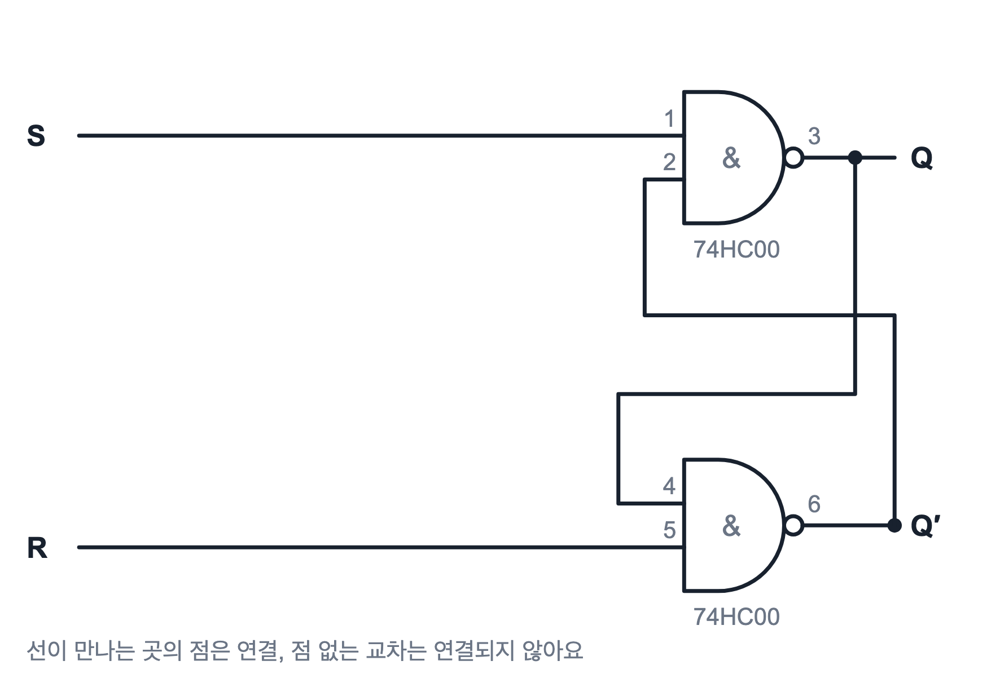
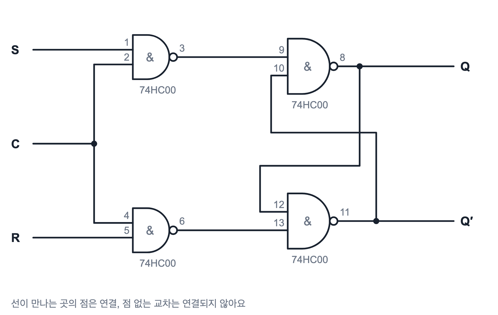
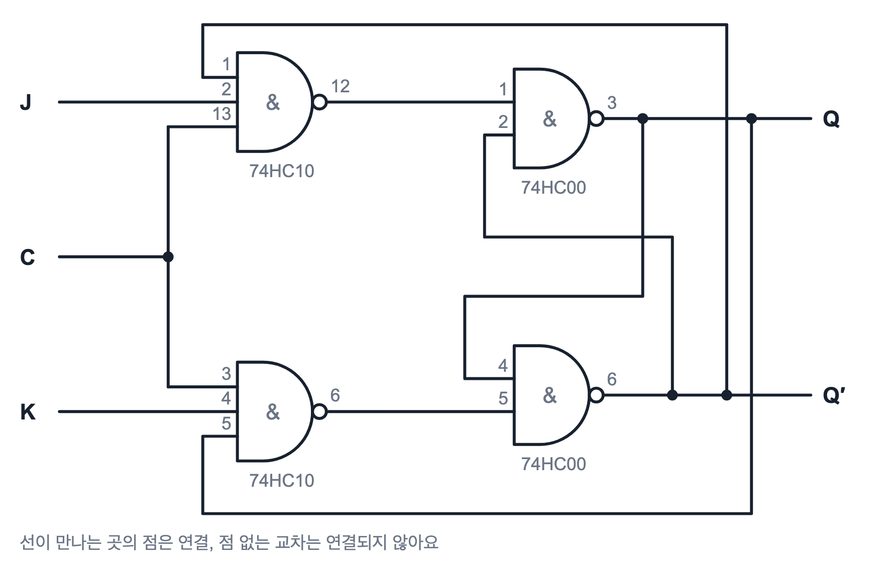
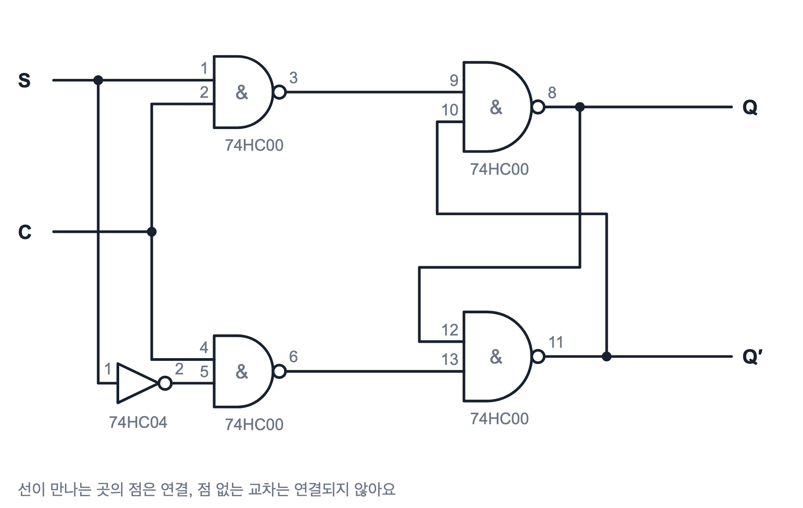
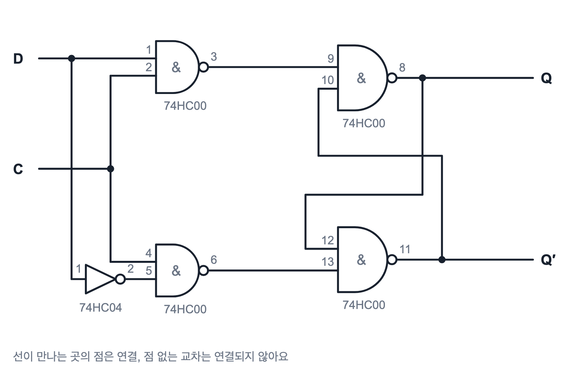
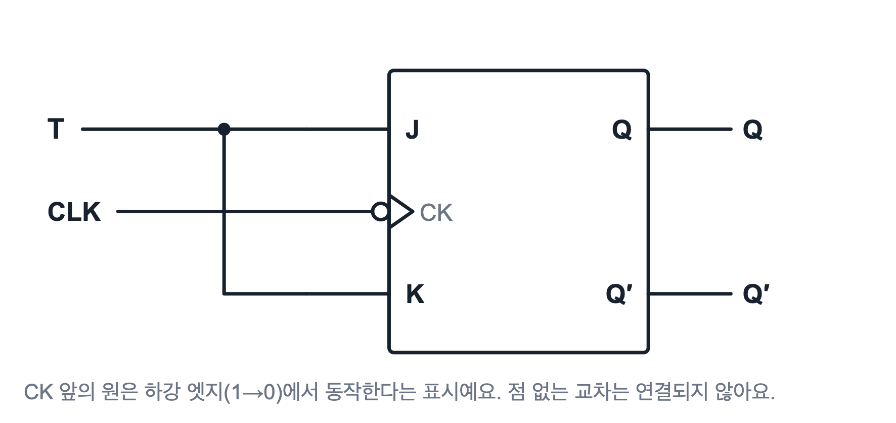

# 실험 6 · 기출 풀이

[실험 설명](실험06_실험설명.md) · [문제/해설](실험06_기출문제.md)

## 1. Latch와 Flip-Flop의 차이
기출 · 실험 6 · 풀이 검토됨

### 문제 원문
Latch와 Flip-Flop의 차이점에 대해서 설명하시오.

### 구할 것
입력이 출력에 반영되는 때를 기준으로 두 소자를 비교하세요.

### 힌트 · 비교 기준
제어 입력이 1인 “동안”과 제어 입력이 바뀌는 “순간” 중 무엇에 반응하는지 생각해요.

### 풀이 1 · 공통점
둘 다 1비트(Q와 Q′)를 저장하는 기억소자예요. 출력을 되먹여 이전 상태를 유지해요.

### 풀이 2 · 차이
| 구분 | Latch | Flip-Flop |
| --- | --- | --- |
| 트리거 | 레벨(Level-triggered) | 엣지(Edge-triggered) |
| 입력 반영 | Enable이 1인 동안 입력이 바뀔 때마다 출력이 바로 따라 바뀜 | 클록의 상승 또는 하강 엣지 순간에만 입력을 받아 출력이 바뀜 |
| 교안의 분류 | 비동기 기억소자 | 동기 기억소자(Clock에 맞춰 동작) |

### 풀이 3 · 검산
**검산:** 같은 입력 파형(Enable/Clock=1 구간 안에서 D가 두 번 바뀜)을 넣으면 래치는 두 번 다 따라가고, 플립플롭은 엣지에서 한 번만 바뀌는지 그려 보면 차이가 맞아요.

### 풀이 4 · 흔한 실수
**흔한 실수:** “래치는 클록이 전혀 없다”라고만 쓰면 Enable 래치를 설명하지 못해요. 레벨과 엣지의 차이를 함께 써요.

### 최종 답
Latch는 Enable이 활성인 동안 입력 변화가 바로 출력에 반영되는 레벨 트리거(비동기) 기억소자이고, Flip-Flop은 클록의 엣지 순간에만 입력이 출력에 반영되는 엣지 트리거(동기) 기억소자예요.

### 출처
- [from_the_past/정리/퀴즈/실험6/실험6 퀴즈 기출 2017-1.pdf](../../../from_the_past/%EC%A0%95%EB%A6%AC/%ED%80%B4%EC%A6%88/%EC%8B%A4%ED%97%986/%EC%8B%A4%ED%97%986%20%ED%80%B4%EC%A6%88%20%EA%B8%B0%EC%B6%9C%202017-1.pdf#page=1)
- [from_the_past/정리/퀴즈/실험6/실험6 퀴즈 기출_단답형.pdf](../../../from_the_past/%EC%A0%95%EB%A6%AC/%ED%80%B4%EC%A6%88/%EC%8B%A4%ED%97%986/%EC%8B%A4%ED%97%986%20%ED%80%B4%EC%A6%88%20%EA%B8%B0%EC%B6%9C_%EB%8B%A8%EB%8B%B5%ED%98%95.pdf#page=1)
- [from_the_past/정리/퀴즈/실험6/실험6 퀴즈 예상문제_v1.pdf](../../../from_the_past/%EC%A0%95%EB%A6%AC/%ED%80%B4%EC%A6%88/%EC%8B%A4%ED%97%986/%EC%8B%A4%ED%97%986%20%ED%80%B4%EC%A6%88%20%EC%98%88%EC%83%81%EB%AC%B8%EC%A0%9C_v1.pdf#page=1)
- [from_the_past/정리/퀴즈/실험6/실험6 퀴즈 예상문제_v2.pdf](../../../from_the_past/%EC%A0%95%EB%A6%AC/%ED%80%B4%EC%A6%88/%EC%8B%A4%ED%97%986/%EC%8B%A4%ED%97%986%20%ED%80%B4%EC%A6%88%20%EC%98%88%EC%83%81%EB%AC%B8%EC%A0%9C_v2.pdf#page=1)
- [from_the_past/정리/퀴즈/실험6/실험6 퀴즈 예상문제_v3.pdf](../../../from_the_past/%EC%A0%95%EB%A6%AC/%ED%80%B4%EC%A6%88/%EC%8B%A4%ED%97%986/%EC%8B%A4%ED%97%986%20%ED%80%B4%EC%A6%88%20%EC%98%88%EC%83%81%EB%AC%B8%EC%A0%9C_v3.pdf#page=1)
- [from_the_past/정리/퀴즈/실험6/실험6 퀴즈 예상문제_v4.pdf](../../../from_the_past/%EC%A0%95%EB%A6%AC/%ED%80%B4%EC%A6%88/%EC%8B%A4%ED%97%986/%EC%8B%A4%ED%97%986%20%ED%80%B4%EC%A6%88%20%EC%98%88%EC%83%81%EB%AC%B8%EC%A0%9C_v4.pdf#page=1)
- [from_the_past/정리/퀴즈/실험6/실험6 퀴즈 종합_기출문제 (4p).pdf](../../../from_the_past/%EC%A0%95%EB%A6%AC/%ED%80%B4%EC%A6%88/%EC%8B%A4%ED%97%986/%EC%8B%A4%ED%97%986%20%ED%80%B4%EC%A6%88%20%EC%A2%85%ED%95%A9_%EA%B8%B0%EC%B6%9C%EB%AC%B8%EC%A0%9C%20%284p%29.pdf#page=2)
- [from_the_past/정리/퀴즈/실험6/원본_docx/실험6.docx](../../../from_the_past/%EC%A0%95%EB%A6%AC/%ED%80%B4%EC%A6%88/%EC%8B%A4%ED%97%986/%EC%9B%90%EB%B3%B8_docx/%EC%8B%A4%ED%97%986.docx)
- [from_the_past/정리/퀴즈/실험6/원본_docx/실험6_예상.docx](../../../from_the_past/%EC%A0%95%EB%A6%AC/%ED%80%B4%EC%A6%88/%EC%8B%A4%ED%97%986/%EC%9B%90%EB%B3%B8_docx/%EC%8B%A4%ED%97%986_%EC%98%88%EC%83%81.docx)

## 2. Latch를 설명
예상문제 · 실험 6 · 풀이 검토됨

### 문제 원문
Latch에 대해서 설명하시오.

### 구할 것
Latch가 무엇을 저장하고 언제 입력을 받아들이는지 설명하세요.

### 힌트 · 세 가지
무엇을 저장하나, 어떻게 기억하나(되먹임), 언제 입력이 반영되나를 차례로 써요.

### 풀이 1 · 풀이
- 2진 정보 1비트를 저장하는 기억소자예요. 출력 Q와 Q′은 서로 반대인 두 안정 상태 중 하나를 유지해요.
- 출력을 입력으로 되먹이는 구조라서 입력이 사라진 뒤에도 마지막 상태를 지켜요.
- 레벨 트리거예요. Enable이 활성(1)인 동안 입력이 바뀌면 출력이 바로 따라 바뀌고, Enable이 0이면 유지해요. 교안은 비동기 기억소자로 분류해요.
- 예: SR 래치, D 래치, JK 래치

### 풀이 2 · 검산
**검산:** D 래치에서 E=1, D=1 → Q=1, 이어서 E=0, D=0 → Q=1 유지로 “저장”과 “레벨 반영”을 모두 확인할 수 있어요.

### 풀이 3 · 흔한 실수
**흔한 실수:** “입력이 변할 때마다 출력이 바뀐다”만 쓰면 Enable=0일 때의 유지를 빠뜨려요.

### 최종 답
Latch는 되먹임으로 1비트를 기억하는 레벨 트리거(비동기) 기억소자예요. Enable이 활성인 동안 입력에 따라 출력이 바로 바뀌고, 비활성이면 마지막 상태를 유지해요.

### 출처
- [from_the_past/정리/퀴즈/실험6/실험6 퀴즈 예상문제_v1.pdf](../../../from_the_past/%EC%A0%95%EB%A6%AC/%ED%80%B4%EC%A6%88/%EC%8B%A4%ED%97%986/%EC%8B%A4%ED%97%986%20%ED%80%B4%EC%A6%88%20%EC%98%88%EC%83%81%EB%AC%B8%EC%A0%9C_v1.pdf#page=2)
- [from_the_past/정리/퀴즈/실험6/실험6 퀴즈 기출_단답형.pdf](../../../from_the_past/%EC%A0%95%EB%A6%AC/%ED%80%B4%EC%A6%88/%EC%8B%A4%ED%97%986/%EC%8B%A4%ED%97%986%20%ED%80%B4%EC%A6%88%20%EA%B8%B0%EC%B6%9C_%EB%8B%A8%EB%8B%B5%ED%98%95.pdf#page=1)
- [from_the_past/정리/퀴즈/실험6/실험6 퀴즈 예상문제_v2.pdf](../../../from_the_past/%EC%A0%95%EB%A6%AC/%ED%80%B4%EC%A6%88/%EC%8B%A4%ED%97%986/%EC%8B%A4%ED%97%986%20%ED%80%B4%EC%A6%88%20%EC%98%88%EC%83%81%EB%AC%B8%EC%A0%9C_v2.pdf#page=2)
- [from_the_past/정리/퀴즈/실험6/실험6 퀴즈 예상문제_v3.pdf](../../../from_the_past/%EC%A0%95%EB%A6%AC/%ED%80%B4%EC%A6%88/%EC%8B%A4%ED%97%986/%EC%8B%A4%ED%97%986%20%ED%80%B4%EC%A6%88%20%EC%98%88%EC%83%81%EB%AC%B8%EC%A0%9C_v3.pdf#page=1)
- [from_the_past/정리/퀴즈/실험6/실험6 퀴즈 예상문제_v4.pdf](../../../from_the_past/%EC%A0%95%EB%A6%AC/%ED%80%B4%EC%A6%88/%EC%8B%A4%ED%97%986/%EC%8B%A4%ED%97%986%20%ED%80%B4%EC%A6%88%20%EC%98%88%EC%83%81%EB%AC%B8%EC%A0%9C_v4.pdf#page=1)
- [from_the_past/정리/퀴즈/실험6/실험6 퀴즈 종합_기출문제 (4p).pdf](../../../from_the_past/%EC%A0%95%EB%A6%AC/%ED%80%B4%EC%A6%88/%EC%8B%A4%ED%97%986/%EC%8B%A4%ED%97%986%20%ED%80%B4%EC%A6%88%20%EC%A2%85%ED%95%A9_%EA%B8%B0%EC%B6%9C%EB%AC%B8%EC%A0%9C%20%284p%29.pdf#page=3)
- [from_the_past/정리/퀴즈/실험6/원본_docx/실험6.docx](../../../from_the_past/%EC%A0%95%EB%A6%AC/%ED%80%B4%EC%A6%88/%EC%8B%A4%ED%97%986/%EC%9B%90%EB%B3%B8_docx/%EC%8B%A4%ED%97%986.docx)
- [from_the_past/정리/퀴즈/실험6/원본_docx/실험6_예상.docx](../../../from_the_past/%EC%A0%95%EB%A6%AC/%ED%80%B4%EC%A6%88/%EC%8B%A4%ED%97%986/%EC%9B%90%EB%B3%B8_docx/%EC%8B%A4%ED%97%986_%EC%98%88%EC%83%81.docx)

## 3. Flip-Flop을 설명
예상문제 · 실험 6 · 풀이 검토됨

### 문제 원문
Flip-Flop에 대해서 설명하시오.

### 구할 것
Flip-Flop이 무엇을 저장하고 언제 입력을 받아들이는지 설명하세요.

### 힌트 · 래치와 비교
저장하는 것은 래치와 같아요. 입력이 반영되는 순간이 달라요.

### 풀이 1 · 풀이
- 2진 정보 1비트를 저장하는 기억소자이고 Q와 Q′은 서로 반대인 두 안정 상태 중 하나를 유지해요.
- 클록을 입력받는 동기 기억소자예요. 클록의 상승 엣지 또는 하강 엣지 순간에만 입력이 출력에 반영되고, 그 사이에는 입력이 바뀌어도 출력이 그대로예요(Edge-triggered).
- 예: SR F/F, D F/F(74HC74, 상승 엣지), JK F/F(74HC76, 하강 엣지)

### 풀이 2 · 검산
**검산:** 74HC76에서 J=K=1로 두고 클록을 한 번 내리면 Q가 정확히 한 번 뒤집히고, 클록이 0으로 머무는 동안은 그대로예요.

### 풀이 3 · 흔한 실수
**흔한 실수:** “클록이 1인 동안 입력을 받는다”라고 쓰면 래치(레벨) 설명이 돼요.

### 최종 답
Flip-Flop은 1비트를 기억하는 동기 기억소자로, 클록의 엣지(상승 또는 하강) 순간에만 입력이 출력에 반영되고 그 밖에는 상태를 유지해요.

### 출처
- [from_the_past/정리/퀴즈/실험6/실험6 퀴즈 예상문제_v1.pdf](../../../from_the_past/%EC%A0%95%EB%A6%AC/%ED%80%B4%EC%A6%88/%EC%8B%A4%ED%97%986/%EC%8B%A4%ED%97%986%20%ED%80%B4%EC%A6%88%20%EC%98%88%EC%83%81%EB%AC%B8%EC%A0%9C_v1.pdf#page=2)
- [from_the_past/정리/퀴즈/실험6/실험6 퀴즈 기출_단답형.pdf](../../../from_the_past/%EC%A0%95%EB%A6%AC/%ED%80%B4%EC%A6%88/%EC%8B%A4%ED%97%986/%EC%8B%A4%ED%97%986%20%ED%80%B4%EC%A6%88%20%EA%B8%B0%EC%B6%9C_%EB%8B%A8%EB%8B%B5%ED%98%95.pdf#page=1)
- [from_the_past/정리/퀴즈/실험6/실험6 퀴즈 예상문제_v2.pdf](../../../from_the_past/%EC%A0%95%EB%A6%AC/%ED%80%B4%EC%A6%88/%EC%8B%A4%ED%97%986/%EC%8B%A4%ED%97%986%20%ED%80%B4%EC%A6%88%20%EC%98%88%EC%83%81%EB%AC%B8%EC%A0%9C_v2.pdf#page=2)
- [from_the_past/정리/퀴즈/실험6/실험6 퀴즈 예상문제_v3.pdf](../../../from_the_past/%EC%A0%95%EB%A6%AC/%ED%80%B4%EC%A6%88/%EC%8B%A4%ED%97%986/%EC%8B%A4%ED%97%986%20%ED%80%B4%EC%A6%88%20%EC%98%88%EC%83%81%EB%AC%B8%EC%A0%9C_v3.pdf#page=1)
- [from_the_past/정리/퀴즈/실험6/실험6 퀴즈 예상문제_v4.pdf](../../../from_the_past/%EC%A0%95%EB%A6%AC/%ED%80%B4%EC%A6%88/%EC%8B%A4%ED%97%986/%EC%8B%A4%ED%97%986%20%ED%80%B4%EC%A6%88%20%EC%98%88%EC%83%81%EB%AC%B8%EC%A0%9C_v4.pdf#page=1)
- [from_the_past/정리/퀴즈/실험6/실험6 퀴즈 종합_기출문제 (4p).pdf](../../../from_the_past/%EC%A0%95%EB%A6%AC/%ED%80%B4%EC%A6%88/%EC%8B%A4%ED%97%986/%EC%8B%A4%ED%97%986%20%ED%80%B4%EC%A6%88%20%EC%A2%85%ED%95%A9_%EA%B8%B0%EC%B6%9C%EB%AC%B8%EC%A0%9C%20%284p%29.pdf#page=3)
- [from_the_past/정리/퀴즈/실험6/원본_docx/실험6.docx](../../../from_the_past/%EC%A0%95%EB%A6%AC/%ED%80%B4%EC%A6%88/%EC%8B%A4%ED%97%986/%EC%9B%90%EB%B3%B8_docx/%EC%8B%A4%ED%97%986.docx)
- [from_the_past/정리/퀴즈/실험6/원본_docx/실험6_예상.docx](../../../from_the_past/%EC%A0%95%EB%A6%AC/%ED%80%B4%EC%A6%88/%EC%8B%A4%ED%97%986/%EC%9B%90%EB%B3%B8_docx/%EC%8B%A4%ED%97%986_%EC%98%88%EC%83%81.docx)

## 4. 기본 S-R latch에 S=R=0을 넣으면
출처 미확인 · 실험 6 · 풀이 검토됨

### 문제 원문
아래의 회로는 기본 S-R latch 회로이다. S와 R이 동시에 0이 입력되면 Q와 Q′의 출력은 무엇인가? Q′ = not Q 등식이 성립하는가?

### 조건
NAND(74HC00) 두 개의 출력이 서로의 입력에 연결돼 있어요. S는 Q를 내는 NAND, R은 Q′을 내는 NAND에 들어가요. Enable 입력은 없어요.

### 구할 것
S=R=0일 때 Q와 Q′을 구하고, Q′=not Q가 성립하는지 답하세요.

### 힌트 · NAND 성질
NAND는 입력에 0이 하나라도 있으면 출력이 1이에요. 각 NAND에 0이 들어가는지만 보면 돼요.

### 풀이 1 · 풀이
S=0이 들어간 위 NAND는 다른 입력과 상관없이 1을 내요. 그래서 Q=1이에요. R=0이 들어간 아래 NAND도 1을 내서 Q′=1이에요.

### 풀이 2 · 판단
Q=1, Q′=1이라 Q′이 Q의 반대가 아니에요. 따라서 Q′=not Q는 성립하지 않아요.

### 풀이 3 · 검산
**검산:** 되먹임 값을 넣어 다시 계산해도 Q=(0·1)′=1, Q′=(0·1)′=1로 변하지 않아요. 이 상태에서 S·R을 동시에 1로 되돌리면 어느 상태로 남을지 예측할 수 없어서 이 입력을 쓰지 않아요.

### 풀이 4 · 흔한 실수
**흔한 실수:** Active High SR 래치의 “S=R=0은 유지”를 그대로 적용하면 틀려요. NAND 기본 래치는 S=R=1이 유지이고 S=R=0이 금지 상태예요.

### 최종 답
Q=1, Q′=1이에요. 두 출력이 같아서 Q′=not Q는 성립하지 않아요.

### 출처
- [from_the_past/정리/퀴즈/실험6/실험6 퀴즈 기출_단답형.pdf](../../../from_the_past/%EC%A0%95%EB%A6%AC/%ED%80%B4%EC%A6%88/%EC%8B%A4%ED%97%986/%EC%8B%A4%ED%97%986%20%ED%80%B4%EC%A6%88%20%EA%B8%B0%EC%B6%9C_%EB%8B%A8%EB%8B%B5%ED%98%95.pdf#page=2)

## 5. Enable이 있는 R-S Latch의 진리표
예상문제 · 실험 6 · 풀이 검토됨

### 문제 원문
R-S Latch의 Truth table을 완성하시오.

### 조건
회로는 아래 그림과 같아요. S·C가 첫 NAND, R·C가 둘째 NAND에 들어가고 그 출력이 서로 되먹임된 NAND 두 개로 가요(74HC00 네 개 게이트). C는 Enable 역할이에요. 원문에는 빈 표가 없어요. 풀이하기 쉽게 입력 행만 정리했어요.

### 구할 것
표의 Q(t)를 채우세요. 부정 행은 회로가 내는 값과 쓰지 않는 이유를 함께 써요.

| S | R | C | Q(t) |
| --- | --- | --- | --- |
| 0 | 0 | 1 |  |
| 0 | 1 | 1 |  |
| 1 | 0 | 1 |  |
| 1 | 1 | 1 |  |
| x | x | 0 |  |

### 힌트 · C부터
C=0이면 앞단 NAND 두 개의 출력이 어떻게 되는지 먼저 봐요. 그다음 C=1에서 S·R마다 앞단 출력 → Q 순서로 따라가요.

### 풀이 1 · C=0
앞단 NAND에 0이 들어가서 두 출력이 모두 1이에요. 교차 NAND는 1을 받아 서로를 붙잡으니 이전 값 Q(t−1)이 유지돼요.

### 풀이 2 · C=1
앞단 NAND는 S·R을 뒤집어 전달해요. S=1이면 위 앞단 출력이 0이라 Q=1(Set), R=1이면 아래 앞단 출력이 0이라 Q′=1, Q=0(Reset)이에요. S=R=0이면 앞단 출력이 모두 1이라 유지예요. S=R=1이면 앞단 출력이 모두 0이라 Q=1, Q′=1이에요.

### 풀이 3 · 완성한 표
| S | R | C | Q(t) |
| --- | --- | --- | --- |
| 0 | 0 | 1 | Q(t−1) |
| 0 | 1 | 1 | 0 : Reset |
| 1 | 0 | 1 | 1 : Set |
| 1 | 1 | 1 | 1 (Q′도 1, 부정·사용 안 함) |
| x | x | 0 | Q(t−1) |

### 풀이 4 · 검산
**검산:** Set 행에서 Q=1을 넣고 다시 계산하면 Q′=(1·1)′=0으로 Q′=Q̄가 맞아요. S=R=1 행만 Q=Q′=1이라 사용하지 않아요.

### 풀이 5 · 흔한 실수
**흔한 실수:** S=R=1 행을 “X”로만 쓰고 끝내면 회로가 실제로 내는 값(Q=Q′=1)을 놓쳐요. 값과 금지 이유를 함께 써요.

### 최종 답
00(C=1)→Q(t−1), 01→0(Reset), 10→1(Set), 11→1(Q′도 1, 금지), C=0→Q(t−1)

### 출처
- [from_the_past/정리/퀴즈/실험6/실험6 퀴즈 예상문제_v1.pdf](../../../from_the_past/%EC%A0%95%EB%A6%AC/%ED%80%B4%EC%A6%88/%EC%8B%A4%ED%97%986/%EC%8B%A4%ED%97%986%20%ED%80%B4%EC%A6%88%20%EC%98%88%EC%83%81%EB%AC%B8%EC%A0%9C_v1.pdf#page=1)
- [from_the_past/정리/퀴즈/실험6/실험6 퀴즈 예상문제_v2.pdf](../../../from_the_past/%EC%A0%95%EB%A6%AC/%ED%80%B4%EC%A6%88/%EC%8B%A4%ED%97%986/%EC%8B%A4%ED%97%986%20%ED%80%B4%EC%A6%88%20%EC%98%88%EC%83%81%EB%AC%B8%EC%A0%9C_v2.pdf#page=1)
- [from_the_past/정리/퀴즈/실험6/실험6 퀴즈 예상문제_v4.pdf](../../../from_the_past/%EC%A0%95%EB%A6%AC/%ED%80%B4%EC%A6%88/%EC%8B%A4%ED%97%986/%EC%8B%A4%ED%97%986%20%ED%80%B4%EC%A6%88%20%EC%98%88%EC%83%81%EB%AC%B8%EC%A0%9C_v4.pdf#page=1)
- [from_the_past/정리/퀴즈/실험6/원본_docx/실험6.docx](../../../from_the_past/%EC%A0%95%EB%A6%AC/%ED%80%B4%EC%A6%88/%EC%8B%A4%ED%97%986/%EC%9B%90%EB%B3%B8_docx/%EC%8B%A4%ED%97%986.docx)
- [from_the_past/정리/퀴즈/실험6/원본_docx/실험6_예상.docx](../../../from_the_past/%EC%A0%95%EB%A6%AC/%ED%80%B4%EC%A6%88/%EC%8B%A4%ED%97%986/%EC%9B%90%EB%B3%B8_docx/%EC%8B%A4%ED%97%986_%EC%98%88%EC%83%81.docx)

## 6. R-S Latch를 Toggle 되게 바꾸기
출처 미확인 · 실험 6 · 풀이 검토됨

### 문제 원문
1) R-S Latch 회로로부터 (R,S가 1 일때), Q의 값이 Toggle 되게 하려면 회로를 어떻게 변형해야 하는가?

2) R-S Latch 회로에서 (R,S 가 1일 때) 갖는 문제점이 무엇인가?

(1)의 결과와 같이 변형된 회로를 무슨 회로라고 부르는가?

### 조건
주어진 회로는 S·C, R·C를 받는 NAND 두 개와 서로 되먹임된 NAND 두 개로 된 R-S Latch예요.

### 구할 것
세 소문항, 1) 변형 방법, 2) 문제점, 3) 변형된 회로의 이름(원문의 “(1)의 결과와 같이…” 문장)에 모두 답하세요.

### 힌트 · Toggle 조건
Toggle은 “지금 Q가 0이면 Set, 1이면 Reset”이에요. S 쪽 NAND가 Q가 0일 때만, R 쪽 NAND가 Q가 1일 때만 열리게 하려면 각 NAND에 무엇을 하나 더 넣으면 될지 생각해요.

### 풀이 1 · 1) 변형
S 쪽 앞단 NAND를 3입력으로 바꿔 Q′을 되먹이고, R 쪽 앞단 NAND도 3입력으로 바꿔 Q를 되먹여요. Q=0이면 Q′=1이라 S 쪽만 열려 Set, Q=1이면 R 쪽만 열려 Reset이 되어 S=R=1(C=1)에서 Q가 뒤집혀요.

### 풀이 2 · 2) 문제점
C=1, S=R=1이면 앞단 NAND 출력이 모두 0이라 Q=1, Q′=1이 돼요. Q와 Q′이 서로 보수여야 한다는 관계가 깨지고, 이 상태에서 S·R을 동시에 0으로 되돌리면 다음 상태를 예측할 수 없어요. 그래서 이 입력을 금지(부정, Not Allowed)해요.

### 풀이 3 · 3) 이름
J-K Latch(JK 래치)예요. S 자리가 J, R 자리가 K가 돼요.

### 풀이 4 · 검산
**검산:** Q=0에서 J=K=C=1: J 쪽 NAND=(1·1·1)′=0 → Q=1. Q=1에서: K 쪽 NAND=(1·1·1)′=0 → Q=0. 매번 반대로 바뀌어요.

### 풀이 5 · 흔한 실수
**흔한 실수:** 되먹임 선을 반대로 연결(S 쪽에 Q)하면 Q가 이미 1일 때 다시 Set을 시도해 Toggle이 되지 않아요. 또 C=1이 길게 유지되면 계속 뒤집히는 race-around가 생겨요.

### 최종 답
1) S 쪽 NAND에 Q′, R 쪽 NAND에 Q를 되먹여 3입력으로 바꿔요. 2) Q=Q′=1이 되어 보수 관계가 깨지고 다음 상태를 예측할 수 없어 사용 금지예요. 3) JK Latch예요.

### 출처
- [from_the_past/정리/퀴즈/실험6/실험6 퀴즈 해설.pdf](../../../from_the_past/%EC%A0%95%EB%A6%AC/%ED%80%B4%EC%A6%88/%EC%8B%A4%ED%97%986/%EC%8B%A4%ED%97%986%20%ED%80%B4%EC%A6%88%20%ED%95%B4%EC%84%A4.pdf#page=1)

## 7. 회로가 주어진 D F/F 진리표
예상문제 · 실험 6 · 풀이 검토됨

### 문제 원문
D F/F의 Truth table을 완성하시오(회로설계로 대체될 수 있음)

### 조건
회로는 아래 그림과 같아요. 원문 그림의 입력 단자 이름은 S와 C예요. S는 첫 NAND로 바로, 또 NOT(74HC04)을 거쳐 둘째 NAND로 들어가요. C는 두 NAND에 함께 들어가요. 원문에는 빈 표가 없어요. 풀이하기 쉽게 입력 행만 정리했어요.

### 구할 것
표의 Q와 Q′을 채우세요.

| S | C | Q | Q′ |
| --- | --- | --- | --- |
| 0 | 1 |  |  |
| 1 | 1 |  |  |
| X | 0 |  |  |

### 힌트 · SR로 바꿔 읽기
NOT 때문에 아래 NAND로 가는 값은 항상 S의 반대예요. 그러면 위 NAND와 아래 NAND 중 어느 쪽에 1이 들어가는지 C=1에서 따져요.

### 풀이 1 · 회로 읽기
위 앞단 NAND는 S·C, 아래 앞단 NAND는 S′·C를 받아요. SR 래치의 S 자리에 S, R 자리에 S′이 들어간 D 래치예요. 그래서 두 입력이 동시에 1이 될 수 없어요.

### 풀이 2 · 행마다
C=1, S=0: 아래 앞단만 0 → Reset, Q=0, Q′=1. C=1, S=1: 위 앞단만 0 → Set, Q=1, Q′=0. C=0: 앞단 출력이 모두 1 → 유지.

### 풀이 3 · 완성한 표
| S | C | Q | Q′ |
| --- | --- | --- | --- |
| 0 | 1 | 0 | 1 |
| 1 | 1 | 1 | 0 |
| X | 0 | Q(t−1) | Q′(t−1) |

### 풀이 4 · 검산
**검산:** C=1에서 Q가 항상 S와 같고 Q′은 그 반대예요. 금지 상태가 없어요.

### 풀이 5 · 흔한 실수
**흔한 실수:** 입력 이름이 S라서 SR 래치 표(유지·Reset·Set·부정 네 행)를 그대로 쓰면 안 돼요. NOT 때문에 입력 조합이 두 가지뿐이에요.

### 최종 답
S=0, C=1 → Q=0, Q′=1; S=1, C=1 → Q=1, Q′=0; C=0 → Q(t−1), Q′(t−1) 유지

### 출처
- [from_the_past/정리/퀴즈/실험6/실험6 퀴즈 예상문제_v3.pdf](../../../from_the_past/%EC%A0%95%EB%A6%AC/%ED%80%B4%EC%A6%88/%EC%8B%A4%ED%97%986/%EC%8B%A4%ED%97%986%20%ED%80%B4%EC%A6%88%20%EC%98%88%EC%83%81%EB%AC%B8%EC%A0%9C_v3.pdf#page=1)
- [from_the_past/정리/퀴즈/실험6/실험6 퀴즈 종합_기출문제 (4p).pdf](../../../from_the_past/%EC%A0%95%EB%A6%AC/%ED%80%B4%EC%A6%88/%EC%8B%A4%ED%97%986/%EC%8B%A4%ED%97%986%20%ED%80%B4%EC%A6%88%20%EC%A2%85%ED%95%A9_%EA%B8%B0%EC%B6%9C%EB%AC%B8%EC%A0%9C%20%284p%29.pdf#page=2)

## 8. D F/F 진리표를 만족하는 회로 설계
기출 · 실험 6 · 풀이 검토됨

### 문제 원문
D F/F의 Truth table을 만족하는 회로를 설계하시오.

| D | C | Q(t) |
| --- | --- | --- |
| 0 | 1 | 0 |
| 1 | 1 | 1 |
| x | 0 | Q(t-1) |

### 조건
표는 원문 그대로이고 이미 채워져 있어요. C는 제어 입력이에요. 원문은 F/F라고 부르지만 표에는 C가 1인 동안의 동작이 적혀 있어요.

### 구할 것
이 표를 만족하는 게이트 회로를 그리세요.

### 힌트 · 출발점
C=1이면 Q=D, C=0이면 유지예요. Enable이 있는 SR 래치에서 S와 R을 무엇으로 정하면 이 표가 되는지 생각해요.

### 풀이 1 · 생각
Enable SR 래치는 C=0이면 유지하고, C=1이면 S=1→Q=1, R=1→Q=0이에요. S=D, R=D′으로 정하면 C=1에서 Q=D가 되고 S=R=1도 생기지 않아요.

### 풀이 2 · 완성 회로
NOT 1개(74HC04)로 D′을 만들고, NAND 4개(74HC00)로 앞단 (D·C)′, (D′·C)′과 교차 래치를 만들어요.

### 풀이 3 · 검산
**검산:** C=1, D=0: 아래 앞단 (1·1)′=0 → Q′=1, Q=0. C=1, D=1: 위 앞단 0 → Q=1. C=0: 앞단 모두 1 → 유지. 표 세 행과 같아요.

### 풀이 4 · 흔한 실수
**흔한 실수:** NOT 없이 D를 두 NAND에 그대로 넣으면 D=1, C=1에서 S=R=1 금지 상태가 돼요.

### 최종 답
D와 D′(NOT)을 S·R 자리에 넣은 Enable SR 래치(NOT 1개 + NAND 4개)예요.

### 출처
- [from_the_past/정리/퀴즈/실험6/실험6 퀴즈 기출 2017-1.pdf](../../../from_the_past/%EC%A0%95%EB%A6%AC/%ED%80%B4%EC%A6%88/%EC%8B%A4%ED%97%986/%EC%8B%A4%ED%97%986%20%ED%80%B4%EC%A6%88%20%EA%B8%B0%EC%B6%9C%202017-1.pdf#page=1)

## 9. 회로가 주어진 J-K F/F 진리표
출처 미확인 · 실험 6 · 풀이 검토됨

### 문제 원문
J-K F/F의 Truth table을 완성하시오.

### 조건
회로는 아래 그림과 같아요. J·C와 Q′을 받는 3입력 NAND, K·C와 Q를 받는 3입력 NAND(74HC10)가 서로 되먹임된 NAND 두 개(74HC00)로 가요. Toggle 행은 C를 짧게 1로 하는 이상적인 경우로 읽어요. 원문에는 빈 표가 없어요. 풀이하기 쉽게 입력 행만 정리했어요.

### 구할 것
표의 Q(t)를 채우세요.

| J | K | C | Q(t) |
| --- | --- | --- | --- |
| 0 | 0 | 1 |  |
| 0 | 1 | 1 |  |
| 1 | 0 | 1 |  |
| 1 | 1 | 1 |  |
| X | X | 0 |  |

### 힌트 · 되먹임 선
J 쪽 NAND에는 Q′, K 쪽 NAND에는 Q가 들어가요. J=K=1일 때 Q=0인 경우와 Q=1인 경우를 따로 계산해요.

### 풀이 1 · C=0과 J=K=0
앞단 NAND에 0이 있어 출력이 모두 1이라 유지예요.

### 풀이 2 · J=0,K=1과 J=1,K=0
K=1이면 Q=1일 때 K 쪽이 열려 Q=0이 되고, Q가 이미 0이면 그대로 0이에요. 그래서 Reset. J=1이면 같은 방식으로 Set이에요.

### 풀이 3 · J=K=1
Q=0이면 Q′=1이라 J 쪽 NAND만 0 → Q=1. Q=1이면 K 쪽 NAND만 0 → Q=0. 결과는 이전 값의 반대(Toggle)예요.

### 풀이 4 · 완성한 표
| J | K | C | Q(t) |
| --- | --- | --- | --- |
| 0 | 0 | 1 | Q(t−1) |
| 0 | 1 | 1 | 0 : Reset |
| 1 | 0 | 1 | 1 : Set |
| 1 | 1 | 1 | Q(t−1)′ : Toggle |
| X | X | 0 | Q(t−1) |

### 풀이 5 · 검산
**검산:** J=1, K=0에서 Q=1이었다면 J 쪽 NAND는 Q′=0 때문에 1, K 쪽은 K=0 때문에 1이라 Q=1 유지예요. Set 결과와 같아요.

### 풀이 6 · 흔한 실수
**흔한 실수:** 이 회로는 C가 1인 동안 동작하는 래치예요. J=K=1에서 C를 오래 1로 두면 Q가 계속 뒤집혀요(race-around). 표의 Toggle은 C를 Q가 한 번 뒤집힐 만큼은 길고 되먹임이 다시 돌아오기 전에 끝날 만큼 짧게 1로 하는 이상적인 조건의 결과예요.

### 최종 답
00→Q(t−1), 01→0(Reset), 10→1(Set), 11→Q(t−1)′(Toggle), C=0→Q(t−1)

### 출처
- [from_the_past/정리/퀴즈/실험6/실험6 퀴즈 기출_단답형.pdf](../../../from_the_past/%EC%A0%95%EB%A6%AC/%ED%80%B4%EC%A6%88/%EC%8B%A4%ED%97%986/%EC%8B%A4%ED%97%986%20%ED%80%B4%EC%A6%88%20%EA%B8%B0%EC%B6%9C_%EB%8B%A8%EB%8B%B5%ED%98%95.pdf#page=2)

## 10. J-K F/F 진리표를 만족하는 회로 설계
기출 · 실험 6 · 풀이 검토됨

### 문제 원문
J-K F/F의 Truth table을 만족하는 회로를 설계하시오.

| J | K | C | Q(t) |
| --- | --- | --- | --- |
| 0 | 0 | 1 | Q(t-1) |
| 0 | 1 | 1 | 0 : Reset |
| 1 | 0 | 1 | 1 : Set |
| 1 | 1 | 1 | Q(t-1)′ : Toggle |
| x | x | 0 | Q(t-1) |

### 조건
표는 원문 그대로이고 이미 채워져 있어요. 원문은 F/F라고 부르지만 표에는 C가 1인 동안의 동작이 적혀 있어요. Toggle 행은 C를 짧게 1로 하는 이상적인 경우로 읽어요.

### 구할 것
이 표를 만족하는 게이트 회로를 그리세요.

### 힌트 · SR에서 출발
J=S, K=R로 두면 1·1 행만 다르게 만들면 돼요. 그 행에서 지금 Q에 따라 S 쪽과 R 쪽 중 한쪽만 열리게 하려면 무엇을 되먹일지 생각해요.

### 풀이 1 · 생각
Enable SR 래치의 앞단 NAND를 3입력으로 바꿔요. J 쪽에는 J·C·Q′, K 쪽에는 K·C·Q를 넣어요. 지금 Q가 0이면 J 쪽만, 1이면 K 쪽만 열려서 1·1 행이 Toggle이 돼요.

### 풀이 2 · 완성 회로
3입력 NAND 2개(74HC10)와 2입력 NAND 2개(74HC00)로 만들어요.

### 풀이 3 · 특성식
$$Q(t)=J\,\overline{Q(t-1)}+\overline{K}\,Q(t-1)$$

C=1일 때의 식이에요.

### 풀이 4 · 검산
**검산:** 네 J·K 조합과 Q=0, 1 두 경우를 모두 계산하면 표와 같아요. 예: J=K=1, Q=1 → K 쪽 (1·1·1)′=0 → Q=0.

### 풀이 5 · 흔한 실수
**흔한 실수:** Q와 Q′의 되먹임을 바꾸어 연결하면 1·1 행에서 Toggle이 되지 않고 같은 값을 다시 Set해요. 또 C=1이 길면 race-around가 생긴다는 한계도 함께 알아 둬요.

### 최종 답
J·C·Q′, K·C·Q를 받는 3입력 NAND 두 개 + 교차 NAND 두 개로 된 JK 래치예요.

### 출처
- [from_the_past/정리/퀴즈/실험6/실험6 퀴즈 기출 2017-1.pdf](../../../from_the_past/%EC%A0%95%EB%A6%AC/%ED%80%B4%EC%A6%88/%EC%8B%A4%ED%97%986/%EC%8B%A4%ED%97%986%20%ED%80%B4%EC%A6%88%20%EA%B8%B0%EC%B6%9C%202017-1.pdf#page=1)

## 11. J-K F/F로 T F/F 만들기
기출 · 실험 6 · 풀이 검토됨

### 문제 원문
J-K F/F을 이용해서 T F/F(toggle)을 만드는 방법을 설명하시오.

### 구할 것
연결 방법과 T=0, T=1일 때의 동작을 설명하세요.

### 힌트 · JK 표에서
JK 표의 네 행 중 “유지”와 “Toggle”만 남기려면 J와 K가 항상 같아야 해요.

### 풀이 1 · 연결
J와 K를 한 선으로 묶어 입력 T로 써요. 클록은 그대로 CLK에 연결해요.

### 풀이 2 · 동작
| T | J | K | 클록 엣지 후 Q |
| --- | --- | --- | --- |
| 0 | 0 | 0 | Q(t−1) 유지 |
| 1 | 1 | 1 | Q(t−1)′ Toggle |

### 풀이 3 · 특성식
$$Q(t)=T\oplus Q(t-1)$$

### 풀이 4 · 검산
**검산:** T=1로 두고 74HC76의 클록을 세 번 내리면 Q가 0→1→0→1로 바뀌어요(시작 Q=0일 때).

### 풀이 5 · 흔한 실수
**흔한 실수:** J=K=1을 “인식하지 못한다”고 쓰면 안 돼요. JK에서 1·1은 정상 입력인 Toggle이에요. 금지 상태는 SR의 1·1이에요.

### 최종 답
J와 K를 묶어 T로 쓰면 T=0일 때 유지, T=1일 때 클록 엣지마다 Q가 반전돼요.

### 출처
- [from_the_past/정리/퀴즈/실험6/실험6 퀴즈 기출 2017-1.pdf](../../../from_the_past/%EC%A0%95%EB%A6%AC/%ED%80%B4%EC%A6%88/%EC%8B%A4%ED%97%986/%EC%8B%A4%ED%97%986%20%ED%80%B4%EC%A6%88%20%EA%B8%B0%EC%B6%9C%202017-1.pdf#page=1)
- [from_the_past/정리/퀴즈/실험6/실험6 퀴즈 기출_단답형.pdf](../../../from_the_past/%EC%A0%95%EB%A6%AC/%ED%80%B4%EC%A6%88/%EC%8B%A4%ED%97%986/%EC%8B%A4%ED%97%986%20%ED%80%B4%EC%A6%88%20%EA%B8%B0%EC%B6%9C_%EB%8B%A8%EB%8B%B5%ED%98%95.pdf#page=2)
- [from_the_past/정리/퀴즈/실험6/실험6 퀴즈 예상문제_v1.pdf](../../../from_the_past/%EC%A0%95%EB%A6%AC/%ED%80%B4%EC%A6%88/%EC%8B%A4%ED%97%986/%EC%8B%A4%ED%97%986%20%ED%80%B4%EC%A6%88%20%EC%98%88%EC%83%81%EB%AC%B8%EC%A0%9C_v1.pdf#page=2)
- [from_the_past/정리/퀴즈/실험6/실험6 퀴즈 예상문제_v2.pdf](../../../from_the_past/%EC%A0%95%EB%A6%AC/%ED%80%B4%EC%A6%88/%EC%8B%A4%ED%97%986/%EC%8B%A4%ED%97%986%20%ED%80%B4%EC%A6%88%20%EC%98%88%EC%83%81%EB%AC%B8%EC%A0%9C_v2.pdf#page=2)
- [from_the_past/정리/퀴즈/실험6/실험6 퀴즈 예상문제_v3.pdf](../../../from_the_past/%EC%A0%95%EB%A6%AC/%ED%80%B4%EC%A6%88/%EC%8B%A4%ED%97%986/%EC%8B%A4%ED%97%986%20%ED%80%B4%EC%A6%88%20%EC%98%88%EC%83%81%EB%AC%B8%EC%A0%9C_v3.pdf#page=1)
- [from_the_past/정리/퀴즈/실험6/실험6 퀴즈 예상문제_v4.pdf](../../../from_the_past/%EC%A0%95%EB%A6%AC/%ED%80%B4%EC%A6%88/%EC%8B%A4%ED%97%986/%EC%8B%A4%ED%97%986%20%ED%80%B4%EC%A6%88%20%EC%98%88%EC%83%81%EB%AC%B8%EC%A0%9C_v4.pdf#page=1)
- [from_the_past/정리/퀴즈/실험6/실험6 퀴즈 종합_기출문제 (4p).pdf](../../../from_the_past/%EC%A0%95%EB%A6%AC/%ED%80%B4%EC%A6%88/%EC%8B%A4%ED%97%986/%EC%8B%A4%ED%97%986%20%ED%80%B4%EC%A6%88%20%EC%A2%85%ED%95%A9_%EA%B8%B0%EC%B6%9C%EB%AC%B8%EC%A0%9C%20%284p%29.pdf#page=3)
- [from_the_past/정리/퀴즈/실험6/원본_docx/실험6.docx](../../../from_the_past/%EC%A0%95%EB%A6%AC/%ED%80%B4%EC%A6%88/%EC%8B%A4%ED%97%986/%EC%9B%90%EB%B3%B8_docx/%EC%8B%A4%ED%97%986.docx)
- [from_the_past/정리/퀴즈/실험6/원본_docx/실험6_예상.docx](../../../from_the_past/%EC%A0%95%EB%A6%AC/%ED%80%B4%EC%A6%88/%EC%8B%A4%ED%97%986/%EC%9B%90%EB%B3%B8_docx/%EC%8B%A4%ED%97%986_%EC%98%88%EC%83%81.docx)

## 12. 74HC76의 CLR·PR 핀 기능
기출 · 실험 6 · 풀이 검토됨

### 문제 원문
74HC76은 J-K F/F이다. CLR 핀과 PR핀의 기능에 대해 설명하시오.

### 구할 것
CLR와 PR가 어떤 값일 때 Q가 어떻게 되는지, 클록과의 관계를 함께 설명하세요.

### 힌트 · 이름 풀기
PR은 Preset, CLR은 Clear의 줄임말이에요. 기호의 원(bubble)이 무엇을 뜻하는지도 떠올려요.

### 풀이 1 · 기능
- PR(Preset, 교안의 SET): 0을 넣으면 클록·J·K와 상관없이 즉시 Q=1(Q′=0)이 돼요.
- CLR(Clear, 교안의 RESET): 0을 넣으면 클록·J·K와 상관없이 즉시 Q=0(Q′=1)이 돼요.
- 둘 다 0일 때 동작하는 Active Low 비동기 입력이고 클록보다 우선해요. J·K로 동작시킬 때는 둘 다 1(HIGH)로 둬요.
- 그래서 플립플롭을 원하는 초기 상태(0 또는 1)로 맞출 때 써요.

### 풀이 2 · 표
| PR | CLR | Q |
| --- | --- | --- |
| 0 | 1 | 1 (Preset) |
| 1 | 0 | 0 (Clear) |
| 1 | 1 | 클록·J·K에 따라 동작 |
| 0 | 0 | 사용하지 않음 |

### 풀이 3 · 검산
**검산:** 교안 p11 표(Set=0, Reset=1 → 1: Set / Set=1, Reset=0 → 0: Reset)와 74HC76 데이터시트 그림의 표(Set=L → Q=H)가 모두 같은 방향이에요.

### 풀이 4 · 흔한 실수
**흔한 실수:** PR을 “출력을 0으로” 만든다고 쓰면 반대예요. Preset은 1로, Clear는 0으로 만들어요. “1을 넣으면 동작”이라고 쓰는 것도 Active Low를 놓친 거예요.

### 최종 답
PR은 0일 때 Q를 1로, CLR은 0일 때 Q를 0으로 만드는 Active Low 비동기 입력이에요. 클록과 상관없이 우선 적용되어 초기화에 쓰이고, 평소 J·K 동작 때는 둘 다 HIGH로 둬요.

### 출처
- [from_the_past/정리/퀴즈/실험6/실험6 퀴즈 기출 2017-1.pdf](../../../from_the_past/%EC%A0%95%EB%A6%AC/%ED%80%B4%EC%A6%88/%EC%8B%A4%ED%97%986/%EC%8B%A4%ED%97%986%20%ED%80%B4%EC%A6%88%20%EA%B8%B0%EC%B6%9C%202017-1.pdf#page=1)
- [from_the_past/정리/퀴즈/실험6/실험6 퀴즈 기출_단답형.pdf](../../../from_the_past/%EC%A0%95%EB%A6%AC/%ED%80%B4%EC%A6%88/%EC%8B%A4%ED%97%986/%EC%8B%A4%ED%97%986%20%ED%80%B4%EC%A6%88%20%EA%B8%B0%EC%B6%9C_%EB%8B%A8%EB%8B%B5%ED%98%95.pdf#page=2)
- [from_the_past/정리/퀴즈/실험6/실험6 퀴즈 예상문제_v1.pdf](../../../from_the_past/%EC%A0%95%EB%A6%AC/%ED%80%B4%EC%A6%88/%EC%8B%A4%ED%97%986/%EC%8B%A4%ED%97%986%20%ED%80%B4%EC%A6%88%20%EC%98%88%EC%83%81%EB%AC%B8%EC%A0%9C_v1.pdf#page=2)
- [from_the_past/정리/퀴즈/실험6/실험6 퀴즈 예상문제_v2.pdf](../../../from_the_past/%EC%A0%95%EB%A6%AC/%ED%80%B4%EC%A6%88/%EC%8B%A4%ED%97%986/%EC%8B%A4%ED%97%986%20%ED%80%B4%EC%A6%88%20%EC%98%88%EC%83%81%EB%AC%B8%EC%A0%9C_v2.pdf#page=2)
- [from_the_past/정리/퀴즈/실험6/실험6 퀴즈 예상문제_v3.pdf](../../../from_the_past/%EC%A0%95%EB%A6%AC/%ED%80%B4%EC%A6%88/%EC%8B%A4%ED%97%986/%EC%8B%A4%ED%97%986%20%ED%80%B4%EC%A6%88%20%EC%98%88%EC%83%81%EB%AC%B8%EC%A0%9C_v3.pdf#page=1)
- [from_the_past/정리/퀴즈/실험6/실험6 퀴즈 예상문제_v4.pdf](../../../from_the_past/%EC%A0%95%EB%A6%AC/%ED%80%B4%EC%A6%88/%EC%8B%A4%ED%97%986/%EC%8B%A4%ED%97%986%20%ED%80%B4%EC%A6%88%20%EC%98%88%EC%83%81%EB%AC%B8%EC%A0%9C_v4.pdf#page=1)
- [from_the_past/정리/퀴즈/실험6/실험6 퀴즈 종합_기출문제 (4p).pdf](../../../from_the_past/%EC%A0%95%EB%A6%AC/%ED%80%B4%EC%A6%88/%EC%8B%A4%ED%97%986/%EC%8B%A4%ED%97%986%20%ED%80%B4%EC%A6%88%20%EC%A2%85%ED%95%A9_%EA%B8%B0%EC%B6%9C%EB%AC%B8%EC%A0%9C%20%284p%29.pdf#page=3)
- [from_the_past/정리/퀴즈/실험6/원본_docx/실험6.docx](../../../from_the_past/%EC%A0%95%EB%A6%AC/%ED%80%B4%EC%A6%88/%EC%8B%A4%ED%97%986/%EC%9B%90%EB%B3%B8_docx/%EC%8B%A4%ED%97%986.docx)
- [from_the_past/정리/퀴즈/실험6/원본_docx/실험6_예상.docx](../../../from_the_past/%EC%A0%95%EB%A6%AC/%ED%80%B4%EC%A6%88/%EC%8B%A4%ED%97%986/%EC%9B%90%EB%B3%B8_docx/%EC%8B%A4%ED%97%986_%EC%98%88%EC%83%81.docx)

## 13. 74HC574에서 입력이 반영되는 시점
출처 미확인 · 실험 6 · 풀이 검토됨

### 문제 원문
74HC574는 D F/F이다. 어느 시점에서 입력이 출력에 반영되는지 설명하시오.

### 구할 것
입력 D가 출력 Q에 반영되는 순간을 쓰세요.

### 힌트 · F/F이면
플립플롭은 클록의 “순간”에 동작해요. 클록 단자 기호에 원이 있는지 없는지로 엣지 방향을 떠올려요.

### 풀이 1 · 풀이
74HC574는 상승 엣지에서 동작하는 8비트 D 플립플롭이에요. 클록이 Low에서 High로 오르는 순간의 D 값이 저장되어 Q에 나타나고(출력 enable OE′가 Low일 때), 그 밖의 시간(클록이 High나 Low로 머무는 동안)에는 D가 바뀌어도 Q가 그대로예요.

### 풀이 2 · 검산
**검산:** 교안 p9의 74HC74 표에서 CLK가 ↑일 때만 Q=D이고 CLK=0이면 Q(t−1)인 것과 같은 원리예요.

### 풀이 3 · 흔한 실수
**흔한 실수:** “클록이 High인 동안 반영된다”라고 쓰면 레벨 동작(래치) 설명이 돼요. 엣지 순간만 반영돼요.

### 최종 답
클록이 Low에서 High로 상승하는 순간(Rising Edge)에 입력 D가 출력에 반영돼요.

### 출처
- [from_the_past/정리/퀴즈/실험6/실험6 퀴즈 기출_단답형.pdf](../../../from_the_past/%EC%A0%95%EB%A6%AC/%ED%80%B4%EC%A6%88/%EC%8B%A4%ED%97%986/%EC%8B%A4%ED%97%986%20%ED%80%B4%EC%A6%88%20%EA%B8%B0%EC%B6%9C_%EB%8B%A8%EB%8B%B5%ED%98%95.pdf#page=2)

## 14. 74HC76 하강 엣지 따라가기
연습문제 · 실험 6 · 풀이 검토됨

### 문제 원문
새 연습: 74HC76 한 개의 플립플롭에 아래 순서로 입력을 넣었어요. 각 단계가 끝난 뒤의 Q를 구하세요.

### 조건
↓는 클록이 1에서 0으로 떨어지는 순간, ↑는 0에서 1로 오르는 순간이에요. “변화 없음”은 그 단계에서 클록 엣지가 없다는 뜻이에요. ↓가 이어지는 단계 사이에는 클록이 다시 1로 오르는 ↑가 있지만, 74HC76은 ↑에 반응하지 않아 표에서 생략했어요. 처음 Q는 정해져 있지 않아요.

### 구할 것
표의 Q를 채우세요.

| 단계 | PR | CLR | CLK | J | K | Q |
| --- | --- | --- | --- | --- | --- | --- |
| 1 | 0 | 1 | 1 (변화 없음) | 0 | 0 |  |
| 2 | 1 | 1 | ↓ | 0 | 0 |  |
| 3 | 1 | 1 | ↑ | 0 | 1 |  |
| 4 | 1 | 1 | ↓ | 0 | 1 |  |
| 5 | 1 | 1 | ↓ | 1 | 1 |  |
| 6 | 1 | 1 | ↓ | 1 | 1 |  |
| 7 | 1 | 1 | ↓ | 1 | 0 |  |
| 8 | 1 | 0 | 0 (변화 없음) | 1 | 1 |  |

### 힌트 · 순서
각 단계에서 PR·CLR을 먼저 보고, 둘 다 1일 때만 클록이 ↓인지 확인한 뒤 J·K를 적용해요.

### 풀이 1 · 1단계
PR=0, CLR=1이라 클록과 상관없이 Q=1이에요. 처음 Q가 무엇이었든 여기서 정해져요.

### 풀이 2 · 2~4단계
2단계: ↓, J=K=0 → 유지 1. 3단계: ↑라서 74HC76은 반응하지 않아요 → 1. 4단계: ↓, J=0, K=1 → Reset 0.

### 풀이 3 · 5~7단계
5단계: ↓, J=K=1 → Toggle 1. 6단계: 다시 Toggle 0. 7단계: ↓, J=1, K=0 → Set 1.

### 풀이 4 · 8단계
CLR=0이라 클록이 없어도, J=K=1이어도 즉시 Q=0이에요.

### 풀이 5 · 완성한 표
| 단계 | PR | CLR | CLK | J | K | Q |
| --- | --- | --- | --- | --- | --- | --- |
| 1 | 0 | 1 | 1 (변화 없음) | 0 | 0 | 1 |
| 2 | 1 | 1 | ↓ | 0 | 0 | 1 |
| 3 | 1 | 1 | ↑ | 0 | 1 | 1 |
| 4 | 1 | 1 | ↓ | 0 | 1 | 0 |
| 5 | 1 | 1 | ↓ | 1 | 1 | 1 |
| 6 | 1 | 1 | ↓ | 1 | 1 | 0 |
| 7 | 1 | 1 | ↓ | 1 | 0 | 1 |
| 8 | 1 | 0 | 0 (변화 없음) | 1 | 1 | 0 |

### 풀이 6 · 검산
**검산:** 하강 엣지는 2·4·5·6·7단계의 다섯 번뿐이고, Q가 바뀐 단계는 1(Preset)·4·5·6·7·8(Clear)이에요. 3단계(↑)는 바뀌지 않았어요.

### 풀이 7 · 흔한 실수
**흔한 실수:** 3단계의 상승 엣지에서 K=1을 적용해 0으로 바꾸면 틀려요. 8단계에서 J=K=1을 보고 Toggle하면 CLR 우선을 놓친 거예요.

### 최종 답
Q = 1, 1, 1, 0, 1, 0, 1, 0 (단계 1~8)

### 출처

## 중복·보류·다른 실험 문항

- q-dlatch-design · duplicate: 주어진 D·C·Q(t) 진리표와 요구(표를 만족하는 회로 설계)가 q-dff-design 과 같아요. 대상 이름만 “D Latch”/“D F/F”로 달라요. 표가 레벨 동작이라 설계 답(D 래치)도 같아요. 이름 차이는 q-dff-design 풀이에서 설명해요.

- q-jklatch-design · duplicate: 주어진 J·K·C·Q(t) 진리표와 요구가 q-jkff-design 과 같아요. 대상 이름만 “J-K Latch”/“J-K F/F”로 달라요. 설계 답(JK 래치)도 같아요.

- q-rs-ff · duplicate: 같은 R-S 회로(S·C·R, 74HC00 4개)를 주고 진리표를 채우는 문항이에요. 이름(R-S F/F)과 “회로설계로 대체될 수 있음” 문구만 달라요. q-rs-latch 로 풀어요.

- q-jkff-table · held: 대표 등장(예상 v3 4번)과 종합본 등장 모두 부분 판독이에요. v3에서는 J-K 회로가 4·5번 문장 뒤에 있어 어느 문항의 그림인지 확정할 수 없고, 종합본 4번 아래 그림은 D 회로예요. 조건을 추측해 채우지 않았어요. 같은 요구는 회로 소속이 분명한 q-jkff-short 로 다뤄요.

- q-rs-ff-short · duplicate: 같은 R-S 회로와 진리표 작성 요구예요(기출_단답형 4번, 실제 시행 근거 미확인). q-rs-latch 로 풀어요.

- q-dff-short · duplicate: 같은 D 회로(입력 표기 S·C)와 진리표 작성 요구예요(기출_단답형 5번). q-dff-table 로 풀어요. 이 자료 답안 둘째 행 “0 1 1”의 오기는 q-dff-table 노트에 남겼어요.
