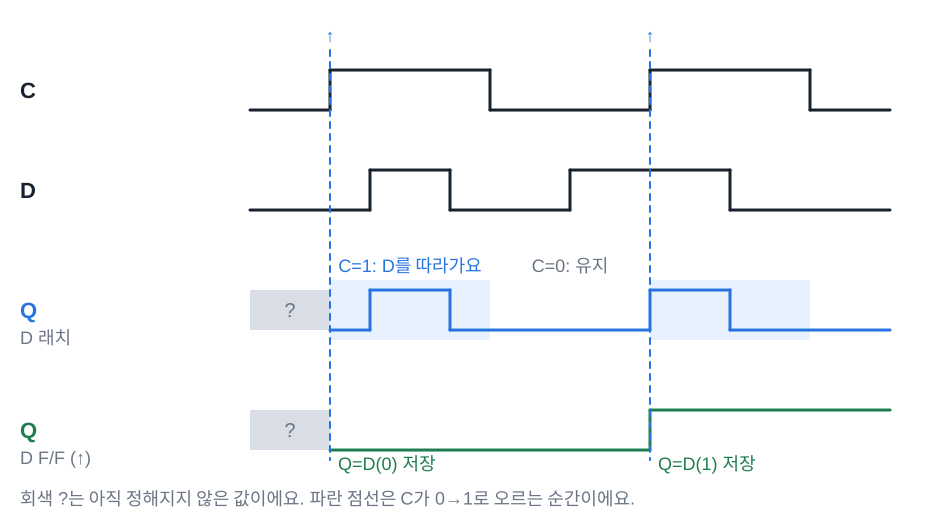
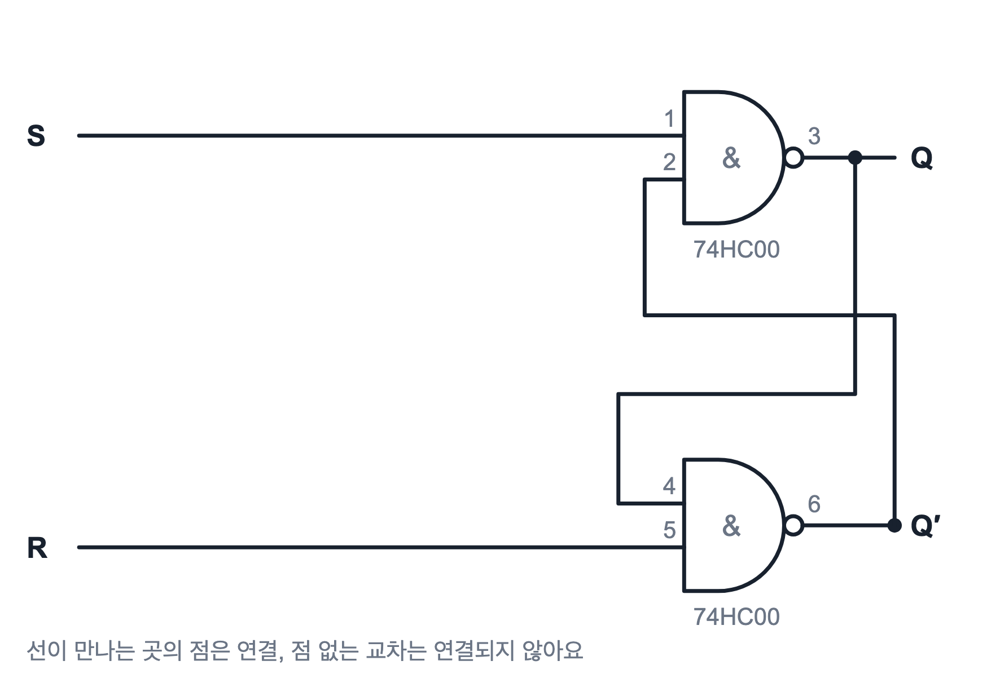
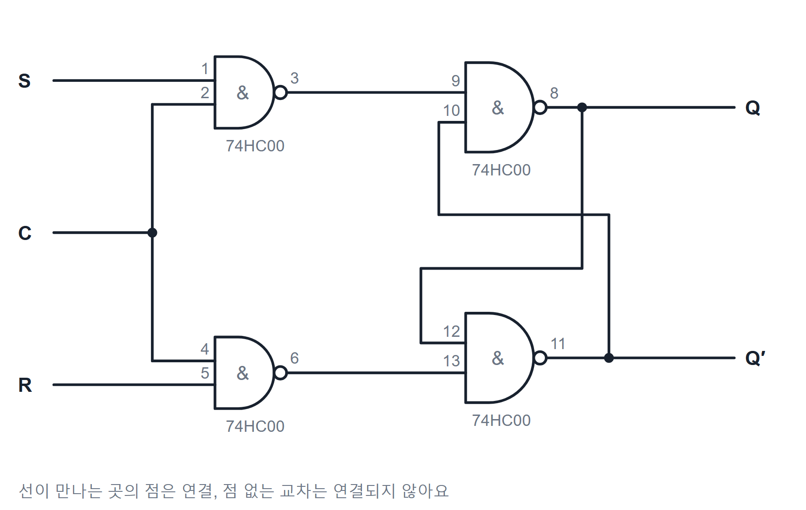
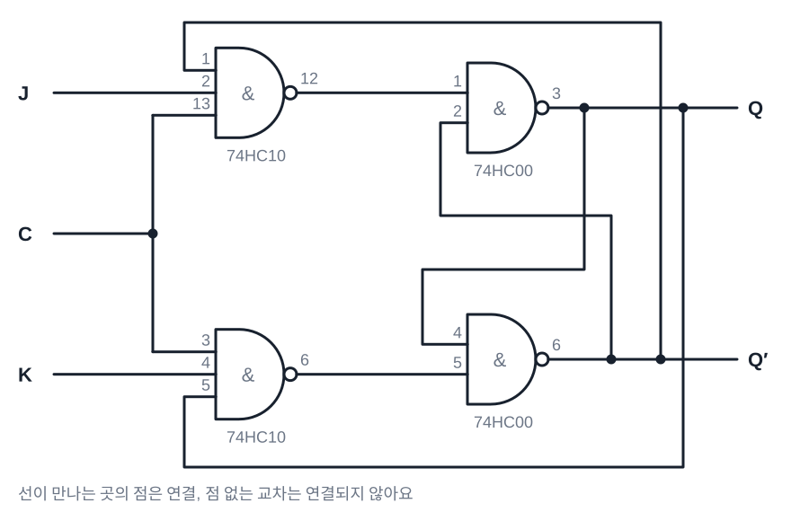
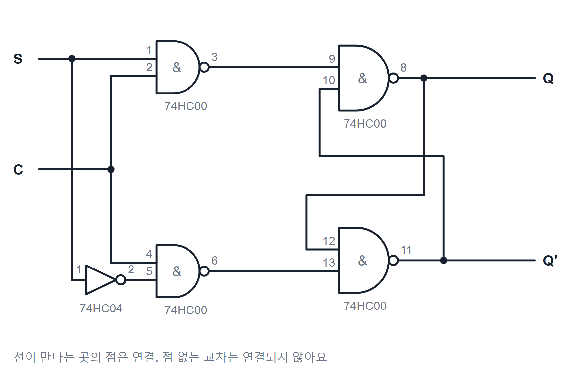
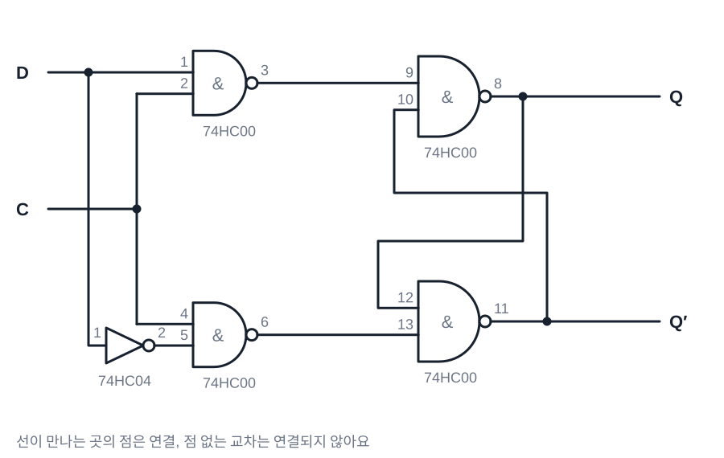
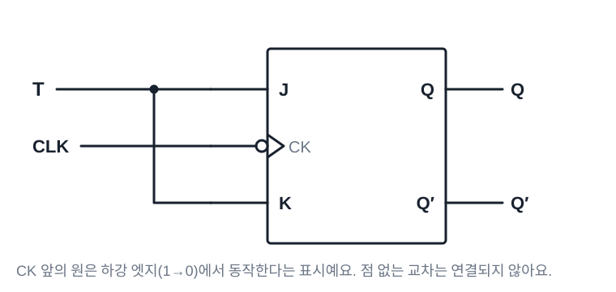
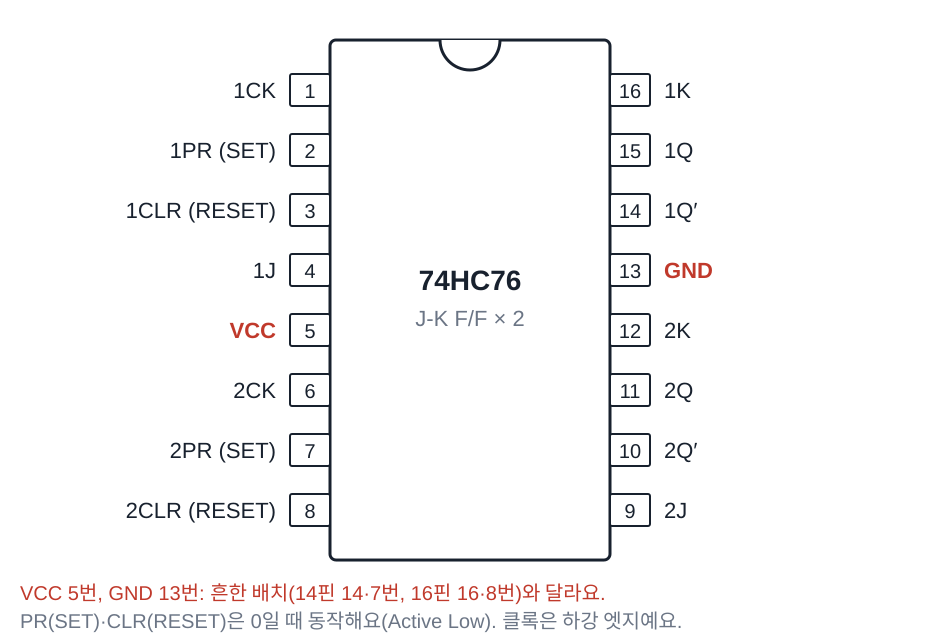
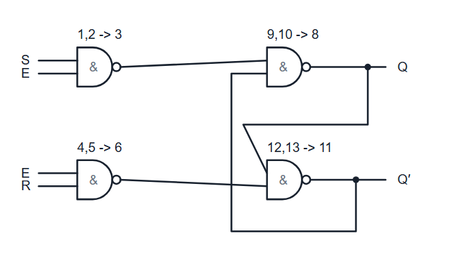
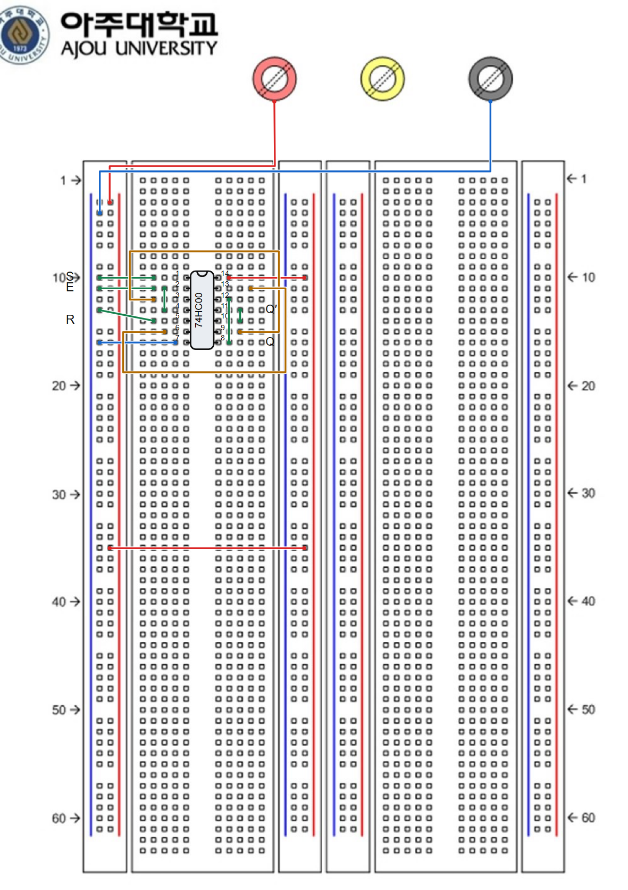

# 실험 6 · 문제 설명

      
첫 줄부터 완성 답과 검산까지 함께 풀어요.

## 문제를 함께 풀어요

### 문제 1 · Latch와 Flip-Flop의 차이

문제 읽기
#### 문제

Latch와 Flip-Flop의 차이점에 대해서 설명하시오.

#### 구할 것

입력이 출력에 반영되는 때를 기준으로 두 소자를 비교하세요.

이 문제에서 할 일
두 소자의 공통점과 차이를 써요.

이 문제를 봤을 때 떠올릴 개념과 공식
입력이 반영되는 시점을 비교해요

두 소자 모두 1비트를 기억하므로 입력을 받아들이는 시점이 구분 기준이에요.

레벨과 엣지를 구분하면 정상 동작의 차이를 설명할 수 있어요.

첫 줄을 이렇게 시작해요
비교 기준을 입력 반영 시점으로 잡아요.

필요한 개념: [래치와 플립플롭: 레벨과 엣지](%EC%8B%A4%ED%97%9806_%EC%8B%A4%ED%97%98%EC%84%A4%EB%AA%85.md#t-edge)

왜 이렇게 푸는지 함께 따라가요
교안의 래치는 Enable=1인 동안, 플립플롭은 소자에 지정된 클록 엣지에서 입력을 반영해요.

| 구분 | Latch | Flip-Flop |
| --- | --- | --- |
| 트리거 | 레벨 | 엣지 |
| 입력 반영 | Enable=1인 동안 계속 | 클록 엣지 순간에만 |
| 분류 | 비동기 | 동기 |

완성 답과 검산
래치는 레벨 트리거, 플립플롭은 엣지 트리거예요.

**검산:** 클록이 높은 동안 D가 0→1→0으로 바뀌면 D 래치의 Q는 따라가고, D 플립플롭은 엣지에서 저장한 값을 유지해요.

여기서 헷갈리기 쉬워요
위 비교는 비동기 강제 입력을 쓰지 않을 때예요. 유효 엣지 방향은 소자마다 달라요.

이제 설명을 닫고 다시 풀어요
- 같은 파형에서 두 소자가 D를 받는 구간과 순간을 각각 표시해요.

**떠올릴 것:** 입력이 반영되는 시점을 비교해요

래치는 Enable 활성 구간, 플립플롭은 지정 엣지에서 입력을 받아요.

**시작:** 비교 기준을 입력 반영 시점으로 잡아요.

**판단:** 교안의 래치는 Enable=1인 동안, 플립플롭은 소자에 지정된 클록 엣지에서 입력을 반영해요.

**검산:** 클록이 높은 동안 D가 0→1→0으로 바뀌면 D 래치의 Q는 따라가고, D 플립플롭은 엣지에서 저장한 값을 유지해요.

비교는 비동기 강제 입력이 없는 정상 동작이며 엣지 방향은 소자마다 지정돼요.

출처: [from_the_past/정리/퀴즈/실험6/실험6 퀴즈 기출 2017-1.pdf · PDF p1](../../../from_the_past/%EC%A0%95%EB%A6%AC/%ED%80%B4%EC%A6%88/%EC%8B%A4%ED%97%986/%EC%8B%A4%ED%97%986%20%ED%80%B4%EC%A6%88%20%EA%B8%B0%EC%B6%9C%202017-1.pdf#page=1) · [from_the_past/정리/퀴즈/실험6/실험6 퀴즈 기출_단답형.pdf · PDF p1](../../../from_the_past/%EC%A0%95%EB%A6%AC/%ED%80%B4%EC%A6%88/%EC%8B%A4%ED%97%986/%EC%8B%A4%ED%97%986%20%ED%80%B4%EC%A6%88%20%EA%B8%B0%EC%B6%9C_%EB%8B%A8%EB%8B%B5%ED%98%95.pdf#page=1) · [from_the_past/정리/퀴즈/실험6/실험6 퀴즈 예상문제_v1.pdf · PDF p1](../../../from_the_past/%EC%A0%95%EB%A6%AC/%ED%80%B4%EC%A6%88/%EC%8B%A4%ED%97%986/%EC%8B%A4%ED%97%986%20%ED%80%B4%EC%A6%88%20%EC%98%88%EC%83%81%EB%AC%B8%EC%A0%9C_v1.pdf#page=1) · [from_the_past/정리/퀴즈/실험6/실험6 퀴즈 예상문제_v2.pdf · PDF p1](../../../from_the_past/%EC%A0%95%EB%A6%AC/%ED%80%B4%EC%A6%88/%EC%8B%A4%ED%97%986/%EC%8B%A4%ED%97%986%20%ED%80%B4%EC%A6%88%20%EC%98%88%EC%83%81%EB%AC%B8%EC%A0%9C_v2.pdf#page=1) · [from_the_past/정리/퀴즈/실험6/실험6 퀴즈 예상문제_v3.pdf · PDF p1](../../../from_the_past/%EC%A0%95%EB%A6%AC/%ED%80%B4%EC%A6%88/%EC%8B%A4%ED%97%986/%EC%8B%A4%ED%97%986%20%ED%80%B4%EC%A6%88%20%EC%98%88%EC%83%81%EB%AC%B8%EC%A0%9C_v3.pdf#page=1) · [from_the_past/정리/퀴즈/실험6/실험6 퀴즈 예상문제_v4.pdf · PDF p1](../../../from_the_past/%EC%A0%95%EB%A6%AC/%ED%80%B4%EC%A6%88/%EC%8B%A4%ED%97%986/%EC%8B%A4%ED%97%986%20%ED%80%B4%EC%A6%88%20%EC%98%88%EC%83%81%EB%AC%B8%EC%A0%9C_v4.pdf#page=1) · [from_the_past/정리/퀴즈/실험6/실험6 퀴즈 종합_기출문제 (4p).pdf · PDF p2](../../../from_the_past/%EC%A0%95%EB%A6%AC/%ED%80%B4%EC%A6%88/%EC%8B%A4%ED%97%986/%EC%8B%A4%ED%97%986%20%ED%80%B4%EC%A6%88%20%EC%A2%85%ED%95%A9_%EA%B8%B0%EC%B6%9C%EB%AC%B8%EC%A0%9C%20%284p%29.pdf#page=2) · [from_the_past/정리/퀴즈/실험6/원본_docx/실험6.docx](../../../from_the_past/%EC%A0%95%EB%A6%AC/%ED%80%B4%EC%A6%88/%EC%8B%A4%ED%97%986/%EC%9B%90%EB%B3%B8_docx/%EC%8B%A4%ED%97%986.docx) · [from_the_past/정리/퀴즈/실험6/원본_docx/실험6_예상.docx](../../../from_the_past/%EC%A0%95%EB%A6%AC/%ED%80%B4%EC%A6%88/%EC%8B%A4%ED%97%986/%EC%9B%90%EB%B3%B8_docx/%EC%8B%A4%ED%97%986_%EC%98%88%EC%83%81.docx)

### 문제 2 · Latch를 설명

문제 읽기
#### 문제

Latch에 대해서 설명하시오.

#### 구할 것

Latch가 무엇을 저장하고 언제 입력을 받아들이는지 설명하세요.

이 문제에서 할 일
무엇을 저장하고 언제 갱신하는지 써요.

이 문제를 봤을 때 떠올릴 개념과 공식
래치는 되먹임으로 1비트를 저장해요

출력을 되먹이면 두 안정 상태 중 하나를 유지할 수 있어요.

교안은 래치를 비동기 기억소자로 분류해요.

첫 줄을 이렇게 시작해요
Q(t−1)을 이미 저장한 값으로 두어요.

필요한 개념: [출력을 되먹이는 회로와 NAND를 다시 읽어요](%EC%8B%A4%ED%97%9806_%EC%8B%A4%ED%97%98%EC%84%A4%EB%AA%85.md#t-basics), [실험 1: Enable이 있는 SR 래치](%EC%8B%A4%ED%97%9806_%EC%8B%A4%ED%97%98%EC%84%A4%EB%AA%85.md#t-sr-enable)

왜 이렇게 푸는지 함께 따라가요
교안의 Enable 래치는 E=1인 동안 입력에 반응해요. E=0이면 교차 되먹임이 기존 상태를 지켜요.

완성 답과 검산
래치는 되먹임으로 1비트를 저장하는 레벨 감응 기억소자예요.

**검산:** D 래치에 E=D=1을 준 뒤 E=0으로 닫고 D를 0으로 바꾸면 Q는 1이에요.

여기서 헷갈리기 쉬워요
초기 Q는 Set 또는 Reset 전까지 미정이에요. SR 금지 입력에서는 Q와 Q′의 보수 관계가 깨져요.

이제 설명을 닫고 다시 풀어요
- 되먹임과 Enable의 역할을 한 문장씩 써요.

**떠올릴 것:** 래치는 되먹임으로 1비트를 저장해요

되먹임이 1비트를 저장하고, E=0에서 직전 값을 유지해요.

**시작:** Q(t−1)을 이미 저장한 값으로 두어요.

**판단:** 교안의 Enable 래치는 E=1인 동안 입력에 반응해요. E=0이면 교차 되먹임이 기존 상태를 지켜요.

**검산:** D 래치에 E=D=1을 준 뒤 E=0으로 닫고 D를 0으로 바꾸면 Q는 1이에요.

초기 Q는 Set/Reset으로 정하기 전 0으로 가정하지 않으며, SR 금지 입력에서는 정상 보수 관계를 적용하지 않아요.

출처: [from_the_past/정리/퀴즈/실험6/실험6 퀴즈 예상문제_v1.pdf · PDF p2](../../../from_the_past/%EC%A0%95%EB%A6%AC/%ED%80%B4%EC%A6%88/%EC%8B%A4%ED%97%986/%EC%8B%A4%ED%97%986%20%ED%80%B4%EC%A6%88%20%EC%98%88%EC%83%81%EB%AC%B8%EC%A0%9C_v1.pdf#page=2) · [from_the_past/정리/퀴즈/실험6/실험6 퀴즈 기출_단답형.pdf · PDF p1](../../../from_the_past/%EC%A0%95%EB%A6%AC/%ED%80%B4%EC%A6%88/%EC%8B%A4%ED%97%986/%EC%8B%A4%ED%97%986%20%ED%80%B4%EC%A6%88%20%EA%B8%B0%EC%B6%9C_%EB%8B%A8%EB%8B%B5%ED%98%95.pdf#page=1) · [from_the_past/정리/퀴즈/실험6/실험6 퀴즈 예상문제_v2.pdf · PDF p2](../../../from_the_past/%EC%A0%95%EB%A6%AC/%ED%80%B4%EC%A6%88/%EC%8B%A4%ED%97%986/%EC%8B%A4%ED%97%986%20%ED%80%B4%EC%A6%88%20%EC%98%88%EC%83%81%EB%AC%B8%EC%A0%9C_v2.pdf#page=2) · [from_the_past/정리/퀴즈/실험6/실험6 퀴즈 예상문제_v3.pdf · PDF p1](../../../from_the_past/%EC%A0%95%EB%A6%AC/%ED%80%B4%EC%A6%88/%EC%8B%A4%ED%97%986/%EC%8B%A4%ED%97%986%20%ED%80%B4%EC%A6%88%20%EC%98%88%EC%83%81%EB%AC%B8%EC%A0%9C_v3.pdf#page=1) · [from_the_past/정리/퀴즈/실험6/실험6 퀴즈 예상문제_v4.pdf · PDF p1](../../../from_the_past/%EC%A0%95%EB%A6%AC/%ED%80%B4%EC%A6%88/%EC%8B%A4%ED%97%986/%EC%8B%A4%ED%97%986%20%ED%80%B4%EC%A6%88%20%EC%98%88%EC%83%81%EB%AC%B8%EC%A0%9C_v4.pdf#page=1) · [from_the_past/정리/퀴즈/실험6/실험6 퀴즈 종합_기출문제 (4p).pdf · PDF p3](../../../from_the_past/%EC%A0%95%EB%A6%AC/%ED%80%B4%EC%A6%88/%EC%8B%A4%ED%97%986/%EC%8B%A4%ED%97%986%20%ED%80%B4%EC%A6%88%20%EC%A2%85%ED%95%A9_%EA%B8%B0%EC%B6%9C%EB%AC%B8%EC%A0%9C%20%284p%29.pdf#page=3) · [from_the_past/정리/퀴즈/실험6/원본_docx/실험6.docx](../../../from_the_past/%EC%A0%95%EB%A6%AC/%ED%80%B4%EC%A6%88/%EC%8B%A4%ED%97%986/%EC%9B%90%EB%B3%B8_docx/%EC%8B%A4%ED%97%986.docx) · [from_the_past/정리/퀴즈/실험6/원본_docx/실험6_예상.docx](../../../from_the_past/%EC%A0%95%EB%A6%AC/%ED%80%B4%EC%A6%88/%EC%8B%A4%ED%97%986/%EC%9B%90%EB%B3%B8_docx/%EC%8B%A4%ED%97%986_%EC%98%88%EC%83%81.docx)

### 문제 3 · Flip-Flop을 설명

문제 읽기
#### 문제

Flip-Flop에 대해서 설명하시오.

#### 구할 것

Flip-Flop이 무엇을 저장하고 언제 입력을 받아들이는지 설명하세요.

이 문제에서 할 일
저장 단위와 입력이 반영되는 때를 써요.

이 문제를 봤을 때 떠올릴 개념과 공식
플립플롭에서 유효 엣지를 먼저 찾아요

Clock의 레벨이 유지되는 구간과 입력을 샘플링하는 순간을 구분해요.

유효 엣지는 소자에 따라 ↑ 또는 ↓예요.

첫 줄을 이렇게 시작해요
클록에서 유효한 엣지 하나를 표시해요.

필요한 개념: [래치와 플립플롭: 레벨과 엣지](%EC%8B%A4%ED%97%9806_%EC%8B%A4%ED%97%98%EC%84%A4%EB%AA%85.md#t-edge)

왜 이렇게 푸는지 함께 따라가요
74HC74는 상승 엣지, 교안의 74HC76은 하강 엣지를 써요. 엣지 사이에는 저장값을 유지해요.

완성 답과 검산
플립플롭은 지정 클록 엣지에서 입력을 받아 1비트를 저장하는 동기 기억소자예요.

**검산:** 74HC76에서 J=K=1로 두고 클록을 한 번 내리면 Q가 한 번 반전되고, 낮은 구간에는 유지돼요.

여기서 헷갈리기 쉬워요
비동기 PR·CLR이 활성일 때는 그 명령이 우선해요. 정상 엣지 동작은 입력의 setup/hold 조건을 전제로 해요.

이제 설명을 닫고 다시 풀어요
- 지정 엣지와 엣지 사이의 동작을 나눠 써요.

**떠올릴 것:** 플립플롭에서 유효 엣지를 먼저 찾아요

지정 엣지에서 입력을 받아 한 비트를 저장해요.

**시작:** 클록에서 유효한 엣지 하나를 표시해요.

**판단:** 74HC74는 상승 엣지, 교안의 74HC76은 하강 엣지를 써요. 엣지 사이에는 저장값을 유지해요.

**검산:** 74HC76에서 J=K=1로 두고 클록을 한 번 내리면 Q가 한 번 반전되고, 낮은 구간에는 유지돼요.

입력은 지정 엣지의 setup/hold를 만족해야 해요. 74HC74는 ↑, 74HC76은 ↓예요. 비동기 PR·CLR이 활성일 때는 그 명령이 우선해요.

출처: [from_the_past/정리/퀴즈/실험6/실험6 퀴즈 예상문제_v1.pdf · PDF p2](../../../from_the_past/%EC%A0%95%EB%A6%AC/%ED%80%B4%EC%A6%88/%EC%8B%A4%ED%97%986/%EC%8B%A4%ED%97%986%20%ED%80%B4%EC%A6%88%20%EC%98%88%EC%83%81%EB%AC%B8%EC%A0%9C_v1.pdf#page=2) · [from_the_past/정리/퀴즈/실험6/실험6 퀴즈 기출_단답형.pdf · PDF p1](../../../from_the_past/%EC%A0%95%EB%A6%AC/%ED%80%B4%EC%A6%88/%EC%8B%A4%ED%97%986/%EC%8B%A4%ED%97%986%20%ED%80%B4%EC%A6%88%20%EA%B8%B0%EC%B6%9C_%EB%8B%A8%EB%8B%B5%ED%98%95.pdf#page=1) · [from_the_past/정리/퀴즈/실험6/실험6 퀴즈 예상문제_v2.pdf · PDF p2](../../../from_the_past/%EC%A0%95%EB%A6%AC/%ED%80%B4%EC%A6%88/%EC%8B%A4%ED%97%986/%EC%8B%A4%ED%97%986%20%ED%80%B4%EC%A6%88%20%EC%98%88%EC%83%81%EB%AC%B8%EC%A0%9C_v2.pdf#page=2) · [from_the_past/정리/퀴즈/실험6/실험6 퀴즈 예상문제_v3.pdf · PDF p1](../../../from_the_past/%EC%A0%95%EB%A6%AC/%ED%80%B4%EC%A6%88/%EC%8B%A4%ED%97%986/%EC%8B%A4%ED%97%986%20%ED%80%B4%EC%A6%88%20%EC%98%88%EC%83%81%EB%AC%B8%EC%A0%9C_v3.pdf#page=1) · [from_the_past/정리/퀴즈/실험6/실험6 퀴즈 예상문제_v4.pdf · PDF p1](../../../from_the_past/%EC%A0%95%EB%A6%AC/%ED%80%B4%EC%A6%88/%EC%8B%A4%ED%97%986/%EC%8B%A4%ED%97%986%20%ED%80%B4%EC%A6%88%20%EC%98%88%EC%83%81%EB%AC%B8%EC%A0%9C_v4.pdf#page=1) · [from_the_past/정리/퀴즈/실험6/실험6 퀴즈 종합_기출문제 (4p).pdf · PDF p3](../../../from_the_past/%EC%A0%95%EB%A6%AC/%ED%80%B4%EC%A6%88/%EC%8B%A4%ED%97%986/%EC%8B%A4%ED%97%986%20%ED%80%B4%EC%A6%88%20%EC%A2%85%ED%95%A9_%EA%B8%B0%EC%B6%9C%EB%AC%B8%EC%A0%9C%20%284p%29.pdf#page=3) · [from_the_past/정리/퀴즈/실험6/원본_docx/실험6.docx](../../../from_the_past/%EC%A0%95%EB%A6%AC/%ED%80%B4%EC%A6%88/%EC%8B%A4%ED%97%986/%EC%9B%90%EB%B3%B8_docx/%EC%8B%A4%ED%97%986.docx) · [from_the_past/정리/퀴즈/실험6/원본_docx/실험6_예상.docx](../../../from_the_past/%EC%A0%95%EB%A6%AC/%ED%80%B4%EC%A6%88/%EC%8B%A4%ED%97%986/%EC%9B%90%EB%B3%B8_docx/%EC%8B%A4%ED%97%986_%EC%98%88%EC%83%81.docx)

### 문제 4 · 기본 S-R latch에 S=R=0을 넣으면

문제 읽기
#### 문제

아래의 회로는 기본 S-R latch 회로이다. S와 R이 동시에 0이 입력되면 Q와 Q′의 출력은 무엇인가? Q′ = not Q 등식이 성립하는가?

#### 주어진 조건

NAND(74HC00) 두 개의 출력이 서로의 입력에 연결돼 있어요. S는 Q를 내는 NAND, R은 Q′을 내는 NAND에 들어가요. Enable 입력은 없어요.

#### 구할 것

S=R=0일 때 Q와 Q′을 구하고, Q′=not Q가 성립하는지 답하세요.

이 문제에서 할 일
두 출력과 보수 관계를 답해요.

이 문제를 봤을 때 떠올릴 개념과 공식
S와 R의 0이 두 NAND에 직접 들어가요

Enable 앞단이 없는 교차 NAND라 S·R은 0에서 활성이고, 0이 들어간 NAND의 출력은 1로 정해져요.

두 NAND 출력을 따로 구하면 금지 입력에서도 결과를 판단할 수 있어요.

첫 줄을 이렇게 시작해요
Q=(S·Q′)′, Q′=(R·Q)′에 S=R=0을 넣어요.

필요한 개념: [NAND 두 개로 만든 기본 SR 래치](%EC%8B%A4%ED%97%9806_%EC%8B%A4%ED%97%98%EC%84%A4%EB%AA%85.md#t-sr-basic)

왜 이렇게 푸는지 함께 따라가요
두 식 모두 되먹임 입력과 관계없이 1이에요.

| S | R | Q | Q′ |
| --- | --- | --- | --- |
| 1 | 1 | Q(t−1) | Q′(t−1) |
| 0 | 1 | 1 | 0 |
| 1 | 0 | 0 | 1 |
| 0 | 0 | 1 | 1 |

완성 답과 검산
Q=Q′=1이므로 Q′=NOT Q는 성립하지 않아요.

**검산:** 되먹임에 나온 1을 다시 넣어도 두 식이 (0·1)′=1로 유지돼요.

여기서 헷갈리기 쉬워요
앞단이 붙은 Enable SR의 00은 유지예요. 이 회로의 00은 금지이며 S·R을 동시에 1로 풀면 다음 상태는 미정이에요.

이제 설명을 닫고 다시 풀어요
- 각 NAND의 강제 입력을 표시해 두 출력을 계산해요.

**떠올릴 것:** S와 R의 0이 두 NAND에 직접 들어가요

기본 NAND SR은 0이 활성이고, 00에서 Q와 Q′이 모두 1이에요.

**시작:** Q=(S·Q′)′, Q′=(R·Q)′에 S=R=0을 넣어요.

**판단:** 두 식 모두 되먹임 입력과 관계없이 1이에요.

**검산:** 되먹임에 나온 1을 다시 넣어도 두 식이 (0·1)′=1로 유지돼요.

00은 금지 입력이에요. S·R을 동시에 1로 풀면 다음 상태는 미정이에요.

출처: [from_the_past/정리/퀴즈/실험6/실험6 퀴즈 기출_단답형.pdf · PDF p2](../../../from_the_past/%EC%A0%95%EB%A6%AC/%ED%80%B4%EC%A6%88/%EC%8B%A4%ED%97%986/%EC%8B%A4%ED%97%986%20%ED%80%B4%EC%A6%88%20%EA%B8%B0%EC%B6%9C_%EB%8B%A8%EB%8B%B5%ED%98%95.pdf#page=2)

### 문제 5 · Enable이 있는 R-S Latch의 진리표

문제 읽기
#### 문제

R-S Latch의 Truth table을 완성하시오.

#### 주어진 조건

회로는 아래 그림과 같아요. S·C가 첫 NAND, R·C가 둘째 NAND에 들어가고 그 출력이 서로 되먹임된 NAND 두 개로 가요(74HC00 네 개 게이트). C는 Enable 역할이에요. 원문에는 빈 표가 없어요. 풀이하기 쉽게 입력 행만 정리했어요.

#### 구할 것

표의 Q(t)를 채우세요. 부정 행은 회로가 내는 값과 쓰지 않는 이유를 함께 써요.

| S | R | C | Q(t) |
| --- | --- | --- | --- |
| 0 | 0 | 1 |  |
| 0 | 1 | 1 |  |
| 1 | 0 | 1 |  |
| 1 | 1 | 1 |  |
| x | x | 0 |  |

이 문제에서 할 일
Q(t)의 다섯 행과 금지 이유를 써요.

이 문제를 봤을 때 떠올릴 개념과 공식
C를 Enable로 읽고 앞단 NAND부터 계산해요

C가 두 앞단 NAND에 공통으로 들어가므로 C=0이면 명령을 차단해요. 바깥 S·R은 High 활성, 저장부 NAND 입력은 Low 활성이에요.

정상 행에서는 Q′=NOT Q예요.

첫 줄을 이렇게 시작해요
C=0이면 (S·0)′=(R·0)′=1이므로 마지막 행을 Q(t−1)로 채워요.

필요한 개념: [실험 1: Enable이 있는 SR 래치](%EC%8B%A4%ED%97%9806_%EC%8B%A4%ED%97%98%EC%84%A4%EB%AA%85.md#t-sr-enable)

왜 이렇게 푸는지 함께 따라가요
C=1일 때 S·R이 10이면 Q 쪽 입력만 0이라 Set이에요. 11은 두 입력을 모두 0으로 만들어 Q=Q′=1이 돼요.

| S | R | C | Q(t) | Q′(t) |
| --- | --- | --- | --- | --- |
| 0 | 0 | 1 | Q(t−1) | Q′(t−1) |
| 0 | 1 | 1 | 0 | 1 |
| 1 | 0 | 1 | 1 | 0 |
| 1 | 1 | 1 | 1 | 1 |
| x | x | 0 | Q(t−1) | Q′(t−1) |

완성 답과 검산
완성표에서 11은 출력이 1이어도 보수 관계가 깨져 사용하지 않는 행이에요.

**검산:** Set 행의 Q=1을 반대쪽에 되먹이면 Q′=(1·1)′=0으로 돌아와요.

여기서 헷갈리기 쉬워요
11에 대한 자료의 1·Invalid·대시는 같은 부정 행을 가리켜요. 실제 출력값과 금지 여부를 함께 써요.

이제 설명을 닫고 다시 풀어요
- 앞단 출력을 먼저 적고, 교차 NAND 두 출력으로 표를 채워요.

**떠올릴 것:** C를 Enable로 읽고 앞단 NAND부터 계산해요

C=0은 유지예요. C=1에서 00 유지·01 Reset·10 Set·11 금지예요.

**시작:** C=0이면 (S·0)′=(R·0)′=1이므로 마지막 행을 Q(t−1)로 채워요.

**판단:** C=1일 때 S·R이 10이면 Q 쪽 입력만 0이라 Set이에요. 11은 두 입력을 모두 0으로 만들어 Q=Q′=1이 돼요.

**검산:** Set 행의 Q=1을 반대쪽에 되먹이면 Q′=(1·1)′=0으로 돌아와요.

출처: [from_the_past/정리/퀴즈/실험6/실험6 퀴즈 예상문제_v1.pdf · PDF p1](../../../from_the_past/%EC%A0%95%EB%A6%AC/%ED%80%B4%EC%A6%88/%EC%8B%A4%ED%97%986/%EC%8B%A4%ED%97%986%20%ED%80%B4%EC%A6%88%20%EC%98%88%EC%83%81%EB%AC%B8%EC%A0%9C_v1.pdf#page=1) · [from_the_past/정리/퀴즈/실험6/실험6 퀴즈 예상문제_v2.pdf · PDF p1](../../../from_the_past/%EC%A0%95%EB%A6%AC/%ED%80%B4%EC%A6%88/%EC%8B%A4%ED%97%986/%EC%8B%A4%ED%97%986%20%ED%80%B4%EC%A6%88%20%EC%98%88%EC%83%81%EB%AC%B8%EC%A0%9C_v2.pdf#page=1) · [from_the_past/정리/퀴즈/실험6/실험6 퀴즈 예상문제_v4.pdf · PDF p1](../../../from_the_past/%EC%A0%95%EB%A6%AC/%ED%80%B4%EC%A6%88/%EC%8B%A4%ED%97%986/%EC%8B%A4%ED%97%986%20%ED%80%B4%EC%A6%88%20%EC%98%88%EC%83%81%EB%AC%B8%EC%A0%9C_v4.pdf#page=1) · [from_the_past/정리/퀴즈/실험6/원본_docx/실험6.docx](../../../from_the_past/%EC%A0%95%EB%A6%AC/%ED%80%B4%EC%A6%88/%EC%8B%A4%ED%97%986/%EC%9B%90%EB%B3%B8_docx/%EC%8B%A4%ED%97%986.docx) · [from_the_past/정리/퀴즈/실험6/원본_docx/실험6_예상.docx](../../../from_the_past/%EC%A0%95%EB%A6%AC/%ED%80%B4%EC%A6%88/%EC%8B%A4%ED%97%986/%EC%9B%90%EB%B3%B8_docx/%EC%8B%A4%ED%97%986_%EC%98%88%EC%83%81.docx)

### 문제 6 · R-S Latch를 Toggle 되게 바꾸기

문제 읽기
#### 문제

1) R-S Latch 회로로부터 (R,S가 1 일때), Q의 값이 Toggle 되게 하려면 회로를 어떻게 변형해야 하는가?

2) R-S Latch 회로에서 (R,S 가 1일 때) 갖는 문제점이 무엇인가?

(1)의 결과와 같이 변형된 회로를 무슨 회로라고 부르는가?

#### 주어진 조건

주어진 회로는 S·C, R·C를 받는 NAND 두 개와 서로 되먹임된 NAND 두 개로 된 R-S Latch예요.

#### 구할 것

세 소문항, 1) 변형 방법, 2) 문제점, 3) 변형된 회로의 이름(원문의 “(1)의 결과와 같이…” 문장)에 모두 답하세요.

이 문제에서 할 일
변형, 원래 회로의 금지 이유, 회로 이름을 답해요.

이 문제를 봤을 때 떠올릴 개념과 공식
11에서 현재 Q와 반대 방향만 열어요

한 번 반전하려면 Q=0에서는 Set, Q=1에서는 Reset 요청만 열어야 해요.

한 번의 갱신은 짧은 활성 펄스를 전제로 해요.

첫 줄을 이렇게 시작해요
정상 상태의 보수 출력 Q′을 Set 쪽에 표시해요.

필요한 개념: [실험 1: Enable이 있는 SR 래치](%EC%8B%A4%ED%97%9806_%EC%8B%A4%ED%97%98%EC%84%A4%EB%AA%85.md#t-sr-enable), [JK 래치는 1, 1을 뒤집기로 바꿔요](%EC%8B%A4%ED%97%9806_%EC%8B%A4%ED%97%98%EC%84%A4%EB%AA%85.md#t-jk-latch)

왜 이렇게 푸는지 함께 따라가요
① 두 앞단을 3입력 NAND로 바꾸고 S 쪽 Q′, R 쪽 Q를 되먹여요. ② 원래 SR에서 C=1, S=R=1이면 Q=Q′=1이라 보수 관계가 깨져요. 두 명령을 함께 해제한 뒤 상태는 미정이에요. ③ 변형한 회로는 JK 래치이며 S가 J, R이 K가 돼요.

완성 답과 검산
완성 회로에서 J 쪽 Q′와 K 쪽 Q를 확인해요.

**검산:** J=K=C=1에 Q=0과 Q=1을 각각 넣으면 활성 앞단이 바뀌어 한 번의 갱신 결과가 각각 1과 0이에요.

여기서 헷갈리기 쉬워요
되먹임을 반대로 연결하면 반전되지 않아요. 표의 한 번 반전에는 짧은 C 펄스가 필요하고 C=1을 오래 유지하면 race-around가 생겨요.

이제 설명을 닫고 다시 풀어요
- 되먹임 두 선을 그린 뒤 원래 11의 문제와 변형 회로 이름을 써요.

**떠올릴 것:** 11에서 현재 Q와 반대 방향만 열어요

J에 Q′, K에 Q를 되먹여 정상 보수 상태에서 한쪽 요청만 열어요.

**시작:** 정상 상태의 보수 출력 Q′을 Set 쪽에 표시해요.

**판단:** ① 두 앞단을 3입력 NAND로 바꾸고 S 쪽 Q′, R 쪽 Q를 되먹여요. ② 원래 SR에서 C=1, S=R=1이면 Q=Q′=1이라 보수 관계가 깨져요. 두 명령을 함께 해제한 뒤 상태는 미정이에요. ③ 변형한 회로는 JK 래치이며 S가 J, R이 K가 돼요.

**검산:** J=K=C=1에 Q=0과 Q=1을 각각 넣으면 활성 앞단이 바뀌어 한 번의 갱신 결과가 각각 1과 0이에요.

한 번의 Toggle은 짧은 C 펄스 조건이에요. 원래 SR의 금지 상태에서 S·R을 동시에 해제한 뒤 값도 예측하지 못해요.

출처: [from_the_past/정리/퀴즈/실험6/실험6 퀴즈 해설.pdf · PDF p1](../../../from_the_past/%EC%A0%95%EB%A6%AC/%ED%80%B4%EC%A6%88/%EC%8B%A4%ED%97%986/%EC%8B%A4%ED%97%986%20%ED%80%B4%EC%A6%88%20%ED%95%B4%EC%84%A4.pdf#page=1)

### 문제 7 · 회로가 주어진 D F/F 진리표

문제 읽기
#### 문제

D F/F의 Truth table을 완성하시오(회로설계로 대체될 수 있음)

#### 주어진 조건

회로는 아래 그림과 같아요. 원문 그림의 입력 단자 이름은 S와 C예요. S는 첫 NAND로 바로, 또 NOT(74HC04)을 거쳐 둘째 NAND로 들어가요. C는 두 NAND에 함께 들어가요. 원문에는 빈 표가 없어요. 풀이하기 쉽게 입력 행만 정리했어요.

#### 구할 것

표의 Q와 Q′을 채우세요.

| S | C | Q | Q′ |
| --- | --- | --- | --- |
| 0 | 1 |  |  |
| 1 | 1 |  |  |
| X | 0 |  |  |

이 문제에서 할 일
Q와 Q′의 세 행을 채워요.

이 문제를 봤을 때 떠올릴 개념과 공식
NOT을 거친 S′이 Reset 쪽으로 가요

그림에서 S가 데이터 역할이고 아래 앞단은 S′을 받으므로, Enable D 래치의 두 행이 나와요.

그림에는 엣지 검출이 없으므로 C는 Enable로 읽어요.

첫 줄을 이렇게 시작해요
C=1, S=0이면 아래 앞단만 0이라 Q′=1부터 적어요.

필요한 개념: [실험 2-1: D 래치는 부정 상태를 막아요](%EC%8B%A4%ED%97%9806_%EC%8B%A4%ED%97%98%EC%84%A4%EB%AA%85.md#t-d-latch)

왜 이렇게 푸는지 함께 따라가요
C=1에서는 두 명령이 동시에 1이 될 수 없어요. C=0이면 앞단 출력이 모두 1이라 직전 상태가 남아요.

| S | C | Q | Q′ |
| --- | --- | --- | --- |
| 0 | 1 | 0 | 1 |
| 1 | 1 | 1 | 0 |
| X | 0 | Q(t−1) | Q′(t−1) |

완성 답과 검산
C=1에서 Q=S, Q′=S′이고 C=0에서는 두 출력이 유지돼요.

**검산:** C=1, S=1이면 위 앞단 NAND가 (1·1)′=0을 내므로 Q=1이에요.

여기서 헷갈리기 쉬워요
제목의 F/F와 달리 그림은 레벨 래치예요. 기출 단답형의 둘째 행 “0 1 1”은 오기로 보이며 회로에서 Q=1인 행의 S는 1이에요.

이제 설명을 닫고 다시 풀어요
- NOT이 붙은 쪽을 따라가서 두 활성 행과 유지 행을 채워요.

**떠올릴 것:** NOT을 거친 S′이 Reset 쪽으로 가요

이 레벨 회로의 S가 데이터이고, C=1에서는 Q=S예요.

**시작:** C=1, S=0이면 아래 앞단만 0이라 Q′=1부터 적어요.

**판단:** C=1에서는 두 명령이 동시에 1이 될 수 없어요. C=0이면 앞단 출력이 모두 1이라 직전 상태가 남아요.

**검산:** C=1, S=1이면 위 앞단 NAND가 (1·1)′=0을 내므로 Q=1이에요.

제목은 F/F지만 엣지 검출 없는 D 래치로 읽어요. 기출 답안 둘째 행의 “0 1 1”은 오기로 보이며 회로 계산은 S=1일 때 Q=1이에요.

출처: [from_the_past/정리/퀴즈/실험6/실험6 퀴즈 예상문제_v3.pdf · PDF p1](../../../from_the_past/%EC%A0%95%EB%A6%AC/%ED%80%B4%EC%A6%88/%EC%8B%A4%ED%97%986/%EC%8B%A4%ED%97%986%20%ED%80%B4%EC%A6%88%20%EC%98%88%EC%83%81%EB%AC%B8%EC%A0%9C_v3.pdf#page=1) · [from_the_past/정리/퀴즈/실험6/실험6 퀴즈 종합_기출문제 (4p).pdf · PDF p2](../../../from_the_past/%EC%A0%95%EB%A6%AC/%ED%80%B4%EC%A6%88/%EC%8B%A4%ED%97%986/%EC%8B%A4%ED%97%986%20%ED%80%B4%EC%A6%88%20%EC%A2%85%ED%95%A9_%EA%B8%B0%EC%B6%9C%EB%AC%B8%EC%A0%9C%20%284p%29.pdf#page=2)

### 문제 8 · D F/F 진리표를 만족하는 회로 설계

문제 읽기
#### 문제

D F/F의 Truth table을 만족하는 회로를 설계하시오.

| D | C | Q(t) |
| --- | --- | --- |
| 0 | 1 | 0 |
| 1 | 1 | 1 |
| x | 0 | Q(t-1) |

#### 주어진 조건

표는 원문 그대로이고 이미 채워져 있어요. C는 제어 입력이에요. 원문은 F/F라고 부르지만 표에는 C가 1인 동안의 동작이 적혀 있어요.

#### 구할 것

이 표를 만족하는 게이트 회로를 그리세요.

이 문제에서 할 일
주어진 표를 구현하는 회로를 그려요.

이 문제를 봤을 때 떠올릴 개념과 공식
C=1 구간의 Q=D는 레벨 래치 동작이에요

표가 C=1인 동안 D를 따라가라고 하므로 Enable SR 래치에서 두 명령을 한 입력으로 만들어요.

Q(t−1)은 이전 저장값이므로 초기값을 임의로 정할 필요가 없어요.

첫 줄을 이렇게 시작해요
S=D, R=D′으로 연결해요.

필요한 개념: [실험 2-1: D 래치는 부정 상태를 막아요](%EC%8B%A4%ED%97%9806_%EC%8B%A4%ED%97%98%EC%84%A4%EB%AA%85.md#t-d-latch)

왜 이렇게 푸는지 함께 따라가요
NOT 1개와 NAND 4개를 써요. D와 D′은 동시에 1이 될 수 없어 C=1에서는 D 값이 Set 또는 Reset 하나를 골라요.

완성 답과 검산
회로에서 D와 D′이 각 앞단에 하나씩 들어가고 C는 공통이에요.

**검산:** 활성 때 D=0·1을 각각 넣어 Q=0·1을 확인해요. C=0에서 앞단 두 출력은 1이므로 이전 Q(t−1)이 남아요.

여기서 헷갈리기 쉬워요
D를 양쪽에 그대로 보내면 D=C=1에서 금지 입력이 생겨요. 엣지형 D F/F는 C=1 도중 바뀐 D를 반영하지 못해요.

이제 설명을 닫고 다시 풀어요
- D·D′과 C를 앞단에 배선하고 표의 세 행을 확인해요.

**떠올릴 것:** C=1 구간의 Q=D는 레벨 래치 동작이에요

S=D, R=D′인 Enable SR 래치는 C=1에서 Q=D, C=0에서 유지예요.

**시작:** S=D, R=D′으로 연결해요.

**판단:** NOT 1개와 NAND 4개를 써요. D와 D′은 동시에 1이 될 수 없어 C=1에서는 D 값이 Set 또는 Reset 하나를 골라요.

**검산:** 활성 때 D=0·1을 각각 넣어 Q=0·1을 확인해요. C=0에서 앞단 두 출력은 1이므로 이전 Q(t−1)이 남아요.

원문 F/F 명칭보다 레벨 표를 기준으로 NOT 1개·NAND 4개를 설계해요. Q(t−1)은 0으로 정해진 값이 아닌 이전 저장값이에요.

출처: [from_the_past/정리/퀴즈/실험6/실험6 퀴즈 기출 2017-1.pdf · PDF p1](../../../from_the_past/%EC%A0%95%EB%A6%AC/%ED%80%B4%EC%A6%88/%EC%8B%A4%ED%97%986/%EC%8B%A4%ED%97%986%20%ED%80%B4%EC%A6%88%20%EA%B8%B0%EC%B6%9C%202017-1.pdf#page=1)

### 문제 9 · 회로가 주어진 J-K F/F 진리표

문제 읽기
#### 문제

J-K F/F의 Truth table을 완성하시오.

#### 주어진 조건

회로는 아래 그림과 같아요. J·C와 Q′을 받는 3입력 NAND, K·C와 Q를 받는 3입력 NAND(74HC10)가 서로 되먹임된 NAND 두 개(74HC00)로 가요. Toggle 행은 C를 짧게 1로 하는 이상적인 경우로 읽어요. 원문에는 빈 표가 없어요. 풀이하기 쉽게 입력 행만 정리했어요.

#### 구할 것

표의 Q(t)를 채우세요.

| J | K | C | Q(t) |
| --- | --- | --- | --- |
| 0 | 0 | 1 |  |
| 0 | 1 | 1 |  |
| 1 | 0 | 1 |  |
| 1 | 1 | 1 |  |
| X | X | 0 |  |

이 문제에서 할 일
JK 표의 다섯 행을 채워요.

이 문제를 봤을 때 떠올릴 개념과 공식
3입력 NAND에서 Q′과 Q의 되먹임을 따라가요

J에는 Q′, K에는 Q가 되먹여져 현재 출력에 따라 Set·Reset 중 한쪽만 열려요.

J·K의 값과 직전 Q가 함께 다음 출력을 결정해요.

첫 줄을 이렇게 시작해요
C=0이면 두 앞단 출력이 1이라 유지 행부터 적어요.

필요한 개념: [JK 래치는 1, 1을 뒤집기로 바꿔요](%EC%8B%A4%ED%97%9806_%EC%8B%A4%ED%97%98%EC%84%A4%EB%AA%85.md#t-jk-latch)

왜 이렇게 푸는지 함께 따라가요
C=1, JK=11에서 기존 Q=0이면 J 쪽, Q=1이면 K 쪽만 열려 한 번 갱신할 때 값이 뒤집혀요.

| J | K | C | Q(t) |
| --- | --- | --- | --- |
| 0 | 0 | 1 | Q(t−1) |
| 0 | 1 | 1 | 0 : Reset |
| 1 | 0 | 1 | 1 : Set |
| 1 | 1 | 1 | Q(t−1)′ : Toggle |
| X | X | 0 | Q(t−1) |

완성 답과 검산
완성표의 Q(t−1)은 갱신 직전 저장값이에요.

**검산:** C=1의 각 행은 한 번의 갱신식 Qnext=J·Q′+K′·Q에 이전 Q=0·1을 각각 넣어 확인해요.

여기서 헷갈리기 쉬워요
그림은 레벨 래치예요. 11의 단일 반전은 한 번 갱신한 뒤 되먹임이 재반영되기 전에 C가 닫히는 조건이고, 긴 C=1에서는 race-around가 생겨요.

이제 설명을 닫고 다시 풀어요
- 활성 행마다 이전 Q를 두 값으로 바꿔 표를 채워요.

**떠올릴 것:** 3입력 NAND에서 Q′과 Q의 되먹임을 따라가요

C=0은 유지. C=1의 11은 단일 갱신 시 Toggle이에요.

**시작:** C=0이면 두 앞단 출력이 1이라 유지 행부터 적어요.

**판단:** C=1, JK=11에서 기존 Q=0이면 J 쪽, Q=1이면 K 쪽만 열려 한 번 갱신할 때 값이 뒤집혀요.

**검산:** C=1의 각 행은 한 번의 갱신식 Qnext=J·Q′+K′·Q에 이전 Q=0·1을 각각 넣어 확인해요.

C=0은 유지이며 11의 단일 Toggle은 한 번 바뀔 만큼 길고 되먹임이 돌아오기 전 끝날 만큼 짧은 C 펄스의 이상 조건이에요.

출처: [from_the_past/정리/퀴즈/실험6/실험6 퀴즈 기출_단답형.pdf · PDF p2](../../../from_the_past/%EC%A0%95%EB%A6%AC/%ED%80%B4%EC%A6%88/%EC%8B%A4%ED%97%986/%EC%8B%A4%ED%97%986%20%ED%80%B4%EC%A6%88%20%EA%B8%B0%EC%B6%9C_%EB%8B%A8%EB%8B%B5%ED%98%95.pdf#page=2)

### 문제 10 · J-K F/F 진리표를 만족하는 회로 설계

문제 읽기
#### 문제

J-K F/F의 Truth table을 만족하는 회로를 설계하시오.

| J | K | C | Q(t) |
| --- | --- | --- | --- |
| 0 | 0 | 1 | Q(t-1) |
| 0 | 1 | 1 | 0 : Reset |
| 1 | 0 | 1 | 1 : Set |
| 1 | 1 | 1 | Q(t-1)′ : Toggle |
| x | x | 0 | Q(t-1) |

#### 주어진 조건

표는 원문 그대로이고 이미 채워져 있어요. 원문은 F/F라고 부르지만 표에는 C가 1인 동안의 동작이 적혀 있어요. Toggle 행은 C를 짧게 1로 하는 이상적인 경우로 읽어요.

#### 구할 것

이 표를 만족하는 게이트 회로를 그리세요.

이 문제에서 할 일
진리표를 만족하는 게이트 회로를 그려요.

이 문제를 봤을 때 떠올릴 개념과 공식
11에서 한쪽 요청만 열리도록 앞단을 바꿔요

11→Q(t−1)′을 만들려면 현재 Q가 0일 때 Set, 1일 때 Reset만 허용해요.

C=0은 유지예요. 레벨 회로의 단일 갱신에는 짧은 C 펄스가 필요해요.

첫 줄을 이렇게 시작해요
J 쪽은 J·C·Q′, K 쪽은 K·C·Q를 받게 해요.

필요한 개념: [JK 래치는 1, 1을 뒤집기로 바꿔요](%EC%8B%A4%ED%97%9806_%EC%8B%A4%ED%97%98%EC%84%A4%EB%AA%85.md#t-jk-latch)

왜 이렇게 푸는지 함께 따라가요
3입력 NAND 2개와 교차 2입력 NAND 2개로 구성해요. 정상 보수 상태에서는 C=1이어도 두 요청이 동시에 활성화되지 않아요.

$$Q(t)=J\,\overline{Q(t-1)}+\overline{K}\,Q(t-1)$$

완성 답과 검산
식은 C=1에서 한 번 갱신한 결과예요.

**검산:** J=K=C=1, Q=1을 대입하면 K 쪽 NAND=0으로 Q=0이에요. Q=0에서 반대 방향과 C=0의 유지도 확인해요.

여기서 헷갈리기 쉬워요
되먹임을 바꾸면 11 반전이 깨져요. 레벨 회로의 긴 C=1에서는 race-around가 생겨요. 엣지 해석이 필요한 경우에는 하강 엣지형 74HC76을 구분해요.

이제 설명을 닫고 다시 풀어요
- 두 되먹임 선을 그린 뒤 11을 Q=0과 1에서 각각 검산해요.

**떠올릴 것:** 11에서 한쪽 요청만 열리도록 앞단을 바꿔요

J에 Q′, K에 Q를 되먹여 C=1에서 한 번 갱신할 때 11을 반전으로 만들어요.

**시작:** J 쪽은 J·C·Q′, K 쪽은 K·C·Q를 받게 해요.

**판단:** 3입력 NAND 2개와 교차 2입력 NAND 2개로 구성해요. 정상 보수 상태에서는 C=1이어도 두 요청이 동시에 활성화되지 않아요.

**검산:** J=K=C=1, Q=1을 대입하면 K 쪽 NAND=0으로 Q=0이에요. Q=0에서 반대 방향과 C=0의 유지도 확인해요.

정상 보수 상태에서 C=1일 때의 갱신이며 C=0은 유지해요. 3입력 NAND 2개·교차 NAND 2개를 쓰고, 긴 C=1의 race-around와 엣지형 74HC76을 구분해요.

출처: [from_the_past/정리/퀴즈/실험6/실험6 퀴즈 기출 2017-1.pdf · PDF p1](../../../from_the_past/%EC%A0%95%EB%A6%AC/%ED%80%B4%EC%A6%88/%EC%8B%A4%ED%97%986/%EC%8B%A4%ED%97%986%20%ED%80%B4%EC%A6%88%20%EA%B8%B0%EC%B6%9C%202017-1.pdf#page=1)

### 문제 11 · J-K F/F로 T F/F 만들기

문제 읽기
#### 문제

J-K F/F을 이용해서 T F/F(toggle)을 만드는 방법을 설명하시오.

#### 구할 것

연결 방법과 T=0, T=1일 때의 동작을 설명하세요.

이 문제에서 할 일
배선과 T 값별 동작을 답해요.

이 문제를 봤을 때 떠올릴 개념과 공식
JK 표에서 유지와 반전 두 행을 골라요

T는 유지와 반전만 필요해요. JK 표에서 해당하는 입력은 00과 11이므로 두 입력에 같은 값을 주면 돼요.

비동기 제어가 비활성이고 T가 setup/hold를 만족하면 지정 엣지에서 한 번 갱신해요.

첫 줄을 이렇게 시작해요
J=K=T로 연결해요.

필요한 개념: [실험 3-2: 74HC76 JK 플립플롭](%EC%8B%A4%ED%97%9806_%EC%8B%A4%ED%97%98%EC%84%A4%EB%AA%85.md#t-74hc76)

왜 이렇게 푸는지 함께 따라가요
엣지 직전 Q를 기준으로 00은 Q, 11은 Q의 보수를 내요.

| T | J | K | 클록 엣지 후 Q |
| --- | --- | --- | --- |
| 0 | 0 | 0 | Q(t−1) 유지 |
| 1 | 1 | 1 | Q(t−1)′ Toggle |

완성 답과 검산
$$Q(t)=T\oplus Q(t-1)$$

**검산:** 74HC76에서 T=1, 초기 Q=0이면 세 번의 하강 엣지 뒤 Q가 차례로 1, 0, 1이에요.

여기서 헷갈리기 쉬워요
JK의 11은 정상 Toggle이에요. 초기 Q가 주어지지 않으면 식에 이전 Q를 그대로 남겨요. 레벨 JK의 긴 활성 구간에서는 반복 반전할 수 있어요.

이제 설명을 닫고 다시 풀어요
- J=K를 만족하는 두 행을 골라 배선과 출력식을 써요.

**떠올릴 것:** JK 표에서 유지와 반전 두 행을 골라요

J=K=T로 묶으면 T=0은 유지, T=1은 반전이에요.

**시작:** J=K=T로 연결해요.

**판단:** 비동기 제어가 비활성이고 T가 안정된 지정 엣지에서만 갱신해요.

**검산:** 74HC76에서 T=1, 초기 Q=0이면 세 번의 하강 엣지 뒤 Q가 차례로 1, 0, 1이에요.

T는 setup/hold 조건을 만족해야 하며 초기 Q가 없으면 기호 Q로 시작해요. 이 74HC76은 ↓를 쓰고 레벨 JK의 긴 활성 구간과 구분해요.

출처: [from_the_past/정리/퀴즈/실험6/실험6 퀴즈 기출 2017-1.pdf · PDF p1](../../../from_the_past/%EC%A0%95%EB%A6%AC/%ED%80%B4%EC%A6%88/%EC%8B%A4%ED%97%986/%EC%8B%A4%ED%97%986%20%ED%80%B4%EC%A6%88%20%EA%B8%B0%EC%B6%9C%202017-1.pdf#page=1) · [from_the_past/정리/퀴즈/실험6/실험6 퀴즈 기출_단답형.pdf · PDF p2](../../../from_the_past/%EC%A0%95%EB%A6%AC/%ED%80%B4%EC%A6%88/%EC%8B%A4%ED%97%986/%EC%8B%A4%ED%97%986%20%ED%80%B4%EC%A6%88%20%EA%B8%B0%EC%B6%9C_%EB%8B%A8%EB%8B%B5%ED%98%95.pdf#page=2) · [from_the_past/정리/퀴즈/실험6/실험6 퀴즈 예상문제_v1.pdf · PDF p2](../../../from_the_past/%EC%A0%95%EB%A6%AC/%ED%80%B4%EC%A6%88/%EC%8B%A4%ED%97%986/%EC%8B%A4%ED%97%986%20%ED%80%B4%EC%A6%88%20%EC%98%88%EC%83%81%EB%AC%B8%EC%A0%9C_v1.pdf#page=2) · [from_the_past/정리/퀴즈/실험6/실험6 퀴즈 예상문제_v2.pdf · PDF p2](../../../from_the_past/%EC%A0%95%EB%A6%AC/%ED%80%B4%EC%A6%88/%EC%8B%A4%ED%97%986/%EC%8B%A4%ED%97%986%20%ED%80%B4%EC%A6%88%20%EC%98%88%EC%83%81%EB%AC%B8%EC%A0%9C_v2.pdf#page=2) · [from_the_past/정리/퀴즈/실험6/실험6 퀴즈 예상문제_v3.pdf · PDF p1](../../../from_the_past/%EC%A0%95%EB%A6%AC/%ED%80%B4%EC%A6%88/%EC%8B%A4%ED%97%986/%EC%8B%A4%ED%97%986%20%ED%80%B4%EC%A6%88%20%EC%98%88%EC%83%81%EB%AC%B8%EC%A0%9C_v3.pdf#page=1) · [from_the_past/정리/퀴즈/실험6/실험6 퀴즈 예상문제_v4.pdf · PDF p1](../../../from_the_past/%EC%A0%95%EB%A6%AC/%ED%80%B4%EC%A6%88/%EC%8B%A4%ED%97%986/%EC%8B%A4%ED%97%986%20%ED%80%B4%EC%A6%88%20%EC%98%88%EC%83%81%EB%AC%B8%EC%A0%9C_v4.pdf#page=1) · [from_the_past/정리/퀴즈/실험6/실험6 퀴즈 종합_기출문제 (4p).pdf · PDF p3](../../../from_the_past/%EC%A0%95%EB%A6%AC/%ED%80%B4%EC%A6%88/%EC%8B%A4%ED%97%986/%EC%8B%A4%ED%97%986%20%ED%80%B4%EC%A6%88%20%EC%A2%85%ED%95%A9_%EA%B8%B0%EC%B6%9C%EB%AC%B8%EC%A0%9C%20%284p%29.pdf#page=3) · [from_the_past/정리/퀴즈/실험6/원본_docx/실험6.docx](../../../from_the_past/%EC%A0%95%EB%A6%AC/%ED%80%B4%EC%A6%88/%EC%8B%A4%ED%97%986/%EC%9B%90%EB%B3%B8_docx/%EC%8B%A4%ED%97%986.docx) · [from_the_past/정리/퀴즈/실험6/원본_docx/실험6_예상.docx](../../../from_the_past/%EC%A0%95%EB%A6%AC/%ED%80%B4%EC%A6%88/%EC%8B%A4%ED%97%986/%EC%9B%90%EB%B3%B8_docx/%EC%8B%A4%ED%97%986_%EC%98%88%EC%83%81.docx)

### 문제 12 · 74HC76의 CLR·PR 핀 기능

문제 읽기
#### 문제

74HC76은 J-K F/F이다. CLR 핀과 PR핀의 기능에 대해 설명하시오.

#### 구할 것

CLR와 PR가 어떤 값일 때 Q가 어떻게 되는지, 클록과의 관계를 함께 설명하세요.

이 문제에서 할 일
두 제어 핀의 입력값과 Q의 관계를 답해요.

이 문제를 봤을 때 떠올릴 개념과 공식
PR·CLR은 각각 Low에서 비동기로 작동해요

회로 기호에서 PR·CLR의 반전 표시는 0이 활성이라는 단서예요. 비동기 입력이므로 클록과 J·K보다 먼저 적용해요.

PR은 Preset(SET), CLR은 Clear(RESET)예요. 둘 다 1일 때만 하강 엣지에서 J·K를 적용해요.

첫 줄을 이렇게 시작해요
입력 순서를 (PR, CLR)로 고정하고 한 핀만 활성인 두 행부터 써요.

필요한 개념: [실험 3-2: 74HC76 JK 플립플롭](%EC%8B%A4%ED%97%9806_%EC%8B%A4%ED%97%98%EC%84%A4%EB%AA%85.md#t-74hc76)

왜 이렇게 푸는지 함께 따라가요
활성인 핀이 클록 변화 없이 Q를 바로 정해요.

| PR | CLR | Q |
| --- | --- | --- |
| 0 | 1 | 1 (Preset) |
| 1 | 0 | 0 (Clear) |
| 1 | 1 | 클록·J·K에 따라 동작 |
| 0 | 0 | 사용하지 않음 |

완성 답과 검산
(PR, CLR)이 (0, 1)이면 Q=1, (1, 0)이면 Q=0이에요.

**검산:** 교안 11쪽과 데이터시트의 Set·Reset 행에서 Q의 극성을 대조해요.

여기서 헷갈리기 쉬워요
두 핀에 동시에 0을 넣는 조합은 피하고, 동시에 해제한 뒤의 Q는 미정으로 둬요. 종합본은 PR·CLR 결과를 뒤집었고, 기출 단답형은 둘 다 Q=0으로 적었어요. 교안과 데이터시트의 표를 기준으로 해요.

이제 설명을 닫고 다시 풀어요
- (0, 1), (1, 0), (1, 1)을 순서대로 보고 각 동작을 써요.

**떠올릴 것:** PR·CLR은 각각 Low에서 비동기로 작동해요

PR·CLR은 Low 활성이고 클록보다 우선해요. 둘 다 1이면 하강 엣지에서 J·K 동작을 해요.

**시작:** 입력 순서를 (PR, CLR)로 고정하고 한 핀만 활성인 두 행부터 써요.

**판단:** PR만 0이면 Q=1, CLR만 0이면 Q=0이에요.

**검산:** 교안 11쪽과 데이터시트의 Set·Reset 행에서 Q의 극성을 대조해요.

교안·데이터시트의 PR→1·CLR→0을 기준으로 반대로 적힌 제공 답안과 구별해요. 동시 0 해제 뒤의 상태도 보장하지 않아요.

출처: [from_the_past/정리/퀴즈/실험6/실험6 퀴즈 기출 2017-1.pdf · PDF p1](../../../from_the_past/%EC%A0%95%EB%A6%AC/%ED%80%B4%EC%A6%88/%EC%8B%A4%ED%97%986/%EC%8B%A4%ED%97%986%20%ED%80%B4%EC%A6%88%20%EA%B8%B0%EC%B6%9C%202017-1.pdf#page=1) · [from_the_past/정리/퀴즈/실험6/실험6 퀴즈 기출_단답형.pdf · PDF p2](../../../from_the_past/%EC%A0%95%EB%A6%AC/%ED%80%B4%EC%A6%88/%EC%8B%A4%ED%97%986/%EC%8B%A4%ED%97%986%20%ED%80%B4%EC%A6%88%20%EA%B8%B0%EC%B6%9C_%EB%8B%A8%EB%8B%B5%ED%98%95.pdf#page=2) · [from_the_past/정리/퀴즈/실험6/실험6 퀴즈 예상문제_v1.pdf · PDF p2](../../../from_the_past/%EC%A0%95%EB%A6%AC/%ED%80%B4%EC%A6%88/%EC%8B%A4%ED%97%986/%EC%8B%A4%ED%97%986%20%ED%80%B4%EC%A6%88%20%EC%98%88%EC%83%81%EB%AC%B8%EC%A0%9C_v1.pdf#page=2) · [from_the_past/정리/퀴즈/실험6/실험6 퀴즈 예상문제_v2.pdf · PDF p2](../../../from_the_past/%EC%A0%95%EB%A6%AC/%ED%80%B4%EC%A6%88/%EC%8B%A4%ED%97%986/%EC%8B%A4%ED%97%986%20%ED%80%B4%EC%A6%88%20%EC%98%88%EC%83%81%EB%AC%B8%EC%A0%9C_v2.pdf#page=2) · [from_the_past/정리/퀴즈/실험6/실험6 퀴즈 예상문제_v3.pdf · PDF p1](../../../from_the_past/%EC%A0%95%EB%A6%AC/%ED%80%B4%EC%A6%88/%EC%8B%A4%ED%97%986/%EC%8B%A4%ED%97%986%20%ED%80%B4%EC%A6%88%20%EC%98%88%EC%83%81%EB%AC%B8%EC%A0%9C_v3.pdf#page=1) · [from_the_past/정리/퀴즈/실험6/실험6 퀴즈 예상문제_v4.pdf · PDF p1](../../../from_the_past/%EC%A0%95%EB%A6%AC/%ED%80%B4%EC%A6%88/%EC%8B%A4%ED%97%986/%EC%8B%A4%ED%97%986%20%ED%80%B4%EC%A6%88%20%EC%98%88%EC%83%81%EB%AC%B8%EC%A0%9C_v4.pdf#page=1) · [from_the_past/정리/퀴즈/실험6/실험6 퀴즈 종합_기출문제 (4p).pdf · PDF p3](../../../from_the_past/%EC%A0%95%EB%A6%AC/%ED%80%B4%EC%A6%88/%EC%8B%A4%ED%97%986/%EC%8B%A4%ED%97%986%20%ED%80%B4%EC%A6%88%20%EC%A2%85%ED%95%A9_%EA%B8%B0%EC%B6%9C%EB%AC%B8%EC%A0%9C%20%284p%29.pdf#page=3) · [from_the_past/정리/퀴즈/실험6/원본_docx/실험6.docx](../../../from_the_past/%EC%A0%95%EB%A6%AC/%ED%80%B4%EC%A6%88/%EC%8B%A4%ED%97%986/%EC%9B%90%EB%B3%B8_docx/%EC%8B%A4%ED%97%986.docx) · [from_the_past/정리/퀴즈/실험6/원본_docx/실험6_예상.docx](../../../from_the_past/%EC%A0%95%EB%A6%AC/%ED%80%B4%EC%A6%88/%EC%8B%A4%ED%97%986/%EC%9B%90%EB%B3%B8_docx/%EC%8B%A4%ED%97%986_%EC%98%88%EC%83%81.docx)

### 문제 13 · 74HC574에서 입력이 반영되는 시점

문제 읽기
#### 문제

74HC574는 D F/F이다. 어느 시점에서 입력이 출력에 반영되는지 설명하시오.

#### 구할 것

입력 D가 출력 Q에 반영되는 순간을 쓰세요.

이 문제에서 할 일
입력이 저장되는 시점을 써요.

이 문제를 봤을 때 떠올릴 개념과 공식
CP는 저장, OE는 출력 핀을 제어해요

74HC574에서는 D를 저장하는 순간과 저장값이 핀에 보이는 조건을 구분해요.

D는 엣지 주변의 setup/hold 조건을 만족해야 해요.

첫 줄을 이렇게 시작해요
CP=0→1을 표시하고 엣지의 D를 읽어요.

필요한 개념: [래치와 플립플롭: 레벨과 엣지](%EC%8B%A4%ED%97%9806_%EC%8B%A4%ED%97%98%EC%84%A4%EB%AA%85.md#t-edge)

왜 이렇게 푸는지 함께 따라가요
지정 엣지에서 안정된 8비트 D를 저장해요. OE=0이면 저장값이 핀에 나오고, OE=1이면 핀만 High-Z가 돼요.

완성 답과 검산
입력 저장은 CP의 상승 엣지 순간에 일어나요.

**검산:** OE=1에서 D=1을 저장한 뒤 CP를 고정하고 D=0, OE=0으로 바꾸면 핀에서 이전 값 1이 나와요.

여기서 헷갈리기 쉬워요
제공 답안은 “한 clock 지속기간 동안”과 “low에서 high로 상승할 때”를 함께 썼어요. 엣지 순간이 맞아요. 소자 사양은 Nexperia Rev. 10, 1–4쪽을 기준으로 해요.

이제 설명을 닫고 다시 풀어요
- 저장 엣지와 핀에 값이 보이는 OE 조건을 따로 표시해요.

**떠올릴 것:** CP는 저장, OE는 출력 핀을 제어해요

CP 상승 엣지에서 내부 Q가 D를 저장하고, OE가 핀 출력 여부를 정해요.

**시작:** CP=0→1을 표시하고 엣지의 D를 읽어요.

**판단:** 지정 엣지에서 안정된 8비트 D를 저장해요. OE=0이면 저장값이 핀에 나오고, OE=1이면 핀만 High-Z가 돼요.

**검산:** OE=1에서 D=1을 저장한 뒤 CP를 고정하고 D=0, OE=0으로 바꾸면 핀에서 이전 값 1이 나와요.

입력의 setup/hold 조건이 필요해요. Nexperia 데이터시트가 근거이며, 제공 답안의 “한 clock 지속기간” 레벨 표현과 구분해요.

출처: [from_the_past/정리/퀴즈/실험6/실험6 퀴즈 기출_단답형.pdf · PDF p2](../../../from_the_past/%EC%A0%95%EB%A6%AC/%ED%80%B4%EC%A6%88/%EC%8B%A4%ED%97%986/%EC%8B%A4%ED%97%986%20%ED%80%B4%EC%A6%88%20%EA%B8%B0%EC%B6%9C_%EB%8B%A8%EB%8B%B5%ED%98%95.pdf#page=2)

### 문제 14 · 74HC76 하강 엣지 따라가기

문제 읽기
#### 문제

새 연습: 74HC76 한 개의 플립플롭에 아래 순서로 입력을 넣었어요. 각 단계가 끝난 뒤의 Q를 구하세요.

#### 주어진 조건

↓는 클록이 1에서 0으로 떨어지는 순간, ↑는 0에서 1로 오르는 순간이에요. “변화 없음”은 그 단계에서 클록 엣지가 없다는 뜻이에요. ↓가 이어지는 단계 사이에는 클록이 다시 1로 오르는 ↑가 있지만, 74HC76은 ↑에 반응하지 않아 표에서 생략했어요. 처음 Q는 정해져 있지 않아요.

#### 구할 것

표의 Q를 채우세요.

| 단계 | PR | CLR | CLK | J | K | Q |
| --- | --- | --- | --- | --- | --- | --- |
| 1 | 0 | 1 | 1 (변화 없음) | 0 | 0 |  |
| 2 | 1 | 1 | ↓ | 0 | 0 |  |
| 3 | 1 | 1 | ↑ | 0 | 1 |  |
| 4 | 1 | 1 | ↓ | 0 | 1 |  |
| 5 | 1 | 1 | ↓ | 1 | 1 |  |
| 6 | 1 | 1 | ↓ | 1 | 1 |  |
| 7 | 1 | 1 | ↓ | 1 | 0 |  |
| 8 | 1 | 0 | 0 (변화 없음) | 1 | 1 |  |

이 문제에서 할 일
각 단계 뒤 Q를 채워요.

이 문제를 봤을 때 떠올릴 개념과 공식
비동기 제어부터 보고 ↓에서만 J·K를 읽어요

PR 또는 CLR 중 하나만 0이면 해당 비동기 제어가 클록 없이 Q를 정해요. 둘 다 1이면 ↓에서만 J·K를 적용해요.

↓에서 JK 00은 유지, 01은 0, 10은 1, 11은 직전 Q의 반전이에요.

첫 줄을 이렇게 시작해요
1단계는 PR=0, CLR=1이어서 미정이던 Q가 1로 정해져요.

필요한 개념: [실험 3-2: 74HC76 JK 플립플롭](%EC%8B%A4%ED%97%9806_%EC%8B%A4%ED%97%98%EC%84%A4%EB%AA%85.md#t-74hc76)

왜 이렇게 푸는지 함께 따라가요
3단계는 ↑라 Q=1을 유지해요. 5·6단계는 연속해서 반전해요. 8단계는 CLR=0이라 Q=0이에요.

| 단계 | PR | CLR | CLK | J | K | Q |
| --- | --- | --- | --- | --- | --- | --- |
| 1 | 0 | 1 | 1 (변화 없음) | 0 | 0 | 1 |
| 2 | 1 | 1 | ↓ | 0 | 0 | 1 |
| 3 | 1 | 1 | ↑ | 0 | 1 | 1 |
| 4 | 1 | 1 | ↓ | 0 | 1 | 0 |
| 5 | 1 | 1 | ↓ | 1 | 1 | 1 |
| 6 | 1 | 1 | ↓ | 1 | 1 | 0 |
| 7 | 1 | 1 | ↓ | 1 | 0 | 1 |
| 8 | 1 | 0 | 0 (변화 없음) | 1 | 1 | 0 |

완성 답과 검산
1~8단계 Q는 1·1·1·0·1·0·1·0이에요.

**검산:** 검산용으로 8단계 직전 Q=0과 하강 엣지를 가정해도 CLR=0이라 Q=0이에요. JK만 적용하면 1이 나와요.

여기서 헷갈리기 쉬워요
연속한 ↓ 사이의 ↑는 문제 표에서 생략돼요. ↑에서는 J·K로 Q를 갱신하지 않아요.

이제 설명을 닫고 다시 풀어요
- 각 행에서 비동기 제어와 ↓를 순서대로 확인하고 Q를 다음 행에 넘겨요.

**떠올릴 것:** 비동기 제어부터 보고 ↓에서만 J·K를 읽어요

PR·CLR을 먼저 적용해요. 둘 다 1이면 ↓에서만 J·K를 적용해요.

**시작:** 1단계는 PR=0, CLR=1이어서 미정이던 Q가 1로 정해져요.

**판단:** 1단계 Preset이 초기 Q를 정하고 8단계 Clear가 Toggle보다 우선해요.

**검산:** 검산용으로 8단계 직전 Q=0과 하강 엣지를 가정해도 CLR=0이라 Q=0이에요. JK만 적용하면 1이 나와요.

단계 1–8의 Q는 1·1·1·0·1·0·1·0이에요. 처음 Q는 미정이며 반복 ↓ 사이의 ↑는 동작하지 않아 표에서 생략된 것이에요.

새로 구성한 연습문제예요.

### 문제 15 · Enable이 꺼진 SR 래치

문제 읽기
#### 문제

자체 출제 · Enable이 꺼진 SR 래치

#### 주어진 조건

이상적인 Enable SR 래치가 정상 상태로 초기화되어 있어요. E=0을 유지해요.

#### 구할 것

S와 R이 바뀌어도 Q는 직전 값을 유지한다. T/F를 고르세요.

이 문제에서 할 일
Q의 유지 여부를 판정해요.

이 문제를 봤을 때 떠올릴 개념과 공식
E=0이면 앞단에서 명령을 막아요

E가 두 앞단 NAND의 공통 입력이므로 E=0이면 저장부로 가는 두 값은 항상 1이에요.

첫 줄을 이렇게 시작해요
(S·0)′과 (R·0)′을 각각 계산해요.

개념으로 돌아가기: [해당 동작 원리](%EC%8B%A4%ED%97%9806_%EC%8B%A4%ED%97%98%EC%84%A4%EB%AA%85.md#t-sr-enable)

이유를 따라 완성해요
두 1은 Set과 Reset을 모두 비활성화하므로 교차 NAND가 초기화된 상태를 유지해요.

완성 답과 검산
T

Q=0과 Q=1 각각에서 S·R 네 조합을 넣어도 같은 상태인지 확인해요.

이 실수를 피하세요
유지는 Q=0이라는 뜻이 아니에요. 초기 Q가 1이면 1을 지켜요.

설명을 닫고 다시 풀어요
- E=0을 넣고 현재 Q가 그대로인지 확인해요.

**떠올릴 것:** E=0이면 앞단에서 명령을 막아요

E가 두 앞단 NAND의 공통 입력이므로 E=0이면 저장부로 가는 두 값은 항상 1이에요.

답: T — 두 1은 Set과 Reset을 모두 비활성화하므로 교차 NAND가 초기화된 상태를 유지해요.

검산: Q=0과 Q=1 각각에서 S·R 네 조합을 넣어도 같은 상태인지 확인해요.

정상 상태로 초기화된 이상 래치의 E=0·전파 지연 뒤 안정 상태 조건이에요. 유지는 Q=0을 뜻하지 않아요.

출처: [강의노트/실험6. Latch & Flip-Flop.pdf · PDF p7](../../../%EA%B0%95%EC%9D%98%EB%85%B8%ED%8A%B8/%EC%8B%A4%ED%97%986.%20Latch%20%26%20Flip-Flop.pdf#page=7)

### 문제 16 · D 래치의 투명 구간

문제 읽기
#### 문제

자체 출제 · D 래치의 투명 구간

#### 주어진 조건

이상적인 D 래치에서 E=1이고 전파 지연 뒤의 안정 출력만 봐요.

#### 구할 것

D가 0에서 1로 바뀌면 클록 엣지가 없어도 Q는 1로 바뀐다. T/F를 고르세요.

이 문제에서 할 일
엣지 없이 Q가 변할지 판정해요.

이 문제를 봤을 때 떠올릴 개념과 공식
E=1 동안 D가 저장부로 전달돼요

열린 D 래치의 입력은 S=D, R=D′이므로 D가 바뀌면 활성 명령도 바뀌어요.

첫 줄을 이렇게 시작해요
D=1에서 (S,R)=(1,0)을 적어요.

개념으로 돌아가기: [해당 동작 원리](%EC%8B%A4%ED%97%9806_%EC%8B%A4%ED%97%98%EC%84%A4%EB%AA%85.md#t-d-latch)

이유를 따라 완성해요
Set 명령이 전달되어 전파 지연 뒤 Q=1이에요.

완성 답과 검산
T

E=1에서 D=0일 때 Q=0, D=1일 때 Q=1을 각각 대입해요.

이 실수를 피하세요
D라는 이름만 보고 엣지 트리거 D 플립플롭과 혼동하지 않아요.

설명을 닫고 다시 풀어요
- D의 두 값에 해당하는 안정 출력을 표시해요.

**떠올릴 것:** E=1 동안 D가 저장부로 전달돼요

열린 D 래치의 입력은 S=D, R=D′이므로 D가 바뀌면 활성 명령도 바뀌어요.

답: T — Set 명령이 전달되어 전파 지연 뒤 Q=1이에요.

검산: E=1에서 D=0일 때 Q=0, D=1일 때 Q=1을 각각 대입해요.

이상적인 D 래치에서 전파 지연 뒤의 안정 출력을 보는 조건이며, 엣지형 D 플립플롭과 구분해요.

출처: [강의노트/실험6. Latch & Flip-Flop.pdf · PDF p8](../../../%EA%B0%95%EC%9D%98%EB%85%B8%ED%8A%B8/%EC%8B%A4%ED%97%986.%20Latch%20%26%20Flip-Flop.pdf#page=8)

### 문제 17 · 74HC76의 동작 엣지

문제 읽기
#### 문제

자체 출제 · 74HC76의 동작 엣지

#### 주어진 조건

교안의 74HC76에서 비동기 SET·RESET은 모두 비활성(High)이고 J=K=1이에요. 입력의 setup/hold 조건을 만족해요.

#### 구할 것

CLK가 0에서 1로 올라가는 순간에 Q가 반전된다. T/F를 고르세요.

이 문제에서 할 일
제시한 엣지에서 반전 여부를 판정해요.

이 문제를 봤을 때 떠올릴 개념과 공식
74HC76에서는 ↓가 유효 엣지예요

SET·RESET이 High이고 J·K가 안정된 정상 모드에서는 J=K=1일 때 유효 엣지마다 반전해요.

첫 줄을 이렇게 시작해요
문장의 CLK 0→1을 ↑로 표시해요.

개념으로 돌아가기: [해당 동작 원리](%EC%8B%A4%ED%97%9806_%EC%8B%A4%ED%97%98%EC%84%A4%EB%AA%85.md#t-74hc76)

이유를 따라 완성해요
상승 엣지에서는 직전 Q를 유지하고 하강 엣지에서만 Q의 보수를 저장해요.

완성 답과 검산
F

Q=0에서 상승 엣지만 주면 0을 유지하고, 다음 하강 엣지에서 1이 되는지 확인해요.

이 실수를 피하세요
JK의 Toggle 조건과 소자의 유효 클록 엣지를 따로 확인해요.

설명을 닫고 다시 풀어요
- JK가 11일 때 ↑와 ↓의 Q를 각각 써요.

**떠올릴 것:** 74HC76에서는 ↓가 유효 엣지예요

SET·RESET이 High이고 J·K가 안정된 정상 모드에서는 J=K=1일 때 유효 엣지마다 반전해요.

답: F — 상승 엣지에서는 직전 Q를 유지하고 하강 엣지에서만 Q의 보수를 저장해요.

검산: Q=0에서 상승 엣지만 주면 0을 유지하고, 다음 하강 엣지에서 1이 되는지 확인해요.

SET·RESET 둘 다 High로 비동기 제어를 해제하고 입력 setup/hold 조건을 만족할 때의 판단이에요.

출처: [강의노트/실험6. Latch & Flip-Flop.pdf · PDF p11](../../../%EA%B0%95%EC%9D%98%EB%85%B8%ED%8A%B8/%EC%8B%A4%ED%97%986.%20Latch%20%26%20Flip-Flop.pdf#page=11)

### 문제 18 · SR 부정 상태의 두 출력

문제 읽기
#### 문제

자체 출제 · SR 부정 상태의 두 출력

#### 주어진 조건

교안의 NAND 4개로 만든 Enable SR 래치에서 E=S=R=1을 유지하고 전파 지연이 지난 상태예요.

#### 구할 것

이때도 Q′은 반드시 Q의 보수이다. T/F를 고르세요.

이 문제에서 할 일
두 출력이 보수인지 판정해요.

이 문제를 봤을 때 떠올릴 개념과 공식
금지 상태의 두 NAND 출력을 따로 구해요

E=S=R=1이면 앞단 NAND가 저장부 양쪽에 활성값 0을 보내요.

첫 줄을 이렇게 시작해요
두 앞단에 각각 (1·1)′=0을 적어요.

개념으로 돌아가기: [해당 동작 원리](%EC%8B%A4%ED%97%9806_%EC%8B%A4%ED%97%98%EC%84%A4%EB%AA%85.md#t-sr-enable)

이유를 따라 완성해요
저장부 NAND마다 입력에 0이 있으므로 전파 지연 뒤 Q=Q′=1이에요.

완성 답과 검산
F

앞단: NAND(1,1)=0, 뒤단: NAND(0,어떤 값)=1을 양쪽에 적용해요.

이 실수를 피하세요
진리표의 부정 X를 입력 don’t-care나 Q=0으로 해석하지 않아요. 동시에 해제한 뒤의 상태도 보장하지 않아요.

설명을 닫고 다시 풀어요
- 앞단 0 두 개를 저장부에 넣고 두 출력을 비교해요.

**떠올릴 것:** 금지 상태의 두 NAND 출력을 따로 구해요

E=S=R=1이면 앞단 NAND가 저장부 양쪽에 활성값 0을 보내요.

답: F — 저장부 NAND마다 입력에 0이 있으므로 전파 지연 뒤 Q=Q′=1이에요.

검산: 앞단: NAND(1,1)=0, 뒤단: NAND(0,어떤 값)=1을 양쪽에 적용해요.

E=S=R=1을 유지한 전파 지연 뒤 조건이에요. 부정 X는 입력 don’t-care나 Q=0이 아니며 동시 해제 뒤 상태도 보장 못 해요.

출처: [강의노트/실험6. Latch & Flip-Flop.pdf · PDF p7](../../../%EA%B0%95%EC%9D%98%EB%85%B8%ED%8A%B8/%EC%8B%A4%ED%97%986.%20Latch%20%26%20Flip-Flop.pdf#page=7)

### 문제 19 · SR 래치의 세 명령

문제 읽기
#### 문제

자체 출제 · SR 래치의 세 명령

#### 주어진 조건

정상 초기화된 Enable SR 래치에서 E=1이에요. S·R은 Active High 명령이에요.

#### 구할 것

(S,R)=(1,0)이면 ① (Set/Reset), (0,1)이면 ② (Set/Reset), (0,0)이면 직전 값을 ③ (유지/반전)해요.

이 문제에서 할 일
세 입력 조합의 명령을 써요.

이 문제를 봤을 때 떠올릴 개념과 공식
E=1이면 바깥 명령의 1이 활성 값이에요

정상 초기화된 Enable SR은 앞단이 극성을 뒤집어요. 바깥 S·R의 1이 안쪽 NAND의 활성 0을 만들어요.

첫 줄을 이렇게 시작해요
①의 S=1, R=0에서 Q 쪽 앞단만 0인지 확인해요.

개념으로 돌아가기: [해당 동작 원리](%EC%8B%A4%ED%97%9806_%EC%8B%A4%ED%97%98%EC%84%A4%EB%AA%85.md#t-sr-enable)

이유를 따라 완성해요
10은 Q를 1로, 01은 Q를 0으로 정해요. 00은 두 명령을 막아 이전 값이 남아요.

완성 답과 검산
① Set, ② Reset, ③ 유지

직전 Q를 0과 1로 바꾸어도 ①의 Q는 1, ②의 Q는 0이고, ③은 각각 0·1인지 확인해요.

이 실수를 피하세요
Enable 없는 기본 NAND 래치의 Active Low 입력표를 그대로 옮기지 않아요.

설명을 닫고 다시 풀어요
- 10·01·00에서 이전 Q가 바뀌는지 따져 명령 이름을 써요.

**떠올릴 것:** E=1이면 바깥 명령의 1이 활성 값이에요

정상 초기화된 Enable SR은 앞단이 극성을 뒤집어요. 바깥 S·R의 1이 안쪽 NAND의 활성 0을 만들어요.

답: ① Set, ② Reset, ③ 유지

검산: 직전 Q를 0과 1로 바꾸어도 ①의 Q는 1, ②의 Q는 0이고, ③은 각각 0·1인지 확인해요.

정상 초기화·E=1인 Enable SR의 High 활성 명령 조건이에요. Enable 없는 기본 NAND의 Low 활성 표와 섞지 않아요.

출처: [강의노트/실험6. Latch & Flip-Flop.pdf · PDF p7](../../../%EA%B0%95%EC%9D%98%EB%85%B8%ED%8A%B8/%EC%8B%A4%ED%97%986.%20Latch%20%26%20Flip-Flop.pdf#page=7)

### 문제 20 · D 래치의 입력과 기억

문제 읽기
#### 문제

자체 출제 · D 래치의 입력과 기억

#### 주어진 조건

이상적인 D 래치에 안정된 입력을 넣어요. Q이전은 E를 0으로 바꾸기 직전의 출력이에요.

#### 구할 것

SR 래치의 S=D, R=① (D/D′)로 묶어요. E=1이면 Q=② (D/Q이전), E=0이면 Q=③ (D/Q이전)이에요.

이 문제에서 할 일
두 번째 입력과 E별 출력을 써요.

이 문제를 봤을 때 떠올릴 개념과 공식
한 데이터로 상반되는 두 명령을 만들어요

이미 S=D이므로 R을 D의 보수로 두면 두 명령의 동시 활성화를 피할 수 있어요.

첫 줄을 이렇게 시작해요
①에 D′을 넣어요.

개념으로 돌아가기: [해당 동작 원리](%EC%8B%A4%ED%97%9806_%EC%8B%A4%ED%97%98%EC%84%A4%EB%AA%85.md#t-d-latch)

이유를 따라 완성해요
E=1에서는 S·R 중 한 명령이 활성이라 안정 출력 Q가 D와 같아요. E=0이면 두 명령을 막아요.

완성 답과 검산
① D′, ② D, ③ Q이전

D=0이면 (S,R)=(0,1), D=1이면 (1,0)이에요. 그 뒤 E=0에서 D를 바꿔도 Q는 그대로인지 확인해요.

이 실수를 피하세요
①은 D의 보수·NOT D·D̄도 인정해요. ③은 현재 D가 아니라 직전 출력이에요.

설명을 닫고 다시 풀어요
- D와 D′을 배치한 뒤 E=1과 E=0의 Q를 따로 써요.

**떠올릴 것:** 한 데이터로 상반되는 두 명령을 만들어요

이미 S=D이므로 R을 D의 보수로 두면 두 명령의 동시 활성화를 피할 수 있어요.

답: ① D′, ② D, ③ Q이전

검산: D=0이면 (S,R)=(0,1), D=1이면 (1,0)이에요. 그 뒤 E=0에서 D를 바꿔도 Q는 그대로인지 확인해요.

출처: [강의노트/실험6. Latch & Flip-Flop.pdf · PDF p8](../../../%EA%B0%95%EC%9D%98%EB%85%B8%ED%8A%B8/%EC%8B%A4%ED%97%986.%20Latch%20%26%20Flip-Flop.pdf#page=8)

### 문제 21 · 74HC76의 비동기 우선순위

문제 읽기
#### 문제

자체 출제 · 74HC76의 비동기 우선순위

#### 주어진 조건

교안의 74HC76이고 입력은 안정되어 있어요. SET·RESET은 Active Low예요. 두 제어를 동시에 0으로 넣지 않아요.

#### 구할 것

J·K의 클록 동작을 보려면 SET=RESET=① (Low/High)로 둬요. SET=1, RESET=0이면 CLK·J·K와 무관하게 Q=② (0/1)이에요. 둘 다 1이고 J=K=1이면 유효 하강 엣지에서 Q는 직전 값의 ③ (보수/동일값)가 돼요.

이 문제에서 할 일
세 조건의 제어값과 Q를 채워요.

이 문제를 봤을 때 떠올릴 개념과 공식
비동기 강제와 JK 반전을 순서대로 봐요

SET·RESET은 Low에서 활성인 비동기 입력이에요. 한 핀이 활성인 동안 클록과 J·K보다 먼저 적용해요.

첫 줄을 이렇게 시작해요
①에 두 핀을 해제하는 High를 써요.

개념으로 돌아가기: [해당 동작 원리](%EC%8B%A4%ED%97%9806_%EC%8B%A4%ED%97%98%EC%84%A4%EB%AA%85.md#t-74hc76)

이유를 따라 완성해요
RESET만 0이면 Q를 0으로 강제해요. 두 핀이 1인 정상 모드에서 11과 하강 엣지가 함께 오면 Q가 반전돼요.

완성 답과 검산
① High, ② 0, ③ 보수

클록이 정지해도 RESET=0이면 Q=0이에요. RESET 해제 후 정상 엣지에서 Q가 반전되는지 따로 확인해요.

이 실수를 피하세요
①은 1·H, ③은 반전값·NOT Q도 인정해요. RESET=0일 때 Toggle 공식을 먼저 적용하지 않아요.

설명을 닫고 다시 풀어요
- 두 제어의 활성 여부를 먼저 쓰고, 정상 모드 행에서만 JK를 적용해요.

**떠올릴 것:** 비동기 강제와 JK 반전을 순서대로 봐요

SET·RESET은 Low에서 활성인 비동기 입력이에요. 한 핀이 활성인 동안 클록과 J·K보다 먼저 적용해요.

답: ① High, ② 0, ③ 보수

검산: 클록이 정지해도 RESET=0이면 Q=0이에요. RESET 해제 후 정상 엣지에서 Q가 반전되는지 따로 확인해요.

안정 입력의 교안 74HC76 조건이고 SET·RESET을 동시에 0으로 넣지 않아요.

출처: [강의노트/실험6. Latch & Flip-Flop.pdf · PDF p11](../../../%EA%B0%95%EC%9D%98%EB%85%B8%ED%8A%B8/%EC%8B%A4%ED%97%986.%20Latch%20%26%20Flip-Flop.pdf#page=11)

### 문제 22 · Enable SR 래치 작도

문제 읽기
#### 문제

자체 출제 · Enable SR 래치 작도

#### 주어진 조건

74HC00(DIP-14) 한 개, +5V/GND와 S·E·R 입력을 사용해요. 출력은 고입력 임피던스 계측기로 Q·Q′을 관찰해요(LED·저항 추가 없음). 전원을 끄고 배선해요. 입력은 항상 0V 또는 +5V에 연결하며 띄우지 않아요. 모든 게이트를 사용하므로 미사용 핀은 없어요. 빨강 잭=+5V, 회색 잭=GND, 노랑 잭은 사용하지 않아요.

| 핀 | 이름 | 역할 |
| --- | --- | --- |
| 1·2→3 | 1A·1B→1Y | NAND 입력→출력 |
| 4·5→6 | 2A·2B→2Y | NAND 입력→출력 |
| 9·10→8 | 3A·3B→3Y | NAND 입력→출력 |
| 12·13→11 | 4A·4B→4Y | NAND 입력→출력 |
| 7 | GND | 0V |
| 14 | VCC | +5V |

#### 구할 것

주어진 논리 회로와 핀 명세를 보고 v1 양식에 칩 방향, 전원, S·E·R, 게이트 사이 배선과 Q·Q′ 관측점을 작도하세요. 칩 위치는 자유예요.

이 문제에서 할 일
전원·신호·되먹임·관측점을 v1 양식에 그려요.

이 문제를 봤을 때 떠올릴 개념과 공식
핀 번호를 정하고 회로의 넷을 옮겨요

74HC00 핀 명세로 NAND 네 개를 찾고, 같은 신호를 받을 핀과 관측점을 같은 넷에 배치해요.

첫 줄을 이렇게 시작해요
노치 옆 1번을 표시하고 14번 +5V, 7번 GND를 배치해요.

개념으로 돌아가기: [해당 동작 원리](%EC%8B%A4%ED%97%9806_%EC%8B%A4%ED%97%98%EC%84%A4%EB%AA%85.md#t-sr-enable)

이유를 따라 완성해요
E는 두 앞단에 공통으로 넣어요. 앞단 출력을 저장부에 보내고, Q와 Q′은 각각 반대 게이트로 되먹여요.

| 넷 | 연결 |
| --- | --- |
| 전원 | 14: +5V / 7: GND |
| 입력 | S:1 / E:2·4 / R:5 |
| 앞단 | 3–9 / 6–13 |
| 되먹임 | 8–12 / 11–10 |
| 관측 | Q:8 / Q′:11 |

예시 점퍼는 초기 0이에요. 같은 넷이면 칩이나 점퍼 위치는 달라도 돼요.

완성 답과 검산
완성 연결표의 각 핀과 그림의 관측점을 대조해요.

E=0 유지, E=1에서 (S,R)=10 Set·01 Reset·00 유지·11 부정을 확인해요. 핀 넷은 완성 연결표와 같아야 해요.

이 실수를 피하세요
같은 행의 a~e와 f~j는 각각 연결되지만 중앙 홈을 건너서는 연결되지 않아요. 선이 그림에서 교차해도 연결점이 없으면 도통하지 않아요. 출력끼리 묶거나 전원 레일을 단락하지 않아요.

설명을 닫고 다시 풀어요
- 완성표 없이 넷을 그린 뒤 E의 두 분기와 양쪽 되먹임을 확인해요.

**떠올릴 것:** 핀 번호를 정하고 회로의 넷을 옮겨요

74HC00 핀 명세로 NAND 네 개를 찾고, 같은 신호를 받을 핀과 관측점을 같은 넷에 배치해요.

답: 14→+5V, 7→GND; S→1, E→2·4, R→5; 3→9, 6→13, 8→12, 11→10; Q=8, Q′=11

검산: E=0 유지, E=1에서 (S,R)=10 Set·01 Reset·00 유지·11 부정을 확인해요. 핀 넷은 완성 연결표와 같아야 해요.

전원을 끄고 결선하고 입력은 0V/+5V에 고정해 띄우지 않아요. 출력은 고입력 임피던스 계측기로 관찰하며 LED·저항은 추가하지 않아요. 중앙 홈 양쪽은 분리되고 교차선은 접속점 없으면 연결되지 않아요. 출력끼리 결합·전원 레일 단락을 피해요.

출처: [강의노트/실험6. Latch & Flip-Flop.pdf · PDF p7](../../../%EA%B0%95%EC%9D%98%EB%85%B8%ED%8A%B8/%EC%8B%A4%ED%97%986.%20Latch%20%26%20Flip-Flop.pdf#page=7) · [강의노트/공지사항/Breadboard.pdf · PDF p1](../../../%EA%B0%95%EC%9D%98%EB%85%B8%ED%8A%B8/%EA%B3%B5%EC%A7%80%EC%82%AC%ED%95%AD/Breadboard.pdf#page=1)

### 문제 23 · SR 래치는 어떻게 기억할까요

문제 읽기
#### 문제

자체 출제 · SR 래치는 어떻게 기억할까요

#### 주어진 조건

교안의 Enable SR 래치예요. 먼저 E=1,S=1,R=0으로 Set한 다음 S=R=0으로 바꿔요. 전파 지연 뒤의 안정 상태를 설명해요.

#### 구할 것

출력 Q의 변화, 입력 명령이 사라진 뒤 값을 유지하는 원리와 E=0의 역할을 3~4문장으로 설명하세요.

이 문제에서 할 일
Set 이후 기억 원리와 E의 역할을 써요.

이 문제를 봤을 때 떠올릴 개념과 공식
Set으로 만든 출력 쌍을 유지식에 넣어요

Set 뒤 교차 NAND의 정상 상태를 구한 다음, 앞단 두 출력이 1로 돌아와도 그 쌍이 남는지 봐요.

첫 줄을 이렇게 시작해요
E=1, S=1, R=0에서 위·아래 앞단의 출력 0·1을 적어요.

개념으로 돌아가기: [해당 동작 원리](%EC%8B%A4%ED%97%9806_%EC%8B%A4%ED%97%98%EC%84%A4%EB%AA%85.md#t-sr-enable)

이유를 따라 완성해요
유지 구간의 식 Q=(1·Q′)′, Q′=(1·Q)′에 Set 뒤의 출력 쌍을 넣어요. 두 출력이 서로의 입력이어서 상태가 유지돼요.

완성 답과 검산
Set으로 Q=1이 돼요. S=R=0으로 돌아와도 교차 되먹임이 Q=1,Q′=0을 유지해요. E=0이면 S·R의 변화가 저장부에 전달되지 않아 직전 상태를 지켜요.

Set 뒤 (Q,Q′)=(1,0)을 두 교차 NAND에 다시 넣어도 같은 출력이 나오는지 확인해요.

이 실수를 피하세요
“전기가 남아 있어서”만으로는 되먹임 원리를 설명하지 못해요. 전원이 차단되어도 영구 보존된다고 쓰지 않아요.

설명을 닫고 다시 풀어요
- Set 직후, 두 명령 해제, E=0의 세 구간을 순서대로 설명해요.

**떠올릴 것:** Set으로 만든 출력 쌍을 유지식에 넣어요

Set 뒤 교차 NAND의 정상 상태를 구한 다음, 앞단 두 출력이 1로 돌아와도 그 쌍이 남는지 봐요.

답: Set으로 Q=1이 돼요. S=R=0으로 돌아와도 교차 되먹임이 Q=1,Q′=0을 유지해요. E=0이면 S·R의 변화가 저장부에 전달되지 않아 직전 상태를 지켜요.

검산: Set 뒤 (Q,Q′)=(1,0)을 두 교차 NAND에 다시 넣어도 같은 출력이 나오는지 확인해요.

먼저 E=1·S=1·R=0으로 Set한 뒤 S=R=0인 안정 상태를 설명해요. 전원이 차단되어도 영구 보존된다는 뜻은 아니에요.

출처: [강의노트/실험6. Latch & Flip-Flop.pdf · PDF p7](../../../%EA%B0%95%EC%9D%98%EB%85%B8%ED%8A%B8/%EC%8B%A4%ED%97%986.%20Latch%20%26%20Flip-Flop.pdf#page=7)

### 문제 24 · 74HC76에서 비동기 제어를 High로 두는 이유

문제 읽기
#### 문제

자체 출제 · 74HC76에서 비동기 제어를 High로 두는 이유

#### 주어진 조건

교안의 74HC76 JK 플립플롭에서 J·K에 따른 정상 클록 동작을 관찰하려고 해요.

#### 구할 것

SET·RESET을 High로 두는 이유, 둘 중 하나만 Low일 때의 Q, 정상 모드에서 출력이 갱신되는 클록 순간을 3~4문장으로 설명하세요.

이 문제에서 할 일
High를 쓰는 이유와 조건별 동작을 써요.

이 문제를 봤을 때 떠올릴 개념과 공식
비동기 제어를 해제해야 JK 동작을 볼 수 있어요

SET·RESET은 클록 없이 Q를 강제하므로, J·K에 따른 변화를 관찰하려면 두 Low 활성 입력부터 해제해요.

첫 줄을 이렇게 시작해요
두 입력이 모두 비활성인 (SET, RESET)=(1,1)을 적어요.

개념으로 돌아가기: [해당 동작 원리](%EC%8B%A4%ED%97%9806_%EC%8B%A4%ED%97%98%EC%84%A4%EB%AA%85.md#t-74hc76)

이유를 따라 완성해요
제어 핀 하나만 Low인 경우와 둘 다 High인 경우를 나눠요. 전자는 비동기 제어가, 후자는 유효 엣지의 J·K가 Q를 정해요.

완성 답과 검산
SET·RESET은 Active Low 비동기 제어이므로 둘 다 High로 두어 비활성화해요. SET만 Low이면 Q=1, RESET만 Low이면 Q=0이며 클록보다 우선해요. 둘 다 High일 때 교안의 74HC76은 하강 엣지에서 J·K에 따라 Q를 갱신해요.

CLK를 고정한 채 SET만 0/RESET만 0인 두 경우와, 두 제어를 1로 둔 하강 엣지 경우를 구분해요.

이 실수를 피하세요
High가 Set 명령이라는 뜻이 아니에요. 두 제어의 동시 Low는 정상 사용 조건에서 제외해요.

설명을 닫고 다시 풀어요
- SET만 Low, RESET만 Low, 둘 다 High의 세 경우를 한 문장씩 써요.

**떠올릴 것:** 비동기 제어를 해제해야 JK 동작을 볼 수 있어요

SET·RESET은 클록 없이 Q를 강제하므로, J·K에 따른 변화를 관찰하려면 두 Low 활성 입력부터 해제해요.

답: SET·RESET은 Active Low 비동기 제어이므로 둘 다 High로 두어 비활성화해요. SET만 Low이면 Q=1, RESET만 Low이면 Q=0이며 클록보다 우선해요. 둘 다 High일 때 교안의 74HC76은 하강 엣지에서 J·K에 따라 Q를 갱신해요.

검산: CLK를 고정한 채 SET만 0/RESET만 0인 두 경우와, 두 제어를 1로 둔 하강 엣지 경우를 구분해요.

High는 Set 명령이 아니라 비동기 제어 비활성이며 두 제어의 동시 Low는 정상 사용에서 제외해요.

출처: [강의노트/실험6. Latch & Flip-Flop.pdf · PDF p11](../../../%EA%B0%95%EC%9D%98%EB%85%B8%ED%8A%B8/%EC%8B%A4%ED%97%986.%20Latch%20%26%20Flip-Flop.pdf#page=11)
