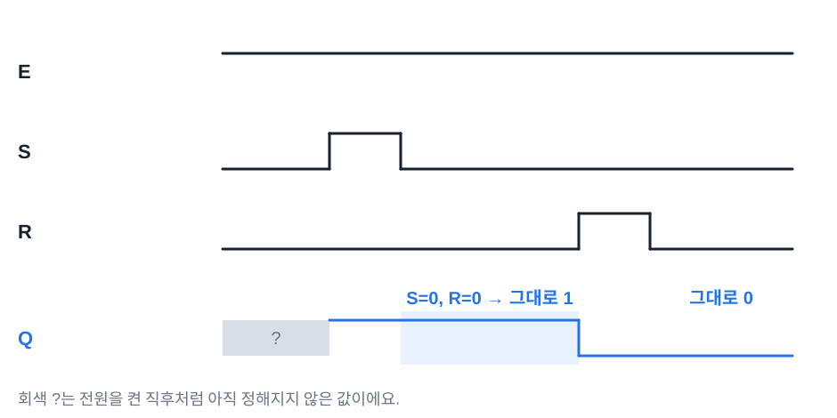
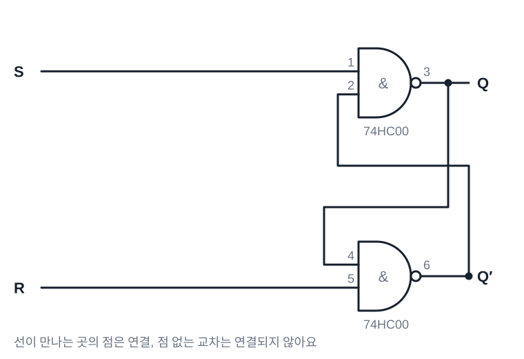
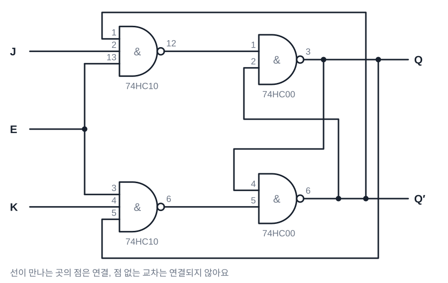
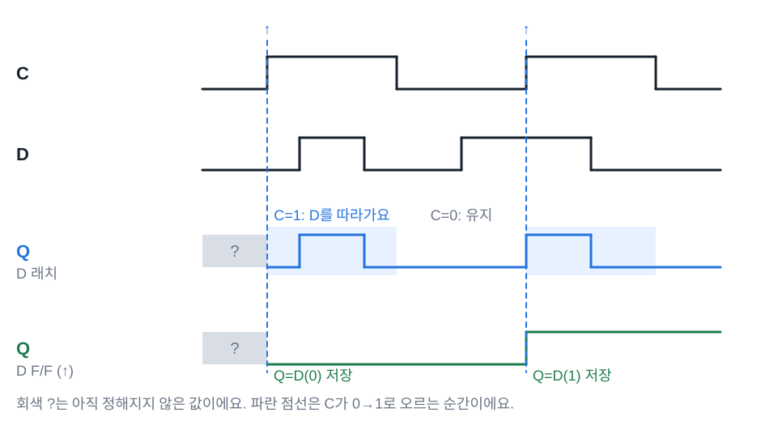
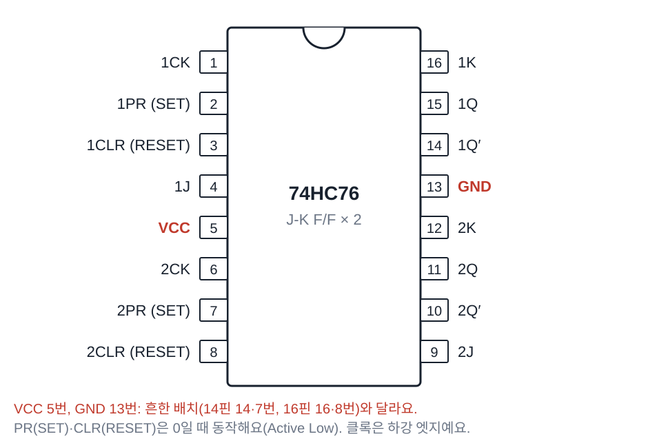
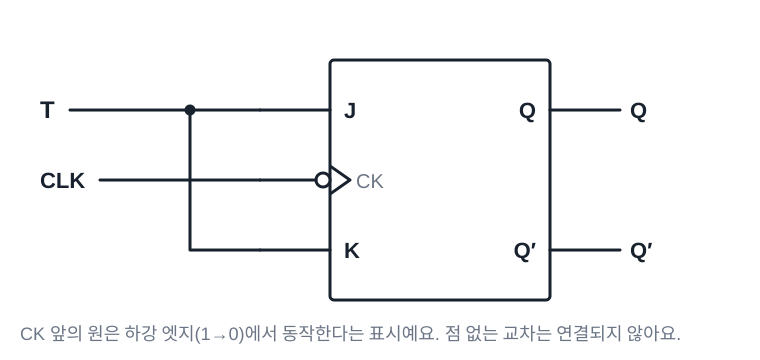

# 실험 6 · Latch & Flip-Flop — 1비트를 기억하는 회로 · 실험 설명

      
이번 학기 교안 기준

## 실험 이해

### 왜 이 회로를 쓰는지 먼저 알아봐요

이해를 위한 예시 · 회로가 해결하는 문제
이해를 위한 예시로, 버튼 하나를 눌렀다 떼면 불이 켜진 채로 남고 다른 버튼을 눌렀다 떼야 꺼지는 장치를 생각해 봐요. 지금까지 만든 AND·OR·디코더 같은 조합회로는 출력이 “지금 들어온 입력”만으로 정해져요. 그래서 버튼에서 손을 떼면 출력도 바로 원래대로 돌아가요. “조금 전에 버튼이 눌렸다”는 사실을 담아 둘 곳이 없어요.

래치와 플립플롭은 출력 Q를 다시 입력 쪽으로 돌려보내는 되먹임(feedback)으로 1비트를 기억해요. 교안은 이것을 “1Bit의 상태정보(Set, Reset)를 저장할 수 있는 기억 소자”라고 불러요. 제어 입력(Enable이나 Clock)에 따라 지금 값을 유지하거나 새 값을 저장해요. 전원이 꺼지면 값이 사라지는 휘발성 소자예요. 교안은 레지스터·CPU 캐시 같은 기억장치를 구성하는 데 활용한다고 소개해요.

작은 예를 하나 따라가 봐요. Enable E=1인 SR 래치에 S(Set)=1, R(Reset)=0을 넣으면 Q=1이 돼요. 이어서 S를 0으로 내려 S=R=0이 되어도 Q는 1로 남아요. 이게 기억이에요. 이번에는 R=1, S=0을 넣으면 Q=0이 되고, 다시 S=R=0이 되어도 0이 남아요. 전원을 켠 직후의 Q는 정해져 있지 않아요. 그래서 교안은 첫 입력으로 Set이나 Reset을 넣으라고 해요.

S·R은 잠깐만 1이 돼도, Q는 다음 명령이 올 때까지 그 값을 지켜요.

이번 실험에서는 게이트로 SR 래치(실험 1)와 D 래치(실험 2-1)를 만들어요. Enable을 1로 둔 채 S·R·D를 바꾸며 Q가 언제 바뀌고 언제 그대로인지 관찰해요. 그다음 74HC76 IC의 JK 플립플롭(실험 3-2)에서 클록이 1에서 0으로 떨어지는 순간(Falling Edge)에만 Q가 바뀌는지 확인해요.

이 순서로 읽어 봐요
먼저 되먹임과 Q(t)·Q(t−1) 표기를 익히고, NAND 두 개로 만든 가장 단순한 래치를 봐요. 그다음 Enable이 있는 SR 래치 → D 래치 → JK 래치 순서로 “부정 상태”를 어떻게 없애는지 따라가요. 마지막으로 래치와 플립플롭의 차이(레벨과 엣지), 74HC76의 핀과 동작, 실험 항목별 관찰 포인트를 정리해요.

이번 보고서 수행 범위는 9월 14일 공지의 실험 1(SR Latch with Enable), 2-1(D Latch with Enable), 3-2(JK F/F, 74HC76)예요. 교안의 2-2(74HC74 D 플립플롭)와 3-1(게이트 JK 래치)은 이번에 직접 하지 않는 보충이에요. 하지 않는다고 시험에 나오지 않는다는 뜻은 아니에요.

예상값과 측정값을 구분해요
여기서 구한 출력은 이상적인 회로의 예상값이에요. 실제로 측정한 값은 실험에서 따로 기록해야 해요. 이 자료에는 실제 측정 수치를 적지 않았어요.

래치·플립플롭은 되먹임으로 1비트를 기억하고 제어 신호에 따라 저장·유지하는 휘발성 소자예요. 전원 직후 Q는 미정이므로 먼저 Set/Reset해요. E=1 SR에서 10은 Set·01은 Reset·00은 이전값 유지예요. 수행은 1 SR·2-1 D 래치·3-2 하강 엣지 74HC76이며 2-2·3-1은 보충으로 시험 제외를 뜻하지 않아요. 여기 값은 이상적인 예상이고 실제 측정 수치는 없어요.

출처: [강의노트/실험6. Latch & Flip-Flop.pdf · PDF p1](../../../%EA%B0%95%EC%9D%98%EB%85%B8%ED%8A%B8/%EC%8B%A4%ED%97%986.%20Latch%20%26%20Flip-Flop.pdf#page=1) · [강의노트/실험6. Latch & Flip-Flop.pdf · PDF p2](../../../%EA%B0%95%EC%9D%98%EB%85%B8%ED%8A%B8/%EC%8B%A4%ED%97%986.%20Latch%20%26%20Flip-Flop.pdf#page=2) · [강의노트/실험6. Latch & Flip-Flop.pdf · PDF p3](../../../%EA%B0%95%EC%9D%98%EB%85%B8%ED%8A%B8/%EC%8B%A4%ED%97%986.%20Latch%20%26%20Flip-Flop.pdf#page=3) · [강의노트/실험6. Latch & Flip-Flop.pdf · PDF p7](../../../%EA%B0%95%EC%9D%98%EB%85%B8%ED%8A%B8/%EC%8B%A4%ED%97%986.%20Latch%20%26%20Flip-Flop.pdf#page=7) · [강의노트/공지사항/2026-09-14_\[필독\]_논리회로실험_보고서_관련_공지.md](../../../%EA%B0%95%EC%9D%98%EB%85%B8%ED%8A%B8/%EA%B3%B5%EC%A7%80%EC%82%AC%ED%95%AD/2026-09-14_%5B%ED%95%84%EB%8F%85%5D_%EB%85%BC%EB%A6%AC%ED%9A%8C%EB%A1%9C%EC%8B%A4%ED%97%98_%EB%B3%B4%EA%B3%A0%EC%84%9C_%EA%B4%80%EB%A0%A8_%EA%B3%B5%EC%A7%80.md)

판본 기록: 교안 표지는 25-1 논리회로실험이에요(2026-10-11 저장소에 추가된 판). 수행 범위는 9월 14일 공지의 실험 1·2-1·3-2예요.

도입의 버튼·불 장치는 이해를 위한 예시이고 측정값이 아니에요. 타이밍도는 교안 p4·p7의 SR 래치 진리표를 바탕으로 직접 그렸어요.

### 출력을 되먹이는 회로와 NAND를 다시 읽어요

출력이 다시 입력으로 돌아와요
조합회로는 입력 → 게이트 → 출력으로 한 방향만 흘러요. 순서회로는 출력의 일부가 다시 게이트 입력으로 돌아와요. 그래서 같은 입력을 넣어도 “지금 Q가 무엇이었는지”에 따라 결과가 달라질 수 있어요.

교안의 진리표에는 Q(t)와 Q(t−1)이 나와요. Q(t−1)은 입력을 바꾸기 직전의 Q, Q(t)는 바꾼 뒤의 Q예요. 표에 “Q(t−1)”이라고 적힌 행은 “바뀌지 않고 그대로”라는 뜻이에요. Q′은 Q의 반대 값이에요. 정상 상태에서는 Q′=Q̄예요.

NAND는 0 하나만 있어도 1이에요
이번 실험 회로는 대부분 NAND(74HC00, 74HC10)로 되어 있어요. NAND의 성질 하나만 기억하면 회로를 빠르게 읽을 수 있어요. 입력 중 하나라도 0이면 출력은 무조건 1이에요. 입력이 모두 1일 때만 출력이 0이에요.

| A | B | (A·B)′ (NAND) |
| --- | --- | --- |
| 0 | 0 | 1 |
| 0 | 1 | 1 |
| 1 | 0 | 1 |
| 1 | 1 | 0 |

그래서 NAND의 한 입력을 1로 고정하면 나머지 입력을 뒤집는 NOT처럼 동작하고, 0으로 고정하면 다른 입력과 상관없이 1을 내요. 래치를 읽을 때 이 두 경우를 계속 써요.

특성식으로 쓰면 이렇게 돼요. 이 자료에서는 Q(t−1)을 Q로 줄여 쓰기도 해요.

$$D:\ Q(t)=D,\qquad JK:\ Q(t)=J\,\overline{Q}+\overline{K}\,Q,\qquad T:\ Q(t)=T\oplus Q$$

X와 “정해지지 않음”은 달라요
진리표의 X는 don’t-care예요. 그 입력이 0이든 1이든 결과가 같다는 뜻이에요. 전원을 켠 직후의 Q처럼 “아직 알 수 없는 값”과는 달라요. 초기값이 주어지지 않은 Q를 0이라고 가정하면 안 돼요.

한 단계만 풀어 봐요
NAND의 한 입력이 0이면 다른 입력이 1이어도 출력은 몇일까요?

#### 힌트

NAND는 입력이 모두 1일 때만 0이에요.

#### 연습 답

출력은 1이에요. 0이 하나라도 있으면 AND가 0이고, 그걸 뒤집어 1이 돼요.

되먹임 순서회로는 이전 Q에 따라 결과가 달라져요. Q(t−1)은 입력 변경 직전·Q(t)는 변경 뒤 값이며 정상 상태에서만 Q′=Q̄예요. NAND는 0이 하나라도 있으면 1·모두 1일 때만 0이고, 입력 1 고정은 NOT·0 고정은 출력 1이에요. D·JK·T 특성식은 각각 D, JQ′+K′Q, T⊕Q예요. 입력 X(don’t-care)와 미정 초기 Q를 구분하고 주어지지 않은 초기값을 0으로 가정하지 않아요.

이 개념으로 풀 문제: [Latch를 설명](%EC%8B%A4%ED%97%9806_%EA%B8%B0%EC%B6%9C%ED%92%80%EC%9D%B4.md#q-latch)

출처: [강의노트/실험6. Latch & Flip-Flop.pdf · PDF p3](../../../%EA%B0%95%EC%9D%98%EB%85%B8%ED%8A%B8/%EC%8B%A4%ED%97%986.%20Latch%20%26%20Flip-Flop.pdf#page=3) · [강의노트/실험6. Latch & Flip-Flop.pdf · PDF p4](../../../%EA%B0%95%EC%9D%98%EB%85%B8%ED%8A%B8/%EC%8B%A4%ED%97%986.%20Latch%20%26%20Flip-Flop.pdf#page=4)

특성식(D·JK·T)은 교안 표를 식으로 옮긴 보충이에요. 각 식은 표의 모든 행과 대조했어요.

### NAND 두 개로 만든 기본 SR 래치

기억은 서로를 붙잡는 고리예요
지금까지 만든 회로는 입력을 빼면 출력도 바로 원래대로 돌아갔어요. 기억한다는 건 입력이 사라진 뒤에도 출력이 그 값을 계속 내고 있는 거예요. 그러려면 회로가 자기 출력을 계속 다시 만들어 내야 해요.

NAND보다 먼저 NOT 두 개로 봐요. NOT1의 출력 Q를 NOT2에 넣고, NOT2의 출력 Q′을 다시 NOT1에 넣어 고리를 만들어요.

NOT 두 개의 고리예요. 바깥 입력이 하나도 없어요.

Q=1에서 시작하면 NOT2가 Q′=0을 내고, NOT1은 0을 받아 다시 Q=1을 내요. 처음 값과 같으니 계속 이대로 버텨요. Q=0에서 시작하면 Q′=1, Q=0으로 역시 버텨요. 두 NOT이 서로의 출력을 붙잡아 주니까 값이 유지돼요. 이게 기억의 정체예요.

그런데 이 고리에는 바깥 입력이 없어요. 그래서 값을 바꿀 방법이 없어요.

NAND 두 개가 서로를 붙잡아요
NOT 자리에 NAND를 넣으면 남는 입력 하나가 바깥에서 조종하는 손잡이가 돼요. 앞에서 본 것처럼 NAND는 한 입력이 1이면 다른 입력을 뒤집는 NOT이고, 한 입력이 0이면 무조건 1을 내요. 그래서 손잡이가 1이면 위의 NOT 고리와 똑같이 값을 기억하고, 손잡이를 0으로 내리면 그 NAND의 출력이 강제로 1이 되어 값이 바뀌어요.

NAND 두 개의 출력을 서로의 입력에 연결하면 가장 단순한 래치가 돼요. 위 NAND의 출력이 Q, 아래 NAND의 출력이 Q′이에요. Q는 아래 NAND로, Q′은 위 NAND로 돌아가요.

기본 S-R 래치예요. Enable이 없어요. 핀 번호는 74HC00 한 개를 쓸 때의 예예요.

이 회로는 0을 넣어야 동작해요
NAND는 0이 하나라도 있으면 1을 내요. 그래서 S=0을 넣으면 위 NAND가 바로 Q=1을 내요. 이 1이 아래 NAND로 가고 R=1이면 아래 출력은 (1·1)′=0, 즉 Q′=0이 돼요. 반대로 R=0이면 Q′=1, Q=0이 돼요. 이 회로의 S·R은 0일 때 명령이 되는 Active Low 입력이에요.

두 NAND를 식으로 쓰면 이래요. 위 NAND(NAND1)는 S와 Q′을 받아 Q를 내고, 아래 NAND(NAND2)는 R과 Q를 받아 Q′을 내요.

$$Q=\overline{S\cdot Q'},\qquad Q'=\overline{R\cdot Q}$$

Q를 구하려면 Q′이 필요하고, Q′을 구하려면 Q가 필요해요. 두 식이 서로를 품고 있는 것이 되먹임이 식에 드러난 모습이에요. 손잡이 S·R에 값을 넣어 봐요.

| S | R | NAND1이 내는 Q | NAND2가 내는 Q′ | 결과 |
| --- | --- | --- | --- | --- |
| 1 | 1 | Q′의 반대 | Q의 반대 | 값을 정하지 않아요 → 유지 |
| 0 | 1 | 0이 있어 1 | (1·1)′=0 | Set, Q=1 |
| 1 | 0 | (1·1)′=0 | 0이 있어 1 | Reset, Q=0 |
| 0 | 0 | 0이 있어 1 | 0이 있어 1 | Q=Q′=1 |

01 행은 NAND1에서 Q=1이 먼저 정해지고, 그 1을 NAND2 식에 넣어 Q′=0을 구해요. 10 행은 반대로 NAND2에서 Q′=1이 먼저 정해지고, 그 값을 NAND1 식에 넣어 Q=0이 나와요. 11 행은 두 식이 “Q는 Q′의 반대, Q′은 Q의 반대”라는 말만 하고 값을 하나로 정해 주지 않아요. 그래서 직전 값이 그대로 남아요.

| S | R | Q | Q′ | 뜻 |
| --- | --- | --- | --- | --- |
| 1 | 1 | Q(t−1) | Q′(t−1) | 유지 |
| 0 | 1 | 1 | 0 | Set |
| 1 | 0 | 0 | 1 | Reset |
| 0 | 0 | 1 | 1 | Q′=Q̄가 깨져요 |

S=R=1이면 두 NAND가 모두 NOT처럼 동작해요. Q=1이었으면 Q′=(1·1)′=0, 다시 Q=(1·0)′=1로 서로를 붙잡아 그대로 유지돼요. S=R=0이면 두 NAND 모두 0을 받아 Q=1, Q′=1이 돼요. Q′이 Q의 반대라는 약속이 깨져요.

한 줄씩 따라가 봐요
S·R을 평소에는 1로 두고, 바꾸고 싶을 때만 잠깐 0으로 내린다고 해 봐요.

| 순서 | S | R | 일어나는 일 | Q |
| --- | --- | --- | --- | --- |
| ① | 1 | 1 | 두 NAND 모두 NOT처럼 지금 값을 지켜요. 전원 직후라 그 값은 아직 몰라요 | ? |
| ② | 0 | 1 | NAND1에 0이 들어가 Q=1, 그다음 NAND2는 (1·1)′=0 | 1 |
| ③ | 1 | 1 | 손잡이를 떼도 NAND1은 Q′=0을 받아 1, NAND2는 Q=1을 받아 0 | 1 (유지) |
| ④ | 1 | 0 | NAND2에 0이 들어가 Q′=1, 그다음 NAND1은 (1·1)′=0 | 0 |
| ⑤ | 1 | 1 | 손잡이를 떼도 Q=0이 그대로 남아요 | 0 (유지) |

③과 ⑤를 비교해 봐요. S·R은 둘 다 1, 1인데 Q는 하나는 1, 하나는 0이에요. 직전에 어느 손잡이를 내렸는지에 따라 결과가 달라졌어요. 회로가 과거를 기억하고 있다는 뜻이에요.

교안 실험에서는 이 회로를 직접 쓰지 않아요
교안은 “Enable이 없는 래치도 존재하나, 불안정하여 본 실험에서는 다루지 않음”이라고 해요. 이 토픽은 Enable이 있는 래치를 이해하고 기출을 풀기 위한 보충이에요.

S=R=0에서 둘을 동시에 1로 되돌리면 이상적인 모델에서는 두 NAND가 같은 순간에 뒤집혀 0과 1을 오갈 수 있어요. 실제 회로에서는 조금 더 빠른 쪽이 이겨서 어느 값으로 남을지 예측할 수 없어요.

한 단계만 풀어 봐요
Q=0인 상태에서 R=1로 둔 채 S를 0으로 내렸다가 다시 1로 올리면 Q는 몇일까요?

#### 힌트

S=0인 동안 NAND1은 무엇을 낼까요? 손잡이를 뗀 뒤에는 11 행을 봐요.

#### 연습 답

Q=1이에요. S=0인 동안 NAND1이 무조건 1을 내서 Q=1, Q′=(1·1)′=0이 돼요. S를 1로 올리면 11이라 유지되고, Q=1이 남아요.

NOT 두 개를 고리로 이으면 서로의 출력을 붙잡아 값이 유지되지만, 바깥 입력이 없어 바꿀 수 없어요. NOT 자리에 NAND를 넣으면 남는 입력이 손잡이가 돼요(1이면 NOT처럼 기억, 0이면 출력을 1로 강제). 식은 Q=(S·Q′)′, Q′=(R·Q)′로 서로를 품고, 11에서는 값을 정하지 않아 직전 값이 남아요. Enable 없는 기본 교차 NAND 래치는 Low 활성 입력이에요. SR=01은 Q=1(Set), 10은 Q=0(Reset), 11은 이전값 유지예요. 같은 11 입력이라도 직전에 내린 손잡이에 따라 Q가 달라요. SR=00은 Q=Q′=1로 보수 관계가 깨지고, 동시에 11로 풀면 이상 모델은 반복 반전 가능·실제 회로의 최종값은 예측 못 해요. 교안의 직접 수행 대상이 아닌 Enable 래치·기출 이해를 위한 보충이에요.

이 개념으로 풀 문제: [기본 S-R latch에 S=R=0을 넣으면](%EC%8B%A4%ED%97%9806_%EA%B8%B0%EC%B6%9C%ED%92%80%EC%9D%B4.md#q-sr-nand-00)

출처: [강의노트/실험6. Latch & Flip-Flop.pdf · PDF p4](../../../%EA%B0%95%EC%9D%98%EB%85%B8%ED%8A%B8/%EC%8B%A4%ED%97%986.%20Latch%20%26%20Flip-Flop.pdf#page=4)

보충: 교안 p4는 Enable 없는 래치를 다루지 않는다고 적었어요. 그림은 기출_단답형 8번 회로(74HC00, 1·2→3, 4·5→6)의 연결을 읽어 직접 다시 그렸어요. 진리표는 NAND 모델을 코드로 계산해 확인했어요.

NOT 고리 빌드업·NAND1·NAND2 식·대입표·①~⑤ 추적표는 교안 밖 보충이에요. NOT 고리 그림은 직접 그렸고, 표의 값은 NAND 모델로 계산해 확인했어요.

### 실험 1: Enable이 있는 SR 래치

Enable은 문지기예요
기본 래치 앞에 NAND 두 개를 더 붙이면 Enable(E)이 생겨요. E=0이면 앞단 NAND 두 개가 모두 1을 내서 뒤의 래치는 “유지” 상태가 돼요. S·R을 아무리 바꿔도 Q가 그대로예요. E=1이면 앞단 NAND가 S·R을 뒤집어 전달해서 S·R이 1일 때 명령이 되는 Active High 래치가 돼요.

실험 1의 회로예요. 74HC00 한 개(NAND 4개)로 만들어요. 핀 번호는 교안 그림과 같아요.

한눈에 보기
동작은 다섯 줄로 기억하면 충분해요.

| 조건 | 결과 |
| --- | --- |
| E=0 | 작동 안 함, 유지 |
| E=1, S만 1 | Set (Q=1) |
| E=1, R만 1 | Reset (Q=0) |
| E=1, 둘 다 0 | 유지 |
| E=1, 둘 다 1 | 금지 (Q·Q′ 둘 다 1) |

아래의 앞단 NAND 식은 “왜 이렇게 되는가”를 설명하는 부분이에요. 외울 필요는 없고, 회로를 한 줄씩 추적하라는 문제에서 꺼내 쓰면 돼요.

앞단 NAND가 하는 일
앞단 NAND 두 개의 출력을 A, B라고 부를게요. 식은 네 줄이에요.

$$A=\overline{S\cdot E},\qquad B=\overline{R\cdot E}$$

$$Q=\overline{A\cdot Q'},\qquad Q'=\overline{B\cdot Q}$$

아래 두 줄은 기본 SR 래치의 식 그대로이고, 이름만 S·R에서 A·B로 바뀌었어요. 그래서 뒤 래치는 이미 아는 규칙대로 움직여요. A=B=1이면 유지, A=0이면 Set, B=0이면 Reset이에요. 남은 질문은 앞단이 언제 A·B에 0을 만드느냐뿐이에요.

E=0이면 A=(S·0)′=1, B=(R·0)′=1이에요. S·R이 무엇이든 뒤 래치는 손잡이 둘 다 1이라 유지해요. E=1이면 A=(S·1)′=S′, B=(R·1)′=R′이라 앞단이 S·R을 뒤집어 넘겨줘요. S=1이면 A=0이라 Set, R=1이면 B=0이라 Reset이에요. 앞단이 한 번 뒤집어 주니까 이제 손잡이를 1로 누르는 방식이 돼요.

한 행씩 따라가 봐요
E=1, S=1, R=0을 넣어 볼게요. 위 앞단 NAND는 (1·1)′=0, 아래 앞단 NAND는 (0·1)′=1이에요. 위 교차 NAND에 0이 들어가니 Q=1이에요. 아래 교차 NAND는 1과 Q=1을 받아 Q′=0이에요. 그래서 Set이에요.

E=1, S=0, R=0이면 앞단 두 출력이 모두 1이에요. 교차 NAND 두 개가 NOT처럼 서로를 붙잡아 이전 값을 그대로 유지해요.

이어서 입력을 차례로 바꿔 가며 Q를 따라가 봐요.

| 순서 | E | S | R | A | B | 뒤 래치 | Q |
| --- | --- | --- | --- | --- | --- | --- | --- |
| ① | 1 | 1 | 0 | 0 | 1 | Set | 1 |
| ② | 1 | 0 | 0 | 1 | 1 | 유지 | 1 |
| ③ | 0 | 0 | 1 | 1 | 1 | 유지 (문 닫힘) | 1 |
| ④ | 1 | 0 | 1 | 1 | 0 | Reset | 0 |
| ⑤ | 1 | 0 | 0 | 1 | 1 | 유지 | 0 |

③과 ④를 비교해 봐요. 둘 다 R=1을 넣었지만 ③은 E=0이라 Q가 그대로이고, ④는 E=1이라 Reset돼요. 실험 1에서 확인할 것이 바로 ②~⑤예요. 첫 입력은 ①처럼 Set이나 Reset으로 넣어요.

| E | S | R | Q(t) | Q′(t) | 뜻 |
| --- | --- | --- | --- | --- | --- |
| 0 | X | X | Q(t−1) | Q′(t−1) | 유지 |
| 1 | 0 | 0 | Q(t−1) | Q′(t−1) | 유지 |
| 1 | 0 | 1 | 0 | 1 | Reset |
| 1 | 1 | 0 | 1 | 0 | Set |
| 1 | 1 | 1 | 1 | 1 | 부정(사용하지 않음) |

E=1일 때의 특성식은 이래요(S=R=1은 쓰지 않는다는 조건 아래에서).

$$Q(t)=S+\overline{R}\,Q(t-1)$$

교안 표는 Q(t)만 적어요. 부정 행은 “X (부정)”이라고 쓰고, 실험 방법에서는 “S=1 R=1인 경우에는 Q(t), Q(t)′이 모두 1이 되며, 이는 논리적으로 모순되는 상태이므로 사용하지 않음”이라고 설명해요.

첫 입력은 Set이나 Reset이에요
전원을 켠 직후에는 Q가 0인지 1인지 알 수 없어요. 그래서 실험 1은 “첫 입력은 Set 또는 Reset을 인가”하라고 해요. 그 뒤에야 S=R=0의 “유지”가 무엇을 유지하는지 확인할 수 있어요.

S=R=1(E=1)을 넣으면 Q와 Q′이 모두 1이에요. 여기서 S와 R을 동시에 0으로 내리면 어느 쪽으로 남을지 예측할 수 없어요. 그래서 S=R=1을 금지해요. 이 행의 Q가 1로 나오는 것 자체가 문제가 아니라, Q′=Q̄가 깨지고 그다음 상태를 알 수 없다는 게 문제예요.

한 단계만 풀어 봐요
Q=1인 상태에서 E=0으로 두고 S=0, R=1을 넣으면 Q는 몇일까요?

#### 힌트

E=0이면 앞단 NAND의 입력에 0이 있어요.

#### 연습 답

앞단 NAND 두 출력이 모두 1이라서 래치는 유지 상태예요. R=1이 들어가도 Q=1 그대로예요.

외울 규칙은 E=0 유지, E=1에서 S만 1 Set·R만 1 Reset·둘 다 0 유지·둘 다 1 금지예요. 앞단 출력 A=(S·E)′, B=(R·E)′를 받는 뒤 교차 NAND는 기본 래치에서 이름만 A·B로 바뀐 것이라, A=B=1 유지·A=0 Set·B=0 Reset이에요. 같은 R=1도 E=0이면 무시되고 E=1이면 Reset이에요. 앞단 NAND 두 개가 E=0에서 모두 1을 내어 이전 상태를 유지하고, E=1에서는 S·R을 뒤집어 전달해 High 활성 명령이 돼요. E=1의 SR=10은 Set·01은 Reset·00은 유지이며 11은 Q=Q′=1이라 금지예요. 전원 직후 Q는 미정이라 첫 입력은 Set/Reset이에요. 금지 상태에서 둘을 동시에 0으로 풀면 다음 상태를 예측 못 해요. Q(t)=S+R′Q(t−1)은 E=1·SR≠11 조건이에요.

이 개념으로 풀 문제: [Latch를 설명](%EC%8B%A4%ED%97%9806_%EA%B8%B0%EC%B6%9C%ED%92%80%EC%9D%B4.md#q-latch) · [Enable이 있는 R-S Latch의 진리표](%EC%8B%A4%ED%97%9806_%EA%B8%B0%EC%B6%9C%ED%92%80%EC%9D%B4.md#q-rs-latch) · [R-S Latch를 Toggle 되게 바꾸기](%EC%8B%A4%ED%97%9806_%EA%B8%B0%EC%B6%9C%ED%92%80%EC%9D%B4.md#q-rs-quiz) · [Enable이 꺼진 SR 래치](%EC%8B%A4%ED%97%9806_%EA%B8%B0%EC%B6%9C%ED%92%80%EC%9D%B4.md#q-qp-e06-tf-01) · [SR 부정 상태의 두 출력](%EC%8B%A4%ED%97%9806_%EA%B8%B0%EC%B6%9C%ED%92%80%EC%9D%B4.md#q-qp-e06-tf-04) · [SR 래치의 세 명령](%EC%8B%A4%ED%97%9806_%EA%B8%B0%EC%B6%9C%ED%92%80%EC%9D%B4.md#q-qp-e06-blank-01) · [Enable SR 래치 작도](%EC%8B%A4%ED%97%9806_%EA%B8%B0%EC%B6%9C%ED%92%80%EC%9D%B4.md#q-qp-e06-board-01) · [SR 래치는 어떻게 기억할까요](%EC%8B%A4%ED%97%9806_%EA%B8%B0%EC%B6%9C%ED%92%80%EC%9D%B4.md#q-qp-e06-short-01)

출처: [강의노트/실험6. Latch & Flip-Flop.pdf · PDF p4](../../../%EA%B0%95%EC%9D%98%EB%85%B8%ED%8A%B8/%EC%8B%A4%ED%97%986.%20Latch%20%26%20Flip-Flop.pdf#page=4) · [강의노트/실험6. Latch & Flip-Flop.pdf · PDF p7](../../../%EA%B0%95%EC%9D%98%EB%85%B8%ED%8A%B8/%EC%8B%A4%ED%97%986.%20Latch%20%26%20Flip-Flop.pdf#page=7)

그림 재제작: 교안 p7 회로(74HC00, 1·2→3, 4·5→6, 9·10→8, 12·13→11)를 확대해 읽고 새로 그렸어요. 10번에는 Q′, 12번에는 Q가 되먹여져요. 표는 교안 p4·p7과 같고, Q′ 열은 NAND 모델 계산으로 덧붙였어요.

한눈에 보기 표·앞단 A·B 식·①~⑤ 추적표는 교안 밖 보충이에요. 표의 값은 NAND 모델로 계산해 확인했어요.

### 실험 2-1: D 래치는 부정 상태를 막아요

입력을 하나로 줄여 금지 상태를 없애요
SR 래치의 문제는 S=R=1이에요. D 래치는 S 자리에 D를, R 자리에 D의 반대 D′을 넣어요. 그러면 S와 R이 항상 서로 반대라서 S=R=1이 아예 생기지 않아요. 교안은 이것을 “부정 상태를 구조적으로 방지”한다고 해요.

실험 2-1의 회로예요. 74HC04(NOT) 하나와 74HC00(NAND 4개) 하나로 만들어요.

E=1이면 Q가 D를 따라가요
| E | D | Q(t) | 뜻 |
| --- | --- | --- | --- |
| 0 | X | Q(t−1) | 유지 |
| 1 | 0 | 0 | Reset |
| 1 | 1 | 1 | Set |

E=1, D=1이면 S=1, R=0이라서 Set이에요. D=0이면 S=0, R=1이라서 Reset이에요. 그래서 E=1인 동안에는 Q=D예요. E=0이 되는 순간의 D가 저장되고, 그 뒤로는 D가 바뀌어도 Q가 그대로예요.

E=1인 동안 D가 0→1→0으로 바뀌면 Q도 똑같이 0→1→0으로 바뀌어요. 이렇게 “열려 있는 동안 그대로 통과”하는 성질 때문에 래치를 투명(transparent)하다고도 해요.

D 래치에는 “유지” 행이 E=0뿐이에요
SR 래치는 E=1에서도 S=R=0이면 유지했어요. D 래치는 E=1이면 항상 D를 따라가요. 값을 지키려면 E를 0으로 내려야 해요.

기출 자료의 D 회로 그림은 입력 단자 이름이 D가 아니라 S, Enable이 C로 적혀 있어요. 연결은 D 래치와 같아요. 이름 대신 NOT이 어느 선에 붙는지를 보고 판단해요.

한 단계만 풀어 봐요
E=1, D=1로 Q=1을 만든 뒤 E를 0으로 내리고 D를 0으로 바꾸면 Q는 몇일까요?

#### 힌트

E=0일 때의 행을 봐요.

#### 연습 답

Q=1 그대로예요. E가 0이 되는 순간 D=1이 저장됐고, 그 뒤의 D 변화는 들어가지 않아요.

D 래치는 S=D, R=D′이라 S=R=1이 생기지 않아요. E=1이면 Q=D, E=0이면 유지예요.

이 개념으로 풀 문제: [회로가 주어진 D F/F 진리표](%EC%8B%A4%ED%97%9806_%EA%B8%B0%EC%B6%9C%ED%92%80%EC%9D%B4.md#q-dff-table) · [D F/F 진리표를 만족하는 회로 설계](%EC%8B%A4%ED%97%9806_%EA%B8%B0%EC%B6%9C%ED%92%80%EC%9D%B4.md#q-dff-design) · [D 래치의 투명 구간](%EC%8B%A4%ED%97%9806_%EA%B8%B0%EC%B6%9C%ED%92%80%EC%9D%B4.md#q-qp-e06-tf-02) · [D 래치의 입력과 기억](%EC%8B%A4%ED%97%9806_%EA%B8%B0%EC%B6%9C%ED%92%80%EC%9D%B4.md#q-qp-e06-blank-02)

출처: [강의노트/실험6. Latch & Flip-Flop.pdf · PDF p8](../../../%EA%B0%95%EC%9D%98%EB%85%B8%ED%8A%B8/%EC%8B%A4%ED%97%986.%20Latch%20%26%20Flip-Flop.pdf#page=8)

그림 재제작: 교안 p8 회로(74HC04 1→2, 74HC00 4개)를 읽고 새로 그렸어요. 기출 자료의 같은 회로는 입력 이름이 S·C로 적혀 있어요.

### JK 래치는 1, 1을 뒤집기로 바꿔요

1, 1을 “뒤집기”로 바꿔요
JK 래치는 SR 래치의 S=R=1 자리를 쓸모 있게 바꾼 회로예요. J는 S, K는 R 역할이에요. 앞단 NAND를 3입력(74HC10)으로 바꾸고, J 쪽 NAND에는 Q′을, K 쪽 NAND에는 Q를 되먹여요.

교안 실험 3-1의 회로예요. Q′은 위로 돌아 J 쪽 NAND의 1번 핀으로, Q는 아래로 돌아 K 쪽 NAND의 5번 핀으로 가요.

Q가 1이면 J 쪽 문이 닫혀요
Q=0(Q′=1)일 때 J=K=1, E=1을 넣으면 J 쪽 NAND는 J·E·Q′=1·1·1이라 0을 내서 Set 쪽으로 밀어요. K 쪽 NAND는 Q=0을 받아 1이라서 Reset 명령은 막혀요. 그래서 Q가 1로 뒤집혀요. 반대로 Q=1이면 K 쪽만 열려서 0으로 뒤집혀요. 결과는 Q(t)=Q(t−1)′, 즉 Toggle이에요.

| E | J | K | Q(t) | 뜻 |
| --- | --- | --- | --- | --- |
| 0 | X | X | Q(t−1) | 유지 |
| 1 | 0 | 0 | Q(t−1) | 유지 |
| 1 | 0 | 1 | 0 | Reset |
| 1 | 1 | 0 | 1 | Set |
| 1 | 1 | 1 | Q(t−1)′ | Toggle |

J=1, K=0이면 Q가 0일 때만 J 쪽이 열려 Set해요. Q가 이미 1이면 아무 문도 열리지 않고 1을 유지해요. 결과는 같아요. J=0, K=1도 같은 방식으로 Reset이에요.

$$Q(t)=J\,\overline{Q(t-1)}+\overline{K}\,Q(t-1)$$

Enable이 길면 계속 뒤집혀요(race-around)
보충: 이 회로는 레벨로 동작하는 래치예요. E=1, J=K=1이 계속되면 Q가 뒤집힌 뒤 그 새 값이 다시 되먹여져 또 뒤집혀요. E가 1인 동안 Q가 0과 1을 계속 오가고, E를 내리는 순간의 값이 남아요. 이것을 race-around라고 해요. 표의 “Toggle 한 번”은 E를 Q가 한 번 뒤집힐 만큼은 길게, 뒤집힌 값이 되먹임으로 다시 돌아오기 전에 끝날 만큼 짧게 1로 했을 때의 이상적인 결과예요. 이 시간 창은 아주 좁아요.

그래서 정확히 한 번만 뒤집으려면 엣지에서만 동작하는 JK 플립플롭(74HC76)을 써요. 이 문제는 게이트 지연을 가정한 일반 원리이고, 교안이 측정값을 제시한 것은 아니에요.

한 단계만 풀어 봐요
Q=1인 상태에서 E=1, J=1, K=0을 넣으면 Q는 몇일까요?

#### 힌트

J 쪽 NAND에는 Q′이 들어가요. 지금 Q′은 0이에요.

#### 연습 답

Q=1 그대로예요. J 쪽 NAND는 Q′=0 때문에 1을 내고, K 쪽 NAND는 K=0 때문에 1을 내서 둘 다 명령이 없어요. Set 결과와 같아요.

JK 래치는 J 쪽에 Q′·K 쪽에 Q를 되먹여 각각 J·E·Q′와 K·E·Q를 만들어요. E=0은 유지, E=1에서 JK=00 유지·01 Reset·10 Set·11 Toggle이에요. 한 갱신은 Qnext=JQ′+K′Q지만 레벨 회로의 11은 긴 E=1에서 race-around해 반복 반전해요. 단일 Toggle은 한 번 바뀌고 되먹임이 돌아오기 전 끝나는 짧은 펄스의 이상 조건이에요. 지연을 가정한 일반 원리 보충으로 교안 측정값이 아니며, 정확히 한 번에는 엣지형 74HC76을 써요.

이 개념으로 풀 문제: [R-S Latch를 Toggle 되게 바꾸기](%EC%8B%A4%ED%97%9806_%EA%B8%B0%EC%B6%9C%ED%92%80%EC%9D%B4.md#q-rs-quiz) · [회로가 주어진 J-K F/F 진리표](%EC%8B%A4%ED%97%9806_%EA%B8%B0%EC%B6%9C%ED%92%80%EC%9D%B4.md#q-jkff-short) · [J-K F/F 진리표를 만족하는 회로 설계](%EC%8B%A4%ED%97%9806_%EA%B8%B0%EC%B6%9C%ED%92%80%EC%9D%B4.md#q-jkff-design)

출처: [강의노트/실험6. Latch & Flip-Flop.pdf · PDF p10](../../../%EA%B0%95%EC%9D%98%EB%85%B8%ED%8A%B8/%EC%8B%A4%ED%97%986.%20Latch%20%26%20Flip-Flop.pdf#page=10)

그림 재제작: 교안 p10 회로(74HC10 1·2·13→12, 3·4·5→6, 74HC00 1·2→3, 4·5→6)를 읽고 새로 그렸어요. 1번 핀은 Q′, 5번 핀은 Q 되먹임이에요. race-around 설명은 게이트 지연 모델로 계산한 보충이에요(J=K=E=1을 유지하면 상태가 반복). 실험 3-1은 이번 수행 범위가 아니에요.

### 래치와 플립플롭: 레벨과 엣지

문이 열려 있는 동안과 문이 열리는 순간
래치는 Enable이 1인 “동안” 계속 입력을 받아들여요. 플립플롭은 클록이 바뀌는 “순간”에만 입력을 한 번 받아들여요. 교안은 래치를 “비동기 기억소자 (Level-triggered)”, 플립플롭을 “동기 기억소자 (Edge-triggered)”라고 정리해요.

같은 입력이라도 래치는 C=1 구간의 D 변화를 모두 내보내고, 플립플롭은 오르는 엣지의 D만 저장해요.

레벨과 엣지를 표로 구분해요
| 구분 | 래치(Latch) | 플립플롭(Flip-Flop) |
| --- | --- | --- |
| 제어 입력 | Enable (E 또는 C) | Clock (CLK) |
| 언제 입력을 받나 | E=1인 동안 계속 | 클록 엣지 순간에만 |
| 트리거 | 레벨(Level-triggered) | 엣지(Edge-triggered) |
| 교안의 분류 | 비동기 기억소자 | 동기 기억소자 |
| 이번 실험 | SR·D 래치(실험 1, 2-1) | 74HC76 JK F/F(실험 3-2) |

엣지는 두 종류예요. 0에서 1로 오르는 순간이 Rising Edge(상승 엣지), 1에서 0으로 떨어지는 순간이 Falling Edge(하강 엣지)예요. 회로 기호에서 클록 단자의 삼각형(▷)은 엣지 트리거라는 표시이고, 삼각형 앞에 원(bubble)이 있으면 하강 엣지예요. 74HC74는 상승 엣지, 74HC76은 하강 엣지예요.

보충: 기출에 나오는 74HC574도 74HC74처럼 상승 엣지 D 플립플롭이에요. 플립플롭 8개가 한 칩에 들어 있고, 출력 enable 핀(OE′)이 Low일 때 저장된 값이 출력 핀에 나와요. 이 칩은 교안 준비물이 아니에요.

보충: 엣지 사이(클록이 0이나 1로 머무는 동안)에는 입력을 바꿔도 Q가 바뀌지 않아요. 74HC74 표의 “CLK=0, D=X → Q(t−1)” 행이 바로 이 뜻이에요.

“비동기”라는 말을 조심해요
교안과 기출 답안은 래치를 “Clock과 무관한 비동기식”이라고 써요. 그렇지만 Enable 래치도 E에 따라 입력을 받아요. 핵심 차이는 “E가 1인 동안 계속(레벨)” 대 “클록 엣지 순간에만(엣지)”이에요. 답안에는 이 차이를 함께 쓰는 게 안전해요.

교안 p5의 SR F/F 회로는 CLK와 반전된 CLK를 NAND에 넣어 엣지 근처에서만 짧은 펄스를 만드는 아이디어예요. 보충: 그림 그대로 NAND(CLK, CLK′)를 쓰면 평소 출력이 1이라 앞단 문이 거의 늘 열려요. 짧은 1 펄스를 얻으려면 그 자리에 AND(또는 NAND 뒤 NOT)가 있어야 해요. 이 회로는 이번 실험 항목이 아니에요.

74HC74 D 플립플롭(실험 2-2, 이번에는 보충)
74HC74는 상승 엣지 D 플립플롭 두 개가 든 IC예요. 교안 표에 따르면 Set=0이면 Q=1, Reset=0이면 Q=0이고 이것은 클록과 상관없이 바로 적용돼요(Active Low). 그래서 D에 따른 결과를 볼 때는 Set·Reset을 모두 1(HIGH)로 둬요. 둘 다 1이면 클록이 오르는 순간의 D가 Q가 돼요.

| Set | Reset | CLK | D | Q(t) |
| --- | --- | --- | --- | --- |
| 0 | 1 | X | X | 1: Set |
| 1 | 0 | X | X | 0: Reset |
| 1 | 1 | 0 | X | Q(t−1) |
| 1 | 1 | ↑ | 0 | 0: Reset |
| 1 | 1 | ↑ | 1 | 1: Set |

래치는 E=1 동안(레벨), 플립플롭은 지정 클록 엣지 순간에 입력을 받아요. ▷는 엣지·원+▷는 하강이며 74HC74는 ↑·74HC76은 ↓예요. “비동기 래치”도 Enable 영향을 받아요. 보충 74HC574는 8비트 상승 엣지 D 소자이고 OE′=Low에서 저장값이 출력돼요. 교안 p5의 NAND(CLK,CLK′)는 평소 1이라 짧은 1 펄스에는 AND 또는 NAND 뒤 NOT이 필요하다는 보충을 구분해요. 보충 74HC74는 Low 활성 Set/Reset이 클록보다 우선하고 둘 다 High일 때 ↑의 D를 저장해요.

이 개념으로 풀 문제: [Latch와 Flip-Flop의 차이](%EC%8B%A4%ED%97%9806_%EA%B8%B0%EC%B6%9C%ED%92%80%EC%9D%B4.md#q-diff) · [Flip-Flop을 설명](%EC%8B%A4%ED%97%9806_%EA%B8%B0%EC%B6%9C%ED%92%80%EC%9D%B4.md#q-ff) · [74HC574에서 입력이 반영되는 시점](%EC%8B%A4%ED%97%9806_%EA%B8%B0%EC%B6%9C%ED%92%80%EC%9D%B4.md#q-74hc574)

출처: [강의노트/실험6. Latch & Flip-Flop.pdf · PDF p3](../../../%EA%B0%95%EC%9D%98%EB%85%B8%ED%8A%B8/%EC%8B%A4%ED%97%986.%20Latch%20%26%20Flip-Flop.pdf#page=3) · [강의노트/실험6. Latch & Flip-Flop.pdf · PDF p4](../../../%EA%B0%95%EC%9D%98%EB%85%B8%ED%8A%B8/%EC%8B%A4%ED%97%986.%20Latch%20%26%20Flip-Flop.pdf#page=4) · [강의노트/실험6. Latch & Flip-Flop.pdf · PDF p5](../../../%EA%B0%95%EC%9D%98%EB%85%B8%ED%8A%B8/%EC%8B%A4%ED%97%986.%20Latch%20%26%20Flip-Flop.pdf#page=5) · [강의노트/실험6. Latch & Flip-Flop.pdf · PDF p9](../../../%EA%B0%95%EC%9D%98%EB%85%B8%ED%8A%B8/%EC%8B%A4%ED%97%986.%20Latch%20%26%20Flip-Flop.pdf#page=9)

74HC574 문단은 저장소에 데이터시트가 없어 일반적인 사양 기준의 보충이에요. 교안 p5 SR F/F 회로는 CLK와 NOT(CLK)를 NAND에 넣어요. NAND(CLK, CLK′)는 지연 순간을 빼면 늘 1이라 그림 그대로는 엣지 펄스로 동작하지 않아요. 원리 설명은 AND 펄스 기준의 보충으로 적었어요. 74HC74 표는 교안 p9 그대로예요. 타이밍도는 직접 만든 입력으로 그렸어요.

### 실험 3-2: 74HC76 JK 플립플롭

떨어지는 순간에 한 번만 결정해요
74HC76에는 JK 플립플롭이 두 개 들어 있어요. 클록이 1에서 0으로 떨어지는 순간(Falling Edge)에만 J·K를 보고 Q를 정해요. 그래서 JK 래치처럼 계속 뒤집히는 문제가 없어요. J=K=1이면 엣지마다 정확히 한 번 뒤집혀요.

VCC가 5번, GND가 13번이에요. 교안도 “GND와 Vcc 위치 유의”라고 강조해요.

PR·CLR이 먼저, 그다음 클록이에요
PR(Preset, 교안의 SET)과 CLR(Clear, 교안의 RESET)은 클록과 상관없이 바로 적용되는 비동기 입력이고 0일 때 동작해요(Active Low). PR=0이면 Q=1, CLR=0이면 Q=0이에요. 둘 다 1(HIGH)일 때만 클록 엣지와 J·K가 Q를 정해요.

| SET(PR) | RESET(CLR) | CLK | J | K | Q(t) |
| --- | --- | --- | --- | --- | --- |
| 0 | 1 | X | X | X | 1: Set |
| 1 | 0 | X | X | X | 0: Reset |
| 1 | 1 | 0 | X | X | Q(t−1) |
| 1 | 1 | ↓ | 0 | 0 | Q(t−1) |
| 1 | 1 | ↓ | 0 | 1 | 0: Reset |
| 1 | 1 | ↓ | 1 | 0 | 1: Set |
| 1 | 1 | ↓ | 1 | 1 | Q(t−1)′ |

한 줄 따라가 볼게요. PR=CLR=1, Q=0에서 J=K=1로 두고 클록을 1→0으로 내리면 Q=1이 돼요. 클록을 다시 0→1로 올려도 Q는 1 그대로예요. 다시 1→0으로 내리면 Q=0이 돼요.

PR=CLR=0을 동시에 넣는 것은 쓰지 않아요. 저장소에 있는 데이터시트 그림의 표는 이때 Q와 Q′이 모두 L이라고 적었고, 계열에 따라 둘 다 H로 적은 표도 있어요. 어느 쪽이든 Q′=Q̄가 깨지고, 둘을 동시에 H로 되돌리면 상태를 예측할 수 없어요.

J와 K를 묶으면 T 플립플롭이에요
J와 K를 한 선으로 묶어 T라고 부르면 T=0일 때 J=K=0이라 유지, T=1일 때 J=K=1이라 엣지마다 Toggle이에요. 이것이 T(Toggle) 플립플롭이에요.

T=1로 두면 클록이 떨어질 때마다 Q가 0, 1, 0, 1…로 바뀌어요.

$$Q(t)=T\oplus Q(t-1)$$

PR·CLR을 띄워 두지 않아요
교안은 “RESET, SET (Active Low): 클럭과 무관하게 최우선 반영 => JK에 따른 결과 확인 시 HIGH”라고 해요. J·K 동작을 보려면 PR·CLR을 VCC에 연결해요. 보충: CMOS 입력을 연결하지 않고 두면 값이 정해지지 않아 결과가 흔들릴 수 있어요.

보충: 손으로 스위치를 눌러 클록을 만들면 접점이 튀어(bounce) 엣지가 여러 번 생길 수 있어요. J=K=1에서 한 번 눌렀는데 Q가 바뀌지 않거나 예상과 다르면 이 가능성을 기록하고 조교 안내에 따라 클록원을 확인해요.

한 단계만 풀어 봐요
PR=CLR=1, Q=1에서 J=0, K=1로 두고 클록을 0→1로 올리면 Q는 몇일까요? 이어서 1→0으로 내리면요?

#### 힌트

74HC76은 하강 엣지에서만 J·K를 봐요.

#### 연습 답

올릴 때는 상승 엣지라서 Q=1 그대로예요. 내릴 때 J=0, K=1이 적용되어 Q=0(Reset)이 돼요.

74HC76은 JK 플립플롭 2개·VCC 5번·GND 13번이며 PR·CLR 둘 다 High일 때만 하강 엣지에서 JK=00 유지·01 Reset·10 Set·11 Toggle해요. Low 활성 비동기 PR=0은 Q=1, CLR=0은 Q=0을 클록보다 우선 강제해요. 동시 0은 자료 계열별 두 출력 L/H 차이가 있지만 보수 관계가 깨지고 동시 해제 뒤 값이 미정이라 쓰지 않아요. J=K=T이면 T=0 유지·1 Toggle(Qnext=T⊕Q)이에요. PR·CLR을 띄우지 않고 High로 묶으며, 손 스위치 bounce로 엣지가 여러 번 생길 수 있다는 보충은 실제 원인으로 단정하지 않아요.

이 개념으로 풀 문제: [J-K F/F로 T F/F 만들기](%EC%8B%A4%ED%97%9806_%EA%B8%B0%EC%B6%9C%ED%92%80%EC%9D%B4.md#q-tff) · [74HC76의 CLR·PR 핀 기능](%EC%8B%A4%ED%97%9806_%EA%B8%B0%EC%B6%9C%ED%92%80%EC%9D%B4.md#q-74hc76) · [74HC76 하강 엣지 따라가기](%EC%8B%A4%ED%97%9806_%EA%B8%B0%EC%B6%9C%ED%92%80%EC%9D%B4.md#q-p-76-trace) · [74HC76의 동작 엣지](%EC%8B%A4%ED%97%9806_%EA%B8%B0%EC%B6%9C%ED%92%80%EC%9D%B4.md#q-qp-e06-tf-03) · [74HC76의 비동기 우선순위](%EC%8B%A4%ED%97%9806_%EA%B8%B0%EC%B6%9C%ED%92%80%EC%9D%B4.md#q-qp-e06-blank-03) · [74HC76에서 비동기 제어를 High로 두는 이유](%EC%8B%A4%ED%97%9806_%EA%B8%B0%EC%B6%9C%ED%92%80%EC%9D%B4.md#q-qp-e06-short-02)

출처: [강의노트/실험6. Latch & Flip-Flop.pdf · PDF p11](../../../%EA%B0%95%EC%9D%98%EB%85%B8%ED%8A%B8/%EC%8B%A4%ED%97%986.%20Latch%20%26%20Flip-Flop.pdf#page=11) · [from_the_past/정리/소자_데이터시트_및_미디어/1_데이터시트_및_핀아웃/74-76-diagram.jpg](../../../from_the_past/%EC%A0%95%EB%A6%AC/%EC%86%8C%EC%9E%90_%EB%8D%B0%EC%9D%B4%ED%84%B0%EC%8B%9C%ED%8A%B8_%EB%B0%8F_%EB%AF%B8%EB%94%94%EC%96%B4/1_%EB%8D%B0%EC%9D%B4%ED%84%B0%EC%8B%9C%ED%8A%B8_%EB%B0%8F_%ED%95%80%EC%95%84%EC%9B%83/74-76-diagram.jpg) · [from_the_past/정리/소자_데이터시트_및_미디어/1_데이터시트_및_핀아웃/92110-74HC76-J-K-Flip-Flop-Pic002-700x700.jpg](../../../from_the_past/%EC%A0%95%EB%A6%AC/%EC%86%8C%EC%9E%90_%EB%8D%B0%EC%9D%B4%ED%84%B0%EC%8B%9C%ED%8A%B8_%EB%B0%8F_%EB%AF%B8%EB%94%94%EC%96%B4/1_%EB%8D%B0%EC%9D%B4%ED%84%B0%EC%8B%9C%ED%8A%B8_%EB%B0%8F_%ED%95%80%EC%95%84%EC%9B%83/92110-74HC76-J-K-Flip-Flop-Pic002-700x700.jpg)

핀 배치는 교안 p11과 from_the_past 7476 핀아웃 그림(92110-74HC76-J-K-Flip-Flop-Pic002-700x700.jpg), 74-76-diagram.jpg의 표와 대조했어요(5번 VCC, 13번 GND, 2번 1PR, 3번 1CLR, 하강 엣지). PR=CLR=0 동시 입력에서 출력 L은 74-76-diagram.jpg 표 각주 기준이고, 다른 계열 표가 H로 적는 경우가 있어 둘 다 적었어요(독립 검토 지적). 스위치 bounce는 일반 원리 보충이에요.

### 실험에서 바꾸고 관찰할 것을 정리해요

항목마다 바꿀 것과 볼 것
| 항목 | 사용 IC | 바꾸는 것 | 관찰할 것 |
| --- | --- | --- | --- |
| 실험 1 SR Latch | 74HC00 | E=1로 두고 S·R (첫 입력은 Set 또는 Reset) | S=R=0에서 이전 Q 유지, Set·Reset, E=0일 때 입력 무시 |
| 실험 2-1 D Latch | 74HC04, 74HC00 | E=1에서 D, 이어서 E=0에서 D | E=1이면 Q=D, E=0이면 마지막 값 유지 |
| 실험 3-2 JK F/F | 74HC76 | PR=CLR=HIGH에서 J·K, 클록 하강 엣지 | 엣지마다 유지·Reset·Set·Toggle, 엣지 사이에는 변화 없음 |

교안 준비물은 5V 전압원, 오실로스코프, 74HC00·74HC04·74HC10·74HC74·74HC76, 발광 다이오드 4개, 330Ω 저항 4개예요. 74HC10과 74HC74는 이번에 하지 않는 3-1·2-2용이에요.

관찰 결과는 “입력을 바꾸기 전 Q → 바꾼 뒤 Q”의 쌍으로 적으면 Q(t−1)과 Q(t)를 구분하기 쉬워요. 유지 행은 바로 앞 행의 Q가 무엇이었는지 함께 적어야 의미가 있어요.

예상과 측정이 다르면 먼저 확인해요
Q가 엉뚱하면 첫 입력으로 Set·Reset을 넣었는지, 74HC76의 VCC(5번)·GND(13번)를 바르게 연결했는지, PR·CLR이 HIGH인지 확인해요. 이 자료의 값은 이상적인 예상값이에요. 실제 측정값은 실험 기록에 따로 적어요.

실험1은 처음 Set/Reset 후 E=1의 SR 동작·E=0 입력 무시, 2-1은 E=1의 Q=D·E=0 마지막값 유지를 관찰해요. 3-2는 PR·CLR=High에서 하강 엣지마다 JK 상태를 기록하고 엣지 사이는 유지해요. “이전 Q→이후 Q”를 쌍으로 적어 유지의 기준을 남겨요. 74HC76 전원은 VCC5·GND13을 확인해요. 74HC10·74HC74는 이번 미수행 3-1·2-2용이며, 계산은 이상 예상값·실제 측정은 별도 기록이에요.

출처: [강의노트/실험6. Latch & Flip-Flop.pdf · PDF p6](../../../%EA%B0%95%EC%9D%98%EB%85%B8%ED%8A%B8/%EC%8B%A4%ED%97%986.%20Latch%20%26%20Flip-Flop.pdf#page=6) · [강의노트/실험6. Latch & Flip-Flop.pdf · PDF p7](../../../%EA%B0%95%EC%9D%98%EB%85%B8%ED%8A%B8/%EC%8B%A4%ED%97%986.%20Latch%20%26%20Flip-Flop.pdf#page=7) · [강의노트/실험6. Latch & Flip-Flop.pdf · PDF p8](../../../%EA%B0%95%EC%9D%98%EB%85%B8%ED%8A%B8/%EC%8B%A4%ED%97%986.%20Latch%20%26%20Flip-Flop.pdf#page=8) · [강의노트/실험6. Latch & Flip-Flop.pdf · PDF p11](../../../%EA%B0%95%EC%9D%98%EB%85%B8%ED%8A%B8/%EC%8B%A4%ED%97%986.%20Latch%20%26%20Flip-Flop.pdf#page=11)

판본 기록: 준비물과 항목은 교안 p6~p11 기준이에요. LED·저항의 연결 방향은 교안에 없어 적지 않았어요.
