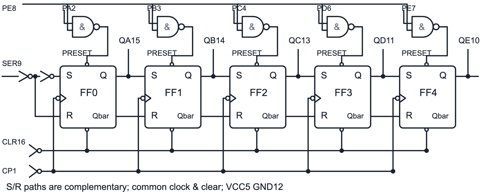
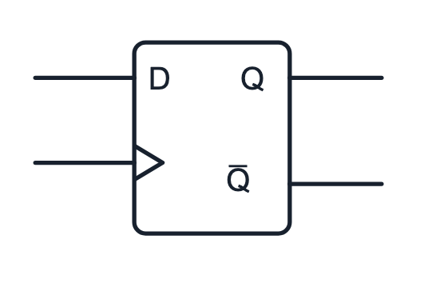
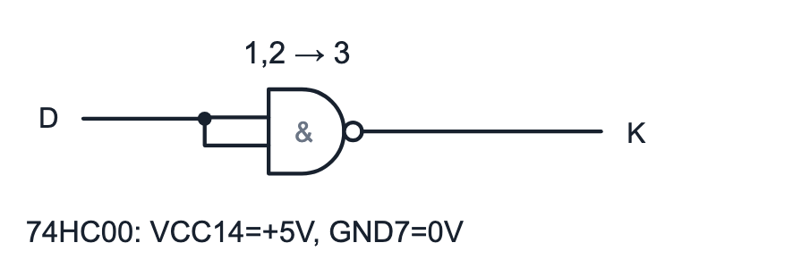

# 실험 7 · 기출문제와 퀴즈 유형 연습

[실험 설명](실험07_실험설명.md) · [문제/해설](실험07_기출풀이.md)

## 1. 시프트 레지스터의 기능
기출 · 실험 7 · 풀이 검토됨

### 문제 원문
시프트 레지스터(Shift Register)에 대해서 설명하시오.

### 힌트 · 접근 순서
저장과 이동을 함께 설명해요

## 2. 링 카운터와 초기화
기출 · 실험 7 · 풀이 검토됨

### 문제 원문
링 카운터에 대해서 설명하시오.

### 힌트 · 접근 순서
마지막 Q를 그대로 되먹여요

## 3. 존슨 카운터의 NAND 역할
기출 · 실험 7 · 답안 충돌

### 문제 원문
존슨 카운터에서 사용되는 2입력 NAND gate의 역할을 설명하시오.

### 힌트 · 접근 순서
NAND의 배선을 먼저 구분해요

## 4. 7496 내부 블록을 읽어요
기출 · 실험 7 · 정답 미확정

### 문제 원문
7496 내부 블록다이어그램을 보고, 동작 원리를 간단하게 설명하시오.

### 힌트 · 접근 순서
이동 경로와 비동기 제어를 나눠요

## 5. 직렬·병렬 변환의 두 방향
기출 · 실험 7 · 풀이 검토됨

### 문제 원문
시프트레지스터(Shift Register)에서 직렬-병렬 변환기와 병렬-직렬 변환기에 대해서 간단히 설명하시오. (3점)

### 힌트 · 접근 순서
입출력 양쪽에서 동시에 몇 비트를 다루는지 봐요

## 6. 4비트 회로와 7476 개수
기출 · 실험 7 · 풀이 검토됨

### 문제 원문
Flip Flop을 활용한 Shift Register 설계 (총 4 점)

1) 4 bit Shift Register을 구현하기 위해 필요한 7476칩의 개수와 J-K F/F의 개수는 각각 몇 개인가? (2점)

2) 아래의 “D F/F”을 활용하여 4 bit Serial in, parallel out Shift Register를 설계 하시오. (2점)

### 조건
원문에 주어진 D F/F는 상승 엣지 기호예요. 첫 칸을 Q0로 정해요.

### 힌트 · 접근 순서
칩 수와 저장 칸 수를 따로 세어요

## 7. 7496을 순환 회로로 바꿔요
기출 · 실험 7 · 풀이 검토됨

### 문제 원문
7496으로 구현한 5bit Shift Register를 Circular Shift Register로 변환하는 방법을 간단히 설명하시오. (3점)

### 힌트 · 접근 순서
마지막 데이터를 버리지 않고 되돌려요

## 8. 시프트용 JK 입력을 정해요
예상문제 · 실험 7 · 풀이 검토됨

### 문제 원문
시프트레지스터에 사용할 JK Flip-Flop에 대해서 설명하시오. Explain about a JK Flip-Flop used in the Shift Register.

### 힌트 · 접근 순서
JK 표에서 복사 조건을 찾아요

## 9. 6비트에 필요한 JK 개수
출처 미확인 · 실험 7 · 풀이 검토됨

### 문제 원문
6bit shift right register를 구현하기 위해 필요한 JK Flip-Flop의 개수는 몇 개인가?

### 힌트 · 접근 순서
저장 비트 수를 세어요

## 10. 병렬에서 직렬로 꺼내요
출처 미확인 · 실험 7 · 풀이 검토됨

### 문제 원문
병렬-직렬 변환기에 대해서 간단히 설명하시오.

### 힌트 · 접근 순서
동시 적재 후 한 비트씩 읽어요

## 11. 존슨 카운터의 상태 순환
출처 미확인 · 실험 7 · 풀이 검토됨

### 문제 원문
존슨카운터에 대해 설명하시오.

### 힌트 · 접근 순서
마지막 Q의 보수를 되먹여요

## 12. 순환 시프트의 연결
출처 미확인 · 실험 7 · 풀이 검토됨

### 문제 원문
Shift Register를 순환 Shift Register로 변환하는 방법을 간단히 설명하시오.

### 힌트 · 접근 순서
마지막 Q를 직렬 입력으로 돌려요

## 13. 여섯 칸의 저장 용량
연습문제 · 실험 7 · 풀이 검토됨 · 퀴즈 유형 연습 — 자체 출제 · T/F

### 문제 원문
6비트 시프트 레지스터에는 JK F/F 6개가 필요하다. T/F

### 조건
7476 계열 한 칩에 JK 두 개가 들어 있어요.

### 힌트 · 접근 단서
조건과 반례로 참·거짓을 판단해요

## 14. 같은 엣지의 이전 값
연습문제 · 실험 7 · 풀이 검토됨 · 퀴즈 유형 연습 — 자체 출제 · T/F

### 문제 원문
한 유효 엣지에서 Q1은 엣지 직전 Q0를 저장한다. T/F

### 조건
공통 클록을 쓰며 입력은 setup/hold를 만족해요. Q0가 첫 칸이에요.

### 힌트 · 접근 단서
조건과 반례로 참·거짓을 판단해요

## 15. Negative Logic LED
연습문제 · 실험 7 · 풀이 검토됨 · 퀴즈 유형 연습 — 자체 출제 · T/F

### 문제 원문
Q=1이면 해당 LED가 켜진다. T/F

### 조건
7496 출력 LED는 +5V→330Ω→애노드→캐소드→Q 순서로 연결돼요.

보고서 지정 항목 밖의 교안 보충 내용을 연습해요. 시험 제외라는 뜻은 아니에요.

### 힌트 · 접근 단서
조건과 반례로 참·거짓을 판단해요

## 16. JK의 복사 조건
연습문제 · 실험 7 · 풀이 검토됨 · 퀴즈 유형 연습 — 자체 출제 · T/F

### 문제 원문
J=K=D로 묶으면 모든 이전 Q에서 Q다음=D가 된다. T/F

### 조건
교안 74HC76의 SET·RESET이 비활성이며 하강 엣지 입력 시간 조건을 만족해요.

### 힌트 · 접근 단서
조건과 반례로 참·거짓을 판단해요

## 17. 칩과 저장 칸
연습문제 · 실험 7 · 풀이 검토됨 · 퀴즈 유형 연습 — 자체 출제 · 빈칸

### 문제 원문
4비트 저장에는 JK ① ( )개와 7476 칩 ② ( )개가 필요해요.

### 조건
7476 한 칩에는 JK F/F 두 개가 들어 있어요.

### 힌트 · 접근 단서
비트 순서와 신호 역할을 먼저 정해요

## 18. 한 칸 이동을 계산해요
연습문제 · 실험 7 · 풀이 검토됨 · 퀴즈 유형 연습 — 자체 출제 · 빈칸

### 문제 원문
유효 엣지 한 번 후 Q0…Q5=① ( )이에요.

### 조건
Q0…Q5=101100이며 정상 이동 모드에서 S=0을 넣어요.

### 힌트 · 접근 단서
비트 순서와 신호 역할을 먼저 정해요

## 19. 순환 연결의 두 핀
연습문제 · 실험 7 · 풀이 검토됨 · 퀴즈 유형 연습 — 자체 출제 · 빈칸

### 문제 원문
마지막 출력 ① (신호/핀)을 첫 입력 ② (신호/핀)에 연결해요.

### 조건
교안 7496을 일반 순환 시프트 레지스터로 바꿔요.

보고서 지정 항목 밖의 교안 보충 내용을 연습해요. 시험 제외라는 뜻은 아니에요.

### 힌트 · 접근 단서
비트 순서와 신호 역할을 먼저 정해요

## 20. 첫 JK 입력용 보수 신호를 작도해요
연습문제 · 실험 7 · 풀이 검토됨 · 퀴즈 유형 연습 — 자체 출제 · 브레드보드 작도

### 문제 원문
주어진 NAND 회로와 핀 명세를 빈 보드에 옮겨 전원·입력·출력과 미사용 핀을 표시하세요.

### 조건
74HC00 한 게이트로 D의 보수 K를 만들어요. LED는 사용하지 않고 3번 출력을 측정점 K로 둬요. 입력 D는 0V 또는 5V 외부 신호예요.

| 핀 | 이름 | 역할 |
| --- | --- | --- |
| 1,2 | A1,B1 | D 입력을 두 입력에 공통 연결 |
| 3 | Y1 | K 측정 출력 |
| 14 | VCC | +5V |
| 7 | GND | 0V |
| 4,5,9,10,12,13 | 미사용 입력 | 수업 작도 명세: NC(개방), 실사용 일반 권장과 구분 |
| 6,8,11 | 미사용 출력 | NC, 접지 금지 |

### 힌트 · 접근 단서
같은 넷을 같은 도통 홀에 옮겨요

## 21. SIPO가 정보를 모으는 이유
연습문제 · 실험 7 · 풀이 검토됨 · 퀴즈 유형 연습 — 자체 출제 · 짧은 서술형

### 문제 원문
SIPO의 기능과 마지막 병렬 출력이 만들어지는 과정을 두세 문장으로 설명하세요.

### 조건
이상적 4단 SIPO를 0000으로 초기화하고 입력 1,0,1,1을 순서대로 넣어요. Q0가 첫 칸이에요.

### 힌트 · 접근 단서
기능·이동 과정·조건을 연결해 설명해요

## 22. 7496의 LED와 상태를 구분해요
연습문제 · 실험 7 · 풀이 검토됨 · 퀴즈 유형 연습 — 자체 출제 · 짧은 서술형

### 문제 원문
유효 엣지 한 번 뒤의 출력 벡터와 LED 상태를 이유와 함께 설명하세요.

### 조건
clear 후 preset으로 QA…QE=11000을 만든 뒤 preset을 해제했어요. SER=0, LED는 Negative Logic이에요.

보고서 지정 항목 밖의 교안 보충 내용을 연습해요. 시험 제외라는 뜻은 아니에요.

### 힌트 · 접근 단서
기능·이동 과정·조건을 연결해 설명해요
