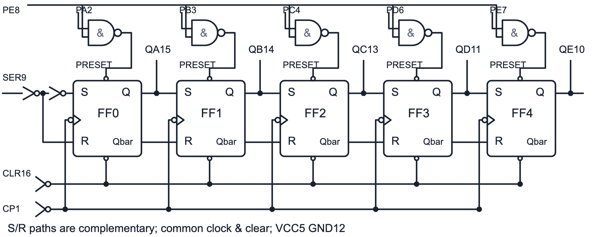
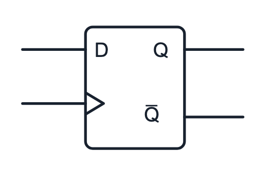
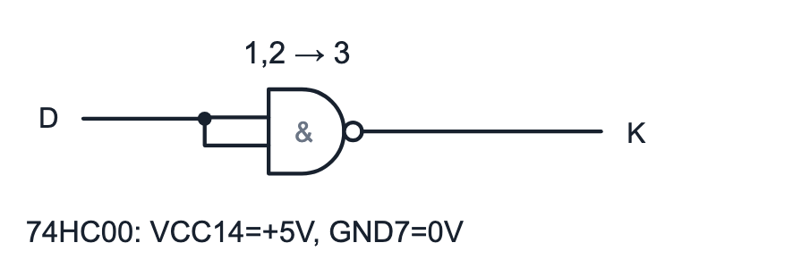

# 실험 7 · 문제 설명

      
첫 줄부터 완성 답과 검산까지 함께 풀어요.

## 문제를 함께 풀어요

### 문제 1 · 시프트 레지스터의 기능

문제 읽기
#### 문제

시프트 레지스터(Shift Register)에 대해서 설명하시오.

이 문제에서 할 일
시프트 레지스터의 기능를 조건에 맞게 설명해요.

무엇이 저장되고 어느 순간 다음 칸으로 가는지 구분해요.

이 문제를 봤을 때 떠올릴 개념과 공식
저장과 이동을 함께 설명해요

Q0가 첫 칸이고 S는 새 직렬 입력이에요. Q0다음=S, Qi다음=Q(i−1)이전은 공통 클록의 정상 이동 모드와 입력 시간 조건에서 성립해요.

이 문항에서 이 기준을 쓰는 이유: 플립플롭을 공통 클록으로 연결하고 유효 엣지마다 각 칸이 앞 칸의 이전 값을 저장해요. 데이터를 한 칸씩 옮기면서 보존하므로 직렬·병렬 변환과 지연에 쓸 수 있어요.

첫 줄을 써 봐요
Q0다음=S, Q1다음=Q0이전부터 적어요.

[필요한 개념으로 돌아가요](%EC%8B%A4%ED%97%9807_%EC%8B%A4%ED%97%98%EC%84%A4%EB%AA%85.md#t-shift)

이유를 따라 완성해요
풀이:

플립플롭을 공통 클록으로 연결하고 유효 엣지마다 각 칸이 앞 칸의 이전 값을 저장해요. 데이터를 한 칸씩 옮기면서 보존하므로 직렬·병렬 변환과 지연에 쓸 수 있어요.

검산:

0000에 1,0을 넣어 1000→0100인지 확인해요.

주의:

단순 저장 장치라는 설명만 쓰면 이동 기능이 빠져요.

답과 검산을 확인해요
클록마다 데이터를 한 칸씩 이동하며 저장하는 레지스터예요.

0000에 1,0을 넣어 1000→0100인지 확인해요.

헷갈리기 쉬운 조건을 확인해요
단순 저장 장치라는 설명만 쓰면 이동 기능이 빠져요.

설명을 닫고 다시 해 봐요
- 입출력 순서와 제어 조건을 적어요.
- Q0다음=S, Q1다음=Q0이전부터 적어요.
- 0000에 1,0을 넣어 1000→0100인지 확인해요.

**떠올릴 것:** 저장과 이동을 함께 설명해요

Q0가 첫 칸이고 S는 새 직렬 입력이에요. Q0다음=S, Qi다음=Q(i−1)이전은 공통 클록의 정상 이동 모드와 입력 시간 조건에서 성립해요.

첫 실행: Q0다음=S, Q1다음=Q0이전부터 적어요.

결론: 클록마다 데이터를 한 칸씩 이동하며 저장하는 레지스터예요.

검산: 0000에 1,0을 넣어 1000→0100인지 확인해요.

주의: 단순 저장 장치라는 설명만 쓰면 이동 기능이 빠져요.

출처: [from_the_past/정리/퀴즈/실험7/실험7 퀴즈 기출 2016-1.pdf · PDF p1](../../../from_the_past/%EC%A0%95%EB%A6%AC/%ED%80%B4%EC%A6%88/%EC%8B%A4%ED%97%987/%EC%8B%A4%ED%97%987%20%ED%80%B4%EC%A6%88%20%EA%B8%B0%EC%B6%9C%202016-1.pdf#page=1) · [from_the_past/정리/퀴즈/실험7/실험7 퀴즈 기출_정답.pdf · PDF p1](../../../from_the_past/%EC%A0%95%EB%A6%AC/%ED%80%B4%EC%A6%88/%EC%8B%A4%ED%97%987/%EC%8B%A4%ED%97%987%20%ED%80%B4%EC%A6%88%20%EA%B8%B0%EC%B6%9C_%EC%A0%95%EB%8B%B5.pdf#page=1) · [from_the_past/정리/퀴즈/실험7/실험7 퀴즈 종합_기출문제 (2p).pdf · PDF p2](../../../from_the_past/%EC%A0%95%EB%A6%AC/%ED%80%B4%EC%A6%88/%EC%8B%A4%ED%97%987/%EC%8B%A4%ED%97%987%20%ED%80%B4%EC%A6%88%20%EC%A2%85%ED%95%A9_%EA%B8%B0%EC%B6%9C%EB%AC%B8%EC%A0%9C%20%282p%29.pdf#page=2) · [from_the_past/정리/퀴즈/실험7/실험7 퀴즈 기출_단답형.pdf · PDF p1](../../../from_the_past/%EC%A0%95%EB%A6%AC/%ED%80%B4%EC%A6%88/%EC%8B%A4%ED%97%987/%EC%8B%A4%ED%97%987%20%ED%80%B4%EC%A6%88%20%EA%B8%B0%EC%B6%9C_%EB%8B%A8%EB%8B%B5%ED%98%95.pdf#page=1) · [from_the_past/정리/퀴즈/실험7/원본_docx/quiz_07.hwp](../../../from_the_past/%EC%A0%95%EB%A6%AC/%ED%80%B4%EC%A6%88/%EC%8B%A4%ED%97%987/%EC%9B%90%EB%B3%B8_docx/quiz_07.hwp) · [from_the_past/정리/퀴즈/실험7/실험7 퀴즈 예상문제_v1.pdf · PDF p1](../../../from_the_past/%EC%A0%95%EB%A6%AC/%ED%80%B4%EC%A6%88/%EC%8B%A4%ED%97%987/%EC%8B%A4%ED%97%987%20%ED%80%B4%EC%A6%88%20%EC%98%88%EC%83%81%EB%AC%B8%EC%A0%9C_v1.pdf#page=1) · [from_the_past/정리/퀴즈/실험7/실험7 퀴즈 예상문제_v2.pdf · PDF p1](../../../from_the_past/%EC%A0%95%EB%A6%AC/%ED%80%B4%EC%A6%88/%EC%8B%A4%ED%97%987/%EC%8B%A4%ED%97%987%20%ED%80%B4%EC%A6%88%20%EC%98%88%EC%83%81%EB%AC%B8%EC%A0%9C_v2.pdf#page=1) · [from_the_past/정리/퀴즈/실험7/실험7 퀴즈 예상문제_v3.pdf · PDF p1](../../../from_the_past/%EC%A0%95%EB%A6%AC/%ED%80%B4%EC%A6%88/%EC%8B%A4%ED%97%987/%EC%8B%A4%ED%97%987%20%ED%80%B4%EC%A6%88%20%EC%98%88%EC%83%81%EB%AC%B8%EC%A0%9C_v3.pdf#page=1) · [from_the_past/정리/퀴즈/실험7/실험7 퀴즈 예상문제_v4.pdf · PDF p1](../../../from_the_past/%EC%A0%95%EB%A6%AC/%ED%80%B4%EC%A6%88/%EC%8B%A4%ED%97%987/%EC%8B%A4%ED%97%987%20%ED%80%B4%EC%A6%88%20%EC%98%88%EC%83%81%EB%AC%B8%EC%A0%9C_v4.pdf#page=1) · [from_the_past/정리/퀴즈/실험7/실험7 퀴즈 종합_기출문제 (2p).pdf · PDF p1](../../../from_the_past/%EC%A0%95%EB%A6%AC/%ED%80%B4%EC%A6%88/%EC%8B%A4%ED%97%987/%EC%8B%A4%ED%97%987%20%ED%80%B4%EC%A6%88%20%EC%A2%85%ED%95%A9_%EA%B8%B0%EC%B6%9C%EB%AC%B8%EC%A0%9C%20%282p%29.pdf#page=1) · [from_the_past/정리/퀴즈/실험7/원본_docx/실험7_예상 !!!.docx](../../../from_the_past/%EC%A0%95%EB%A6%AC/%ED%80%B4%EC%A6%88/%EC%8B%A4%ED%97%987/%EC%9B%90%EB%B3%B8_docx/%EC%8B%A4%ED%97%987_%EC%98%88%EC%83%81%20%21%21%21.docx) · [from_the_past/정리/퀴즈/실험7/원본_docx/실험7_예상.docx](../../../from_the_past/%EC%A0%95%EB%A6%AC/%ED%80%B4%EC%A6%88/%EC%8B%A4%ED%97%987/%EC%9B%90%EB%B3%B8_docx/%EC%8B%A4%ED%97%987_%EC%98%88%EC%83%81.docx)

### 문제 2 · 링 카운터와 초기화

문제 읽기
#### 문제

링 카운터에 대해서 설명하시오.

이 문제에서 할 일
링 카운터와 초기화를 조건에 맞게 설명해요.

무엇이 저장되고 어느 순간 다음 칸으로 가는지 구분해요.

이 문제를 봤을 때 떠올릴 개념과 공식
마지막 Q를 그대로 되먹여요

순환은 S=마지막 Q, 존슨은 S=NOT(마지막 Q)인 되먹임이에요. one-hot 링의 n상태와 정상 초기화한 존슨의 2n상태는 초기 조건을 포함해 말해요. NAND 역할은 입력을 묶었는지 상태를 디코딩하는지 배선으로 판단해요.

이 문항에서 이 기준을 쓰는 이유: 마지막 Q를 첫 입력으로 연결한 순환 레지스터예요. one-hot 링 카운터라면 1000→0100→0010→0001→1000으로 1이 순환하여 단계별 신호를 만들어요. n단이면 정상 one-hot 주기에 n상태가 있어요.

첫 줄을 써 봐요
4비트 one-hot 초기값을 1000으로 적어요.

[필요한 개념으로 돌아가요](%EC%8B%A4%ED%97%9807_%EC%8B%A4%ED%97%98%EC%84%A4%EB%AA%85.md#t-counters)

이유를 따라 완성해요
풀이:

마지막 Q를 첫 입력으로 연결한 순환 레지스터예요. one-hot 링 카운터라면 1000→0100→0010→0001→1000으로 1이 순환하여 단계별 신호를 만들어요. n단이면 정상 one-hot 주기에 n상태가 있어요.

검산:

0000도 대입해 계속 0000임을 확인해요.

주의:

n상태는 one-hot 초기화 조건이 필요해요.

답과 검산을 확인해요
마지막 Q를 첫 입력으로 되먹이는 순환 회로이며 one-hot 초기화하면 n단에서 n상태를 순환해요.

0000도 대입해 계속 0000임을 확인해요.

헷갈리기 쉬운 조건을 확인해요
n상태는 one-hot 초기화 조건이 필요해요.

설명을 닫고 다시 해 봐요
- 입출력 순서와 제어 조건을 적어요.
- 4비트 one-hot 초기값을 1000으로 적어요.
- 0000도 대입해 계속 0000임을 확인해요.

**떠올릴 것:** 마지막 Q를 그대로 되먹여요

순환은 S=마지막 Q, 존슨은 S=NOT(마지막 Q)인 되먹임이에요. one-hot 링의 n상태와 정상 초기화한 존슨의 2n상태는 초기 조건을 포함해 말해요. NAND 역할은 입력을 묶었는지 상태를 디코딩하는지 배선으로 판단해요.

첫 실행: 4비트 one-hot 초기값을 1000으로 적어요.

결론: 마지막 Q를 첫 입력으로 되먹이는 순환 회로이며 one-hot 초기화하면 n단에서 n상태를 순환해요.

검산: 0000도 대입해 계속 0000임을 확인해요.

주의: n상태는 one-hot 초기화 조건이 필요해요.

출처: [from_the_past/정리/퀴즈/실험7/실험7 퀴즈 기출 2016-1.pdf · PDF p1](../../../from_the_past/%EC%A0%95%EB%A6%AC/%ED%80%B4%EC%A6%88/%EC%8B%A4%ED%97%987/%EC%8B%A4%ED%97%987%20%ED%80%B4%EC%A6%88%20%EA%B8%B0%EC%B6%9C%202016-1.pdf#page=1) · [from_the_past/정리/퀴즈/실험7/실험7 퀴즈 기출_단답형.pdf · PDF p1](../../../from_the_past/%EC%A0%95%EB%A6%AC/%ED%80%B4%EC%A6%88/%EC%8B%A4%ED%97%987/%EC%8B%A4%ED%97%987%20%ED%80%B4%EC%A6%88%20%EA%B8%B0%EC%B6%9C_%EB%8B%A8%EB%8B%B5%ED%98%95.pdf#page=1) · [from_the_past/정리/퀴즈/실험7/원본_docx/quiz_07.hwp](../../../from_the_past/%EC%A0%95%EB%A6%AC/%ED%80%B4%EC%A6%88/%EC%8B%A4%ED%97%987/%EC%9B%90%EB%B3%B8_docx/quiz_07.hwp) · [from_the_past/정리/퀴즈/실험7/실험7 퀴즈 예상문제_v1.pdf · PDF p1](../../../from_the_past/%EC%A0%95%EB%A6%AC/%ED%80%B4%EC%A6%88/%EC%8B%A4%ED%97%987/%EC%8B%A4%ED%97%987%20%ED%80%B4%EC%A6%88%20%EC%98%88%EC%83%81%EB%AC%B8%EC%A0%9C_v1.pdf#page=1) · [from_the_past/정리/퀴즈/실험7/실험7 퀴즈 예상문제_v2.pdf · PDF p1](../../../from_the_past/%EC%A0%95%EB%A6%AC/%ED%80%B4%EC%A6%88/%EC%8B%A4%ED%97%987/%EC%8B%A4%ED%97%987%20%ED%80%B4%EC%A6%88%20%EC%98%88%EC%83%81%EB%AC%B8%EC%A0%9C_v2.pdf#page=1) · [from_the_past/정리/퀴즈/실험7/실험7 퀴즈 예상문제_v3.pdf · PDF p1](../../../from_the_past/%EC%A0%95%EB%A6%AC/%ED%80%B4%EC%A6%88/%EC%8B%A4%ED%97%987/%EC%8B%A4%ED%97%987%20%ED%80%B4%EC%A6%88%20%EC%98%88%EC%83%81%EB%AC%B8%EC%A0%9C_v3.pdf#page=1) · [from_the_past/정리/퀴즈/실험7/실험7 퀴즈 예상문제_v4.pdf · PDF p1](../../../from_the_past/%EC%A0%95%EB%A6%AC/%ED%80%B4%EC%A6%88/%EC%8B%A4%ED%97%987/%EC%8B%A4%ED%97%987%20%ED%80%B4%EC%A6%88%20%EC%98%88%EC%83%81%EB%AC%B8%EC%A0%9C_v4.pdf#page=1) · [from_the_past/정리/퀴즈/실험7/실험7 퀴즈 종합_기출문제 (2p).pdf · PDF p1](../../../from_the_past/%EC%A0%95%EB%A6%AC/%ED%80%B4%EC%A6%88/%EC%8B%A4%ED%97%987/%EC%8B%A4%ED%97%987%20%ED%80%B4%EC%A6%88%20%EC%A2%85%ED%95%A9_%EA%B8%B0%EC%B6%9C%EB%AC%B8%EC%A0%9C%20%282p%29.pdf#page=1) · [from_the_past/정리/퀴즈/실험7/원본_docx/실험7_예상 !!!.docx](../../../from_the_past/%EC%A0%95%EB%A6%AC/%ED%80%B4%EC%A6%88/%EC%8B%A4%ED%97%987/%EC%9B%90%EB%B3%B8_docx/%EC%8B%A4%ED%97%987_%EC%98%88%EC%83%81%20%21%21%21.docx) · [from_the_past/정리/퀴즈/실험7/원본_docx/실험7_예상.docx](../../../from_the_past/%EC%A0%95%EB%A6%AC/%ED%80%B4%EC%A6%88/%EC%8B%A4%ED%97%987/%EC%9B%90%EB%B3%B8_docx/%EC%8B%A4%ED%97%987_%EC%98%88%EC%83%81.docx)

### 문제 3 · 존슨 카운터의 NAND 역할

문제 읽기
#### 문제

존슨 카운터에서 사용되는 2입력 NAND gate의 역할을 설명하시오.

이 문제에서 할 일
존슨 카운터의 NAND 역할를 조건에 맞게 설명해요.

무엇이 저장되고 어느 순간 다음 칸으로 가는지 구분해요.

이 문제를 봤을 때 떠올릴 개념과 공식
NAND의 배선을 먼저 구분해요

순환은 S=마지막 Q, 존슨은 S=NOT(마지막 Q)인 되먹임이에요. one-hot 링의 n상태와 정상 초기화한 존슨의 2n상태는 초기 조건을 포함해 말해요. NAND 역할은 입력을 묶었는지 상태를 디코딩하는지 배선으로 판단해요.

이 문항에서 이 기준을 쓰는 이유: 답안 충돌: 일부 제공 답은 마지막 출력을 반전한다고 쓰고, 다른 답은 2n개의 AND 디코딩 게이트라고 써요. 두 입력을 마지막 Q에 묶은 NAND라면 반전 되먹임을 만들어 존슨 동작을 구현해요. 서로 다른 상태 신호에 연결했다면 상태 검출용 active-low 디코더일 수 있어요. 원문에 배선이 없어 단일 역할은 확정할 수 없어요.

첫 줄을 써 봐요
NAND(Q,Q)=NOT Q부터 적어요.

[필요한 개념으로 돌아가요](%EC%8B%A4%ED%97%9807_%EC%8B%A4%ED%97%98%EC%84%A4%EB%AA%85.md#t-counters)

이유를 따라 완성해요
풀이:

답안 충돌: 일부 제공 답은 마지막 출력을 반전한다고 쓰고, 다른 답은 2n개의 AND 디코딩 게이트라고 써요. 두 입력을 마지막 Q에 묶은 NAND라면 반전 되먹임을 만들어 존슨 동작을 구현해요. 서로 다른 상태 신호에 연결했다면 상태 검출용 active-low 디코더일 수 있어요. 원문에 배선이 없어 단일 역할은 확정할 수 없어요.

검산:

Q=0이면 NAND=1, Q=1이면 NAND=0을 확인해요. 디코딩 답은 실제 입력 배선 없이는 대조할 수 없어요.

주의:

답안 충돌을 숨기지 않아요. “항상 2n개의 AND가 필요”는 모든 목적의 회로에 대한 일반 법칙이 아니에요.

답과 검산을 확인해요
배선 미제시로 미확정: 입력을 묶으면 반전 되먹임, 상태 신호를 받으면 디코딩이에요.

Q=0이면 NAND=1, Q=1이면 NAND=0을 확인해요. 디코딩 답은 실제 입력 배선 없이는 대조할 수 없어요.

헷갈리기 쉬운 조건을 확인해요
답안 충돌을 숨기지 않아요. “항상 2n개의 AND가 필요”는 모든 목적의 회로에 대한 일반 법칙이 아니에요.

설명을 닫고 다시 해 봐요
- 입출력 순서와 제어 조건을 적어요.
- NAND(Q,Q)=NOT Q부터 적어요.
- Q=0이면 NAND=1, Q=1이면 NAND=0을 확인해요. 디코딩 답은 실제 입력 배선 없이는 대조할 수 없어요.

**떠올릴 것:** NAND의 배선을 먼저 구분해요

순환은 S=마지막 Q, 존슨은 S=NOT(마지막 Q)인 되먹임이에요. one-hot 링의 n상태와 정상 초기화한 존슨의 2n상태는 초기 조건을 포함해 말해요. NAND 역할은 입력을 묶었는지 상태를 디코딩하는지 배선으로 판단해요.

첫 실행: NAND(Q,Q)=NOT Q부터 적어요.

결론: 배선 미제시로 미확정: 입력을 묶으면 반전 되먹임, 상태 신호를 받으면 디코딩이에요.

검산: Q=0이면 NAND=1, Q=1이면 NAND=0을 확인해요. 디코딩 답은 실제 입력 배선 없이는 대조할 수 없어요.

주의: 답안 충돌을 숨기지 않아요. “항상 2n개의 AND가 필요”는 모든 목적의 회로에 대한 일반 법칙이 아니에요.

출처: [from_the_past/정리/퀴즈/실험7/실험7 퀴즈 기출 2016-1.pdf · PDF p1](../../../from_the_past/%EC%A0%95%EB%A6%AC/%ED%80%B4%EC%A6%88/%EC%8B%A4%ED%97%987/%EC%8B%A4%ED%97%987%20%ED%80%B4%EC%A6%88%20%EA%B8%B0%EC%B6%9C%202016-1.pdf#page=1) · [from_the_past/정리/퀴즈/실험7/실험7 퀴즈 기출_단답형.pdf · PDF p1](../../../from_the_past/%EC%A0%95%EB%A6%AC/%ED%80%B4%EC%A6%88/%EC%8B%A4%ED%97%987/%EC%8B%A4%ED%97%987%20%ED%80%B4%EC%A6%88%20%EA%B8%B0%EC%B6%9C_%EB%8B%A8%EB%8B%B5%ED%98%95.pdf#page=1) · [from_the_past/정리/퀴즈/실험7/원본_docx/quiz_07.hwp](../../../from_the_past/%EC%A0%95%EB%A6%AC/%ED%80%B4%EC%A6%88/%EC%8B%A4%ED%97%987/%EC%9B%90%EB%B3%B8_docx/quiz_07.hwp) · [from_the_past/정리/퀴즈/실험7/실험7 퀴즈 예상문제_v1.pdf · PDF p2](../../../from_the_past/%EC%A0%95%EB%A6%AC/%ED%80%B4%EC%A6%88/%EC%8B%A4%ED%97%987/%EC%8B%A4%ED%97%987%20%ED%80%B4%EC%A6%88%20%EC%98%88%EC%83%81%EB%AC%B8%EC%A0%9C_v1.pdf#page=2) · [from_the_past/정리/퀴즈/실험7/실험7 퀴즈 예상문제_v2.pdf · PDF p1](../../../from_the_past/%EC%A0%95%EB%A6%AC/%ED%80%B4%EC%A6%88/%EC%8B%A4%ED%97%987/%EC%8B%A4%ED%97%987%20%ED%80%B4%EC%A6%88%20%EC%98%88%EC%83%81%EB%AC%B8%EC%A0%9C_v2.pdf#page=1) · [from_the_past/정리/퀴즈/실험7/실험7 퀴즈 예상문제_v3.pdf · PDF p1](../../../from_the_past/%EC%A0%95%EB%A6%AC/%ED%80%B4%EC%A6%88/%EC%8B%A4%ED%97%987/%EC%8B%A4%ED%97%987%20%ED%80%B4%EC%A6%88%20%EC%98%88%EC%83%81%EB%AC%B8%EC%A0%9C_v3.pdf#page=1) · [from_the_past/정리/퀴즈/실험7/실험7 퀴즈 예상문제_v4.pdf · PDF p2](../../../from_the_past/%EC%A0%95%EB%A6%AC/%ED%80%B4%EC%A6%88/%EC%8B%A4%ED%97%987/%EC%8B%A4%ED%97%987%20%ED%80%B4%EC%A6%88%20%EC%98%88%EC%83%81%EB%AC%B8%EC%A0%9C_v4.pdf#page=2) · [from_the_past/정리/퀴즈/실험7/실험7 퀴즈 종합_기출문제 (2p).pdf · PDF p1](../../../from_the_past/%EC%A0%95%EB%A6%AC/%ED%80%B4%EC%A6%88/%EC%8B%A4%ED%97%987/%EC%8B%A4%ED%97%987%20%ED%80%B4%EC%A6%88%20%EC%A2%85%ED%95%A9_%EA%B8%B0%EC%B6%9C%EB%AC%B8%EC%A0%9C%20%282p%29.pdf#page=1) · [from_the_past/정리/퀴즈/실험7/원본_docx/실험7_예상 !!!.docx](../../../from_the_past/%EC%A0%95%EB%A6%AC/%ED%80%B4%EC%A6%88/%EC%8B%A4%ED%97%987/%EC%9B%90%EB%B3%B8_docx/%EC%8B%A4%ED%97%987_%EC%98%88%EC%83%81%20%21%21%21.docx) · [from_the_past/정리/퀴즈/실험7/원본_docx/실험7_예상.docx](../../../from_the_past/%EC%A0%95%EB%A6%AC/%ED%80%B4%EC%A6%88/%EC%8B%A4%ED%97%987/%EC%9B%90%EB%B3%B8_docx/%EC%8B%A4%ED%97%987_%EC%98%88%EC%83%81.docx)

### 문제 4 · 7496 내부 블록을 읽어요

문제 읽기
#### 문제

7496 내부 블록다이어그램을 보고, 동작 원리를 간단하게 설명하시오.

이 문제에서 할 일
7496 내부 블록을 읽어요를 조건에 맞게 설명해요.

무엇이 저장되고 어느 순간 다음 칸으로 가는지 구분해요.

이 문제를 봤을 때 떠올릴 개념과 공식
이동 경로와 비동기 제어를 나눠요

QA~QE는 다섯 저장 칸 출력이고 SER는 첫 칸 입력이에요. 정상 이동 모드에서 QA다음=SER, QB다음=QA이전처럼 이동해요. PE와 해당 preset이 모두 1이면 1을 강제해요. clear/preset이 해제된 조건에서 이동을 계산해요.

이 문항에서 이 기준을 쓰는 이유: 다섯 S-R 저장 단계가 공통 클록을 받아 앞 단계의 이전 Q를 다음 단계로 넘겨요. PE와 각 preset 입력이 들어가는 NAND의 출력은 해당 비동기 preset으로 가요. PE=1이고 preset=1이면 NAND=0이 되어 해당 Q를 1로 강제해요. 공통 CLEAR는 모든 단계를 초기화해요. 교안 13쪽은 CLR 1→0→1, 부록 18~20쪽은 MR 0→1→0으로 서로 달라요. 25쪽은 하강 엣지, 과거 제공 답은 상승 엣지를 적어요. 칩의 정확한 제조사·품번 데이터시트와 실물 파형을 확인하기 전 7496의 초기화 극성·유효 엣지는 미확정이에요. 아래 상태 이동은 “유효 엣지 1회” 기준이에요.

첫 줄을 써 봐요
SER→첫 단계→다음 단계의 경로를 먼저 표시해요.

[필요한 개념으로 돌아가요](%EC%8B%A4%ED%97%9807_%EC%8B%A4%ED%97%98%EC%84%A4%EB%AA%85.md#t-7496)

이유를 따라 완성해요
풀이:

다섯 S-R 저장 단계가 공통 클록을 받아 앞 단계의 이전 Q를 다음 단계로 넘겨요. PE와 각 preset 입력이 들어가는 NAND의 출력은 해당 비동기 preset으로 가요. PE=1이고 preset=1이면 NAND=0이 되어 해당 Q를 1로 강제해요. 공통 CLEAR는 모든 단계를 초기화해요. 교안 13쪽은 CLR 1→0→1, 부록 18~20쪽은 MR 0→1→0으로 서로 달라요. 25쪽은 하강 엣지, 과거 제공 답은 상승 엣지를 적어요. 칩의 정확한 제조사·품번 데이터시트와 실물 파형을 확인하기 전 7496의 초기화 극성·유효 엣지는 미확정이에요. 아래 상태 이동은 “유효 엣지 1회” 기준이에요.

검산:

PE=0이면 preset NAND가 1, PE=A=1이면 0인지 계산해요. clear 후 정상 이동 벡터 11000→01100도 확인해요.

주의:

정답 미확정: 교안 내 CLR 극성과 과거 답의 엣지 표기가 충돌해요. 초기화의 강제 동작과 정상 이동은 구분해요.

답과 검산을 확인해요
5단 저장·공통 클록 이동·PE와 개별 preset의 AND 조건·공통 clear가 핵심이에요. CLR 극성·엣지는 미확정이에요.

PE=0이면 preset NAND가 1, PE=A=1이면 0인지 계산해요. clear 후 정상 이동 벡터 11000→01100도 확인해요.

헷갈리기 쉬운 조건을 확인해요
정답 미확정: 교안 내 CLR 극성과 과거 답의 엣지 표기가 충돌해요. 초기화의 강제 동작과 정상 이동은 구분해요.

설명을 닫고 다시 해 봐요
- 입출력 순서와 제어 조건을 적어요.
- SER→첫 단계→다음 단계의 경로를 먼저 표시해요.
- PE=0이면 preset NAND가 1, PE=A=1이면 0인지 계산해요. clear 후 정상 이동 벡터 11000→01100도 확인해요.

**떠올릴 것:** 이동 경로와 비동기 제어를 나눠요

QA~QE는 다섯 저장 칸 출력이고 SER는 첫 칸 입력이에요. 정상 이동 모드에서 QA다음=SER, QB다음=QA이전처럼 이동해요. PE와 해당 preset이 모두 1이면 1을 강제해요. clear/preset이 해제된 조건에서 이동을 계산해요.

첫 실행: SER→첫 단계→다음 단계의 경로를 먼저 표시해요.

결론: 5단 저장·공통 클록 이동·PE와 개별 preset의 AND 조건·공통 clear가 핵심이에요. CLR 극성·엣지는 미확정이에요.

검산: PE=0이면 preset NAND가 1, PE=A=1이면 0인지 계산해요. clear 후 정상 이동 벡터 11000→01100도 확인해요.

주의: 정답 미확정: 교안 내 CLR 극성과 과거 답의 엣지 표기가 충돌해요. 초기화의 강제 동작과 정상 이동은 구분해요.

출처: [from_the_past/정리/퀴즈/실험7/실험7 퀴즈 기출 2016-1.pdf · PDF p1](../../../from_the_past/%EC%A0%95%EB%A6%AC/%ED%80%B4%EC%A6%88/%EC%8B%A4%ED%97%987/%EC%8B%A4%ED%97%987%20%ED%80%B4%EC%A6%88%20%EA%B8%B0%EC%B6%9C%202016-1.pdf#page=1) · [from_the_past/정리/퀴즈/실험7/실험7 퀴즈 기출_단답형.pdf · PDF p2](../../../from_the_past/%EC%A0%95%EB%A6%AC/%ED%80%B4%EC%A6%88/%EC%8B%A4%ED%97%987/%EC%8B%A4%ED%97%987%20%ED%80%B4%EC%A6%88%20%EA%B8%B0%EC%B6%9C_%EB%8B%A8%EB%8B%B5%ED%98%95.pdf#page=2) · [from_the_past/정리/퀴즈/실험7/원본_docx/quiz_07.hwp](../../../from_the_past/%EC%A0%95%EB%A6%AC/%ED%80%B4%EC%A6%88/%EC%8B%A4%ED%97%987/%EC%9B%90%EB%B3%B8_docx/quiz_07.hwp) · [from_the_past/정리/퀴즈/실험7/실험7 퀴즈 예상문제_v1.pdf · PDF p2](../../../from_the_past/%EC%A0%95%EB%A6%AC/%ED%80%B4%EC%A6%88/%EC%8B%A4%ED%97%987/%EC%8B%A4%ED%97%987%20%ED%80%B4%EC%A6%88%20%EC%98%88%EC%83%81%EB%AC%B8%EC%A0%9C_v1.pdf#page=2) · [from_the_past/정리/퀴즈/실험7/실험7 퀴즈 예상문제_v2.pdf · PDF p1](../../../from_the_past/%EC%A0%95%EB%A6%AC/%ED%80%B4%EC%A6%88/%EC%8B%A4%ED%97%987/%EC%8B%A4%ED%97%987%20%ED%80%B4%EC%A6%88%20%EC%98%88%EC%83%81%EB%AC%B8%EC%A0%9C_v2.pdf#page=1) · [from_the_past/정리/퀴즈/실험7/실험7 퀴즈 예상문제_v3.pdf · PDF p1](../../../from_the_past/%EC%A0%95%EB%A6%AC/%ED%80%B4%EC%A6%88/%EC%8B%A4%ED%97%987/%EC%8B%A4%ED%97%987%20%ED%80%B4%EC%A6%88%20%EC%98%88%EC%83%81%EB%AC%B8%EC%A0%9C_v3.pdf#page=1) · [from_the_past/정리/퀴즈/실험7/실험7 퀴즈 예상문제_v4.pdf · PDF p2](../../../from_the_past/%EC%A0%95%EB%A6%AC/%ED%80%B4%EC%A6%88/%EC%8B%A4%ED%97%987/%EC%8B%A4%ED%97%987%20%ED%80%B4%EC%A6%88%20%EC%98%88%EC%83%81%EB%AC%B8%EC%A0%9C_v4.pdf#page=2) · [from_the_past/정리/퀴즈/실험7/실험7 퀴즈 종합_기출문제 (2p).pdf · PDF p1](../../../from_the_past/%EC%A0%95%EB%A6%AC/%ED%80%B4%EC%A6%88/%EC%8B%A4%ED%97%987/%EC%8B%A4%ED%97%987%20%ED%80%B4%EC%A6%88%20%EC%A2%85%ED%95%A9_%EA%B8%B0%EC%B6%9C%EB%AC%B8%EC%A0%9C%20%282p%29.pdf#page=1) · [from_the_past/정리/퀴즈/실험7/원본_docx/실험7_예상 !!!.docx](../../../from_the_past/%EC%A0%95%EB%A6%AC/%ED%80%B4%EC%A6%88/%EC%8B%A4%ED%97%987/%EC%9B%90%EB%B3%B8_docx/%EC%8B%A4%ED%97%987_%EC%98%88%EC%83%81%20%21%21%21.docx) · [from_the_past/정리/퀴즈/실험7/원본_docx/실험7_예상.docx](../../../from_the_past/%EC%A0%95%EB%A6%AC/%ED%80%B4%EC%A6%88/%EC%8B%A4%ED%97%987/%EC%9B%90%EB%B3%B8_docx/%EC%8B%A4%ED%97%987_%EC%98%88%EC%83%81.docx)

### 문제 5 · 직렬·병렬 변환의 두 방향

문제 읽기
#### 문제

시프트레지스터(Shift Register)에서 직렬-병렬 변환기와 병렬-직렬 변환기에 대해서 간단히 설명하시오. (3점)

이 문제에서 할 일
직렬·병렬 변환의 두 방향를 조건에 맞게 설명해요.

무엇이 저장되고 어느 순간 다음 칸으로 가는지 구분해요.

이 문제를 봤을 때 떠올릴 개념과 공식
입출력 양쪽에서 동시에 몇 비트를 다루는지 봐요

직렬은 한 비트씩 시간 순서로, 병렬은 여러 선의 값을 함께 다루는 방식이에요. SIPO는 직렬 입력·병렬 출력, PISO는 병렬 적재·직렬 출력이에요. 입력과 출력의 칸 순서를 정해야 해요.

이 문항에서 이 기준을 쓰는 이유: SIPO는 직렬 데이터를 엣지마다 한 비트씩 저장하고 각 단계 Q를 병렬로 동시에 읽어요. PISO는 여러 비트를 동시에 적재하고 이동할 때 마지막 Q에서 한 비트씩 직렬로 읽어요.

첫 줄을 써 봐요
SIPO의 입력은 한 비트, 출력은 여러 Q라고 적어요.

[필요한 개념으로 돌아가요](%EC%8B%A4%ED%97%9807_%EC%8B%A4%ED%97%98%EC%84%A4%EB%AA%85.md#t-convert)

이유를 따라 완성해요
풀이:

SIPO는 직렬 데이터를 엣지마다 한 비트씩 저장하고 각 단계 Q를 병렬로 동시에 읽어요. PISO는 여러 비트를 동시에 적재하고 이동할 때 마지막 Q에서 한 비트씩 직렬로 읽어요.

검산:

SIPO 0000에 1,0,1,1 입력→1101. PISO 1011 적재 후 마지막 Q를 이동 직전에 읽으면 1,1,0,1이에요.

주의:

직렬·병렬은 시간/선의 수예요. 비트의 시간 순서와 칸 순서를 혼동하지 않아요.

답과 검산을 확인해요
SIPO는 직렬 입력·병렬 출력, PISO는 병렬 적재·직렬 출력이에요.

SIPO 0000에 1,0,1,1 입력→1101. PISO 1011 적재 후 마지막 Q를 이동 직전에 읽으면 1,1,0,1이에요.

헷갈리기 쉬운 조건을 확인해요
직렬·병렬은 시간/선의 수예요. 비트의 시간 순서와 칸 순서를 혼동하지 않아요.

설명을 닫고 다시 해 봐요
- 입출력 순서와 제어 조건을 적어요.
- SIPO의 입력은 한 비트, 출력은 여러 Q라고 적어요.
- SIPO 0000에 1,0,1,1 입력→1101. PISO 1011 적재 후 마지막 Q를 이동 직전에 읽으면 1,1,0,1이에요.

**떠올릴 것:** 입출력 양쪽에서 동시에 몇 비트를 다루는지 봐요

직렬은 한 비트씩 시간 순서로, 병렬은 여러 선의 값을 함께 다루는 방식이에요. SIPO는 직렬 입력·병렬 출력, PISO는 병렬 적재·직렬 출력이에요. 입력과 출력의 칸 순서를 정해야 해요.

첫 실행: SIPO의 입력은 한 비트, 출력은 여러 Q라고 적어요.

결론: SIPO는 직렬 입력·병렬 출력, PISO는 병렬 적재·직렬 출력이에요.

검산: SIPO 0000에 1,0,1,1 입력→1101. PISO 1011 적재 후 마지막 Q를 이동 직전에 읽으면 1,1,0,1이에요.

주의: 직렬·병렬은 시간/선의 수예요. 비트의 시간 순서와 칸 순서를 혼동하지 않아요.

출처: [from_the_past/정리/퀴즈/실험7/실험7 퀴즈 기출_월요반_문제.pdf · PDF p1](../../../from_the_past/%EC%A0%95%EB%A6%AC/%ED%80%B4%EC%A6%88/%EC%8B%A4%ED%97%987/%EC%8B%A4%ED%97%987%20%ED%80%B4%EC%A6%88%20%EA%B8%B0%EC%B6%9C_%EC%9B%94%EC%9A%94%EB%B0%98_%EB%AC%B8%EC%A0%9C.pdf#page=1) · [from_the_past/정리/퀴즈/실험7/실험7 퀴즈 기출_금요반_정답.pdf · PDF p1](../../../from_the_past/%EC%A0%95%EB%A6%AC/%ED%80%B4%EC%A6%88/%EC%8B%A4%ED%97%987/%EC%8B%A4%ED%97%987%20%ED%80%B4%EC%A6%88%20%EA%B8%B0%EC%B6%9C_%EA%B8%88%EC%9A%94%EB%B0%98_%EC%A0%95%EB%8B%B5.pdf#page=1) · [from_the_past/정리/퀴즈/실험7/실험7 퀴즈 기출_채점본.jpg](../../../from_the_past/%EC%A0%95%EB%A6%AC/%ED%80%B4%EC%A6%88/%EC%8B%A4%ED%97%987/%EC%8B%A4%ED%97%987%20%ED%80%B4%EC%A6%88%20%EA%B8%B0%EC%B6%9C_%EC%B1%84%EC%A0%90%EB%B3%B8.jpg) · [from_the_past/정리/퀴즈/실험7/원본_docx/실험7_답.docx](../../../from_the_past/%EC%A0%95%EB%A6%AC/%ED%80%B4%EC%A6%88/%EC%8B%A4%ED%97%987/%EC%9B%90%EB%B3%B8_docx/%EC%8B%A4%ED%97%987_%EB%8B%B5.docx) · [from_the_past/정리/퀴즈/실험7/실험7 퀴즈 기출_단답형.pdf · PDF p1](../../../from_the_past/%EC%A0%95%EB%A6%AC/%ED%80%B4%EC%A6%88/%EC%8B%A4%ED%97%987/%EC%8B%A4%ED%97%987%20%ED%80%B4%EC%A6%88%20%EA%B8%B0%EC%B6%9C_%EB%8B%A8%EB%8B%B5%ED%98%95.pdf#page=1) · [from_the_past/정리/퀴즈/실험7/원본_docx/quiz_07.hwp](../../../from_the_past/%EC%A0%95%EB%A6%AC/%ED%80%B4%EC%A6%88/%EC%8B%A4%ED%97%987/%EC%9B%90%EB%B3%B8_docx/quiz_07.hwp) · [from_the_past/정리/퀴즈/실험7/실험7 퀴즈 예상문제_v1.pdf · PDF p1](../../../from_the_past/%EC%A0%95%EB%A6%AC/%ED%80%B4%EC%A6%88/%EC%8B%A4%ED%97%987/%EC%8B%A4%ED%97%987%20%ED%80%B4%EC%A6%88%20%EC%98%88%EC%83%81%EB%AC%B8%EC%A0%9C_v1.pdf#page=1) · [from_the_past/정리/퀴즈/실험7/실험7 퀴즈 예상문제_v2.pdf · PDF p1](../../../from_the_past/%EC%A0%95%EB%A6%AC/%ED%80%B4%EC%A6%88/%EC%8B%A4%ED%97%987/%EC%8B%A4%ED%97%987%20%ED%80%B4%EC%A6%88%20%EC%98%88%EC%83%81%EB%AC%B8%EC%A0%9C_v2.pdf#page=1) · [from_the_past/정리/퀴즈/실험7/실험7 퀴즈 예상문제_v3.pdf · PDF p1](../../../from_the_past/%EC%A0%95%EB%A6%AC/%ED%80%B4%EC%A6%88/%EC%8B%A4%ED%97%987/%EC%8B%A4%ED%97%987%20%ED%80%B4%EC%A6%88%20%EC%98%88%EC%83%81%EB%AC%B8%EC%A0%9C_v3.pdf#page=1) · [from_the_past/정리/퀴즈/실험7/실험7 퀴즈 예상문제_v4.pdf · PDF p1](../../../from_the_past/%EC%A0%95%EB%A6%AC/%ED%80%B4%EC%A6%88/%EC%8B%A4%ED%97%987/%EC%8B%A4%ED%97%987%20%ED%80%B4%EC%A6%88%20%EC%98%88%EC%83%81%EB%AC%B8%EC%A0%9C_v4.pdf#page=1) · [from_the_past/정리/퀴즈/실험7/실험7 퀴즈 종합_기출문제 (2p).pdf · PDF p1](../../../from_the_past/%EC%A0%95%EB%A6%AC/%ED%80%B4%EC%A6%88/%EC%8B%A4%ED%97%987/%EC%8B%A4%ED%97%987%20%ED%80%B4%EC%A6%88%20%EC%A2%85%ED%95%A9_%EA%B8%B0%EC%B6%9C%EB%AC%B8%EC%A0%9C%20%282p%29.pdf#page=1) · [from_the_past/정리/퀴즈/실험7/원본_docx/실험7_예상 !!!.docx](../../../from_the_past/%EC%A0%95%EB%A6%AC/%ED%80%B4%EC%A6%88/%EC%8B%A4%ED%97%987/%EC%9B%90%EB%B3%B8_docx/%EC%8B%A4%ED%97%987_%EC%98%88%EC%83%81%20%21%21%21.docx) · [from_the_past/정리/퀴즈/실험7/원본_docx/실험7_예상.docx](../../../from_the_past/%EC%A0%95%EB%A6%AC/%ED%80%B4%EC%A6%88/%EC%8B%A4%ED%97%987/%EC%9B%90%EB%B3%B8_docx/%EC%8B%A4%ED%97%987_%EC%98%88%EC%83%81.docx)

### 문제 6 · 4비트 회로와 7476 개수

문제 읽기
#### 문제

Flip Flop을 활용한 Shift Register 설계 (총 4 점)

1) 4 bit Shift Register을 구현하기 위해 필요한 7476칩의 개수와 J-K F/F의 개수는 각각 몇 개인가? (2점)

2) 아래의 “D F/F”을 활용하여 4 bit Serial in, parallel out Shift Register를 설계 하시오. (2점)

#### 주어진 조건

원문에 주어진 D F/F는 상승 엣지 기호예요. 첫 칸을 Q0로 정해요.

이 문제에서 할 일
4비트 회로와 7476 개수를 조건에 맞게 설명해요.

무엇이 저장되고 어느 순간 다음 칸으로 가는지 구분해요.

이 문제를 봤을 때 떠올릴 개념과 공식
칩 수와 저장 칸 수를 따로 세어요

J,K는 다음 상태 명령이에요. 비동기 제어가 비활성일 때 00 유지·01 Reset·10 Set·11 반전이에요. J=D,K=NOT D면 이전 Q와 무관하게 D를 복사해요.

이 문항에서 이 기준을 쓰는 이유: 1) 7476 한 칩에는 JK가 두 개이므로 JK 4개·칩 2개가 필요해요. 2) D F/F 네 개를 두고 S→D0, Q0→D1, Q1→D2, Q2→D3로 연결해요. 네 CLK는 같은 클록, Q0~Q3는 병렬 출력이에요. 주어진 D 기호처럼 상승 엣지로 동작하고 초기화는 문제에 없으므로 초기 상태를 임의로 정하지 않아요.

첫 줄을 써 봐요
1) 4비트=JK 4개, 4÷2=7476 2개로 시작해요.

[필요한 개념으로 돌아가요](%EC%8B%A4%ED%97%9807_%EC%8B%A4%ED%97%98%EC%84%A4%EB%AA%85.md#t-jk)

이유를 따라 완성해요
풀이:

1) 7476 한 칩에는 JK가 두 개이므로 JK 4개·칩 2개가 필요해요. 2) D F/F 네 개를 두고 S→D0, Q0→D1, Q1→D2, Q2→D3로 연결해요. 네 CLK는 같은 클록, Q0~Q3는 병렬 출력이에요. 주어진 D 기호처럼 상승 엣지로 동작하고 초기화는 문제에 없으므로 초기 상태를 임의로 정하지 않아요.

검산:

이해를 위한 초기값 0000을 별도로 둔 예에서 입력 1 후 1000, 입력 0 후 0100이에요. 공통 클록 연결과 세 Q→D 연결을 각각 세어요.

주의:

2번 소문항은 D 회로예요. 7476을 반드시 그 회로의 D 기호로 그리라는 조건이 아니에요.

답과 검산을 확인해요
1) 7476 2개·JK 4개. 2) D F/F 4개 직렬 Q→D, 공통 CLK, 각 Q 병렬 출력이에요.

이해를 위한 초기값 0000을 별도로 둔 예에서 입력 1 후 1000, 입력 0 후 0100이에요. 공통 클록 연결과 세 Q→D 연결을 각각 세어요.

헷갈리기 쉬운 조건을 확인해요
2번 소문항은 D 회로예요. 7476을 반드시 그 회로의 D 기호로 그리라는 조건이 아니에요.

설명을 닫고 다시 해 봐요
- 입출력 순서와 제어 조건을 적어요.
- 1) 4비트=JK 4개, 4÷2=7476 2개로 시작해요.
- 이해를 위한 초기값 0000을 별도로 둔 예에서 입력 1 후 1000, 입력 0 후 0100이에요. 공통 클록 연결과 세 Q→D 연결을 각각 세어요.

**떠올릴 것:** 칩 수와 저장 칸 수를 따로 세어요

J,K는 다음 상태 명령이에요. 비동기 제어가 비활성일 때 00 유지·01 Reset·10 Set·11 반전이에요. J=D,K=NOT D면 이전 Q와 무관하게 D를 복사해요.

첫 실행: 1) 4비트=JK 4개, 4÷2=7476 2개로 시작해요.

결론: 1) 7476 2개·JK 4개. 2) D F/F 4개 직렬 Q→D, 공통 CLK, 각 Q 병렬 출력이에요.

검산: 이해를 위한 초기값 0000을 별도로 둔 예에서 입력 1 후 1000, 입력 0 후 0100이에요. 공통 클록 연결과 세 Q→D 연결을 각각 세어요.

주의: 2번 소문항은 D 회로예요. 7476을 반드시 그 회로의 D 기호로 그리라는 조건이 아니에요.

출처: [from_the_past/정리/퀴즈/실험7/실험7 퀴즈 기출_월요반_문제.pdf · PDF p1](../../../from_the_past/%EC%A0%95%EB%A6%AC/%ED%80%B4%EC%A6%88/%EC%8B%A4%ED%97%987/%EC%8B%A4%ED%97%987%20%ED%80%B4%EC%A6%88%20%EA%B8%B0%EC%B6%9C_%EC%9B%94%EC%9A%94%EB%B0%98_%EB%AC%B8%EC%A0%9C.pdf#page=1) · [from_the_past/정리/퀴즈/실험7/실험7 퀴즈 기출_금요반_정답.pdf · PDF p1](../../../from_the_past/%EC%A0%95%EB%A6%AC/%ED%80%B4%EC%A6%88/%EC%8B%A4%ED%97%987/%EC%8B%A4%ED%97%987%20%ED%80%B4%EC%A6%88%20%EA%B8%B0%EC%B6%9C_%EA%B8%88%EC%9A%94%EB%B0%98_%EC%A0%95%EB%8B%B5.pdf#page=1) · [from_the_past/정리/퀴즈/실험7/실험7 퀴즈 기출_채점본.jpg](../../../from_the_past/%EC%A0%95%EB%A6%AC/%ED%80%B4%EC%A6%88/%EC%8B%A4%ED%97%987/%EC%8B%A4%ED%97%987%20%ED%80%B4%EC%A6%88%20%EA%B8%B0%EC%B6%9C_%EC%B1%84%EC%A0%90%EB%B3%B8.jpg) · [from_the_past/정리/퀴즈/실험7/원본_docx/실험7_답.docx](../../../from_the_past/%EC%A0%95%EB%A6%AC/%ED%80%B4%EC%A6%88/%EC%8B%A4%ED%97%987/%EC%9B%90%EB%B3%B8_docx/%EC%8B%A4%ED%97%987_%EB%8B%B5.docx)

### 문제 7 · 7496을 순환 회로로 바꿔요

문제 읽기
#### 문제

7496으로 구현한 5bit Shift Register를 Circular Shift Register로 변환하는 방법을 간단히 설명하시오. (3점)

이 문제에서 할 일
7496을 순환 회로로 바꿔요를 조건에 맞게 설명해요.

무엇이 저장되고 어느 순간 다음 칸으로 가는지 구분해요.

이 문제를 봤을 때 떠올릴 개념과 공식
마지막 데이터를 버리지 않고 되돌려요

순환은 S=마지막 Q, 존슨은 S=NOT(마지막 Q)인 되먹임이에요. one-hot 링의 n상태와 정상 초기화한 존슨의 2n상태는 초기 조건을 포함해 말해요. NAND 역할은 입력을 묶었는지 상태를 디코딩하는지 배선으로 판단해요.

이 문항에서 이 기준을 쓰는 이유: QE(10번)를 SER(9번)에 연결하고 정상 이동 동안 clear와 preset을 비활성으로 유지해요. 그러면 마지막 비트가 첫 칸으로 돌아와 정보가 회전해요.

첫 줄을 써 봐요
QE=10번, SER=9번을 적어요.

[필요한 개념으로 돌아가요](%EC%8B%A4%ED%97%9807_%EC%8B%A4%ED%97%98%EC%84%A4%EB%AA%85.md#t-counters)

이유를 따라 완성해요
풀이:

QE(10번)를 SER(9번)에 연결하고 정상 이동 동안 clear와 preset을 비활성으로 유지해요. 그러면 마지막 비트가 첫 칸으로 돌아와 정보가 회전해요.

검산:

11000→01100→00110→00011→10001→11000으로 다섯 이동을 계산해요.

주의:

반전해서 되먹이면 존슨 회로예요. 이 문항은 Q를 그대로 연결해요.

답과 검산을 확인해요
QE(10번)를 SER(9번)에 연결해요.

11000→01100→00110→00011→10001→11000으로 다섯 이동을 계산해요.

헷갈리기 쉬운 조건을 확인해요
반전해서 되먹이면 존슨 회로예요. 이 문항은 Q를 그대로 연결해요.

설명을 닫고 다시 해 봐요
- 입출력 순서와 제어 조건을 적어요.
- QE=10번, SER=9번을 적어요.
- 11000→01100→00110→00011→10001→11000으로 다섯 이동을 계산해요.

**떠올릴 것:** 마지막 데이터를 버리지 않고 되돌려요

순환은 S=마지막 Q, 존슨은 S=NOT(마지막 Q)인 되먹임이에요. one-hot 링의 n상태와 정상 초기화한 존슨의 2n상태는 초기 조건을 포함해 말해요. NAND 역할은 입력을 묶었는지 상태를 디코딩하는지 배선으로 판단해요.

첫 실행: QE=10번, SER=9번을 적어요.

결론: QE(10번)를 SER(9번)에 연결해요.

검산: 11000→01100→00110→00011→10001→11000으로 다섯 이동을 계산해요.

주의: 반전해서 되먹이면 존슨 회로예요. 이 문항은 Q를 그대로 연결해요.

출처: [from_the_past/정리/퀴즈/실험7/실험7 퀴즈 기출_월요반_문제.pdf · PDF p1](../../../from_the_past/%EC%A0%95%EB%A6%AC/%ED%80%B4%EC%A6%88/%EC%8B%A4%ED%97%987/%EC%8B%A4%ED%97%987%20%ED%80%B4%EC%A6%88%20%EA%B8%B0%EC%B6%9C_%EC%9B%94%EC%9A%94%EB%B0%98_%EB%AC%B8%EC%A0%9C.pdf#page=1) · [from_the_past/정리/퀴즈/실험7/실험7 퀴즈 기출_금요반_정답.pdf · PDF p1](../../../from_the_past/%EC%A0%95%EB%A6%AC/%ED%80%B4%EC%A6%88/%EC%8B%A4%ED%97%987/%EC%8B%A4%ED%97%987%20%ED%80%B4%EC%A6%88%20%EA%B8%B0%EC%B6%9C_%EA%B8%88%EC%9A%94%EB%B0%98_%EC%A0%95%EB%8B%B5.pdf#page=1) · [from_the_past/정리/퀴즈/실험7/실험7 퀴즈 기출_채점본.jpg](../../../from_the_past/%EC%A0%95%EB%A6%AC/%ED%80%B4%EC%A6%88/%EC%8B%A4%ED%97%987/%EC%8B%A4%ED%97%987%20%ED%80%B4%EC%A6%88%20%EA%B8%B0%EC%B6%9C_%EC%B1%84%EC%A0%90%EB%B3%B8.jpg) · [from_the_past/정리/퀴즈/실험7/원본_docx/실험7_답.docx](../../../from_the_past/%EC%A0%95%EB%A6%AC/%ED%80%B4%EC%A6%88/%EC%8B%A4%ED%97%987/%EC%9B%90%EB%B3%B8_docx/%EC%8B%A4%ED%97%987_%EB%8B%B5.docx)

### 문제 8 · 시프트용 JK 입력을 정해요

문제 읽기
#### 문제

시프트레지스터에 사용할 JK Flip-Flop에 대해서 설명하시오. Explain about a JK Flip-Flop used in the Shift Register.

이 문제에서 할 일
시프트용 JK 입력을 정해요를 조건에 맞게 설명해요.

무엇이 저장되고 어느 순간 다음 칸으로 가는지 구분해요.

이 문제를 봤을 때 떠올릴 개념과 공식
JK 표에서 복사 조건을 찾아요

J,K는 다음 상태 명령이에요. 비동기 제어가 비활성일 때 00 유지·01 Reset·10 Set·11 반전이에요. J=D,K=NOT D면 이전 Q와 무관하게 D를 복사해요.

이 문항에서 이 기준을 쓰는 이유: 보충 예상문항: 시프트 레지스터의 한 단계는 앞 단계의 비트를 그대로 복사해야 해요. J=D,K=NOT D로 연결하면 유효 엣지에서 Q다음=D가 돼요. 첫 칸 D는 SER, 이후 D는 앞 단계 Q이며 K에는 앞 단계 Q의 보수를 넣어요.

첫 줄을 써 봐요
D=0이면 JK=01, D=1이면 JK=10으로 적어요.

[필요한 개념으로 돌아가요](%EC%8B%A4%ED%97%9807_%EC%8B%A4%ED%97%98%EC%84%A4%EB%AA%85.md#t-jk)

이유를 따라 완성해요
풀이:

보충 예상문항: 시프트 레지스터의 한 단계는 앞 단계의 비트를 그대로 복사해야 해요. J=D,K=NOT D로 연결하면 유효 엣지에서 Q다음=D가 돼요. 첫 칸 D는 SER, 이후 D는 앞 단계 Q이며 K에는 앞 단계 Q의 보수를 넣어요.

검산:

D=0/1과 이전 Q=0/1의 네 조합에서 Q다음=D인지 검사해요.

주의:

J=K=1은 복사가 아니라 반전이에요. 비동기 SET·RESET은 비활성 조건이에요.

답과 검산을 확인해요
J=D,K=NOT D로 데이터 복사 단계를 만들어요.

D=0/1과 이전 Q=0/1의 네 조합에서 Q다음=D인지 검사해요.

헷갈리기 쉬운 조건을 확인해요
J=K=1은 복사가 아니라 반전이에요. 비동기 SET·RESET은 비활성 조건이에요.

설명을 닫고 다시 해 봐요
- 입출력 순서와 제어 조건을 적어요.
- D=0이면 JK=01, D=1이면 JK=10으로 적어요.
- D=0/1과 이전 Q=0/1의 네 조합에서 Q다음=D인지 검사해요.

**떠올릴 것:** JK 표에서 복사 조건을 찾아요

J,K는 다음 상태 명령이에요. 비동기 제어가 비활성일 때 00 유지·01 Reset·10 Set·11 반전이에요. J=D,K=NOT D면 이전 Q와 무관하게 D를 복사해요.

첫 실행: D=0이면 JK=01, D=1이면 JK=10으로 적어요.

결론: J=D,K=NOT D로 데이터 복사 단계를 만들어요.

검산: D=0/1과 이전 Q=0/1의 네 조합에서 Q다음=D인지 검사해요.

주의: J=K=1은 복사가 아니라 반전이에요. 비동기 SET·RESET은 비활성 조건이에요.

출처: [from_the_past/정리/퀴즈/실험7/실험7 퀴즈 기출_단답형.pdf · PDF p1](../../../from_the_past/%EC%A0%95%EB%A6%AC/%ED%80%B4%EC%A6%88/%EC%8B%A4%ED%97%987/%EC%8B%A4%ED%97%987%20%ED%80%B4%EC%A6%88%20%EA%B8%B0%EC%B6%9C_%EB%8B%A8%EB%8B%B5%ED%98%95.pdf#page=1) · [from_the_past/정리/퀴즈/실험7/원본_docx/quiz_07.hwp](../../../from_the_past/%EC%A0%95%EB%A6%AC/%ED%80%B4%EC%A6%88/%EC%8B%A4%ED%97%987/%EC%9B%90%EB%B3%B8_docx/quiz_07.hwp) · [from_the_past/정리/퀴즈/실험7/실험7 퀴즈 예상문제_v1.pdf · PDF p1](../../../from_the_past/%EC%A0%95%EB%A6%AC/%ED%80%B4%EC%A6%88/%EC%8B%A4%ED%97%987/%EC%8B%A4%ED%97%987%20%ED%80%B4%EC%A6%88%20%EC%98%88%EC%83%81%EB%AC%B8%EC%A0%9C_v1.pdf#page=1) · [from_the_past/정리/퀴즈/실험7/실험7 퀴즈 예상문제_v2.pdf · PDF p1](../../../from_the_past/%EC%A0%95%EB%A6%AC/%ED%80%B4%EC%A6%88/%EC%8B%A4%ED%97%987/%EC%8B%A4%ED%97%987%20%ED%80%B4%EC%A6%88%20%EC%98%88%EC%83%81%EB%AC%B8%EC%A0%9C_v2.pdf#page=1) · [from_the_past/정리/퀴즈/실험7/실험7 퀴즈 예상문제_v3.pdf · PDF p1](../../../from_the_past/%EC%A0%95%EB%A6%AC/%ED%80%B4%EC%A6%88/%EC%8B%A4%ED%97%987/%EC%8B%A4%ED%97%987%20%ED%80%B4%EC%A6%88%20%EC%98%88%EC%83%81%EB%AC%B8%EC%A0%9C_v3.pdf#page=1) · [from_the_past/정리/퀴즈/실험7/실험7 퀴즈 예상문제_v4.pdf · PDF p1](../../../from_the_past/%EC%A0%95%EB%A6%AC/%ED%80%B4%EC%A6%88/%EC%8B%A4%ED%97%987/%EC%8B%A4%ED%97%987%20%ED%80%B4%EC%A6%88%20%EC%98%88%EC%83%81%EB%AC%B8%EC%A0%9C_v4.pdf#page=1) · [from_the_past/정리/퀴즈/실험7/실험7 퀴즈 종합_기출문제 (2p).pdf · PDF p1](../../../from_the_past/%EC%A0%95%EB%A6%AC/%ED%80%B4%EC%A6%88/%EC%8B%A4%ED%97%987/%EC%8B%A4%ED%97%987%20%ED%80%B4%EC%A6%88%20%EC%A2%85%ED%95%A9_%EA%B8%B0%EC%B6%9C%EB%AC%B8%EC%A0%9C%20%282p%29.pdf#page=1) · [from_the_past/정리/퀴즈/실험7/원본_docx/실험7_예상 !!!.docx](../../../from_the_past/%EC%A0%95%EB%A6%AC/%ED%80%B4%EC%A6%88/%EC%8B%A4%ED%97%987/%EC%9B%90%EB%B3%B8_docx/%EC%8B%A4%ED%97%987_%EC%98%88%EC%83%81%20%21%21%21.docx) · [from_the_past/정리/퀴즈/실험7/원본_docx/실험7_예상.docx](../../../from_the_past/%EC%A0%95%EB%A6%AC/%ED%80%B4%EC%A6%88/%EC%8B%A4%ED%97%987/%EC%9B%90%EB%B3%B8_docx/%EC%8B%A4%ED%97%987_%EC%98%88%EC%83%81.docx)

### 문제 9 · 6비트에 필요한 JK 개수

문제 읽기
#### 문제

6bit shift right register를 구현하기 위해 필요한 JK Flip-Flop의 개수는 몇 개인가?

이 문제에서 할 일
6비트에 필요한 JK 개수를 조건에 맞게 설명해요.

무엇이 저장되고 어느 순간 다음 칸으로 가는지 구분해요.

이 문제를 봤을 때 떠올릴 개념과 공식
저장 비트 수를 세어요

비트는 저장 정보 한 자리이고 F/F 하나가 한 비트를 기억해요. 칩 개수는 한 칩에 든 F/F 수로 나눠요.

이 문항에서 이 기준을 쓰는 이유: 6개의 독립 비트를 저장하려면 JK F/F 6개가 필요해요. 7476처럼 두 개가 한 칩에 있으면 칩 수는 3개예요. 문제는 JK의 개수를 물으므로 6개가 답이에요.

첫 줄을 써 봐요
1비트당 F/F 1개라고 적어요.

[필요한 개념으로 돌아가요](%EC%8B%A4%ED%97%9807_%EC%8B%A4%ED%97%98%EC%84%A4%EB%AA%85.md#t-memory)

이유를 따라 완성해요
풀이:

6개의 독립 비트를 저장하려면 JK F/F 6개가 필요해요. 7476처럼 두 개가 한 칩에 있으면 칩 수는 3개예요. 문제는 JK의 개수를 물으므로 6개가 답이에요.

검산:

칩 3개×칩당 JK 2개=6개로 역산해요.

주의:

칩 수 3을 F/F 개수 답으로 쓰지 않아요.

답과 검산을 확인해요
JK 플립플롭 6개예요.

칩 3개×칩당 JK 2개=6개로 역산해요.

헷갈리기 쉬운 조건을 확인해요
칩 수 3을 F/F 개수 답으로 쓰지 않아요.

설명을 닫고 다시 해 봐요
- 입출력 순서와 제어 조건을 적어요.
- 1비트당 F/F 1개라고 적어요.
- 칩 3개×칩당 JK 2개=6개로 역산해요.

**떠올릴 것:** 저장 비트 수를 세어요

비트는 저장 정보 한 자리이고 F/F 하나가 한 비트를 기억해요. 칩 개수는 한 칩에 든 F/F 수로 나눠요.

첫 실행: 1비트당 F/F 1개라고 적어요.

결론: JK 플립플롭 6개예요.

검산: 칩 3개×칩당 JK 2개=6개로 역산해요.

주의: 칩 수 3을 F/F 개수 답으로 쓰지 않아요.

출처: [from_the_past/정리/퀴즈/실험7/실험7 퀴즈 기출_정답.pdf · PDF p1](../../../from_the_past/%EC%A0%95%EB%A6%AC/%ED%80%B4%EC%A6%88/%EC%8B%A4%ED%97%987/%EC%8B%A4%ED%97%987%20%ED%80%B4%EC%A6%88%20%EA%B8%B0%EC%B6%9C_%EC%A0%95%EB%8B%B5.pdf#page=1) · [from_the_past/정리/퀴즈/실험7/실험7 퀴즈 종합_기출문제 (2p).pdf · PDF p2](../../../from_the_past/%EC%A0%95%EB%A6%AC/%ED%80%B4%EC%A6%88/%EC%8B%A4%ED%97%987/%EC%8B%A4%ED%97%987%20%ED%80%B4%EC%A6%88%20%EC%A2%85%ED%95%A9_%EA%B8%B0%EC%B6%9C%EB%AC%B8%EC%A0%9C%20%282p%29.pdf#page=2) · [from_the_past/정리/퀴즈/실험7/실험7 퀴즈 기출_단답형.pdf · PDF p1](../../../from_the_past/%EC%A0%95%EB%A6%AC/%ED%80%B4%EC%A6%88/%EC%8B%A4%ED%97%987/%EC%8B%A4%ED%97%987%20%ED%80%B4%EC%A6%88%20%EA%B8%B0%EC%B6%9C_%EB%8B%A8%EB%8B%B5%ED%98%95.pdf#page=1) · [from_the_past/정리/퀴즈/실험7/원본_docx/quiz_07.hwp](../../../from_the_past/%EC%A0%95%EB%A6%AC/%ED%80%B4%EC%A6%88/%EC%8B%A4%ED%97%987/%EC%9B%90%EB%B3%B8_docx/quiz_07.hwp) · [from_the_past/정리/퀴즈/실험7/실험7 퀴즈 예상문제_v1.pdf · PDF p1](../../../from_the_past/%EC%A0%95%EB%A6%AC/%ED%80%B4%EC%A6%88/%EC%8B%A4%ED%97%987/%EC%8B%A4%ED%97%987%20%ED%80%B4%EC%A6%88%20%EC%98%88%EC%83%81%EB%AC%B8%EC%A0%9C_v1.pdf#page=1) · [from_the_past/정리/퀴즈/실험7/실험7 퀴즈 예상문제_v2.pdf · PDF p1](../../../from_the_past/%EC%A0%95%EB%A6%AC/%ED%80%B4%EC%A6%88/%EC%8B%A4%ED%97%987/%EC%8B%A4%ED%97%987%20%ED%80%B4%EC%A6%88%20%EC%98%88%EC%83%81%EB%AC%B8%EC%A0%9C_v2.pdf#page=1) · [from_the_past/정리/퀴즈/실험7/실험7 퀴즈 예상문제_v3.pdf · PDF p1](../../../from_the_past/%EC%A0%95%EB%A6%AC/%ED%80%B4%EC%A6%88/%EC%8B%A4%ED%97%987/%EC%8B%A4%ED%97%987%20%ED%80%B4%EC%A6%88%20%EC%98%88%EC%83%81%EB%AC%B8%EC%A0%9C_v3.pdf#page=1) · [from_the_past/정리/퀴즈/실험7/실험7 퀴즈 예상문제_v4.pdf · PDF p1](../../../from_the_past/%EC%A0%95%EB%A6%AC/%ED%80%B4%EC%A6%88/%EC%8B%A4%ED%97%987/%EC%8B%A4%ED%97%987%20%ED%80%B4%EC%A6%88%20%EC%98%88%EC%83%81%EB%AC%B8%EC%A0%9C_v4.pdf#page=1) · [from_the_past/정리/퀴즈/실험7/실험7 퀴즈 종합_기출문제 (2p).pdf · PDF p1](../../../from_the_past/%EC%A0%95%EB%A6%AC/%ED%80%B4%EC%A6%88/%EC%8B%A4%ED%97%987/%EC%8B%A4%ED%97%987%20%ED%80%B4%EC%A6%88%20%EC%A2%85%ED%95%A9_%EA%B8%B0%EC%B6%9C%EB%AC%B8%EC%A0%9C%20%282p%29.pdf#page=1) · [from_the_past/정리/퀴즈/실험7/원본_docx/실험7_예상 !!!.docx](../../../from_the_past/%EC%A0%95%EB%A6%AC/%ED%80%B4%EC%A6%88/%EC%8B%A4%ED%97%987/%EC%9B%90%EB%B3%B8_docx/%EC%8B%A4%ED%97%987_%EC%98%88%EC%83%81%20%21%21%21.docx) · [from_the_past/정리/퀴즈/실험7/원본_docx/실험7_예상.docx](../../../from_the_past/%EC%A0%95%EB%A6%AC/%ED%80%B4%EC%A6%88/%EC%8B%A4%ED%97%987/%EC%9B%90%EB%B3%B8_docx/%EC%8B%A4%ED%97%987_%EC%98%88%EC%83%81.docx)

### 문제 10 · 병렬에서 직렬로 꺼내요

문제 읽기
#### 문제

병렬-직렬 변환기에 대해서 간단히 설명하시오.

이 문제에서 할 일
병렬에서 직렬로 꺼내요를 조건에 맞게 설명해요.

무엇이 저장되고 어느 순간 다음 칸으로 가는지 구분해요.

이 문제를 봤을 때 떠올릴 개념과 공식
동시 적재 후 한 비트씩 읽어요

직렬은 한 비트씩 시간 순서로, 병렬은 여러 선의 값을 함께 다루는 방식이에요. SIPO는 직렬 입력·병렬 출력, PISO는 병렬 적재·직렬 출력이에요. 입력과 출력의 칸 순서를 정해야 해요.

이 문항에서 이 기준을 쓰는 이유: 병렬 데이터는 여러 입력 선을 통해 여러 저장 칸에 함께 들어가요. 적재 후 이동 모드로 바꾸어 마지막 단계의 Q를 순서대로 읽으면 한 선으로 직렬 데이터가 나와요.

첫 줄을 써 봐요
네 비트 1011을 동시에 적재했다고 두어요.

[필요한 개념으로 돌아가요](%EC%8B%A4%ED%97%9807_%EC%8B%A4%ED%97%98%EC%84%A4%EB%AA%85.md#t-convert)

이유를 따라 완성해요
풀이:

병렬 데이터는 여러 입력 선을 통해 여러 저장 칸에 함께 들어가요. 적재 후 이동 모드로 바꾸어 마지막 단계의 Q를 순서대로 읽으면 한 선으로 직렬 데이터가 나와요.

검산:

Q0Q1Q2Q3=1011을 이동 직전에 Q3에서 읽으면 1,1,0,1이에요.

주의:

SIPO와 방향을 바꾸어 말하지 않아요. 적재 기능이 있는 회로라는 조건이 필요해요.

답과 검산을 확인해요
여러 비트를 동시에 적재한 뒤 시프트하며 마지막 Q에서 한 비트씩 출력해요.

Q0Q1Q2Q3=1011을 이동 직전에 Q3에서 읽으면 1,1,0,1이에요.

헷갈리기 쉬운 조건을 확인해요
SIPO와 방향을 바꾸어 말하지 않아요. 적재 기능이 있는 회로라는 조건이 필요해요.

설명을 닫고 다시 해 봐요
- 입출력 순서와 제어 조건을 적어요.
- 네 비트 1011을 동시에 적재했다고 두어요.
- Q0Q1Q2Q3=1011을 이동 직전에 Q3에서 읽으면 1,1,0,1이에요.

**떠올릴 것:** 동시 적재 후 한 비트씩 읽어요

직렬은 한 비트씩 시간 순서로, 병렬은 여러 선의 값을 함께 다루는 방식이에요. SIPO는 직렬 입력·병렬 출력, PISO는 병렬 적재·직렬 출력이에요. 입력과 출력의 칸 순서를 정해야 해요.

첫 실행: 네 비트 1011을 동시에 적재했다고 두어요.

결론: 여러 비트를 동시에 적재한 뒤 시프트하며 마지막 Q에서 한 비트씩 출력해요.

검산: Q0Q1Q2Q3=1011을 이동 직전에 Q3에서 읽으면 1,1,0,1이에요.

주의: SIPO와 방향을 바꾸어 말하지 않아요. 적재 기능이 있는 회로라는 조건이 필요해요.

출처: [from_the_past/정리/퀴즈/실험7/실험7 퀴즈 기출_정답.pdf · PDF p1](../../../from_the_past/%EC%A0%95%EB%A6%AC/%ED%80%B4%EC%A6%88/%EC%8B%A4%ED%97%987/%EC%8B%A4%ED%97%987%20%ED%80%B4%EC%A6%88%20%EA%B8%B0%EC%B6%9C_%EC%A0%95%EB%8B%B5.pdf#page=1) · [from_the_past/정리/퀴즈/실험7/실험7 퀴즈 종합_기출문제 (2p).pdf · PDF p2](../../../from_the_past/%EC%A0%95%EB%A6%AC/%ED%80%B4%EC%A6%88/%EC%8B%A4%ED%97%987/%EC%8B%A4%ED%97%987%20%ED%80%B4%EC%A6%88%20%EC%A2%85%ED%95%A9_%EA%B8%B0%EC%B6%9C%EB%AC%B8%EC%A0%9C%20%282p%29.pdf#page=2)

### 문제 11 · 존슨 카운터의 상태 순환

문제 읽기
#### 문제

존슨카운터에 대해 설명하시오.

이 문제에서 할 일
존슨 카운터의 상태 순환를 조건에 맞게 설명해요.

무엇이 저장되고 어느 순간 다음 칸으로 가는지 구분해요.

이 문제를 봤을 때 떠올릴 개념과 공식
마지막 Q의 보수를 되먹여요

순환은 S=마지막 Q, 존슨은 S=NOT(마지막 Q)인 되먹임이에요. one-hot 링의 n상태와 정상 초기화한 존슨의 2n상태는 초기 조건을 포함해 말해요. NAND 역할은 입력을 묶었는지 상태를 디코딩하는지 배선으로 판단해요.

이 문항에서 이 기준을 쓰는 이유: 마지막 Q의 보수를 첫 입력으로 돌려주는 꼬리바꿈 링 카운터예요. 네 칸을 0000으로 초기화하면 0000→1000→1100→1110→1111→0111→0011→0001→0000으로 8상태를 순환해요. 일반적으로 정상 주기는 2n상태예요.

첫 줄을 써 봐요
4비트 0000에서 첫 입력은 NOT Q3=1이에요.

[필요한 개념으로 돌아가요](%EC%8B%A4%ED%97%9807_%EC%8B%A4%ED%97%98%EC%84%A4%EB%AA%85.md#t-counters)

이유를 따라 완성해요
풀이:

마지막 Q의 보수를 첫 입력으로 돌려주는 꼬리바꿈 링 카운터예요. 네 칸을 0000으로 초기화하면 0000→1000→1100→1110→1111→0111→0011→0001→0000으로 8상태를 순환해요. 일반적으로 정상 주기는 2n상태예요.

검산:

각 단계에서 NOT(맨 끝)을 앞에 붙여 여덟 번 뒤 원상복귀하는지 확인해요.

주의:

2n은 2의 n제곱이 아니에요. 초기 상태가 정상 주기 밖이면 이 주기라는 보장이 없어요.

답과 검산을 확인해요
마지막 Q를 반전해 되먹이며 정상 초기화한 n단에서 2n상태를 순환해요.

각 단계에서 NOT(맨 끝)을 앞에 붙여 여덟 번 뒤 원상복귀하는지 확인해요.

헷갈리기 쉬운 조건을 확인해요
2n은 2의 n제곱이 아니에요. 초기 상태가 정상 주기 밖이면 이 주기라는 보장이 없어요.

설명을 닫고 다시 해 봐요
- 입출력 순서와 제어 조건을 적어요.
- 4비트 0000에서 첫 입력은 NOT Q3=1이에요.
- 각 단계에서 NOT(맨 끝)을 앞에 붙여 여덟 번 뒤 원상복귀하는지 확인해요.

**떠올릴 것:** 마지막 Q의 보수를 되먹여요

순환은 S=마지막 Q, 존슨은 S=NOT(마지막 Q)인 되먹임이에요. one-hot 링의 n상태와 정상 초기화한 존슨의 2n상태는 초기 조건을 포함해 말해요. NAND 역할은 입력을 묶었는지 상태를 디코딩하는지 배선으로 판단해요.

첫 실행: 4비트 0000에서 첫 입력은 NOT Q3=1이에요.

결론: 마지막 Q를 반전해 되먹이며 정상 초기화한 n단에서 2n상태를 순환해요.

검산: 각 단계에서 NOT(맨 끝)을 앞에 붙여 여덟 번 뒤 원상복귀하는지 확인해요.

주의: 2n은 2의 n제곱이 아니에요. 초기 상태가 정상 주기 밖이면 이 주기라는 보장이 없어요.

출처: [from_the_past/정리/퀴즈/실험7/실험7 퀴즈 기출_정답.pdf · PDF p1](../../../from_the_past/%EC%A0%95%EB%A6%AC/%ED%80%B4%EC%A6%88/%EC%8B%A4%ED%97%987/%EC%8B%A4%ED%97%987%20%ED%80%B4%EC%A6%88%20%EA%B8%B0%EC%B6%9C_%EC%A0%95%EB%8B%B5.pdf#page=1) · [from_the_past/정리/퀴즈/실험7/실험7 퀴즈 종합_기출문제 (2p).pdf · PDF p2](../../../from_the_past/%EC%A0%95%EB%A6%AC/%ED%80%B4%EC%A6%88/%EC%8B%A4%ED%97%987/%EC%8B%A4%ED%97%987%20%ED%80%B4%EC%A6%88%20%EC%A2%85%ED%95%A9_%EA%B8%B0%EC%B6%9C%EB%AC%B8%EC%A0%9C%20%282p%29.pdf#page=2) · [from_the_past/정리/퀴즈/실험7/실험7 퀴즈 기출_단답형.pdf · PDF p1](../../../from_the_past/%EC%A0%95%EB%A6%AC/%ED%80%B4%EC%A6%88/%EC%8B%A4%ED%97%987/%EC%8B%A4%ED%97%987%20%ED%80%B4%EC%A6%88%20%EA%B8%B0%EC%B6%9C_%EB%8B%A8%EB%8B%B5%ED%98%95.pdf#page=1) · [from_the_past/정리/퀴즈/실험7/원본_docx/quiz_07.hwp](../../../from_the_past/%EC%A0%95%EB%A6%AC/%ED%80%B4%EC%A6%88/%EC%8B%A4%ED%97%987/%EC%9B%90%EB%B3%B8_docx/quiz_07.hwp) · [from_the_past/정리/퀴즈/실험7/실험7 퀴즈 예상문제_v1.pdf · PDF p1](../../../from_the_past/%EC%A0%95%EB%A6%AC/%ED%80%B4%EC%A6%88/%EC%8B%A4%ED%97%987/%EC%8B%A4%ED%97%987%20%ED%80%B4%EC%A6%88%20%EC%98%88%EC%83%81%EB%AC%B8%EC%A0%9C_v1.pdf#page=1) · [from_the_past/정리/퀴즈/실험7/실험7 퀴즈 예상문제_v2.pdf · PDF p1](../../../from_the_past/%EC%A0%95%EB%A6%AC/%ED%80%B4%EC%A6%88/%EC%8B%A4%ED%97%987/%EC%8B%A4%ED%97%987%20%ED%80%B4%EC%A6%88%20%EC%98%88%EC%83%81%EB%AC%B8%EC%A0%9C_v2.pdf#page=1) · [from_the_past/정리/퀴즈/실험7/실험7 퀴즈 예상문제_v3.pdf · PDF p1](../../../from_the_past/%EC%A0%95%EB%A6%AC/%ED%80%B4%EC%A6%88/%EC%8B%A4%ED%97%987/%EC%8B%A4%ED%97%987%20%ED%80%B4%EC%A6%88%20%EC%98%88%EC%83%81%EB%AC%B8%EC%A0%9C_v3.pdf#page=1) · [from_the_past/정리/퀴즈/실험7/실험7 퀴즈 예상문제_v4.pdf · PDF p1](../../../from_the_past/%EC%A0%95%EB%A6%AC/%ED%80%B4%EC%A6%88/%EC%8B%A4%ED%97%987/%EC%8B%A4%ED%97%987%20%ED%80%B4%EC%A6%88%20%EC%98%88%EC%83%81%EB%AC%B8%EC%A0%9C_v4.pdf#page=1) · [from_the_past/정리/퀴즈/실험7/실험7 퀴즈 종합_기출문제 (2p).pdf · PDF p1](../../../from_the_past/%EC%A0%95%EB%A6%AC/%ED%80%B4%EC%A6%88/%EC%8B%A4%ED%97%987/%EC%8B%A4%ED%97%987%20%ED%80%B4%EC%A6%88%20%EC%A2%85%ED%95%A9_%EA%B8%B0%EC%B6%9C%EB%AC%B8%EC%A0%9C%20%282p%29.pdf#page=1) · [from_the_past/정리/퀴즈/실험7/원본_docx/실험7_예상 !!!.docx](../../../from_the_past/%EC%A0%95%EB%A6%AC/%ED%80%B4%EC%A6%88/%EC%8B%A4%ED%97%987/%EC%9B%90%EB%B3%B8_docx/%EC%8B%A4%ED%97%987_%EC%98%88%EC%83%81%20%21%21%21.docx) · [from_the_past/정리/퀴즈/실험7/원본_docx/실험7_예상.docx](../../../from_the_past/%EC%A0%95%EB%A6%AC/%ED%80%B4%EC%A6%88/%EC%8B%A4%ED%97%987/%EC%9B%90%EB%B3%B8_docx/%EC%8B%A4%ED%97%987_%EC%98%88%EC%83%81.docx)

### 문제 12 · 순환 시프트의 연결

문제 읽기
#### 문제

Shift Register를 순환 Shift Register로 변환하는 방법을 간단히 설명하시오.

이 문제에서 할 일
순환 시프트의 연결를 조건에 맞게 설명해요.

무엇이 저장되고 어느 순간 다음 칸으로 가는지 구분해요.

이 문제를 봤을 때 떠올릴 개념과 공식
마지막 Q를 직렬 입력으로 돌려요

순환은 S=마지막 Q, 존슨은 S=NOT(마지막 Q)인 되먹임이에요. one-hot 링의 n상태와 정상 초기화한 존슨의 2n상태는 초기 조건을 포함해 말해요. NAND 역할은 입력을 묶었는지 상태를 디코딩하는지 배선으로 판단해요.

이 문항에서 이 기준을 쓰는 이유: 직렬 입력을 외부 데이터 대신 마지막 출력 Q에 연결해요. 공통 유효 엣지마다 마지막 값이 첫 칸으로 돌아오고 나머지는 한 칸씩 이동해요.

첫 줄을 써 봐요
S다음=Q마지막이라고 적어요.

[필요한 개념으로 돌아가요](%EC%8B%A4%ED%97%9807_%EC%8B%A4%ED%97%98%EC%84%A4%EB%AA%85.md#t-counters)

이유를 따라 완성해요
풀이:

직렬 입력을 외부 데이터 대신 마지막 출력 Q에 연결해요. 공통 유효 엣지마다 마지막 값이 첫 칸으로 돌아오고 나머지는 한 칸씩 이동해요.

검산:

4비트 1001→1100→0110→0011→1001을 확인해요.

주의:

초기 패턴에 따라 반복 주기는 달라요. 1111은 한 번 이동해도 같아요.

답과 검산을 확인해요
마지막 출력을 첫 단계 직렬 입력으로 되먹여요.

4비트 1001→1100→0110→0011→1001을 확인해요.

헷갈리기 쉬운 조건을 확인해요
초기 패턴에 따라 반복 주기는 달라요. 1111은 한 번 이동해도 같아요.

설명을 닫고 다시 해 봐요
- 입출력 순서와 제어 조건을 적어요.
- S다음=Q마지막이라고 적어요.
- 4비트 1001→1100→0110→0011→1001을 확인해요.

**떠올릴 것:** 마지막 Q를 직렬 입력으로 돌려요

순환은 S=마지막 Q, 존슨은 S=NOT(마지막 Q)인 되먹임이에요. one-hot 링의 n상태와 정상 초기화한 존슨의 2n상태는 초기 조건을 포함해 말해요. NAND 역할은 입력을 묶었는지 상태를 디코딩하는지 배선으로 판단해요.

첫 실행: S다음=Q마지막이라고 적어요.

결론: 마지막 출력을 첫 단계 직렬 입력으로 되먹여요.

검산: 4비트 1001→1100→0110→0011→1001을 확인해요.

주의: 초기 패턴에 따라 반복 주기는 달라요. 1111은 한 번 이동해도 같아요.

출처: [from_the_past/정리/퀴즈/실험7/실험7 퀴즈 기출_정답.pdf · PDF p1](../../../from_the_past/%EC%A0%95%EB%A6%AC/%ED%80%B4%EC%A6%88/%EC%8B%A4%ED%97%987/%EC%8B%A4%ED%97%987%20%ED%80%B4%EC%A6%88%20%EA%B8%B0%EC%B6%9C_%EC%A0%95%EB%8B%B5.pdf#page=1) · [from_the_past/정리/퀴즈/실험7/실험7 퀴즈 종합_기출문제 (2p).pdf · PDF p2](../../../from_the_past/%EC%A0%95%EB%A6%AC/%ED%80%B4%EC%A6%88/%EC%8B%A4%ED%97%987/%EC%8B%A4%ED%97%987%20%ED%80%B4%EC%A6%88%20%EC%A2%85%ED%95%A9_%EA%B8%B0%EC%B6%9C%EB%AC%B8%EC%A0%9C%20%282p%29.pdf#page=2) · [from_the_past/정리/퀴즈/실험7/실험7 퀴즈 기출_단답형.pdf · PDF p1](../../../from_the_past/%EC%A0%95%EB%A6%AC/%ED%80%B4%EC%A6%88/%EC%8B%A4%ED%97%987/%EC%8B%A4%ED%97%987%20%ED%80%B4%EC%A6%88%20%EA%B8%B0%EC%B6%9C_%EB%8B%A8%EB%8B%B5%ED%98%95.pdf#page=1) · [from_the_past/정리/퀴즈/실험7/원본_docx/quiz_07.hwp](../../../from_the_past/%EC%A0%95%EB%A6%AC/%ED%80%B4%EC%A6%88/%EC%8B%A4%ED%97%987/%EC%9B%90%EB%B3%B8_docx/quiz_07.hwp) · [from_the_past/정리/퀴즈/실험7/실험7 퀴즈 예상문제_v1.pdf · PDF p2](../../../from_the_past/%EC%A0%95%EB%A6%AC/%ED%80%B4%EC%A6%88/%EC%8B%A4%ED%97%987/%EC%8B%A4%ED%97%987%20%ED%80%B4%EC%A6%88%20%EC%98%88%EC%83%81%EB%AC%B8%EC%A0%9C_v1.pdf#page=2) · [from_the_past/정리/퀴즈/실험7/실험7 퀴즈 예상문제_v2.pdf · PDF p1](../../../from_the_past/%EC%A0%95%EB%A6%AC/%ED%80%B4%EC%A6%88/%EC%8B%A4%ED%97%987/%EC%8B%A4%ED%97%987%20%ED%80%B4%EC%A6%88%20%EC%98%88%EC%83%81%EB%AC%B8%EC%A0%9C_v2.pdf#page=1) · [from_the_past/정리/퀴즈/실험7/실험7 퀴즈 예상문제_v3.pdf · PDF p1](../../../from_the_past/%EC%A0%95%EB%A6%AC/%ED%80%B4%EC%A6%88/%EC%8B%A4%ED%97%987/%EC%8B%A4%ED%97%987%20%ED%80%B4%EC%A6%88%20%EC%98%88%EC%83%81%EB%AC%B8%EC%A0%9C_v3.pdf#page=1) · [from_the_past/정리/퀴즈/실험7/실험7 퀴즈 예상문제_v4.pdf · PDF p1](../../../from_the_past/%EC%A0%95%EB%A6%AC/%ED%80%B4%EC%A6%88/%EC%8B%A4%ED%97%987/%EC%8B%A4%ED%97%987%20%ED%80%B4%EC%A6%88%20%EC%98%88%EC%83%81%EB%AC%B8%EC%A0%9C_v4.pdf#page=1) · [from_the_past/정리/퀴즈/실험7/실험7 퀴즈 종합_기출문제 (2p).pdf · PDF p1](../../../from_the_past/%EC%A0%95%EB%A6%AC/%ED%80%B4%EC%A6%88/%EC%8B%A4%ED%97%987/%EC%8B%A4%ED%97%987%20%ED%80%B4%EC%A6%88%20%EC%A2%85%ED%95%A9_%EA%B8%B0%EC%B6%9C%EB%AC%B8%EC%A0%9C%20%282p%29.pdf#page=1) · [from_the_past/정리/퀴즈/실험7/원본_docx/실험7_예상 !!!.docx](../../../from_the_past/%EC%A0%95%EB%A6%AC/%ED%80%B4%EC%A6%88/%EC%8B%A4%ED%97%987/%EC%9B%90%EB%B3%B8_docx/%EC%8B%A4%ED%97%987_%EC%98%88%EC%83%81%20%21%21%21.docx) · [from_the_past/정리/퀴즈/실험7/원본_docx/실험7_예상.docx](../../../from_the_past/%EC%A0%95%EB%A6%AC/%ED%80%B4%EC%A6%88/%EC%8B%A4%ED%97%987/%EC%9B%90%EB%B3%B8_docx/%EC%8B%A4%ED%97%987_%EC%98%88%EC%83%81.docx)

### 문제 13 · 여섯 칸의 저장 용량

문제 읽기
#### 문제

6비트 시프트 레지스터에는 JK F/F 6개가 필요하다. T/F

#### 주어진 조건

7476 계열 한 칩에 JK 두 개가 들어 있어요.

이 문제에서 할 일
여섯 칸의 저장 용량를 조건에 맞게 설명해요.

무엇이 저장되고 어느 순간 다음 칸으로 가는지 구분해요.

이 문제를 봤을 때 떠올릴 개념과 공식
조건과 반례로 참·거짓을 판단해요

비트는 저장 정보 한 자리이고 F/F 하나가 한 비트를 기억해요. 칩 개수는 한 칩에 든 F/F 수로 나눠요.

이 문항에서 이 기준을 쓰는 이유: 플립플롭 한 개는 1비트를 저장하므로 독립 비트 여섯 개에는 여섯 저장 칸이 필요해요.

첫 줄을 써 봐요
1비트당 저장 칸 한 개라고 적어요.

[필요한 개념으로 돌아가요](%EC%8B%A4%ED%97%9807_%EC%8B%A4%ED%97%98%EC%84%A4%EB%AA%85.md#t-memory)

이유를 따라 완성해요
판정 근거:

플립플롭 한 개는 1비트를 저장하므로 독립 비트 여섯 개에는 여섯 저장 칸이 필요해요.

문장 확인:

칩 수 3개와 F/F 수 6개를 구분해요.

7476 칩 3개×JK 2개=6개로 확인해요.

답과 검산을 확인해요
T

7476 칩 3개×JK 2개=6개로 확인해요.

헷갈리기 쉬운 조건을 확인해요
칩 수 3개와 F/F 수 6개를 구분해요.

설명을 닫고 다시 해 봐요
- 입출력 순서와 제어 조건을 적어요.
- 1비트당 저장 칸 한 개라고 적어요.
- 7476 칩 3개×JK 2개=6개로 확인해요.

**떠올릴 것:** 조건과 반례로 참·거짓을 판단해요

비트는 저장 정보 한 자리이고 F/F 하나가 한 비트를 기억해요. 칩 개수는 한 칩에 든 F/F 수로 나눠요.

첫 실행: 1비트당 저장 칸 한 개라고 적어요.

결론: T

검산: 7476 칩 3개×JK 2개=6개로 확인해요.

주의: 칩 수 3개와 F/F 수 6개를 구분해요.

출처: [강의노트/실험7. Shift Register.pdf · PDF p3](../../../%EA%B0%95%EC%9D%98%EB%85%B8%ED%8A%B8/%EC%8B%A4%ED%97%987.%20Shift%20Register.pdf#page=3)

### 문제 14 · 같은 엣지의 이전 값

문제 읽기
#### 문제

한 유효 엣지에서 Q1은 엣지 직전 Q0를 저장한다. T/F

#### 주어진 조건

공통 클록을 쓰며 입력은 setup/hold를 만족해요. Q0가 첫 칸이에요.

이 문제에서 할 일
같은 엣지의 이전 값를 조건에 맞게 설명해요.

무엇이 저장되고 어느 순간 다음 칸으로 가는지 구분해요.

이 문제를 봤을 때 떠올릴 개념과 공식
조건과 반례로 참·거짓을 판단해요

Q0가 첫 칸이고 S는 새 직렬 입력이에요. Q0다음=S, Qi다음=Q(i−1)이전은 공통 클록의 정상 이동 모드와 입력 시간 조건에서 성립해요.

이 문항에서 이 기준을 쓰는 이유: 각 칸은 같은 엣지 직전의 입력을 받아요. 다음 칸에 첫 칸의 갓 바뀐 값이 즉시 전달되는 모델이 아니에요.

첫 줄을 써 봐요
이전 Q0=1,Q1=0을 구분해 적어요.

[필요한 개념으로 돌아가요](%EC%8B%A4%ED%97%9807_%EC%8B%A4%ED%97%98%EC%84%A4%EB%AA%85.md#t-shift)

이유를 따라 완성해요
판정 근거:

각 칸은 같은 엣지 직전의 입력을 받아요. 다음 칸에 첫 칸의 갓 바뀐 값이 즉시 전달되는 모델이 아니에요.

문장 확인:

클록을 각 Q에서 따오는 비동기 카운터와 구분해요.

이전 상태 1000, S=0이면 0100이 돼요.

답과 검산을 확인해요
T

이전 상태 1000, S=0이면 0100이 돼요.

헷갈리기 쉬운 조건을 확인해요
클록을 각 Q에서 따오는 비동기 카운터와 구분해요.

설명을 닫고 다시 해 봐요
- 입출력 순서와 제어 조건을 적어요.
- 이전 Q0=1,Q1=0을 구분해 적어요.
- 이전 상태 1000, S=0이면 0100이 돼요.

**떠올릴 것:** 조건과 반례로 참·거짓을 판단해요

Q0가 첫 칸이고 S는 새 직렬 입력이에요. Q0다음=S, Qi다음=Q(i−1)이전은 공통 클록의 정상 이동 모드와 입력 시간 조건에서 성립해요.

첫 실행: 이전 Q0=1,Q1=0을 구분해 적어요.

결론: T

검산: 이전 상태 1000, S=0이면 0100이 돼요.

주의: 클록을 각 Q에서 따오는 비동기 카운터와 구분해요.

출처: [강의노트/실험7. Shift Register.pdf · PDF p6](../../../%EA%B0%95%EC%9D%98%EB%85%B8%ED%8A%B8/%EC%8B%A4%ED%97%987.%20Shift%20Register.pdf#page=6)

### 문제 15 · Negative Logic LED

문제 읽기
#### 문제

Q=1이면 해당 LED가 켜진다. T/F

#### 주어진 조건

7496 출력 LED는 +5V→330Ω→애노드→캐소드→Q 순서로 연결돼요.

보고서 지정 항목 밖의 교안 보충 내용을 연습해요. 시험 제외라는 뜻은 아니에요.

이 문제에서 할 일
Negative Logic LED를 조건에 맞게 설명해요.

무엇이 저장되고 어느 순간 다음 칸으로 가는지 구분해요.

이 문제를 봤을 때 떠올릴 개념과 공식
조건과 반례로 참·거짓을 판단해요

QA~QE는 다섯 저장 칸 출력이고 SER는 첫 칸 입력이에요. 정상 이동 모드에서 QA다음=SER, QB다음=QA이전처럼 이동해요. PE와 해당 preset이 모두 1이면 1을 강제해요. clear/preset이 해제된 조건에서 이동을 계산해요.

이 문항에서 이 기준을 쓰는 이유: Q=0이면 전류를 흘려 켜지고 Q=1이면 꺼져요.

첫 줄을 써 봐요
출력 0과 LED 전류 경로를 먼저 표시해요.

[필요한 개념으로 돌아가요](%EC%8B%A4%ED%97%9807_%EC%8B%A4%ED%97%98%EC%84%A4%EB%AA%85.md#t-7496)

이유를 따라 완성해요
판정 근거:

Q=0이면 전류를 흘려 켜지고 Q=1이면 꺼져요.

문장 확인:

LED 켜짐과 논리 1을 동일시하지 않아요.

QA…QE=11000이면 LED는 꺼짐·꺼짐·켜짐·켜짐·켜짐이에요.

답과 검산을 확인해요
F

QA…QE=11000이면 LED는 꺼짐·꺼짐·켜짐·켜짐·켜짐이에요.

헷갈리기 쉬운 조건을 확인해요
LED 켜짐과 논리 1을 동일시하지 않아요.

설명을 닫고 다시 해 봐요
- 입출력 순서와 제어 조건을 적어요.
- 출력 0과 LED 전류 경로를 먼저 표시해요.
- QA…QE=11000이면 LED는 꺼짐·꺼짐·켜짐·켜짐·켜짐이에요.

**떠올릴 것:** 조건과 반례로 참·거짓을 판단해요

QA~QE는 다섯 저장 칸 출력이고 SER는 첫 칸 입력이에요. 정상 이동 모드에서 QA다음=SER, QB다음=QA이전처럼 이동해요. PE와 해당 preset이 모두 1이면 1을 강제해요. clear/preset이 해제된 조건에서 이동을 계산해요.

첫 실행: 출력 0과 LED 전류 경로를 먼저 표시해요.

결론: F

검산: QA…QE=11000이면 LED는 꺼짐·꺼짐·켜짐·켜짐·켜짐이에요.

주의: LED 켜짐과 논리 1을 동일시하지 않아요.

출처: [강의노트/실험7. Shift Register.pdf · PDF p13](../../../%EA%B0%95%EC%9D%98%EB%85%B8%ED%8A%B8/%EC%8B%A4%ED%97%987.%20Shift%20Register.pdf#page=13)

### 문제 16 · JK의 복사 조건

문제 읽기
#### 문제

J=K=D로 묶으면 모든 이전 Q에서 Q다음=D가 된다. T/F

#### 주어진 조건

교안 74HC76의 SET·RESET이 비활성이며 하강 엣지 입력 시간 조건을 만족해요.

이 문제에서 할 일
JK의 복사 조건를 조건에 맞게 설명해요.

무엇이 저장되고 어느 순간 다음 칸으로 가는지 구분해요.

이 문제를 봤을 때 떠올릴 개념과 공식
조건과 반례로 참·거짓을 판단해요

J,K는 다음 상태 명령이에요. 비동기 제어가 비활성일 때 00 유지·01 Reset·10 Set·11 반전이에요. J=D,K=NOT D면 이전 Q와 무관하게 D를 복사해요.

이 문항에서 이 기준을 쓰는 이유: D=1이면 JK=11이라 반전돼요. 복사하려면 J=D,K=NOT D가 필요해요.

첫 줄을 써 봐요
D=1,Q이전=1을 첫 반례로 잡아요.

[필요한 개념으로 돌아가요](%EC%8B%A4%ED%97%9807_%EC%8B%A4%ED%97%98%EC%84%A4%EB%AA%85.md#t-jk)

이유를 따라 완성해요
판정 근거:

D=1이면 JK=11이라 반전돼요. 복사하려면 J=D,K=NOT D가 필요해요.

문장 확인:

JK=11은 Set이 아니라 Toggle이에요.

D=1,Q이전=1이면 JK=11은 Q다음=0이라 반례예요.

답과 검산을 확인해요
F

D=1,Q이전=1이면 JK=11은 Q다음=0이라 반례예요.

헷갈리기 쉬운 조건을 확인해요
JK=11은 Set이 아니라 Toggle이에요.

설명을 닫고 다시 해 봐요
- 입출력 순서와 제어 조건을 적어요.
- D=1,Q이전=1을 첫 반례로 잡아요.
- D=1,Q이전=1이면 JK=11은 Q다음=0이라 반례예요.

**떠올릴 것:** 조건과 반례로 참·거짓을 판단해요

J,K는 다음 상태 명령이에요. 비동기 제어가 비활성일 때 00 유지·01 Reset·10 Set·11 반전이에요. J=D,K=NOT D면 이전 Q와 무관하게 D를 복사해요.

첫 실행: D=1,Q이전=1을 첫 반례로 잡아요.

결론: F

검산: D=1,Q이전=1이면 JK=11은 Q다음=0이라 반례예요.

주의: JK=11은 Set이 아니라 Toggle이에요.

출처: [강의노트/실험7. Shift Register.pdf · PDF p8](../../../%EA%B0%95%EC%9D%98%EB%85%B8%ED%8A%B8/%EC%8B%A4%ED%97%987.%20Shift%20Register.pdf#page=8)

### 문제 17 · 칩과 저장 칸

문제 읽기
#### 문제

4비트 저장에는 JK ① ( )개와 7476 칩 ② ( )개가 필요해요.

#### 주어진 조건

7476 한 칩에는 JK F/F 두 개가 들어 있어요.

이 문제에서 할 일
칩과 저장 칸를 조건에 맞게 설명해요.

무엇이 저장되고 어느 순간 다음 칸으로 가는지 구분해요.

이 문제를 봤을 때 떠올릴 개념과 공식
비트 순서와 신호 역할을 먼저 정해요

비트는 저장 정보 한 자리이고 F/F 하나가 한 비트를 기억해요. 칩 개수는 한 칩에 든 F/F 수로 나눠요.

이 문항에서 이 기준을 쓰는 이유: 4개의 비트를 위해 JK 4개, 두 개씩 묶어 칩은 2개예요.

첫 줄을 써 봐요
4비트=JK 4개부터 적어요.

[필요한 개념으로 돌아가요](%EC%8B%A4%ED%97%9807_%EC%8B%A4%ED%97%98%EC%84%A4%EB%AA%85.md#t-memory)

이유를 따라 완성해요
빈칸별 근거:

4개의 비트를 위해 JK 4개, 두 개씩 묶어 칩은 2개예요.

2칩×2=4로 검산해요.

①과 ②의 순서를 바꾸지 않아요. 숫자 한글 표현도 인정해요.

답과 검산을 확인해요
① 4, ② 2

2칩×2=4로 검산해요.

헷갈리기 쉬운 조건을 확인해요
①과 ②의 순서를 바꾸지 않아요. 숫자 한글 표현도 인정해요.

설명을 닫고 다시 해 봐요
- 입출력 순서와 제어 조건을 적어요.
- 4비트=JK 4개부터 적어요.
- 2칩×2=4로 검산해요.

**떠올릴 것:** 비트 순서와 신호 역할을 먼저 정해요

비트는 저장 정보 한 자리이고 F/F 하나가 한 비트를 기억해요. 칩 개수는 한 칩에 든 F/F 수로 나눠요.

첫 실행: 4비트=JK 4개부터 적어요.

결론: ① 4, ② 2

검산: 2칩×2=4로 검산해요.

주의: ①과 ②의 순서를 바꾸지 않아요. 숫자 한글 표현도 인정해요.

출처: [강의노트/실험7. Shift Register.pdf · PDF p3](../../../%EA%B0%95%EC%9D%98%EB%85%B8%ED%8A%B8/%EC%8B%A4%ED%97%987.%20Shift%20Register.pdf#page=3)

### 문제 18 · 한 칸 이동을 계산해요

문제 읽기
#### 문제

유효 엣지 한 번 후 Q0…Q5=① ( )이에요.

#### 주어진 조건

Q0…Q5=101100이며 정상 이동 모드에서 S=0을 넣어요.

이 문제에서 할 일
한 칸 이동을 계산해요를 조건에 맞게 설명해요.

무엇이 저장되고 어느 순간 다음 칸으로 가는지 구분해요.

이 문제를 봤을 때 떠올릴 개념과 공식
비트 순서와 신호 역할을 먼저 정해요

Q0가 첫 칸이고 S는 새 직렬 입력이에요. Q0다음=S, Qi다음=Q(i−1)이전은 공통 클록의 정상 이동 모드와 입력 시간 조건에서 성립해요.

이 문항에서 이 기준을 쓰는 이유: 새 0을 앞에 붙이고 이전 상태 맨 끝 0을 버려요.

첫 줄을 써 봐요
새 S=0을 맨 앞 칸에 적어요.

[필요한 개념으로 돌아가요](%EC%8B%A4%ED%97%9807_%EC%8B%A4%ED%97%98%EC%84%A4%EB%AA%85.md#t-shift)

이유를 따라 완성해요
빈칸별 근거:

새 0을 앞에 붙이고 이전 상태 맨 끝 0을 버려요.

Q1=이전 Q0=1,Q2=이전 Q1=0인지 각각 확인해요.

정수 나눗셈처럼 반대쪽에 0을 붙이지 않아요.

답과 검산을 확인해요
① 010110

Q1=이전 Q0=1,Q2=이전 Q1=0인지 각각 확인해요.

헷갈리기 쉬운 조건을 확인해요
정수 나눗셈처럼 반대쪽에 0을 붙이지 않아요.

설명을 닫고 다시 해 봐요
- 입출력 순서와 제어 조건을 적어요.
- 새 S=0을 맨 앞 칸에 적어요.
- Q1=이전 Q0=1,Q2=이전 Q1=0인지 각각 확인해요.

**떠올릴 것:** 비트 순서와 신호 역할을 먼저 정해요

Q0가 첫 칸이고 S는 새 직렬 입력이에요. Q0다음=S, Qi다음=Q(i−1)이전은 공통 클록의 정상 이동 모드와 입력 시간 조건에서 성립해요.

첫 실행: 새 S=0을 맨 앞 칸에 적어요.

결론: ① 010110

검산: Q1=이전 Q0=1,Q2=이전 Q1=0인지 각각 확인해요.

주의: 정수 나눗셈처럼 반대쪽에 0을 붙이지 않아요.

출처: [강의노트/실험7. Shift Register.pdf · PDF p6](../../../%EA%B0%95%EC%9D%98%EB%85%B8%ED%8A%B8/%EC%8B%A4%ED%97%987.%20Shift%20Register.pdf#page=6)

### 문제 19 · 순환 연결의 두 핀

문제 읽기
#### 문제

마지막 출력 ① (신호/핀)을 첫 입력 ② (신호/핀)에 연결해요.

#### 주어진 조건

교안 7496을 일반 순환 시프트 레지스터로 바꿔요.

보고서 지정 항목 밖의 교안 보충 내용을 연습해요. 시험 제외라는 뜻은 아니에요.

이 문제에서 할 일
순환 연결의 두 핀를 조건에 맞게 설명해요.

무엇이 저장되고 어느 순간 다음 칸으로 가는지 구분해요.

이 문제를 봤을 때 떠올릴 개념과 공식
비트 순서와 신호 역할을 먼저 정해요

순환은 S=마지막 Q, 존슨은 S=NOT(마지막 Q)인 되먹임이에요. one-hot 링의 n상태와 정상 초기화한 존슨의 2n상태는 초기 조건을 포함해 말해요. NAND 역할은 입력을 묶었는지 상태를 디코딩하는지 배선으로 판단해요.

이 문항에서 이 기준을 쓰는 이유: 마지막 값 QE를 새 직렬 입력 SER로 되돌려요.

첫 줄을 써 봐요
QA부터 QE까지의 마지막 칸을 찾고 핀 표를 읽어요.

[필요한 개념으로 돌아가요](%EC%8B%A4%ED%97%9807_%EC%8B%A4%ED%97%98%EC%84%A4%EB%AA%85.md#t-counters)

이유를 따라 완성해요
빈칸별 근거:

마지막 값 QE를 새 직렬 입력 SER로 되돌려요.

초기 00001에서 한 이동 뒤 10000인지 확인해요.

Q의 보수가 아닌 Q를 연결해요. S와 SERIAL INPUT은 SER의 동의어로 인정해요.

답과 검산을 확인해요
① QE/10번, ② SER/9번

초기 00001에서 한 이동 뒤 10000인지 확인해요.

헷갈리기 쉬운 조건을 확인해요
Q의 보수가 아닌 Q를 연결해요. S와 SERIAL INPUT은 SER의 동의어로 인정해요.

설명을 닫고 다시 해 봐요
- 입출력 순서와 제어 조건을 적어요.
- QA부터 QE까지의 마지막 칸을 찾고 핀 표를 읽어요.
- 초기 00001에서 한 이동 뒤 10000인지 확인해요.

**떠올릴 것:** 비트 순서와 신호 역할을 먼저 정해요

순환은 S=마지막 Q, 존슨은 S=NOT(마지막 Q)인 되먹임이에요. one-hot 링의 n상태와 정상 초기화한 존슨의 2n상태는 초기 조건을 포함해 말해요. NAND 역할은 입력을 묶었는지 상태를 디코딩하는지 배선으로 판단해요.

첫 실행: QA부터 QE까지의 마지막 칸을 찾고 핀 표를 읽어요.

결론: ① QE/10번, ② SER/9번

검산: 초기 00001에서 한 이동 뒤 10000인지 확인해요.

주의: Q의 보수가 아닌 Q를 연결해요. S와 SERIAL INPUT은 SER의 동의어로 인정해요.

출처: [강의노트/실험7. Shift Register.pdf · PDF p16](../../../%EA%B0%95%EC%9D%98%EB%85%B8%ED%8A%B8/%EC%8B%A4%ED%97%987.%20Shift%20Register.pdf#page=16)

### 문제 20 · 첫 JK 입력용 보수 신호를 작도해요

문제 읽기
#### 문제

주어진 NAND 회로와 핀 명세를 빈 보드에 옮겨 전원·입력·출력과 미사용 핀을 표시하세요.

#### 주어진 조건

74HC00 한 게이트로 D의 보수 K를 만들어요. LED는 사용하지 않고 3번 출력을 측정점 K로 둬요. 입력 D는 0V 또는 5V 외부 신호예요.

| 핀 | 이름 | 역할 |
| --- | --- | --- |
| 1,2 | A1,B1 | D 입력을 두 입력에 공통 연결 |
| 3 | Y1 | K 측정 출력 |
| 14 | VCC | +5V |
| 7 | GND | 0V |
| 4,5,9,10,12,13 | 미사용 입력 | 수업 작도 명세: NC(개방), 실사용 일반 권장과 구분 |
| 6,8,11 | 미사용 출력 | NC, 접지 금지 |

이 문제에서 할 일
첫 JK 입력용 보수 신호를 작도해요를 조건에 맞게 설명해요.

무엇이 저장되고 어느 순간 다음 칸으로 가는지 구분해요.

이 문제를 봤을 때 떠올릴 개념과 공식
같은 넷을 같은 도통 홀에 옮겨요

J,K는 다음 상태 명령이에요. 비동기 제어가 비활성일 때 00 유지·01 Reset·10 Set·11 반전이에요. J=D,K=NOT D면 이전 Q와 무관하게 D를 복사해요.

이 문항에서 이 기준을 쓰는 이유: NAND(D,D)=NOT D이므로 J=D와 함께 쓰면 JK가 입력을 복사해요. 이 문항은 보수 생성부만 작도하며 JK 칩은 그리지 않아요.

첫 줄을 써 봐요
14번과 7번의 전원 넷부터 표시해요.

[필요한 개념으로 돌아가요](%EC%8B%A4%ED%97%9807_%EC%8B%A4%ED%97%98%EC%84%A4%EB%AA%85.md#t-jk)

이유를 따라 완성해요
연결 기준:

14→+5V,7→GND,1·2→D,3→K. 미사용 입력·출력은 명세대로 NC.

| 넷 | 핀 |
| --- | --- |
| +5V | 14 |
| GND | 7 |
| D | 1,2 |
| K | 3 |
| NC | 4,5,6,8,9,10,11,12,13 |

외부 D는 신호원이고 K는 측정점이에요. IC 위치·홀 좌표가 달라도 같은 넷이면 인정해요.

완성 결선도:

그림은 D=0인 예예요. D 점퍼의 레일 쪽을 +5V로 옮기면 D=1이에요.

논리 검산:

NAND(D,D)=NOT D이므로 J=D와 함께 쓰면 JK가 입력을 복사해요. 이 문항은 보수 생성부만 작도하며 JK 칩은 그리지 않아요.

D=0이면 K=1,D=1이면 K=0인지 논리식과 핀 넷을 확인해요.

답과 검산을 확인해요
14→+5V,7→GND,1·2→D,3→K. 미사용 입력·출력은 명세대로 NC.

D=0이면 K=1,D=1이면 K=0인지 논리식과 핀 넷을 확인해요.

헷갈리기 쉬운 조건을 확인해요
서로 다른 입력 홀에 꽂아도 1·2가 D와 같은 넷이어야 해요. 미사용 출력은 접지하지 않아요.

설명을 닫고 다시 해 봐요
- 입출력 순서와 제어 조건을 적어요.
- 14번과 7번의 전원 넷부터 표시해요.
- D=0이면 K=1,D=1이면 K=0인지 논리식과 핀 넷을 확인해요.

**떠올릴 것:** 같은 넷을 같은 도통 홀에 옮겨요

J,K는 다음 상태 명령이에요. 비동기 제어가 비활성일 때 00 유지·01 Reset·10 Set·11 반전이에요. J=D,K=NOT D면 이전 Q와 무관하게 D를 복사해요.

첫 실행: 14번과 7번의 전원 넷부터 표시해요.

결론: 14→+5V,7→GND,1·2→D,3→K. 미사용 입력·출력은 명세대로 NC.

검산: D=0이면 K=1,D=1이면 K=0인지 논리식과 핀 넷을 확인해요.

주의: 서로 다른 입력 홀에 꽂아도 1·2가 D와 같은 넷이어야 해요. 미사용 출력은 접지하지 않아요.

출처: [강의노트/실험7. Shift Register.pdf · PDF p8](../../../%EA%B0%95%EC%9D%98%EB%85%B8%ED%8A%B8/%EC%8B%A4%ED%97%987.%20Shift%20Register.pdf#page=8) · [강의노트/공지사항/Breadboard.pdf · PDF p1](../../../%EA%B0%95%EC%9D%98%EB%85%B8%ED%8A%B8/%EA%B3%B5%EC%A7%80%EC%82%AC%ED%95%AD/Breadboard.pdf#page=1) · [강의노트/실험1. Basic Gates.pdf · PDF p8](../../../%EA%B0%95%EC%9D%98%EB%85%B8%ED%8A%B8/%EC%8B%A4%ED%97%981.%20Basic%20Gates.pdf#page=8)

### 문제 21 · SIPO가 정보를 모으는 이유

문제 읽기
#### 문제

SIPO의 기능과 마지막 병렬 출력이 만들어지는 과정을 두세 문장으로 설명하세요.

#### 주어진 조건

이상적 4단 SIPO를 0000으로 초기화하고 입력 1,0,1,1을 순서대로 넣어요. Q0가 첫 칸이에요.

이 문제에서 할 일
SIPO가 정보를 모으는 이유를 조건에 맞게 설명해요.

무엇이 저장되고 어느 순간 다음 칸으로 가는지 구분해요.

이 문제를 봤을 때 떠올릴 개념과 공식
기능·이동 과정·조건을 연결해 설명해요

직렬은 한 비트씩 시간 순서로, 병렬은 여러 선의 값을 함께 다루는 방식이에요. SIPO는 직렬 입력·병렬 출력, PISO는 병렬 적재·직렬 출력이에요. 입력과 출력의 칸 순서를 정해야 해요.

이 문항에서 이 기준을 쓰는 이유: 직렬은 시간별 한 비트이고 병렬은 네 출력 선을 동시에 읽는 방식이에요. 각 입력은 다음 칸으로 이동하며 사라지지 않고 저장돼요.

첫 줄을 써 봐요
초기 0000에서 첫 입력 1 후 1000을 적어요.

[필요한 개념으로 돌아가요](%EC%8B%A4%ED%97%9807_%EC%8B%A4%ED%97%98%EC%84%A4%EB%AA%85.md#t-convert)

이유를 따라 완성해요
모범 답:

한 비트씩 받아 저장·이동하고 여러 Q를 동시에 읽어요. 상태는 1000→0100→1010→1101이에요.

직렬은 시간별 한 비트이고 병렬은 네 출력 선을 동시에 읽는 방식이에요. 각 입력은 다음 칸으로 이동하며 사라지지 않고 저장돼요.

채점 핵심:

마지막 상태 Q0=마지막 입력 1, Q3=첫 입력 1인지 확인해요.

허용 표현:

같은 인과와 비트 순서를 밝힌 동치 표현을 인정해요.

최종 벡터의 위치 순서를 먼저 밝혀요.

답과 검산을 확인해요
한 비트씩 받아 저장·이동하고 여러 Q를 동시에 읽어요. 상태는 1000→0100→1010→1101이에요.

마지막 상태 Q0=마지막 입력 1, Q3=첫 입력 1인지 확인해요.

헷갈리기 쉬운 조건을 확인해요
최종 벡터의 위치 순서를 먼저 밝혀요.

설명을 닫고 다시 해 봐요
- 입출력 순서와 제어 조건을 적어요.
- 초기 0000에서 첫 입력 1 후 1000을 적어요.
- 마지막 상태 Q0=마지막 입력 1, Q3=첫 입력 1인지 확인해요.

**떠올릴 것:** 기능·이동 과정·조건을 연결해 설명해요

직렬은 한 비트씩 시간 순서로, 병렬은 여러 선의 값을 함께 다루는 방식이에요. SIPO는 직렬 입력·병렬 출력, PISO는 병렬 적재·직렬 출력이에요. 입력과 출력의 칸 순서를 정해야 해요.

첫 실행: 초기 0000에서 첫 입력 1 후 1000을 적어요.

결론: 한 비트씩 받아 저장·이동하고 여러 Q를 동시에 읽어요. 상태는 1000→0100→1010→1101이에요.

검산: 마지막 상태 Q0=마지막 입력 1, Q3=첫 입력 1인지 확인해요.

주의: 최종 벡터의 위치 순서를 먼저 밝혀요.

출처: [강의노트/실험7. Shift Register.pdf · PDF p5](../../../%EA%B0%95%EC%9D%98%EB%85%B8%ED%8A%B8/%EC%8B%A4%ED%97%987.%20Shift%20Register.pdf#page=5)

### 문제 22 · 7496의 LED와 상태를 구분해요

문제 읽기
#### 문제

유효 엣지 한 번 뒤의 출력 벡터와 LED 상태를 이유와 함께 설명하세요.

#### 주어진 조건

clear 후 preset으로 QA…QE=11000을 만든 뒤 preset을 해제했어요. SER=0, LED는 Negative Logic이에요.

보고서 지정 항목 밖의 교안 보충 내용을 연습해요. 시험 제외라는 뜻은 아니에요.

이 문제에서 할 일
7496의 LED와 상태를 구분해요를 조건에 맞게 설명해요.

무엇이 저장되고 어느 순간 다음 칸으로 가는지 구분해요.

이 문제를 봤을 때 떠올릴 개념과 공식
기능·이동 과정·조건을 연결해 설명해요

QA~QE는 다섯 저장 칸 출력이고 SER는 첫 칸 입력이에요. 정상 이동 모드에서 QA다음=SER, QB다음=QA이전처럼 이동해요. PE와 해당 preset이 모두 1이면 1을 강제해요. clear/preset이 해제된 조건에서 이동을 계산해요.

이 문항에서 이 기준을 쓰는 이유: 새 0이 QA로 들어가고 이전 QA,QB의 1이 QB,QC로 이동해요. Negative Logic LED는 출력 0일 때 켜져요.

첫 줄을 써 봐요
이전 상태 11000에서 새 S=0을 앞에 붙여요.

[필요한 개념으로 돌아가요](%EC%8B%A4%ED%97%9807_%EC%8B%A4%ED%97%98%EC%84%A4%EB%AA%85.md#t-7496)

이유를 따라 완성해요
모범 답:

QA…QE=01100, LED A·D·E 켜짐, B·C 꺼짐이에요.

새 0이 QA로 들어가고 이전 QA,QB의 1이 QB,QC로 이동해요. Negative Logic LED는 출력 0일 때 켜져요.

채점 핵심:

각 Q를 0이면 켜짐,1이면 꺼짐으로 바꿔요.

허용 표현:

같은 인과와 비트 순서를 밝힌 동치 표현을 인정해요.

교안의 CLR·엣지 충돌을 피해 유효 엣지로 조건을 정했어요. 실제 극성은 미확정이에요.

답과 검산을 확인해요
QA…QE=01100, LED A·D·E 켜짐, B·C 꺼짐이에요.

각 Q를 0이면 켜짐,1이면 꺼짐으로 바꿔요.

헷갈리기 쉬운 조건을 확인해요
교안의 CLR·엣지 충돌을 피해 유효 엣지로 조건을 정했어요. 실제 극성은 미확정이에요.

설명을 닫고 다시 해 봐요
- 입출력 순서와 제어 조건을 적어요.
- 이전 상태 11000에서 새 S=0을 앞에 붙여요.
- 각 Q를 0이면 켜짐,1이면 꺼짐으로 바꿔요.

**떠올릴 것:** 기능·이동 과정·조건을 연결해 설명해요

QA~QE는 다섯 저장 칸 출력이고 SER는 첫 칸 입력이에요. 정상 이동 모드에서 QA다음=SER, QB다음=QA이전처럼 이동해요. PE와 해당 preset이 모두 1이면 1을 강제해요. clear/preset이 해제된 조건에서 이동을 계산해요.

첫 실행: 이전 상태 11000에서 새 S=0을 앞에 붙여요.

결론: QA…QE=01100, LED A·D·E 켜짐, B·C 꺼짐이에요.

검산: 각 Q를 0이면 켜짐,1이면 꺼짐으로 바꿔요.

주의: 교안의 CLR·엣지 충돌을 피해 유효 엣지로 조건을 정했어요. 실제 극성은 미확정이에요.

출처: [강의노트/실험7. Shift Register.pdf · PDF p15](../../../%EA%B0%95%EC%9D%98%EB%85%B8%ED%8A%B8/%EC%8B%A4%ED%97%987.%20Shift%20Register.pdf#page=15)
