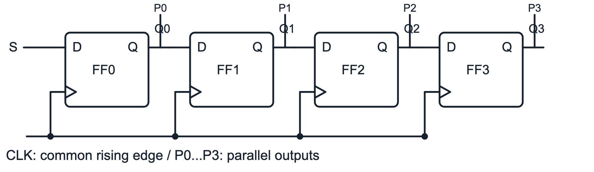
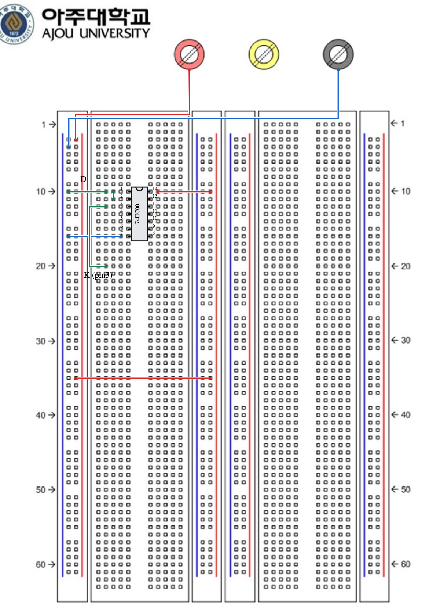

# 실험 7 · 문제 설명

      
첫 줄부터 완성 답과 검산까지 함께 풀어요.

## 문제를 함께 풀어요

### 문제 1 · 시프트 레지스터의 기능

문제 읽기
#### 문제

시프트 레지스터(Shift Register)에 대해서 설명하시오.

이 문제에서 할 일
저장과 이동을 함께 설명해요.

이 문제를 봤을 때 떠올릴 개념과 공식
공통 클록의 유효 엣지

같은 엣지에 각 칸이 앞 칸의 이전 값을 받아요.

첫 줄을 써 봐요
첫 칸은 Q0다음=S로 적어요.

[필요한 개념으로 돌아가요](%EC%8B%A4%ED%97%9807_%EC%8B%A4%ED%97%98%EC%84%A4%EB%AA%85.md#t-shift)

이유를 따라 완성해요
정상 이동 모드에서 입력 시간 조건을 만족하면 Qi다음=Q(i−1)이전이에요. 저장한 비트를 한 칸씩 옮겨 직렬·병렬 변환이나 지연에 써요.

답과 검산을 확인해요
0000에서 1, 0을 차례로 넣으면 1000→0100이에요.

헷갈리기 쉬운 조건을 확인해요
한 엣지는 한 칸 이동이에요.

설명을 닫고 다시 해 봐요
- 입력 1이 두 엣지 동안 지나가는 칸을 표시해요.

**떠올릴 것:** 공통 클록의 유효 엣지

같은 엣지에 각 칸이 앞 칸의 이전 값을 받아요.

첫 실행: 첫 칸은 Q0다음=S로 적어요.

결론: 정상 이동 모드에서 입력 시간 조건을 만족하면 Qi다음=Q(i−1)이전이에요. 저장한 비트를 한 칸씩 옮겨 직렬·병렬 변환이나 지연에 써요.

검산: 0000에서 1, 0을 차례로 넣으면 1000→0100이에요.

주의: 한 엣지는 한 칸 이동이에요.

출처: [from_the_past/정리/퀴즈/실험7/실험7 퀴즈 기출 2016-1.pdf · PDF p1](../../../from_the_past/%EC%A0%95%EB%A6%AC/%ED%80%B4%EC%A6%88/%EC%8B%A4%ED%97%987/%EC%8B%A4%ED%97%987%20%ED%80%B4%EC%A6%88%20%EA%B8%B0%EC%B6%9C%202016-1.pdf#page=1) · [from_the_past/정리/퀴즈/실험7/실험7 퀴즈 기출_정답.pdf · PDF p1](../../../from_the_past/%EC%A0%95%EB%A6%AC/%ED%80%B4%EC%A6%88/%EC%8B%A4%ED%97%987/%EC%8B%A4%ED%97%987%20%ED%80%B4%EC%A6%88%20%EA%B8%B0%EC%B6%9C_%EC%A0%95%EB%8B%B5.pdf#page=1) · [from_the_past/정리/퀴즈/실험7/실험7 퀴즈 종합_기출문제 (2p).pdf · PDF p2](../../../from_the_past/%EC%A0%95%EB%A6%AC/%ED%80%B4%EC%A6%88/%EC%8B%A4%ED%97%987/%EC%8B%A4%ED%97%987%20%ED%80%B4%EC%A6%88%20%EC%A2%85%ED%95%A9_%EA%B8%B0%EC%B6%9C%EB%AC%B8%EC%A0%9C%20%282p%29.pdf#page=2) · [from_the_past/정리/퀴즈/실험7/실험7 퀴즈 기출_단답형.pdf · PDF p1](../../../from_the_past/%EC%A0%95%EB%A6%AC/%ED%80%B4%EC%A6%88/%EC%8B%A4%ED%97%987/%EC%8B%A4%ED%97%987%20%ED%80%B4%EC%A6%88%20%EA%B8%B0%EC%B6%9C_%EB%8B%A8%EB%8B%B5%ED%98%95.pdf#page=1) · [from_the_past/정리/퀴즈/실험7/원본_docx/quiz_07.hwp](../../../from_the_past/%EC%A0%95%EB%A6%AC/%ED%80%B4%EC%A6%88/%EC%8B%A4%ED%97%987/%EC%9B%90%EB%B3%B8_docx/quiz_07.hwp) · [from_the_past/정리/퀴즈/실험7/실험7 퀴즈 예상문제_v1.pdf · PDF p1](../../../from_the_past/%EC%A0%95%EB%A6%AC/%ED%80%B4%EC%A6%88/%EC%8B%A4%ED%97%987/%EC%8B%A4%ED%97%987%20%ED%80%B4%EC%A6%88%20%EC%98%88%EC%83%81%EB%AC%B8%EC%A0%9C_v1.pdf#page=1) · [from_the_past/정리/퀴즈/실험7/실험7 퀴즈 예상문제_v2.pdf · PDF p1](../../../from_the_past/%EC%A0%95%EB%A6%AC/%ED%80%B4%EC%A6%88/%EC%8B%A4%ED%97%987/%EC%8B%A4%ED%97%987%20%ED%80%B4%EC%A6%88%20%EC%98%88%EC%83%81%EB%AC%B8%EC%A0%9C_v2.pdf#page=1) · [from_the_past/정리/퀴즈/실험7/실험7 퀴즈 예상문제_v3.pdf · PDF p1](../../../from_the_past/%EC%A0%95%EB%A6%AC/%ED%80%B4%EC%A6%88/%EC%8B%A4%ED%97%987/%EC%8B%A4%ED%97%987%20%ED%80%B4%EC%A6%88%20%EC%98%88%EC%83%81%EB%AC%B8%EC%A0%9C_v3.pdf#page=1) · [from_the_past/정리/퀴즈/실험7/실험7 퀴즈 예상문제_v4.pdf · PDF p1](../../../from_the_past/%EC%A0%95%EB%A6%AC/%ED%80%B4%EC%A6%88/%EC%8B%A4%ED%97%987/%EC%8B%A4%ED%97%987%20%ED%80%B4%EC%A6%88%20%EC%98%88%EC%83%81%EB%AC%B8%EC%A0%9C_v4.pdf#page=1) · [from_the_past/정리/퀴즈/실험7/실험7 퀴즈 종합_기출문제 (2p).pdf · PDF p1](../../../from_the_past/%EC%A0%95%EB%A6%AC/%ED%80%B4%EC%A6%88/%EC%8B%A4%ED%97%987/%EC%8B%A4%ED%97%987%20%ED%80%B4%EC%A6%88%20%EC%A2%85%ED%95%A9_%EA%B8%B0%EC%B6%9C%EB%AC%B8%EC%A0%9C%20%282p%29.pdf#page=1) · [from_the_past/정리/퀴즈/실험7/원본_docx/실험7_예상 !!!.docx](../../../from_the_past/%EC%A0%95%EB%A6%AC/%ED%80%B4%EC%A6%88/%EC%8B%A4%ED%97%987/%EC%9B%90%EB%B3%B8_docx/%EC%8B%A4%ED%97%987_%EC%98%88%EC%83%81%20%21%21%21.docx) · [from_the_past/정리/퀴즈/실험7/원본_docx/실험7_예상.docx](../../../from_the_past/%EC%A0%95%EB%A6%AC/%ED%80%B4%EC%A6%88/%EC%8B%A4%ED%97%987/%EC%9B%90%EB%B3%B8_docx/%EC%8B%A4%ED%97%987_%EC%98%88%EC%83%81.docx)

### 문제 2 · 링 카운터와 초기화

문제 읽기
#### 문제

링 카운터에 대해서 설명하시오.

이 문제에서 할 일
되먹임 연결과 순환 상태 수를 답해요.

이 문제를 봤을 때 떠올릴 개념과 공식
마지막 Q를 그대로 되먹여요

one-hot으로 시작하면 1 하나가 매 엣지에 한 칸씩 돌아요.

첫 줄을 써 봐요
Q0…Q3=1000에서 시작해요.

[필요한 개념으로 돌아가요](%EC%8B%A4%ED%97%9807_%EC%8B%A4%ED%97%98%EC%84%A4%EB%AA%85.md#t-counters)

이유를 따라 완성해요
마지막 Q를 첫 직렬 입력에 연결해요. 1000→0100→0010→0001→1000이므로 one-hot으로 초기화한 n단 링은 n상태를 순환해요.

답과 검산을 확인해요
0000을 넣으면 다음도 0000이라 같은 주기를 돌지 않아요.

헷갈리기 쉬운 조건을 확인해요
n상태를 쓰려면 one-hot 초기화 조건을 밝혀요.

설명을 닫고 다시 해 봐요
- 1이 출발 위치로 돌아오는 데 필요한 엣지를 세어요.

**떠올릴 것:** 마지막 Q를 그대로 되먹여요

one-hot으로 시작하면 1 하나가 매 엣지에 한 칸씩 돌아요.

첫 실행: Q0…Q3=1000에서 시작해요.

결론: 마지막 Q를 첫 직렬 입력에 연결해요. 1000→0100→0010→0001→1000이므로 one-hot으로 초기화한 n단 링은 n상태를 순환해요.

검산: 0000을 넣으면 다음도 0000이라 같은 주기를 돌지 않아요.

주의: n상태를 쓰려면 one-hot 초기화 조건을 밝혀요.

출처: [from_the_past/정리/퀴즈/실험7/실험7 퀴즈 기출 2016-1.pdf · PDF p1](../../../from_the_past/%EC%A0%95%EB%A6%AC/%ED%80%B4%EC%A6%88/%EC%8B%A4%ED%97%987/%EC%8B%A4%ED%97%987%20%ED%80%B4%EC%A6%88%20%EA%B8%B0%EC%B6%9C%202016-1.pdf#page=1) · [from_the_past/정리/퀴즈/실험7/실험7 퀴즈 기출_단답형.pdf · PDF p1](../../../from_the_past/%EC%A0%95%EB%A6%AC/%ED%80%B4%EC%A6%88/%EC%8B%A4%ED%97%987/%EC%8B%A4%ED%97%987%20%ED%80%B4%EC%A6%88%20%EA%B8%B0%EC%B6%9C_%EB%8B%A8%EB%8B%B5%ED%98%95.pdf#page=1) · [from_the_past/정리/퀴즈/실험7/원본_docx/quiz_07.hwp](../../../from_the_past/%EC%A0%95%EB%A6%AC/%ED%80%B4%EC%A6%88/%EC%8B%A4%ED%97%987/%EC%9B%90%EB%B3%B8_docx/quiz_07.hwp) · [from_the_past/정리/퀴즈/실험7/실험7 퀴즈 예상문제_v1.pdf · PDF p1](../../../from_the_past/%EC%A0%95%EB%A6%AC/%ED%80%B4%EC%A6%88/%EC%8B%A4%ED%97%987/%EC%8B%A4%ED%97%987%20%ED%80%B4%EC%A6%88%20%EC%98%88%EC%83%81%EB%AC%B8%EC%A0%9C_v1.pdf#page=1) · [from_the_past/정리/퀴즈/실험7/실험7 퀴즈 예상문제_v2.pdf · PDF p1](../../../from_the_past/%EC%A0%95%EB%A6%AC/%ED%80%B4%EC%A6%88/%EC%8B%A4%ED%97%987/%EC%8B%A4%ED%97%987%20%ED%80%B4%EC%A6%88%20%EC%98%88%EC%83%81%EB%AC%B8%EC%A0%9C_v2.pdf#page=1) · [from_the_past/정리/퀴즈/실험7/실험7 퀴즈 예상문제_v3.pdf · PDF p1](../../../from_the_past/%EC%A0%95%EB%A6%AC/%ED%80%B4%EC%A6%88/%EC%8B%A4%ED%97%987/%EC%8B%A4%ED%97%987%20%ED%80%B4%EC%A6%88%20%EC%98%88%EC%83%81%EB%AC%B8%EC%A0%9C_v3.pdf#page=1) · [from_the_past/정리/퀴즈/실험7/실험7 퀴즈 예상문제_v4.pdf · PDF p1](../../../from_the_past/%EC%A0%95%EB%A6%AC/%ED%80%B4%EC%A6%88/%EC%8B%A4%ED%97%987/%EC%8B%A4%ED%97%987%20%ED%80%B4%EC%A6%88%20%EC%98%88%EC%83%81%EB%AC%B8%EC%A0%9C_v4.pdf#page=1) · [from_the_past/정리/퀴즈/실험7/실험7 퀴즈 종합_기출문제 (2p).pdf · PDF p1](../../../from_the_past/%EC%A0%95%EB%A6%AC/%ED%80%B4%EC%A6%88/%EC%8B%A4%ED%97%987/%EC%8B%A4%ED%97%987%20%ED%80%B4%EC%A6%88%20%EC%A2%85%ED%95%A9_%EA%B8%B0%EC%B6%9C%EB%AC%B8%EC%A0%9C%20%282p%29.pdf#page=1) · [from_the_past/정리/퀴즈/실험7/원본_docx/실험7_예상 !!!.docx](../../../from_the_past/%EC%A0%95%EB%A6%AC/%ED%80%B4%EC%A6%88/%EC%8B%A4%ED%97%987/%EC%9B%90%EB%B3%B8_docx/%EC%8B%A4%ED%97%987_%EC%98%88%EC%83%81%20%21%21%21.docx) · [from_the_past/정리/퀴즈/실험7/원본_docx/실험7_예상.docx](../../../from_the_past/%EC%A0%95%EB%A6%AC/%ED%80%B4%EC%A6%88/%EC%8B%A4%ED%97%987/%EC%9B%90%EB%B3%B8_docx/%EC%8B%A4%ED%97%987_%EC%98%88%EC%83%81.docx)

### 문제 3 · 존슨 카운터의 NAND 역할

문제 읽기
#### 문제

존슨 카운터에서 사용되는 2입력 NAND gate의 역할을 설명하시오.

이 문제에서 할 일
2입력 NAND의 역할을 배선별로 판단해요.

이 문제를 봤을 때 떠올릴 개념과 공식
NAND 입력과 출력의 연결

두 입력을 한 신호에 묶으면 반전하고, 서로 다른 상태 신호를 받으면 특정 상태를 검출할 수 있어요.

첫 줄을 써 봐요
두 입력이 모두 마지막 Q라면 NAND(Q,Q)=NOT Q를 써요.

[필요한 개념으로 돌아가요](%EC%8B%A4%ED%97%9807_%EC%8B%A4%ED%97%98%EC%84%A4%EB%AA%85.md#t-counters)

이유를 따라 완성해요
그 출력을 첫 칸에 돌려주면 존슨의 반전 되먹임이에요. 상태 신호 두 개를 받아 해당 상태에서 0을 내는 배선이면 active-low 디코더예요.

답과 검산을 확인해요
입력을 묶은 경우 Q=0→출력 1, Q=1→출력 0이에요. 디코딩은 입력 배선이 있어야 검산할 수 있어요.

헷갈리기 쉬운 조건을 확인해요
답안 충돌. 제공 답은 마지막 출력의 반전과 2n개 AND 디코딩으로 갈려요. 원문에 배선이 없어서 단일 역할은 미확정이에요. 2n개 AND가 모든 회로의 필수 조건은 아니에요.

설명을 닫고 다시 해 봐요
- NAND 출력이 첫 칸에 들어가는지 상태 검출에 쓰이는지 나눠 설명해요.

**떠올릴 것:** NAND 입력과 출력의 연결

두 입력을 한 신호에 묶으면 반전하고, 서로 다른 상태 신호를 받으면 특정 상태를 검출할 수 있어요.

첫 실행: 두 입력이 모두 마지막 Q라면 NAND(Q,Q)=NOT Q를 써요.

결론: 그 출력을 첫 칸에 돌려주면 존슨의 반전 되먹임이에요. 상태 신호 두 개를 받아 해당 상태에서 0을 내는 배선이면 active-low 디코더예요.

검산: 입력을 묶은 경우 Q=0→출력 1, Q=1→출력 0이에요. 디코딩은 입력 배선이 있어야 검산할 수 있어요.

주의: 답안 충돌. 제공 답은 마지막 출력의 반전과 2n개 AND 디코딩으로 갈려요. 원문에 배선이 없어서 단일 역할은 미확정이에요. 2n개 AND가 모든 회로의 필수 조건은 아니에요.

출처: [from_the_past/정리/퀴즈/실험7/실험7 퀴즈 기출 2016-1.pdf · PDF p1](../../../from_the_past/%EC%A0%95%EB%A6%AC/%ED%80%B4%EC%A6%88/%EC%8B%A4%ED%97%987/%EC%8B%A4%ED%97%987%20%ED%80%B4%EC%A6%88%20%EA%B8%B0%EC%B6%9C%202016-1.pdf#page=1) · [from_the_past/정리/퀴즈/실험7/실험7 퀴즈 기출_단답형.pdf · PDF p1](../../../from_the_past/%EC%A0%95%EB%A6%AC/%ED%80%B4%EC%A6%88/%EC%8B%A4%ED%97%987/%EC%8B%A4%ED%97%987%20%ED%80%B4%EC%A6%88%20%EA%B8%B0%EC%B6%9C_%EB%8B%A8%EB%8B%B5%ED%98%95.pdf#page=1) · [from_the_past/정리/퀴즈/실험7/원본_docx/quiz_07.hwp](../../../from_the_past/%EC%A0%95%EB%A6%AC/%ED%80%B4%EC%A6%88/%EC%8B%A4%ED%97%987/%EC%9B%90%EB%B3%B8_docx/quiz_07.hwp) · [from_the_past/정리/퀴즈/실험7/실험7 퀴즈 예상문제_v1.pdf · PDF p2](../../../from_the_past/%EC%A0%95%EB%A6%AC/%ED%80%B4%EC%A6%88/%EC%8B%A4%ED%97%987/%EC%8B%A4%ED%97%987%20%ED%80%B4%EC%A6%88%20%EC%98%88%EC%83%81%EB%AC%B8%EC%A0%9C_v1.pdf#page=2) · [from_the_past/정리/퀴즈/실험7/실험7 퀴즈 예상문제_v2.pdf · PDF p1](../../../from_the_past/%EC%A0%95%EB%A6%AC/%ED%80%B4%EC%A6%88/%EC%8B%A4%ED%97%987/%EC%8B%A4%ED%97%987%20%ED%80%B4%EC%A6%88%20%EC%98%88%EC%83%81%EB%AC%B8%EC%A0%9C_v2.pdf#page=1) · [from_the_past/정리/퀴즈/실험7/실험7 퀴즈 예상문제_v3.pdf · PDF p1](../../../from_the_past/%EC%A0%95%EB%A6%AC/%ED%80%B4%EC%A6%88/%EC%8B%A4%ED%97%987/%EC%8B%A4%ED%97%987%20%ED%80%B4%EC%A6%88%20%EC%98%88%EC%83%81%EB%AC%B8%EC%A0%9C_v3.pdf#page=1) · [from_the_past/정리/퀴즈/실험7/실험7 퀴즈 예상문제_v4.pdf · PDF p2](../../../from_the_past/%EC%A0%95%EB%A6%AC/%ED%80%B4%EC%A6%88/%EC%8B%A4%ED%97%987/%EC%8B%A4%ED%97%987%20%ED%80%B4%EC%A6%88%20%EC%98%88%EC%83%81%EB%AC%B8%EC%A0%9C_v4.pdf#page=2) · [from_the_past/정리/퀴즈/실험7/실험7 퀴즈 종합_기출문제 (2p).pdf · PDF p1](../../../from_the_past/%EC%A0%95%EB%A6%AC/%ED%80%B4%EC%A6%88/%EC%8B%A4%ED%97%987/%EC%8B%A4%ED%97%987%20%ED%80%B4%EC%A6%88%20%EC%A2%85%ED%95%A9_%EA%B8%B0%EC%B6%9C%EB%AC%B8%EC%A0%9C%20%282p%29.pdf#page=1) · [from_the_past/정리/퀴즈/실험7/원본_docx/실험7_예상 !!!.docx](../../../from_the_past/%EC%A0%95%EB%A6%AC/%ED%80%B4%EC%A6%88/%EC%8B%A4%ED%97%987/%EC%9B%90%EB%B3%B8_docx/%EC%8B%A4%ED%97%987_%EC%98%88%EC%83%81%20%21%21%21.docx) · [from_the_past/정리/퀴즈/실험7/원본_docx/실험7_예상.docx](../../../from_the_past/%EC%A0%95%EB%A6%AC/%ED%80%B4%EC%A6%88/%EC%8B%A4%ED%97%987/%EC%9B%90%EB%B3%B8_docx/%EC%8B%A4%ED%97%987_%EC%98%88%EC%83%81.docx)

### 문제 4 · 7496 내부 블록을 읽어요

문제 읽기
#### 문제

7496 내부 블록다이어그램을 보고, 동작 원리를 간단하게 설명하시오.

이 문제에서 할 일
이동·프리셋·초기화 경로를 읽어요.

이 문제를 봤을 때 떠올릴 개념과 공식
공통 클록과 비동기 제어

공통 클록은 이전 값을 옮기고 preset·clear는 클록 없이 상태를 강제해요.

첫 줄을 써 봐요
SER가 들어가는 첫 S-R 단계를 찾고 QA→다음 단으로 따라가요.

[필요한 개념으로 돌아가요](%EC%8B%A4%ED%97%9807_%EC%8B%A4%ED%97%98%EC%84%A4%EB%AA%85.md#t-7496)

이유를 따라 완성해요
정상 모드의 유효 엣지마다 앞 단계의 이전 값이 다섯 S-R 단을 따라 이동해요. PE=1이고 해당 preset=1이면 NAND 출력 0이 그 Q를 1로 강제해요. 공통 CLEAR는 다섯 단을 초기화해요.

답과 검산을 확인해요
PE=0이면 preset NAND 출력 1이에요. clear와 preset을 해제한 11000에 SER=0을 넣으면 유효 엣지 한 번 뒤 01100이에요.

헷갈리기 쉬운 조건을 확인해요
정답 미확정. 교안 13쪽 CLR 1→0→1과 부록 18~20쪽 MR 0→1→0이 달라요. 25쪽은 하강 엣지, 과거 답은 상승 엣지예요. 정확한 제조사·품번 데이터시트와 실물 파형 확인이 필요해요.

설명을 닫고 다시 해 봐요
- 클록을 통과하는 이동과 상태를 강제하는 두 경로를 따로 그려요.

**떠올릴 것:** 공통 클록과 비동기 제어

공통 클록은 이전 값을 옮기고 preset·clear는 클록 없이 상태를 강제해요.

첫 실행: SER가 들어가는 첫 S-R 단계를 찾고 QA→다음 단으로 따라가요.

결론: 정상 모드의 유효 엣지마다 앞 단계의 이전 값이 다섯 S-R 단을 따라 이동해요. PE=1이고 해당 preset=1이면 NAND 출력 0이 그 Q를 1로 강제해요. 공통 CLEAR는 다섯 단을 초기화해요.

검산: PE=0이면 preset NAND 출력 1이에요. clear와 preset을 해제한 11000에 SER=0을 넣으면 유효 엣지 한 번 뒤 01100이에요.

주의: 정답 미확정. 교안 13쪽 CLR 1→0→1과 부록 18~20쪽 MR 0→1→0이 달라요. 25쪽은 하강 엣지, 과거 답은 상승 엣지예요. 정확한 제조사·품번 데이터시트와 실물 파형 확인이 필요해요.

출처: [from_the_past/정리/퀴즈/실험7/실험7 퀴즈 기출 2016-1.pdf · PDF p1](../../../from_the_past/%EC%A0%95%EB%A6%AC/%ED%80%B4%EC%A6%88/%EC%8B%A4%ED%97%987/%EC%8B%A4%ED%97%987%20%ED%80%B4%EC%A6%88%20%EA%B8%B0%EC%B6%9C%202016-1.pdf#page=1) · [from_the_past/정리/퀴즈/실험7/실험7 퀴즈 기출_단답형.pdf · PDF p2](../../../from_the_past/%EC%A0%95%EB%A6%AC/%ED%80%B4%EC%A6%88/%EC%8B%A4%ED%97%987/%EC%8B%A4%ED%97%987%20%ED%80%B4%EC%A6%88%20%EA%B8%B0%EC%B6%9C_%EB%8B%A8%EB%8B%B5%ED%98%95.pdf#page=2) · [from_the_past/정리/퀴즈/실험7/원본_docx/quiz_07.hwp](../../../from_the_past/%EC%A0%95%EB%A6%AC/%ED%80%B4%EC%A6%88/%EC%8B%A4%ED%97%987/%EC%9B%90%EB%B3%B8_docx/quiz_07.hwp) · [from_the_past/정리/퀴즈/실험7/실험7 퀴즈 예상문제_v1.pdf · PDF p2](../../../from_the_past/%EC%A0%95%EB%A6%AC/%ED%80%B4%EC%A6%88/%EC%8B%A4%ED%97%987/%EC%8B%A4%ED%97%987%20%ED%80%B4%EC%A6%88%20%EC%98%88%EC%83%81%EB%AC%B8%EC%A0%9C_v1.pdf#page=2) · [from_the_past/정리/퀴즈/실험7/실험7 퀴즈 예상문제_v2.pdf · PDF p1](../../../from_the_past/%EC%A0%95%EB%A6%AC/%ED%80%B4%EC%A6%88/%EC%8B%A4%ED%97%987/%EC%8B%A4%ED%97%987%20%ED%80%B4%EC%A6%88%20%EC%98%88%EC%83%81%EB%AC%B8%EC%A0%9C_v2.pdf#page=1) · [from_the_past/정리/퀴즈/실험7/실험7 퀴즈 예상문제_v3.pdf · PDF p1](../../../from_the_past/%EC%A0%95%EB%A6%AC/%ED%80%B4%EC%A6%88/%EC%8B%A4%ED%97%987/%EC%8B%A4%ED%97%987%20%ED%80%B4%EC%A6%88%20%EC%98%88%EC%83%81%EB%AC%B8%EC%A0%9C_v3.pdf#page=1) · [from_the_past/정리/퀴즈/실험7/실험7 퀴즈 예상문제_v4.pdf · PDF p2](../../../from_the_past/%EC%A0%95%EB%A6%AC/%ED%80%B4%EC%A6%88/%EC%8B%A4%ED%97%987/%EC%8B%A4%ED%97%987%20%ED%80%B4%EC%A6%88%20%EC%98%88%EC%83%81%EB%AC%B8%EC%A0%9C_v4.pdf#page=2) · [from_the_past/정리/퀴즈/실험7/실험7 퀴즈 종합_기출문제 (2p).pdf · PDF p1](../../../from_the_past/%EC%A0%95%EB%A6%AC/%ED%80%B4%EC%A6%88/%EC%8B%A4%ED%97%987/%EC%8B%A4%ED%97%987%20%ED%80%B4%EC%A6%88%20%EC%A2%85%ED%95%A9_%EA%B8%B0%EC%B6%9C%EB%AC%B8%EC%A0%9C%20%282p%29.pdf#page=1) · [from_the_past/정리/퀴즈/실험7/원본_docx/실험7_예상 !!!.docx](../../../from_the_past/%EC%A0%95%EB%A6%AC/%ED%80%B4%EC%A6%88/%EC%8B%A4%ED%97%987/%EC%9B%90%EB%B3%B8_docx/%EC%8B%A4%ED%97%987_%EC%98%88%EC%83%81%20%21%21%21.docx) · [from_the_past/정리/퀴즈/실험7/원본_docx/실험7_예상.docx](../../../from_the_past/%EC%A0%95%EB%A6%AC/%ED%80%B4%EC%A6%88/%EC%8B%A4%ED%97%987/%EC%9B%90%EB%B3%B8_docx/%EC%8B%A4%ED%97%987_%EC%98%88%EC%83%81.docx)

### 문제 5 · 직렬·병렬 변환의 두 방향

문제 읽기
#### 문제

시프트레지스터(Shift Register)에서 직렬-병렬 변환기와 병렬-직렬 변환기에 대해서 간단히 설명하시오. (3점)

이 문제에서 할 일
두 변환에서 데이터를 넣고 읽는 순서를 써요.

이 문제를 봤을 때 떠올릴 개념과 공식
직렬 한 선과 병렬 여러 선

한 비트씩 주고받는 쪽과 여러 선을 동시에 쓰는 쪽을 구분해요.

첫 줄을 써 봐요
SIPO의 입력 쪽에 직렬 입력선 하나를 표시해요.

[필요한 개념으로 돌아가요](%EC%8B%A4%ED%97%9807_%EC%8B%A4%ED%97%98%EC%84%A4%EB%AA%85.md#t-convert)

이유를 따라 완성해요
SIPO는 엣지마다 한 비트씩 받아 각 Q를 동시에 읽어요. PISO는 여러 비트를 동시에 적재한 뒤 이동하며 마지막 Q를 한 비트씩 읽어요.

답과 검산을 확인해요
SIPO 0000에 1, 0, 1, 1을 넣으면 Q0…Q3=1101이에요. PISO에 1011을 적재하고 이동 직전에 마지막 Q를 읽으면 1, 1, 0, 1이에요.

헷갈리기 쉬운 조건을 확인해요
입력 시간 순서와 출력의 칸 순서를 밝혀요.

설명을 닫고 다시 해 봐요
- 두 변환에서 동시에 값을 다루는 쪽을 각각 표시해요.

**떠올릴 것:** 직렬 한 선과 병렬 여러 선

한 비트씩 주고받는 쪽과 여러 선을 동시에 쓰는 쪽을 구분해요.

첫 실행: SIPO의 입력 쪽에 직렬 입력선 하나를 표시해요.

결론: SIPO는 엣지마다 한 비트씩 받아 각 Q를 동시에 읽어요. PISO는 여러 비트를 동시에 적재한 뒤 이동하며 마지막 Q를 한 비트씩 읽어요.

검산: SIPO 0000에 1, 0, 1, 1을 넣으면 Q0…Q3=1101이에요. PISO에 1011을 적재하고 이동 직전에 마지막 Q를 읽으면 1, 1, 0, 1이에요.

주의: 입력 시간 순서와 출력의 칸 순서를 밝혀요.

출처: [from_the_past/정리/퀴즈/실험7/실험7 퀴즈 기출_월요반_문제.pdf · PDF p1](../../../from_the_past/%EC%A0%95%EB%A6%AC/%ED%80%B4%EC%A6%88/%EC%8B%A4%ED%97%987/%EC%8B%A4%ED%97%987%20%ED%80%B4%EC%A6%88%20%EA%B8%B0%EC%B6%9C_%EC%9B%94%EC%9A%94%EB%B0%98_%EB%AC%B8%EC%A0%9C.pdf#page=1) · [from_the_past/정리/퀴즈/실험7/실험7 퀴즈 기출_금요반_정답.pdf · PDF p1](../../../from_the_past/%EC%A0%95%EB%A6%AC/%ED%80%B4%EC%A6%88/%EC%8B%A4%ED%97%987/%EC%8B%A4%ED%97%987%20%ED%80%B4%EC%A6%88%20%EA%B8%B0%EC%B6%9C_%EA%B8%88%EC%9A%94%EB%B0%98_%EC%A0%95%EB%8B%B5.pdf#page=1) · [from_the_past/정리/퀴즈/실험7/실험7 퀴즈 기출_채점본.jpg](../../../from_the_past/%EC%A0%95%EB%A6%AC/%ED%80%B4%EC%A6%88/%EC%8B%A4%ED%97%987/%EC%8B%A4%ED%97%987%20%ED%80%B4%EC%A6%88%20%EA%B8%B0%EC%B6%9C_%EC%B1%84%EC%A0%90%EB%B3%B8.jpg) · [from_the_past/정리/퀴즈/실험7/원본_docx/실험7_답.docx](../../../from_the_past/%EC%A0%95%EB%A6%AC/%ED%80%B4%EC%A6%88/%EC%8B%A4%ED%97%987/%EC%9B%90%EB%B3%B8_docx/%EC%8B%A4%ED%97%987_%EB%8B%B5.docx) · [from_the_past/정리/퀴즈/실험7/실험7 퀴즈 기출_단답형.pdf · PDF p1](../../../from_the_past/%EC%A0%95%EB%A6%AC/%ED%80%B4%EC%A6%88/%EC%8B%A4%ED%97%987/%EC%8B%A4%ED%97%987%20%ED%80%B4%EC%A6%88%20%EA%B8%B0%EC%B6%9C_%EB%8B%A8%EB%8B%B5%ED%98%95.pdf#page=1) · [from_the_past/정리/퀴즈/실험7/원본_docx/quiz_07.hwp](../../../from_the_past/%EC%A0%95%EB%A6%AC/%ED%80%B4%EC%A6%88/%EC%8B%A4%ED%97%987/%EC%9B%90%EB%B3%B8_docx/quiz_07.hwp) · [from_the_past/정리/퀴즈/실험7/실험7 퀴즈 예상문제_v1.pdf · PDF p1](../../../from_the_past/%EC%A0%95%EB%A6%AC/%ED%80%B4%EC%A6%88/%EC%8B%A4%ED%97%987/%EC%8B%A4%ED%97%987%20%ED%80%B4%EC%A6%88%20%EC%98%88%EC%83%81%EB%AC%B8%EC%A0%9C_v1.pdf#page=1) · [from_the_past/정리/퀴즈/실험7/실험7 퀴즈 예상문제_v2.pdf · PDF p1](../../../from_the_past/%EC%A0%95%EB%A6%AC/%ED%80%B4%EC%A6%88/%EC%8B%A4%ED%97%987/%EC%8B%A4%ED%97%987%20%ED%80%B4%EC%A6%88%20%EC%98%88%EC%83%81%EB%AC%B8%EC%A0%9C_v2.pdf#page=1) · [from_the_past/정리/퀴즈/실험7/실험7 퀴즈 예상문제_v3.pdf · PDF p1](../../../from_the_past/%EC%A0%95%EB%A6%AC/%ED%80%B4%EC%A6%88/%EC%8B%A4%ED%97%987/%EC%8B%A4%ED%97%987%20%ED%80%B4%EC%A6%88%20%EC%98%88%EC%83%81%EB%AC%B8%EC%A0%9C_v3.pdf#page=1) · [from_the_past/정리/퀴즈/실험7/실험7 퀴즈 예상문제_v4.pdf · PDF p1](../../../from_the_past/%EC%A0%95%EB%A6%AC/%ED%80%B4%EC%A6%88/%EC%8B%A4%ED%97%987/%EC%8B%A4%ED%97%987%20%ED%80%B4%EC%A6%88%20%EC%98%88%EC%83%81%EB%AC%B8%EC%A0%9C_v4.pdf#page=1) · [from_the_past/정리/퀴즈/실험7/실험7 퀴즈 종합_기출문제 (2p).pdf · PDF p1](../../../from_the_past/%EC%A0%95%EB%A6%AC/%ED%80%B4%EC%A6%88/%EC%8B%A4%ED%97%987/%EC%8B%A4%ED%97%987%20%ED%80%B4%EC%A6%88%20%EC%A2%85%ED%95%A9_%EA%B8%B0%EC%B6%9C%EB%AC%B8%EC%A0%9C%20%282p%29.pdf#page=1) · [from_the_past/정리/퀴즈/실험7/원본_docx/실험7_예상 !!!.docx](../../../from_the_past/%EC%A0%95%EB%A6%AC/%ED%80%B4%EC%A6%88/%EC%8B%A4%ED%97%987/%EC%9B%90%EB%B3%B8_docx/%EC%8B%A4%ED%97%987_%EC%98%88%EC%83%81%20%21%21%21.docx) · [from_the_past/정리/퀴즈/실험7/원본_docx/실험7_예상.docx](../../../from_the_past/%EC%A0%95%EB%A6%AC/%ED%80%B4%EC%A6%88/%EC%8B%A4%ED%97%987/%EC%9B%90%EB%B3%B8_docx/%EC%8B%A4%ED%97%987_%EC%98%88%EC%83%81.docx)

### 문제 6 · 4비트 회로와 7476 개수

문제 읽기
#### 문제

Flip Flop을 활용한 Shift Register 설계 (총 4 점)

1) 4 bit Shift Register을 구현하기 위해 필요한 7476칩의 개수와 J-K F/F의 개수는 각각 몇 개인가? (2점)

2) 아래의 “D F/F”을 활용하여 4 bit Serial in, parallel out Shift Register를 설계 하시오. (2점)

#### 주어진 조건

원문에 주어진 D F/F는 상승 엣지 기호예요. 첫 칸을 Q0로 정해요.

이 문제에서 할 일
7476 칩 수와 JK 수를 구하고, D 플립플롭으로 회로를 그려요.

이 문제를 봤을 때 떠올릴 개념과 공식
저장 칸 수와 칩 수

4비트에 저장 칸 4개가 필요하고, 7476 한 칩에는 JK가 두 개예요.

첫 줄을 써 봐요
칩 수는 4÷2부터 계산해요.

[필요한 개념으로 돌아가요](%EC%8B%A4%ED%97%9807_%EC%8B%A4%ED%97%98%EC%84%A4%EB%AA%85.md#t-jk)

이유를 따라 완성해요
① JK 4개, 7476 2개예요. ② S→D0, Q0→D1, Q1→D2, Q2→D3을 연결해요. 네 CLK는 공통이고 Q0~Q3가 병렬 출력이에요. 제시된 D 기호는 상승 엣지예요.

답과 검산을 확인해요
검산용 초기값 0000에 입력 1, 0을 주면 1000→0100이에요. Q→D 연결은 3개예요.

헷갈리기 쉬운 조건을 확인해요
소문항 ②는 D F/F로 그려요. 원문에 초기 상태는 주어지지 않았어요.

설명을 닫고 다시 해 봐요
- JK 수와 칩 수를 적고 네 D F/F의 데이터선과 공통 클록을 그려요.

**떠올릴 것:** 저장 칸 수와 칩 수

4비트에 저장 칸 4개가 필요하고, 7476 한 칩에는 JK가 두 개예요.

첫 실행: 칩 수는 4÷2부터 계산해요.

결론: ① JK 4개, 7476 2개예요. ② S→D0, Q0→D1, Q1→D2, Q2→D3을 연결해요. 네 CLK는 공통이고 Q0~Q3가 병렬 출력이에요. 제시된 D 기호는 상승 엣지예요.

검산: 검산용 초기값 0000에 입력 1, 0을 주면 1000→0100이에요. Q→D 연결은 3개예요.

주의: 소문항 ②는 D F/F로 그려요. 원문에 초기 상태는 주어지지 않았어요.

출처: [from_the_past/정리/퀴즈/실험7/실험7 퀴즈 기출_월요반_문제.pdf · PDF p1](../../../from_the_past/%EC%A0%95%EB%A6%AC/%ED%80%B4%EC%A6%88/%EC%8B%A4%ED%97%987/%EC%8B%A4%ED%97%987%20%ED%80%B4%EC%A6%88%20%EA%B8%B0%EC%B6%9C_%EC%9B%94%EC%9A%94%EB%B0%98_%EB%AC%B8%EC%A0%9C.pdf#page=1) · [from_the_past/정리/퀴즈/실험7/실험7 퀴즈 기출_금요반_정답.pdf · PDF p1](../../../from_the_past/%EC%A0%95%EB%A6%AC/%ED%80%B4%EC%A6%88/%EC%8B%A4%ED%97%987/%EC%8B%A4%ED%97%987%20%ED%80%B4%EC%A6%88%20%EA%B8%B0%EC%B6%9C_%EA%B8%88%EC%9A%94%EB%B0%98_%EC%A0%95%EB%8B%B5.pdf#page=1) · [from_the_past/정리/퀴즈/실험7/실험7 퀴즈 기출_채점본.jpg](../../../from_the_past/%EC%A0%95%EB%A6%AC/%ED%80%B4%EC%A6%88/%EC%8B%A4%ED%97%987/%EC%8B%A4%ED%97%987%20%ED%80%B4%EC%A6%88%20%EA%B8%B0%EC%B6%9C_%EC%B1%84%EC%A0%90%EB%B3%B8.jpg) · [from_the_past/정리/퀴즈/실험7/원본_docx/실험7_답.docx](../../../from_the_past/%EC%A0%95%EB%A6%AC/%ED%80%B4%EC%A6%88/%EC%8B%A4%ED%97%987/%EC%9B%90%EB%B3%B8_docx/%EC%8B%A4%ED%97%987_%EB%8B%B5.docx)

### 문제 7 · 7496을 순환 회로로 바꿔요

문제 읽기
#### 문제

7496으로 구현한 5bit Shift Register를 Circular Shift Register로 변환하는 방법을 간단히 설명하시오. (3점)

이 문제에서 할 일
7496의 순환 되먹임 배선을 답해요.

이 문제를 봤을 때 떠올릴 개념과 공식
QE를 다시 SER로

마지막 비트를 첫 칸에 넣으면 데이터가 회전해요.

첫 줄을 써 봐요
QA…QE 순서에서 마지막 칸과 직렬 입력을 찾아요.

[필요한 개념으로 돌아가요](%EC%8B%A4%ED%97%9807_%EC%8B%A4%ED%97%98%EC%84%A4%EB%AA%85.md#t-counters)

이유를 따라 완성해요
QE 10번을 SER 9번에 연결해요. 정상 이동 동안 clear와 preset은 비활성으로 둬요.

답과 검산을 확인해요
11000→01100→00110→00011→10001→11000을 따라가요.

헷갈리기 쉬운 조건을 확인해요
QE를 반전해서 연결하면 존슨 회로가 돼요.

설명을 닫고 다시 해 봐요
- 핀 번호를 확인하고 QE가 1인 상태에서 다음 QA를 적어요.

**떠올릴 것:** QE를 다시 SER로

마지막 비트를 첫 칸에 넣으면 데이터가 회전해요.

첫 실행: QA…QE 순서에서 마지막 칸과 직렬 입력을 찾아요.

결론: QE 10번을 SER 9번에 연결해요. 정상 이동 동안 clear와 preset은 비활성으로 둬요.

검산: 11000→01100→00110→00011→10001→11000을 따라가요.

주의: QE를 반전해서 연결하면 존슨 회로가 돼요.

출처: [from_the_past/정리/퀴즈/실험7/실험7 퀴즈 기출_월요반_문제.pdf · PDF p1](../../../from_the_past/%EC%A0%95%EB%A6%AC/%ED%80%B4%EC%A6%88/%EC%8B%A4%ED%97%987/%EC%8B%A4%ED%97%987%20%ED%80%B4%EC%A6%88%20%EA%B8%B0%EC%B6%9C_%EC%9B%94%EC%9A%94%EB%B0%98_%EB%AC%B8%EC%A0%9C.pdf#page=1) · [from_the_past/정리/퀴즈/실험7/실험7 퀴즈 기출_금요반_정답.pdf · PDF p1](../../../from_the_past/%EC%A0%95%EB%A6%AC/%ED%80%B4%EC%A6%88/%EC%8B%A4%ED%97%987/%EC%8B%A4%ED%97%987%20%ED%80%B4%EC%A6%88%20%EA%B8%B0%EC%B6%9C_%EA%B8%88%EC%9A%94%EB%B0%98_%EC%A0%95%EB%8B%B5.pdf#page=1) · [from_the_past/정리/퀴즈/실험7/실험7 퀴즈 기출_채점본.jpg](../../../from_the_past/%EC%A0%95%EB%A6%AC/%ED%80%B4%EC%A6%88/%EC%8B%A4%ED%97%987/%EC%8B%A4%ED%97%987%20%ED%80%B4%EC%A6%88%20%EA%B8%B0%EC%B6%9C_%EC%B1%84%EC%A0%90%EB%B3%B8.jpg) · [from_the_past/정리/퀴즈/실험7/원본_docx/실험7_답.docx](../../../from_the_past/%EC%A0%95%EB%A6%AC/%ED%80%B4%EC%A6%88/%EC%8B%A4%ED%97%987/%EC%9B%90%EB%B3%B8_docx/%EC%8B%A4%ED%97%987_%EB%8B%B5.docx)

### 문제 8 · 시프트용 JK 입력을 정해요

문제 읽기
#### 문제

시프트레지스터에 사용할 JK Flip-Flop에 대해서 설명하시오. Explain about a JK Flip-Flop used in the Shift Register.

이 문제에서 할 일
JK로 앞 단계의 값을 복사하는 입력을 정해요.

이 문제를 봤을 때 떠올릴 개념과 공식
JK의 Reset과 Set

다음 Q가 이전 Q와 무관하게 D=0이면 Reset, D=1이면 Set이어야 해요.

첫 줄을 써 봐요
D=0에 JK=01, D=1에 JK=10을 대응시켜요.

[필요한 개념으로 돌아가요](%EC%8B%A4%ED%97%9807_%EC%8B%A4%ED%97%98%EC%84%A4%EB%AA%85.md#t-jk)

이유를 따라 완성해요
비동기 SET·RESET을 비활성으로 두고 J=D, K=NOT D로 연결하면 유효 엣지에서 Q다음=D예요. 첫 칸 D에는 SER, 이후에는 앞 단계 Q를 넣어요.

답과 검산을 확인해요
D와 이전 Q의 네 조합에서 다음 Q는 (0, 0, 1, 1)이에요. D=0의 두 경우부터 세어요.

헷갈리기 쉬운 조건을 확인해요
보충 예상문항이에요. J=K=1은 반전 동작이에요.

설명을 닫고 다시 해 봐요
- D를 0·1로 두고 이전 Q에 상관없이 복사하도록 JK를 정해요.

**떠올릴 것:** JK의 Reset과 Set

다음 Q가 이전 Q와 무관하게 D=0이면 Reset, D=1이면 Set이어야 해요.

첫 실행: D=0에 JK=01, D=1에 JK=10을 대응시켜요.

결론: 비동기 SET·RESET을 비활성으로 두고 J=D, K=NOT D로 연결하면 유효 엣지에서 Q다음=D예요. 첫 칸 D에는 SER, 이후에는 앞 단계 Q를 넣어요.

검산: D와 이전 Q의 네 조합에서 다음 Q는 (0, 0, 1, 1)이에요. D=0의 두 경우부터 세어요.

주의: 보충 예상문항이에요. J=K=1은 반전 동작이에요.

출처: [from_the_past/정리/퀴즈/실험7/실험7 퀴즈 기출_단답형.pdf · PDF p1](../../../from_the_past/%EC%A0%95%EB%A6%AC/%ED%80%B4%EC%A6%88/%EC%8B%A4%ED%97%987/%EC%8B%A4%ED%97%987%20%ED%80%B4%EC%A6%88%20%EA%B8%B0%EC%B6%9C_%EB%8B%A8%EB%8B%B5%ED%98%95.pdf#page=1) · [from_the_past/정리/퀴즈/실험7/원본_docx/quiz_07.hwp](../../../from_the_past/%EC%A0%95%EB%A6%AC/%ED%80%B4%EC%A6%88/%EC%8B%A4%ED%97%987/%EC%9B%90%EB%B3%B8_docx/quiz_07.hwp) · [from_the_past/정리/퀴즈/실험7/실험7 퀴즈 예상문제_v1.pdf · PDF p1](../../../from_the_past/%EC%A0%95%EB%A6%AC/%ED%80%B4%EC%A6%88/%EC%8B%A4%ED%97%987/%EC%8B%A4%ED%97%987%20%ED%80%B4%EC%A6%88%20%EC%98%88%EC%83%81%EB%AC%B8%EC%A0%9C_v1.pdf#page=1) · [from_the_past/정리/퀴즈/실험7/실험7 퀴즈 예상문제_v2.pdf · PDF p1](../../../from_the_past/%EC%A0%95%EB%A6%AC/%ED%80%B4%EC%A6%88/%EC%8B%A4%ED%97%987/%EC%8B%A4%ED%97%987%20%ED%80%B4%EC%A6%88%20%EC%98%88%EC%83%81%EB%AC%B8%EC%A0%9C_v2.pdf#page=1) · [from_the_past/정리/퀴즈/실험7/실험7 퀴즈 예상문제_v3.pdf · PDF p1](../../../from_the_past/%EC%A0%95%EB%A6%AC/%ED%80%B4%EC%A6%88/%EC%8B%A4%ED%97%987/%EC%8B%A4%ED%97%987%20%ED%80%B4%EC%A6%88%20%EC%98%88%EC%83%81%EB%AC%B8%EC%A0%9C_v3.pdf#page=1) · [from_the_past/정리/퀴즈/실험7/실험7 퀴즈 예상문제_v4.pdf · PDF p1](../../../from_the_past/%EC%A0%95%EB%A6%AC/%ED%80%B4%EC%A6%88/%EC%8B%A4%ED%97%987/%EC%8B%A4%ED%97%987%20%ED%80%B4%EC%A6%88%20%EC%98%88%EC%83%81%EB%AC%B8%EC%A0%9C_v4.pdf#page=1) · [from_the_past/정리/퀴즈/실험7/실험7 퀴즈 종합_기출문제 (2p).pdf · PDF p1](../../../from_the_past/%EC%A0%95%EB%A6%AC/%ED%80%B4%EC%A6%88/%EC%8B%A4%ED%97%987/%EC%8B%A4%ED%97%987%20%ED%80%B4%EC%A6%88%20%EC%A2%85%ED%95%A9_%EA%B8%B0%EC%B6%9C%EB%AC%B8%EC%A0%9C%20%282p%29.pdf#page=1) · [from_the_past/정리/퀴즈/실험7/원본_docx/실험7_예상 !!!.docx](../../../from_the_past/%EC%A0%95%EB%A6%AC/%ED%80%B4%EC%A6%88/%EC%8B%A4%ED%97%987/%EC%9B%90%EB%B3%B8_docx/%EC%8B%A4%ED%97%987_%EC%98%88%EC%83%81%20%21%21%21.docx) · [from_the_past/정리/퀴즈/실험7/원본_docx/실험7_예상.docx](../../../from_the_past/%EC%A0%95%EB%A6%AC/%ED%80%B4%EC%A6%88/%EC%8B%A4%ED%97%987/%EC%9B%90%EB%B3%B8_docx/%EC%8B%A4%ED%97%987_%EC%98%88%EC%83%81.docx)

### 문제 9 · 6비트에 필요한 JK 개수

문제 읽기
#### 문제

6bit shift right register를 구현하기 위해 필요한 JK Flip-Flop의 개수는 몇 개인가?

이 문제에서 할 일
필요한 JK 플립플롭 수를 답해요.

이 문제를 봤을 때 떠올릴 개념과 공식
독립 비트당 저장 칸 하나

각 JK가 비트 하나를 기억하므로 비트 수와 저장 칸 수가 같아요.

첫 줄을 써 봐요
6비트에 대응하는 저장 칸을 하나씩 표시해요.

[필요한 개념으로 돌아가요](%EC%8B%A4%ED%97%9807_%EC%8B%A4%ED%97%98%EC%84%A4%EB%AA%85.md#t-memory)

이유를 따라 완성해요
필요한 JK F/F는 6개예요. 7476이라면 한 칩의 두 칸을 써서 3칩에 담아요.

답과 검산을 확인해요
7476 3칩×칩당 2개=6개로 역산해요.

헷갈리기 쉬운 조건을 확인해요
문제가 세는 대상은 칩 안의 JK예요.

설명을 닫고 다시 해 봐요
- 비트 수를 적고 답의 단위를 F/F 개로 써요.

**떠올릴 것:** 독립 비트당 저장 칸 하나

각 JK가 비트 하나를 기억하므로 비트 수와 저장 칸 수가 같아요.

첫 실행: 6비트에 대응하는 저장 칸을 하나씩 표시해요.

결론: 필요한 JK F/F는 6개예요. 7476이라면 한 칩의 두 칸을 써서 3칩에 담아요.

검산: 7476 3칩×칩당 2개=6개로 역산해요.

주의: 문제가 세는 대상은 칩 안의 JK예요.

출처: [from_the_past/정리/퀴즈/실험7/실험7 퀴즈 기출_정답.pdf · PDF p1](../../../from_the_past/%EC%A0%95%EB%A6%AC/%ED%80%B4%EC%A6%88/%EC%8B%A4%ED%97%987/%EC%8B%A4%ED%97%987%20%ED%80%B4%EC%A6%88%20%EA%B8%B0%EC%B6%9C_%EC%A0%95%EB%8B%B5.pdf#page=1) · [from_the_past/정리/퀴즈/실험7/실험7 퀴즈 종합_기출문제 (2p).pdf · PDF p2](../../../from_the_past/%EC%A0%95%EB%A6%AC/%ED%80%B4%EC%A6%88/%EC%8B%A4%ED%97%987/%EC%8B%A4%ED%97%987%20%ED%80%B4%EC%A6%88%20%EC%A2%85%ED%95%A9_%EA%B8%B0%EC%B6%9C%EB%AC%B8%EC%A0%9C%20%282p%29.pdf#page=2) · [from_the_past/정리/퀴즈/실험7/실험7 퀴즈 기출_단답형.pdf · PDF p1](../../../from_the_past/%EC%A0%95%EB%A6%AC/%ED%80%B4%EC%A6%88/%EC%8B%A4%ED%97%987/%EC%8B%A4%ED%97%987%20%ED%80%B4%EC%A6%88%20%EA%B8%B0%EC%B6%9C_%EB%8B%A8%EB%8B%B5%ED%98%95.pdf#page=1) · [from_the_past/정리/퀴즈/실험7/원본_docx/quiz_07.hwp](../../../from_the_past/%EC%A0%95%EB%A6%AC/%ED%80%B4%EC%A6%88/%EC%8B%A4%ED%97%987/%EC%9B%90%EB%B3%B8_docx/quiz_07.hwp) · [from_the_past/정리/퀴즈/실험7/실험7 퀴즈 예상문제_v1.pdf · PDF p1](../../../from_the_past/%EC%A0%95%EB%A6%AC/%ED%80%B4%EC%A6%88/%EC%8B%A4%ED%97%987/%EC%8B%A4%ED%97%987%20%ED%80%B4%EC%A6%88%20%EC%98%88%EC%83%81%EB%AC%B8%EC%A0%9C_v1.pdf#page=1) · [from_the_past/정리/퀴즈/실험7/실험7 퀴즈 예상문제_v2.pdf · PDF p1](../../../from_the_past/%EC%A0%95%EB%A6%AC/%ED%80%B4%EC%A6%88/%EC%8B%A4%ED%97%987/%EC%8B%A4%ED%97%987%20%ED%80%B4%EC%A6%88%20%EC%98%88%EC%83%81%EB%AC%B8%EC%A0%9C_v2.pdf#page=1) · [from_the_past/정리/퀴즈/실험7/실험7 퀴즈 예상문제_v3.pdf · PDF p1](../../../from_the_past/%EC%A0%95%EB%A6%AC/%ED%80%B4%EC%A6%88/%EC%8B%A4%ED%97%987/%EC%8B%A4%ED%97%987%20%ED%80%B4%EC%A6%88%20%EC%98%88%EC%83%81%EB%AC%B8%EC%A0%9C_v3.pdf#page=1) · [from_the_past/정리/퀴즈/실험7/실험7 퀴즈 예상문제_v4.pdf · PDF p1](../../../from_the_past/%EC%A0%95%EB%A6%AC/%ED%80%B4%EC%A6%88/%EC%8B%A4%ED%97%987/%EC%8B%A4%ED%97%987%20%ED%80%B4%EC%A6%88%20%EC%98%88%EC%83%81%EB%AC%B8%EC%A0%9C_v4.pdf#page=1) · [from_the_past/정리/퀴즈/실험7/실험7 퀴즈 종합_기출문제 (2p).pdf · PDF p1](../../../from_the_past/%EC%A0%95%EB%A6%AC/%ED%80%B4%EC%A6%88/%EC%8B%A4%ED%97%987/%EC%8B%A4%ED%97%987%20%ED%80%B4%EC%A6%88%20%EC%A2%85%ED%95%A9_%EA%B8%B0%EC%B6%9C%EB%AC%B8%EC%A0%9C%20%282p%29.pdf#page=1) · [from_the_past/정리/퀴즈/실험7/원본_docx/실험7_예상 !!!.docx](../../../from_the_past/%EC%A0%95%EB%A6%AC/%ED%80%B4%EC%A6%88/%EC%8B%A4%ED%97%987/%EC%9B%90%EB%B3%B8_docx/%EC%8B%A4%ED%97%987_%EC%98%88%EC%83%81%20%21%21%21.docx) · [from_the_past/정리/퀴즈/실험7/원본_docx/실험7_예상.docx](../../../from_the_past/%EC%A0%95%EB%A6%AC/%ED%80%B4%EC%A6%88/%EC%8B%A4%ED%97%987/%EC%9B%90%EB%B3%B8_docx/%EC%8B%A4%ED%97%987_%EC%98%88%EC%83%81.docx)

### 문제 10 · 병렬에서 직렬로 꺼내요

문제 읽기
#### 문제

병렬-직렬 변환기에 대해서 간단히 설명하시오.

이 문제에서 할 일
병렬 데이터를 한 선으로 꺼내는 과정을 써요.

이 문제를 봤을 때 떠올릴 개념과 공식
동시 적재와 순차 출력

여러 칸에 값을 한 번에 담고 각 비트를 끝 칸으로 이동시켜요.

첫 줄을 써 봐요
끝 칸을 직렬 출력으로 표시해요.

[필요한 개념으로 돌아가요](%EC%8B%A4%ED%97%9807_%EC%8B%A4%ED%97%98%EC%84%A4%EB%AA%85.md#t-convert)

이유를 따라 완성해요
병렬 입력선을 통해 여러 비트를 동시에 적재해요. 이동 모드로 바꾼 뒤 마지막 Q를 엣지마다 차례로 읽어요.

답과 검산을 확인해요
Q0…Q3=1011이면 이동 직전 Q3를 읽는 순서는 1, 1, 0, 1이에요.

헷갈리기 쉬운 조건을 확인해요
병렬 적재 기능이 있는 회로를 전제로 해요.

설명을 닫고 다시 해 봐요
- 적재와 이동에서 쓰는 입력선과 출력선을 적어요.

**떠올릴 것:** 동시 적재와 순차 출력

여러 칸에 값을 한 번에 담고 각 비트를 끝 칸으로 이동시켜요.

첫 실행: 끝 칸을 직렬 출력으로 표시해요.

결론: 병렬 입력선을 통해 여러 비트를 동시에 적재해요. 이동 모드로 바꾼 뒤 마지막 Q를 엣지마다 차례로 읽어요.

검산: Q0…Q3=1011이면 이동 직전 Q3를 읽는 순서는 1, 1, 0, 1이에요.

주의: 병렬 적재 기능이 있는 회로를 전제로 해요.

출처: [from_the_past/정리/퀴즈/실험7/실험7 퀴즈 기출_정답.pdf · PDF p1](../../../from_the_past/%EC%A0%95%EB%A6%AC/%ED%80%B4%EC%A6%88/%EC%8B%A4%ED%97%987/%EC%8B%A4%ED%97%987%20%ED%80%B4%EC%A6%88%20%EA%B8%B0%EC%B6%9C_%EC%A0%95%EB%8B%B5.pdf#page=1) · [from_the_past/정리/퀴즈/실험7/실험7 퀴즈 종합_기출문제 (2p).pdf · PDF p2](../../../from_the_past/%EC%A0%95%EB%A6%AC/%ED%80%B4%EC%A6%88/%EC%8B%A4%ED%97%987/%EC%8B%A4%ED%97%987%20%ED%80%B4%EC%A6%88%20%EC%A2%85%ED%95%A9_%EA%B8%B0%EC%B6%9C%EB%AC%B8%EC%A0%9C%20%282p%29.pdf#page=2)

### 문제 11 · 존슨 카운터의 상태 순환

문제 읽기
#### 문제

존슨카운터에 대해 설명하시오.

이 문제에서 할 일
존슨 카운터의 되먹임과 주기를 설명해요.

이 문제를 봤을 때 떠올릴 개념과 공식
마지막 Q의 보수를 되먹여요

꼬리바꿈 때문에 0에서 1이 채워진 뒤 0이 다시 채워져요.

첫 줄을 써 봐요
0000에서 첫 입력 NOT Q3=1을 적어요.

[필요한 개념으로 돌아가요](%EC%8B%A4%ED%97%9807_%EC%8B%A4%ED%97%98%EC%84%A4%EB%AA%85.md#t-counters)

이유를 따라 완성해요
맨 끝 Q를 반전해 첫 입력에 연결해요. 4단은 0000→1000→1100→1110→1111→0111→0011→0001→0000이고 정상 초기화한 n단의 주기는 2n상태예요.

답과 검산을 확인해요
1111에서 다음 상태는 0111이에요. 여기서부터 마지막의 1이 모두 빠지면 0000으로 돌아와요.

헷갈리기 쉬운 조건을 확인해요
2n은 두 배예요. 정상 주기 밖의 초기 상태에는 2n을 적용할 수 없어요.

설명을 닫고 다시 해 봐요
- 0000에서 시작해 되돌아올 때까지 이동 횟수를 세어요.

**떠올릴 것:** 마지막 Q의 보수를 되먹여요

꼬리바꿈 때문에 0에서 1이 채워진 뒤 0이 다시 채워져요.

첫 실행: 0000에서 첫 입력 NOT Q3=1을 적어요.

결론: 맨 끝 Q를 반전해 첫 입력에 연결해요. 4단은 0000→1000→1100→1110→1111→0111→0011→0001→0000이고 정상 초기화한 n단의 주기는 2n상태예요.

검산: 1111에서 다음 상태는 0111이에요. 여기서부터 마지막의 1이 모두 빠지면 0000으로 돌아와요.

주의: 2n은 두 배예요. 정상 주기 밖의 초기 상태에는 2n을 적용할 수 없어요.

출처: [from_the_past/정리/퀴즈/실험7/실험7 퀴즈 기출_정답.pdf · PDF p1](../../../from_the_past/%EC%A0%95%EB%A6%AC/%ED%80%B4%EC%A6%88/%EC%8B%A4%ED%97%987/%EC%8B%A4%ED%97%987%20%ED%80%B4%EC%A6%88%20%EA%B8%B0%EC%B6%9C_%EC%A0%95%EB%8B%B5.pdf#page=1) · [from_the_past/정리/퀴즈/실험7/실험7 퀴즈 종합_기출문제 (2p).pdf · PDF p2](../../../from_the_past/%EC%A0%95%EB%A6%AC/%ED%80%B4%EC%A6%88/%EC%8B%A4%ED%97%987/%EC%8B%A4%ED%97%987%20%ED%80%B4%EC%A6%88%20%EC%A2%85%ED%95%A9_%EA%B8%B0%EC%B6%9C%EB%AC%B8%EC%A0%9C%20%282p%29.pdf#page=2) · [from_the_past/정리/퀴즈/실험7/실험7 퀴즈 기출_단답형.pdf · PDF p1](../../../from_the_past/%EC%A0%95%EB%A6%AC/%ED%80%B4%EC%A6%88/%EC%8B%A4%ED%97%987/%EC%8B%A4%ED%97%987%20%ED%80%B4%EC%A6%88%20%EA%B8%B0%EC%B6%9C_%EB%8B%A8%EB%8B%B5%ED%98%95.pdf#page=1) · [from_the_past/정리/퀴즈/실험7/원본_docx/quiz_07.hwp](../../../from_the_past/%EC%A0%95%EB%A6%AC/%ED%80%B4%EC%A6%88/%EC%8B%A4%ED%97%987/%EC%9B%90%EB%B3%B8_docx/quiz_07.hwp) · [from_the_past/정리/퀴즈/실험7/실험7 퀴즈 예상문제_v1.pdf · PDF p1](../../../from_the_past/%EC%A0%95%EB%A6%AC/%ED%80%B4%EC%A6%88/%EC%8B%A4%ED%97%987/%EC%8B%A4%ED%97%987%20%ED%80%B4%EC%A6%88%20%EC%98%88%EC%83%81%EB%AC%B8%EC%A0%9C_v1.pdf#page=1) · [from_the_past/정리/퀴즈/실험7/실험7 퀴즈 예상문제_v2.pdf · PDF p1](../../../from_the_past/%EC%A0%95%EB%A6%AC/%ED%80%B4%EC%A6%88/%EC%8B%A4%ED%97%987/%EC%8B%A4%ED%97%987%20%ED%80%B4%EC%A6%88%20%EC%98%88%EC%83%81%EB%AC%B8%EC%A0%9C_v2.pdf#page=1) · [from_the_past/정리/퀴즈/실험7/실험7 퀴즈 예상문제_v3.pdf · PDF p1](../../../from_the_past/%EC%A0%95%EB%A6%AC/%ED%80%B4%EC%A6%88/%EC%8B%A4%ED%97%987/%EC%8B%A4%ED%97%987%20%ED%80%B4%EC%A6%88%20%EC%98%88%EC%83%81%EB%AC%B8%EC%A0%9C_v3.pdf#page=1) · [from_the_past/정리/퀴즈/실험7/실험7 퀴즈 예상문제_v4.pdf · PDF p1](../../../from_the_past/%EC%A0%95%EB%A6%AC/%ED%80%B4%EC%A6%88/%EC%8B%A4%ED%97%987/%EC%8B%A4%ED%97%987%20%ED%80%B4%EC%A6%88%20%EC%98%88%EC%83%81%EB%AC%B8%EC%A0%9C_v4.pdf#page=1) · [from_the_past/정리/퀴즈/실험7/실험7 퀴즈 종합_기출문제 (2p).pdf · PDF p1](../../../from_the_past/%EC%A0%95%EB%A6%AC/%ED%80%B4%EC%A6%88/%EC%8B%A4%ED%97%987/%EC%8B%A4%ED%97%987%20%ED%80%B4%EC%A6%88%20%EC%A2%85%ED%95%A9_%EA%B8%B0%EC%B6%9C%EB%AC%B8%EC%A0%9C%20%282p%29.pdf#page=1) · [from_the_past/정리/퀴즈/실험7/원본_docx/실험7_예상 !!!.docx](../../../from_the_past/%EC%A0%95%EB%A6%AC/%ED%80%B4%EC%A6%88/%EC%8B%A4%ED%97%987/%EC%9B%90%EB%B3%B8_docx/%EC%8B%A4%ED%97%987_%EC%98%88%EC%83%81%20%21%21%21.docx) · [from_the_past/정리/퀴즈/실험7/원본_docx/실험7_예상.docx](../../../from_the_past/%EC%A0%95%EB%A6%AC/%ED%80%B4%EC%A6%88/%EC%8B%A4%ED%97%987/%EC%9B%90%EB%B3%B8_docx/%EC%8B%A4%ED%97%987_%EC%98%88%EC%83%81.docx)

### 문제 12 · 순환 시프트의 연결

문제 읽기
#### 문제

Shift Register를 순환 Shift Register로 변환하는 방법을 간단히 설명하시오.

이 문제에서 할 일
일반 시프트를 순환 시프트로 바꾸는 배선을 써요.

이 문제를 봤을 때 떠올릴 개념과 공식
끝 비트를 첫 칸으로

직렬 입력에 외부 데이터 대신 마지막 Q를 넣으면 비트가 보존돼요.

첫 줄을 써 봐요
첫 칸 입력 S에 마지막 Q가 들어오게 표시해요.

[필요한 개념으로 돌아가요](%EC%8B%A4%ED%97%9807_%EC%8B%A4%ED%97%98%EC%84%A4%EB%AA%85.md#t-counters)

이유를 따라 완성해요
마지막 Q를 반전 없이 S에 연결해요. 공통 유효 엣지마다 끝 비트가 첫 칸으로, 나머지는 다음 칸으로 가요.

답과 검산을 확인해요
1001→1100→0110→0011→1001을 확인해요.

헷갈리기 쉬운 조건을 확인해요
주기는 초기 패턴에 따라 달라요. 1111은 한 번 이동해도 같아요.

설명을 닫고 다시 해 봐요
- 끝에서 나온 비트를 맨 앞에 옮겨 상태를 한 번 갱신해요.

**떠올릴 것:** 끝 비트를 첫 칸으로

직렬 입력에 외부 데이터 대신 마지막 Q를 넣으면 비트가 보존돼요.

첫 실행: 첫 칸 입력 S에 마지막 Q가 들어오게 표시해요.

결론: 마지막 Q를 반전 없이 S에 연결해요. 공통 유효 엣지마다 끝 비트가 첫 칸으로, 나머지는 다음 칸으로 가요.

검산: 1001→1100→0110→0011→1001을 확인해요.

주의: 주기는 초기 패턴에 따라 달라요. 1111은 한 번 이동해도 같아요.

출처: [from_the_past/정리/퀴즈/실험7/실험7 퀴즈 기출_정답.pdf · PDF p1](../../../from_the_past/%EC%A0%95%EB%A6%AC/%ED%80%B4%EC%A6%88/%EC%8B%A4%ED%97%987/%EC%8B%A4%ED%97%987%20%ED%80%B4%EC%A6%88%20%EA%B8%B0%EC%B6%9C_%EC%A0%95%EB%8B%B5.pdf#page=1) · [from_the_past/정리/퀴즈/실험7/실험7 퀴즈 종합_기출문제 (2p).pdf · PDF p2](../../../from_the_past/%EC%A0%95%EB%A6%AC/%ED%80%B4%EC%A6%88/%EC%8B%A4%ED%97%987/%EC%8B%A4%ED%97%987%20%ED%80%B4%EC%A6%88%20%EC%A2%85%ED%95%A9_%EA%B8%B0%EC%B6%9C%EB%AC%B8%EC%A0%9C%20%282p%29.pdf#page=2) · [from_the_past/정리/퀴즈/실험7/실험7 퀴즈 기출_단답형.pdf · PDF p1](../../../from_the_past/%EC%A0%95%EB%A6%AC/%ED%80%B4%EC%A6%88/%EC%8B%A4%ED%97%987/%EC%8B%A4%ED%97%987%20%ED%80%B4%EC%A6%88%20%EA%B8%B0%EC%B6%9C_%EB%8B%A8%EB%8B%B5%ED%98%95.pdf#page=1) · [from_the_past/정리/퀴즈/실험7/원본_docx/quiz_07.hwp](../../../from_the_past/%EC%A0%95%EB%A6%AC/%ED%80%B4%EC%A6%88/%EC%8B%A4%ED%97%987/%EC%9B%90%EB%B3%B8_docx/quiz_07.hwp) · [from_the_past/정리/퀴즈/실험7/실험7 퀴즈 예상문제_v1.pdf · PDF p2](../../../from_the_past/%EC%A0%95%EB%A6%AC/%ED%80%B4%EC%A6%88/%EC%8B%A4%ED%97%987/%EC%8B%A4%ED%97%987%20%ED%80%B4%EC%A6%88%20%EC%98%88%EC%83%81%EB%AC%B8%EC%A0%9C_v1.pdf#page=2) · [from_the_past/정리/퀴즈/실험7/실험7 퀴즈 예상문제_v2.pdf · PDF p1](../../../from_the_past/%EC%A0%95%EB%A6%AC/%ED%80%B4%EC%A6%88/%EC%8B%A4%ED%97%987/%EC%8B%A4%ED%97%987%20%ED%80%B4%EC%A6%88%20%EC%98%88%EC%83%81%EB%AC%B8%EC%A0%9C_v2.pdf#page=1) · [from_the_past/정리/퀴즈/실험7/실험7 퀴즈 예상문제_v3.pdf · PDF p1](../../../from_the_past/%EC%A0%95%EB%A6%AC/%ED%80%B4%EC%A6%88/%EC%8B%A4%ED%97%987/%EC%8B%A4%ED%97%987%20%ED%80%B4%EC%A6%88%20%EC%98%88%EC%83%81%EB%AC%B8%EC%A0%9C_v3.pdf#page=1) · [from_the_past/정리/퀴즈/실험7/실험7 퀴즈 예상문제_v4.pdf · PDF p1](../../../from_the_past/%EC%A0%95%EB%A6%AC/%ED%80%B4%EC%A6%88/%EC%8B%A4%ED%97%987/%EC%8B%A4%ED%97%987%20%ED%80%B4%EC%A6%88%20%EC%98%88%EC%83%81%EB%AC%B8%EC%A0%9C_v4.pdf#page=1) · [from_the_past/정리/퀴즈/실험7/실험7 퀴즈 종합_기출문제 (2p).pdf · PDF p1](../../../from_the_past/%EC%A0%95%EB%A6%AC/%ED%80%B4%EC%A6%88/%EC%8B%A4%ED%97%987/%EC%8B%A4%ED%97%987%20%ED%80%B4%EC%A6%88%20%EC%A2%85%ED%95%A9_%EA%B8%B0%EC%B6%9C%EB%AC%B8%EC%A0%9C%20%282p%29.pdf#page=1) · [from_the_past/정리/퀴즈/실험7/원본_docx/실험7_예상 !!!.docx](../../../from_the_past/%EC%A0%95%EB%A6%AC/%ED%80%B4%EC%A6%88/%EC%8B%A4%ED%97%987/%EC%9B%90%EB%B3%B8_docx/%EC%8B%A4%ED%97%987_%EC%98%88%EC%83%81%20%21%21%21.docx) · [from_the_past/정리/퀴즈/실험7/원본_docx/실험7_예상.docx](../../../from_the_past/%EC%A0%95%EB%A6%AC/%ED%80%B4%EC%A6%88/%EC%8B%A4%ED%97%987/%EC%9B%90%EB%B3%B8_docx/%EC%8B%A4%ED%97%987_%EC%98%88%EC%83%81.docx)

### 문제 13 · 여섯 칸의 저장 용량

문제 읽기
#### 문제

6비트 시프트 레지스터에는 JK F/F 6개가 필요하다. T/F

#### 주어진 조건

7476 계열 한 칩에 JK 두 개가 들어 있어요.

이 문제에서 할 일
저장 용량 문장의 참·거짓을 판단해요.

이 문제를 봤을 때 떠올릴 개념과 공식
독립 비트마다 F/F 한 개

한 JK는 비트 한 개만 기억해요.

첫 줄을 써 봐요
필요한 저장 자리 여섯 개를 세어요.

[필요한 개념으로 돌아가요](%EC%8B%A4%ED%97%9807_%EC%8B%A4%ED%97%98%EC%84%A4%EB%AA%85.md#t-memory)

이유를 따라 완성해요
참(T)이에요. 6비트를 각각 저장하려면 JK F/F 6개가 필요해요.

답과 검산을 확인해요
7476 3칩의 저장 용량은 3×2=6비트예요.

헷갈리기 쉬운 조건을 확인해요
칩 수와 칩에 들어 있는 F/F 수를 구분해요.

설명을 닫고 다시 해 봐요
- 비트 수를 JK 수와 칩 수로 각각 바꿔 써요.

**떠올릴 것:** 독립 비트마다 F/F 한 개

한 JK는 비트 한 개만 기억해요.

첫 실행: 필요한 저장 자리 여섯 개를 세어요.

결론: 참(T)이에요. 6비트를 각각 저장하려면 JK F/F 6개가 필요해요.

검산: 7476 3칩의 저장 용량은 3×2=6비트예요.

주의: 칩 수와 칩에 들어 있는 F/F 수를 구분해요.

출처: [강의노트/실험7. Shift Register.pdf · PDF p3](../../../%EA%B0%95%EC%9D%98%EB%85%B8%ED%8A%B8/%EC%8B%A4%ED%97%987.%20Shift%20Register.pdf#page=3)

### 문제 14 · 같은 엣지의 이전 값

문제 읽기
#### 문제

한 유효 엣지에서 Q1은 엣지 직전 Q0를 저장한다. T/F

#### 주어진 조건

공통 클록을 쓰며 입력은 setup/hold를 만족해요. Q0가 첫 칸이에요.

이 문제에서 할 일
Q1에 들어가는 값의 시점을 판정해요.

이 문제를 봤을 때 떠올릴 개념과 공식
공통 엣지 직전의 값

입력 시간 조건을 만족하면 같은 유효 엣지의 각 칸은 직전 입력을 저장해요.

첫 줄을 써 봐요
엣지 전 Q0와 엣지 후 Q0를 구분해요.

[필요한 개념으로 돌아가요](%EC%8B%A4%ED%97%9807_%EC%8B%A4%ED%97%98%EC%84%A4%EB%AA%85.md#t-shift)

이유를 따라 완성해요
참(T)이에요. Q1다음은 이전 Q0예요.

답과 검산을 확인해요
이전 상태 1000에 S=0을 넣으면 0100이에요.

헷갈리기 쉬운 조건을 확인해요
각 Q가 다음 칸의 클록이 되는 비동기 카운터와 구분해요.

설명을 닫고 다시 해 봐요
- 이전 Q0=1, 다음 Q0=0일 때 Q1다음을 써요.

**떠올릴 것:** 공통 엣지 직전의 값

입력 시간 조건을 만족하면 같은 유효 엣지의 각 칸은 직전 입력을 저장해요.

첫 실행: 엣지 전 Q0와 엣지 후 Q0를 구분해요.

결론: 참(T)이에요. Q1다음은 이전 Q0예요.

검산: 이전 상태 1000에 S=0을 넣으면 0100이에요.

주의: 각 Q가 다음 칸의 클록이 되는 비동기 카운터와 구분해요.

출처: [강의노트/실험7. Shift Register.pdf · PDF p6](../../../%EA%B0%95%EC%9D%98%EB%85%B8%ED%8A%B8/%EC%8B%A4%ED%97%987.%20Shift%20Register.pdf#page=6)

### 문제 15 · Negative Logic LED

문제 읽기
#### 문제

Q=1이면 해당 LED가 켜진다. T/F

#### 주어진 조건

7496 출력 LED는 +5V→330Ω→애노드→캐소드→Q 순서로 연결돼요.

보고서 지정 항목 밖의 교안 보충 내용을 연습해요. 시험 제외라는 뜻은 아니에요.

이 문제에서 할 일
출력 1에서 LED가 켜지는지 판정해요.

이 문제를 봤을 때 떠올릴 개념과 공식
전원에서 Q로 흐르는 LED 전류

캐소드가 Q에 연결된 Negative Logic에서는 Q가 낮을 때 전류가 흘러요.

첫 줄을 써 봐요
+5V→330Ω→LED→Q 경로를 표시해요.

[필요한 개념으로 돌아가요](%EC%8B%A4%ED%97%9807_%EC%8B%A4%ED%97%98%EC%84%A4%EB%AA%85.md#t-7496)

이유를 따라 완성해요
거짓(F)이에요. Q=0이면 켜지고 Q=1이면 꺼져요.

답과 검산을 확인해요
QA…QE=11000이면 A·B만 꺼지고 C·D·E는 켜져요.

헷갈리기 쉬운 조건을 확인해요
켜짐을 논리 1로 기록하면 출력값이 뒤집혀요.

설명을 닫고 다시 해 봐요
- Q=0과 Q=1 각각에서 전류가 흐르는지 판정해요.

**떠올릴 것:** 전원에서 Q로 흐르는 LED 전류

캐소드가 Q에 연결된 Negative Logic에서는 Q가 낮을 때 전류가 흘러요.

첫 실행: +5V→330Ω→LED→Q 경로를 표시해요.

결론: 거짓(F)이에요. Q=0이면 켜지고 Q=1이면 꺼져요.

검산: QA…QE=11000이면 A·B만 꺼지고 C·D·E는 켜져요.

주의: 켜짐을 논리 1로 기록하면 출력값이 뒤집혀요.

출처: [강의노트/실험7. Shift Register.pdf · PDF p13](../../../%EA%B0%95%EC%9D%98%EB%85%B8%ED%8A%B8/%EC%8B%A4%ED%97%987.%20Shift%20Register.pdf#page=13)

### 문제 16 · JK의 복사 조건

문제 읽기
#### 문제

J=K=D로 묶으면 모든 이전 Q에서 Q다음=D가 된다. T/F

#### 주어진 조건

교안 74HC76의 SET·RESET이 비활성이며 하강 엣지 입력 시간 조건을 만족해요.

이 문제에서 할 일
J와 K를 D에 묶었을 때 복사되는지 판정해요.

이 문제를 봤을 때 떠올릴 개념과 공식
JK=11은 반전

비동기 SET·RESET이 비활성일 때 JK=11은 유효 하강 엣지에서 이전 Q를 뒤집어요.

첫 줄을 써 봐요
D=1을 대입해 JK=11을 얻어요.

[필요한 개념으로 돌아가요](%EC%8B%A4%ED%97%9807_%EC%8B%A4%ED%97%98%EC%84%A4%EB%AA%85.md#t-jk)

이유를 따라 완성해요
거짓(F)이에요. D=1, 이전 Q=1이면 다음 Q=0이라 D와 달라요. 복사하려면 J=D, K=NOT D로 둬요.

답과 검산을 확인해요
D=0을 공통 연결하면 JK=00이므로 이전 Q=1을 유지해요. 이 경우에도 D와 달라요.

헷갈리기 쉬운 조건을 확인해요
JK=10에 해당하는 Set과 JK=11의 Toggle을 구분해요.

설명을 닫고 다시 해 봐요
- D=1에서 이전 Q를 각각 0과 1로 두고 어느 쪽이 반례인지 찾아요.

**떠올릴 것:** JK=11은 반전

비동기 SET·RESET이 비활성일 때 JK=11은 유효 하강 엣지에서 이전 Q를 뒤집어요.

첫 실행: D=1을 대입해 JK=11을 얻어요.

결론: 거짓(F)이에요. D=1, 이전 Q=1이면 다음 Q=0이라 D와 달라요. 복사하려면 J=D, K=NOT D로 둬요.

검산: D=0을 공통 연결하면 JK=00이므로 이전 Q=1을 유지해요. 이 경우에도 D와 달라요.

주의: JK=10에 해당하는 Set과 JK=11의 Toggle을 구분해요.

출처: [강의노트/실험7. Shift Register.pdf · PDF p8](../../../%EA%B0%95%EC%9D%98%EB%85%B8%ED%8A%B8/%EC%8B%A4%ED%97%987.%20Shift%20Register.pdf#page=8)

### 문제 17 · 칩과 저장 칸

문제 읽기
#### 문제

4비트 저장에는 JK ① ( )개와 7476 칩 ② ( )개가 필요해요.

#### 주어진 조건

7476 한 칩에는 JK F/F 두 개가 들어 있어요.

이 문제에서 할 일
JK 수와 7476 칩 수를 순서대로 써요.

이 문제를 봤을 때 떠올릴 개념과 공식
비트당 JK 하나, 칩당 JK 둘

독립 저장 칸을 먼저 세고 칩당 저장 칸으로 나눠요.

첫 줄을 써 봐요
4비트에 필요한 저장 칸 수를 적어요.

[필요한 개념으로 돌아가요](%EC%8B%A4%ED%97%9807_%EC%8B%A4%ED%97%98%EC%84%A4%EB%AA%85.md#t-memory)

이유를 따라 완성해요
① JK 4개, ② 7476 칩 2개예요.

답과 검산을 확인해요
2칩×칩당 2개=4개예요.

헷갈리기 쉬운 조건을 확인해요
빈칸 순서는 JK가 먼저예요. 한글 숫자도 인정해요.

설명을 닫고 다시 해 봐요
- 칩 수에서 JK 수를 거꾸로 계산해요.

**떠올릴 것:** 비트당 JK 하나, 칩당 JK 둘

독립 저장 칸을 먼저 세고 칩당 저장 칸으로 나눠요.

첫 실행: 4비트에 필요한 저장 칸 수를 적어요.

결론: ① JK 4개, ② 7476 칩 2개예요.

검산: 2칩×칩당 2개=4개예요.

주의: 빈칸 순서는 JK가 먼저예요. 한글 숫자도 인정해요.

출처: [강의노트/실험7. Shift Register.pdf · PDF p3](../../../%EA%B0%95%EC%9D%98%EB%85%B8%ED%8A%B8/%EC%8B%A4%ED%97%987.%20Shift%20Register.pdf#page=3)

### 문제 18 · 한 칸 이동을 계산해요

문제 읽기
#### 문제

유효 엣지 한 번 후 Q0…Q5=① ( )이에요.

#### 주어진 조건

Q0…Q5=101100이며 정상 이동 모드에서 S=0을 넣어요.

이 문제에서 할 일
유효 엣지 뒤의 6비트 벡터를 써요.

이 문제를 봤을 때 떠올릴 개념과 공식
새 입력은 Q0로

Q0가 첫 칸이므로 이전 상태를 오른쪽으로 한 칸 옮기고 첫 칸에 새 입력을 써요.

첫 줄을 써 봐요
Q0에 SER 값 0을 적어요.

[필요한 개념으로 돌아가요](%EC%8B%A4%ED%97%9807_%EC%8B%A4%ED%97%98%EC%84%A4%EB%AA%85.md#t-shift)

이유를 따라 완성해요
이전 101100에서 끝의 0을 버리고 나머지를 한 칸 옮기면 ① 010110이에요.

답과 검산을 확인해요
다음 Q1은 이전 Q0=1, 다음 Q2는 이전 Q1=0이에요.

헷갈리기 쉬운 조건을 확인해요
Q0…Q5 순서를 지켜요. 반대쪽에 0을 붙이면 결과가 달라져요.

설명을 닫고 다시 해 봐요
- 입력 0을 넣을 칸과 버릴 비트를 표시한 뒤 벡터를 써요.

**떠올릴 것:** 새 입력은 Q0로

Q0가 첫 칸이므로 이전 상태를 오른쪽으로 한 칸 옮기고 첫 칸에 새 입력을 써요.

첫 실행: Q0에 SER 값 0을 적어요.

결론: 이전 101100에서 끝의 0을 버리고 나머지를 한 칸 옮기면 ① 010110이에요.

검산: 다음 Q1은 이전 Q0=1, 다음 Q2는 이전 Q1=0이에요.

주의: Q0…Q5 순서를 지켜요. 반대쪽에 0을 붙이면 결과가 달라져요.

출처: [강의노트/실험7. Shift Register.pdf · PDF p6](../../../%EA%B0%95%EC%9D%98%EB%85%B8%ED%8A%B8/%EC%8B%A4%ED%97%987.%20Shift%20Register.pdf#page=6)

### 문제 19 · 순환 연결의 두 핀

문제 읽기
#### 문제

마지막 출력 ① (신호/핀)을 첫 입력 ② (신호/핀)에 연결해요.

#### 주어진 조건

교안 7496을 일반 순환 시프트 레지스터로 바꿔요.

보고서 지정 항목 밖의 교안 보충 내용을 연습해요. 시험 제외라는 뜻은 아니에요.

이 문제에서 할 일
되먹임 양쪽 신호와 핀을 써요.

이 문제를 봤을 때 떠올릴 개념과 공식
마지막 출력이 새 입력

일반 순환은 마지막 칸의 값을 첫 직렬 입력에 그대로 넣어요.

첫 줄을 써 봐요
QA…QE에서 마지막 칸을 찾고 핀 표에서 번호를 읽어요.

[필요한 개념으로 돌아가요](%EC%8B%A4%ED%97%9807_%EC%8B%A4%ED%97%98%EC%84%A4%EB%AA%85.md#t-counters)

이유를 따라 완성해요
① QE/10번을 ② SER/9번에 연결해요.

답과 검산을 확인해요
00001을 한 칸 순환하면 10000이에요.

헷갈리기 쉬운 조건을 확인해요
Q의 보수는 쓰지 않아요. S와 SERIAL INPUT도 SER로 인정해요.

설명을 닫고 다시 해 봐요
- 출력 쪽과 입력 쪽의 핀 번호를 배선 방향대로 써요.

**떠올릴 것:** 마지막 출력이 새 입력

일반 순환은 마지막 칸의 값을 첫 직렬 입력에 그대로 넣어요.

첫 실행: QA…QE에서 마지막 칸을 찾고 핀 표에서 번호를 읽어요.

결론: ① QE/10번을 ② SER/9번에 연결해요.

검산: 00001을 한 칸 순환하면 10000이에요.

주의: Q의 보수는 쓰지 않아요. S와 SERIAL INPUT도 SER로 인정해요.

출처: [강의노트/실험7. Shift Register.pdf · PDF p16](../../../%EA%B0%95%EC%9D%98%EB%85%B8%ED%8A%B8/%EC%8B%A4%ED%97%987.%20Shift%20Register.pdf#page=16)

### 문제 20 · 첫 JK 입력용 보수 신호를 작도해요

문제 읽기
#### 문제

주어진 NAND 회로와 핀 명세를 빈 보드에 옮겨 전원·입력·출력과 미사용 핀을 표시하세요.

#### 주어진 조건

74HC00 한 게이트로 D의 보수 K를 만들어요. LED는 사용하지 않고 3번 출력을 측정점 K로 둬요. 입력 D는 0V 또는 5V 외부 신호예요.

| 핀 | 이름 | 역할 |
| --- | --- | --- |
| 1,2 | A1,B1 | D 입력을 두 입력에 공통 연결 |
| 3 | Y1 | K 측정 출력 |
| 14 | VCC | +5V |
| 7 | GND | 0V |
| 4,5,9,10,12,13 | 미사용 입력 | 수업 작도 명세: NC(개방), 실사용 일반 권장과 구분 |
| 6,8,11 | 미사용 출력 | NC, 접지 금지 |

이 문제에서 할 일
74HC00의 보수 생성부를 작도해요.

이 문제를 봤을 때 떠올릴 개념과 공식
NAND 두 입력을 D에 공통 연결

NAND(D,D)=NOT D로 K를 만들어요. JK까지 연결하면 J=D와 함께 복사 입력이 되지만, 여기서는 보수 생성부만 그려요.

첫 줄을 써 봐요
14번과 7번을 각각 +5V와 GND에 연결해요.

[필요한 개념으로 돌아가요](%EC%8B%A4%ED%97%9807_%EC%8B%A4%ED%97%98%EC%84%A4%EB%AA%85.md#t-jk)

이유를 따라 완성해요
완성 연결표에서 같은 넷을 도통 홀로 이어요. 외부 D는 신호원, K는 LED 없는 측정점이에요. IC 위치가 달라도 같은 넷이면 돼요.

| 넷 | 핀 |
| --- | --- |
| +5V | 14 |
| GND | 7 |
| D | 1,2 |
| K | 3 |
| NC | 4,5,6,8,9,10,11,12,13 |

답과 검산을 확인해요
완성 그림은 D=0에서 K=1인 예예요. D 점퍼의 레일 쪽을 +5V로 옮기면 K=0이에요.

헷갈리기 쉬운 조건을 확인해요
1·2번이 같은 D 넷인지 확인해요. 미사용 핀은 NC이고, 미사용 출력은 접지하지 않아요.

설명을 닫고 다시 해 봐요
- 전원 두 넷과 D·K를 그리고 미사용 핀을 표시해요.

**떠올릴 것:** NAND 두 입력을 D에 공통 연결

NAND(D,D)=NOT D로 K를 만들어요. JK까지 연결하면 J=D와 함께 복사 입력이 되지만, 여기서는 보수 생성부만 그려요.

첫 실행: 14번과 7번을 각각 +5V와 GND에 연결해요.

결론: 14→+5V, 7→GND, 1·2→D, 3→K. 미사용 핀은 NC예요.

검산: 완성 그림은 D=0에서 K=1인 예예요. D 점퍼의 레일 쪽을 +5V로 옮기면 K=0이에요.

주의: 1·2번이 같은 D 넷인지 확인해요. 미사용 핀은 NC이고, 미사용 출력은 접지하지 않아요.

출처: [강의노트/실험7. Shift Register.pdf · PDF p8](../../../%EA%B0%95%EC%9D%98%EB%85%B8%ED%8A%B8/%EC%8B%A4%ED%97%987.%20Shift%20Register.pdf#page=8) · [강의노트/공지사항/Breadboard.pdf · PDF p1](../../../%EA%B0%95%EC%9D%98%EB%85%B8%ED%8A%B8/%EA%B3%B5%EC%A7%80%EC%82%AC%ED%95%AD/Breadboard.pdf#page=1) · [강의노트/실험1. Basic Gates.pdf · PDF p8](../../../%EA%B0%95%EC%9D%98%EB%85%B8%ED%8A%B8/%EC%8B%A4%ED%97%981.%20Basic%20Gates.pdf#page=8)

### 문제 21 · SIPO가 정보를 모으는 이유

문제 읽기
#### 문제

SIPO의 기능과 마지막 병렬 출력이 만들어지는 과정을 두세 문장으로 설명하세요.

#### 주어진 조건

이상적 4단 SIPO를 0000으로 초기화하고 입력 1,0,1,1을 순서대로 넣어요. Q0가 첫 칸이에요.

이 문제에서 할 일
SIPO의 기능과 최종 출력이 만들어지는 과정을 써요.

이 문제를 봤을 때 떠올릴 개념과 공식
순차 입력을 네 칸에 저장

엣지마다 새 입력이 Q0에 들어가고 이전 비트는 다음 칸으로 가요.

첫 줄을 써 봐요
초기값 0000에 첫 입력 1을 넣어 1000을 적어요.

[필요한 개념으로 돌아가요](%EC%8B%A4%ED%97%9807_%EC%8B%A4%ED%97%98%EC%84%A4%EB%AA%85.md#t-convert)

이유를 따라 완성해요
Q0…Q3는 1000→0100→1010→1101이에요. 네 Q를 동시에 읽으면 시간순으로 들어온 네 비트가 병렬 출력으로 나와요.

답과 검산을 확인해요
최종 Q0는 마지막 입력, Q3는 첫 입력이에요. 서로 다른 가운데 비트도 Q1=1, Q2=0 순인지 확인해요.

헷갈리기 쉬운 조건을 확인해요
같은 인과를 쓰더라도 벡터의 칸 순서를 밝혀요.

설명을 닫고 다시 해 봐요
- 입력마다 상태 한 줄을 쓰고 마지막 줄을 병렬로 읽어요.

**떠올릴 것:** 순차 입력을 네 칸에 저장

엣지마다 새 입력이 Q0에 들어가고 이전 비트는 다음 칸으로 가요.

첫 실행: 초기값 0000에 첫 입력 1을 넣어 1000을 적어요.

결론: Q0…Q3는 1000→0100→1010→1101이에요. 네 Q를 동시에 읽으면 시간순으로 들어온 네 비트가 병렬 출력으로 나와요.

검산: 최종 Q0는 마지막 입력, Q3는 첫 입력이에요. 서로 다른 가운데 비트도 Q1=1, Q2=0 순인지 확인해요.

주의: 같은 인과를 쓰더라도 벡터의 칸 순서를 밝혀요.

출처: [강의노트/실험7. Shift Register.pdf · PDF p5](../../../%EA%B0%95%EC%9D%98%EB%85%B8%ED%8A%B8/%EC%8B%A4%ED%97%987.%20Shift%20Register.pdf#page=5)

### 문제 22 · 7496의 LED와 상태를 구분해요

문제 읽기
#### 문제

유효 엣지 한 번 뒤의 출력 벡터와 LED 상태를 이유와 함께 설명하세요.

#### 주어진 조건

clear 후 preset으로 QA…QE=11000을 만든 뒤 preset을 해제했어요. SER=0, LED는 Negative Logic이에요.

보고서 지정 항목 밖의 교안 보충 내용을 연습해요. 시험 제외라는 뜻은 아니에요.

이 문제에서 할 일
이동 뒤의 벡터와 LED 각각의 상태를 써요.

이 문제를 봤을 때 떠올릴 개념과 공식
정상 이동 후 Q=0인 LED만 켜짐

preset 해제 후에는 SER가 QA로 들어가고 이전 QA·QB는 QB·QC로 가요.

첫 줄을 써 봐요
11000의 앞에 SER=0을 넣고 끝의 한 칸을 버려요.

[필요한 개념으로 돌아가요](%EC%8B%A4%ED%97%9807_%EC%8B%A4%ED%97%98%EC%84%A4%EB%AA%85.md#t-7496)

이유를 따라 완성해요
QA…QE=01100이에요. Negative Logic이므로 A·D·E가 켜지고 B·C가 꺼져요.

답과 검산을 확인해요
이전 상태 11000과 비교하면 B·D·E는 그대로고 A는 켜지며 C는 꺼져요.

헷갈리기 쉬운 조건을 확인해요
교안의 CLR·엣지 표기가 갈리므로 문제는 유효 엣지로 지정해요. 실제 극성·엣지는 미확정이에요.

설명을 닫고 다시 해 봐요
- 상태 벡터를 먼저 구한 뒤 0을 켜짐으로 표시해요.

**떠올릴 것:** 정상 이동 후 Q=0인 LED만 켜짐

preset 해제 후에는 SER가 QA로 들어가고 이전 QA·QB는 QB·QC로 가요.

첫 실행: 11000의 앞에 SER=0을 넣고 끝의 한 칸을 버려요.

결론: QA…QE=01100이에요. Negative Logic이므로 A·D·E가 켜지고 B·C가 꺼져요.

검산: 이전 상태 11000과 비교하면 B·D·E는 그대로고 A는 켜지며 C는 꺼져요.

주의: 교안의 CLR·엣지 표기가 갈리므로 문제는 유효 엣지로 지정해요. 실제 극성·엣지는 미확정이에요.

출처: [강의노트/실험7. Shift Register.pdf · PDF p15](../../../%EA%B0%95%EC%9D%98%EB%85%B8%ED%8A%B8/%EC%8B%A4%ED%97%987.%20Shift%20Register.pdf#page=15)
