# 실험 7 · Shift Register — 저장한 비트를 한 칸씩 옮겨요 · 실험 설명

      
이번 학기 교안 기준

## 실험 이해

### 왜 이 회로를 쓰는지 먼저 알아봐요

작은 상태부터 살펴봐요
이해를 위한 예시: 센서가 1, 0, 1, 1을 한 선으로 차례로 보내는데, 화면은 네 비트를 동시에 필요로 해요. 전선을 연결하기만 하면 현재 비트만 보여서 앞서 온 값은 잃어버려요.

조건과 작동 원리를 확인해요
시프트 레지스터는 비트를 기억하는 칸을 줄지어 연결해요. 유효 클록 엣지마다 새 값을 첫 칸에 넣고 이전 값은 다음 칸으로 넘겨요. 한 선의 시간 순서를 여러 칸의 공간 순서로 바꿀 수 있어요.

초기 상태 Q0Q1Q2Q3=0000에서 입력 1을 받으면 1000, 다음에 0을 받으면 0100이 돼요. Q0가 첫 칸이고 오른쪽이 다음 칸이에요. 클록 두 번에 첫 비트가 두 번째 칸으로 옮겨졌어요.

현재 공지에서 지정한 보고서 작성 대상은 실험 1의 JK 플립플롭 여섯 개 회로예요. 7496 실험 2-1·2-2와 링·존슨은 교안 전체 이해와 기출 대비를 위한 보충이에요. 작성 대상 제외가 시험 제외라는 뜻은 아니에요. JK 플립플롭 여섯 개와 보충 7496의 다섯 칸을 비교해요. 입력·초기화·되먹임을 바꾸어 저장, 이동, 순환의 차이를 확인해요. 교안 표지는 25-1이지만 현재 배포된 파일을 사용해요. 아래 값은 예상 논리 상태이며 실제 측정 결과가 아니에요.

외울 규칙

- **직렬로 온 비트** → 기억하며 한 칸씩 옮겨요
- **0000에 1, 0을 차례로 넣음** → 1000, 0100

이유

한 선의 시간 순서를 여러 칸의 공간 순서로 바꿔요.

헷갈리지 마요

- 보고서 지정은 실험 1의 6비트 JK 회로예요.
- 7496·링·존슨은 보충이며 시험 제외로 단정하지 않아요.
- 현재 배포 파일의 표지는 25-1이에요.
- 값은 예상 상태이며 실제 측정 결과가 아니에요.

출처: [강의노트/실험7. Shift Register.pdf · PDF p2](../../../%EA%B0%95%EC%9D%98%EB%85%B8%ED%8A%B8/%EC%8B%A4%ED%97%987.%20Shift%20Register.pdf#page=2) · [강의노트/실험7. Shift Register.pdf · PDF p3](../../../%EA%B0%95%EC%9D%98%EB%85%B8%ED%8A%B8/%EC%8B%A4%ED%97%987.%20Shift%20Register.pdf#page=3) · [강의노트/실험7. Shift Register.pdf · PDF p4](../../../%EA%B0%95%EC%9D%98%EB%85%B8%ED%8A%B8/%EC%8B%A4%ED%97%987.%20Shift%20Register.pdf#page=4) · [강의노트/실험7. Shift Register.pdf · PDF p5](../../../%EA%B0%95%EC%9D%98%EB%85%B8%ED%8A%B8/%EC%8B%A4%ED%97%987.%20Shift%20Register.pdf#page=5) · [강의노트/공지사항/2026-09-14_\[필독\]_논리회로실험_보고서_관련_공지.md](../../../%EA%B0%95%EC%9D%98%EB%85%B8%ED%8A%B8/%EA%B3%B5%EC%A7%80%EC%82%AC%ED%95%AD/2026-09-14_%5B%ED%95%84%EB%8F%85%5D_%EB%85%BC%EB%A6%AC%ED%9A%8C%EB%A1%9C%EC%8B%A4%ED%97%98_%EB%B3%B4%EA%B3%A0%EC%84%9C_%EA%B4%80%EB%A0%A8_%EA%B3%B5%EC%A7%80.md)

### 비트·플립플롭·클록을 연결해 알아봐요

새 이름 세 개부터 알아봐요
비트는 0 또는 1인 정보 한 자리예요. 플립플롭 한 개는 한 비트를 저장하고 Q는 그 값을 출력해요. 칩 한 개와 플립플롭 한 개는 달라요. 7476 계열 한 칩에는 JK 플립플롭 두 개가 있어요.

유효 엣지는 사진기의 셔터처럼 저장이 일어나는 클록의 순간이에요. 상승은 0→1, 하강은 1→0이에요. 비동기 제어는 초기화나 preset처럼 셔터를 기다리지 않고 상태를 바로 정하는 입력이에요. 실험06 74HC76의 PR·CLR 강제 버튼과 같은 종류예요.

한눈에 보기
다섯 줄로 기억하면 충분해요.

| 조건 | 결과 |
| --- | --- |
| 플립플롭 1개 | 1비트 저장 |
| n비트 레지스터 | 플립플롭 n개 |
| 7476 계열 칩 1개 | 플립플롭 2개 |
| 공통 클록의 유효 엣지 | 모든 칸이 엣지 직전 값을 동시에 받음 |
| 비동기 제어(초기화·preset) | 클록 없이 먼저 적용 |

실험06에서는 플립플롭 하나를 봤어요. 이번에는 여러 개를 같은 클록에 줄 세운 것이고, 각 칸의 규칙은 그대로예요.

아래 추적표는 외울 필요 없고, 엣지마다 상태를 따라가라는 문제에서 꺼내 쓰면 돼요.

같은 엣지에 한 칸만 가는 이유
입력은 유효 엣지 전후의 setup/hold 시간 동안 안정되어야 해요. 공통 클록에서는 모든 칸이 엣지 직전의 값을 함께 받아요. 그래서 첫 칸의 새 값이 같은 엣지에 마지막 칸까지 즉시 전파되지 않아요. 세 칸짜리 예로 따라가 봐요. 이해를 위한 예시로 초기값을 000으로 정했어요.

| 엣지 | S | 엣지 직전 Q0Q1Q2 | 엣지 뒤 Q0Q1Q2 |
| --- | --- | --- | --- |
| ① | 1 | 000 | 100 |
| ② | 1 | 100 | 110 |
| ③ | 1 | 110 | 111 |

①과 ②를 비교해 봐요. 둘 다 S=1이지만 ①에서는 Q1이 0으로 남고 ②에서야 1이 돼요. ① 직전에 Q0가 아직 0이었기 때문이에요. 1이 한 엣지에 한 칸씩만 들어가요.

칩 수와 초기값을 조심해요
“플립플롭 몇 개”와 “칩 몇 개”는 다른 질문이에요. 6비트는 플립플롭 6개이고, 7476 계열 칩으로는 3개예요.

초기화 조건이 없으면 최초 Q를 임의로 0으로 정하지 않아요. 위 표의 000은 설명을 위해 정한 값이에요.

한 단계만 풀어 봐요
8비트 레지스터에는 플립플롭 몇 개와 7476 계열 칩 몇 개가 필요할까요?

#### 힌트

한눈에 보기의 2·3번째 줄을 봐요.

#### 연습 답

플립플롭 8개, 칩 4개예요. 한 칩에 두 개씩 들어 있어요.

외울 규칙

- **플립플롭 1개** → 1비트 저장
- **n비트 레지스터** → 플립플롭 n개
- **7476 계열 칩 1개** → 플립플롭 2개
- **공통 클록의 유효 엣지** → 모든 칸이 엣지 직전 값을 동시에 받음
- **비동기 제어(초기화·preset)** → 클록 없이 먼저 적용

이유

공통 클록에서는 모든 칸이 유효 엣지 직전 값을 함께 받아서 한 엣지에 한 칸씩만 옮겨져요. 입력은 setup/hold 동안 안정시켜요.

헷갈리지 마요

- 칩 수와 F/F 수는 다른 질문이에요. 6비트는 F/F 6개, 7476 계열 칩 3개예요.
- 초기값 미지정은 0이 아니라 미정이에요.

이 개념으로 풀 문제: [6비트에 필요한 JK 개수](%EC%8B%A4%ED%97%9807_%EA%B8%B0%EC%B6%9C%ED%92%80%EC%9D%B4.md#q-6bit-jk) · [여섯 칸의 저장 용량](%EC%8B%A4%ED%97%9807_%EA%B8%B0%EC%B6%9C%ED%92%80%EC%9D%B4.md#q-qp-e07-tf-01) · [칩과 저장 칸](%EC%8B%A4%ED%97%9807_%EA%B8%B0%EC%B6%9C%ED%92%80%EC%9D%B4.md#q-qp-e07-blank-01)

출처: [강의노트/실험7. Shift Register.pdf · PDF p3](../../../%EA%B0%95%EC%9D%98%EB%85%B8%ED%8A%B8/%EC%8B%A4%ED%97%987.%20Shift%20Register.pdf#page=3) · [강의노트/실험7. Shift Register.pdf · PDF p6](../../../%EA%B0%95%EC%9D%98%EB%85%B8%ED%8A%B8/%EC%8B%A4%ED%97%987.%20Shift%20Register.pdf#page=6) · [강의노트/실험7. Shift Register.pdf · PDF p9](../../../%EA%B0%95%EC%9D%98%EB%85%B8%ED%8A%B8/%EC%8B%A4%ED%97%987.%20Shift%20Register.pdf#page=9) · [강의노트/실험7. Shift Register.pdf · PDF p10](../../../%EA%B0%95%EC%9D%98%EB%85%B8%ED%8A%B8/%EC%8B%A4%ED%97%987.%20Shift%20Register.pdf#page=10)

### 한 엣지에 한 칸만 옮겨요

S와 Q0부터 정해요
S는 밖에서 들어오는 직렬 입력이에요. Q0는 S를 받는 첫 칸, Q5는 마지막 칸이에요. 그림에서 오른쪽은 칸의 순서이며 수의 크기 방향과는 별개예요.

한눈에 보기
네 줄로 기억하면 충분해요.

| 조건 | 결과 |
| --- | --- |
| 유효 엣지 없음 | 모든 칸 유지 |
| 유효 엣지, 첫 칸 Q0 | Q0다음 = S |
| 유효 엣지, 나머지 칸 | 앞 칸의 엣지 직전 값을 받음 |
| 유효 엣지, 마지막 칸의 이전 값 | 밖으로 밀려나 사라짐 |

실험06 D 플립플롭의 “엣지에서 Q=D” 규칙과 같고, D 자리에 앞 칸의 Q가 들어간 것만 달라요.

아래 식과 추적표는 외울 필요 없고, 엣지마다 벡터를 쓰라는 문제에서 꺼내 쓰면 돼요.

각 칸은 D 플립플롭 그대로예요
레지스터를 “D 플립플롭 여섯 개 + 칸 사이 연결”로 나눠 봐요. 각 칸은 실험06의 D 플립플롭 식 그대로이고, D 자리에 무엇이 들어가는지만 달라요.

| 칸 | D 자리에 들어가는 것 | D 플립플롭 규칙으로 본 결과 |
| --- | --- | --- |
| Q0 | S | Q0다음 = S |
| Q1 | Q0 | Q1다음 = Q0이전 |
| Q2~Q5 | 바로 앞 칸 Q | Qi다음 = Q(i−1)이전 |

정상 이동 모드에서 Q0다음=S, Q1다음=Q0이전, …, Q5다음=Q4이전이에요.

| 엣지 | S | Q0Q1Q2Q3Q4Q5 |
| --- | --- | --- |
| 초기화 | — | 000000 |
| 1 | 1 | 100000 |
| 2 | 0 | 010000 |
| 3 | 1 | 101000 |
| 4 | 1 | 110100 |
| 5 | 0 | 011010 |
| 6 | 0 | 001101 |

완성 예제: 네 번째 엣지 직전은 101000이에요. 새 S=1을 맨 앞에 붙이고 맨 끝 한 비트를 버리면 110100이에요. 전체 레지스터가 바뀌어도 각 칸은 한 비트만 저장해요.

엣지 3과 엣지 4를 비교해 봐요. 둘 다 S=1이라 Q0는 똑같이 1이지만 나머지 다섯 칸은 101000과 110100으로 달라요. 엣지 직전 상태가 010000과 101000으로 달랐기 때문이에요. 새 입력은 첫 칸만 정하고, 나머지는 이전 상태가 정해요.

각 Q는 다음 D로 가고 클록은 네 칸에 함께 가요.

비트 순서를 먼저 정해요
첫 칸을 왼쪽에 쓸지 오른쪽에 쓸지에 따라 같은 상태도 다르게 적혀요. 벡터를 쓰기 전에 어느 쪽이 Q0인지부터 정해요. 공통 클록이므로 한 엣지에 여러 칸을 건너뛰지 않아요.

한 단계만 풀어 봐요
001101에 S=1을 넣으면 어떻게 될까요?

#### 힌트

새 S를 맨 앞에 붙이고 맨 끝 한 비트를 버려요.

#### 연습 답

답은 100110이에요. 이전 벡터의 앞 다섯 자리를 보존해 검산해요.

외울 규칙

- **유효 엣지 없음** → 모든 칸 유지
- **유효 엣지, 첫 칸 Q0** → Q0다음 = S
- **유효 엣지, 나머지 칸** → 앞 칸의 엣지 직전 값을 받음 (Qi다음 = Q(i−1)이전)
- **유효 엣지, 마지막 칸의 이전 값** → 밖으로 밀려나 사라짐

이유

각 칸은 D 자리에 앞 칸 Q가 들어간 D 플립플롭이에요. 공통 클록에서 한 칸씩 동시에 이동하고, 같은 S여도 이전 상태가 다르면 결과가 달라요. 예를 들어 001101에 1을 넣으면 100110이에요.

헷갈리지 마요

- 벡터를 쓰기 전에 어느 쪽이 Q0인지, 비트 순서를 먼저 정해요.
- 한 엣지에 여러 칸을 건너뛰지 않아요.

이 개념으로 풀 문제: [시프트 레지스터의 기능](%EC%8B%A4%ED%97%9807_%EA%B8%B0%EC%B6%9C%ED%92%80%EC%9D%B4.md#q-sr) · [같은 엣지의 이전 값](%EC%8B%A4%ED%97%9807_%EA%B8%B0%EC%B6%9C%ED%92%80%EC%9D%B4.md#q-qp-e07-tf-02) · [한 칸 이동을 계산해요](%EC%8B%A4%ED%97%9807_%EA%B8%B0%EC%B6%9C%ED%92%80%EC%9D%B4.md#q-qp-e07-blank-02)

출처: [강의노트/실험7. Shift Register.pdf · PDF p4](../../../%EA%B0%95%EC%9D%98%EB%85%B8%ED%8A%B8/%EC%8B%A4%ED%97%987.%20Shift%20Register.pdf#page=4) · [강의노트/실험7. Shift Register.pdf · PDF p6](../../../%EA%B0%95%EC%9D%98%EB%85%B8%ED%8A%B8/%EC%8B%A4%ED%97%987.%20Shift%20Register.pdf#page=6) · [강의노트/실험7. Shift Register.pdf · PDF p8](../../../%EA%B0%95%EC%9D%98%EB%85%B8%ED%8A%B8/%EC%8B%A4%ED%97%987.%20Shift%20Register.pdf#page=8) · [강의노트/실험7. Shift Register.pdf · PDF p10](../../../%EA%B0%95%EC%9D%98%EB%85%B8%ED%8A%B8/%EC%8B%A4%ED%97%987.%20Shift%20Register.pdf#page=10)

### 직렬과 병렬은 읽고 넣는 방법이에요

직렬과 병렬이라는 말부터 알아봐요
직렬은 한 선에서 한 번에 한 비트를 주고받고, 병렬은 여러 선에서 여러 비트를 함께 주고받아요. SIPO는 Serial In Parallel Out, PISO는 Parallel In Serial Out이에요.

한눈에 보기
네 줄로 기억하면 충분해요.

| 종류 | 넣는 방법 → 읽는 방법 |
| --- | --- |
| SIPO | 한 비트씩 넣음 → 여러 Q를 함께 읽음 |
| PISO | 여러 비트를 함께 적재 → 마지막 Q를 한 비트씩 읽음 |
| SISO | 직렬 → 직렬 |
| PIPO | 병렬 → 병렬 |

레지스터 자체는 t-shift의 시프트 레지스터와 같고, 언제 어디서 넣고 읽느냐만 달라요.

아래 추적표는 외울 필요 없고, 변환 과정을 쓰라는 문제에서 꺼내 쓰면 돼요.

두 방향을 추적해요
SIPO: 네 칸을 0000으로 초기화하고 1,0,1,1 순서로 넣어요.

| 엣지 | S | Q0Q1Q2Q3 |
| --- | --- | --- |
| 초기화 | — | 0000 |
| ① | 1 | 1000 |
| ② | 0 | 0100 |
| ③ | 1 | 1010 |
| ④ | 1 | 1101 |

마지막에는 Q0Q1Q2Q3=1101을 동시에 읽어요. ①과 ④를 비교해 봐요. ①에서 Q0에 들어간 첫 비트 1은 ④에서는 Q3에 있어요. 먼저 들어온 비트가 맨 끝 칸으로 가므로 시간 순서와 저장 칸 순서가 반대가 될 수 있어요.

PISO: 보충으로 병렬 load 기능이 있는 이상 모델을 생각해요. Q0Q1Q2Q3=1011을 동시에 적재하고, 이동 직전마다 마지막 Q3를 읽어요. 이해를 위한 예시로 이동 중 S=0을 넣어요.

| 단계 | 이동 직전 Q0Q1Q2Q3 | 읽은 Q3 |
| --- | --- | --- |
| 적재 뒤 | 1011 | 1 |
| 이동 1 뒤 | 0101 | 1 |
| 이동 2 뒤 | 0010 | 0 |
| 이동 3 뒤 | 0001 | 1 |

직렬 출력은 1,1,0,1이에요. 적재 뒤와 이동 2 뒤를 비교해 봐요. 같은 Q3 자리인데 처음에는 Q3에 원래 있던 1을, 이동 2 뒤에는 원래 Q1에 있던 0을 읽어요. 이동할 때마다 한 칸 앞의 비트가 출구로 와요.

preset은 load가 아니에요
일반적인 병렬 load와 7496의 1을 강제하는 preset을 같은 기능으로 가정하지 않아요. preset은 0인 칸을 0으로 덮어쓰지 않아요.

직렬·병렬은 선의 수와 시간의 차이예요. 비트의 시간 순서와 칸 순서를 혼동하지 않아요.

한 단계만 풀어 봐요
SIPO 0000에 0,1,1을 차례로 넣으면 Q0Q1Q2Q3는 무엇일까요?

#### 힌트

엣지마다 새 비트를 Q0에 붙이고 맨 끝을 버려요.

#### 연습 답

0000→0000→1000→1100이에요. 첫 비트 0은 Q2에 있어요.

외울 규칙

- **SIPO** → 한 비트씩 넣고 여러 Q를 함께 읽음
- **PISO** → 여러 비트를 함께 적재하고 마지막 Q를 한 비트씩 읽음
- **SISO** → 직렬로 넣고 직렬로 읽음
- **PIPO** → 병렬로 넣고 병렬로 읽음

이유

레지스터는 t-shift와 같고 넣고 읽는 시점만 달라요. SIPO 0000에 1,0,1,1을 넣으면 1101이고, 먼저 들어온 비트가 맨 끝 칸에 가요.

헷갈리지 마요

- 비트의 시간 순서와 칸 순서를 구분해요.
- 7496 preset을 임의의 병렬 load로 일반화하지 않아요. preset은 0인 칸을 0으로 덮어쓰지 않아요.

이 개념으로 풀 문제: [직렬·병렬 변환의 두 방향](%EC%8B%A4%ED%97%9807_%EA%B8%B0%EC%B6%9C%ED%92%80%EC%9D%B4.md#q-convert) · [병렬에서 직렬로 꺼내요](%EC%8B%A4%ED%97%9807_%EA%B8%B0%EC%B6%9C%ED%92%80%EC%9D%B4.md#q-p2s) · [SIPO가 정보를 모으는 이유](%EC%8B%A4%ED%97%9807_%EA%B8%B0%EC%B6%9C%ED%92%80%EC%9D%B4.md#q-qp-e07-short-01)

출처: [강의노트/실험7. Shift Register.pdf · PDF p4](../../../%EA%B0%95%EC%9D%98%EB%85%B8%ED%8A%B8/%EC%8B%A4%ED%97%987.%20Shift%20Register.pdf#page=4) · [강의노트/실험7. Shift Register.pdf · PDF p5](../../../%EA%B0%95%EC%9D%98%EB%85%B8%ED%8A%B8/%EC%8B%A4%ED%97%987.%20Shift%20Register.pdf#page=5) · [강의노트/실험7. Shift Register.pdf · PDF p6](../../../%EA%B0%95%EC%9D%98%EB%85%B8%ED%8A%B8/%EC%8B%A4%ED%97%987.%20Shift%20Register.pdf#page=6)

### JK를 새 입력을 복사하는 칸으로 써요

PR·CLR은 실험06의 강제 버튼이에요
교안 회로의 74HC76에는 J·K·클록 말고 PR과 CLR이 있어요. 실험06에서 본 강제 버튼이에요. 클록을 기다리지 않고 PR=0은 Q를 1로, CLR=0은 Q를 0으로 만들어요. 평소에는 둘 다 1로 두고, 시작값을 정할 때만 잠깐 0으로 눌러요.

아래 규칙은 PR=CLR=1일 때의 규칙이에요.

한눈에 보기
다섯 줄로 기억하면 충분해요.

| 조건 | 결과 |
| --- | --- |
| 유효 엣지 아님 | 유지 |
| 엣지, J=K=0 | 유지 |
| 엣지, J만 1 | Set (Q=1) |
| 엣지, K만 1 | Reset (Q=0) |
| 엣지, J=K=1 | Toggle (Q 반전) |

실험06의 JK 규칙 그대로예요. 시프트 레지스터에서는 J=D, K=NOT D로 묶어 쓰고, 이 규칙으로 그대로 읽을 수 있어요.

| D | J | K | JK 규칙으로 보면 |
| --- | --- | --- | --- |
| 0 | 0 | 1 | K만 1 → Reset (Q=0) |
| 1 | 1 | 0 | J만 1 → Set (Q=1) |

JK=00 유지 줄과 JK=11 Toggle 줄은 생기지 않아요. J와 K가 늘 서로 반대라서예요. JK 규칙 다섯 줄 중 Set 줄과 Reset 줄만 남은 게 복사 칸이고, 합치면 Q다음=D예요. 실험06 D 래치에서 S=D, R=D′으로 묶은 것과 같은 방법이에요.

아래 추적표는 외울 필요 없고, 회로를 한 줄씩 따라가라는 문제에서 꺼내 쓰면 돼요.

NOT 하나 + JK 플립플롭
복사 칸을 “앞단 NOT 하나 + 이미 아는 JK 플립플롭”으로 나눠 봐요. 앞단은 D를 J에 그대로, D의 반대를 K에 넣어요. 뒤의 JK 플립플롭은 위 다섯 줄 규칙 그대로이고 이름만 J=D, K=NOT D로 바뀌었어요. 비동기 SET·RESET이 비활성이고 입력 시간 조건을 만족할 때 성립해요.

| D | Q이전 | J | K | JK 규칙 | Q다음 |
| --- | --- | --- | --- | --- | --- |
| 0 | 0 | 0 | 1 | Reset | 0 |
| 0 | 1 | 0 | 1 | Reset | 0 |
| 1 | 0 | 1 | 0 | Set | 1 |
| 1 | 1 | 1 | 0 | Set | 1 |

셋째 줄과 넷째 줄을 비교해 봐요. Q이전은 0과 1로 다르지만 D=1이라 둘 다 Q다음=1이에요. 복사 칸에서는 이전 Q가 결과를 바꾸지 못해요.

J=K=D로 잘못 묶으면 D=1, Q이전=1에서 JK=11이 되어 Toggle로 Q다음=0이에요. 위 넷째 줄과 같은 입력인데 결과가 반대예요. 그래서 K에는 반드시 D의 반대를 넣어요.

첫 칸에는 J=S, K=NOT S를 넣고 다음 칸에는 앞 칸 Q와 Q의 보수를 넣어요. 6비트에는 JK 6개, 두 개씩 든 7476 계열 칩 3개가 필요해요. 4비트에는 JK 4개·칩 2개예요.

J=K=1과 실험 조건을 조심해요
J=K=1은 복사가 아니라 반전이에요. J=K=D로 묶지 않아요.

교안의 74HC76 회로는 하강 엣지로 관찰해요. CLR=0으로 초기화하고 다시 1로 해제해요. PR1·PR2를 0으로 만들면 해당 칸은 1로 강제돼요. SET과 RESET을 동시에 활성화하지 않아요. 관찰하기 쉽게 주기 5초 이상, 즉 0.2Hz 이하를 권해요.

한 단계만 풀어 봐요
복사 칸에서 Q이전=1, D=0이면 엣지 뒤 Q는 몇일까요?

#### 힌트

D=0이면 JK가 몇인지 먼저 적어요.

#### 연습 답

JK=01이라 Reset, Q다음=0이에요. D를 그대로 복사했어요.

외울 규칙

- **유효 엣지 아님** → 유지
- **엣지, J=K=0** → 유지
- **엣지, J만 1** → Set (Q=1)
- **엣지, K만 1** → Reset (Q=0)
- **엣지, J=K=1** → Toggle (Q 반전)
- **J=D, K=NOT D로 묶음** → Q다음 = D
- **6비트 레지스터** → JK 6개 · 7476 칩 3개

이유

J=D, K=NOT D로 묶으면 Set·Reset 줄만 남아 이전 Q와 상관없이 D를 복사해요. PR·CLR은 클록 없이 Q를 정하는 강제 버튼이고 평소 1이에요.

헷갈리지 마요

- J=K=D로 묶으면 D=1에서 복사가 아니라 반전돼요.
- 교안 74HC76은 하강 엣지예요. CLR=0으로 초기화하고 1로 해제해요.
- SET과 RESET을 동시에 활성화하지 않아요.
- 주기 5초 이상(0.2Hz 이하)으로 관찰해요.

이 개념으로 풀 문제: [4비트 회로와 7476 개수](%EC%8B%A4%ED%97%9807_%EA%B8%B0%EC%B6%9C%ED%92%80%EC%9D%B4.md#q-ff-design) · [시프트용 JK 입력을 정해요](%EC%8B%A4%ED%97%9807_%EA%B8%B0%EC%B6%9C%ED%92%80%EC%9D%B4.md#q-jkff) · [JK의 복사 조건](%EC%8B%A4%ED%97%9807_%EA%B8%B0%EC%B6%9C%ED%92%80%EC%9D%B4.md#q-qp-e07-tf-04) · [첫 JK 입력용 보수 신호를 작도해요](%EC%8B%A4%ED%97%9807_%EA%B8%B0%EC%B6%9C%ED%92%80%EC%9D%B4.md#q-qp-e07-board-01)

출처: [강의노트/실험7. Shift Register.pdf · PDF p8](../../../%EA%B0%95%EC%9D%98%EB%85%B8%ED%8A%B8/%EC%8B%A4%ED%97%987.%20Shift%20Register.pdf#page=8) · [강의노트/실험7. Shift Register.pdf · PDF p9](../../../%EA%B0%95%EC%9D%98%EB%85%B8%ED%8A%B8/%EC%8B%A4%ED%97%987.%20Shift%20Register.pdf#page=9) · [강의노트/실험7. Shift Register.pdf · PDF p10](../../../%EA%B0%95%EC%9D%98%EB%85%B8%ED%8A%B8/%EC%8B%A4%ED%97%987.%20Shift%20Register.pdf#page=10) · [강의노트/실험7. Shift Register.pdf · PDF p11](../../../%EA%B0%95%EC%9D%98%EB%85%B8%ED%8A%B8/%EC%8B%A4%ED%97%987.%20Shift%20Register.pdf#page=11)

### 7496의 다섯 칸과 제어 신호를 읽어요

7496의 이름들부터 알아봐요
7496은 다섯 저장 단계를 가진 시프트 레지스터예요. 핀 이름은 지금까지 쓴 이름과 이렇게 대응해요. SER는 첫 칸에 들어가는 직렬 입력 S이고, CP는 클록이에요. QA~QE는 다섯 칸의 출력 Q예요.

나머지 두 가지는 버튼이에요. PE와 preset A~E는 “1 심기 버튼”이에요. PE가 공통 허락이고 A~E가 어느 칸에 심을지 고르는 스위치라서, PE와 해당 preset이 둘 다 1일 때만 그 칸이 1이 돼요. CLR은 “전체 0 버튼”이에요. 실험06 74HC76의 PR·CLR 강제 버튼과 같은 종류로, 클록을 기다리지 않아요.

한눈에 보기
다섯 줄로 기억하면 충분해요.

| 조건 | 결과 |
| --- | --- |
| CLR 활성 | 모든 칸 0 (활성 극성은 아래 주의 참고) |
| PE=1, 그 칸 preset=1 | 그 칸 Q=1 강제 (클록 없이) |
| PE=1, 그 칸 preset=0 | 그 칸 그대로 (0으로 덮지 않음) |
| 제어 해제, 유효 엣지 | 한 칸 이동 (QA다음 = SER) |
| 제어 해제, 엣지 없음 | 유지 |

74HC76의 PR처럼 클록 없이 1을 만드는 버튼이지만, PE와 preset 두 개가 모두 1이어야 눌려요. 0을 만드는 버튼은 CLR 하나뿐이에요.

아래 핀 표와 추적표는 외울 필요 없고, 결선하거나 상태를 따라가라는 문제에서 꺼내 쓰면 돼요.

핀이 하는 일
7496은 IC 하나로 주어져서 게이트 식 대신 핀 동작으로 읽어요. 핀 배치는 일반 14핀 논리 게이트와 달라요.

| 핀 | 이름 | 하는 일 |
| --- | --- | --- |
| 9 | SER | 첫 칸 직렬 입력 |
| 1 | CP | 클록, 유효 엣지에 한 칸 이동 |
| 8 | PE | preset 공통 허락 |
| 2, 3, 4, 6, 7 | A~E | 칸별 1 심기 선택 |
| 16 | CLR | 모든 칸 0 |
| 15, 14, 13, 11, 10 | QA~QE | 다섯 칸 출력 |
| 5 | VCC | +5V |
| 12 | GND | 0V |

상세 내부 반전 회로는 기출문제의 재제작 그림에서 구분해요.

preset 입력이 0인 칸을 자동으로 0으로 덮어쓰는 일반 병렬 load가 아니에요. 그래서 먼저 clear하여 모두 0으로 만든 뒤 A=B=1, C=D=E=0에서 PE를 0→1→0으로 주면 11000을 만들 수 있어요. 이어서 preset과 clear를 해제한 정상 이동 모드에서 SER=0으로 엣지를 줘요. 기준은 QA에서 QE 순서예요.

| 단계 | 조작 | QA QB QC QD QE |
| --- | --- | --- |
| ① | clear | 00000 |
| ② | A=B=1, C=D=E=0, PE 0→1→0 | 11000 |
| ③ | 유효 엣지 1, SER=0 | 01100 |
| ④ | 유효 엣지 2, SER=0 | 00110 |
| ⑤ | 유효 엣지 3, SER=0 | 00011 |
| ⑥ | 유효 엣지 4, SER=0 | 00001 |
| ⑦ | 유효 엣지 5, SER=0 | 00000 |

②와 ③을 비교해 봐요. ②는 클록 엣지가 없는데도 상태가 바뀌었고, ③은 엣지가 와야 바뀌었어요. ②는 비동기 preset이고 ③은 클록에 맞춘 이동이에요.

①과 ②도 비교해 봐요. ②에서 C=D=E=0인 칸이 0인 것은 preset이 0을 넣어서가 아니라 ①의 clear가 미리 0을 만들어 두었기 때문이에요.

LED와 교안의 충돌을 확인해요
출력 자체는 반전 출력이 아니에요. Negative Logic LED는 +5V→330Ω→LED 애노드→캐소드→Q로 연결하여 Q=0일 때 켜져요. 그래서 11000에서는 LED A·B가 꺼지고 C·D·E가 켜져요. LED 켜짐과 논리 1을 동일시하지 않아요.

교안 13쪽은 CLR 1→0→1, 부록 18~20쪽은 MR 0→1→0으로 서로 달라요. 25쪽은 하강 엣지, 과거 제공 답은 상승 엣지를 적어요. 칩의 정확한 제조사·품번 데이터시트와 실물 파형을 확인하기 전 7496의 초기화 극성·유효 엣지는 미확정이에요. 아래 상태 이동은 “유효 엣지 1회” 기준이에요.

한 단계만 풀어 봐요
11000에서 제어를 해제하고 SER=1로 유효 엣지를 한 번 주면 QA…QE는 무엇일까요?

#### 힌트

SER를 QA에 붙이고 QE의 이전 값을 버려요.

#### 연습 답

11100이에요. 이전 QA·QB의 1이 QB·QC로 옮겨지고 QA에는 새 1이 들어가요.

외울 규칙

- **CLR 활성** → 모든 칸 0
- **PE=1, 그 칸 preset=1** → 그 칸 Q=1 강제 (클록 없이)
- **PE=1, 그 칸 preset=0** → 그 칸 그대로 (0으로 덮지 않음)
- **제어 해제, 유효 엣지** → 한 칸 이동 (QA다음 = SER)
- **제어 해제, 엣지 없음** → 유지
- **핀** → VCC 5 · GND 12 · SER 9 · PE 8 · CLR 16 · CP 1

이유

7496은 5단이에요. preset은 0을 적재하는 load가 아니므로 clear 뒤 preset으로 11000을 만들고, SER=0으로 한 번 이동하면 01100이에요. preset은 클록 없이, 이동은 엣지에서 일어나요.

헷갈리지 마요

- Negative Logic LED는 Q=0에서 켜져요. LED 켜짐을 논리 1로 읽지 않아요.
- CLR 극성·유효 엣지는 교안과 과거 답의 충돌로 미확정이에요.

이 개념으로 풀 문제: [7496 내부 블록을 읽어요](%EC%8B%A4%ED%97%9807_%EA%B8%B0%EC%B6%9C%ED%92%80%EC%9D%B4.md#q-7496-block) · [Negative Logic LED](%EC%8B%A4%ED%97%9807_%EA%B8%B0%EC%B6%9C%ED%92%80%EC%9D%B4.md#q-qp-e07-tf-03) · [7496의 LED와 상태를 구분해요](%EC%8B%A4%ED%97%9807_%EA%B8%B0%EC%B6%9C%ED%92%80%EC%9D%B4.md#q-qp-e07-short-02)

출처: [강의노트/실험7. Shift Register.pdf · PDF p7](../../../%EA%B0%95%EC%9D%98%EB%85%B8%ED%8A%B8/%EC%8B%A4%ED%97%987.%20Shift%20Register.pdf#page=7) · [강의노트/실험7. Shift Register.pdf · PDF p12](../../../%EA%B0%95%EC%9D%98%EB%85%B8%ED%8A%B8/%EC%8B%A4%ED%97%987.%20Shift%20Register.pdf#page=12) · [강의노트/실험7. Shift Register.pdf · PDF p13](../../../%EA%B0%95%EC%9D%98%EB%85%B8%ED%8A%B8/%EC%8B%A4%ED%97%987.%20Shift%20Register.pdf#page=13) · [강의노트/실험7. Shift Register.pdf · PDF p14](../../../%EA%B0%95%EC%9D%98%EB%85%B8%ED%8A%B8/%EC%8B%A4%ED%97%987.%20Shift%20Register.pdf#page=14) · [강의노트/실험7. Shift Register.pdf · PDF p15](../../../%EA%B0%95%EC%9D%98%EB%85%B8%ED%8A%B8/%EC%8B%A4%ED%97%987.%20Shift%20Register.pdf#page=15) · [강의노트/실험7. Shift Register.pdf · PDF p17](../../../%EA%B0%95%EC%9D%98%EB%85%B8%ED%8A%B8/%EC%8B%A4%ED%97%987.%20Shift%20Register.pdf#page=17) · [강의노트/실험7. Shift Register.pdf · PDF p18](../../../%EA%B0%95%EC%9D%98%EB%85%B8%ED%8A%B8/%EC%8B%A4%ED%97%987.%20Shift%20Register.pdf#page=18) · [강의노트/실험7. Shift Register.pdf · PDF p19](../../../%EA%B0%95%EC%9D%98%EB%85%B8%ED%8A%B8/%EC%8B%A4%ED%97%987.%20Shift%20Register.pdf#page=19) · [강의노트/실험7. Shift Register.pdf · PDF p20](../../../%EA%B0%95%EC%9D%98%EB%85%B8%ED%8A%B8/%EC%8B%A4%ED%97%987.%20Shift%20Register.pdf#page=20) · [강의노트/실험7. Shift Register.pdf · PDF p21](../../../%EA%B0%95%EC%9D%98%EB%85%B8%ED%8A%B8/%EC%8B%A4%ED%97%987.%20Shift%20Register.pdf#page=21) · [강의노트/실험7. Shift Register.pdf · PDF p22](../../../%EA%B0%95%EC%9D%98%EB%85%B8%ED%8A%B8/%EC%8B%A4%ED%97%987.%20Shift%20Register.pdf#page=22) · [강의노트/실험7. Shift Register.pdf · PDF p23](../../../%EA%B0%95%EC%9D%98%EB%85%B8%ED%8A%B8/%EC%8B%A4%ED%97%987.%20Shift%20Register.pdf#page=23) · [강의노트/실험7. Shift Register.pdf · PDF p24](../../../%EA%B0%95%EC%9D%98%EB%85%B8%ED%8A%B8/%EC%8B%A4%ED%97%987.%20Shift%20Register.pdf#page=24) · [강의노트/실험7. Shift Register.pdf · PDF p25](../../../%EA%B0%95%EC%9D%98%EB%85%B8%ED%8A%B8/%EC%8B%A4%ED%97%987.%20Shift%20Register.pdf#page=25)

현재 배포 파일 표지는 25-1. 7496 제어 극성·엣지는 교안 본문/부록/과거 제공 답 사이 충돌을 유지해요.

### 되먹임으로 순환·링·존슨을 구분해요

되먹임이라는 말부터 알아봐요
되먹임은 마지막 칸의 출력을 첫 칸의 입력 S로 다시 넣는 선이에요. 밖에서 데이터를 넣는 대신 레지스터가 자기 값을 다시 받아요.

한눈에 보기
네 줄로 기억하면 충분해요. 링·존슨 두 줄은 교안 수행 항목 밖의 보충이에요.

| S 자리에 넣는 것 | 결과 |
| --- | --- |
| 외부 데이터 | 보통 시프트 (t-shift) |
| 마지막 Q 그대로 | 순환: 패턴이 돌아요 |
| 마지막 Q 그대로 + 1이 하나뿐인 초기값 | 링 카운터: n단에서 n상태 (보충) |
| 마지막 Q의 반대 | 존슨 카운터: 정상 초기화에서 2n상태 (보충) |

t-shift의 시프트 레지스터와 같고, S 자리에 무엇을 넣느냐만 달라요.

아래 추적표는 외울 필요 없고, 상태 순서를 쓰라는 문제에서 꺼내 쓰면 돼요.

7496을 순환시켜요
7496에서는 QE(10번)를 SER(9번)에 연결해요. clear·preset을 해제하고 초기 QA…QE=11000에서 시작해요.

| 엣지 | SER=이전 QE | QA QB QC QD QE |
| --- | --- | --- |
| 시작 | — | 11000 |
| 1 | 0 | 01100 |
| 2 | 0 | 00110 |
| 3 | 0 | 00011 |
| 4 | 1 | 10001 |
| 5 | 1 | 11000 |

엣지 3과 엣지 4를 비교해 봐요. 둘 다 같은 연결인데 엣지 3에서는 QA에 0이, 엣지 4에서는 1이 들어가요. 엣지 직전 QE가 0과 1로 달랐기 때문이에요. 끝에서 밀려난 비트가 버려지지 않고 첫 칸으로 돌아와요.

보충: 링과 존슨을 나란히 봐요
보충: n비트 one-hot 링 카운터는 1이 정확히 하나인 초기 상태를 만들고 마지막 Q를 그대로 되먹여요. 존슨 카운터는 마지막 Q의 보수를 첫 입력으로 돌려줘요. 네 칸에 같은 클록을 주고 링은 1000, 존슨은 0000에서 시작해요.

| 엣지 | 링 Q0Q1Q2Q3 | 존슨 Q0Q1Q2Q3 |
| --- | --- | --- |
| 0 | 1000 | 0000 |
| 1 | 0100 | 1000 |
| 2 | 0010 | 1100 |
| 3 | 0001 | 1110 |
| 4 | 1000 | 1111 |
| 5 | 0100 | 0111 |
| 6 | 0010 | 0011 |
| 7 | 0001 | 0001 |
| 8 | 1000 | 0000 |

엣지 3에서 엣지 4로 넘어가는 줄을 비교해 봐요. 링은 끝의 1이 그대로 앞으로 와서 1000, 처음 상태로 돌아가요. 존슨은 끝의 0이 반전되어 1이 들어가 1111이 되고, 엣지 8에야 0000으로 돌아와요. 그래서 링은 4상태, 존슨은 8상태, 즉 2n상태예요.

n=4의 나머지 상태까지 모두 이 주기로 들어온다고 보장하지는 않아요.

초기값과 NAND 역할을 조심해요
링 카운터를 모두 0으로 초기화하면 계속 0000이므로 1을 하나 심어야 해요. 여러 1을 가진 순환 레지스터를 one-hot 링 카운터와 구분해요. 2n은 2의 n제곱이 아니에요.

보충: 두 입력을 같은 Q에 묶은 NAND는 NOT(Q·Q)=NOT Q라 반전 되먹임을 만들어요. NAND를 디코더로 쓰면 상태 조합을 검출하고 출력은 active-low가 돼요. “존슨 카운터의 NAND 역할”만 주어지고 배선이 없으면 어느 역할인지 하나로 확정할 수 없어요. 과거 답에는 반전과 AND 디코딩이라는 서로 다른 설명이 있어요.

한 단계만 풀어 봐요
보충: 4비트 존슨 카운터가 1100이면 다음 엣지 뒤에는 무엇일까요?

#### 힌트

마지막 Q의 반대를 맨 앞에 붙이고 맨 끝을 버려요.

#### 연습 답

마지막 Q=0의 반대 1을 붙여 1110이에요.

외울 규칙

- **S 자리에 외부 데이터** → 보통 시프트
- **S 자리에 마지막 Q 그대로** → 순환
- **마지막 Q 그대로 + 1이 하나뿐인 초기값** → 링 카운터: n단에서 n상태
- **S 자리에 마지막 Q의 반대** → 존슨 카운터: 정상 초기화에서 2n상태
- **7496 순환 연결** → QE 10번 → SER 9번, 11000은 다섯 엣지에 돌아옴

이유

레지스터는 t-shift와 같고 S 자리에 무엇을 넣는지만 달라요.

헷갈리지 마요

- 링은 0000이면 멈춰 있어요. 1을 하나 심어야 해요.
- 2n은 2의 n제곱이 아니에요.
- NAND 두 입력을 묶으면 반전, 디코더로 연결하면 상태 검출이에요.
- 과거 NAND 문항은 배선 부재·답안 충돌을 남겨요.

이 개념으로 풀 문제: [링 카운터와 초기화](%EC%8B%A4%ED%97%9807_%EA%B8%B0%EC%B6%9C%ED%92%80%EC%9D%B4.md#q-ring) · [존슨 카운터의 NAND 역할](%EC%8B%A4%ED%97%9807_%EA%B8%B0%EC%B6%9C%ED%92%80%EC%9D%B4.md#q-johnson-nand) · [7496을 순환 회로로 바꿔요](%EC%8B%A4%ED%97%9807_%EA%B8%B0%EC%B6%9C%ED%92%80%EC%9D%B4.md#q-7496-circular) · [존슨 카운터의 상태 순환](%EC%8B%A4%ED%97%9807_%EA%B8%B0%EC%B6%9C%ED%92%80%EC%9D%B4.md#q-johnson) · [순환 시프트의 연결](%EC%8B%A4%ED%97%9807_%EA%B8%B0%EC%B6%9C%ED%92%80%EC%9D%B4.md#q-circular) · [순환 연결의 두 핀](%EC%8B%A4%ED%97%9807_%EA%B8%B0%EC%B6%9C%ED%92%80%EC%9D%B4.md#q-qp-e07-blank-03)

출처: [강의노트/실험7. Shift Register.pdf · PDF p16](../../../%EA%B0%95%EC%9D%98%EB%85%B8%ED%8A%B8/%EC%8B%A4%ED%97%987.%20Shift%20Register.pdf#page=16)

링·존슨은 현재 교안의 수행 항목과 구분한 기출 대비 보충이에요.
