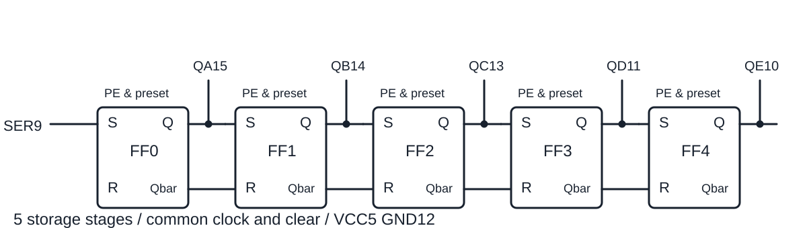

# 실험 7 · Shift Register — 저장한 비트를 한 칸씩 옮겨요 · 실험 설명

      
이번 학기 교안 기준

## 실험 이해

### 왜 이 회로를 쓰는지 먼저 알아봐요

작은 상태부터 살펴봐요
이해를 위한 예시: 센서가 1, 0, 1, 1을 한 선으로 차례로 보내는데, 화면은 네 비트를 동시에 필요로 해요. 전선을 연결하기만 하면 현재 비트만 보여서 앞서 온 값은 잃어버려요.

조건과 작동 원리를 확인해요
시프트 레지스터는 비트를 기억하는 칸을 줄지어 연결해요. 유효 클록 엣지마다 새 값을 첫 칸에 넣고 이전 값은 다음 칸으로 넘겨요. 한 선의 시간 순서를 여러 칸의 공간 순서로 바꿀 수 있어요.

초기 상태 Q0Q1Q2Q3=0000에서 입력 1을 받으면 1000, 다음에 0을 받으면 0100이 돼요. Q0가 첫 칸이고 오른쪽이 다음 칸이에요. 클록 두 번에 첫 비트가 두 번째 칸으로 옮겨졌어요.

현재 공지에서 지정한 보고서 작성 대상은 실험 1의 JK 플립플롭 여섯 개 회로예요. 7496 실험 2-1·2-2와 링·존슨은 교안 전체 이해와 기출 대비를 위한 보충이에요. 작성 대상 제외가 시험 제외라는 뜻은 아니에요. JK 플립플롭 여섯 개와 보충 7496의 다섯 칸을 비교해요. 입력·초기화·되먹임을 바꾸어 저장, 이동, 순환의 차이를 확인해요. 교안 표지는 25-1이지만 현재 배포된 파일을 사용해요. 아래 값은 예상 논리 상태이며 실제 측정 결과가 아니에요.

직렬로 온 과거 비트를 기억하며 한 칸씩 옮겨요. 0000에 1,0을 넣으면 1000→0100이에요. 보고서 지정은 실험 1의 6비트 JK 회로예요. 7496·링·존슨은 보충이며 시험 제외로 단정하지 않아요. 현재 배포 파일의 표지는 25-1이며 값은 예상 상태예요.

출처: [강의노트/실험7. Shift Register.pdf · PDF p2](../../../%EA%B0%95%EC%9D%98%EB%85%B8%ED%8A%B8/%EC%8B%A4%ED%97%987.%20Shift%20Register.pdf#page=2) · [강의노트/실험7. Shift Register.pdf · PDF p3](../../../%EA%B0%95%EC%9D%98%EB%85%B8%ED%8A%B8/%EC%8B%A4%ED%97%987.%20Shift%20Register.pdf#page=3) · [강의노트/실험7. Shift Register.pdf · PDF p4](../../../%EA%B0%95%EC%9D%98%EB%85%B8%ED%8A%B8/%EC%8B%A4%ED%97%987.%20Shift%20Register.pdf#page=4) · [강의노트/실험7. Shift Register.pdf · PDF p5](../../../%EA%B0%95%EC%9D%98%EB%85%B8%ED%8A%B8/%EC%8B%A4%ED%97%987.%20Shift%20Register.pdf#page=5) · [강의노트/공지사항/2026-09-14_\[필독\]_논리회로실험_보고서_관련_공지.md](../../../%EA%B0%95%EC%9D%98%EB%85%B8%ED%8A%B8/%EA%B3%B5%EC%A7%80%EC%82%AC%ED%95%AD/2026-09-14_%5B%ED%95%84%EB%8F%85%5D_%EB%85%BC%EB%A6%AC%ED%9A%8C%EB%A1%9C%EC%8B%A4%ED%97%98_%EB%B3%B4%EA%B3%A0%EC%84%9C_%EA%B4%80%EB%A0%A8_%EA%B3%B5%EC%A7%80.md)

### 비트·플립플롭·클록을 연결해 알아봐요

작은 상태부터 살펴봐요
비트는 0 또는 1인 정보 한 자리예요. 플립플롭 한 개는 한 비트를 저장하고 Q는 그 값을 출력해요. n비트 레지스터에는 n개의 플립플롭이 필요해요. 칩 한 개와 플립플롭 한 개는 달라요. 7476 계열 한 칩에는 JK 플립플롭 두 개가 있어요.

조건과 작동 원리를 확인해요
유효 엣지는 저장이 일어나는 클록의 순간이에요. 상승은 0→1, 하강은 1→0이에요. 입력은 이 순간 전후의 setup/hold 시간 동안 안정되어야 해요. 초기화나 preset 같은 비동기 제어는 클록 없이 상태를 강제할 수 있어요.

공통 클록에서는 모든 칸이 엣지 직전의 값을 함께 받아요. 첫 칸의 새 값이 같은 엣지에 여섯 번째까지 즉시 전파되는 것이 아니에요. 초기화 조건이 없으면 최초 Q를 임의로 0으로 정하지 않아요.

한 F/F는 1비트, n비트에는 n개가 필요해요. 7476은 한 칩에 두 개예요. 유효 엣지 전후 입력을 안정시키고 각 칸은 엣지 직전 값을 함께 받아요. 비동기 제어가 우선이며 초기값 미지정은 미정이에요.

이 개념으로 풀 문제: [6비트에 필요한 JK 개수](%EC%8B%A4%ED%97%9807_%EA%B8%B0%EC%B6%9C%ED%92%80%EC%9D%B4.md#q-6bit-jk) · [여섯 칸의 저장 용량](%EC%8B%A4%ED%97%9807_%EA%B8%B0%EC%B6%9C%ED%92%80%EC%9D%B4.md#q-qp-e07-tf-01) · [칩과 저장 칸](%EC%8B%A4%ED%97%9807_%EA%B8%B0%EC%B6%9C%ED%92%80%EC%9D%B4.md#q-qp-e07-blank-01)

출처: [강의노트/실험7. Shift Register.pdf · PDF p3](../../../%EA%B0%95%EC%9D%98%EB%85%B8%ED%8A%B8/%EC%8B%A4%ED%97%987.%20Shift%20Register.pdf#page=3) · [강의노트/실험7. Shift Register.pdf · PDF p6](../../../%EA%B0%95%EC%9D%98%EB%85%B8%ED%8A%B8/%EC%8B%A4%ED%97%987.%20Shift%20Register.pdf#page=6) · [강의노트/실험7. Shift Register.pdf · PDF p9](../../../%EA%B0%95%EC%9D%98%EB%85%B8%ED%8A%B8/%EC%8B%A4%ED%97%987.%20Shift%20Register.pdf#page=9) · [강의노트/실험7. Shift Register.pdf · PDF p10](../../../%EA%B0%95%EC%9D%98%EB%85%B8%ED%8A%B8/%EC%8B%A4%ED%97%987.%20Shift%20Register.pdf#page=10)

### 한 엣지에 한 칸만 옮겨요

작은 상태부터 살펴봐요
Q0를 첫 칸, Q5를 마지막 칸, S를 직렬 입력이라 해요. 정상 이동 모드에서 Q0다음=S, Q1다음=Q0이전, …, Q5다음=Q4이전이에요. 그림에서의 오른쪽은 칸의 순서이며 수의 크기 방향과는 별개예요.

조건과 작동 원리를 확인해요
| 엣지 | S | Q0Q1Q2Q3Q4Q5 |
| --- | --- | --- |
| 초기화 | — | 000000 |
| 1 | 1 | 100000 |
| 2 | 0 | 010000 |
| 3 | 1 | 101000 |
| 4 | 1 | 110100 |
| 5 | 0 | 011010 |
| 6 | 0 | 001101 |

완성 예제: 네 번째 엣지 직전은 101000이에요. 새 S=1을 맨 앞에 붙이고 맨 끝 한 비트를 버리면 110100이에요. 전체 레지스터가 바뀌어도 각 칸은 한 비트만 저장해요.

각 Q는 다음 D로 가고 클록은 네 칸에 함께 가요.

일부 단계 연습: 001101에 S=1을 넣으면 어떻게 될까요? 답은 100110이에요. 이전 벡터의 앞 다섯 자리를 보존해 검산해요.

Q0다음=S, Qi다음=Q(i−1)이전이에요. 공통 클록에서 한 칸씩 동시에 이동해요. 비트 순서를 먼저 정해요. 001101에 1을 넣으면 100110이에요.

이 개념으로 풀 문제: [시프트 레지스터의 기능](%EC%8B%A4%ED%97%9807_%EA%B8%B0%EC%B6%9C%ED%92%80%EC%9D%B4.md#q-sr) · [같은 엣지의 이전 값](%EC%8B%A4%ED%97%9807_%EA%B8%B0%EC%B6%9C%ED%92%80%EC%9D%B4.md#q-qp-e07-tf-02) · [한 칸 이동을 계산해요](%EC%8B%A4%ED%97%9807_%EA%B8%B0%EC%B6%9C%ED%92%80%EC%9D%B4.md#q-qp-e07-blank-02)

출처: [강의노트/실험7. Shift Register.pdf · PDF p4](../../../%EA%B0%95%EC%9D%98%EB%85%B8%ED%8A%B8/%EC%8B%A4%ED%97%987.%20Shift%20Register.pdf#page=4) · [강의노트/실험7. Shift Register.pdf · PDF p6](../../../%EA%B0%95%EC%9D%98%EB%85%B8%ED%8A%B8/%EC%8B%A4%ED%97%987.%20Shift%20Register.pdf#page=6) · [강의노트/실험7. Shift Register.pdf · PDF p8](../../../%EA%B0%95%EC%9D%98%EB%85%B8%ED%8A%B8/%EC%8B%A4%ED%97%987.%20Shift%20Register.pdf#page=8) · [강의노트/실험7. Shift Register.pdf · PDF p10](../../../%EA%B0%95%EC%9D%98%EB%85%B8%ED%8A%B8/%EC%8B%A4%ED%97%987.%20Shift%20Register.pdf#page=10)

### 직렬과 병렬은 읽고 넣는 방법이에요

작은 상태부터 살펴봐요
직렬은 한 선에서 한 번에 한 비트를 주고받고, 병렬은 여러 선에서 여러 비트를 함께 주고받아요. SIPO는 Serial In Parallel Out, PISO는 Parallel In Serial Out이에요.

조건과 작동 원리를 확인해요
SIPO: 네 칸을 0000으로 초기화하고 1,0,1,1 순서로 넣으면 1000→0100→1010→1101이에요. 마지막에는 Q0Q1Q2Q3=1101을 동시에 읽어요. 시간 순서와 저장 칸 순서가 반대가 될 수 있어요.

PISO: 보충으로 병렬 load 기능이 있는 이상 모델을 생각해요. Q0Q1Q2Q3=1011을 동시에 적재하고, 이동 직전 마지막 Q3를 읽으면 1,1,0,1 순서로 직렬 출력돼요. 일반적인 병렬 load와 7496의 1을 강제하는 preset을 같은 기능으로 가정하지 않아요.

| 종류 | 입력 | 출력 |
| --- | --- | --- |
| SIPO | 한 비트씩 | 여러 Q를 함께 |
| PISO | 여러 비트 함께 적재 | 마지막 Q를 한 비트씩 |
| SISO | 직렬 | 직렬 |
| PIPO | 병렬 | 병렬 |

SIPO는 한 비트씩 저장한 뒤 여러 Q를 동시에 읽어요. PISO는 병렬 적재 뒤 마지막 Q를 한 비트씩 읽어요. 시간 순서와 칸 순서를 구분하고 7496 preset을 임의의 병렬 load로 일반화하지 않아요.

이 개념으로 풀 문제: [직렬·병렬 변환의 두 방향](%EC%8B%A4%ED%97%9807_%EA%B8%B0%EC%B6%9C%ED%92%80%EC%9D%B4.md#q-convert) · [병렬에서 직렬로 꺼내요](%EC%8B%A4%ED%97%9807_%EA%B8%B0%EC%B6%9C%ED%92%80%EC%9D%B4.md#q-p2s) · [SIPO가 정보를 모으는 이유](%EC%8B%A4%ED%97%9807_%EA%B8%B0%EC%B6%9C%ED%92%80%EC%9D%B4.md#q-qp-e07-short-01)

출처: [강의노트/실험7. Shift Register.pdf · PDF p4](../../../%EA%B0%95%EC%9D%98%EB%85%B8%ED%8A%B8/%EC%8B%A4%ED%97%987.%20Shift%20Register.pdf#page=4) · [강의노트/실험7. Shift Register.pdf · PDF p5](../../../%EA%B0%95%EC%9D%98%EB%85%B8%ED%8A%B8/%EC%8B%A4%ED%97%987.%20Shift%20Register.pdf#page=5) · [강의노트/실험7. Shift Register.pdf · PDF p6](../../../%EA%B0%95%EC%9D%98%EB%85%B8%ED%8A%B8/%EC%8B%A4%ED%97%987.%20Shift%20Register.pdf#page=6)

### JK를 새 입력을 복사하는 칸으로 써요

작은 상태부터 살펴봐요
JK 플립플롭은 J,K와 현재 Q에 따라 다음 Q를 정해요. 비동기 SET·RESET이 비활성이고 입력 시간 조건을 만족할 때 아래 표를 써요.

조건과 작동 원리를 확인해요
| J | K | Q다음 |
| --- | --- | --- |
| 0 | 0 | Q이전 유지 |
| 0 | 1 | 0 |
| 1 | 0 | 1 |
| 1 | 1 | Q이전 반전 |

새 데이터 D를 그대로 기억하게 하려면 J=D, K=NOT D로 묶어요. D=0이면 JK=01이라 0을 저장하고, D=1이면 JK=10이라 1을 저장해요. J=K=D로 묶으면 D=1일 때 복사가 아니라 반전이 돼요.

첫 칸에는 J=S, K=NOT S를 넣고 다음 칸에는 앞 칸 Q와 Q의 보수를 넣어요. 6비트에는 JK 6개, 두 개씩 든 7476 계열 칩 3개가 필요해요. 4비트에는 JK 4개·칩 2개예요.

교안의 74HC76 회로는 하강 엣지로 관찰해요. CLR=0으로 초기화하고 다시 1로 해제해요. PR1·PR2를 0으로 만들면 해당 칸은 1로 강제돼요. SET과 RESET을 동시에 활성화하지 않아요. 관찰하기 쉽게 주기 5초 이상, 즉 0.2Hz 이하를 권해요.

JK=00 유지·01 Reset·10 Set·11 반전이에요. J=D,K=NOT D이면 D를 복사해요. 6비트는 JK 6개·7476 칩 3개예요. 교안 74HC76은 하강 엣지, CLR=0 초기화·1 해제예요. SET/RESET 동시 활성은 피하고 주기 5초 이상으로 관찰해요.

이 개념으로 풀 문제: [4비트 회로와 7476 개수](%EC%8B%A4%ED%97%9807_%EA%B8%B0%EC%B6%9C%ED%92%80%EC%9D%B4.md#q-ff-design) · [시프트용 JK 입력을 정해요](%EC%8B%A4%ED%97%9807_%EA%B8%B0%EC%B6%9C%ED%92%80%EC%9D%B4.md#q-jkff) · [JK의 복사 조건](%EC%8B%A4%ED%97%9807_%EA%B8%B0%EC%B6%9C%ED%92%80%EC%9D%B4.md#q-qp-e07-tf-04) · [첫 JK 입력용 보수 신호를 작도해요](%EC%8B%A4%ED%97%9807_%EA%B8%B0%EC%B6%9C%ED%92%80%EC%9D%B4.md#q-qp-e07-board-01)

출처: [강의노트/실험7. Shift Register.pdf · PDF p8](../../../%EA%B0%95%EC%9D%98%EB%85%B8%ED%8A%B8/%EC%8B%A4%ED%97%987.%20Shift%20Register.pdf#page=8) · [강의노트/실험7. Shift Register.pdf · PDF p9](../../../%EA%B0%95%EC%9D%98%EB%85%B8%ED%8A%B8/%EC%8B%A4%ED%97%987.%20Shift%20Register.pdf#page=9) · [강의노트/실험7. Shift Register.pdf · PDF p10](../../../%EA%B0%95%EC%9D%98%EB%85%B8%ED%8A%B8/%EC%8B%A4%ED%97%987.%20Shift%20Register.pdf#page=10) · [강의노트/실험7. Shift Register.pdf · PDF p11](../../../%EA%B0%95%EC%9D%98%EB%85%B8%ED%8A%B8/%EC%8B%A4%ED%97%987.%20Shift%20Register.pdf#page=11)

### 7496의 다섯 칸과 제어 신호를 읽어요

작은 상태부터 살펴봐요
7496은 다섯 저장 단계를 가진 시프트 레지스터예요. 핀 배치는 일반 14핀 논리 게이트와 달라요. VCC=5번, GND=12번, CP=1번, SER=9번, CLR=16번, PE=8번이에요. preset A~E=2,3,4,6,7번, QA~QE=15,14,13,11,10번이에요.

조건과 작동 원리를 확인해요

상세 내부 반전 회로는 기출문제의 재제작 그림에서 구분해요.

PE와 각 preset 입력이 모두 1이면 해당 단계의 비동기 preset이 활성화되어 Q=1을 강제해요. preset 입력이 0인 칸을 자동으로 0으로 덮어쓰는 일반 병렬 load가 아니에요. 먼저 clear하여 모두 0으로 만든 뒤 A=B=1, C=D=E=0에서 PE를 0→1→0으로 주면 11000을 만들 수 있어요.

preset과 clear를 해제한 정상 이동 모드에서 SER=0이면 11000→01100→00110→00011→00001→00000이에요. 기준은 QA에서 QE 순서예요.

출력 자체는 반전 출력이 아니에요. Negative Logic LED는 +5V→330Ω→LED 애노드→캐소드→Q로 연결하여 Q=0일 때 켜져요. 그래서 11000에서는 LED A·B가 꺼지고 C·D·E가 켜져요. LED 켜짐과 논리 1을 동일시하지 않아요.

교안 안의 충돌을 확인해요
교안 13쪽은 CLR 1→0→1, 부록 18~20쪽은 MR 0→1→0으로 서로 달라요. 25쪽은 하강 엣지, 과거 제공 답은 상승 엣지를 적어요. 칩의 정확한 제조사·품번 데이터시트와 실물 파형을 확인하기 전 7496의 초기화 극성·유효 엣지는 미확정이에요. 아래 상태 이동은 “유효 엣지 1회” 기준이에요.

7496은 5단이에요. VCC 5·GND 12, SER 9·PE 8·CLR 16·CP 1번이에요. PE=1과 preset=1은 해당 Q를 1로 강제하며 0을 적재하는 load는 아니에요. clear 후 11000에서 SER=0 이동은 01100이에요. Negative Logic LED는 Q=0에서 켜져요. CLR 극성·유효 엣지는 교안과 과거 답의 충돌로 미확정이에요.

이 개념으로 풀 문제: [7496 내부 블록을 읽어요](%EC%8B%A4%ED%97%9807_%EA%B8%B0%EC%B6%9C%ED%92%80%EC%9D%B4.md#q-7496-block) · [Negative Logic LED](%EC%8B%A4%ED%97%9807_%EA%B8%B0%EC%B6%9C%ED%92%80%EC%9D%B4.md#q-qp-e07-tf-03) · [7496의 LED와 상태를 구분해요](%EC%8B%A4%ED%97%9807_%EA%B8%B0%EC%B6%9C%ED%92%80%EC%9D%B4.md#q-qp-e07-short-02)

출처: [강의노트/실험7. Shift Register.pdf · PDF p7](../../../%EA%B0%95%EC%9D%98%EB%85%B8%ED%8A%B8/%EC%8B%A4%ED%97%987.%20Shift%20Register.pdf#page=7) · [강의노트/실험7. Shift Register.pdf · PDF p12](../../../%EA%B0%95%EC%9D%98%EB%85%B8%ED%8A%B8/%EC%8B%A4%ED%97%987.%20Shift%20Register.pdf#page=12) · [강의노트/실험7. Shift Register.pdf · PDF p13](../../../%EA%B0%95%EC%9D%98%EB%85%B8%ED%8A%B8/%EC%8B%A4%ED%97%987.%20Shift%20Register.pdf#page=13) · [강의노트/실험7. Shift Register.pdf · PDF p14](../../../%EA%B0%95%EC%9D%98%EB%85%B8%ED%8A%B8/%EC%8B%A4%ED%97%987.%20Shift%20Register.pdf#page=14) · [강의노트/실험7. Shift Register.pdf · PDF p15](../../../%EA%B0%95%EC%9D%98%EB%85%B8%ED%8A%B8/%EC%8B%A4%ED%97%987.%20Shift%20Register.pdf#page=15) · [강의노트/실험7. Shift Register.pdf · PDF p17](../../../%EA%B0%95%EC%9D%98%EB%85%B8%ED%8A%B8/%EC%8B%A4%ED%97%987.%20Shift%20Register.pdf#page=17) · [강의노트/실험7. Shift Register.pdf · PDF p18](../../../%EA%B0%95%EC%9D%98%EB%85%B8%ED%8A%B8/%EC%8B%A4%ED%97%987.%20Shift%20Register.pdf#page=18) · [강의노트/실험7. Shift Register.pdf · PDF p19](../../../%EA%B0%95%EC%9D%98%EB%85%B8%ED%8A%B8/%EC%8B%A4%ED%97%987.%20Shift%20Register.pdf#page=19) · [강의노트/실험7. Shift Register.pdf · PDF p20](../../../%EA%B0%95%EC%9D%98%EB%85%B8%ED%8A%B8/%EC%8B%A4%ED%97%987.%20Shift%20Register.pdf#page=20) · [강의노트/실험7. Shift Register.pdf · PDF p21](../../../%EA%B0%95%EC%9D%98%EB%85%B8%ED%8A%B8/%EC%8B%A4%ED%97%987.%20Shift%20Register.pdf#page=21) · [강의노트/실험7. Shift Register.pdf · PDF p22](../../../%EA%B0%95%EC%9D%98%EB%85%B8%ED%8A%B8/%EC%8B%A4%ED%97%987.%20Shift%20Register.pdf#page=22) · [강의노트/실험7. Shift Register.pdf · PDF p23](../../../%EA%B0%95%EC%9D%98%EB%85%B8%ED%8A%B8/%EC%8B%A4%ED%97%987.%20Shift%20Register.pdf#page=23) · [강의노트/실험7. Shift Register.pdf · PDF p24](../../../%EA%B0%95%EC%9D%98%EB%85%B8%ED%8A%B8/%EC%8B%A4%ED%97%987.%20Shift%20Register.pdf#page=24) · [강의노트/실험7. Shift Register.pdf · PDF p25](../../../%EA%B0%95%EC%9D%98%EB%85%B8%ED%8A%B8/%EC%8B%A4%ED%97%987.%20Shift%20Register.pdf#page=25)

현재 배포 파일 표지는 25-1. 7496 제어 극성·엣지는 교안 본문/부록/과거 제공 답 사이 충돌을 유지해요.

### 되먹임으로 순환·링·존슨을 구분해요

작은 상태부터 살펴봐요
일반 직렬 입력 대신 마지막 Q를 첫 입력으로 돌려주면 순환 시프트 레지스터가 돼요. 7496에서는 QE(10번)를 SER(9번)에 연결해요. clear·preset을 해제하고 초기 QA…QE=11000에서 11000→01100→00110→00011→10001→11000으로 돌아와요.

보충 원리를 비교해요
보충: n비트 one-hot 링 카운터는 1이 정확히 하나인 초기 상태를 만들고 마지막 Q를 그대로 되먹여요. 네 칸이면 1000→0100→0010→0001→1000으로 4상태예요. 모두 0으로 초기화하면 계속 0000이므로 1을 하나 심어야 해요. 여러 1을 가진 순환 레지스터를 one-hot 링 카운터와 구분해요.

보충: 존슨 카운터는 마지막 Q의 보수를 첫 입력으로 돌려줘요. 네 칸을 0000으로 시작하면 1000→1100→1110→1111→0111→0011→0001→0000으로 8상태, 즉 2n상태를 순환해요. n=4의 나머지 상태까지 모두 이 주기로 들어온다고 보장하지는 않아요.

보충: 두 입력을 같은 Q에 묶은 NAND는 NOT(Q·Q)=NOT Q라 반전 되먹임을 만들어요. NAND를 디코더로 쓰면 상태 조합을 검출하고 출력은 active-low가 돼요. “존슨 카운터의 NAND 역할”만 주어지고 배선이 없으면 어느 역할인지 하나로 확정할 수 없어요. 과거 답에는 반전과 AND 디코딩이라는 서로 다른 설명이 있어요.

순환은 마지막 Q를 첫 입력으로 돌려줘요. 7496은 QE 10→SER 9번이에요. 보충: one-hot 링은 올바른 초기 상태에서 n상태, 존슨은 반전 되먹임과 정상 초기화에서 2n상태예요. NAND 두 입력을 묶으면 반전, 디코더로 연결하면 상태 검출이에요. 과거 NAND 문항은 배선 부재·답안 충돌을 남겨요.

이 개념으로 풀 문제: [링 카운터와 초기화](%EC%8B%A4%ED%97%9807_%EA%B8%B0%EC%B6%9C%ED%92%80%EC%9D%B4.md#q-ring) · [존슨 카운터의 NAND 역할](%EC%8B%A4%ED%97%9807_%EA%B8%B0%EC%B6%9C%ED%92%80%EC%9D%B4.md#q-johnson-nand) · [7496을 순환 회로로 바꿔요](%EC%8B%A4%ED%97%9807_%EA%B8%B0%EC%B6%9C%ED%92%80%EC%9D%B4.md#q-7496-circular) · [존슨 카운터의 상태 순환](%EC%8B%A4%ED%97%9807_%EA%B8%B0%EC%B6%9C%ED%92%80%EC%9D%B4.md#q-johnson) · [순환 시프트의 연결](%EC%8B%A4%ED%97%9807_%EA%B8%B0%EC%B6%9C%ED%92%80%EC%9D%B4.md#q-circular) · [순환 연결의 두 핀](%EC%8B%A4%ED%97%9807_%EA%B8%B0%EC%B6%9C%ED%92%80%EC%9D%B4.md#q-qp-e07-blank-03)

출처: [강의노트/실험7. Shift Register.pdf · PDF p16](../../../%EA%B0%95%EC%9D%98%EB%85%B8%ED%8A%B8/%EC%8B%A4%ED%97%987.%20Shift%20Register.pdf#page=16)

링·존슨은 현재 교안의 수행 항목과 구분한 기출 대비 보충이에요.
