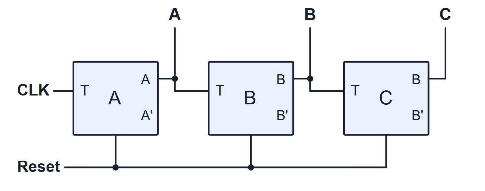
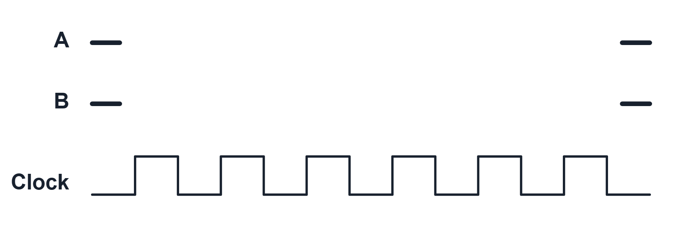
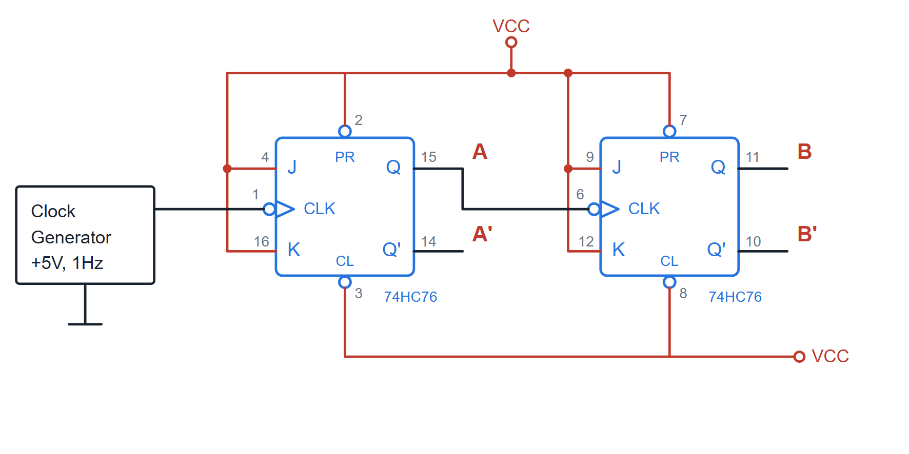
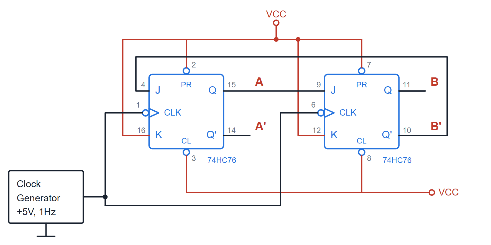
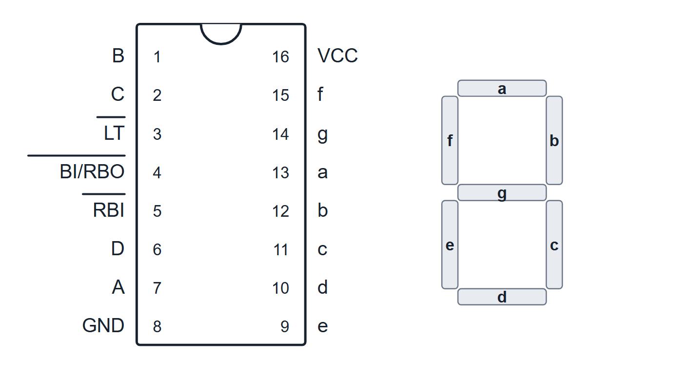
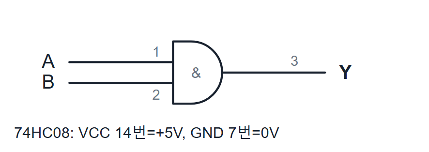

# 실험 8 · 기출문제와 퀴즈 유형 연습

[실험 설명](실험08_실험설명.md) · [문제/해설](실험08_기출풀이.md)

## 1. JK F/F를 Toggle로 쓰는 네 핀 값
출처 미확인 · 실험 8 · 풀이 검토됨

### 문제 원문
JK F/F의 Clock이 Falling Edge일 때 출력(Q)이 Toggle로 동작하기 위한 PR, CLR, J, K핀의 입력값을 적으시오.

### 구할 것
PR, CLR, J, K 네 핀의 값

### 힌트 · 접근 순서
강제 버튼이 쉬는 값부터 정하고, JK 표에서 반전 줄을 찾아요.

## 2. J, K, CLR로 Toggle 만들기
출처 미확인 · 실험 8 · 풀이 검토됨

### 문제 원문
JK F/F의 출력 Q가 Toggle로 동작하기 위한 J, K, CLR핀의 입력값을 적으시오.

### 구할 것
J, K, CLR 세 핀의 값

### 힌트 · 접근 순서
앞 문제와 같은 질문이에요. 물어보지 않은 핀도 조건으로 살펴요.

## 3. 비동기식 카운터의 특징
기출 · 실험 8 · 풀이 검토됨

### 문제 원문
비동기식 카운터의 특징을 간략하게 적으시오.

### 구할 것
비동기식의 특징

### 힌트 · 접근 순서
클럭이 어디로 들어가는지, 그 결과 언제 바뀌는지 두 가지를 써요.

## 4. T F/F 3단 블록도의 동작
기출 · 실험 8 · 풀이 검토됨

### 문제 원문
아래의 카운터가 어떻게 동작하는지 간략하게 적으시오. (X단 Y진 카운터, 출력값의 변화순서와 범위)

### 조건
원문에는 블록 C 안의 출력 라벨도 B, B′로 인쇄돼 있어요. 위로 뽑힌 선의 이름은 C예요.

### 구할 것
X, Y, 출력값의 변화 순서와 범위

### 힌트 · 접근 순서
CLK가 어느 블록에만 들어가는지 보고 단 수를 세요.

## 5. 74HC76 비동기 회로의 A·B 파형
기출 · 실험 8 · 풀이 검토됨

### 문제 원문
아래의 카운터 회로를 보고 A,B핀의 출력파형을 Clock에 맞추어 그리시오 (4점)

### 조건
회로는 원문 사진을 다시 그린 그림이에요. 사진에서 일부 핀 번호가 흐려도 배선은 교안 실험 1 회로와 같아요.

### 구할 것
Clock에 맞춘 A, B 파형

### 힌트 · 접근 순서
CLK 입력 앞의 동그라미를 보고, 둘째 단 CLK가 어디서 오는지 찾아요.

## 6. 비동기 회로는 몇 진 카운터인가요
출처 미확인 · 실험 8 · 답안 충돌

### 문제 원문
위 문제의 회로는 몇진 카운터인지 적으시오.

### 조건
‘위 문제의 회로’는 Quiz 4번의 74HC76 회로예요. 이 문제지 5번 문항의 비동기 회로와 같아요. 첫 단 J(4)·K(16)·PR(2)·CL(3)과 둘째 단 J(9)·K(12)·PR(7)·CL(8)은 VCC, 첫 단 CLK(1)는 Clock Generator(+5V, 1Hz), 둘째 단 CLK(6)는 첫 단 Q(15, A)에 연결돼요.

### 구할 것
몇 진 카운터인지

### 힌트 · 접근 순서
한 사이클에 서로 다른 AB가 몇 개 나오는지 세요.

## 7. 4단 2진 카운터를 AND로 확인하기
출처 미확인 · 실험 8 · 풀이 검토됨

### 문제 원문
4단 2진 카운터의 결과를 AND 게이트로만 확인하려면 몇 개의 AND 게이트가 필요한지 이유와 답을 적으시오.

### 구할 것
필요한 AND 개수와 이유

### 힌트 · 접근 순서
실험 1에서 상태 수와 AND 수의 관계를 떠올려요.

## 8. 5진 카운터의 최소 출력핀
기출 · 실험 8 · 풀이 검토됨

### 문제 원문
5진카운터를 만들기 위한 최소한의 출력핀의 개수와 이유를 적으시오 (3점)

### 구할 것
최소 출력핀 개수와 이유

### 힌트 · 접근 순서
핀 k개로 구분할 수 있는 값의 개수를 떠올려요.

## 9. 5진 카운터 출력핀 (확인용 단서)
출처 미확인 · 실험 8 · 답안 충돌

### 문제 원문
5진 카운터를 만들기 위한 최소한의 출력핀의 개수와 이유를 적으시오. (출력을 확인하기 위한 최소한의 핀의 개수)

### 구할 것
최소 출력핀 개수와 이유

### 힌트 · 접근 순서
앞 문항의 답과 단서 문구의 차이를 비교해요.

## 10. 동기식이 보완한 점
출처 미확인 · 실험 8 · 풀이 검토됨

### 문제 원문
동기식 카운터가 비동기식 카운터의 어떤 점을 보완한 것인지 적으시오.

### 구할 것
동기식이 보완한 점

### 힌트 · 접근 순서
비동기식의 약점을 먼저 떠올리고 클럭 연결로 답해요.

## 11. 비동기식과 동기식 설명·보완점
기출 · 실험 8 · 풀이 검토됨

### 문제 원문
비동기식 카운터와 동기식 카운터에 대해서 설명하고 동기식 카운터가 비동기식 카운터의 어떤점을 보완한 것인지 적으시오 (3점)

### 구할 것
두 방식의 설명과 보완점

### 힌트 · 접근 순서
두 방식을 클럭 연결로 한 문장씩 쓰고 마지막에 보완점을 써요.

## 12. 74HC76 동기 회로의 A·B 파형
기출 · 실험 8 · 풀이 검토됨

### 문제 원문
아래의 카운터 회로를 보고 A, B핀의 출력파형을 Clock에 맞추어 그리시오.

### 조건

### 구할 것
Clock에 맞춘 A, B 파형

### 힌트 · 접근 순서
두 CLK가 같은 선인지 먼저 보고, J에 무엇이 들어가는지 찾아요.

## 13. 몇 진인지와 2배 진수로 바꾸는 법
기출 · 실험 8 · 답안 충돌

### 문제 원문
위 3번 문제에 주어진 회로는 몇진 카운터인지 적으시오. 만약에 ‘X’진 카운터라면 회로의 수정 없이 ‘2*X’(2배)진 카운터로 바꾸고 싶으면 어떻게 하면 되는지 적으시오.

### 조건
원문의 ‘위 3번 문제에 주어진 회로’는 앞의 74HC76 동기 회로예요. 아래 그림이 그 회로예요.

### 구할 것
몇 진인지와 2배로 바꾸는 방법

### 힌트 · 접근 순서
F/F 두 개로 구분할 수 있는 상태가 최대 몇 개인지 먼저 세요.

## 14. 7447 입력 0101의 핀 출력
출처 미확인 · 실험 8 · 답안 충돌

### 문제 원문
아래의 왼쪽은 BCD-TO-SEVEN-SEGMENT DECODERS/DRIVERS 이고 오른쪽은 7-Segment이다. ‘ A = H, B = L, C= H, D = L, 3~5번핀은 H ’로 입력되었을 때 9~15번 핀으로 나오는 출력을 적으시오.

### 조건
원문 그림의 핀 배치를 옮긴 표예요. 16번 라벨은 원문에서 잘려 인쇄됐어요. 원문은 칩 번호 없이 “BCD-TO-SEVEN-SEGMENT DECODERS/DRIVERS”라고만 적어요.

| 핀 | 이름 | 핀 | 이름 |
| --- | --- | --- | --- |
| 1 | B | 16 | VCC |
| 2 | C | 15 | f |
| 3 | LT(윗줄) | 14 | g |
| 4 | BI/RBO(윗줄) | 13 | a |
| 5 | RBI(윗줄) | 12 | b |
| 6 | D | 11 | c |
| 7 | A | 10 | d |
| 8 | GND | 9 | e |

### 구할 것
핀 9~15의 출력

### 힌트 · 접근 순서
먼저 DCBA를 숫자로 바꾸고, 세그먼트를 켜는 출력이 H인지 L인지 정해요.

## 15. 둘째 단이 바뀌는 순간
연습문제 · 실험 8 · 풀이 검토됨 · 퀴즈 유형 연습 — 자체 출제 · T/F

### 문제 원문
A가 0에서 1로 올라갈 때 B가 뒤집힌다. T/F

### 조건
교안 실험 1의 74HC76 비동기 2단 카운터예요. J=K=1, PR=CL=1이에요.

### 구할 것
참(T)·거짓(F) 판정

### 힌트 · 접근 단서
교안의 Falling Edge 조건을 대입해요

## 16. 단 수와 상태 수
연습문제 · 실험 8 · 풀이 검토됨 · 퀴즈 유형 연습 — 자체 출제 · T/F

### 문제 원문
n단 2진 카운터의 상태 수는 2ⁿ개이다. T/F

### 조건
되먹임 없이 T F/F를 n단 이은 카운터예요.

### 구할 것
참(T)·거짓(F) 판정

### 힌트 · 접근 단서
작은 n을 넣어 조건을 확인해요

## 17. R0로 0에 고정
연습문제 · 실험 8 · 풀이 검토됨 · 퀴즈 유형 연습 — 자체 출제 · T/F

### 문제 원문
이때 클럭이 들어와도 출력은 QD QC QB QA = L L L L을 유지한다. T/F

### 조건
7490에서 R0(1)=R0(2)=H, R9(1)=R9(2)=L이에요.

### 구할 것
참(T)·거짓(F) 판정

### 힌트 · 접근 단서
Reset 표에서 같은 줄을 찾아요

## 18. LT 입력의 동작
연습문제 · 실험 8 · 풀이 검토됨 · 퀴즈 유형 연습 — 자체 출제 · T/F

### 문제 원문
LT에 L을 주면 모든 세그먼트가 꺼진다. T/F

### 조건
교안 7447 Control Pins 표는 “0: On, 1: Off”예요.

### 구할 것
참(T)·거짓(F) 판정

### 힌트 · 접근 단서
LT와 BI의 동작을 구분해요

## 19. 켜지는 출력 찾기
연습문제 · 실험 8 · 풀이 검토됨 · 퀴즈 유형 연습 — 자체 출제 · 빈칸

### 문제 원문
이때 입력이 모두 1인 AND는 ① ( )이고, 켜지는 출력 번호는 ② ( )예요.

### 조건
교안 실험 1 디코더예요. A를 앞에 적어 AB=01이에요. 즉 A=0, B=1이에요.

### 구할 것
빈칸의 값

### 힌트 · 접근 단서
A가 낮은 자리임을 먼저 정해요

## 20. 7490의 두 연결
연습문제 · 실험 8 · 풀이 검토됨 · 퀴즈 유형 연습 — 자체 출제 · 빈칸

### 문제 원문
클럭은 ① ( )번 핀(INPUT A)에 넣고, QA인 ② ( )번 핀을 ③ ( )번 핀(INPUT B)에 연결해요.

### 조건
교안 p11처럼 7490을 0~9 카운터로 써요.

### 구할 것
빈칸의 값

### 힌트 · 접근 단서
2진 단 → 5진 단 순서로 따라가요

## 21. 입력 0011의 표시
연습문제 · 실험 8 · 풀이 검토됨 · 퀴즈 유형 연습 — 자체 출제 · 빈칸

### 문제 원문
표시되는 숫자는 ① ( )이고, 켜지는 세그먼트는 ② ( )예요.

### 조건
7447 제어 핀은 모두 H이고 입력 D C B A=0011이에요.

### 구할 것
빈칸의 값

### 힌트 · 접근 단서
D C B A 순서로 값을 읽어요

## 22. 출력 3의 AND를 작도해요
연습문제 · 실험 8 · 풀이 검토됨 · 퀴즈 유형 연습 — 자체 출제 · 브레드보드 작도

### 문제 원문
주어진 AND 회로와 핀 명세를 빈 보드에 옮겨 전원·입력·출력과 미사용 핀을 표시하세요.

### 조건
74HC08 한 게이트로 실험 1의 출력 3(A·B)을 만들어요. A는 1번, B는 2번에 넣고 3번 출력을 측정점 Y로 둬요. 입력 A, B는 0V 또는 5V 외부 신호예요. LED는 쓰지 않아요.

| 핀 | 이름 | 역할 |
| --- | --- | --- |
| 1 | A | 입력 A |
| 2 | B | 입력 B |
| 3 | Y | 출력(측정점) |
| 14 | VCC | +5V |
| 7 | GND | 0V |
| 4,5,9,10,12,13 | 미사용 입력 | 수업 작도 명세: NC(개방), 실사용 일반 권장과 구분 |
| 6,8,11 | 미사용 출력 | NC, 접지 금지 |

### 구할 것
완성한 작도

### 힌트 · 접근 단서
같은 넷을 같은 도통 홀에 옮겨요

## 23. 가짜 상태가 생기는 이유
연습문제 · 실험 8 · 풀이 검토됨 · 퀴즈 유형 연습 — 자체 출제 · 짧은 서술형

### 문제 원문
최종 AB와, 그 사이에 잠깐 나타나는 값을 이유와 함께 두세 문장으로 설명하세요.

### 조건
교안 실험 1의 비동기 2단 카운터예요. AB=11에서 CLK가 떨어져요. A를 앞에 적어요.

### 구할 것
이유를 담은 설명

### 힌트 · 접근 단서
클럭 경로로 인과를 설명해요

## 24. L일 때 켜지는 이유
연습문제 · 실험 8 · 풀이 검토됨 · 퀴즈 유형 연습 — 자체 출제 · 짧은 서술형

### 문제 원문
7447 출력이 L일 때 세그먼트가 켜지는 이유를 전류가 흐르는 길로 설명하세요.

### 조건
FND는 Common Anode이고 3·8번이 +5V예요. 각 세그먼트는 330Ω을 거쳐 7447 출력에 연결돼요.

### 구할 것
이유를 담은 설명

### 힌트 · 접근 단서
전류의 시작과 끝을 먼저 적어요
