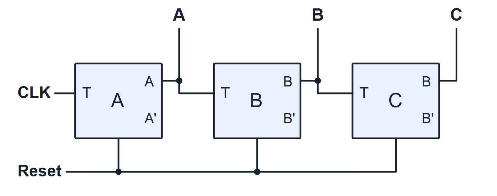
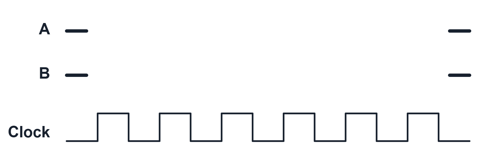
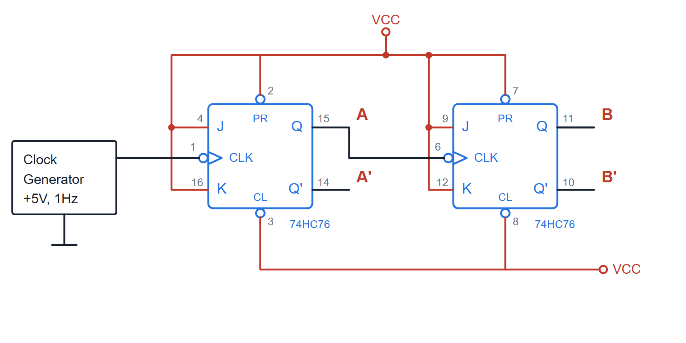
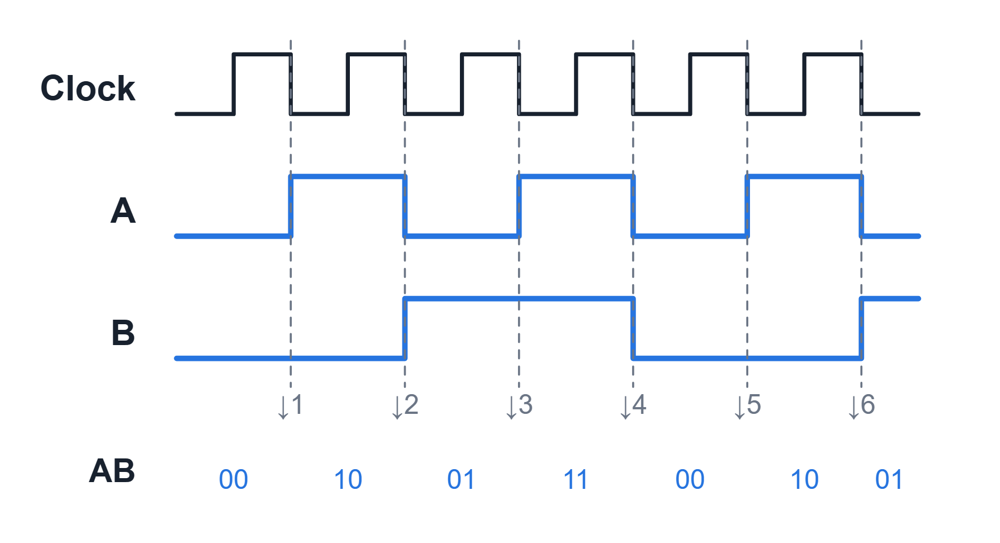
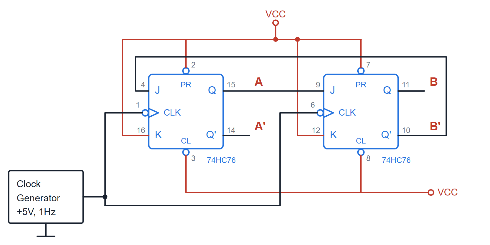
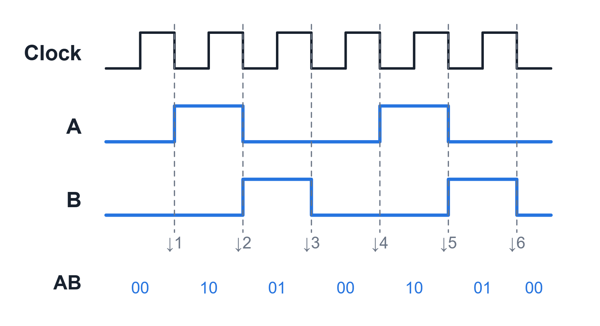
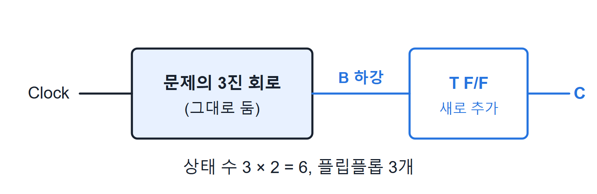
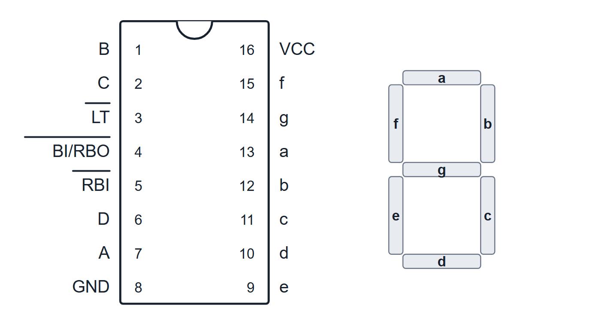
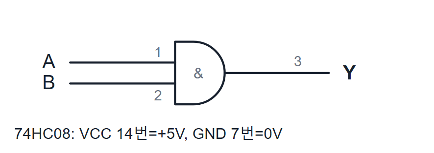
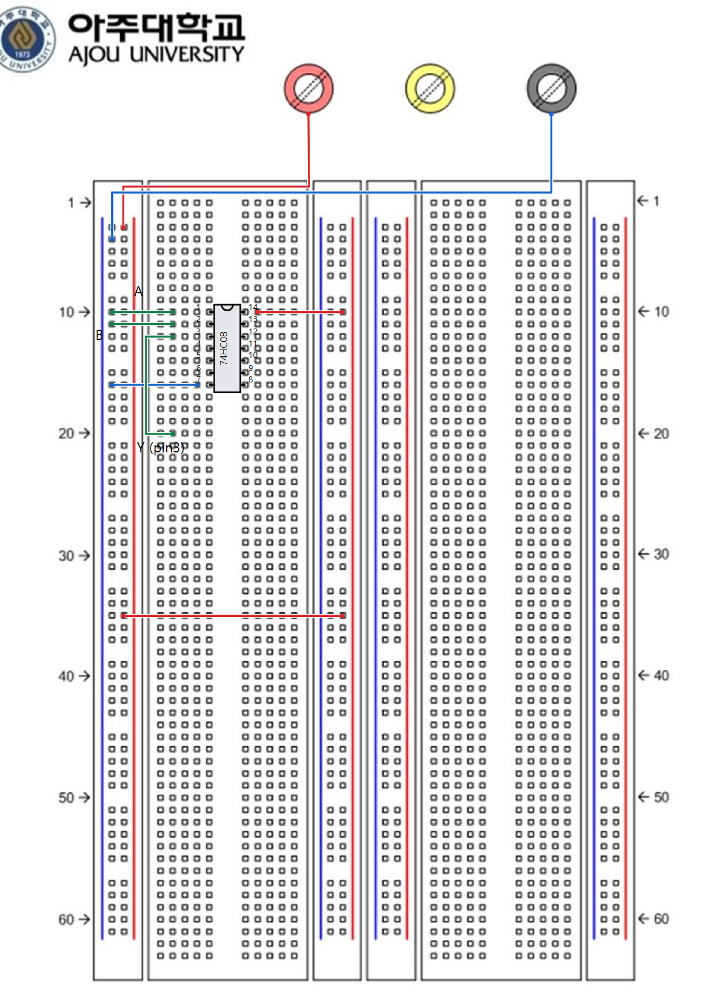

# 실험 8 · 기출풀이와 퀴즈 유형 연습

[실험 설명](실험08_실험설명.md) · [문제/해설](실험08_기출문제.md)

## 1. JK F/F를 Toggle로 쓰는 네 핀 값
출처 미확인 · 실험 8 · 풀이 검토됨

### 문제 원문
JK F/F의 Clock이 Falling Edge일 때 출력(Q)이 Toggle로 동작하기 위한 PR, CLR, J, K핀의 입력값을 적으시오.

### 구할 것
PR, CLR, J, K 네 핀의 값

### 힌트 · 접근 순서
강제 버튼이 쉬는 값부터 정하고, JK 표에서 반전 줄을 찾아요.

### 풀이 1 · 강제 버튼
PR=0이면 Q가 1로, CLR=0이면 Q가 0으로 고정돼요. 그러면 클럭이 와도 뒤집히지 않아요. 그래서 둘 다 1로 둬요.

### 풀이 2 · JK 줄 고르기
J=K=0은 유지, J만 1은 Set, K만 1은 Reset이에요. 반전은 J=K=1 한 줄뿐이에요.

### 풀이 3 · 정리
| 핀 | 값 | 이유 |
| --- | --- | --- |
| PR | 1 | 강제 Set 쉼 |
| CLR | 1 | 강제 Reset 쉼 |
| J | 1 | J=K=1이어야 반전 |
| K | 1 | J=K=1이어야 반전 |

### 풀이 4 · 검산
Q이전=0이면 J·Q′+K′·Q = 1·1+0·0 = 1, Q이전=1이면 1·0+0·1 = 0이에요. 두 경우 모두 반전이에요.

### 풀이 5 · 주의
J, K만 적고 PR, CLR을 빠뜨리면 조건이 모자라요. 또 74HC76의 PR·CLR은 L일 때 눌리므로 “쉬는 값”이 0이라고 적으면 틀려요.

### 최종 답
PR=1, CLR=1, J=1, K=1 (네 핀 모두 High)

### 출처
- [from_the_past/정리/퀴즈/실험8/실험8 퀴즈 예상문제_v1.pdf](../../../from_the_past/%EC%A0%95%EB%A6%AC/%ED%80%B4%EC%A6%88/%EC%8B%A4%ED%97%988/%EC%8B%A4%ED%97%988%20%ED%80%B4%EC%A6%88%20%EC%98%88%EC%83%81%EB%AC%B8%EC%A0%9C_v1.pdf#page=1)
- [from_the_past/정리/퀴즈/실험8/실험8 퀴즈 예상문제_v2.pdf](../../../from_the_past/%EC%A0%95%EB%A6%AC/%ED%80%B4%EC%A6%88/%EC%8B%A4%ED%97%988/%EC%8B%A4%ED%97%988%20%ED%80%B4%EC%A6%88%20%EC%98%88%EC%83%81%EB%AC%B8%EC%A0%9C_v2.pdf#page=1)
- [from_the_past/정리/퀴즈/실험8/실험8 퀴즈 예상문제_v3.pdf](../../../from_the_past/%EC%A0%95%EB%A6%AC/%ED%80%B4%EC%A6%88/%EC%8B%A4%ED%97%988/%EC%8B%A4%ED%97%988%20%ED%80%B4%EC%A6%88%20%EC%98%88%EC%83%81%EB%AC%B8%EC%A0%9C_v3.pdf#page=1)
- [from_the_past/정리/퀴즈/실험8/실험8 퀴즈 예상문제_v4.pdf](../../../from_the_past/%EC%A0%95%EB%A6%AC/%ED%80%B4%EC%A6%88/%EC%8B%A4%ED%97%988/%EC%8B%A4%ED%97%988%20%ED%80%B4%EC%A6%88%20%EC%98%88%EC%83%81%EB%AC%B8%EC%A0%9C_v4.pdf#page=1)
- [from_the_past/정리/퀴즈/실험8/실험8 퀴즈 예상문제_답안단순화_v1.pdf](../../../from_the_past/%EC%A0%95%EB%A6%AC/%ED%80%B4%EC%A6%88/%EC%8B%A4%ED%97%988/%EC%8B%A4%ED%97%988%20%ED%80%B4%EC%A6%88%20%EC%98%88%EC%83%81%EB%AC%B8%EC%A0%9C_%EB%8B%B5%EC%95%88%EB%8B%A8%EC%88%9C%ED%99%94_v1.pdf#page=1)
- [from_the_past/정리/퀴즈/실험8/실험8 퀴즈 예상문제_답안단순화_v2.pdf](../../../from_the_past/%EC%A0%95%EB%A6%AC/%ED%80%B4%EC%A6%88/%EC%8B%A4%ED%97%988/%EC%8B%A4%ED%97%988%20%ED%80%B4%EC%A6%88%20%EC%98%88%EC%83%81%EB%AC%B8%EC%A0%9C_%EB%8B%B5%EC%95%88%EB%8B%A8%EC%88%9C%ED%99%94_v2.pdf#page=1)
- [from_the_past/정리/퀴즈/실험8/실험8 퀴즈 예상문제_정리본_v1.pdf](../../../from_the_past/%EC%A0%95%EB%A6%AC/%ED%80%B4%EC%A6%88/%EC%8B%A4%ED%97%988/%EC%8B%A4%ED%97%988%20%ED%80%B4%EC%A6%88%20%EC%98%88%EC%83%81%EB%AC%B8%EC%A0%9C_%EC%A0%95%EB%A6%AC%EB%B3%B8_v1.pdf#page=1)
- [from_the_past/정리/퀴즈/실험8/실험8 퀴즈 예상문제_정리본_v2.pdf](../../../from_the_past/%EC%A0%95%EB%A6%AC/%ED%80%B4%EC%A6%88/%EC%8B%A4%ED%97%988/%EC%8B%A4%ED%97%988%20%ED%80%B4%EC%A6%88%20%EC%98%88%EC%83%81%EB%AC%B8%EC%A0%9C_%EC%A0%95%EB%A6%AC%EB%B3%B8_v2.pdf#page=1)
- [from_the_past/정리/퀴즈/실험8/실험8 퀴즈 예상문제_카운터심화.pdf](../../../from_the_past/%EC%A0%95%EB%A6%AC/%ED%80%B4%EC%A6%88/%EC%8B%A4%ED%97%988/%EC%8B%A4%ED%97%988%20%ED%80%B4%EC%A6%88%20%EC%98%88%EC%83%81%EB%AC%B8%EC%A0%9C_%EC%B9%B4%EC%9A%B4%ED%84%B0%EC%8B%AC%ED%99%94.pdf#page=1)
- [from_the_past/정리/퀴즈/실험8/실험8 퀴즈 종합_기출문제 (8p).pdf](../../../from_the_past/%EC%A0%95%EB%A6%AC/%ED%80%B4%EC%A6%88/%EC%8B%A4%ED%97%988/%EC%8B%A4%ED%97%988%20%ED%80%B4%EC%A6%88%20%EC%A2%85%ED%95%A9_%EA%B8%B0%EC%B6%9C%EB%AC%B8%EC%A0%9C%20%288p%29.pdf#page=2)
- [from_the_past/정리/퀴즈/실험8/원본_docx/실험8 정리중!!!!!!.docx](../../../from_the_past/%EC%A0%95%EB%A6%AC/%ED%80%B4%EC%A6%88/%EC%8B%A4%ED%97%988/%EC%9B%90%EB%B3%B8_docx/%EC%8B%A4%ED%97%988%20%EC%A0%95%EB%A6%AC%EC%A4%91%21%21%21%21%21%21.docx)
- [from_the_past/정리/퀴즈/실험8/원본_docx/실험8 정리중-수정.docx](../../../from_the_past/%EC%A0%95%EB%A6%AC/%ED%80%B4%EC%A6%88/%EC%8B%A4%ED%97%988/%EC%9B%90%EB%B3%B8_docx/%EC%8B%A4%ED%97%988%20%EC%A0%95%EB%A6%AC%EC%A4%91-%EC%88%98%EC%A0%95.docx)
- [from_the_past/정리/퀴즈/실험8/원본_docx/실험8 최종 - 답안 단순화!.docx](../../../from_the_past/%EC%A0%95%EB%A6%AC/%ED%80%B4%EC%A6%88/%EC%8B%A4%ED%97%988/%EC%9B%90%EB%B3%B8_docx/%EC%8B%A4%ED%97%988%20%EC%B5%9C%EC%A2%85%20-%20%EB%8B%B5%EC%95%88%20%EB%8B%A8%EC%88%9C%ED%99%94%21.docx)
- [from_the_past/정리/퀴즈/실험8/원본_docx/실험8 최종 - 답안 단순화.docx](../../../from_the_past/%EC%A0%95%EB%A6%AC/%ED%80%B4%EC%A6%88/%EC%8B%A4%ED%97%988/%EC%9B%90%EB%B3%B8_docx/%EC%8B%A4%ED%97%988%20%EC%B5%9C%EC%A2%85%20-%20%EB%8B%B5%EC%95%88%20%EB%8B%A8%EC%88%9C%ED%99%94.docx)
- [from_the_past/정리/퀴즈/실험8/원본_docx/실험8.docx](../../../from_the_past/%EC%A0%95%EB%A6%AC/%ED%80%B4%EC%A6%88/%EC%8B%A4%ED%97%988/%EC%9B%90%EB%B3%B8_docx/%EC%8B%A4%ED%97%988.docx)

## 2. J, K, CLR로 Toggle 만들기
출처 미확인 · 실험 8 · 풀이 검토됨

### 문제 원문
JK F/F의 출력 Q가 Toggle로 동작하기 위한 J, K, CLR핀의 입력값을 적으시오.

### 구할 것
J, K, CLR 세 핀의 값

### 힌트 · 접근 순서
앞 문제와 같은 질문이에요. 물어보지 않은 핀도 조건으로 살펴요.

### 풀이 1 · 값 고르기
J=K=1이 반전 줄이고, CLR은 쉬게 1로 둬요. 물어본 순서대로 적으면 1, 1, 1이에요.

### 풀이 2 · 전제 밝히기
클럭이 하강 엣지로 들어오고 PR=1일 때 성립해요. 원문은 엣지 방향과 PR을 적지 않았어요.

### 풀이 3 · 검산
CLR=0이면 Q=0으로 고정이라 반전이 안 돼요. 그래서 CLR=1이 꼭 필요해요.

### 풀이 4 · 주의
세 값을 1, 1, 1로 적고 끝내도 답은 맞아요. 다만 PR=0이면 성립하지 않는다는 점을 알아 두어요.

### 최종 답
J=1, K=1, CLR=1 (PR도 1이어야 해요)

### 출처
- [from_the_past/정리/퀴즈/실험8/실험8 퀴즈 기출_단답형 (1p).pdf](../../../from_the_past/%EC%A0%95%EB%A6%AC/%ED%80%B4%EC%A6%88/%EC%8B%A4%ED%97%988/%EC%8B%A4%ED%97%988%20%ED%80%B4%EC%A6%88%20%EA%B8%B0%EC%B6%9C_%EB%8B%A8%EB%8B%B5%ED%98%95%20%281p%29.pdf#page=1)
- [from_the_past/정리/퀴즈/실험8/실험8 퀴즈 기출_정답.pdf](../../../from_the_past/%EC%A0%95%EB%A6%AC/%ED%80%B4%EC%A6%88/%EC%8B%A4%ED%97%988/%EC%8B%A4%ED%97%988%20%ED%80%B4%EC%A6%88%20%EA%B8%B0%EC%B6%9C_%EC%A0%95%EB%8B%B5.pdf#page=1)
- [from_the_past/정리/퀴즈/실험8/실험8 퀴즈 종합_기출문제 (8p).pdf](../../../from_the_past/%EC%A0%95%EB%A6%AC/%ED%80%B4%EC%A6%88/%EC%8B%A4%ED%97%988/%EC%8B%A4%ED%97%988%20%ED%80%B4%EC%A6%88%20%EC%A2%85%ED%95%A9_%EA%B8%B0%EC%B6%9C%EB%AC%B8%EC%A0%9C%20%288p%29.pdf#page=7)

## 3. 비동기식 카운터의 특징
기출 · 실험 8 · 풀이 검토됨

### 문제 원문
비동기식 카운터의 특징을 간략하게 적으시오.

### 구할 것
비동기식의 특징

### 힌트 · 접근 순서
클럭이 어디로 들어가는지, 그 결과 언제 바뀌는지 두 가지를 써요.

### 풀이 1 · 연결
외부 클럭은 첫 F/F에만 들어가요. 둘째 F/F부터는 앞 F/F의 출력을 클럭으로 받아요.

### 풀이 2 · 결과
그래서 F/F들이 동시에 바뀌지 않고 앞에서부터 차례로 바뀌어요. 지연이 단마다 쌓여서 뒤 단일수록 늦어요.

### 풀이 3 · 보충
회로가 단순한 대신 11→00처럼 여러 비트가 바뀔 때 01 같은 가짜 상태를 잠깐 지나요.

### 풀이 4 · 검산
2단 2진에서 11→00을 따라가 봐요. A가 먼저 0이 되어 01이 되고, 그 뒤 B가 0이 되어 00이 돼요.

### 풀이 5 · 주의
“앞의 결과에 영향을 받는다”만 쓰면 동기 카운터의 되먹임도 해당돼요. 클럭이 앞 단 출력에서 온다는 점을 꼭 써요.

### 최종 답
첫 F/F만 외부 클럭을 받고 다음 F/F는 앞 F/F의 출력을 클럭으로 받아요. 그래서 F/F가 동시에 바뀌지 않고 차례로 바뀌며 전달 지연이 단마다 쌓여요.

### 출처
- [from_the_past/정리/퀴즈/실험8/실험8 퀴즈 기출 2017-1.pdf](../../../from_the_past/%EC%A0%95%EB%A6%AC/%ED%80%B4%EC%A6%88/%EC%8B%A4%ED%97%988/%EC%8B%A4%ED%97%988%20%ED%80%B4%EC%A6%88%20%EA%B8%B0%EC%B6%9C%202017-1.pdf#page=1)
- [from_the_past/정리/퀴즈/실험8/실험8 퀴즈 기출 2015-2_영문.pdf](../../../from_the_past/%EC%A0%95%EB%A6%AC/%ED%80%B4%EC%A6%88/%EC%8B%A4%ED%97%988/%EC%8B%A4%ED%97%988%20%ED%80%B4%EC%A6%88%20%EA%B8%B0%EC%B6%9C%202015-2_%EC%98%81%EB%AC%B8.pdf#page=1)
- [from_the_past/정리/퀴즈/실험8/실험8 퀴즈 기출_단답형 (1p).pdf](../../../from_the_past/%EC%A0%95%EB%A6%AC/%ED%80%B4%EC%A6%88/%EC%8B%A4%ED%97%988/%EC%8B%A4%ED%97%988%20%ED%80%B4%EC%A6%88%20%EA%B8%B0%EC%B6%9C_%EB%8B%A8%EB%8B%B5%ED%98%95%20%281p%29.pdf#page=1)
- [from_the_past/정리/퀴즈/실험8/실험8 퀴즈 기출_정답.pdf](../../../from_the_past/%EC%A0%95%EB%A6%AC/%ED%80%B4%EC%A6%88/%EC%8B%A4%ED%97%988/%EC%8B%A4%ED%97%988%20%ED%80%B4%EC%A6%88%20%EA%B8%B0%EC%B6%9C_%EC%A0%95%EB%8B%B5.pdf#page=1)
- [from_the_past/정리/퀴즈/실험8/실험8 퀴즈 종합_기출문제 (8p).pdf](../../../from_the_past/%EC%A0%95%EB%A6%AC/%ED%80%B4%EC%A6%88/%EC%8B%A4%ED%97%988/%EC%8B%A4%ED%97%988%20%ED%80%B4%EC%A6%88%20%EC%A2%85%ED%95%A9_%EA%B8%B0%EC%B6%9C%EB%AC%B8%EC%A0%9C%20%288p%29.pdf#page=7)
- [from_the_past/정리/퀴즈/실험8/실험8 퀴즈 예상문제_v1.pdf](../../../from_the_past/%EC%A0%95%EB%A6%AC/%ED%80%B4%EC%A6%88/%EC%8B%A4%ED%97%988/%EC%8B%A4%ED%97%988%20%ED%80%B4%EC%A6%88%20%EC%98%88%EC%83%81%EB%AC%B8%EC%A0%9C_v1.pdf#page=1)
- [from_the_past/정리/퀴즈/실험8/실험8 퀴즈 예상문제_v2.pdf](../../../from_the_past/%EC%A0%95%EB%A6%AC/%ED%80%B4%EC%A6%88/%EC%8B%A4%ED%97%988/%EC%8B%A4%ED%97%988%20%ED%80%B4%EC%A6%88%20%EC%98%88%EC%83%81%EB%AC%B8%EC%A0%9C_v2.pdf#page=1)
- [from_the_past/정리/퀴즈/실험8/실험8 퀴즈 예상문제_v3.pdf](../../../from_the_past/%EC%A0%95%EB%A6%AC/%ED%80%B4%EC%A6%88/%EC%8B%A4%ED%97%988/%EC%8B%A4%ED%97%988%20%ED%80%B4%EC%A6%88%20%EC%98%88%EC%83%81%EB%AC%B8%EC%A0%9C_v3.pdf#page=1)
- [from_the_past/정리/퀴즈/실험8/실험8 퀴즈 예상문제_v4.pdf](../../../from_the_past/%EC%A0%95%EB%A6%AC/%ED%80%B4%EC%A6%88/%EC%8B%A4%ED%97%988/%EC%8B%A4%ED%97%988%20%ED%80%B4%EC%A6%88%20%EC%98%88%EC%83%81%EB%AC%B8%EC%A0%9C_v4.pdf#page=1)
- [from_the_past/정리/퀴즈/실험8/실험8 퀴즈 예상문제_답안단순화_v1.pdf](../../../from_the_past/%EC%A0%95%EB%A6%AC/%ED%80%B4%EC%A6%88/%EC%8B%A4%ED%97%988/%EC%8B%A4%ED%97%988%20%ED%80%B4%EC%A6%88%20%EC%98%88%EC%83%81%EB%AC%B8%EC%A0%9C_%EB%8B%B5%EC%95%88%EB%8B%A8%EC%88%9C%ED%99%94_v1.pdf#page=1)
- [from_the_past/정리/퀴즈/실험8/실험8 퀴즈 예상문제_답안단순화_v2.pdf](../../../from_the_past/%EC%A0%95%EB%A6%AC/%ED%80%B4%EC%A6%88/%EC%8B%A4%ED%97%988/%EC%8B%A4%ED%97%988%20%ED%80%B4%EC%A6%88%20%EC%98%88%EC%83%81%EB%AC%B8%EC%A0%9C_%EB%8B%B5%EC%95%88%EB%8B%A8%EC%88%9C%ED%99%94_v2.pdf#page=1)
- [from_the_past/정리/퀴즈/실험8/실험8 퀴즈 예상문제_정리본_v1.pdf](../../../from_the_past/%EC%A0%95%EB%A6%AC/%ED%80%B4%EC%A6%88/%EC%8B%A4%ED%97%988/%EC%8B%A4%ED%97%988%20%ED%80%B4%EC%A6%88%20%EC%98%88%EC%83%81%EB%AC%B8%EC%A0%9C_%EC%A0%95%EB%A6%AC%EB%B3%B8_v1.pdf#page=1)
- [from_the_past/정리/퀴즈/실험8/실험8 퀴즈 예상문제_정리본_v2.pdf](../../../from_the_past/%EC%A0%95%EB%A6%AC/%ED%80%B4%EC%A6%88/%EC%8B%A4%ED%97%988/%EC%8B%A4%ED%97%988%20%ED%80%B4%EC%A6%88%20%EC%98%88%EC%83%81%EB%AC%B8%EC%A0%9C_%EC%A0%95%EB%A6%AC%EB%B3%B8_v2.pdf#page=1)
- [from_the_past/정리/퀴즈/실험8/실험8 퀴즈 예상문제_카운터심화.pdf](../../../from_the_past/%EC%A0%95%EB%A6%AC/%ED%80%B4%EC%A6%88/%EC%8B%A4%ED%97%988/%EC%8B%A4%ED%97%988%20%ED%80%B4%EC%A6%88%20%EC%98%88%EC%83%81%EB%AC%B8%EC%A0%9C_%EC%B9%B4%EC%9A%B4%ED%84%B0%EC%8B%AC%ED%99%94.pdf#page=1)
- [from_the_past/정리/퀴즈/실험8/실험8 퀴즈 종합_기출문제 (8p).pdf](../../../from_the_past/%EC%A0%95%EB%A6%AC/%ED%80%B4%EC%A6%88/%EC%8B%A4%ED%97%988/%EC%8B%A4%ED%97%988%20%ED%80%B4%EC%A6%88%20%EC%A2%85%ED%95%A9_%EA%B8%B0%EC%B6%9C%EB%AC%B8%EC%A0%9C%20%288p%29.pdf#page=2)
- [from_the_past/정리/퀴즈/실험8/원본_docx/실험8 정리중!!!!!!.docx](../../../from_the_past/%EC%A0%95%EB%A6%AC/%ED%80%B4%EC%A6%88/%EC%8B%A4%ED%97%988/%EC%9B%90%EB%B3%B8_docx/%EC%8B%A4%ED%97%988%20%EC%A0%95%EB%A6%AC%EC%A4%91%21%21%21%21%21%21.docx)
- [from_the_past/정리/퀴즈/실험8/원본_docx/실험8 정리중-수정.docx](../../../from_the_past/%EC%A0%95%EB%A6%AC/%ED%80%B4%EC%A6%88/%EC%8B%A4%ED%97%988/%EC%9B%90%EB%B3%B8_docx/%EC%8B%A4%ED%97%988%20%EC%A0%95%EB%A6%AC%EC%A4%91-%EC%88%98%EC%A0%95.docx)
- [from_the_past/정리/퀴즈/실험8/원본_docx/실험8 최종 - 답안 단순화!.docx](../../../from_the_past/%EC%A0%95%EB%A6%AC/%ED%80%B4%EC%A6%88/%EC%8B%A4%ED%97%988/%EC%9B%90%EB%B3%B8_docx/%EC%8B%A4%ED%97%988%20%EC%B5%9C%EC%A2%85%20-%20%EB%8B%B5%EC%95%88%20%EB%8B%A8%EC%88%9C%ED%99%94%21.docx)
- [from_the_past/정리/퀴즈/실험8/원본_docx/실험8 최종 - 답안 단순화.docx](../../../from_the_past/%EC%A0%95%EB%A6%AC/%ED%80%B4%EC%A6%88/%EC%8B%A4%ED%97%988/%EC%9B%90%EB%B3%B8_docx/%EC%8B%A4%ED%97%988%20%EC%B5%9C%EC%A2%85%20-%20%EB%8B%B5%EC%95%88%20%EB%8B%A8%EC%88%9C%ED%99%94.docx)
- [from_the_past/정리/퀴즈/실험8/원본_docx/실험8.docx](../../../from_the_past/%EC%A0%95%EB%A6%AC/%ED%80%B4%EC%A6%88/%EC%8B%A4%ED%97%988/%EC%9B%90%EB%B3%B8_docx/%EC%8B%A4%ED%97%988.docx)

## 4. T F/F 3단 블록도의 동작
기출 · 실험 8 · 풀이 검토됨

### 문제 원문
아래의 카운터가 어떻게 동작하는지 간략하게 적으시오. (X단 Y진 카운터, 출력값의 변화순서와 범위)

### 조건
원문에는 블록 C 안의 출력 라벨도 B, B′로 인쇄돼 있어요. 위로 뽑힌 선의 이름은 C예요.

### 구할 것
X, Y, 출력값의 변화 순서와 범위

### 힌트 · 접근 순서
CLK가 어느 블록에만 들어가는지 보고 단 수를 세요.

### 풀이 1 · 이름
T 블록이 3개이니 3단이고, 각 단이 2진이에요. 그래서 3단 2진 카운터, 전체 상태는 8개예요.

### 풀이 2 · 변화 순서
Reset 뒤 CBA=000이에요. 하강 엣지 기준이면 A는 CLK마다, B는 A가 떨어질 때, C는 B가 떨어질 때 뒤집혀요.

| CLK 하강 | C B A | 값 |
| --- | --- | --- |
| 시작 | 000 | 0 |
| 1 | 001 | 1 |
| 2 | 010 | 2 |
| 3 | 011 | 3 |
| 4 | 100 | 4 |
| 5 | 101 | 5 |
| 6 | 110 | 6 |
| 7 | 111 | 7 |
| 8 | 000 | 0 |

### 풀이 3 · 비동기
CLK에 의해 A가 먼저 바뀌고, 그 결과로 B, 다시 C가 바뀌어요. 그래서 비동기식이에요.

### 풀이 4 · 검산
A는 CLK 1번마다, B는 2번마다, C는 4번마다 바뀌어 전체가 8번에 돌아와요.

### 풀이 5 · 주의
“3단 3진”이나 “2진”으로만 쓰지 않아요. 단 수와 상태 수를 함께 써요. 원문 블록 C의 B, B′ 라벨은 인쇄 그대로이고 C 출력으로 읽어요. 상승 엣지로 동작하면 순서가 000→111→110…로 바뀌어요.

### 최종 답
3단 2진 비동기 카운터예요. 상태는 8개(0~7)이고, Reset 뒤 CBA가 000→001→…→111→000으로 반복해요. A, B, C가 차례로 바뀌어요. (교안처럼 하강 엣지 기준)

### 출처
- [from_the_past/정리/퀴즈/실험8/실험8 퀴즈 기출 2017-1.pdf](../../../from_the_past/%EC%A0%95%EB%A6%AC/%ED%80%B4%EC%A6%88/%EC%8B%A4%ED%97%988/%EC%8B%A4%ED%97%988%20%ED%80%B4%EC%A6%88%20%EA%B8%B0%EC%B6%9C%202017-1.pdf#page=1)
- [from_the_past/정리/퀴즈/실험8/실험8 퀴즈 기출 2015-2_영문.pdf](../../../from_the_past/%EC%A0%95%EB%A6%AC/%ED%80%B4%EC%A6%88/%EC%8B%A4%ED%97%988/%EC%8B%A4%ED%97%988%20%ED%80%B4%EC%A6%88%20%EA%B8%B0%EC%B6%9C%202015-2_%EC%98%81%EB%AC%B8.pdf#page=1)
- [from_the_past/정리/퀴즈/실험8/실험8 퀴즈 예상문제_v1.pdf](../../../from_the_past/%EC%A0%95%EB%A6%AC/%ED%80%B4%EC%A6%88/%EC%8B%A4%ED%97%988/%EC%8B%A4%ED%97%988%20%ED%80%B4%EC%A6%88%20%EC%98%88%EC%83%81%EB%AC%B8%EC%A0%9C_v1.pdf#page=1)
- [from_the_past/정리/퀴즈/실험8/실험8 퀴즈 예상문제_v2.pdf](../../../from_the_past/%EC%A0%95%EB%A6%AC/%ED%80%B4%EC%A6%88/%EC%8B%A4%ED%97%988/%EC%8B%A4%ED%97%988%20%ED%80%B4%EC%A6%88%20%EC%98%88%EC%83%81%EB%AC%B8%EC%A0%9C_v2.pdf#page=1)
- [from_the_past/정리/퀴즈/실험8/실험8 퀴즈 예상문제_v3.pdf](../../../from_the_past/%EC%A0%95%EB%A6%AC/%ED%80%B4%EC%A6%88/%EC%8B%A4%ED%97%988/%EC%8B%A4%ED%97%988%20%ED%80%B4%EC%A6%88%20%EC%98%88%EC%83%81%EB%AC%B8%EC%A0%9C_v3.pdf#page=1)
- [from_the_past/정리/퀴즈/실험8/실험8 퀴즈 예상문제_v4.pdf](../../../from_the_past/%EC%A0%95%EB%A6%AC/%ED%80%B4%EC%A6%88/%EC%8B%A4%ED%97%988/%EC%8B%A4%ED%97%988%20%ED%80%B4%EC%A6%88%20%EC%98%88%EC%83%81%EB%AC%B8%EC%A0%9C_v4.pdf#page=1)
- [from_the_past/정리/퀴즈/실험8/실험8 퀴즈 예상문제_답안단순화_v1.pdf](../../../from_the_past/%EC%A0%95%EB%A6%AC/%ED%80%B4%EC%A6%88/%EC%8B%A4%ED%97%988/%EC%8B%A4%ED%97%988%20%ED%80%B4%EC%A6%88%20%EC%98%88%EC%83%81%EB%AC%B8%EC%A0%9C_%EB%8B%B5%EC%95%88%EB%8B%A8%EC%88%9C%ED%99%94_v1.pdf#page=1)
- [from_the_past/정리/퀴즈/실험8/실험8 퀴즈 예상문제_답안단순화_v2.pdf](../../../from_the_past/%EC%A0%95%EB%A6%AC/%ED%80%B4%EC%A6%88/%EC%8B%A4%ED%97%988/%EC%8B%A4%ED%97%988%20%ED%80%B4%EC%A6%88%20%EC%98%88%EC%83%81%EB%AC%B8%EC%A0%9C_%EB%8B%B5%EC%95%88%EB%8B%A8%EC%88%9C%ED%99%94_v2.pdf#page=1)
- [from_the_past/정리/퀴즈/실험8/실험8 퀴즈 예상문제_정리본_v1.pdf](../../../from_the_past/%EC%A0%95%EB%A6%AC/%ED%80%B4%EC%A6%88/%EC%8B%A4%ED%97%988/%EC%8B%A4%ED%97%988%20%ED%80%B4%EC%A6%88%20%EC%98%88%EC%83%81%EB%AC%B8%EC%A0%9C_%EC%A0%95%EB%A6%AC%EB%B3%B8_v1.pdf#page=1)
- [from_the_past/정리/퀴즈/실험8/실험8 퀴즈 예상문제_정리본_v2.pdf](../../../from_the_past/%EC%A0%95%EB%A6%AC/%ED%80%B4%EC%A6%88/%EC%8B%A4%ED%97%988/%EC%8B%A4%ED%97%988%20%ED%80%B4%EC%A6%88%20%EC%98%88%EC%83%81%EB%AC%B8%EC%A0%9C_%EC%A0%95%EB%A6%AC%EB%B3%B8_v2.pdf#page=1)
- [from_the_past/정리/퀴즈/실험8/실험8 퀴즈 예상문제_카운터심화.pdf](../../../from_the_past/%EC%A0%95%EB%A6%AC/%ED%80%B4%EC%A6%88/%EC%8B%A4%ED%97%988/%EC%8B%A4%ED%97%988%20%ED%80%B4%EC%A6%88%20%EC%98%88%EC%83%81%EB%AC%B8%EC%A0%9C_%EC%B9%B4%EC%9A%B4%ED%84%B0%EC%8B%AC%ED%99%94.pdf#page=1)
- [from_the_past/정리/퀴즈/실험8/실험8 퀴즈 종합_기출문제 (8p).pdf](../../../from_the_past/%EC%A0%95%EB%A6%AC/%ED%80%B4%EC%A6%88/%EC%8B%A4%ED%97%988/%EC%8B%A4%ED%97%988%20%ED%80%B4%EC%A6%88%20%EC%A2%85%ED%95%A9_%EA%B8%B0%EC%B6%9C%EB%AC%B8%EC%A0%9C%20%288p%29.pdf#page=3)
- [from_the_past/정리/퀴즈/실험8/원본_docx/실험8 정리중!!!!!!.docx](../../../from_the_past/%EC%A0%95%EB%A6%AC/%ED%80%B4%EC%A6%88/%EC%8B%A4%ED%97%988/%EC%9B%90%EB%B3%B8_docx/%EC%8B%A4%ED%97%988%20%EC%A0%95%EB%A6%AC%EC%A4%91%21%21%21%21%21%21.docx)
- [from_the_past/정리/퀴즈/실험8/원본_docx/실험8 정리중-수정.docx](../../../from_the_past/%EC%A0%95%EB%A6%AC/%ED%80%B4%EC%A6%88/%EC%8B%A4%ED%97%988/%EC%9B%90%EB%B3%B8_docx/%EC%8B%A4%ED%97%988%20%EC%A0%95%EB%A6%AC%EC%A4%91-%EC%88%98%EC%A0%95.docx)
- [from_the_past/정리/퀴즈/실험8/원본_docx/실험8 최종 - 답안 단순화!.docx](../../../from_the_past/%EC%A0%95%EB%A6%AC/%ED%80%B4%EC%A6%88/%EC%8B%A4%ED%97%988/%EC%9B%90%EB%B3%B8_docx/%EC%8B%A4%ED%97%988%20%EC%B5%9C%EC%A2%85%20-%20%EB%8B%B5%EC%95%88%20%EB%8B%A8%EC%88%9C%ED%99%94%21.docx)
- [from_the_past/정리/퀴즈/실험8/원본_docx/실험8 최종 - 답안 단순화.docx](../../../from_the_past/%EC%A0%95%EB%A6%AC/%ED%80%B4%EC%A6%88/%EC%8B%A4%ED%97%988/%EC%9B%90%EB%B3%B8_docx/%EC%8B%A4%ED%97%988%20%EC%B5%9C%EC%A2%85%20-%20%EB%8B%B5%EC%95%88%20%EB%8B%A8%EC%88%9C%ED%99%94.docx)
- [from_the_past/정리/퀴즈/실험8/원본_docx/실험8.docx](../../../from_the_past/%EC%A0%95%EB%A6%AC/%ED%80%B4%EC%A6%88/%EC%8B%A4%ED%97%988/%EC%9B%90%EB%B3%B8_docx/%EC%8B%A4%ED%97%988.docx)

## 5. 74HC76 비동기 회로의 A·B 파형
기출 · 실험 8 · 풀이 검토됨

### 문제 원문
아래의 카운터 회로를 보고 A,B핀의 출력파형을 Clock에 맞추어 그리시오 (4점)

### 조건
회로는 원문 사진을 다시 그린 그림이에요. 사진에서 일부 핀 번호가 흐려도 배선은 교안 실험 1 회로와 같아요.

### 구할 것
Clock에 맞춘 A, B 파형

### 힌트 · 접근 순서
CLK 입력 앞의 동그라미를 보고, 둘째 단 CLK가 어디서 오는지 찾아요.

### 풀이 1 · A 그리기
세로선마다 A를 뒤집어요. 첫 하강에서 0→1이에요.

### 풀이 2 · B 그리기
A가 1→0으로 떨어지는 세로선에서만 B를 뒤집어요. 2번, 4번, 6번 하강이에요.

| CLK 하강 | A | B | AB (A부터) |
| --- | --- | --- | --- |
| 시작(가정) | 0 | 0 | 00 |
| 1 | 1 | 0 | 10 |
| 2 | 0 | 1 | 01 |
| 3 | 1 | 1 | 11 |
| 4 | 0 | 0 | 00 |
| 5 | 1 | 0 | 10 |
| 6 | 0 | 1 | 01 |

### 풀이 3 · 완성 파형

### 풀이 4 · 검산
A의 주기가 Clock의 2배, B의 주기가 Clock의 4배인지 봐요. 6번째 하강 뒤 AB=01로, 원문 답란 끝에서 B가 1인 것도 맞아요.

### 풀이 5 · 주의
B를 Clock에 맞춰 뒤집으면 틀려요. 상승 엣지에서 바꿔도 틀려요. 원문 답란의 끝 막대는 눈금일 뿐이라 끝값으로 읽지 않아요. 시작값은 가정이에요.

### 최종 답
A는 Clock 하강마다 반전(주기 2배), B는 A 하강마다 반전(주기 4배). 시작 AB=00 가정에서 하강마다 10→01→11→00→10→01이에요.

### 출처
- [from_the_past/정리/퀴즈/실험8/실험8 퀴즈 기출_채점본.jpg](../../../from_the_past/%EC%A0%95%EB%A6%AC/%ED%80%B4%EC%A6%88/%EC%8B%A4%ED%97%988/%EC%8B%A4%ED%97%988%20%ED%80%B4%EC%A6%88%20%EA%B8%B0%EC%B6%9C_%EC%B1%84%EC%A0%90%EB%B3%B8.jpg)
- [from_the_past/정리/퀴즈/실험8/실험8 퀴즈 기출_단답형 (1p).pdf](../../../from_the_past/%EC%A0%95%EB%A6%AC/%ED%80%B4%EC%A6%88/%EC%8B%A4%ED%97%988/%EC%8B%A4%ED%97%988%20%ED%80%B4%EC%A6%88%20%EA%B8%B0%EC%B6%9C_%EB%8B%A8%EB%8B%B5%ED%98%95%20%281p%29.pdf#page=1)
- [from_the_past/정리/퀴즈/실험8/실험8 퀴즈 기출_정답.pdf](../../../from_the_past/%EC%A0%95%EB%A6%AC/%ED%80%B4%EC%A6%88/%EC%8B%A4%ED%97%988/%EC%8B%A4%ED%97%988%20%ED%80%B4%EC%A6%88%20%EA%B8%B0%EC%B6%9C_%EC%A0%95%EB%8B%B5.pdf#page=1)
- [from_the_past/정리/퀴즈/실험8/실험8 퀴즈 종합_기출문제 (8p).pdf](../../../from_the_past/%EC%A0%95%EB%A6%AC/%ED%80%B4%EC%A6%88/%EC%8B%A4%ED%97%988/%EC%8B%A4%ED%97%988%20%ED%80%B4%EC%A6%88%20%EC%A2%85%ED%95%A9_%EA%B8%B0%EC%B6%9C%EB%AC%B8%EC%A0%9C%20%288p%29.pdf#page=7)
- [from_the_past/정리/퀴즈/실험8/실험8 퀴즈 예상문제_v1.pdf](../../../from_the_past/%EC%A0%95%EB%A6%AC/%ED%80%B4%EC%A6%88/%EC%8B%A4%ED%97%988/%EC%8B%A4%ED%97%988%20%ED%80%B4%EC%A6%88%20%EC%98%88%EC%83%81%EB%AC%B8%EC%A0%9C_v1.pdf#page=1)
- [from_the_past/정리/퀴즈/실험8/실험8 퀴즈 예상문제_v2.pdf](../../../from_the_past/%EC%A0%95%EB%A6%AC/%ED%80%B4%EC%A6%88/%EC%8B%A4%ED%97%988/%EC%8B%A4%ED%97%988%20%ED%80%B4%EC%A6%88%20%EC%98%88%EC%83%81%EB%AC%B8%EC%A0%9C_v2.pdf#page=2)
- [from_the_past/정리/퀴즈/실험8/실험8 퀴즈 예상문제_v3.pdf](../../../from_the_past/%EC%A0%95%EB%A6%AC/%ED%80%B4%EC%A6%88/%EC%8B%A4%ED%97%988/%EC%8B%A4%ED%97%988%20%ED%80%B4%EC%A6%88%20%EC%98%88%EC%83%81%EB%AC%B8%EC%A0%9C_v3.pdf#page=2)
- [from_the_past/정리/퀴즈/실험8/실험8 퀴즈 예상문제_v4.pdf](../../../from_the_past/%EC%A0%95%EB%A6%AC/%ED%80%B4%EC%A6%88/%EC%8B%A4%ED%97%988/%EC%8B%A4%ED%97%988%20%ED%80%B4%EC%A6%88%20%EC%98%88%EC%83%81%EB%AC%B8%EC%A0%9C_v4.pdf#page=2)
- [from_the_past/정리/퀴즈/실험8/실험8 퀴즈 예상문제_답안단순화_v1.pdf](../../../from_the_past/%EC%A0%95%EB%A6%AC/%ED%80%B4%EC%A6%88/%EC%8B%A4%ED%97%988/%EC%8B%A4%ED%97%988%20%ED%80%B4%EC%A6%88%20%EC%98%88%EC%83%81%EB%AC%B8%EC%A0%9C_%EB%8B%B5%EC%95%88%EB%8B%A8%EC%88%9C%ED%99%94_v1.pdf#page=1)
- [from_the_past/정리/퀴즈/실험8/실험8 퀴즈 예상문제_답안단순화_v2.pdf](../../../from_the_past/%EC%A0%95%EB%A6%AC/%ED%80%B4%EC%A6%88/%EC%8B%A4%ED%97%988/%EC%8B%A4%ED%97%988%20%ED%80%B4%EC%A6%88%20%EC%98%88%EC%83%81%EB%AC%B8%EC%A0%9C_%EB%8B%B5%EC%95%88%EB%8B%A8%EC%88%9C%ED%99%94_v2.pdf#page=1)
- [from_the_past/정리/퀴즈/실험8/실험8 퀴즈 예상문제_정리본_v1.pdf](../../../from_the_past/%EC%A0%95%EB%A6%AC/%ED%80%B4%EC%A6%88/%EC%8B%A4%ED%97%988/%EC%8B%A4%ED%97%988%20%ED%80%B4%EC%A6%88%20%EC%98%88%EC%83%81%EB%AC%B8%EC%A0%9C_%EC%A0%95%EB%A6%AC%EB%B3%B8_v1.pdf#page=2)
- [from_the_past/정리/퀴즈/실험8/실험8 퀴즈 예상문제_정리본_v2.pdf](../../../from_the_past/%EC%A0%95%EB%A6%AC/%ED%80%B4%EC%A6%88/%EC%8B%A4%ED%97%988/%EC%8B%A4%ED%97%988%20%ED%80%B4%EC%A6%88%20%EC%98%88%EC%83%81%EB%AC%B8%EC%A0%9C_%EC%A0%95%EB%A6%AC%EB%B3%B8_v2.pdf#page=2)
- [from_the_past/정리/퀴즈/실험8/실험8 퀴즈 예상문제_카운터심화.pdf](../../../from_the_past/%EC%A0%95%EB%A6%AC/%ED%80%B4%EC%A6%88/%EC%8B%A4%ED%97%988/%EC%8B%A4%ED%97%988%20%ED%80%B4%EC%A6%88%20%EC%98%88%EC%83%81%EB%AC%B8%EC%A0%9C_%EC%B9%B4%EC%9A%B4%ED%84%B0%EC%8B%AC%ED%99%94.pdf#page=2)
- [from_the_past/정리/퀴즈/실험8/실험8 퀴즈 종합_기출문제 (8p).pdf](../../../from_the_past/%EC%A0%95%EB%A6%AC/%ED%80%B4%EC%A6%88/%EC%8B%A4%ED%97%988/%EC%8B%A4%ED%97%988%20%ED%80%B4%EC%A6%88%20%EC%A2%85%ED%95%A9_%EA%B8%B0%EC%B6%9C%EB%AC%B8%EC%A0%9C%20%288p%29.pdf#page=3)
- [from_the_past/정리/퀴즈/실험8/원본_docx/실험8 정리중!!!!!!.docx](../../../from_the_past/%EC%A0%95%EB%A6%AC/%ED%80%B4%EC%A6%88/%EC%8B%A4%ED%97%988/%EC%9B%90%EB%B3%B8_docx/%EC%8B%A4%ED%97%988%20%EC%A0%95%EB%A6%AC%EC%A4%91%21%21%21%21%21%21.docx)
- [from_the_past/정리/퀴즈/실험8/원본_docx/실험8 정리중-수정.docx](../../../from_the_past/%EC%A0%95%EB%A6%AC/%ED%80%B4%EC%A6%88/%EC%8B%A4%ED%97%988/%EC%9B%90%EB%B3%B8_docx/%EC%8B%A4%ED%97%988%20%EC%A0%95%EB%A6%AC%EC%A4%91-%EC%88%98%EC%A0%95.docx)
- [from_the_past/정리/퀴즈/실험8/원본_docx/실험8 최종 - 답안 단순화!.docx](../../../from_the_past/%EC%A0%95%EB%A6%AC/%ED%80%B4%EC%A6%88/%EC%8B%A4%ED%97%988/%EC%9B%90%EB%B3%B8_docx/%EC%8B%A4%ED%97%988%20%EC%B5%9C%EC%A2%85%20-%20%EB%8B%B5%EC%95%88%20%EB%8B%A8%EC%88%9C%ED%99%94%21.docx)
- [from_the_past/정리/퀴즈/실험8/원본_docx/실험8 최종 - 답안 단순화.docx](../../../from_the_past/%EC%A0%95%EB%A6%AC/%ED%80%B4%EC%A6%88/%EC%8B%A4%ED%97%988/%EC%9B%90%EB%B3%B8_docx/%EC%8B%A4%ED%97%988%20%EC%B5%9C%EC%A2%85%20-%20%EB%8B%B5%EC%95%88%20%EB%8B%A8%EC%88%9C%ED%99%94.docx)
- [from_the_past/정리/퀴즈/실험8/원본_docx/실험8.docx](../../../from_the_past/%EC%A0%95%EB%A6%AC/%ED%80%B4%EC%A6%88/%EC%8B%A4%ED%97%988/%EC%9B%90%EB%B3%B8_docx/%EC%8B%A4%ED%97%988.docx)

## 6. 비동기 회로는 몇 진 카운터인가요
출처 미확인 · 실험 8 · 답안 충돌

### 문제 원문
위 문제의 회로는 몇진 카운터인지 적으시오.

### 조건
‘위 문제의 회로’는 Quiz 4번의 74HC76 회로예요. 이 문제지 5번 문항의 비동기 회로와 같아요. 첫 단 J(4)·K(16)·PR(2)·CL(3)과 둘째 단 J(9)·K(12)·PR(7)·CL(8)은 VCC, 첫 단 CLK(1)는 Clock Generator(+5V, 1Hz), 둘째 단 CLK(6)는 첫 단 Q(15, A)에 연결돼요.

### 구할 것
몇 진 카운터인지

### 힌트 · 접근 순서
한 사이클에 서로 다른 AB가 몇 개 나오는지 세요.

### 풀이 1 · 상태 세기
앞 문제 추적표처럼 00→10→01→11→00으로 돌아요. 상태는 4개예요.

### 풀이 2 · 이름 맞추기
상태 수로 말하면 4진(mod-4)이에요. 교안 이름으로는 2단 2진 카운터예요.

### 풀이 3 · 검산
B의 주기가 Clock의 4배라서 네 번째 하강에서 처음으로 돌아와요.

### 풀이 4 · 주의
답안 충돌: 원문 제공 답은 ‘2진 카운터’이고, 상태 수는 4개예요. 답안에는 “4상태(0~3), 2단 2진”을 함께 적어 어느 표현을 원해도 뜻이 통하게 해요. 출제자가 어느 표현을 정답으로 봤는지는 확인하지 못했어요.

### 최종 답
상태가 네 개(AB=00, 10, 01, 11)라서 4진(0~3)이에요. 교안 이름으로는 2단 2진 카운터예요. 제공 답 ‘2진 카운터’는 이 이름을 줄인 표현으로 보여요.

### 출처
- [from_the_past/정리/퀴즈/실험8/실험8 퀴즈 기출_단답형 (1p).pdf](../../../from_the_past/%EC%A0%95%EB%A6%AC/%ED%80%B4%EC%A6%88/%EC%8B%A4%ED%97%988/%EC%8B%A4%ED%97%988%20%ED%80%B4%EC%A6%88%20%EA%B8%B0%EC%B6%9C_%EB%8B%A8%EB%8B%B5%ED%98%95%20%281p%29.pdf#page=1)
- [from_the_past/정리/퀴즈/실험8/실험8 퀴즈 기출_정답.pdf](../../../from_the_past/%EC%A0%95%EB%A6%AC/%ED%80%B4%EC%A6%88/%EC%8B%A4%ED%97%988/%EC%8B%A4%ED%97%988%20%ED%80%B4%EC%A6%88%20%EA%B8%B0%EC%B6%9C_%EC%A0%95%EB%8B%B5.pdf#page=1)
- [from_the_past/정리/퀴즈/실험8/실험8 퀴즈 종합_기출문제 (8p).pdf](../../../from_the_past/%EC%A0%95%EB%A6%AC/%ED%80%B4%EC%A6%88/%EC%8B%A4%ED%97%988/%EC%8B%A4%ED%97%988%20%ED%80%B4%EC%A6%88%20%EC%A2%85%ED%95%A9_%EA%B8%B0%EC%B6%9C%EB%AC%B8%EC%A0%9C%20%288p%29.pdf#page=7)

## 7. 4단 2진 카운터를 AND로 확인하기
출처 미확인 · 실험 8 · 풀이 검토됨

### 문제 원문
4단 2진 카운터의 결과를 AND 게이트로만 확인하려면 몇 개의 AND 게이트가 필요한지 이유와 답을 적으시오.

### 구할 것
필요한 AND 개수와 이유

### 힌트 · 접근 순서
실험 1에서 상태 수와 AND 수의 관계를 떠올려요.

### 풀이 1 · 상태 수
4단 2진 카운터의 상태는 2⁴=16개예요.

### 풀이 2 · AND 수
상태마다 출력 하나가 켜지려면 AND가 상태 수만큼 필요해요. 그래서 16개예요.

### 풀이 3 · 검산
실험 1에 대입해 봐요. 2단이면 2²=4개로 교안의 네 AND와 같아요.

### 풀이 4 · 주의
단 수 4를 그대로 답으로 쓰지 않아요. “4입력 AND 기준”이라는 조건을 함께 적어요.

### 최종 답
16개예요. 4단 2진은 상태가 2⁴=16개이고, 상태마다 4입력 AND 하나로 그 상태에서만 1을 내요.

### 출처
- [from_the_past/정리/퀴즈/실험8/실험8 퀴즈 예상문제_v1.pdf](../../../from_the_past/%EC%A0%95%EB%A6%AC/%ED%80%B4%EC%A6%88/%EC%8B%A4%ED%97%988/%EC%8B%A4%ED%97%988%20%ED%80%B4%EC%A6%88%20%EC%98%88%EC%83%81%EB%AC%B8%EC%A0%9C_v1.pdf#page=1)
- [from_the_past/정리/퀴즈/실험8/실험8 퀴즈 예상문제_v2.pdf](../../../from_the_past/%EC%A0%95%EB%A6%AC/%ED%80%B4%EC%A6%88/%EC%8B%A4%ED%97%988/%EC%8B%A4%ED%97%988%20%ED%80%B4%EC%A6%88%20%EC%98%88%EC%83%81%EB%AC%B8%EC%A0%9C_v2.pdf#page=1)
- [from_the_past/정리/퀴즈/실험8/실험8 퀴즈 예상문제_v3.pdf](../../../from_the_past/%EC%A0%95%EB%A6%AC/%ED%80%B4%EC%A6%88/%EC%8B%A4%ED%97%988/%EC%8B%A4%ED%97%988%20%ED%80%B4%EC%A6%88%20%EC%98%88%EC%83%81%EB%AC%B8%EC%A0%9C_v3.pdf#page=1)
- [from_the_past/정리/퀴즈/실험8/실험8 퀴즈 예상문제_v4.pdf](../../../from_the_past/%EC%A0%95%EB%A6%AC/%ED%80%B4%EC%A6%88/%EC%8B%A4%ED%97%988/%EC%8B%A4%ED%97%988%20%ED%80%B4%EC%A6%88%20%EC%98%88%EC%83%81%EB%AC%B8%EC%A0%9C_v4.pdf#page=2)
- [from_the_past/정리/퀴즈/실험8/실험8 퀴즈 예상문제_답안단순화_v1.pdf](../../../from_the_past/%EC%A0%95%EB%A6%AC/%ED%80%B4%EC%A6%88/%EC%8B%A4%ED%97%988/%EC%8B%A4%ED%97%988%20%ED%80%B4%EC%A6%88%20%EC%98%88%EC%83%81%EB%AC%B8%EC%A0%9C_%EB%8B%B5%EC%95%88%EB%8B%A8%EC%88%9C%ED%99%94_v1.pdf#page=1)
- [from_the_past/정리/퀴즈/실험8/실험8 퀴즈 예상문제_답안단순화_v2.pdf](../../../from_the_past/%EC%A0%95%EB%A6%AC/%ED%80%B4%EC%A6%88/%EC%8B%A4%ED%97%988/%EC%8B%A4%ED%97%988%20%ED%80%B4%EC%A6%88%20%EC%98%88%EC%83%81%EB%AC%B8%EC%A0%9C_%EB%8B%B5%EC%95%88%EB%8B%A8%EC%88%9C%ED%99%94_v2.pdf#page=1)
- [from_the_past/정리/퀴즈/실험8/실험8 퀴즈 예상문제_정리본_v1.pdf](../../../from_the_past/%EC%A0%95%EB%A6%AC/%ED%80%B4%EC%A6%88/%EC%8B%A4%ED%97%988/%EC%8B%A4%ED%97%988%20%ED%80%B4%EC%A6%88%20%EC%98%88%EC%83%81%EB%AC%B8%EC%A0%9C_%EC%A0%95%EB%A6%AC%EB%B3%B8_v1.pdf#page=2)
- [from_the_past/정리/퀴즈/실험8/실험8 퀴즈 예상문제_정리본_v2.pdf](../../../from_the_past/%EC%A0%95%EB%A6%AC/%ED%80%B4%EC%A6%88/%EC%8B%A4%ED%97%988/%EC%8B%A4%ED%97%988%20%ED%80%B4%EC%A6%88%20%EC%98%88%EC%83%81%EB%AC%B8%EC%A0%9C_%EC%A0%95%EB%A6%AC%EB%B3%B8_v2.pdf#page=2)
- [from_the_past/정리/퀴즈/실험8/실험8 퀴즈 예상문제_카운터심화.pdf](../../../from_the_past/%EC%A0%95%EB%A6%AC/%ED%80%B4%EC%A6%88/%EC%8B%A4%ED%97%988/%EC%8B%A4%ED%97%988%20%ED%80%B4%EC%A6%88%20%EC%98%88%EC%83%81%EB%AC%B8%EC%A0%9C_%EC%B9%B4%EC%9A%B4%ED%84%B0%EC%8B%AC%ED%99%94.pdf#page=1)
- [from_the_past/정리/퀴즈/실험8/실험8 퀴즈 종합_기출문제 (8p).pdf](../../../from_the_past/%EC%A0%95%EB%A6%AC/%ED%80%B4%EC%A6%88/%EC%8B%A4%ED%97%988/%EC%8B%A4%ED%97%988%20%ED%80%B4%EC%A6%88%20%EC%A2%85%ED%95%A9_%EA%B8%B0%EC%B6%9C%EB%AC%B8%EC%A0%9C%20%288p%29.pdf#page=3)
- [from_the_past/정리/퀴즈/실험8/원본_docx/실험8 정리중!!!!!!.docx](../../../from_the_past/%EC%A0%95%EB%A6%AC/%ED%80%B4%EC%A6%88/%EC%8B%A4%ED%97%988/%EC%9B%90%EB%B3%B8_docx/%EC%8B%A4%ED%97%988%20%EC%A0%95%EB%A6%AC%EC%A4%91%21%21%21%21%21%21.docx)
- [from_the_past/정리/퀴즈/실험8/원본_docx/실험8 정리중-수정.docx](../../../from_the_past/%EC%A0%95%EB%A6%AC/%ED%80%B4%EC%A6%88/%EC%8B%A4%ED%97%988/%EC%9B%90%EB%B3%B8_docx/%EC%8B%A4%ED%97%988%20%EC%A0%95%EB%A6%AC%EC%A4%91-%EC%88%98%EC%A0%95.docx)
- [from_the_past/정리/퀴즈/실험8/원본_docx/실험8 최종 - 답안 단순화!.docx](../../../from_the_past/%EC%A0%95%EB%A6%AC/%ED%80%B4%EC%A6%88/%EC%8B%A4%ED%97%988/%EC%9B%90%EB%B3%B8_docx/%EC%8B%A4%ED%97%988%20%EC%B5%9C%EC%A2%85%20-%20%EB%8B%B5%EC%95%88%20%EB%8B%A8%EC%88%9C%ED%99%94%21.docx)
- [from_the_past/정리/퀴즈/실험8/원본_docx/실험8 최종 - 답안 단순화.docx](../../../from_the_past/%EC%A0%95%EB%A6%AC/%ED%80%B4%EC%A6%88/%EC%8B%A4%ED%97%988/%EC%9B%90%EB%B3%B8_docx/%EC%8B%A4%ED%97%988%20%EC%B5%9C%EC%A2%85%20-%20%EB%8B%B5%EC%95%88%20%EB%8B%A8%EC%88%9C%ED%99%94.docx)
- [from_the_past/정리/퀴즈/실험8/원본_docx/실험8.docx](../../../from_the_past/%EC%A0%95%EB%A6%AC/%ED%80%B4%EC%A6%88/%EC%8B%A4%ED%97%988/%EC%9B%90%EB%B3%B8_docx/%EC%8B%A4%ED%97%988.docx)

## 8. 5진 카운터의 최소 출력핀
기출 · 실험 8 · 풀이 검토됨

### 문제 원문
5진카운터를 만들기 위한 최소한의 출력핀의 개수와 이유를 적으시오 (3점)

### 구할 것
최소 출력핀 개수와 이유

### 힌트 · 접근 순서
핀 k개로 구분할 수 있는 값의 개수를 떠올려요.

### 풀이 1 · k 구하기
2²=4는 5보다 작고 2³=8은 5 이상이에요. 그래서 k=3이에요.

### 풀이 2 · 예시
다섯 상태를 000, 001, 010, 011, 100으로 적을 수 있어요. 출력핀 3개면 충분해요.

### 풀이 3 · 검산
핀 2개로는 00, 01, 10, 11 네 가지뿐이라 다섯째 상태를 적을 수 없어요.

### 풀이 4 · 주의
채점본 손글씨 답(부분 판독)은 3개이고 다른 자료의 비슷한 문제 답은 5개예요. 다음 문항에서 왜 갈리는지 봐요. 이 문항은 단서가 없어서 3개로 풀었어요.

### 최종 답
3개예요. 상태 5개를 구분하려면 2ᵏ≥5인 최소 k=3비트가 필요해요. 예: 000, 001, 010, 011, 100.

### 출처
- [from_the_past/정리/퀴즈/실험8/실험8 퀴즈 기출_채점본.jpg](../../../from_the_past/%EC%A0%95%EB%A6%AC/%ED%80%B4%EC%A6%88/%EC%8B%A4%ED%97%988/%EC%8B%A4%ED%97%988%20%ED%80%B4%EC%A6%88%20%EA%B8%B0%EC%B6%9C_%EC%B1%84%EC%A0%90%EB%B3%B8.jpg)

## 9. 5진 카운터 출력핀 (확인용 단서)
출처 미확인 · 실험 8 · 답안 충돌

### 문제 원문
5진 카운터를 만들기 위한 최소한의 출력핀의 개수와 이유를 적으시오. (출력을 확인하기 위한 최소한의 핀의 개수)

### 구할 것
최소 출력핀 개수와 이유

### 힌트 · 접근 순서
앞 문항의 답과 단서 문구의 차이를 비교해요.

### 풀이 1 · 경우 1: Q 출력
이진수로 상태를 읽는다면 앞 문항처럼 3개면 돼요.

### 풀이 2 · 경우 2: 상태별 출력
실험 1처럼 AND로 상태마다 불을 켜서 확인한다면 다섯 상태에 출력 다섯 개가 필요해요.

### 풀이 3 · 검산
2단 2진에 대입해 봐요. Q 출력은 2개, 교안의 디코더 출력은 4개예요. 같은 방식으로 5상태는 3개와 5개예요.

### 풀이 4 · 주의
답안 충돌: 예상 세트의 제공 답은 5개이고, 채점본 손글씨 답은 3개예요. 괄호 단서를 어떻게 읽었는지가 다른 것으로 보이며, 출제자의 의도는 확인하지 못했어요. 두 경우를 나눠 써요.

### 최종 답
무엇을 세는지에 따라 달라요. 이진 Q 출력으로 읽으면 3개, 상태마다 불을 하나씩 켜는 디코딩 출력이면 5개예요. 문구 “출력을 확인하기 위한”을 후자로 읽으면 제공 답 5개와 같아요.

### 출처
- [from_the_past/정리/퀴즈/실험8/실험8 퀴즈 예상문제_v1.pdf](../../../from_the_past/%EC%A0%95%EB%A6%AC/%ED%80%B4%EC%A6%88/%EC%8B%A4%ED%97%988/%EC%8B%A4%ED%97%988%20%ED%80%B4%EC%A6%88%20%EC%98%88%EC%83%81%EB%AC%B8%EC%A0%9C_v1.pdf#page=1)
- [from_the_past/정리/퀴즈/실험8/실험8 퀴즈 예상문제_v2.pdf](../../../from_the_past/%EC%A0%95%EB%A6%AC/%ED%80%B4%EC%A6%88/%EC%8B%A4%ED%97%988/%EC%8B%A4%ED%97%988%20%ED%80%B4%EC%A6%88%20%EC%98%88%EC%83%81%EB%AC%B8%EC%A0%9C_v2.pdf#page=1)
- [from_the_past/정리/퀴즈/실험8/실험8 퀴즈 예상문제_v3.pdf](../../../from_the_past/%EC%A0%95%EB%A6%AC/%ED%80%B4%EC%A6%88/%EC%8B%A4%ED%97%988/%EC%8B%A4%ED%97%988%20%ED%80%B4%EC%A6%88%20%EC%98%88%EC%83%81%EB%AC%B8%EC%A0%9C_v3.pdf#page=1)
- [from_the_past/정리/퀴즈/실험8/실험8 퀴즈 예상문제_v4.pdf](../../../from_the_past/%EC%A0%95%EB%A6%AC/%ED%80%B4%EC%A6%88/%EC%8B%A4%ED%97%988/%EC%8B%A4%ED%97%988%20%ED%80%B4%EC%A6%88%20%EC%98%88%EC%83%81%EB%AC%B8%EC%A0%9C_v4.pdf#page=1)
- [from_the_past/정리/퀴즈/실험8/실험8 퀴즈 예상문제_답안단순화_v1.pdf](../../../from_the_past/%EC%A0%95%EB%A6%AC/%ED%80%B4%EC%A6%88/%EC%8B%A4%ED%97%988/%EC%8B%A4%ED%97%988%20%ED%80%B4%EC%A6%88%20%EC%98%88%EC%83%81%EB%AC%B8%EC%A0%9C_%EB%8B%B5%EC%95%88%EB%8B%A8%EC%88%9C%ED%99%94_v1.pdf#page=1)
- [from_the_past/정리/퀴즈/실험8/실험8 퀴즈 예상문제_답안단순화_v2.pdf](../../../from_the_past/%EC%A0%95%EB%A6%AC/%ED%80%B4%EC%A6%88/%EC%8B%A4%ED%97%988/%EC%8B%A4%ED%97%988%20%ED%80%B4%EC%A6%88%20%EC%98%88%EC%83%81%EB%AC%B8%EC%A0%9C_%EB%8B%B5%EC%95%88%EB%8B%A8%EC%88%9C%ED%99%94_v2.pdf#page=1)
- [from_the_past/정리/퀴즈/실험8/실험8 퀴즈 예상문제_정리본_v1.pdf](../../../from_the_past/%EC%A0%95%EB%A6%AC/%ED%80%B4%EC%A6%88/%EC%8B%A4%ED%97%988/%EC%8B%A4%ED%97%988%20%ED%80%B4%EC%A6%88%20%EC%98%88%EC%83%81%EB%AC%B8%EC%A0%9C_%EC%A0%95%EB%A6%AC%EB%B3%B8_v1.pdf#page=1)
- [from_the_past/정리/퀴즈/실험8/실험8 퀴즈 예상문제_정리본_v2.pdf](../../../from_the_past/%EC%A0%95%EB%A6%AC/%ED%80%B4%EC%A6%88/%EC%8B%A4%ED%97%988/%EC%8B%A4%ED%97%988%20%ED%80%B4%EC%A6%88%20%EC%98%88%EC%83%81%EB%AC%B8%EC%A0%9C_%EC%A0%95%EB%A6%AC%EB%B3%B8_v2.pdf#page=1)
- [from_the_past/정리/퀴즈/실험8/실험8 퀴즈 예상문제_카운터심화.pdf](../../../from_the_past/%EC%A0%95%EB%A6%AC/%ED%80%B4%EC%A6%88/%EC%8B%A4%ED%97%988/%EC%8B%A4%ED%97%988%20%ED%80%B4%EC%A6%88%20%EC%98%88%EC%83%81%EB%AC%B8%EC%A0%9C_%EC%B9%B4%EC%9A%B4%ED%84%B0%EC%8B%AC%ED%99%94.pdf#page=1)
- [from_the_past/정리/퀴즈/실험8/실험8 퀴즈 종합_기출문제 (8p).pdf](../../../from_the_past/%EC%A0%95%EB%A6%AC/%ED%80%B4%EC%A6%88/%EC%8B%A4%ED%97%988/%EC%8B%A4%ED%97%988%20%ED%80%B4%EC%A6%88%20%EC%A2%85%ED%95%A9_%EA%B8%B0%EC%B6%9C%EB%AC%B8%EC%A0%9C%20%288p%29.pdf#page=2)
- [from_the_past/정리/퀴즈/실험8/원본_docx/실험8 정리중!!!!!!.docx](../../../from_the_past/%EC%A0%95%EB%A6%AC/%ED%80%B4%EC%A6%88/%EC%8B%A4%ED%97%988/%EC%9B%90%EB%B3%B8_docx/%EC%8B%A4%ED%97%988%20%EC%A0%95%EB%A6%AC%EC%A4%91%21%21%21%21%21%21.docx)
- [from_the_past/정리/퀴즈/실험8/원본_docx/실험8 정리중-수정.docx](../../../from_the_past/%EC%A0%95%EB%A6%AC/%ED%80%B4%EC%A6%88/%EC%8B%A4%ED%97%988/%EC%9B%90%EB%B3%B8_docx/%EC%8B%A4%ED%97%988%20%EC%A0%95%EB%A6%AC%EC%A4%91-%EC%88%98%EC%A0%95.docx)
- [from_the_past/정리/퀴즈/실험8/원본_docx/실험8 최종 - 답안 단순화!.docx](../../../from_the_past/%EC%A0%95%EB%A6%AC/%ED%80%B4%EC%A6%88/%EC%8B%A4%ED%97%988/%EC%9B%90%EB%B3%B8_docx/%EC%8B%A4%ED%97%988%20%EC%B5%9C%EC%A2%85%20-%20%EB%8B%B5%EC%95%88%20%EB%8B%A8%EC%88%9C%ED%99%94%21.docx)
- [from_the_past/정리/퀴즈/실험8/원본_docx/실험8 최종 - 답안 단순화.docx](../../../from_the_past/%EC%A0%95%EB%A6%AC/%ED%80%B4%EC%A6%88/%EC%8B%A4%ED%97%988/%EC%9B%90%EB%B3%B8_docx/%EC%8B%A4%ED%97%988%20%EC%B5%9C%EC%A2%85%20-%20%EB%8B%B5%EC%95%88%20%EB%8B%A8%EC%88%9C%ED%99%94.docx)
- [from_the_past/정리/퀴즈/실험8/원본_docx/실험8.docx](../../../from_the_past/%EC%A0%95%EB%A6%AC/%ED%80%B4%EC%A6%88/%EC%8B%A4%ED%97%988/%EC%9B%90%EB%B3%B8_docx/%EC%8B%A4%ED%97%988.docx)

## 10. 동기식이 보완한 점
출처 미확인 · 실험 8 · 풀이 검토됨

### 문제 원문
동기식 카운터가 비동기식 카운터의 어떤 점을 보완한 것인지 적으시오.

### 구할 것
동기식이 보완한 점

### 힌트 · 접근 순서
비동기식의 약점을 먼저 떠올리고 클럭 연결로 답해요.

### 풀이 1 · 문제
비동기식은 앞 단이 바뀐 뒤 다음 단이 움직여서 지연이 쌓이고, 가짜 상태를 잠깐 지나요.

### 풀이 2 · 해결
동기식은 모든 F/F가 같은 클럭 엣지에서 함께 바뀌어요. 지연이 쌓이지 않아 더 빠른 클럭에 쓰기 좋아요.

### 풀이 3 · 검산
AB가 11에서 00으로 갈 때를 비교해요. 비동기는 01을 지나고, 공통 클럭이면 두 F/F가 같은 엣지에서 바뀌어요.

### 풀이 4 · 주의
“지연이 0”이라고 쓰지 않아요. F/F마다의 지연은 있어요. 없어지는 것은 단마다 쌓이는 지연이에요. 제공 답의 “없다”도 이 뜻으로 읽어요.

### 최종 답
모든 F/F에 같은 클럭을 넣어 동시에 바뀌게 해요. 그래서 비동기식에서 단마다 쌓이던 전달(전파) 지연을 없애요.

### 출처
- [from_the_past/정리/퀴즈/실험8/실험8 퀴즈 기출_단답형 (1p).pdf](../../../from_the_past/%EC%A0%95%EB%A6%AC/%ED%80%B4%EC%A6%88/%EC%8B%A4%ED%97%988/%EC%8B%A4%ED%97%988%20%ED%80%B4%EC%A6%88%20%EA%B8%B0%EC%B6%9C_%EB%8B%A8%EB%8B%B5%ED%98%95%20%281p%29.pdf#page=1)
- [from_the_past/정리/퀴즈/실험8/실험8 퀴즈 기출_정답.pdf](../../../from_the_past/%EC%A0%95%EB%A6%AC/%ED%80%B4%EC%A6%88/%EC%8B%A4%ED%97%988/%EC%8B%A4%ED%97%988%20%ED%80%B4%EC%A6%88%20%EA%B8%B0%EC%B6%9C_%EC%A0%95%EB%8B%B5.pdf#page=1)
- [from_the_past/정리/퀴즈/실험8/실험8 퀴즈 종합_기출문제 (8p).pdf](../../../from_the_past/%EC%A0%95%EB%A6%AC/%ED%80%B4%EC%A6%88/%EC%8B%A4%ED%97%988/%EC%8B%A4%ED%97%988%20%ED%80%B4%EC%A6%88%20%EC%A2%85%ED%95%A9_%EA%B8%B0%EC%B6%9C%EB%AC%B8%EC%A0%9C%20%288p%29.pdf#page=7)
- [from_the_past/정리/퀴즈/실험8/실험8 퀴즈 예상문제_v1.pdf](../../../from_the_past/%EC%A0%95%EB%A6%AC/%ED%80%B4%EC%A6%88/%EC%8B%A4%ED%97%988/%EC%8B%A4%ED%97%988%20%ED%80%B4%EC%A6%88%20%EC%98%88%EC%83%81%EB%AC%B8%EC%A0%9C_v1.pdf#page=1)
- [from_the_past/정리/퀴즈/실험8/실험8 퀴즈 예상문제_v2.pdf](../../../from_the_past/%EC%A0%95%EB%A6%AC/%ED%80%B4%EC%A6%88/%EC%8B%A4%ED%97%988/%EC%8B%A4%ED%97%988%20%ED%80%B4%EC%A6%88%20%EC%98%88%EC%83%81%EB%AC%B8%EC%A0%9C_v2.pdf#page=1)
- [from_the_past/정리/퀴즈/실험8/실험8 퀴즈 예상문제_v3.pdf](../../../from_the_past/%EC%A0%95%EB%A6%AC/%ED%80%B4%EC%A6%88/%EC%8B%A4%ED%97%988/%EC%8B%A4%ED%97%988%20%ED%80%B4%EC%A6%88%20%EC%98%88%EC%83%81%EB%AC%B8%EC%A0%9C_v3.pdf#page=1)
- [from_the_past/정리/퀴즈/실험8/실험8 퀴즈 예상문제_v4.pdf](../../../from_the_past/%EC%A0%95%EB%A6%AC/%ED%80%B4%EC%A6%88/%EC%8B%A4%ED%97%988/%EC%8B%A4%ED%97%988%20%ED%80%B4%EC%A6%88%20%EC%98%88%EC%83%81%EB%AC%B8%EC%A0%9C_v4.pdf#page=1)
- [from_the_past/정리/퀴즈/실험8/실험8 퀴즈 예상문제_답안단순화_v1.pdf](../../../from_the_past/%EC%A0%95%EB%A6%AC/%ED%80%B4%EC%A6%88/%EC%8B%A4%ED%97%988/%EC%8B%A4%ED%97%988%20%ED%80%B4%EC%A6%88%20%EC%98%88%EC%83%81%EB%AC%B8%EC%A0%9C_%EB%8B%B5%EC%95%88%EB%8B%A8%EC%88%9C%ED%99%94_v1.pdf#page=1)
- [from_the_past/정리/퀴즈/실험8/실험8 퀴즈 예상문제_답안단순화_v2.pdf](../../../from_the_past/%EC%A0%95%EB%A6%AC/%ED%80%B4%EC%A6%88/%EC%8B%A4%ED%97%988/%EC%8B%A4%ED%97%988%20%ED%80%B4%EC%A6%88%20%EC%98%88%EC%83%81%EB%AC%B8%EC%A0%9C_%EB%8B%B5%EC%95%88%EB%8B%A8%EC%88%9C%ED%99%94_v2.pdf#page=1)
- [from_the_past/정리/퀴즈/실험8/실험8 퀴즈 예상문제_정리본_v1.pdf](../../../from_the_past/%EC%A0%95%EB%A6%AC/%ED%80%B4%EC%A6%88/%EC%8B%A4%ED%97%988/%EC%8B%A4%ED%97%988%20%ED%80%B4%EC%A6%88%20%EC%98%88%EC%83%81%EB%AC%B8%EC%A0%9C_%EC%A0%95%EB%A6%AC%EB%B3%B8_v1.pdf#page=1)
- [from_the_past/정리/퀴즈/실험8/실험8 퀴즈 예상문제_정리본_v2.pdf](../../../from_the_past/%EC%A0%95%EB%A6%AC/%ED%80%B4%EC%A6%88/%EC%8B%A4%ED%97%988/%EC%8B%A4%ED%97%988%20%ED%80%B4%EC%A6%88%20%EC%98%88%EC%83%81%EB%AC%B8%EC%A0%9C_%EC%A0%95%EB%A6%AC%EB%B3%B8_v2.pdf#page=1)
- [from_the_past/정리/퀴즈/실험8/실험8 퀴즈 예상문제_카운터심화.pdf](../../../from_the_past/%EC%A0%95%EB%A6%AC/%ED%80%B4%EC%A6%88/%EC%8B%A4%ED%97%988/%EC%8B%A4%ED%97%988%20%ED%80%B4%EC%A6%88%20%EC%98%88%EC%83%81%EB%AC%B8%EC%A0%9C_%EC%B9%B4%EC%9A%B4%ED%84%B0%EC%8B%AC%ED%99%94.pdf#page=1)
- [from_the_past/정리/퀴즈/실험8/실험8 퀴즈 종합_기출문제 (8p).pdf](../../../from_the_past/%EC%A0%95%EB%A6%AC/%ED%80%B4%EC%A6%88/%EC%8B%A4%ED%97%988/%EC%8B%A4%ED%97%988%20%ED%80%B4%EC%A6%88%20%EC%A2%85%ED%95%A9_%EA%B8%B0%EC%B6%9C%EB%AC%B8%EC%A0%9C%20%288p%29.pdf#page=2)
- [from_the_past/정리/퀴즈/실험8/원본_docx/실험8 정리중!!!!!!.docx](../../../from_the_past/%EC%A0%95%EB%A6%AC/%ED%80%B4%EC%A6%88/%EC%8B%A4%ED%97%988/%EC%9B%90%EB%B3%B8_docx/%EC%8B%A4%ED%97%988%20%EC%A0%95%EB%A6%AC%EC%A4%91%21%21%21%21%21%21.docx)
- [from_the_past/정리/퀴즈/실험8/원본_docx/실험8 정리중-수정.docx](../../../from_the_past/%EC%A0%95%EB%A6%AC/%ED%80%B4%EC%A6%88/%EC%8B%A4%ED%97%988/%EC%9B%90%EB%B3%B8_docx/%EC%8B%A4%ED%97%988%20%EC%A0%95%EB%A6%AC%EC%A4%91-%EC%88%98%EC%A0%95.docx)
- [from_the_past/정리/퀴즈/실험8/원본_docx/실험8 최종 - 답안 단순화!.docx](../../../from_the_past/%EC%A0%95%EB%A6%AC/%ED%80%B4%EC%A6%88/%EC%8B%A4%ED%97%988/%EC%9B%90%EB%B3%B8_docx/%EC%8B%A4%ED%97%988%20%EC%B5%9C%EC%A2%85%20-%20%EB%8B%B5%EC%95%88%20%EB%8B%A8%EC%88%9C%ED%99%94%21.docx)
- [from_the_past/정리/퀴즈/실험8/원본_docx/실험8 최종 - 답안 단순화.docx](../../../from_the_past/%EC%A0%95%EB%A6%AC/%ED%80%B4%EC%A6%88/%EC%8B%A4%ED%97%988/%EC%9B%90%EB%B3%B8_docx/%EC%8B%A4%ED%97%988%20%EC%B5%9C%EC%A2%85%20-%20%EB%8B%B5%EC%95%88%20%EB%8B%A8%EC%88%9C%ED%99%94.docx)
- [from_the_past/정리/퀴즈/실험8/원본_docx/실험8.docx](../../../from_the_past/%EC%A0%95%EB%A6%AC/%ED%80%B4%EC%A6%88/%EC%8B%A4%ED%97%988/%EC%9B%90%EB%B3%B8_docx/%EC%8B%A4%ED%97%988.docx)

## 11. 비동기식과 동기식 설명·보완점
기출 · 실험 8 · 풀이 검토됨

### 문제 원문
비동기식 카운터와 동기식 카운터에 대해서 설명하고 동기식 카운터가 비동기식 카운터의 어떤점을 보완한 것인지 적으시오 (3점)

### 구할 것
두 방식의 설명과 보완점

### 힌트 · 접근 순서
두 방식을 클럭 연결로 한 문장씩 쓰고 마지막에 보완점을 써요.

### 풀이 1 · 비동기식
첫 F/F만 외부 클럭을 받고 나머지는 앞 F/F의 출력을 클럭으로 받아요. 차례로 바뀌며 지연이 쌓여요.

### 풀이 2 · 동기식
모든 F/F의 CLK가 같은 클럭에 묶여 동시에 바뀌어요.

### 풀이 3 · 보완점
비동기식의 쌓이는 전달 지연 문제를 없앴어요.

### 풀이 4 · 검산
세 요소(비동기 설명, 동기 설명, 보완점)가 다 있는지 세어 봐요. 채점본 손글씨 답도 같은 세 줄 구성이에요(부분 판독).

### 풀이 5 · 주의
보완점만 쓰면 3점짜리 문제의 앞 두 요소가 빠져요. 동기식의 장단점을 길게 나열할 필요는 없어요.

### 최종 답
비동기식: 앞 F/F의 출력이 다음 F/F의 클럭이라 차례로 바뀌고 전달 지연이 쌓여요. 동기식: 모든 F/F가 같은 클럭으로 동시에 바뀌어요. 동기식은 쌓이는 전달 지연 문제를 보완했어요.

### 출처
- [from_the_past/정리/퀴즈/실험8/실험8 퀴즈 기출_채점본.jpg](../../../from_the_past/%EC%A0%95%EB%A6%AC/%ED%80%B4%EC%A6%88/%EC%8B%A4%ED%97%988/%EC%8B%A4%ED%97%988%20%ED%80%B4%EC%A6%88%20%EA%B8%B0%EC%B6%9C_%EC%B1%84%EC%A0%90%EB%B3%B8.jpg)

## 12. 74HC76 동기 회로의 A·B 파형
기출 · 실험 8 · 풀이 검토됨

### 문제 원문
아래의 카운터 회로를 보고 A, B핀의 출력파형을 Clock에 맞추어 그리시오.

### 조건

### 구할 것
Clock에 맞춘 A, B 파형

### 힌트 · 접근 순서
두 CLK가 같은 선인지 먼저 보고, J에 무엇이 들어가는지 찾아요.

### 풀이 1 · 다음 상태 계산
AB=00이면 J1=1이라 A 반전, J2=0이라 B=0이에요. 다음은 10이에요. 이어서 10→01, 01→00이에요.

| CLK 하강 | J1=B′ | J2=A | 다음 A | 다음 B | AB (A부터) |
| --- | --- | --- | --- | --- | --- |
| 시작(가정) | — | — | 0 | 0 | 00 |
| 1 | 1 | 0 | 1 | 0 | 10 |
| 2 | 1 | 1 | 0 | 1 | 01 |
| 3 | 0 | 0 | 0 | 0 | 00 |
| 4 | 1 | 0 | 1 | 0 | 10 |
| 5 | 1 | 1 | 0 | 1 | 01 |
| 6 | 0 | 0 | 0 | 0 | 00 |

### 풀이 2 · 완성 파형

### 풀이 3 · 검산
세 번째 하강마다 00으로 돌아와 주기가 Clock의 3배예요. AB=11이 한 번도 나오지 않아요. 11에서 시작해도 다음은 00이에요.

### 풀이 4 · 주의
B를 A의 하강에 맞춰 그리면 비동기 회로로 착각한 거예요. 공통 클럭이라 두 출력은 같은 엣지에서 바뀌어요. 시작값은 가정이에요.

### 최종 답
시작 AB=00 가정에서 Clock 하강마다 10→01→00을 반복해요. A는 1번·4번 하강 뒤 한 주기 동안 1, B는 2번·5번 하강 뒤 한 주기 동안 1이에요.

### 출처
- [from_the_past/정리/퀴즈/실험8/실험8 퀴즈 기출 2017-1.pdf](../../../from_the_past/%EC%A0%95%EB%A6%AC/%ED%80%B4%EC%A6%88/%EC%8B%A4%ED%97%988/%EC%8B%A4%ED%97%988%20%ED%80%B4%EC%A6%88%20%EA%B8%B0%EC%B6%9C%202017-1.pdf#page=1)
- [from_the_past/정리/퀴즈/실험8/실험8 퀴즈 기출 2015-2_영문.pdf](../../../from_the_past/%EC%A0%95%EB%A6%AC/%ED%80%B4%EC%A6%88/%EC%8B%A4%ED%97%988/%EC%8B%A4%ED%97%988%20%ED%80%B4%EC%A6%88%20%EA%B8%B0%EC%B6%9C%202015-2_%EC%98%81%EB%AC%B8.pdf#page=1)
- [from_the_past/정리/퀴즈/실험8/실험8 퀴즈 예상문제_v1.pdf](../../../from_the_past/%EC%A0%95%EB%A6%AC/%ED%80%B4%EC%A6%88/%EC%8B%A4%ED%97%988/%EC%8B%A4%ED%97%988%20%ED%80%B4%EC%A6%88%20%EC%98%88%EC%83%81%EB%AC%B8%EC%A0%9C_v1.pdf#page=2)
- [from_the_past/정리/퀴즈/실험8/실험8 퀴즈 예상문제_v2.pdf](../../../from_the_past/%EC%A0%95%EB%A6%AC/%ED%80%B4%EC%A6%88/%EC%8B%A4%ED%97%988/%EC%8B%A4%ED%97%988%20%ED%80%B4%EC%A6%88%20%EC%98%88%EC%83%81%EB%AC%B8%EC%A0%9C_v2.pdf#page=2)
- [from_the_past/정리/퀴즈/실험8/실험8 퀴즈 예상문제_v3.pdf](../../../from_the_past/%EC%A0%95%EB%A6%AC/%ED%80%B4%EC%A6%88/%EC%8B%A4%ED%97%988/%EC%8B%A4%ED%97%988%20%ED%80%B4%EC%A6%88%20%EC%98%88%EC%83%81%EB%AC%B8%EC%A0%9C_v3.pdf#page=2)
- [from_the_past/정리/퀴즈/실험8/실험8 퀴즈 예상문제_v4.pdf](../../../from_the_past/%EC%A0%95%EB%A6%AC/%ED%80%B4%EC%A6%88/%EC%8B%A4%ED%97%988/%EC%8B%A4%ED%97%988%20%ED%80%B4%EC%A6%88%20%EC%98%88%EC%83%81%EB%AC%B8%EC%A0%9C_v4.pdf#page=3)
- [from_the_past/정리/퀴즈/실험8/실험8 퀴즈 예상문제_답안단순화_v1.pdf](../../../from_the_past/%EC%A0%95%EB%A6%AC/%ED%80%B4%EC%A6%88/%EC%8B%A4%ED%97%988/%EC%8B%A4%ED%97%988%20%ED%80%B4%EC%A6%88%20%EC%98%88%EC%83%81%EB%AC%B8%EC%A0%9C_%EB%8B%B5%EC%95%88%EB%8B%A8%EC%88%9C%ED%99%94_v1.pdf#page=1)
- [from_the_past/정리/퀴즈/실험8/실험8 퀴즈 예상문제_답안단순화_v2.pdf](../../../from_the_past/%EC%A0%95%EB%A6%AC/%ED%80%B4%EC%A6%88/%EC%8B%A4%ED%97%988/%EC%8B%A4%ED%97%988%20%ED%80%B4%EC%A6%88%20%EC%98%88%EC%83%81%EB%AC%B8%EC%A0%9C_%EB%8B%B5%EC%95%88%EB%8B%A8%EC%88%9C%ED%99%94_v2.pdf#page=1)
- [from_the_past/정리/퀴즈/실험8/실험8 퀴즈 예상문제_정리본_v1.pdf](../../../from_the_past/%EC%A0%95%EB%A6%AC/%ED%80%B4%EC%A6%88/%EC%8B%A4%ED%97%988/%EC%8B%A4%ED%97%988%20%ED%80%B4%EC%A6%88%20%EC%98%88%EC%83%81%EB%AC%B8%EC%A0%9C_%EC%A0%95%EB%A6%AC%EB%B3%B8_v1.pdf#page=3)
- [from_the_past/정리/퀴즈/실험8/실험8 퀴즈 예상문제_정리본_v2.pdf](../../../from_the_past/%EC%A0%95%EB%A6%AC/%ED%80%B4%EC%A6%88/%EC%8B%A4%ED%97%988/%EC%8B%A4%ED%97%988%20%ED%80%B4%EC%A6%88%20%EC%98%88%EC%83%81%EB%AC%B8%EC%A0%9C_%EC%A0%95%EB%A6%AC%EB%B3%B8_v2.pdf#page=3)
- [from_the_past/정리/퀴즈/실험8/실험8 퀴즈 예상문제_카운터심화.pdf](../../../from_the_past/%EC%A0%95%EB%A6%AC/%ED%80%B4%EC%A6%88/%EC%8B%A4%ED%97%988/%EC%8B%A4%ED%97%988%20%ED%80%B4%EC%A6%88%20%EC%98%88%EC%83%81%EB%AC%B8%EC%A0%9C_%EC%B9%B4%EC%9A%B4%ED%84%B0%EC%8B%AC%ED%99%94.pdf#page=2)
- [from_the_past/정리/퀴즈/실험8/실험8 퀴즈 종합_기출문제 (8p).pdf](../../../from_the_past/%EC%A0%95%EB%A6%AC/%ED%80%B4%EC%A6%88/%EC%8B%A4%ED%97%988/%EC%8B%A4%ED%97%988%20%ED%80%B4%EC%A6%88%20%EC%A2%85%ED%95%A9_%EA%B8%B0%EC%B6%9C%EB%AC%B8%EC%A0%9C%20%288p%29.pdf#page=4)
- [from_the_past/정리/퀴즈/실험8/원본_docx/실험8 정리중!!!!!!.docx](../../../from_the_past/%EC%A0%95%EB%A6%AC/%ED%80%B4%EC%A6%88/%EC%8B%A4%ED%97%988/%EC%9B%90%EB%B3%B8_docx/%EC%8B%A4%ED%97%988%20%EC%A0%95%EB%A6%AC%EC%A4%91%21%21%21%21%21%21.docx)
- [from_the_past/정리/퀴즈/실험8/원본_docx/실험8 정리중-수정.docx](../../../from_the_past/%EC%A0%95%EB%A6%AC/%ED%80%B4%EC%A6%88/%EC%8B%A4%ED%97%988/%EC%9B%90%EB%B3%B8_docx/%EC%8B%A4%ED%97%988%20%EC%A0%95%EB%A6%AC%EC%A4%91-%EC%88%98%EC%A0%95.docx)
- [from_the_past/정리/퀴즈/실험8/원본_docx/실험8 최종 - 답안 단순화!.docx](../../../from_the_past/%EC%A0%95%EB%A6%AC/%ED%80%B4%EC%A6%88/%EC%8B%A4%ED%97%988/%EC%9B%90%EB%B3%B8_docx/%EC%8B%A4%ED%97%988%20%EC%B5%9C%EC%A2%85%20-%20%EB%8B%B5%EC%95%88%20%EB%8B%A8%EC%88%9C%ED%99%94%21.docx)
- [from_the_past/정리/퀴즈/실험8/원본_docx/실험8 최종 - 답안 단순화.docx](../../../from_the_past/%EC%A0%95%EB%A6%AC/%ED%80%B4%EC%A6%88/%EC%8B%A4%ED%97%988/%EC%9B%90%EB%B3%B8_docx/%EC%8B%A4%ED%97%988%20%EC%B5%9C%EC%A2%85%20-%20%EB%8B%B5%EC%95%88%20%EB%8B%A8%EC%88%9C%ED%99%94.docx)
- [from_the_past/정리/퀴즈/실험8/원본_docx/실험8.docx](../../../from_the_past/%EC%A0%95%EB%A6%AC/%ED%80%B4%EC%A6%88/%EC%8B%A4%ED%97%988/%EC%9B%90%EB%B3%B8_docx/%EC%8B%A4%ED%97%988.docx)

## 13. 몇 진인지와 2배 진수로 바꾸는 법
기출 · 실험 8 · 답안 충돌

### 문제 원문
위 3번 문제에 주어진 회로는 몇진 카운터인지 적으시오. 만약에 ‘X’진 카운터라면 회로의 수정 없이 ‘2*X’(2배)진 카운터로 바꾸고 싶으면 어떻게 하면 되는지 적으시오.

### 조건
원문의 ‘위 3번 문제에 주어진 회로’는 앞의 74HC76 동기 회로예요. 아래 그림이 그 회로예요.

### 구할 것
몇 진인지와 2배로 바꾸는 방법

### 힌트 · 접근 순서
F/F 두 개로 구분할 수 있는 상태가 최대 몇 개인지 먼저 세요.

### 풀이 1 · 몇 진
앞 문제 추적처럼 00→10→01→00이에요. 상태 3개라서 3진이고, 공통 클럭이라 동기식이에요.

### 풀이 2 · 6진의 조건
F/F 2개의 상태는 최대 4개예요. 그래서 기존 두 F/F의 배선만 바꿔서는 6진이 될 수 없어요.

### 풀이 3 · 방법
기존 3진 회로는 그대로 두고 J=K=1인 T F/F를 하나 더해요. 새 F/F의 클럭에 B를 넣으면 B가 떨어질 때(세 번째 하강마다) 뒤집혀요.

### 풀이 4 · 검산
ABC가 000, 100, 010, 001, 101, 011 여섯 상태를 돌고 6번째 하강에서 000으로 돌아와요. 파이썬 상태 전이로도 같은 결과를 확인했어요.

### 풀이 5 · 주의
답안 충돌: 2배 방법의 제공 답이 네 가지로 갈려요. F/F 2개 그대로인 답은 2²=4를 넘을 수 없어요. ‘플립플롭을 하나 더 단다’가 계산과 맞지만 출제 의도는 미확정이에요. 자세한 비교는 문제설명에 있어요.

### 최종 답
3진 동기 카운터예요. 2배인 6진은 F/F 2개로 만들 수 없어요(2²=4<6). 기존 회로를 그대로 두고 T F/F 하나를 뒤에 붙여 3×2=6상태로 만들어요. (제공 답안이 갈려 출제 의도는 미확정)

### 출처
- [from_the_past/정리/퀴즈/실험8/실험8 퀴즈 기출 2017-1.pdf](../../../from_the_past/%EC%A0%95%EB%A6%AC/%ED%80%B4%EC%A6%88/%EC%8B%A4%ED%97%988/%EC%8B%A4%ED%97%988%20%ED%80%B4%EC%A6%88%20%EA%B8%B0%EC%B6%9C%202017-1.pdf#page=1)
- [from_the_past/정리/퀴즈/실험8/실험8 퀴즈 기출 2015-2_영문.pdf](../../../from_the_past/%EC%A0%95%EB%A6%AC/%ED%80%B4%EC%A6%88/%EC%8B%A4%ED%97%988/%EC%8B%A4%ED%97%988%20%ED%80%B4%EC%A6%88%20%EA%B8%B0%EC%B6%9C%202015-2_%EC%98%81%EB%AC%B8.pdf#page=1)
- [from_the_past/정리/퀴즈/실험8/실험8 퀴즈 예상문제_v1.pdf](../../../from_the_past/%EC%A0%95%EB%A6%AC/%ED%80%B4%EC%A6%88/%EC%8B%A4%ED%97%988/%EC%8B%A4%ED%97%988%20%ED%80%B4%EC%A6%88%20%EC%98%88%EC%83%81%EB%AC%B8%EC%A0%9C_v1.pdf#page=2)
- [from_the_past/정리/퀴즈/실험8/실험8 퀴즈 예상문제_v2.pdf](../../../from_the_past/%EC%A0%95%EB%A6%AC/%ED%80%B4%EC%A6%88/%EC%8B%A4%ED%97%988/%EC%8B%A4%ED%97%988%20%ED%80%B4%EC%A6%88%20%EC%98%88%EC%83%81%EB%AC%B8%EC%A0%9C_v2.pdf#page=3)
- [from_the_past/정리/퀴즈/실험8/실험8 퀴즈 예상문제_v3.pdf](../../../from_the_past/%EC%A0%95%EB%A6%AC/%ED%80%B4%EC%A6%88/%EC%8B%A4%ED%97%988/%EC%8B%A4%ED%97%988%20%ED%80%B4%EC%A6%88%20%EC%98%88%EC%83%81%EB%AC%B8%EC%A0%9C_v3.pdf#page=3)
- [from_the_past/정리/퀴즈/실험8/실험8 퀴즈 예상문제_v4.pdf](../../../from_the_past/%EC%A0%95%EB%A6%AC/%ED%80%B4%EC%A6%88/%EC%8B%A4%ED%97%988/%EC%8B%A4%ED%97%988%20%ED%80%B4%EC%A6%88%20%EC%98%88%EC%83%81%EB%AC%B8%EC%A0%9C_v4.pdf#page=4)
- [from_the_past/정리/퀴즈/실험8/실험8 퀴즈 예상문제_답안단순화_v1.pdf](../../../from_the_past/%EC%A0%95%EB%A6%AC/%ED%80%B4%EC%A6%88/%EC%8B%A4%ED%97%988/%EC%8B%A4%ED%97%988%20%ED%80%B4%EC%A6%88%20%EC%98%88%EC%83%81%EB%AC%B8%EC%A0%9C_%EB%8B%B5%EC%95%88%EB%8B%A8%EC%88%9C%ED%99%94_v1.pdf#page=2)
- [from_the_past/정리/퀴즈/실험8/실험8 퀴즈 예상문제_답안단순화_v2.pdf](../../../from_the_past/%EC%A0%95%EB%A6%AC/%ED%80%B4%EC%A6%88/%EC%8B%A4%ED%97%988/%EC%8B%A4%ED%97%988%20%ED%80%B4%EC%A6%88%20%EC%98%88%EC%83%81%EB%AC%B8%EC%A0%9C_%EB%8B%B5%EC%95%88%EB%8B%A8%EC%88%9C%ED%99%94_v2.pdf#page=2)
- [from_the_past/정리/퀴즈/실험8/실험8 퀴즈 예상문제_정리본_v1.pdf](../../../from_the_past/%EC%A0%95%EB%A6%AC/%ED%80%B4%EC%A6%88/%EC%8B%A4%ED%97%988/%EC%8B%A4%ED%97%988%20%ED%80%B4%EC%A6%88%20%EC%98%88%EC%83%81%EB%AC%B8%EC%A0%9C_%EC%A0%95%EB%A6%AC%EB%B3%B8_v1.pdf#page=4)
- [from_the_past/정리/퀴즈/실험8/실험8 퀴즈 예상문제_정리본_v2.pdf](../../../from_the_past/%EC%A0%95%EB%A6%AC/%ED%80%B4%EC%A6%88/%EC%8B%A4%ED%97%988/%EC%8B%A4%ED%97%988%20%ED%80%B4%EC%A6%88%20%EC%98%88%EC%83%81%EB%AC%B8%EC%A0%9C_%EC%A0%95%EB%A6%AC%EB%B3%B8_v2.pdf#page=4)
- [from_the_past/정리/퀴즈/실험8/실험8 퀴즈 예상문제_카운터심화.pdf](../../../from_the_past/%EC%A0%95%EB%A6%AC/%ED%80%B4%EC%A6%88/%EC%8B%A4%ED%97%988/%EC%8B%A4%ED%97%988%20%ED%80%B4%EC%A6%88%20%EC%98%88%EC%83%81%EB%AC%B8%EC%A0%9C_%EC%B9%B4%EC%9A%B4%ED%84%B0%EC%8B%AC%ED%99%94.pdf#page=3)
- [from_the_past/정리/퀴즈/실험8/실험8 퀴즈 종합_기출문제 (8p).pdf](../../../from_the_past/%EC%A0%95%EB%A6%AC/%ED%80%B4%EC%A6%88/%EC%8B%A4%ED%97%988/%EC%8B%A4%ED%97%988%20%ED%80%B4%EC%A6%88%20%EC%A2%85%ED%95%A9_%EA%B8%B0%EC%B6%9C%EB%AC%B8%EC%A0%9C%20%288p%29.pdf#page=5)
- [from_the_past/정리/퀴즈/실험8/원본_docx/실험8 정리중!!!!!!.docx](../../../from_the_past/%EC%A0%95%EB%A6%AC/%ED%80%B4%EC%A6%88/%EC%8B%A4%ED%97%988/%EC%9B%90%EB%B3%B8_docx/%EC%8B%A4%ED%97%988%20%EC%A0%95%EB%A6%AC%EC%A4%91%21%21%21%21%21%21.docx)
- [from_the_past/정리/퀴즈/실험8/원본_docx/실험8 정리중-수정.docx](../../../from_the_past/%EC%A0%95%EB%A6%AC/%ED%80%B4%EC%A6%88/%EC%8B%A4%ED%97%988/%EC%9B%90%EB%B3%B8_docx/%EC%8B%A4%ED%97%988%20%EC%A0%95%EB%A6%AC%EC%A4%91-%EC%88%98%EC%A0%95.docx)
- [from_the_past/정리/퀴즈/실험8/원본_docx/실험8 최종 - 답안 단순화!.docx](../../../from_the_past/%EC%A0%95%EB%A6%AC/%ED%80%B4%EC%A6%88/%EC%8B%A4%ED%97%988/%EC%9B%90%EB%B3%B8_docx/%EC%8B%A4%ED%97%988%20%EC%B5%9C%EC%A2%85%20-%20%EB%8B%B5%EC%95%88%20%EB%8B%A8%EC%88%9C%ED%99%94%21.docx)
- [from_the_past/정리/퀴즈/실험8/원본_docx/실험8 최종 - 답안 단순화.docx](../../../from_the_past/%EC%A0%95%EB%A6%AC/%ED%80%B4%EC%A6%88/%EC%8B%A4%ED%97%988/%EC%9B%90%EB%B3%B8_docx/%EC%8B%A4%ED%97%988%20%EC%B5%9C%EC%A2%85%20-%20%EB%8B%B5%EC%95%88%20%EB%8B%A8%EC%88%9C%ED%99%94.docx)
- [from_the_past/정리/퀴즈/실험8/원본_docx/실험8.docx](../../../from_the_past/%EC%A0%95%EB%A6%AC/%ED%80%B4%EC%A6%88/%EC%8B%A4%ED%97%988/%EC%9B%90%EB%B3%B8_docx/%EC%8B%A4%ED%97%988.docx)

## 14. 7447 입력 0101의 핀 출력
출처 미확인 · 실험 8 · 답안 충돌

### 문제 원문
아래의 왼쪽은 BCD-TO-SEVEN-SEGMENT DECODERS/DRIVERS 이고 오른쪽은 7-Segment이다. ‘ A = H, B = L, C= H, D = L, 3~5번핀은 H ’로 입력되었을 때 9~15번 핀으로 나오는 출력을 적으시오.

### 조건
원문 그림의 핀 배치를 옮긴 표예요. 16번 라벨은 원문에서 잘려 인쇄됐어요. 원문은 칩 번호 없이 “BCD-TO-SEVEN-SEGMENT DECODERS/DRIVERS”라고만 적어요.

| 핀 | 이름 | 핀 | 이름 |
| --- | --- | --- | --- |
| 1 | B | 16 | VCC |
| 2 | C | 15 | f |
| 3 | LT(윗줄) | 14 | g |
| 4 | BI/RBO(윗줄) | 13 | a |
| 5 | RBI(윗줄) | 12 | b |
| 6 | D | 11 | c |
| 7 | A | 10 | d |
| 8 | GND | 9 | e |

### 구할 것
핀 9~15의 출력

### 힌트 · 접근 순서
먼저 DCBA를 숫자로 바꾸고, 세그먼트를 켜는 출력이 H인지 L인지 정해요.

### 풀이 1 · 숫자와 세그먼트
0101은 5이고 교안 p15에서 acdfg가 켜져요. b, e는 꺼져요.

### 풀이 2 · 핀으로 옮기기
켜지는 세그먼트는 L, 꺼지는 세그먼트는 H로 적어요.

| 핀 | 세그먼트 | 숫자 5 | 출력 |
| --- | --- | --- | --- |
| 13 | a | 켜짐 | L |
| 12 | b | 꺼짐 | H |
| 11 | c | 켜짐 | L |
| 10 | d | 켜짐 | L |
| 9 | e | 꺼짐 | H |
| 15 | f | 켜짐 | L |
| 14 | g | 켜짐 | L |

### 풀이 3 · 검산
L인 핀이 다섯 개이고 켜지는 세그먼트 수 5와 같아요. b와 e 두 핀만 H예요. a~g 일곱 칸을 모두 적었는지도 세어 봐요.

### 풀이 4 · 주의
답안 충돌: 자료마다 H·L이 정반대예요. 교안 7447·Common Anode 회로에서는 켜짐이 L이라 L 계열이 맞아요. 원문에 칩 번호가 없어 이 조건을 함께 적어요.

### 최종 답
7447 기준 13:L, 12:H, 11:L, 10:L, 9:H, 14:L, 15:L이에요(숫자 5, a·c·d·f·g 켜짐).

### 출처
- [from_the_past/정리/퀴즈/실험8/실험8 퀴즈 예상문제_v1.pdf](../../../from_the_past/%EC%A0%95%EB%A6%AC/%ED%80%B4%EC%A6%88/%EC%8B%A4%ED%97%988/%EC%8B%A4%ED%97%988%20%ED%80%B4%EC%A6%88%20%EC%98%88%EC%83%81%EB%AC%B8%EC%A0%9C_v1.pdf#page=2)
- [from_the_past/정리/퀴즈/실험8/실험8 퀴즈 예상문제_v2.pdf](../../../from_the_past/%EC%A0%95%EB%A6%AC/%ED%80%B4%EC%A6%88/%EC%8B%A4%ED%97%988/%EC%8B%A4%ED%97%988%20%ED%80%B4%EC%A6%88%20%EC%98%88%EC%83%81%EB%AC%B8%EC%A0%9C_v2.pdf#page=3)
- [from_the_past/정리/퀴즈/실험8/실험8 퀴즈 예상문제_v3.pdf](../../../from_the_past/%EC%A0%95%EB%A6%AC/%ED%80%B4%EC%A6%88/%EC%8B%A4%ED%97%988/%EC%8B%A4%ED%97%988%20%ED%80%B4%EC%A6%88%20%EC%98%88%EC%83%81%EB%AC%B8%EC%A0%9C_v3.pdf#page=3)
- [from_the_past/정리/퀴즈/실험8/실험8 퀴즈 예상문제_v4.pdf](../../../from_the_past/%EC%A0%95%EB%A6%AC/%ED%80%B4%EC%A6%88/%EC%8B%A4%ED%97%988/%EC%8B%A4%ED%97%988%20%ED%80%B4%EC%A6%88%20%EC%98%88%EC%83%81%EB%AC%B8%EC%A0%9C_v4.pdf#page=4)
- [from_the_past/정리/퀴즈/실험8/실험8 퀴즈 예상문제_답안단순화_v1.pdf](../../../from_the_past/%EC%A0%95%EB%A6%AC/%ED%80%B4%EC%A6%88/%EC%8B%A4%ED%97%988/%EC%8B%A4%ED%97%988%20%ED%80%B4%EC%A6%88%20%EC%98%88%EC%83%81%EB%AC%B8%EC%A0%9C_%EB%8B%B5%EC%95%88%EB%8B%A8%EC%88%9C%ED%99%94_v1.pdf#page=2)
- [from_the_past/정리/퀴즈/실험8/실험8 퀴즈 예상문제_답안단순화_v2.pdf](../../../from_the_past/%EC%A0%95%EB%A6%AC/%ED%80%B4%EC%A6%88/%EC%8B%A4%ED%97%988/%EC%8B%A4%ED%97%988%20%ED%80%B4%EC%A6%88%20%EC%98%88%EC%83%81%EB%AC%B8%EC%A0%9C_%EB%8B%B5%EC%95%88%EB%8B%A8%EC%88%9C%ED%99%94_v2.pdf#page=2)
- [from_the_past/정리/퀴즈/실험8/실험8 퀴즈 예상문제_정리본_v1.pdf](../../../from_the_past/%EC%A0%95%EB%A6%AC/%ED%80%B4%EC%A6%88/%EC%8B%A4%ED%97%988/%EC%8B%A4%ED%97%988%20%ED%80%B4%EC%A6%88%20%EC%98%88%EC%83%81%EB%AC%B8%EC%A0%9C_%EC%A0%95%EB%A6%AC%EB%B3%B8_v1.pdf#page=5)
- [from_the_past/정리/퀴즈/실험8/실험8 퀴즈 예상문제_정리본_v2.pdf](../../../from_the_past/%EC%A0%95%EB%A6%AC/%ED%80%B4%EC%A6%88/%EC%8B%A4%ED%97%988/%EC%8B%A4%ED%97%988%20%ED%80%B4%EC%A6%88%20%EC%98%88%EC%83%81%EB%AC%B8%EC%A0%9C_%EC%A0%95%EB%A6%AC%EB%B3%B8_v2.pdf#page=5)
- [from_the_past/정리/퀴즈/실험8/실험8 퀴즈 예상문제_카운터심화.pdf](../../../from_the_past/%EC%A0%95%EB%A6%AC/%ED%80%B4%EC%A6%88/%EC%8B%A4%ED%97%988/%EC%8B%A4%ED%97%988%20%ED%80%B4%EC%A6%88%20%EC%98%88%EC%83%81%EB%AC%B8%EC%A0%9C_%EC%B9%B4%EC%9A%B4%ED%84%B0%EC%8B%AC%ED%99%94.pdf#page=3)
- [from_the_past/정리/퀴즈/실험8/실험8 퀴즈 종합_기출문제 (8p).pdf](../../../from_the_past/%EC%A0%95%EB%A6%AC/%ED%80%B4%EC%A6%88/%EC%8B%A4%ED%97%988/%EC%8B%A4%ED%97%988%20%ED%80%B4%EC%A6%88%20%EC%A2%85%ED%95%A9_%EA%B8%B0%EC%B6%9C%EB%AC%B8%EC%A0%9C%20%288p%29.pdf#page=5)
- [from_the_past/정리/퀴즈/실험8/원본_docx/실험8 정리중!!!!!!.docx](../../../from_the_past/%EC%A0%95%EB%A6%AC/%ED%80%B4%EC%A6%88/%EC%8B%A4%ED%97%988/%EC%9B%90%EB%B3%B8_docx/%EC%8B%A4%ED%97%988%20%EC%A0%95%EB%A6%AC%EC%A4%91%21%21%21%21%21%21.docx)
- [from_the_past/정리/퀴즈/실험8/원본_docx/실험8 정리중-수정.docx](../../../from_the_past/%EC%A0%95%EB%A6%AC/%ED%80%B4%EC%A6%88/%EC%8B%A4%ED%97%988/%EC%9B%90%EB%B3%B8_docx/%EC%8B%A4%ED%97%988%20%EC%A0%95%EB%A6%AC%EC%A4%91-%EC%88%98%EC%A0%95.docx)
- [from_the_past/정리/퀴즈/실험8/원본_docx/실험8 최종 - 답안 단순화!.docx](../../../from_the_past/%EC%A0%95%EB%A6%AC/%ED%80%B4%EC%A6%88/%EC%8B%A4%ED%97%988/%EC%9B%90%EB%B3%B8_docx/%EC%8B%A4%ED%97%988%20%EC%B5%9C%EC%A2%85%20-%20%EB%8B%B5%EC%95%88%20%EB%8B%A8%EC%88%9C%ED%99%94%21.docx)
- [from_the_past/정리/퀴즈/실험8/원본_docx/실험8 최종 - 답안 단순화.docx](../../../from_the_past/%EC%A0%95%EB%A6%AC/%ED%80%B4%EC%A6%88/%EC%8B%A4%ED%97%988/%EC%9B%90%EB%B3%B8_docx/%EC%8B%A4%ED%97%988%20%EC%B5%9C%EC%A2%85%20-%20%EB%8B%B5%EC%95%88%20%EB%8B%A8%EC%88%9C%ED%99%94.docx)
- [from_the_past/정리/퀴즈/실험8/원본_docx/실험8.docx](../../../from_the_past/%EC%A0%95%EB%A6%AC/%ED%80%B4%EC%A6%88/%EC%8B%A4%ED%97%988/%EC%9B%90%EB%B3%B8_docx/%EC%8B%A4%ED%97%988.docx)

## 15. 둘째 단이 바뀌는 순간
연습문제 · 실험 8 · 풀이 검토됨 · 퀴즈 유형 연습 — 자체 출제 · T/F

### 문제 원문
A가 0에서 1로 올라갈 때 B가 뒤집힌다. T/F

### 조건
교안 실험 1의 74HC76 비동기 2단 카운터예요. J=K=1, PR=CL=1이에요.

### 구할 것
참(T)·거짓(F) 판정

### 힌트 · 접근 단서
교안의 Falling Edge 조건을 대입해요

### 풀이 1 · 판정 근거
FFB는 A의 하강 엣지에 Trigger돼요. A가 1에서 0으로 떨어질 때 B가 뒤집혀요.

### 풀이 2 · 문장 확인
“A가 바뀔 때마다”가 아니라 “A가 떨어질 때”예요.

AB=00에서 CLK 하강 1번이면 A만 올라가 10이고, B는 그대로예요.

### 최종 답
F

### 출처
- [보고서/실험08/강의노트/실험8.pdf](../../../%EB%B3%B4%EA%B3%A0%EC%84%9C/%EC%8B%A4%ED%97%9808/%EA%B0%95%EC%9D%98%EB%85%B8%ED%8A%B8/%EC%8B%A4%ED%97%988.pdf#page=5)

## 16. 단 수와 상태 수
연습문제 · 실험 8 · 풀이 검토됨 · 퀴즈 유형 연습 — 자체 출제 · T/F

### 문제 원문
n단 2진 카운터의 상태 수는 2ⁿ개이다. T/F

### 조건
되먹임 없이 T F/F를 n단 이은 카운터예요.

### 구할 것
참(T)·거짓(F) 판정

### 힌트 · 접근 단서
작은 n을 넣어 조건을 확인해요

### 풀이 1 · 판정 근거
단을 하나 이을 때마다 상태 수가 2배가 돼요. 교안의 2단 2진도 4상태(0-3 Counter)예요.

### 풀이 2 · 문장 확인
되먹임이 있으면 성립하지 않아요. p10의 3진 회로는 F/F 2개로 3상태예요.

n=2면 4, n=3이면 8로 앞 문제와 같아요.

### 최종 답
T

### 출처
- [보고서/실험08/강의노트/실험8.pdf](../../../%EB%B3%B4%EA%B3%A0%EC%84%9C/%EC%8B%A4%ED%97%9808/%EA%B0%95%EC%9D%98%EB%85%B8%ED%8A%B8/%EC%8B%A4%ED%97%988.pdf#page=5)

## 17. R0로 0에 고정
연습문제 · 실험 8 · 풀이 검토됨 · 퀴즈 유형 연습 — 자체 출제 · T/F

### 문제 원문
이때 클럭이 들어와도 출력은 QD QC QB QA = L L L L을 유지한다. T/F

### 조건
7490에서 R0(1)=R0(2)=H, R9(1)=R9(2)=L이에요.

### 구할 것
참(T)·거짓(F) 판정

### 힌트 · 접근 단서
Reset 표에서 같은 줄을 찾아요

### 풀이 1 · 판정 근거
교안 Reset 표 첫째 줄이에요. R0 두 핀이 H이고 R9 중 L이 있으면 출력은 L L L L이에요.

### 풀이 2 · 문장 확인
R0 하나만 H이면 COUNT 줄이에요. 두 핀 모두 H여야 해요.

표의 COUNT 줄은 R0 중 L이 있을 때만 나와요.

### 최종 답
T

### 출처
- [보고서/실험08/강의노트/실험8.pdf](../../../%EB%B3%B4%EA%B3%A0%EC%84%9C/%EC%8B%A4%ED%97%9808/%EA%B0%95%EC%9D%98%EB%85%B8%ED%8A%B8/%EC%8B%A4%ED%97%988.pdf#page=7)

## 18. LT 입력의 동작
연습문제 · 실험 8 · 풀이 검토됨 · 퀴즈 유형 연습 — 자체 출제 · T/F

### 문제 원문
LT에 L을 주면 모든 세그먼트가 꺼진다. T/F

### 조건
교안 7447 Control Pins 표는 “0: On, 1: Off”예요.

### 구할 것
참(T)·거짓(F) 판정

### 힌트 · 접근 단서
LT와 BI의 동작을 구분해요

### 풀이 1 · 판정 근거
LT는 Lamp-Test로, 켜면(L) 모든 세그먼트가 ON이에요. 모두 끄는 것은 BI예요.

### 풀이 2 · 문장 확인
L을 준다는 말이 “끈다”는 뜻이 아니에요. 버튼이 눌린다는 뜻이에요.

표의 LT 줄은 ON, BI 줄은 OFF예요.

### 최종 답
F

### 출처
- [보고서/실험08/강의노트/실험8.pdf](../../../%EB%B3%B4%EA%B3%A0%EC%84%9C/%EC%8B%A4%ED%97%9808/%EA%B0%95%EC%9D%98%EB%85%B8%ED%8A%B8/%EC%8B%A4%ED%97%988.pdf#page=14)

## 19. 켜지는 출력 찾기
연습문제 · 실험 8 · 풀이 검토됨 · 퀴즈 유형 연습 — 자체 출제 · 빈칸

### 문제 원문
이때 입력이 모두 1인 AND는 ① ( )이고, 켜지는 출력 번호는 ② ( )예요.

### 조건
교안 실험 1 디코더예요. A를 앞에 적어 AB=01이에요. 즉 A=0, B=1이에요.

### 구할 것
빈칸의 값

### 힌트 · 접근 단서
A가 낮은 자리임을 먼저 정해요

### 풀이 1 · 빈칸별 근거
A=0이니 A′=1, B=1이니 A′·B가 1이에요. 교안의 세 번째 AND, 출력 2예요.

값으로 보면 A가 낮은 자리라 AB=01은 1×2+0=2예요.

AB=01을 값 1로 읽지 않아요. A′B, BA′처럼 순서가 다른 표현도 인정해요.

### 최종 답
① A′·B, ② 2

### 출처
- [보고서/실험08/강의노트/실험8.pdf](../../../%EB%B3%B4%EA%B3%A0%EC%84%9C/%EC%8B%A4%ED%97%9808/%EA%B0%95%EC%9D%98%EB%85%B8%ED%8A%B8/%EC%8B%A4%ED%97%988.pdf#page=5)

## 20. 7490의 두 연결
연습문제 · 실험 8 · 풀이 검토됨 · 퀴즈 유형 연습 — 자체 출제 · 빈칸

### 문제 원문
클럭은 ① ( )번 핀(INPUT A)에 넣고, QA인 ② ( )번 핀을 ③ ( )번 핀(INPUT B)에 연결해요.

### 조건
교안 p11처럼 7490을 0~9 카운터로 써요.

### 구할 것
빈칸의 값

### 힌트 · 접근 단서
2진 단 → 5진 단 순서로 따라가요

### 풀이 1 · 빈칸별 근거
INPUT A가 2진 단의 입력이고 QA 12번이 5진 단의 입력 INPUT B 1번으로 들어가요.

p6 핀맵과 p11 회로의 번호가 같아요.

번호 순서를 바꾸지 않아요. 핀 이름만 쓴 답은 번호로 바꿔 적어요.

### 최종 답
① 14, ② 12, ③ 1

### 출처
- [보고서/실험08/강의노트/실험8.pdf](../../../%EB%B3%B4%EA%B3%A0%EC%84%9C/%EC%8B%A4%ED%97%9808/%EA%B0%95%EC%9D%98%EB%85%B8%ED%8A%B8/%EC%8B%A4%ED%97%988.pdf#page=11)

## 21. 입력 0011의 표시
연습문제 · 실험 8 · 풀이 검토됨 · 퀴즈 유형 연습 — 자체 출제 · 빈칸

### 문제 원문
표시되는 숫자는 ① ( )이고, 켜지는 세그먼트는 ② ( )예요.

### 조건
7447 제어 핀은 모두 H이고 입력 D C B A=0011이에요.

### 구할 것
빈칸의 값

### 힌트 · 접근 단서
D C B A 순서로 값을 읽어요

### 풀이 1 · 빈칸별 근거
0011은 2+1=3이고 교안 p15 표에서 abcdg예요.

e, f만 꺼져 있어요. 7개 중 5개가 켜져요.

세그먼트 순서가 달라도 같은 집합이면 인정해요.

### 최종 답
① 3, ② abcdg

### 출처
- [보고서/실험08/강의노트/실험8.pdf](../../../%EB%B3%B4%EA%B3%A0%EC%84%9C/%EC%8B%A4%ED%97%9808/%EA%B0%95%EC%9D%98%EB%85%B8%ED%8A%B8/%EC%8B%A4%ED%97%988.pdf#page=15)

## 22. 출력 3의 AND를 작도해요
연습문제 · 실험 8 · 풀이 검토됨 · 퀴즈 유형 연습 — 자체 출제 · 브레드보드 작도

### 문제 원문
주어진 AND 회로와 핀 명세를 빈 보드에 옮겨 전원·입력·출력과 미사용 핀을 표시하세요.

### 조건
74HC08 한 게이트로 실험 1의 출력 3(A·B)을 만들어요. A는 1번, B는 2번에 넣고 3번 출력을 측정점 Y로 둬요. 입력 A, B는 0V 또는 5V 외부 신호예요. LED는 쓰지 않아요.

| 핀 | 이름 | 역할 |
| --- | --- | --- |
| 1 | A | 입력 A |
| 2 | B | 입력 B |
| 3 | Y | 출력(측정점) |
| 14 | VCC | +5V |
| 7 | GND | 0V |
| 4,5,9,10,12,13 | 미사용 입력 | 수업 작도 명세: NC(개방), 실사용 일반 권장과 구분 |
| 6,8,11 | 미사용 출력 | NC, 접지 금지 |

### 구할 것
완성한 작도

### 힌트 · 접근 단서
같은 넷을 같은 도통 홀에 옮겨요

### 풀이 1 · 연결 기준
14→+5V, 7→GND, 1→A, 2→B, 3→Y. 미사용 입력·출력은 명세대로 NC.

| 넷 | 핀 |
| --- | --- |
| +5V | 14 |
| GND | 7 |
| A | 1 |
| B | 2 |
| Y | 3 |
| NC | 4,5,6,8,9,10,11,12,13 |

외부 A, B는 신호원이고 Y는 측정점이에요. IC 위치·홀 좌표가 달라도 같은 넷이면 인정해요.

### 풀이 2 · 완성 결선도
그림은 A=B=0인 예예요. 입력 점퍼의 레일 쪽을 +5V로 옮기면 입력이 1이에요.

### 풀이 3 · 논리 검산
A·B는 A=B=1일 때만 1이에요. 실험 1에서 AB=11인 상태를 찾는 게이트예요. 이 문항은 AND 한 개만 작도해요.

A=B=1이면 Y=1, 그 밖에는 Y=0인지 진리표와 핀 넷을 확인해요.

서로 다른 입력 신호이니 1번과 2번을 묶지 않아요. 미사용 출력은 접지하지 않아요.

### 최종 답
14→+5V, 7→GND, 1→A, 2→B, 3→Y. 미사용 입력·출력은 명세대로 NC.

### 출처
- [보고서/실험08/강의노트/실험8.pdf](../../../%EB%B3%B4%EA%B3%A0%EC%84%9C/%EC%8B%A4%ED%97%9808/%EA%B0%95%EC%9D%98%EB%85%B8%ED%8A%B8/%EC%8B%A4%ED%97%988.pdf#page=9)
- [강의노트/공지사항/Breadboard.pdf](../../../%EA%B0%95%EC%9D%98%EB%85%B8%ED%8A%B8/%EA%B3%B5%EC%A7%80%EC%82%AC%ED%95%AD/Breadboard.pdf#page=1)

## 23. 가짜 상태가 생기는 이유
연습문제 · 실험 8 · 풀이 검토됨 · 퀴즈 유형 연습 — 자체 출제 · 짧은 서술형

### 문제 원문
최종 AB와, 그 사이에 잠깐 나타나는 값을 이유와 함께 두세 문장으로 설명하세요.

### 조건
교안 실험 1의 비동기 2단 카운터예요. AB=11에서 CLK가 떨어져요. A를 앞에 적어요.

### 구할 것
이유를 담은 설명

### 힌트 · 접근 단서
클럭 경로로 인과를 설명해요

### 풀이 1 · 모범 답
최종은 00이고 잠깐 01을 지나요. A가 먼저 0이 되고, 그 하강을 받은 B가 전달 지연 뒤에 0이 되기 때문이에요.

FFB의 클럭은 A예요. A가 바뀐 뒤에야 B가 움직이니 두 값이 같은 순간에 바뀌지 않아요.

### 풀이 2 · 채점 핵심
채점 요소: 최종 00, 중간 01, A가 B의 클럭이라는 원인, 전달 지연이라는 표현.

### 풀이 3 · 허용 표현
같은 인과와 순서를 밝힌 동치 표현을 인정해요.

값의 순서(A를 앞에)를 먼저 밝혀요. 01을 값 1로 읽지 않아요.

### 최종 답
최종은 00이고 잠깐 01을 지나요. A가 먼저 0이 되고, 그 하강을 받은 B가 전달 지연 뒤에 0이 되기 때문이에요.

### 출처
- [보고서/실험08/강의노트/실험8.pdf](../../../%EB%B3%B4%EA%B3%A0%EC%84%9C/%EC%8B%A4%ED%97%9808/%EA%B0%95%EC%9D%98%EB%85%B8%ED%8A%B8/%EC%8B%A4%ED%97%988.pdf#page=4)

## 24. L일 때 켜지는 이유
연습문제 · 실험 8 · 풀이 검토됨 · 퀴즈 유형 연습 — 자체 출제 · 짧은 서술형

### 문제 원문
7447 출력이 L일 때 세그먼트가 켜지는 이유를 전류가 흐르는 길로 설명하세요.

### 조건
FND는 Common Anode이고 3·8번이 +5V예요. 각 세그먼트는 330Ω을 거쳐 7447 출력에 연결돼요.

### 구할 것
이유를 담은 설명

### 힌트 · 접근 단서
전류의 시작과 끝을 먼저 적어요

### 풀이 1 · 모범 답
+5V에서 공통 애노드, LED, 330Ω을 지나 L인 출력으로 전류가 흘러 켜져요. H면 양쪽 전압 차가 없어 꺼져요.

LED는 애노드에서 캐소드로 전류가 흐를 때 켜져요. Common Anode는 애노드가 +5V로 묶여 있어 반대쪽을 낮춰야 해요.

### 풀이 2 · 채점 핵심
채점 요소: +5V 공통 애노드, 전류 경로, L일 때 전압 차, H일 때 꺼짐.

### 풀이 3 · 허용 표현
같은 인과와 순서를 밝힌 동치 표현을 인정해요.

Common Cathode와 극성이 반대예요. 이 실험에서는 Common Cathode가 동작하지 않아요.

### 최종 답
+5V에서 공통 애노드, LED, 330Ω을 지나 L인 출력으로 전류가 흘러 켜져요. H면 양쪽 전압 차가 없어 꺼져요.

### 출처
- [보고서/실험08/강의노트/실험8.pdf](../../../%EB%B3%B4%EA%B3%A0%EC%84%9C/%EC%8B%A4%ED%97%9808/%EA%B0%95%EC%9D%98%EB%85%B8%ED%8A%B8/%EC%8B%A4%ED%97%988.pdf#page=16)
