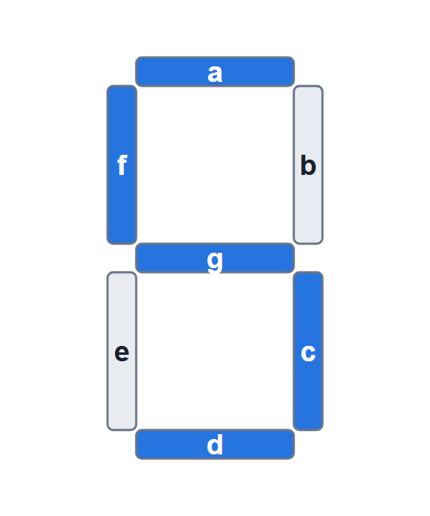

# 실험 8 · 문제 설명

      
첫 줄부터 완성 답과 검산까지 함께 풀어요.

## 문제를 함께 풀어요

### 문제 1 · JK F/F를 Toggle로 쓰는 네 핀 값

문제 읽기
#### 문제

JK F/F의 Clock이 Falling Edge일 때 출력(Q)이 Toggle로 동작하기 위한 PR, CLR, J, K핀의 입력값을 적으시오.

#### 구할 것

PR, CLR, J, K 네 핀의 값

이 문제에서 할 일
JK 플립플롭의 네 입력을 어떻게 두면 하강 엣지마다 Q가 뒤집히는지 묻는 문제예요. 전등 스위치처럼 누를 때마다 바뀌게 만드는 값을 찾아요.

이 문제를 봤을 때 떠올릴 개념과 공식
Toggle은 J=K=1, 강제 핀은 쉬게

“Toggle”이라는 말이 단서예요. Toggle은 유효 엣지마다 이전 Q를 뒤집는 동작이에요. 이 말을 보면 JK 표의 J=K=1 줄을 떠올려요.

PR은 Q를 1로, CLR은 Q를 0으로 만드는 비동기 입력이에요. 74HC76에서는 L일 때 눌려요. 이름 위 줄이나 핀의 동그라미가 그 표시예요.

J=K=1 규칙은 PR=CLR=1이고 입력이 엣지 주변에서 안정될 때만 성립해요. 그래서 이 문제는 J, K만이 아니라 PR, CLR까지 함께 답해야 해요.

첫 줄을 이렇게 시작해요
먼저 “PR=1, CLR=1이면 강제 버튼이 쉬어요”라고 적어요.

[필요한 개념으로 돌아가요](%EC%8B%A4%ED%97%9808_%EC%8B%A4%ED%97%98%EC%84%A4%EB%AA%85.md#t-toggle)

이유를 따라 완성해요
**강제 버튼:**

PR=0이면 Q가 1로, CLR=0이면 Q가 0으로 고정돼요. 그러면 클럭이 와도 뒤집히지 않아요. 그래서 둘 다 1로 둬요.

**JK 줄 고르기:**

J=K=0은 유지, J만 1은 Set, K만 1은 Reset이에요. 반전은 J=K=1 한 줄뿐이에요.

**정리:**

| 핀 | 값 | 이유 |
| --- | --- | --- |
| PR | 1 | 강제 Set 쉼 |
| CLR | 1 | 강제 Reset 쉼 |
| J | 1 | J=K=1이어야 반전 |
| K | 1 | J=K=1이어야 반전 |

답과 검산을 확인해요
최종 답: PR=1, CLR=1, J=1, K=1 (네 핀 모두 High)

검산: Q이전=0이면 J·Q′+K′·Q = 1·1+0·0 = 1, Q이전=1이면 1·0+0·1 = 0이에요. 두 경우 모두 반전이에요.

헷갈리기 쉬운 조건을 확인해요
J, K만 적고 PR, CLR을 빠뜨리면 조건이 모자라요. 또 74HC76의 PR·CLR은 L일 때 눌리므로 “쉬는 값”이 0이라고 적으면 틀려요.

설명을 닫고 다시 해 봐요
- 강제 핀이 쉬는 값을 적어요.
- JK 표에서 반전 줄을 찾아요.
- 식 Q다음=J·Q′+K′·Q로 두 경우를 검산해요.

**떠올릴 것:** Toggle은 J=K=1, 강제 핀은 쉬게

“Toggle”이라는 말이 단서예요. Toggle은 유효 엣지마다 이전 Q를 뒤집는 동작이에요. 이 말을 보면 JK 표의 J=K=1 줄을 떠올려요.

첫 실행: 먼저 “PR=1, CLR=1이면 강제 버튼이 쉬어요”라고 적어요.

핵심: 강제 핀은 1로 쉬게 하고 J=K=1을 줘요.

결론: PR=1, CLR=1, J=1, K=1 (네 핀 모두 High)

검산: Q이전=0이면 J·Q′+K′·Q = 1·1+0·0 = 1, Q이전=1이면 1·0+0·1 = 0이에요. 두 경우 모두 반전이에요.

주의: J, K만 적고 PR, CLR을 빠뜨리면 조건이 모자라요. 또 74HC76의 PR·CLR은 L일 때 눌리므로 “쉬는 값”이 0이라고 적으면 틀려요.

출처: [from_the_past/정리/퀴즈/실험8/실험8 퀴즈 예상문제_v1.pdf · PDF p1](../../../from_the_past/%EC%A0%95%EB%A6%AC/%ED%80%B4%EC%A6%88/%EC%8B%A4%ED%97%988/%EC%8B%A4%ED%97%988%20%ED%80%B4%EC%A6%88%20%EC%98%88%EC%83%81%EB%AC%B8%EC%A0%9C_v1.pdf#page=1) · [from_the_past/정리/퀴즈/실험8/실험8 퀴즈 예상문제_v2.pdf · PDF p1](../../../from_the_past/%EC%A0%95%EB%A6%AC/%ED%80%B4%EC%A6%88/%EC%8B%A4%ED%97%988/%EC%8B%A4%ED%97%988%20%ED%80%B4%EC%A6%88%20%EC%98%88%EC%83%81%EB%AC%B8%EC%A0%9C_v2.pdf#page=1) · [from_the_past/정리/퀴즈/실험8/실험8 퀴즈 예상문제_v3.pdf · PDF p1](../../../from_the_past/%EC%A0%95%EB%A6%AC/%ED%80%B4%EC%A6%88/%EC%8B%A4%ED%97%988/%EC%8B%A4%ED%97%988%20%ED%80%B4%EC%A6%88%20%EC%98%88%EC%83%81%EB%AC%B8%EC%A0%9C_v3.pdf#page=1) · [from_the_past/정리/퀴즈/실험8/실험8 퀴즈 예상문제_v4.pdf · PDF p1](../../../from_the_past/%EC%A0%95%EB%A6%AC/%ED%80%B4%EC%A6%88/%EC%8B%A4%ED%97%988/%EC%8B%A4%ED%97%988%20%ED%80%B4%EC%A6%88%20%EC%98%88%EC%83%81%EB%AC%B8%EC%A0%9C_v4.pdf#page=1) · [from_the_past/정리/퀴즈/실험8/실험8 퀴즈 예상문제_답안단순화_v1.pdf · PDF p1](../../../from_the_past/%EC%A0%95%EB%A6%AC/%ED%80%B4%EC%A6%88/%EC%8B%A4%ED%97%988/%EC%8B%A4%ED%97%988%20%ED%80%B4%EC%A6%88%20%EC%98%88%EC%83%81%EB%AC%B8%EC%A0%9C_%EB%8B%B5%EC%95%88%EB%8B%A8%EC%88%9C%ED%99%94_v1.pdf#page=1) · [from_the_past/정리/퀴즈/실험8/실험8 퀴즈 예상문제_답안단순화_v2.pdf · PDF p1](../../../from_the_past/%EC%A0%95%EB%A6%AC/%ED%80%B4%EC%A6%88/%EC%8B%A4%ED%97%988/%EC%8B%A4%ED%97%988%20%ED%80%B4%EC%A6%88%20%EC%98%88%EC%83%81%EB%AC%B8%EC%A0%9C_%EB%8B%B5%EC%95%88%EB%8B%A8%EC%88%9C%ED%99%94_v2.pdf#page=1) · [from_the_past/정리/퀴즈/실험8/실험8 퀴즈 예상문제_정리본_v1.pdf · PDF p1](../../../from_the_past/%EC%A0%95%EB%A6%AC/%ED%80%B4%EC%A6%88/%EC%8B%A4%ED%97%988/%EC%8B%A4%ED%97%988%20%ED%80%B4%EC%A6%88%20%EC%98%88%EC%83%81%EB%AC%B8%EC%A0%9C_%EC%A0%95%EB%A6%AC%EB%B3%B8_v1.pdf#page=1) · [from_the_past/정리/퀴즈/실험8/실험8 퀴즈 예상문제_정리본_v2.pdf · PDF p1](../../../from_the_past/%EC%A0%95%EB%A6%AC/%ED%80%B4%EC%A6%88/%EC%8B%A4%ED%97%988/%EC%8B%A4%ED%97%988%20%ED%80%B4%EC%A6%88%20%EC%98%88%EC%83%81%EB%AC%B8%EC%A0%9C_%EC%A0%95%EB%A6%AC%EB%B3%B8_v2.pdf#page=1) · [from_the_past/정리/퀴즈/실험8/실험8 퀴즈 예상문제_카운터심화.pdf · PDF p1](../../../from_the_past/%EC%A0%95%EB%A6%AC/%ED%80%B4%EC%A6%88/%EC%8B%A4%ED%97%988/%EC%8B%A4%ED%97%988%20%ED%80%B4%EC%A6%88%20%EC%98%88%EC%83%81%EB%AC%B8%EC%A0%9C_%EC%B9%B4%EC%9A%B4%ED%84%B0%EC%8B%AC%ED%99%94.pdf#page=1) · [from_the_past/정리/퀴즈/실험8/실험8 퀴즈 종합_기출문제 (8p).pdf · PDF p2](../../../from_the_past/%EC%A0%95%EB%A6%AC/%ED%80%B4%EC%A6%88/%EC%8B%A4%ED%97%988/%EC%8B%A4%ED%97%988%20%ED%80%B4%EC%A6%88%20%EC%A2%85%ED%95%A9_%EA%B8%B0%EC%B6%9C%EB%AC%B8%EC%A0%9C%20%288p%29.pdf#page=2) · [from_the_past/정리/퀴즈/실험8/원본_docx/실험8 정리중!!!!!!.docx](../../../from_the_past/%EC%A0%95%EB%A6%AC/%ED%80%B4%EC%A6%88/%EC%8B%A4%ED%97%988/%EC%9B%90%EB%B3%B8_docx/%EC%8B%A4%ED%97%988%20%EC%A0%95%EB%A6%AC%EC%A4%91%21%21%21%21%21%21.docx) · [from_the_past/정리/퀴즈/실험8/원본_docx/실험8 정리중-수정.docx](../../../from_the_past/%EC%A0%95%EB%A6%AC/%ED%80%B4%EC%A6%88/%EC%8B%A4%ED%97%988/%EC%9B%90%EB%B3%B8_docx/%EC%8B%A4%ED%97%988%20%EC%A0%95%EB%A6%AC%EC%A4%91-%EC%88%98%EC%A0%95.docx) · [from_the_past/정리/퀴즈/실험8/원본_docx/실험8 최종 - 답안 단순화!.docx](../../../from_the_past/%EC%A0%95%EB%A6%AC/%ED%80%B4%EC%A6%88/%EC%8B%A4%ED%97%988/%EC%9B%90%EB%B3%B8_docx/%EC%8B%A4%ED%97%988%20%EC%B5%9C%EC%A2%85%20-%20%EB%8B%B5%EC%95%88%20%EB%8B%A8%EC%88%9C%ED%99%94%21.docx) · [from_the_past/정리/퀴즈/실험8/원본_docx/실험8 최종 - 답안 단순화.docx](../../../from_the_past/%EC%A0%95%EB%A6%AC/%ED%80%B4%EC%A6%88/%EC%8B%A4%ED%97%988/%EC%9B%90%EB%B3%B8_docx/%EC%8B%A4%ED%97%988%20%EC%B5%9C%EC%A2%85%20-%20%EB%8B%B5%EC%95%88%20%EB%8B%A8%EC%88%9C%ED%99%94.docx) · [from_the_past/정리/퀴즈/실험8/원본_docx/실험8.docx](../../../from_the_past/%EC%A0%95%EB%A6%AC/%ED%80%B4%EC%A6%88/%EC%8B%A4%ED%97%988/%EC%9B%90%EB%B3%B8_docx/%EC%8B%A4%ED%97%988.docx)

### 문제 2 · J, K, CLR로 Toggle 만들기

문제 읽기
#### 문제

JK F/F의 출력 Q가 Toggle로 동작하기 위한 J, K, CLR핀의 입력값을 적으시오.

#### 구할 것

J, K, CLR 세 핀의 값

이 문제에서 할 일
앞 문제와 같은 Toggle 조건을 세 핀만 골라 묻는 문제예요. 답은 세 값이지만, 묻지 않은 PR도 쉬고 있어야 해요.

이 문제를 봤을 때 떠올릴 개념과 공식
J=K=1, CLR=1, PR도 쉬는 상태

“Toggle”과 “J, K, CLR”이 단서예요. JK 표의 반전 줄과 CLR의 쉬는 값을 떠올려요.

CLR은 74HC76에서 L일 때 Q를 0으로 만드는 입력이에요. 1을 주면 쉬어요.

문제가 PR을 묻지 않았어도 PR=1이어야 성립해요. PR=0이면 Q가 1에 묶여서 뒤집히지 않아요.

첫 줄을 이렇게 시작해요
“J=1, K=1, CLR=1”이라고 적고, 옆에 “PR=1 전제”를 덧붙여요.

[필요한 개념으로 돌아가요](%EC%8B%A4%ED%97%9808_%EC%8B%A4%ED%97%98%EC%84%A4%EB%AA%85.md#t-toggle)

이유를 따라 완성해요
**값 고르기:**

J=K=1이 반전 줄이고, CLR은 쉬게 1로 둬요. 물어본 순서대로 적으면 1, 1, 1이에요.

**전제 밝히기:**

클럭이 하강 엣지로 들어오고 PR=1일 때 성립해요. 원문은 엣지 방향과 PR을 적지 않았어요.

답과 검산을 확인해요
최종 답: J=1, K=1, CLR=1 (PR도 1이어야 해요)

검산: CLR=0이면 Q=0으로 고정이라 반전이 안 돼요. 그래서 CLR=1이 꼭 필요해요.

헷갈리기 쉬운 조건을 확인해요
세 값을 1, 1, 1로 적고 끝내도 답은 맞아요. 다만 PR=0이면 성립하지 않는다는 점을 알아 두어요.

설명을 닫고 다시 해 봐요
- JK 표에서 반전 줄을 찾아요.
- CLR의 쉬는 값을 적어요.
- 묻지 않은 PR의 전제를 확인해요.

**떠올릴 것:** J=K=1, CLR=1, PR도 쉬는 상태

“Toggle”과 “J, K, CLR”이 단서예요. JK 표의 반전 줄과 CLR의 쉬는 값을 떠올려요.

첫 실행: “J=1, K=1, CLR=1”이라고 적고, 옆에 “PR=1 전제”를 덧붙여요.

핵심: 물어보지 않은 PR도 1이어야 해요.

결론: J=1, K=1, CLR=1 (PR도 1이어야 해요)

검산: CLR=0이면 Q=0으로 고정이라 반전이 안 돼요. 그래서 CLR=1이 꼭 필요해요.

주의: 세 값을 1, 1, 1로 적고 끝내도 답은 맞아요. 다만 PR=0이면 성립하지 않는다는 점을 알아 두어요.

출처: [from_the_past/정리/퀴즈/실험8/실험8 퀴즈 기출_단답형 (1p).pdf · PDF p1](../../../from_the_past/%EC%A0%95%EB%A6%AC/%ED%80%B4%EC%A6%88/%EC%8B%A4%ED%97%988/%EC%8B%A4%ED%97%988%20%ED%80%B4%EC%A6%88%20%EA%B8%B0%EC%B6%9C_%EB%8B%A8%EB%8B%B5%ED%98%95%20%281p%29.pdf#page=1) · [from_the_past/정리/퀴즈/실험8/실험8 퀴즈 기출_정답.pdf · PDF p1](../../../from_the_past/%EC%A0%95%EB%A6%AC/%ED%80%B4%EC%A6%88/%EC%8B%A4%ED%97%988/%EC%8B%A4%ED%97%988%20%ED%80%B4%EC%A6%88%20%EA%B8%B0%EC%B6%9C_%EC%A0%95%EB%8B%B5.pdf#page=1) · [from_the_past/정리/퀴즈/실험8/실험8 퀴즈 종합_기출문제 (8p).pdf · PDF p7](../../../from_the_past/%EC%A0%95%EB%A6%AC/%ED%80%B4%EC%A6%88/%EC%8B%A4%ED%97%988/%EC%8B%A4%ED%97%988%20%ED%80%B4%EC%A6%88%20%EC%A2%85%ED%95%A9_%EA%B8%B0%EC%B6%9C%EB%AC%B8%EC%A0%9C%20%288p%29.pdf#page=7)

### 문제 3 · 비동기식 카운터의 특징

문제 읽기
#### 문제

비동기식 카운터의 특징을 간략하게 적으시오.

#### 구할 것

비동기식의 특징

이 문제에서 할 일
비동기식이라는 이름이 왜 붙었는지 짧게 쓰는 문제예요. 클럭 연결과 그 결과를 함께 써요.

이 문제를 봤을 때 떠올릴 개념과 공식
클럭 연결 → 차례로 변함 → 지연

“비동기식”이 단서예요. 동기는 같은 시각에 맞춘다는 뜻이니, 비동기는 F/F들이 같은 시각에 바뀌지 않는다는 뜻이에요.

교안 정의는 “이전 F/F의 출력이 다음 F/F의 클럭으로 전달되어 순차적으로 동작하며, 전송 지연이 발생하는 구조”예요.

전달 지연은 입력이 바뀐 뒤 출력이 바뀌기까지 걸리는 시간이에요. 앞 단이 바뀐 뒤 다음 단이 움직이니 단마다 쌓여요.

첫 줄을 이렇게 시작해요
“첫 F/F에만 외부 클럭이 들어가요”로 시작해요.

[필요한 개념으로 돌아가요](%EC%8B%A4%ED%97%9808_%EC%8B%A4%ED%97%98%EC%84%A4%EB%AA%85.md#t-async)

이유를 따라 완성해요
**연결:**

외부 클럭은 첫 F/F에만 들어가요. 둘째 F/F부터는 앞 F/F의 출력을 클럭으로 받아요.

**결과:**

그래서 F/F들이 동시에 바뀌지 않고 앞에서부터 차례로 바뀌어요. 지연이 단마다 쌓여서 뒤 단일수록 늦어요.

**보충:**

회로가 단순한 대신 11→00처럼 여러 비트가 바뀔 때 01 같은 가짜 상태를 잠깐 지나요.

답과 검산을 확인해요
최종 답: 첫 F/F만 외부 클럭을 받고 다음 F/F는 앞 F/F의 출력을 클럭으로 받아요. 그래서 F/F가 동시에 바뀌지 않고 차례로 바뀌며 전달 지연이 단마다 쌓여요.

검산: 2단 2진에서 11→00을 따라가 봐요. A가 먼저 0이 되어 01이 되고, 그 뒤 B가 0이 되어 00이 돼요.

헷갈리기 쉬운 조건을 확인해요
“앞의 결과에 영향을 받는다”만 쓰면 동기 카운터의 되먹임도 해당돼요. 클럭이 앞 단 출력에서 온다는 점을 꼭 써요.

설명을 닫고 다시 해 봐요
- 클럭이 어디로 들어가는지 적어요.
- 바뀌는 순서를 적어요.
- 지연이 쌓이는 이유를 한 문장으로 적어요.

**떠올릴 것:** 클럭 연결 → 차례로 변함 → 지연

“비동기식”이 단서예요. 동기는 같은 시각에 맞춘다는 뜻이니, 비동기는 F/F들이 같은 시각에 바뀌지 않는다는 뜻이에요.

첫 실행: “첫 F/F에만 외부 클럭이 들어가요”로 시작해요.

핵심: 클럭 연결과 차례로 바뀐다는 결과를 함께 써요.

결론: 첫 F/F만 외부 클럭을 받고 다음 F/F는 앞 F/F의 출력을 클럭으로 받아요. 그래서 F/F가 동시에 바뀌지 않고 차례로 바뀌며 전달 지연이 단마다 쌓여요.

검산: 2단 2진에서 11→00을 따라가 봐요. A가 먼저 0이 되어 01이 되고, 그 뒤 B가 0이 되어 00이 돼요.

주의: “앞의 결과에 영향을 받는다”만 쓰면 동기 카운터의 되먹임도 해당돼요. 클럭이 앞 단 출력에서 온다는 점을 꼭 써요.

출처: [from_the_past/정리/퀴즈/실험8/실험8 퀴즈 기출 2017-1.pdf · PDF p1](../../../from_the_past/%EC%A0%95%EB%A6%AC/%ED%80%B4%EC%A6%88/%EC%8B%A4%ED%97%988/%EC%8B%A4%ED%97%988%20%ED%80%B4%EC%A6%88%20%EA%B8%B0%EC%B6%9C%202017-1.pdf#page=1) · [from_the_past/정리/퀴즈/실험8/실험8 퀴즈 기출 2015-2_영문.pdf · PDF p1](../../../from_the_past/%EC%A0%95%EB%A6%AC/%ED%80%B4%EC%A6%88/%EC%8B%A4%ED%97%988/%EC%8B%A4%ED%97%988%20%ED%80%B4%EC%A6%88%20%EA%B8%B0%EC%B6%9C%202015-2_%EC%98%81%EB%AC%B8.pdf#page=1) · [from_the_past/정리/퀴즈/실험8/실험8 퀴즈 기출_단답형 (1p).pdf · PDF p1](../../../from_the_past/%EC%A0%95%EB%A6%AC/%ED%80%B4%EC%A6%88/%EC%8B%A4%ED%97%988/%EC%8B%A4%ED%97%988%20%ED%80%B4%EC%A6%88%20%EA%B8%B0%EC%B6%9C_%EB%8B%A8%EB%8B%B5%ED%98%95%20%281p%29.pdf#page=1) · [from_the_past/정리/퀴즈/실험8/실험8 퀴즈 기출_정답.pdf · PDF p1](../../../from_the_past/%EC%A0%95%EB%A6%AC/%ED%80%B4%EC%A6%88/%EC%8B%A4%ED%97%988/%EC%8B%A4%ED%97%988%20%ED%80%B4%EC%A6%88%20%EA%B8%B0%EC%B6%9C_%EC%A0%95%EB%8B%B5.pdf#page=1) · [from_the_past/정리/퀴즈/실험8/실험8 퀴즈 종합_기출문제 (8p).pdf · PDF p7](../../../from_the_past/%EC%A0%95%EB%A6%AC/%ED%80%B4%EC%A6%88/%EC%8B%A4%ED%97%988/%EC%8B%A4%ED%97%988%20%ED%80%B4%EC%A6%88%20%EC%A2%85%ED%95%A9_%EA%B8%B0%EC%B6%9C%EB%AC%B8%EC%A0%9C%20%288p%29.pdf#page=7) · [from_the_past/정리/퀴즈/실험8/실험8 퀴즈 예상문제_v1.pdf · PDF p1](../../../from_the_past/%EC%A0%95%EB%A6%AC/%ED%80%B4%EC%A6%88/%EC%8B%A4%ED%97%988/%EC%8B%A4%ED%97%988%20%ED%80%B4%EC%A6%88%20%EC%98%88%EC%83%81%EB%AC%B8%EC%A0%9C_v1.pdf#page=1) · [from_the_past/정리/퀴즈/실험8/실험8 퀴즈 예상문제_v2.pdf · PDF p1](../../../from_the_past/%EC%A0%95%EB%A6%AC/%ED%80%B4%EC%A6%88/%EC%8B%A4%ED%97%988/%EC%8B%A4%ED%97%988%20%ED%80%B4%EC%A6%88%20%EC%98%88%EC%83%81%EB%AC%B8%EC%A0%9C_v2.pdf#page=1) · [from_the_past/정리/퀴즈/실험8/실험8 퀴즈 예상문제_v3.pdf · PDF p1](../../../from_the_past/%EC%A0%95%EB%A6%AC/%ED%80%B4%EC%A6%88/%EC%8B%A4%ED%97%988/%EC%8B%A4%ED%97%988%20%ED%80%B4%EC%A6%88%20%EC%98%88%EC%83%81%EB%AC%B8%EC%A0%9C_v3.pdf#page=1) · [from_the_past/정리/퀴즈/실험8/실험8 퀴즈 예상문제_v4.pdf · PDF p1](../../../from_the_past/%EC%A0%95%EB%A6%AC/%ED%80%B4%EC%A6%88/%EC%8B%A4%ED%97%988/%EC%8B%A4%ED%97%988%20%ED%80%B4%EC%A6%88%20%EC%98%88%EC%83%81%EB%AC%B8%EC%A0%9C_v4.pdf#page=1) · [from_the_past/정리/퀴즈/실험8/실험8 퀴즈 예상문제_답안단순화_v1.pdf · PDF p1](../../../from_the_past/%EC%A0%95%EB%A6%AC/%ED%80%B4%EC%A6%88/%EC%8B%A4%ED%97%988/%EC%8B%A4%ED%97%988%20%ED%80%B4%EC%A6%88%20%EC%98%88%EC%83%81%EB%AC%B8%EC%A0%9C_%EB%8B%B5%EC%95%88%EB%8B%A8%EC%88%9C%ED%99%94_v1.pdf#page=1) · [from_the_past/정리/퀴즈/실험8/실험8 퀴즈 예상문제_답안단순화_v2.pdf · PDF p1](../../../from_the_past/%EC%A0%95%EB%A6%AC/%ED%80%B4%EC%A6%88/%EC%8B%A4%ED%97%988/%EC%8B%A4%ED%97%988%20%ED%80%B4%EC%A6%88%20%EC%98%88%EC%83%81%EB%AC%B8%EC%A0%9C_%EB%8B%B5%EC%95%88%EB%8B%A8%EC%88%9C%ED%99%94_v2.pdf#page=1) · [from_the_past/정리/퀴즈/실험8/실험8 퀴즈 예상문제_정리본_v1.pdf · PDF p1](../../../from_the_past/%EC%A0%95%EB%A6%AC/%ED%80%B4%EC%A6%88/%EC%8B%A4%ED%97%988/%EC%8B%A4%ED%97%988%20%ED%80%B4%EC%A6%88%20%EC%98%88%EC%83%81%EB%AC%B8%EC%A0%9C_%EC%A0%95%EB%A6%AC%EB%B3%B8_v1.pdf#page=1) · [from_the_past/정리/퀴즈/실험8/실험8 퀴즈 예상문제_정리본_v2.pdf · PDF p1](../../../from_the_past/%EC%A0%95%EB%A6%AC/%ED%80%B4%EC%A6%88/%EC%8B%A4%ED%97%988/%EC%8B%A4%ED%97%988%20%ED%80%B4%EC%A6%88%20%EC%98%88%EC%83%81%EB%AC%B8%EC%A0%9C_%EC%A0%95%EB%A6%AC%EB%B3%B8_v2.pdf#page=1) · [from_the_past/정리/퀴즈/실험8/실험8 퀴즈 예상문제_카운터심화.pdf · PDF p1](../../../from_the_past/%EC%A0%95%EB%A6%AC/%ED%80%B4%EC%A6%88/%EC%8B%A4%ED%97%988/%EC%8B%A4%ED%97%988%20%ED%80%B4%EC%A6%88%20%EC%98%88%EC%83%81%EB%AC%B8%EC%A0%9C_%EC%B9%B4%EC%9A%B4%ED%84%B0%EC%8B%AC%ED%99%94.pdf#page=1) · [from_the_past/정리/퀴즈/실험8/실험8 퀴즈 종합_기출문제 (8p).pdf · PDF p2](../../../from_the_past/%EC%A0%95%EB%A6%AC/%ED%80%B4%EC%A6%88/%EC%8B%A4%ED%97%988/%EC%8B%A4%ED%97%988%20%ED%80%B4%EC%A6%88%20%EC%A2%85%ED%95%A9_%EA%B8%B0%EC%B6%9C%EB%AC%B8%EC%A0%9C%20%288p%29.pdf#page=2) · [from_the_past/정리/퀴즈/실험8/원본_docx/실험8 정리중!!!!!!.docx](../../../from_the_past/%EC%A0%95%EB%A6%AC/%ED%80%B4%EC%A6%88/%EC%8B%A4%ED%97%988/%EC%9B%90%EB%B3%B8_docx/%EC%8B%A4%ED%97%988%20%EC%A0%95%EB%A6%AC%EC%A4%91%21%21%21%21%21%21.docx) · [from_the_past/정리/퀴즈/실험8/원본_docx/실험8 정리중-수정.docx](../../../from_the_past/%EC%A0%95%EB%A6%AC/%ED%80%B4%EC%A6%88/%EC%8B%A4%ED%97%988/%EC%9B%90%EB%B3%B8_docx/%EC%8B%A4%ED%97%988%20%EC%A0%95%EB%A6%AC%EC%A4%91-%EC%88%98%EC%A0%95.docx) · [from_the_past/정리/퀴즈/실험8/원본_docx/실험8 최종 - 답안 단순화!.docx](../../../from_the_past/%EC%A0%95%EB%A6%AC/%ED%80%B4%EC%A6%88/%EC%8B%A4%ED%97%988/%EC%9B%90%EB%B3%B8_docx/%EC%8B%A4%ED%97%988%20%EC%B5%9C%EC%A2%85%20-%20%EB%8B%B5%EC%95%88%20%EB%8B%A8%EC%88%9C%ED%99%94%21.docx) · [from_the_past/정리/퀴즈/실험8/원본_docx/실험8 최종 - 답안 단순화.docx](../../../from_the_past/%EC%A0%95%EB%A6%AC/%ED%80%B4%EC%A6%88/%EC%8B%A4%ED%97%988/%EC%9B%90%EB%B3%B8_docx/%EC%8B%A4%ED%97%988%20%EC%B5%9C%EC%A2%85%20-%20%EB%8B%B5%EC%95%88%20%EB%8B%A8%EC%88%9C%ED%99%94.docx) · [from_the_past/정리/퀴즈/실험8/원본_docx/실험8.docx](../../../from_the_past/%EC%A0%95%EB%A6%AC/%ED%80%B4%EC%A6%88/%EC%8B%A4%ED%97%988/%EC%9B%90%EB%B3%B8_docx/%EC%8B%A4%ED%97%988.docx)

### 문제 4 · T F/F 3단 블록도의 동작

문제 읽기
#### 문제

아래의 카운터가 어떻게 동작하는지 간략하게 적으시오. (X단 Y진 카운터, 출력값의 변화순서와 범위)

#### 주어진 조건

원문에는 블록 C 안의 출력 라벨도 B, B′로 인쇄돼 있어요. 위로 뽑힌 선의 이름은 C예요.

#### 구할 것

X, Y, 출력값의 변화 순서와 범위

이 문제에서 할 일
블록도를 보고 몇 단 몇 진인지, 값이 어떤 순서로 어디까지 가는지 쓰는 문제예요.

이 문제를 봤을 때 떠올릴 개념과 공식
단 수 세고 상태 수 2ⁿ, 앞 출력이 클럭

T 블록이 줄지어 있고 앞 출력이 다음 T로 들어가는 것이 단서예요. 비동기 카운터를 떠올려요.

X단은 F/F 개수이고, 2진 F/F를 n단 이으면 상태는 2ⁿ개예요. 교안의 “2단 2진 = 0-3 Counter”와 같은 이름 방식이에요.

블록도에 엣지 방향이 없어요. 교안 p5처럼 하강 엣지로 보면 A가 낮은 자리인 올라가는 카운터가 돼요. 상승 엣지면 내려가는 순서가 되므로 조건을 적어요.

Reset 선이 세 블록에 공통이라서 시작을 000으로 맞출 수 있어요.

첫 줄을 이렇게 시작해요
“T 블록 3개 → 3단, 2³=8상태”라고 적어요.

[필요한 개념으로 돌아가요](%EC%8B%A4%ED%97%9808_%EC%8B%A4%ED%97%98%EC%84%A4%EB%AA%85.md#t-toggle)

이유를 따라 완성해요
**이름:**

T 블록이 3개이니 3단이고, 각 단이 2진이에요. 그래서 3단 2진 카운터, 전체 상태는 8개예요.

**변화 순서:**

Reset 뒤 CBA=000이에요. 하강 엣지 기준이면 A는 CLK마다, B는 A가 떨어질 때, C는 B가 떨어질 때 뒤집혀요.

| CLK 하강 | C B A | 값 |
| --- | --- | --- |
| 시작 | 000 | 0 |
| 1 | 001 | 1 |
| 2 | 010 | 2 |
| 3 | 011 | 3 |
| 4 | 100 | 4 |
| 5 | 101 | 5 |
| 6 | 110 | 6 |
| 7 | 111 | 7 |
| 8 | 000 | 0 |

**비동기:**

CLK에 의해 A가 먼저 바뀌고, 그 결과로 B, 다시 C가 바뀌어요. 그래서 비동기식이에요.

답과 검산을 확인해요
최종 답: 3단 2진 비동기 카운터예요. 상태는 8개(0~7)이고, Reset 뒤 CBA가 000→001→…→111→000으로 반복해요. A, B, C가 차례로 바뀌어요. (교안처럼 하강 엣지 기준)

검산: A는 CLK 1번마다, B는 2번마다, C는 4번마다 바뀌어 전체가 8번에 돌아와요.

헷갈리기 쉬운 조건을 확인해요
“3단 3진”이나 “2진”으로만 쓰지 않아요. 단 수와 상태 수를 함께 써요. 원문 블록 C의 B, B′ 라벨은 인쇄 그대로이고 C 출력으로 읽어요. 상승 엣지로 동작하면 순서가 000→111→110…로 바뀌어요.

설명을 닫고 다시 해 봐요
- T 블록 수를 세요.
- 2ⁿ으로 상태 수를 구해요.
- 하강 엣지 조건을 밝히고 순서를 적어요.

**떠올릴 것:** 단 수 세고 상태 수 2ⁿ, 앞 출력이 클럭

T 블록이 줄지어 있고 앞 출력이 다음 T로 들어가는 것이 단서예요. 비동기 카운터를 떠올려요.

첫 실행: “T 블록 3개 → 3단, 2³=8상태”라고 적어요.

핵심: 3단 2진, 8상태, 0~7, 비동기 순서를 함께 써요.

결론: 3단 2진 비동기 카운터예요. 상태는 8개(0~7)이고, Reset 뒤 CBA가 000→001→…→111→000으로 반복해요. A, B, C가 차례로 바뀌어요. (교안처럼 하강 엣지 기준)

검산: A는 CLK 1번마다, B는 2번마다, C는 4번마다 바뀌어 전체가 8번에 돌아와요.

주의: “3단 3진”이나 “2진”으로만 쓰지 않아요. 단 수와 상태 수를 함께 써요. 원문 블록 C의 B, B′ 라벨은 인쇄 그대로이고 C 출력으로 읽어요. 상승 엣지로 동작하면 순서가 000→111→110…로 바뀌어요.

출처: [from_the_past/정리/퀴즈/실험8/실험8 퀴즈 기출 2017-1.pdf · PDF p1](../../../from_the_past/%EC%A0%95%EB%A6%AC/%ED%80%B4%EC%A6%88/%EC%8B%A4%ED%97%988/%EC%8B%A4%ED%97%988%20%ED%80%B4%EC%A6%88%20%EA%B8%B0%EC%B6%9C%202017-1.pdf#page=1) · [from_the_past/정리/퀴즈/실험8/실험8 퀴즈 기출 2015-2_영문.pdf · PDF p1](../../../from_the_past/%EC%A0%95%EB%A6%AC/%ED%80%B4%EC%A6%88/%EC%8B%A4%ED%97%988/%EC%8B%A4%ED%97%988%20%ED%80%B4%EC%A6%88%20%EA%B8%B0%EC%B6%9C%202015-2_%EC%98%81%EB%AC%B8.pdf#page=1) · [from_the_past/정리/퀴즈/실험8/실험8 퀴즈 예상문제_v1.pdf · PDF p1](../../../from_the_past/%EC%A0%95%EB%A6%AC/%ED%80%B4%EC%A6%88/%EC%8B%A4%ED%97%988/%EC%8B%A4%ED%97%988%20%ED%80%B4%EC%A6%88%20%EC%98%88%EC%83%81%EB%AC%B8%EC%A0%9C_v1.pdf#page=1) · [from_the_past/정리/퀴즈/실험8/실험8 퀴즈 예상문제_v2.pdf · PDF p1](../../../from_the_past/%EC%A0%95%EB%A6%AC/%ED%80%B4%EC%A6%88/%EC%8B%A4%ED%97%988/%EC%8B%A4%ED%97%988%20%ED%80%B4%EC%A6%88%20%EC%98%88%EC%83%81%EB%AC%B8%EC%A0%9C_v2.pdf#page=1) · [from_the_past/정리/퀴즈/실험8/실험8 퀴즈 예상문제_v3.pdf · PDF p1](../../../from_the_past/%EC%A0%95%EB%A6%AC/%ED%80%B4%EC%A6%88/%EC%8B%A4%ED%97%988/%EC%8B%A4%ED%97%988%20%ED%80%B4%EC%A6%88%20%EC%98%88%EC%83%81%EB%AC%B8%EC%A0%9C_v3.pdf#page=1) · [from_the_past/정리/퀴즈/실험8/실험8 퀴즈 예상문제_v4.pdf · PDF p1](../../../from_the_past/%EC%A0%95%EB%A6%AC/%ED%80%B4%EC%A6%88/%EC%8B%A4%ED%97%988/%EC%8B%A4%ED%97%988%20%ED%80%B4%EC%A6%88%20%EC%98%88%EC%83%81%EB%AC%B8%EC%A0%9C_v4.pdf#page=1) · [from_the_past/정리/퀴즈/실험8/실험8 퀴즈 예상문제_답안단순화_v1.pdf · PDF p1](../../../from_the_past/%EC%A0%95%EB%A6%AC/%ED%80%B4%EC%A6%88/%EC%8B%A4%ED%97%988/%EC%8B%A4%ED%97%988%20%ED%80%B4%EC%A6%88%20%EC%98%88%EC%83%81%EB%AC%B8%EC%A0%9C_%EB%8B%B5%EC%95%88%EB%8B%A8%EC%88%9C%ED%99%94_v1.pdf#page=1) · [from_the_past/정리/퀴즈/실험8/실험8 퀴즈 예상문제_답안단순화_v2.pdf · PDF p1](../../../from_the_past/%EC%A0%95%EB%A6%AC/%ED%80%B4%EC%A6%88/%EC%8B%A4%ED%97%988/%EC%8B%A4%ED%97%988%20%ED%80%B4%EC%A6%88%20%EC%98%88%EC%83%81%EB%AC%B8%EC%A0%9C_%EB%8B%B5%EC%95%88%EB%8B%A8%EC%88%9C%ED%99%94_v2.pdf#page=1) · [from_the_past/정리/퀴즈/실험8/실험8 퀴즈 예상문제_정리본_v1.pdf · PDF p1](../../../from_the_past/%EC%A0%95%EB%A6%AC/%ED%80%B4%EC%A6%88/%EC%8B%A4%ED%97%988/%EC%8B%A4%ED%97%988%20%ED%80%B4%EC%A6%88%20%EC%98%88%EC%83%81%EB%AC%B8%EC%A0%9C_%EC%A0%95%EB%A6%AC%EB%B3%B8_v1.pdf#page=1) · [from_the_past/정리/퀴즈/실험8/실험8 퀴즈 예상문제_정리본_v2.pdf · PDF p1](../../../from_the_past/%EC%A0%95%EB%A6%AC/%ED%80%B4%EC%A6%88/%EC%8B%A4%ED%97%988/%EC%8B%A4%ED%97%988%20%ED%80%B4%EC%A6%88%20%EC%98%88%EC%83%81%EB%AC%B8%EC%A0%9C_%EC%A0%95%EB%A6%AC%EB%B3%B8_v2.pdf#page=1) · [from_the_past/정리/퀴즈/실험8/실험8 퀴즈 예상문제_카운터심화.pdf · PDF p1](../../../from_the_past/%EC%A0%95%EB%A6%AC/%ED%80%B4%EC%A6%88/%EC%8B%A4%ED%97%988/%EC%8B%A4%ED%97%988%20%ED%80%B4%EC%A6%88%20%EC%98%88%EC%83%81%EB%AC%B8%EC%A0%9C_%EC%B9%B4%EC%9A%B4%ED%84%B0%EC%8B%AC%ED%99%94.pdf#page=1) · [from_the_past/정리/퀴즈/실험8/실험8 퀴즈 종합_기출문제 (8p).pdf · PDF p3](../../../from_the_past/%EC%A0%95%EB%A6%AC/%ED%80%B4%EC%A6%88/%EC%8B%A4%ED%97%988/%EC%8B%A4%ED%97%988%20%ED%80%B4%EC%A6%88%20%EC%A2%85%ED%95%A9_%EA%B8%B0%EC%B6%9C%EB%AC%B8%EC%A0%9C%20%288p%29.pdf#page=3) · [from_the_past/정리/퀴즈/실험8/원본_docx/실험8 정리중!!!!!!.docx](../../../from_the_past/%EC%A0%95%EB%A6%AC/%ED%80%B4%EC%A6%88/%EC%8B%A4%ED%97%988/%EC%9B%90%EB%B3%B8_docx/%EC%8B%A4%ED%97%988%20%EC%A0%95%EB%A6%AC%EC%A4%91%21%21%21%21%21%21.docx) · [from_the_past/정리/퀴즈/실험8/원본_docx/실험8 정리중-수정.docx](../../../from_the_past/%EC%A0%95%EB%A6%AC/%ED%80%B4%EC%A6%88/%EC%8B%A4%ED%97%988/%EC%9B%90%EB%B3%B8_docx/%EC%8B%A4%ED%97%988%20%EC%A0%95%EB%A6%AC%EC%A4%91-%EC%88%98%EC%A0%95.docx) · [from_the_past/정리/퀴즈/실험8/원본_docx/실험8 최종 - 답안 단순화!.docx](../../../from_the_past/%EC%A0%95%EB%A6%AC/%ED%80%B4%EC%A6%88/%EC%8B%A4%ED%97%988/%EC%9B%90%EB%B3%B8_docx/%EC%8B%A4%ED%97%988%20%EC%B5%9C%EC%A2%85%20-%20%EB%8B%B5%EC%95%88%20%EB%8B%A8%EC%88%9C%ED%99%94%21.docx) · [from_the_past/정리/퀴즈/실험8/원본_docx/실험8 최종 - 답안 단순화.docx](../../../from_the_past/%EC%A0%95%EB%A6%AC/%ED%80%B4%EC%A6%88/%EC%8B%A4%ED%97%988/%EC%9B%90%EB%B3%B8_docx/%EC%8B%A4%ED%97%988%20%EC%B5%9C%EC%A2%85%20-%20%EB%8B%B5%EC%95%88%20%EB%8B%A8%EC%88%9C%ED%99%94.docx) · [from_the_past/정리/퀴즈/실험8/원본_docx/실험8.docx](../../../from_the_past/%EC%A0%95%EB%A6%AC/%ED%80%B4%EC%A6%88/%EC%8B%A4%ED%97%988/%EC%9B%90%EB%B3%B8_docx/%EC%8B%A4%ED%97%988.docx)

### 문제 5 · 74HC76 비동기 회로의 A·B 파형

문제 읽기
#### 문제

아래의 카운터 회로를 보고 A,B핀의 출력파형을 Clock에 맞추어 그리시오 (4점)

#### 주어진 조건

회로는 원문 사진을 다시 그린 그림이에요. 사진에서 일부 핀 번호가 흐려도 배선은 교안 실험 1 회로와 같아요.

#### 구할 것

Clock에 맞춘 A, B 파형

이 문제에서 할 일
회로를 보고 A와 B의 파형을 Clock 아래에 그리는 문제예요. 어느 순간에 무엇이 뒤집히는지 찾으면 돼요.

이 문제를 봤을 때 떠올릴 개념과 공식
하강 엣지에 세로선, A 먼저 B는 A 하강

둘째 단 CLK(6번)가 A(15번)에 연결된 것이 단서예요. 비동기 카운터를 떠올려요.

네 J·K와 PR·CL이 모두 VCC라서 두 F/F는 Toggle만 해요. PR·CL이 쉬고 J=K=1일 때의 규칙이에요.

74HC76 CLK의 동그라미는 하강 엣지를 뜻해요. 그래서 A는 Clock이 1→0일 때, B는 A가 1→0일 때 뒤집혀요.

원문에 시작값이 없어요. 초기화 입력도 없어서 시작은 AB=00이라고 가정을 밝혀요.

첫 줄을 이렇게 시작해요
Clock의 하강 엣지마다 세로 점선을 긋고, 시작 AB=00 가정을 적어요.

[필요한 개념으로 돌아가요](%EC%8B%A4%ED%97%9808_%EC%8B%A4%ED%97%98%EC%84%A4%EB%AA%85.md#t-async)

이유를 따라 완성해요
**A 그리기:**

세로선마다 A를 뒤집어요. 첫 하강에서 0→1이에요.

**B 그리기:**

A가 1→0으로 떨어지는 세로선에서만 B를 뒤집어요. 2번, 4번, 6번 하강이에요.

| CLK 하강 | A | B | AB (A부터) |
| --- | --- | --- | --- |
| 시작(가정) | 0 | 0 | 00 |
| 1 | 1 | 0 | 10 |
| 2 | 0 | 1 | 01 |
| 3 | 1 | 1 | 11 |
| 4 | 0 | 0 | 00 |
| 5 | 1 | 0 | 10 |
| 6 | 0 | 1 | 01 |

**완성 파형:**

답과 검산을 확인해요
최종 답: A는 Clock 하강마다 반전(주기 2배), B는 A 하강마다 반전(주기 4배). 시작 AB=00 가정에서 하강마다 10→01→11→00→10→01이에요.

검산: A의 주기가 Clock의 2배, B의 주기가 Clock의 4배인지 봐요. 6번째 하강 뒤 AB=01로, 원문 답란 끝에서 B가 1인 것도 맞아요.

헷갈리기 쉬운 조건을 확인해요
B를 Clock에 맞춰 뒤집으면 틀려요. 상승 엣지에서 바꿔도 틀려요. 원문 답란의 끝 막대는 눈금일 뿐이라 끝값으로 읽지 않아요. 시작값은 가정이에요.

설명을 닫고 다시 해 봐요
- 하강 엣지마다 세로선을 그어요.
- A를 뒤집어요.
- A가 떨어지는 곳에서만 B를 뒤집어요.

**떠올릴 것:** 하강 엣지에 세로선, A 먼저 B는 A 하강

둘째 단 CLK(6번)가 A(15번)에 연결된 것이 단서예요. 비동기 카운터를 떠올려요.

첫 실행: Clock의 하강 엣지마다 세로 점선을 긋고, 시작 AB=00 가정을 적어요.

핵심: A는 Clock 하강, B는 A 하강이에요.

결론: A는 Clock 하강마다 반전(주기 2배), B는 A 하강마다 반전(주기 4배). 시작 AB=00 가정에서 하강마다 10→01→11→00→10→01이에요.

검산: A의 주기가 Clock의 2배, B의 주기가 Clock의 4배인지 봐요. 6번째 하강 뒤 AB=01로, 원문 답란 끝에서 B가 1인 것도 맞아요.

주의: B를 Clock에 맞춰 뒤집으면 틀려요. 상승 엣지에서 바꿔도 틀려요. 원문 답란의 끝 막대는 눈금일 뿐이라 끝값으로 읽지 않아요. 시작값은 가정이에요.

출처: [from_the_past/정리/퀴즈/실험8/실험8 퀴즈 기출_채점본.jpg](../../../from_the_past/%EC%A0%95%EB%A6%AC/%ED%80%B4%EC%A6%88/%EC%8B%A4%ED%97%988/%EC%8B%A4%ED%97%988%20%ED%80%B4%EC%A6%88%20%EA%B8%B0%EC%B6%9C_%EC%B1%84%EC%A0%90%EB%B3%B8.jpg) · [from_the_past/정리/퀴즈/실험8/실험8 퀴즈 기출_단답형 (1p).pdf · PDF p1](../../../from_the_past/%EC%A0%95%EB%A6%AC/%ED%80%B4%EC%A6%88/%EC%8B%A4%ED%97%988/%EC%8B%A4%ED%97%988%20%ED%80%B4%EC%A6%88%20%EA%B8%B0%EC%B6%9C_%EB%8B%A8%EB%8B%B5%ED%98%95%20%281p%29.pdf#page=1) · [from_the_past/정리/퀴즈/실험8/실험8 퀴즈 기출_정답.pdf · PDF p1](../../../from_the_past/%EC%A0%95%EB%A6%AC/%ED%80%B4%EC%A6%88/%EC%8B%A4%ED%97%988/%EC%8B%A4%ED%97%988%20%ED%80%B4%EC%A6%88%20%EA%B8%B0%EC%B6%9C_%EC%A0%95%EB%8B%B5.pdf#page=1) · [from_the_past/정리/퀴즈/실험8/실험8 퀴즈 종합_기출문제 (8p).pdf · PDF p7](../../../from_the_past/%EC%A0%95%EB%A6%AC/%ED%80%B4%EC%A6%88/%EC%8B%A4%ED%97%988/%EC%8B%A4%ED%97%988%20%ED%80%B4%EC%A6%88%20%EC%A2%85%ED%95%A9_%EA%B8%B0%EC%B6%9C%EB%AC%B8%EC%A0%9C%20%288p%29.pdf#page=7) · [from_the_past/정리/퀴즈/실험8/실험8 퀴즈 예상문제_v1.pdf · PDF p1](../../../from_the_past/%EC%A0%95%EB%A6%AC/%ED%80%B4%EC%A6%88/%EC%8B%A4%ED%97%988/%EC%8B%A4%ED%97%988%20%ED%80%B4%EC%A6%88%20%EC%98%88%EC%83%81%EB%AC%B8%EC%A0%9C_v1.pdf#page=1) · [from_the_past/정리/퀴즈/실험8/실험8 퀴즈 예상문제_v2.pdf · PDF p2](../../../from_the_past/%EC%A0%95%EB%A6%AC/%ED%80%B4%EC%A6%88/%EC%8B%A4%ED%97%988/%EC%8B%A4%ED%97%988%20%ED%80%B4%EC%A6%88%20%EC%98%88%EC%83%81%EB%AC%B8%EC%A0%9C_v2.pdf#page=2) · [from_the_past/정리/퀴즈/실험8/실험8 퀴즈 예상문제_v3.pdf · PDF p2](../../../from_the_past/%EC%A0%95%EB%A6%AC/%ED%80%B4%EC%A6%88/%EC%8B%A4%ED%97%988/%EC%8B%A4%ED%97%988%20%ED%80%B4%EC%A6%88%20%EC%98%88%EC%83%81%EB%AC%B8%EC%A0%9C_v3.pdf#page=2) · [from_the_past/정리/퀴즈/실험8/실험8 퀴즈 예상문제_v4.pdf · PDF p2](../../../from_the_past/%EC%A0%95%EB%A6%AC/%ED%80%B4%EC%A6%88/%EC%8B%A4%ED%97%988/%EC%8B%A4%ED%97%988%20%ED%80%B4%EC%A6%88%20%EC%98%88%EC%83%81%EB%AC%B8%EC%A0%9C_v4.pdf#page=2) · [from_the_past/정리/퀴즈/실험8/실험8 퀴즈 예상문제_답안단순화_v1.pdf · PDF p1](../../../from_the_past/%EC%A0%95%EB%A6%AC/%ED%80%B4%EC%A6%88/%EC%8B%A4%ED%97%988/%EC%8B%A4%ED%97%988%20%ED%80%B4%EC%A6%88%20%EC%98%88%EC%83%81%EB%AC%B8%EC%A0%9C_%EB%8B%B5%EC%95%88%EB%8B%A8%EC%88%9C%ED%99%94_v1.pdf#page=1) · [from_the_past/정리/퀴즈/실험8/실험8 퀴즈 예상문제_답안단순화_v2.pdf · PDF p1](../../../from_the_past/%EC%A0%95%EB%A6%AC/%ED%80%B4%EC%A6%88/%EC%8B%A4%ED%97%988/%EC%8B%A4%ED%97%988%20%ED%80%B4%EC%A6%88%20%EC%98%88%EC%83%81%EB%AC%B8%EC%A0%9C_%EB%8B%B5%EC%95%88%EB%8B%A8%EC%88%9C%ED%99%94_v2.pdf#page=1) · [from_the_past/정리/퀴즈/실험8/실험8 퀴즈 예상문제_정리본_v1.pdf · PDF p2](../../../from_the_past/%EC%A0%95%EB%A6%AC/%ED%80%B4%EC%A6%88/%EC%8B%A4%ED%97%988/%EC%8B%A4%ED%97%988%20%ED%80%B4%EC%A6%88%20%EC%98%88%EC%83%81%EB%AC%B8%EC%A0%9C_%EC%A0%95%EB%A6%AC%EB%B3%B8_v1.pdf#page=2) · [from_the_past/정리/퀴즈/실험8/실험8 퀴즈 예상문제_정리본_v2.pdf · PDF p2](../../../from_the_past/%EC%A0%95%EB%A6%AC/%ED%80%B4%EC%A6%88/%EC%8B%A4%ED%97%988/%EC%8B%A4%ED%97%988%20%ED%80%B4%EC%A6%88%20%EC%98%88%EC%83%81%EB%AC%B8%EC%A0%9C_%EC%A0%95%EB%A6%AC%EB%B3%B8_v2.pdf#page=2) · [from_the_past/정리/퀴즈/실험8/실험8 퀴즈 예상문제_카운터심화.pdf · PDF p2](../../../from_the_past/%EC%A0%95%EB%A6%AC/%ED%80%B4%EC%A6%88/%EC%8B%A4%ED%97%988/%EC%8B%A4%ED%97%988%20%ED%80%B4%EC%A6%88%20%EC%98%88%EC%83%81%EB%AC%B8%EC%A0%9C_%EC%B9%B4%EC%9A%B4%ED%84%B0%EC%8B%AC%ED%99%94.pdf#page=2) · [from_the_past/정리/퀴즈/실험8/실험8 퀴즈 종합_기출문제 (8p).pdf · PDF p3](../../../from_the_past/%EC%A0%95%EB%A6%AC/%ED%80%B4%EC%A6%88/%EC%8B%A4%ED%97%988/%EC%8B%A4%ED%97%988%20%ED%80%B4%EC%A6%88%20%EC%A2%85%ED%95%A9_%EA%B8%B0%EC%B6%9C%EB%AC%B8%EC%A0%9C%20%288p%29.pdf#page=3) · [from_the_past/정리/퀴즈/실험8/원본_docx/실험8 정리중!!!!!!.docx](../../../from_the_past/%EC%A0%95%EB%A6%AC/%ED%80%B4%EC%A6%88/%EC%8B%A4%ED%97%988/%EC%9B%90%EB%B3%B8_docx/%EC%8B%A4%ED%97%988%20%EC%A0%95%EB%A6%AC%EC%A4%91%21%21%21%21%21%21.docx) · [from_the_past/정리/퀴즈/실험8/원본_docx/실험8 정리중-수정.docx](../../../from_the_past/%EC%A0%95%EB%A6%AC/%ED%80%B4%EC%A6%88/%EC%8B%A4%ED%97%988/%EC%9B%90%EB%B3%B8_docx/%EC%8B%A4%ED%97%988%20%EC%A0%95%EB%A6%AC%EC%A4%91-%EC%88%98%EC%A0%95.docx) · [from_the_past/정리/퀴즈/실험8/원본_docx/실험8 최종 - 답안 단순화!.docx](../../../from_the_past/%EC%A0%95%EB%A6%AC/%ED%80%B4%EC%A6%88/%EC%8B%A4%ED%97%988/%EC%9B%90%EB%B3%B8_docx/%EC%8B%A4%ED%97%988%20%EC%B5%9C%EC%A2%85%20-%20%EB%8B%B5%EC%95%88%20%EB%8B%A8%EC%88%9C%ED%99%94%21.docx) · [from_the_past/정리/퀴즈/실험8/원본_docx/실험8 최종 - 답안 단순화.docx](../../../from_the_past/%EC%A0%95%EB%A6%AC/%ED%80%B4%EC%A6%88/%EC%8B%A4%ED%97%988/%EC%9B%90%EB%B3%B8_docx/%EC%8B%A4%ED%97%988%20%EC%B5%9C%EC%A2%85%20-%20%EB%8B%B5%EC%95%88%20%EB%8B%A8%EC%88%9C%ED%99%94.docx) · [from_the_past/정리/퀴즈/실험8/원본_docx/실험8.docx](../../../from_the_past/%EC%A0%95%EB%A6%AC/%ED%80%B4%EC%A6%88/%EC%8B%A4%ED%97%988/%EC%9B%90%EB%B3%B8_docx/%EC%8B%A4%ED%97%988.docx)

### 문제 6 · 비동기 회로는 몇 진 카운터인가요

문제 읽기
#### 문제

위 문제의 회로는 몇진 카운터인지 적으시오.

#### 주어진 조건

‘위 문제의 회로’는 Quiz 4번의 74HC76 회로예요. 이 문제지 5번 문항의 비동기 회로와 같아요. 첫 단 J(4)·K(16)·PR(2)·CL(3)과 둘째 단 J(9)·K(12)·PR(7)·CL(8)은 VCC, 첫 단 CLK(1)는 Clock Generator(+5V, 1Hz), 둘째 단 CLK(6)는 첫 단 Q(15, A)에 연결돼요.

#### 구할 것

몇 진 카운터인지

이 문제에서 할 일
회로가 몇 개의 상태를 돌고 나서 처음으로 돌아오는지 세는 문제예요.

이 문제를 봤을 때 떠올릴 개념과 공식
상태를 세요: 2ⁿ, 이름은 2단 2진

“몇진”이 단서예요. 한 사이클의 서로 다른 상태 수 N을 세면 N진이에요.

이 회로는 앞 파형 문제와 같은 비동기 2단이에요. 되먹임이 없어서 2²=4상태를 모두 돌아요.

교안은 같은 회로를 “2단 2진 Counter … 0-3 Counter”라고 불러요. “2진”은 한 단을 뜻해서 전체 상태 수와 달라요.

첫 줄을 이렇게 시작해요
AB를 00, 10, 01, 11로 적고 개수를 세요.

[필요한 개념으로 돌아가요](%EC%8B%A4%ED%97%9808_%EC%8B%A4%ED%97%98%EC%84%A4%EB%AA%85.md#t-toggle)

이유를 따라 완성해요
**상태 세기:**

앞 문제 추적표처럼 00→10→01→11→00으로 돌아요. 상태는 4개예요.

**이름 맞추기:**

상태 수로 말하면 4진(mod-4)이에요. 교안 이름으로는 2단 2진 카운터예요.

답과 검산을 확인해요
최종 답: 상태가 네 개(AB=00, 10, 01, 11)라서 4진(0~3)이에요. 교안 이름으로는 2단 2진 카운터예요. 제공 답 ‘2진 카운터’는 이 이름을 줄인 표현으로 보여요.

검산: B의 주기가 Clock의 4배라서 네 번째 하강에서 처음으로 돌아와요.

헷갈리기 쉬운 조건을 확인해요
답안 충돌: 원문 제공 답은 ‘2진 카운터’이고, 상태 수는 4개예요. 답안에는 “4상태(0~3), 2단 2진”을 함께 적어 어느 표현을 원해도 뜻이 통하게 해요. 출제자가 어느 표현을 정답으로 봤는지는 확인하지 못했어요.

설명을 닫고 다시 해 봐요
- 되먹임이 있는지 봐요.
- 상태를 세요.
- 상태 수와 교안 이름을 함께 적어요.

**떠올릴 것:** 상태를 세요: 2ⁿ, 이름은 2단 2진

“몇진”이 단서예요. 한 사이클의 서로 다른 상태 수 N을 세면 N진이에요.

첫 실행: AB를 00, 10, 01, 11로 적고 개수를 세요.

핵심: 상태 수 4와 이름 2단 2진을 함께 적어요.

결론: 상태가 네 개(AB=00, 10, 01, 11)라서 4진(0~3)이에요. 교안 이름으로는 2단 2진 카운터예요. 제공 답 ‘2진 카운터’는 이 이름을 줄인 표현으로 보여요.

검산: B의 주기가 Clock의 4배라서 네 번째 하강에서 처음으로 돌아와요.

주의: 답안 충돌: 원문 제공 답은 ‘2진 카운터’이고, 상태 수는 4개예요. 답안에는 “4상태(0~3), 2단 2진”을 함께 적어 어느 표현을 원해도 뜻이 통하게 해요. 출제자가 어느 표현을 정답으로 봤는지는 확인하지 못했어요.

출처: [from_the_past/정리/퀴즈/실험8/실험8 퀴즈 기출_단답형 (1p).pdf · PDF p1](../../../from_the_past/%EC%A0%95%EB%A6%AC/%ED%80%B4%EC%A6%88/%EC%8B%A4%ED%97%988/%EC%8B%A4%ED%97%988%20%ED%80%B4%EC%A6%88%20%EA%B8%B0%EC%B6%9C_%EB%8B%A8%EB%8B%B5%ED%98%95%20%281p%29.pdf#page=1) · [from_the_past/정리/퀴즈/실험8/실험8 퀴즈 기출_정답.pdf · PDF p1](../../../from_the_past/%EC%A0%95%EB%A6%AC/%ED%80%B4%EC%A6%88/%EC%8B%A4%ED%97%988/%EC%8B%A4%ED%97%988%20%ED%80%B4%EC%A6%88%20%EA%B8%B0%EC%B6%9C_%EC%A0%95%EB%8B%B5.pdf#page=1) · [from_the_past/정리/퀴즈/실험8/실험8 퀴즈 종합_기출문제 (8p).pdf · PDF p7](../../../from_the_past/%EC%A0%95%EB%A6%AC/%ED%80%B4%EC%A6%88/%EC%8B%A4%ED%97%988/%EC%8B%A4%ED%97%988%20%ED%80%B4%EC%A6%88%20%EC%A2%85%ED%95%A9_%EA%B8%B0%EC%B6%9C%EB%AC%B8%EC%A0%9C%20%288p%29.pdf#page=7)

### 문제 7 · 4단 2진 카운터를 AND로 확인하기

문제 읽기
#### 문제

4단 2진 카운터의 결과를 AND 게이트로만 확인하려면 몇 개의 AND 게이트가 필요한지 이유와 답을 적으시오.

#### 구할 것

필요한 AND 개수와 이유

이 문제에서 할 일
각 상태가 왔는지 불빛으로 확인하려면 AND가 몇 개 필요한지 세는 문제예요.

이 문제를 봤을 때 떠올릴 개념과 공식
상태 하나에 AND 하나, 2ⁿ개

“AND 게이트로만 확인”이 단서예요. 교안 실험 1의 디코더를 떠올려요. 2단 2진 4상태에 AND 4개를 썼어요.

AND는 입력이 모두 1일 때만 1이에요. Q와 Q′ 중 알맞은 쪽을 네 입력에 넣으면 한 상태에서만 1이 돼요.

여기서는 입력이 4개인 AND 하나로 한 상태를 찾는다고 봐요. 두 입력 AND만 쓴다면 개수가 달라져요.

첫 줄을 이렇게 시작해요
“4단 2진 → 2⁴=16상태”라고 적어요.

[필요한 개념으로 돌아가요](%EC%8B%A4%ED%97%9808_%EC%8B%A4%ED%97%98%EC%84%A4%EB%AA%85.md#t-decode)

이유를 따라 완성해요
**상태 수:**

4단 2진 카운터의 상태는 2⁴=16개예요.

**AND 수:**

상태마다 출력 하나가 켜지려면 AND가 상태 수만큼 필요해요. 그래서 16개예요.

답과 검산을 확인해요
최종 답: 16개예요. 4단 2진은 상태가 2⁴=16개이고, 상태마다 4입력 AND 하나로 그 상태에서만 1을 내요.

검산: 실험 1에 대입해 봐요. 2단이면 2²=4개로 교안의 네 AND와 같아요.

헷갈리기 쉬운 조건을 확인해요
단 수 4를 그대로 답으로 쓰지 않아요. “4입력 AND 기준”이라는 조건을 함께 적어요.

설명을 닫고 다시 해 봐요
- 상태 수를 구해요.
- 상태 하나에 AND 하나를 대응해요.
- 2단에 대입해 검산해요.

**떠올릴 것:** 상태 하나에 AND 하나, 2ⁿ개

“AND 게이트로만 확인”이 단서예요. 교안 실험 1의 디코더를 떠올려요. 2단 2진 4상태에 AND 4개를 썼어요.

첫 실행: “4단 2진 → 2⁴=16상태”라고 적어요.

핵심: 상태 수만큼 AND가 필요해요.

결론: 16개예요. 4단 2진은 상태가 2⁴=16개이고, 상태마다 4입력 AND 하나로 그 상태에서만 1을 내요.

검산: 실험 1에 대입해 봐요. 2단이면 2²=4개로 교안의 네 AND와 같아요.

주의: 단 수 4를 그대로 답으로 쓰지 않아요. “4입력 AND 기준”이라는 조건을 함께 적어요.

출처: [from_the_past/정리/퀴즈/실험8/실험8 퀴즈 예상문제_v1.pdf · PDF p1](../../../from_the_past/%EC%A0%95%EB%A6%AC/%ED%80%B4%EC%A6%88/%EC%8B%A4%ED%97%988/%EC%8B%A4%ED%97%988%20%ED%80%B4%EC%A6%88%20%EC%98%88%EC%83%81%EB%AC%B8%EC%A0%9C_v1.pdf#page=1) · [from_the_past/정리/퀴즈/실험8/실험8 퀴즈 예상문제_v2.pdf · PDF p1](../../../from_the_past/%EC%A0%95%EB%A6%AC/%ED%80%B4%EC%A6%88/%EC%8B%A4%ED%97%988/%EC%8B%A4%ED%97%988%20%ED%80%B4%EC%A6%88%20%EC%98%88%EC%83%81%EB%AC%B8%EC%A0%9C_v2.pdf#page=1) · [from_the_past/정리/퀴즈/실험8/실험8 퀴즈 예상문제_v3.pdf · PDF p1](../../../from_the_past/%EC%A0%95%EB%A6%AC/%ED%80%B4%EC%A6%88/%EC%8B%A4%ED%97%988/%EC%8B%A4%ED%97%988%20%ED%80%B4%EC%A6%88%20%EC%98%88%EC%83%81%EB%AC%B8%EC%A0%9C_v3.pdf#page=1) · [from_the_past/정리/퀴즈/실험8/실험8 퀴즈 예상문제_v4.pdf · PDF p2](../../../from_the_past/%EC%A0%95%EB%A6%AC/%ED%80%B4%EC%A6%88/%EC%8B%A4%ED%97%988/%EC%8B%A4%ED%97%988%20%ED%80%B4%EC%A6%88%20%EC%98%88%EC%83%81%EB%AC%B8%EC%A0%9C_v4.pdf#page=2) · [from_the_past/정리/퀴즈/실험8/실험8 퀴즈 예상문제_답안단순화_v1.pdf · PDF p1](../../../from_the_past/%EC%A0%95%EB%A6%AC/%ED%80%B4%EC%A6%88/%EC%8B%A4%ED%97%988/%EC%8B%A4%ED%97%988%20%ED%80%B4%EC%A6%88%20%EC%98%88%EC%83%81%EB%AC%B8%EC%A0%9C_%EB%8B%B5%EC%95%88%EB%8B%A8%EC%88%9C%ED%99%94_v1.pdf#page=1) · [from_the_past/정리/퀴즈/실험8/실험8 퀴즈 예상문제_답안단순화_v2.pdf · PDF p1](../../../from_the_past/%EC%A0%95%EB%A6%AC/%ED%80%B4%EC%A6%88/%EC%8B%A4%ED%97%988/%EC%8B%A4%ED%97%988%20%ED%80%B4%EC%A6%88%20%EC%98%88%EC%83%81%EB%AC%B8%EC%A0%9C_%EB%8B%B5%EC%95%88%EB%8B%A8%EC%88%9C%ED%99%94_v2.pdf#page=1) · [from_the_past/정리/퀴즈/실험8/실험8 퀴즈 예상문제_정리본_v1.pdf · PDF p2](../../../from_the_past/%EC%A0%95%EB%A6%AC/%ED%80%B4%EC%A6%88/%EC%8B%A4%ED%97%988/%EC%8B%A4%ED%97%988%20%ED%80%B4%EC%A6%88%20%EC%98%88%EC%83%81%EB%AC%B8%EC%A0%9C_%EC%A0%95%EB%A6%AC%EB%B3%B8_v1.pdf#page=2) · [from_the_past/정리/퀴즈/실험8/실험8 퀴즈 예상문제_정리본_v2.pdf · PDF p2](../../../from_the_past/%EC%A0%95%EB%A6%AC/%ED%80%B4%EC%A6%88/%EC%8B%A4%ED%97%988/%EC%8B%A4%ED%97%988%20%ED%80%B4%EC%A6%88%20%EC%98%88%EC%83%81%EB%AC%B8%EC%A0%9C_%EC%A0%95%EB%A6%AC%EB%B3%B8_v2.pdf#page=2) · [from_the_past/정리/퀴즈/실험8/실험8 퀴즈 예상문제_카운터심화.pdf · PDF p1](../../../from_the_past/%EC%A0%95%EB%A6%AC/%ED%80%B4%EC%A6%88/%EC%8B%A4%ED%97%988/%EC%8B%A4%ED%97%988%20%ED%80%B4%EC%A6%88%20%EC%98%88%EC%83%81%EB%AC%B8%EC%A0%9C_%EC%B9%B4%EC%9A%B4%ED%84%B0%EC%8B%AC%ED%99%94.pdf#page=1) · [from_the_past/정리/퀴즈/실험8/실험8 퀴즈 종합_기출문제 (8p).pdf · PDF p3](../../../from_the_past/%EC%A0%95%EB%A6%AC/%ED%80%B4%EC%A6%88/%EC%8B%A4%ED%97%988/%EC%8B%A4%ED%97%988%20%ED%80%B4%EC%A6%88%20%EC%A2%85%ED%95%A9_%EA%B8%B0%EC%B6%9C%EB%AC%B8%EC%A0%9C%20%288p%29.pdf#page=3) · [from_the_past/정리/퀴즈/실험8/원본_docx/실험8 정리중!!!!!!.docx](../../../from_the_past/%EC%A0%95%EB%A6%AC/%ED%80%B4%EC%A6%88/%EC%8B%A4%ED%97%988/%EC%9B%90%EB%B3%B8_docx/%EC%8B%A4%ED%97%988%20%EC%A0%95%EB%A6%AC%EC%A4%91%21%21%21%21%21%21.docx) · [from_the_past/정리/퀴즈/실험8/원본_docx/실험8 정리중-수정.docx](../../../from_the_past/%EC%A0%95%EB%A6%AC/%ED%80%B4%EC%A6%88/%EC%8B%A4%ED%97%988/%EC%9B%90%EB%B3%B8_docx/%EC%8B%A4%ED%97%988%20%EC%A0%95%EB%A6%AC%EC%A4%91-%EC%88%98%EC%A0%95.docx) · [from_the_past/정리/퀴즈/실험8/원본_docx/실험8 최종 - 답안 단순화!.docx](../../../from_the_past/%EC%A0%95%EB%A6%AC/%ED%80%B4%EC%A6%88/%EC%8B%A4%ED%97%988/%EC%9B%90%EB%B3%B8_docx/%EC%8B%A4%ED%97%988%20%EC%B5%9C%EC%A2%85%20-%20%EB%8B%B5%EC%95%88%20%EB%8B%A8%EC%88%9C%ED%99%94%21.docx) · [from_the_past/정리/퀴즈/실험8/원본_docx/실험8 최종 - 답안 단순화.docx](../../../from_the_past/%EC%A0%95%EB%A6%AC/%ED%80%B4%EC%A6%88/%EC%8B%A4%ED%97%988/%EC%9B%90%EB%B3%B8_docx/%EC%8B%A4%ED%97%988%20%EC%B5%9C%EC%A2%85%20-%20%EB%8B%B5%EC%95%88%20%EB%8B%A8%EC%88%9C%ED%99%94.docx) · [from_the_past/정리/퀴즈/실험8/원본_docx/실험8.docx](../../../from_the_past/%EC%A0%95%EB%A6%AC/%ED%80%B4%EC%A6%88/%EC%8B%A4%ED%97%988/%EC%9B%90%EB%B3%B8_docx/%EC%8B%A4%ED%97%988.docx)

### 문제 8 · 5진 카운터의 최소 출력핀

문제 읽기
#### 문제

5진카운터를 만들기 위한 최소한의 출력핀의 개수와 이유를 적으시오 (3점)

#### 구할 것

최소 출력핀 개수와 이유

이 문제에서 할 일
다섯 상태를 서로 다르게 나타내려면 출력 선이 최소 몇 개 있어야 하는지 묻는 문제예요.

이 문제를 봤을 때 떠올릴 개념과 공식
2ᵏ ≥ 상태 수인 최소 k

“최소한의 출력핀”이 단서예요. 핀 하나는 0·1 두 값이니 k개면 2ᵏ가지를 구분해요.

상태 N개를 구분하려면 2ᵏ≥N인 가장 작은 k가 필요해요. 5상태면 2²=4는 모자라고 2³=8은 충분해요.

이 식은 이진수로 상태를 적을 때의 값이에요. 쓰고 남는 코드 101, 110, 111은 사용하지 않아요.

첫 줄을 이렇게 시작해요
“2²=4<5, 2³=8≥5”라고 적어요.

[필요한 개념으로 돌아가요](%EC%8B%A4%ED%97%9808_%EC%8B%A4%ED%97%98%EC%84%A4%EB%AA%85.md#t-decode)

이유를 따라 완성해요
**k 구하기:**

2²=4는 5보다 작고 2³=8은 5 이상이에요. 그래서 k=3이에요.

**예시:**

다섯 상태를 000, 001, 010, 011, 100으로 적을 수 있어요. 출력핀 3개면 충분해요.

답과 검산을 확인해요
최종 답: 3개예요. 상태 5개를 구분하려면 2ᵏ≥5인 최소 k=3비트가 필요해요. 예: 000, 001, 010, 011, 100.

검산: 핀 2개로는 00, 01, 10, 11 네 가지뿐이라 다섯째 상태를 적을 수 없어요.

헷갈리기 쉬운 조건을 확인해요
채점본 손글씨 답(부분 판독)은 3개이고 다른 자료의 비슷한 문제 답은 5개예요. 다음 문항에서 왜 갈리는지 봐요. 이 문항은 단서가 없어서 3개로 풀었어요.

설명을 닫고 다시 해 봐요
- 상태 수를 적어요.
- 2ᵏ을 키워 가며 최소 k를 찾아요.
- 코드 예를 적어요.

**떠올릴 것:** 2ᵏ ≥ 상태 수인 최소 k

“최소한의 출력핀”이 단서예요. 핀 하나는 0·1 두 값이니 k개면 2ᵏ가지를 구분해요.

첫 실행: “2²=4<5, 2³=8≥5”라고 적어요.

핵심: 5상태는 2³=8≥5라서 3비트예요.

결론: 3개예요. 상태 5개를 구분하려면 2ᵏ≥5인 최소 k=3비트가 필요해요. 예: 000, 001, 010, 011, 100.

검산: 핀 2개로는 00, 01, 10, 11 네 가지뿐이라 다섯째 상태를 적을 수 없어요.

주의: 채점본 손글씨 답(부분 판독)은 3개이고 다른 자료의 비슷한 문제 답은 5개예요. 다음 문항에서 왜 갈리는지 봐요. 이 문항은 단서가 없어서 3개로 풀었어요.

출처: [from_the_past/정리/퀴즈/실험8/실험8 퀴즈 기출_채점본.jpg](../../../from_the_past/%EC%A0%95%EB%A6%AC/%ED%80%B4%EC%A6%88/%EC%8B%A4%ED%97%988/%EC%8B%A4%ED%97%988%20%ED%80%B4%EC%A6%88%20%EA%B8%B0%EC%B6%9C_%EC%B1%84%EC%A0%90%EB%B3%B8.jpg)

### 문제 9 · 5진 카운터 출력핀 (확인용 단서)

문제 읽기
#### 문제

5진 카운터를 만들기 위한 최소한의 출력핀의 개수와 이유를 적으시오. (출력을 확인하기 위한 최소한의 핀의 개수)

#### 구할 것

최소 출력핀 개수와 이유

이 문제에서 할 일
앞 문항과 거의 같은데 괄호 단서가 붙었어요. 단서를 어떻게 읽느냐에 따라 세는 대상이 달라져요.

이 문제를 봤을 때 떠올릴 개념과 공식
이진 Q면 3개, 상태별 출력이면 5개

괄호의 “출력을 확인하기 위한”이 단서예요. 실험 1처럼 상태마다 출력 하나가 켜지게 확인하는 그림을 떠올릴 수 있어요.

이진 Q 출력 수는 2ᵏ≥N에서 나와요. 상태별 출력 선 수는 상태 수 N 그대로예요.

둘 다 맞는 계산이지만 세는 대상이 달라요. 그래서 답안에 어떤 출력을 세는지 밝혀야 해요.

첫 줄을 이렇게 시작해요
“Q 출력이면 3개, 상태별 출력이면 5개”로 두 경우를 나눠 적어요.

[필요한 개념으로 돌아가요](%EC%8B%A4%ED%97%9808_%EC%8B%A4%ED%97%98%EC%84%A4%EB%AA%85.md#t-decode)

이유를 따라 완성해요
**경우 1: Q 출력:**

이진수로 상태를 읽는다면 앞 문항처럼 3개면 돼요.

**경우 2: 상태별 출력:**

실험 1처럼 AND로 상태마다 불을 켜서 확인한다면 다섯 상태에 출력 다섯 개가 필요해요.

답과 검산을 확인해요
최종 답: 무엇을 세는지에 따라 달라요. 이진 Q 출력으로 읽으면 3개, 상태마다 불을 하나씩 켜는 디코딩 출력이면 5개예요. 문구 “출력을 확인하기 위한”을 후자로 읽으면 제공 답 5개와 같아요.

검산: 2단 2진에 대입해 봐요. Q 출력은 2개, 교안의 디코더 출력은 4개예요. 같은 방식으로 5상태는 3개와 5개예요.

헷갈리기 쉬운 조건을 확인해요
답안 충돌: 예상 세트의 제공 답은 5개이고, 채점본 손글씨 답은 3개예요. 괄호 단서를 어떻게 읽었는지가 다른 것으로 보이며, 출제자의 의도는 확인하지 못했어요. 두 경우를 나눠 써요.

설명을 닫고 다시 해 봐요
- 세는 대상을 먼저 정해요.
- Q 출력은 2ᵏ≥N으로 구해요.
- 상태별 출력은 N개로 적어요.

**떠올릴 것:** 이진 Q면 3개, 상태별 출력이면 5개

괄호의 “출력을 확인하기 위한”이 단서예요. 실험 1처럼 상태마다 출력 하나가 켜지게 확인하는 그림을 떠올릴 수 있어요.

첫 실행: “Q 출력이면 3개, 상태별 출력이면 5개”로 두 경우를 나눠 적어요.

핵심: 세는 대상을 밝히고 3개와 5개를 구분해요.

결론: 무엇을 세는지에 따라 달라요. 이진 Q 출력으로 읽으면 3개, 상태마다 불을 하나씩 켜는 디코딩 출력이면 5개예요. 문구 “출력을 확인하기 위한”을 후자로 읽으면 제공 답 5개와 같아요.

검산: 2단 2진에 대입해 봐요. Q 출력은 2개, 교안의 디코더 출력은 4개예요. 같은 방식으로 5상태는 3개와 5개예요.

주의: 답안 충돌: 예상 세트의 제공 답은 5개이고, 채점본 손글씨 답은 3개예요. 괄호 단서를 어떻게 읽었는지가 다른 것으로 보이며, 출제자의 의도는 확인하지 못했어요. 두 경우를 나눠 써요.

출처: [from_the_past/정리/퀴즈/실험8/실험8 퀴즈 예상문제_v1.pdf · PDF p1](../../../from_the_past/%EC%A0%95%EB%A6%AC/%ED%80%B4%EC%A6%88/%EC%8B%A4%ED%97%988/%EC%8B%A4%ED%97%988%20%ED%80%B4%EC%A6%88%20%EC%98%88%EC%83%81%EB%AC%B8%EC%A0%9C_v1.pdf#page=1) · [from_the_past/정리/퀴즈/실험8/실험8 퀴즈 예상문제_v2.pdf · PDF p1](../../../from_the_past/%EC%A0%95%EB%A6%AC/%ED%80%B4%EC%A6%88/%EC%8B%A4%ED%97%988/%EC%8B%A4%ED%97%988%20%ED%80%B4%EC%A6%88%20%EC%98%88%EC%83%81%EB%AC%B8%EC%A0%9C_v2.pdf#page=1) · [from_the_past/정리/퀴즈/실험8/실험8 퀴즈 예상문제_v3.pdf · PDF p1](../../../from_the_past/%EC%A0%95%EB%A6%AC/%ED%80%B4%EC%A6%88/%EC%8B%A4%ED%97%988/%EC%8B%A4%ED%97%988%20%ED%80%B4%EC%A6%88%20%EC%98%88%EC%83%81%EB%AC%B8%EC%A0%9C_v3.pdf#page=1) · [from_the_past/정리/퀴즈/실험8/실험8 퀴즈 예상문제_v4.pdf · PDF p1](../../../from_the_past/%EC%A0%95%EB%A6%AC/%ED%80%B4%EC%A6%88/%EC%8B%A4%ED%97%988/%EC%8B%A4%ED%97%988%20%ED%80%B4%EC%A6%88%20%EC%98%88%EC%83%81%EB%AC%B8%EC%A0%9C_v4.pdf#page=1) · [from_the_past/정리/퀴즈/실험8/실험8 퀴즈 예상문제_답안단순화_v1.pdf · PDF p1](../../../from_the_past/%EC%A0%95%EB%A6%AC/%ED%80%B4%EC%A6%88/%EC%8B%A4%ED%97%988/%EC%8B%A4%ED%97%988%20%ED%80%B4%EC%A6%88%20%EC%98%88%EC%83%81%EB%AC%B8%EC%A0%9C_%EB%8B%B5%EC%95%88%EB%8B%A8%EC%88%9C%ED%99%94_v1.pdf#page=1) · [from_the_past/정리/퀴즈/실험8/실험8 퀴즈 예상문제_답안단순화_v2.pdf · PDF p1](../../../from_the_past/%EC%A0%95%EB%A6%AC/%ED%80%B4%EC%A6%88/%EC%8B%A4%ED%97%988/%EC%8B%A4%ED%97%988%20%ED%80%B4%EC%A6%88%20%EC%98%88%EC%83%81%EB%AC%B8%EC%A0%9C_%EB%8B%B5%EC%95%88%EB%8B%A8%EC%88%9C%ED%99%94_v2.pdf#page=1) · [from_the_past/정리/퀴즈/실험8/실험8 퀴즈 예상문제_정리본_v1.pdf · PDF p1](../../../from_the_past/%EC%A0%95%EB%A6%AC/%ED%80%B4%EC%A6%88/%EC%8B%A4%ED%97%988/%EC%8B%A4%ED%97%988%20%ED%80%B4%EC%A6%88%20%EC%98%88%EC%83%81%EB%AC%B8%EC%A0%9C_%EC%A0%95%EB%A6%AC%EB%B3%B8_v1.pdf#page=1) · [from_the_past/정리/퀴즈/실험8/실험8 퀴즈 예상문제_정리본_v2.pdf · PDF p1](../../../from_the_past/%EC%A0%95%EB%A6%AC/%ED%80%B4%EC%A6%88/%EC%8B%A4%ED%97%988/%EC%8B%A4%ED%97%988%20%ED%80%B4%EC%A6%88%20%EC%98%88%EC%83%81%EB%AC%B8%EC%A0%9C_%EC%A0%95%EB%A6%AC%EB%B3%B8_v2.pdf#page=1) · [from_the_past/정리/퀴즈/실험8/실험8 퀴즈 예상문제_카운터심화.pdf · PDF p1](../../../from_the_past/%EC%A0%95%EB%A6%AC/%ED%80%B4%EC%A6%88/%EC%8B%A4%ED%97%988/%EC%8B%A4%ED%97%988%20%ED%80%B4%EC%A6%88%20%EC%98%88%EC%83%81%EB%AC%B8%EC%A0%9C_%EC%B9%B4%EC%9A%B4%ED%84%B0%EC%8B%AC%ED%99%94.pdf#page=1) · [from_the_past/정리/퀴즈/실험8/실험8 퀴즈 종합_기출문제 (8p).pdf · PDF p2](../../../from_the_past/%EC%A0%95%EB%A6%AC/%ED%80%B4%EC%A6%88/%EC%8B%A4%ED%97%988/%EC%8B%A4%ED%97%988%20%ED%80%B4%EC%A6%88%20%EC%A2%85%ED%95%A9_%EA%B8%B0%EC%B6%9C%EB%AC%B8%EC%A0%9C%20%288p%29.pdf#page=2) · [from_the_past/정리/퀴즈/실험8/원본_docx/실험8 정리중!!!!!!.docx](../../../from_the_past/%EC%A0%95%EB%A6%AC/%ED%80%B4%EC%A6%88/%EC%8B%A4%ED%97%988/%EC%9B%90%EB%B3%B8_docx/%EC%8B%A4%ED%97%988%20%EC%A0%95%EB%A6%AC%EC%A4%91%21%21%21%21%21%21.docx) · [from_the_past/정리/퀴즈/실험8/원본_docx/실험8 정리중-수정.docx](../../../from_the_past/%EC%A0%95%EB%A6%AC/%ED%80%B4%EC%A6%88/%EC%8B%A4%ED%97%988/%EC%9B%90%EB%B3%B8_docx/%EC%8B%A4%ED%97%988%20%EC%A0%95%EB%A6%AC%EC%A4%91-%EC%88%98%EC%A0%95.docx) · [from_the_past/정리/퀴즈/실험8/원본_docx/실험8 최종 - 답안 단순화!.docx](../../../from_the_past/%EC%A0%95%EB%A6%AC/%ED%80%B4%EC%A6%88/%EC%8B%A4%ED%97%988/%EC%9B%90%EB%B3%B8_docx/%EC%8B%A4%ED%97%988%20%EC%B5%9C%EC%A2%85%20-%20%EB%8B%B5%EC%95%88%20%EB%8B%A8%EC%88%9C%ED%99%94%21.docx) · [from_the_past/정리/퀴즈/실험8/원본_docx/실험8 최종 - 답안 단순화.docx](../../../from_the_past/%EC%A0%95%EB%A6%AC/%ED%80%B4%EC%A6%88/%EC%8B%A4%ED%97%988/%EC%9B%90%EB%B3%B8_docx/%EC%8B%A4%ED%97%988%20%EC%B5%9C%EC%A2%85%20-%20%EB%8B%B5%EC%95%88%20%EB%8B%A8%EC%88%9C%ED%99%94.docx) · [from_the_past/정리/퀴즈/실험8/원본_docx/실험8.docx](../../../from_the_past/%EC%A0%95%EB%A6%AC/%ED%80%B4%EC%A6%88/%EC%8B%A4%ED%97%988/%EC%9B%90%EB%B3%B8_docx/%EC%8B%A4%ED%97%988.docx)

### 문제 10 · 동기식이 보완한 점

문제 읽기
#### 문제

동기식 카운터가 비동기식 카운터의 어떤 점을 보완한 것인지 적으시오.

#### 구할 것

동기식이 보완한 점

이 문제에서 할 일
비동기식의 어떤 문제를 동기식이 고쳤는지 쓰는 문제예요.

이 문제를 봤을 때 떠올릴 개념과 공식
공통 클럭 → 지연 누적 제거

“보완”이 단서예요. 비동기식의 약점인 전달 지연을 먼저 떠올려요.

교안 정의: 동기식은 “모든 F/F에 동일한 클럭 펄스가 동시에 입력되는 구조”예요.

같은 클럭을 받으면 앞 단을 기다리지 않아요. F/F 하나의 지연은 남지만 단마다 쌓이지 않아요.

첫 줄을 이렇게 시작해요
“비동기식은 지연이 단마다 쌓여요”로 시작해요.

[필요한 개념으로 돌아가요](%EC%8B%A4%ED%97%9808_%EC%8B%A4%ED%97%98%EC%84%A4%EB%AA%85.md#t-sync)

이유를 따라 완성해요
**문제:**

비동기식은 앞 단이 바뀐 뒤 다음 단이 움직여서 지연이 쌓이고, 가짜 상태를 잠깐 지나요.

**해결:**

동기식은 모든 F/F가 같은 클럭 엣지에서 함께 바뀌어요. 지연이 쌓이지 않아 더 빠른 클럭에 쓰기 좋아요.

답과 검산을 확인해요
최종 답: 모든 F/F에 같은 클럭을 넣어 동시에 바뀌게 해요. 그래서 비동기식에서 단마다 쌓이던 전달(전파) 지연을 없애요.

검산: AB가 11에서 00으로 갈 때를 비교해요. 비동기는 01을 지나고, 공통 클럭이면 두 F/F가 같은 엣지에서 바뀌어요.

헷갈리기 쉬운 조건을 확인해요
“지연이 0”이라고 쓰지 않아요. F/F마다의 지연은 있어요. 없어지는 것은 단마다 쌓이는 지연이에요. 제공 답의 “없다”도 이 뜻으로 읽어요.

설명을 닫고 다시 해 봐요
- 비동기식의 약점을 적어요.
- 공통 클럭을 적어요.
- 쌓이는 지연이 없어진다고 적어요.

**떠올릴 것:** 공통 클럭 → 지연 누적 제거

“보완”이 단서예요. 비동기식의 약점인 전달 지연을 먼저 떠올려요.

첫 실행: “비동기식은 지연이 단마다 쌓여요”로 시작해요.

핵심: 공통 클럭으로 지연 누적을 없애요.

결론: 모든 F/F에 같은 클럭을 넣어 동시에 바뀌게 해요. 그래서 비동기식에서 단마다 쌓이던 전달(전파) 지연을 없애요.

검산: AB가 11에서 00으로 갈 때를 비교해요. 비동기는 01을 지나고, 공통 클럭이면 두 F/F가 같은 엣지에서 바뀌어요.

주의: “지연이 0”이라고 쓰지 않아요. F/F마다의 지연은 있어요. 없어지는 것은 단마다 쌓이는 지연이에요. 제공 답의 “없다”도 이 뜻으로 읽어요.

출처: [from_the_past/정리/퀴즈/실험8/실험8 퀴즈 기출_단답형 (1p).pdf · PDF p1](../../../from_the_past/%EC%A0%95%EB%A6%AC/%ED%80%B4%EC%A6%88/%EC%8B%A4%ED%97%988/%EC%8B%A4%ED%97%988%20%ED%80%B4%EC%A6%88%20%EA%B8%B0%EC%B6%9C_%EB%8B%A8%EB%8B%B5%ED%98%95%20%281p%29.pdf#page=1) · [from_the_past/정리/퀴즈/실험8/실험8 퀴즈 기출_정답.pdf · PDF p1](../../../from_the_past/%EC%A0%95%EB%A6%AC/%ED%80%B4%EC%A6%88/%EC%8B%A4%ED%97%988/%EC%8B%A4%ED%97%988%20%ED%80%B4%EC%A6%88%20%EA%B8%B0%EC%B6%9C_%EC%A0%95%EB%8B%B5.pdf#page=1) · [from_the_past/정리/퀴즈/실험8/실험8 퀴즈 종합_기출문제 (8p).pdf · PDF p7](../../../from_the_past/%EC%A0%95%EB%A6%AC/%ED%80%B4%EC%A6%88/%EC%8B%A4%ED%97%988/%EC%8B%A4%ED%97%988%20%ED%80%B4%EC%A6%88%20%EC%A2%85%ED%95%A9_%EA%B8%B0%EC%B6%9C%EB%AC%B8%EC%A0%9C%20%288p%29.pdf#page=7) · [from_the_past/정리/퀴즈/실험8/실험8 퀴즈 예상문제_v1.pdf · PDF p1](../../../from_the_past/%EC%A0%95%EB%A6%AC/%ED%80%B4%EC%A6%88/%EC%8B%A4%ED%97%988/%EC%8B%A4%ED%97%988%20%ED%80%B4%EC%A6%88%20%EC%98%88%EC%83%81%EB%AC%B8%EC%A0%9C_v1.pdf#page=1) · [from_the_past/정리/퀴즈/실험8/실험8 퀴즈 예상문제_v2.pdf · PDF p1](../../../from_the_past/%EC%A0%95%EB%A6%AC/%ED%80%B4%EC%A6%88/%EC%8B%A4%ED%97%988/%EC%8B%A4%ED%97%988%20%ED%80%B4%EC%A6%88%20%EC%98%88%EC%83%81%EB%AC%B8%EC%A0%9C_v2.pdf#page=1) · [from_the_past/정리/퀴즈/실험8/실험8 퀴즈 예상문제_v3.pdf · PDF p1](../../../from_the_past/%EC%A0%95%EB%A6%AC/%ED%80%B4%EC%A6%88/%EC%8B%A4%ED%97%988/%EC%8B%A4%ED%97%988%20%ED%80%B4%EC%A6%88%20%EC%98%88%EC%83%81%EB%AC%B8%EC%A0%9C_v3.pdf#page=1) · [from_the_past/정리/퀴즈/실험8/실험8 퀴즈 예상문제_v4.pdf · PDF p1](../../../from_the_past/%EC%A0%95%EB%A6%AC/%ED%80%B4%EC%A6%88/%EC%8B%A4%ED%97%988/%EC%8B%A4%ED%97%988%20%ED%80%B4%EC%A6%88%20%EC%98%88%EC%83%81%EB%AC%B8%EC%A0%9C_v4.pdf#page=1) · [from_the_past/정리/퀴즈/실험8/실험8 퀴즈 예상문제_답안단순화_v1.pdf · PDF p1](../../../from_the_past/%EC%A0%95%EB%A6%AC/%ED%80%B4%EC%A6%88/%EC%8B%A4%ED%97%988/%EC%8B%A4%ED%97%988%20%ED%80%B4%EC%A6%88%20%EC%98%88%EC%83%81%EB%AC%B8%EC%A0%9C_%EB%8B%B5%EC%95%88%EB%8B%A8%EC%88%9C%ED%99%94_v1.pdf#page=1) · [from_the_past/정리/퀴즈/실험8/실험8 퀴즈 예상문제_답안단순화_v2.pdf · PDF p1](../../../from_the_past/%EC%A0%95%EB%A6%AC/%ED%80%B4%EC%A6%88/%EC%8B%A4%ED%97%988/%EC%8B%A4%ED%97%988%20%ED%80%B4%EC%A6%88%20%EC%98%88%EC%83%81%EB%AC%B8%EC%A0%9C_%EB%8B%B5%EC%95%88%EB%8B%A8%EC%88%9C%ED%99%94_v2.pdf#page=1) · [from_the_past/정리/퀴즈/실험8/실험8 퀴즈 예상문제_정리본_v1.pdf · PDF p1](../../../from_the_past/%EC%A0%95%EB%A6%AC/%ED%80%B4%EC%A6%88/%EC%8B%A4%ED%97%988/%EC%8B%A4%ED%97%988%20%ED%80%B4%EC%A6%88%20%EC%98%88%EC%83%81%EB%AC%B8%EC%A0%9C_%EC%A0%95%EB%A6%AC%EB%B3%B8_v1.pdf#page=1) · [from_the_past/정리/퀴즈/실험8/실험8 퀴즈 예상문제_정리본_v2.pdf · PDF p1](../../../from_the_past/%EC%A0%95%EB%A6%AC/%ED%80%B4%EC%A6%88/%EC%8B%A4%ED%97%988/%EC%8B%A4%ED%97%988%20%ED%80%B4%EC%A6%88%20%EC%98%88%EC%83%81%EB%AC%B8%EC%A0%9C_%EC%A0%95%EB%A6%AC%EB%B3%B8_v2.pdf#page=1) · [from_the_past/정리/퀴즈/실험8/실험8 퀴즈 예상문제_카운터심화.pdf · PDF p1](../../../from_the_past/%EC%A0%95%EB%A6%AC/%ED%80%B4%EC%A6%88/%EC%8B%A4%ED%97%988/%EC%8B%A4%ED%97%988%20%ED%80%B4%EC%A6%88%20%EC%98%88%EC%83%81%EB%AC%B8%EC%A0%9C_%EC%B9%B4%EC%9A%B4%ED%84%B0%EC%8B%AC%ED%99%94.pdf#page=1) · [from_the_past/정리/퀴즈/실험8/실험8 퀴즈 종합_기출문제 (8p).pdf · PDF p2](../../../from_the_past/%EC%A0%95%EB%A6%AC/%ED%80%B4%EC%A6%88/%EC%8B%A4%ED%97%988/%EC%8B%A4%ED%97%988%20%ED%80%B4%EC%A6%88%20%EC%A2%85%ED%95%A9_%EA%B8%B0%EC%B6%9C%EB%AC%B8%EC%A0%9C%20%288p%29.pdf#page=2) · [from_the_past/정리/퀴즈/실험8/원본_docx/실험8 정리중!!!!!!.docx](../../../from_the_past/%EC%A0%95%EB%A6%AC/%ED%80%B4%EC%A6%88/%EC%8B%A4%ED%97%988/%EC%9B%90%EB%B3%B8_docx/%EC%8B%A4%ED%97%988%20%EC%A0%95%EB%A6%AC%EC%A4%91%21%21%21%21%21%21.docx) · [from_the_past/정리/퀴즈/실험8/원본_docx/실험8 정리중-수정.docx](../../../from_the_past/%EC%A0%95%EB%A6%AC/%ED%80%B4%EC%A6%88/%EC%8B%A4%ED%97%988/%EC%9B%90%EB%B3%B8_docx/%EC%8B%A4%ED%97%988%20%EC%A0%95%EB%A6%AC%EC%A4%91-%EC%88%98%EC%A0%95.docx) · [from_the_past/정리/퀴즈/실험8/원본_docx/실험8 최종 - 답안 단순화!.docx](../../../from_the_past/%EC%A0%95%EB%A6%AC/%ED%80%B4%EC%A6%88/%EC%8B%A4%ED%97%988/%EC%9B%90%EB%B3%B8_docx/%EC%8B%A4%ED%97%988%20%EC%B5%9C%EC%A2%85%20-%20%EB%8B%B5%EC%95%88%20%EB%8B%A8%EC%88%9C%ED%99%94%21.docx) · [from_the_past/정리/퀴즈/실험8/원본_docx/실험8 최종 - 답안 단순화.docx](../../../from_the_past/%EC%A0%95%EB%A6%AC/%ED%80%B4%EC%A6%88/%EC%8B%A4%ED%97%988/%EC%9B%90%EB%B3%B8_docx/%EC%8B%A4%ED%97%988%20%EC%B5%9C%EC%A2%85%20-%20%EB%8B%B5%EC%95%88%20%EB%8B%A8%EC%88%9C%ED%99%94.docx) · [from_the_past/정리/퀴즈/실험8/원본_docx/실험8.docx](../../../from_the_past/%EC%A0%95%EB%A6%AC/%ED%80%B4%EC%A6%88/%EC%8B%A4%ED%97%988/%EC%9B%90%EB%B3%B8_docx/%EC%8B%A4%ED%97%988.docx)

### 문제 11 · 비동기식과 동기식 설명·보완점

문제 읽기
#### 문제

비동기식 카운터와 동기식 카운터에 대해서 설명하고 동기식 카운터가 비동기식 카운터의 어떤점을 보완한 것인지 적으시오 (3점)

#### 구할 것

두 방식의 설명과 보완점

이 문제에서 할 일
두 방식을 각각 설명하고 차이에서 보완점을 끌어내는 문제예요. 세 문장이면 돼요.

이 문제를 봤을 때 떠올릴 개념과 공식
클럭 연결 두 문장 + 보완점 한 문장

“대해서 설명하고 … 보완”이 단서예요. 두 정의와 하나의 결론을 모두 써야 해요.

비동기: 이전 F/F 출력이 다음 F/F 클럭. 동기: 모든 F/F에 동일한 클럭. 교안 p4의 두 정의예요.

두 정의의 차이는 클럭이 어디서 오는지예요. 그 차이가 지연이 쌓이는지를 정해요.

첫 줄을 이렇게 시작해요
“비동기식은 앞 F/F의 출력이 다음 F/F의 클럭이에요”로 시작해요.

[필요한 개념으로 돌아가요](%EC%8B%A4%ED%97%9808_%EC%8B%A4%ED%97%98%EC%84%A4%EB%AA%85.md#t-sync)

이유를 따라 완성해요
**비동기식:**

첫 F/F만 외부 클럭을 받고 나머지는 앞 F/F의 출력을 클럭으로 받아요. 차례로 바뀌며 지연이 쌓여요.

**동기식:**

모든 F/F의 CLK가 같은 클럭에 묶여 동시에 바뀌어요.

**보완점:**

비동기식의 쌓이는 전달 지연 문제를 없앴어요.

답과 검산을 확인해요
최종 답: 비동기식: 앞 F/F의 출력이 다음 F/F의 클럭이라 차례로 바뀌고 전달 지연이 쌓여요. 동기식: 모든 F/F가 같은 클럭으로 동시에 바뀌어요. 동기식은 쌓이는 전달 지연 문제를 보완했어요.

검산: 세 요소(비동기 설명, 동기 설명, 보완점)가 다 있는지 세어 봐요. 채점본 손글씨 답도 같은 세 줄 구성이에요(부분 판독).

헷갈리기 쉬운 조건을 확인해요
보완점만 쓰면 3점짜리 문제의 앞 두 요소가 빠져요. 동기식의 장단점을 길게 나열할 필요는 없어요.

설명을 닫고 다시 해 봐요
- 비동기식을 클럭 연결로 적어요.
- 동기식을 클럭 연결로 적어요.
- 보완점을 한 문장으로 적어요.

**떠올릴 것:** 클럭 연결 두 문장 + 보완점 한 문장

“대해서 설명하고 … 보완”이 단서예요. 두 정의와 하나의 결론을 모두 써야 해요.

첫 실행: “비동기식은 앞 F/F의 출력이 다음 F/F의 클럭이에요”로 시작해요.

핵심: 정의 두 개와 보완점 하나를 모두 써요.

결론: 비동기식: 앞 F/F의 출력이 다음 F/F의 클럭이라 차례로 바뀌고 전달 지연이 쌓여요. 동기식: 모든 F/F가 같은 클럭으로 동시에 바뀌어요. 동기식은 쌓이는 전달 지연 문제를 보완했어요.

검산: 세 요소(비동기 설명, 동기 설명, 보완점)가 다 있는지 세어 봐요. 채점본 손글씨 답도 같은 세 줄 구성이에요(부분 판독).

주의: 보완점만 쓰면 3점짜리 문제의 앞 두 요소가 빠져요. 동기식의 장단점을 길게 나열할 필요는 없어요.

출처: [from_the_past/정리/퀴즈/실험8/실험8 퀴즈 기출_채점본.jpg](../../../from_the_past/%EC%A0%95%EB%A6%AC/%ED%80%B4%EC%A6%88/%EC%8B%A4%ED%97%988/%EC%8B%A4%ED%97%988%20%ED%80%B4%EC%A6%88%20%EA%B8%B0%EC%B6%9C_%EC%B1%84%EC%A0%90%EB%B3%B8.jpg)

### 문제 12 · 74HC76 동기 회로의 A·B 파형

문제 읽기
#### 문제

아래의 카운터 회로를 보고 A, B핀의 출력파형을 Clock에 맞추어 그리시오.

#### 주어진 조건

#### 구할 것

Clock에 맞춘 A, B 파형

이 문제에서 할 일
동기 회로의 A, B 파형을 그리는 문제예요. 지금 상태로 J, K를 구하고 다음 상태를 계산해요.

이 문제를 봤을 때 떠올릴 개념과 공식
공통 CLK: J·K 먼저, 다음 상태표로

두 CLK가 같은 Clock Generator에 연결된 것이 단서예요. 동기 회로이니 다음 상태표를 떠올려요.

회로에서 J1(4번)은 B′(10번), J2(9번)는 A(15번), K1·K2와 PR·CL은 VCC예요. K가 1이니 J=1이면 반전, J=0이면 0이 돼요.

모든 값은 엣지 직전 상태로 계산하고 하강 엣지에서 함께 바뀌어요. 74HC76 CLK의 동그라미가 하강 엣지 표시예요.

시작값이 없고 초기화 입력도 없어서 AB=00을 가정으로 밝혀요.

첫 줄을 이렇게 시작해요
AB=00에서 J1=B′=1, J2=A=0을 적어요.

[필요한 개념으로 돌아가요](%EC%8B%A4%ED%97%9808_%EC%8B%A4%ED%97%98%EC%84%A4%EB%AA%85.md#t-sync)

이유를 따라 완성해요
**다음 상태 계산:**

AB=00이면 J1=1이라 A 반전, J2=0이라 B=0이에요. 다음은 10이에요. 이어서 10→01, 01→00이에요.

| CLK 하강 | J1=B′ | J2=A | 다음 A | 다음 B | AB (A부터) |
| --- | --- | --- | --- | --- | --- |
| 시작(가정) | — | — | 0 | 0 | 00 |
| 1 | 1 | 0 | 1 | 0 | 10 |
| 2 | 1 | 1 | 0 | 1 | 01 |
| 3 | 0 | 0 | 0 | 0 | 00 |
| 4 | 1 | 0 | 1 | 0 | 10 |
| 5 | 1 | 1 | 0 | 1 | 01 |
| 6 | 0 | 0 | 0 | 0 | 00 |

**완성 파형:**

답과 검산을 확인해요
최종 답: 시작 AB=00 가정에서 Clock 하강마다 10→01→00을 반복해요. A는 1번·4번 하강 뒤 한 주기 동안 1, B는 2번·5번 하강 뒤 한 주기 동안 1이에요.

검산: 세 번째 하강마다 00으로 돌아와 주기가 Clock의 3배예요. AB=11이 한 번도 나오지 않아요. 11에서 시작해도 다음은 00이에요.

헷갈리기 쉬운 조건을 확인해요
B를 A의 하강에 맞춰 그리면 비동기 회로로 착각한 거예요. 공통 클럭이라 두 출력은 같은 엣지에서 바뀌어요. 시작값은 가정이에요.

설명을 닫고 다시 해 봐요
- 공통 CLK인지 확인해요.
- J1, J2를 지금 상태로 구해요.
- 다음 상태를 표로 이어 가요.

**떠올릴 것:** 공통 CLK: J·K 먼저, 다음 상태표로

두 CLK가 같은 Clock Generator에 연결된 것이 단서예요. 동기 회로이니 다음 상태표를 떠올려요.

첫 실행: AB=00에서 J1=B′=1, J2=A=0을 적어요.

핵심: 00→10→01 세 상태를 공통 하강 엣지에서 돌아요.

결론: 시작 AB=00 가정에서 Clock 하강마다 10→01→00을 반복해요. A는 1번·4번 하강 뒤 한 주기 동안 1, B는 2번·5번 하강 뒤 한 주기 동안 1이에요.

검산: 세 번째 하강마다 00으로 돌아와 주기가 Clock의 3배예요. AB=11이 한 번도 나오지 않아요. 11에서 시작해도 다음은 00이에요.

주의: B를 A의 하강에 맞춰 그리면 비동기 회로로 착각한 거예요. 공통 클럭이라 두 출력은 같은 엣지에서 바뀌어요. 시작값은 가정이에요.

출처: [from_the_past/정리/퀴즈/실험8/실험8 퀴즈 기출 2017-1.pdf · PDF p1](../../../from_the_past/%EC%A0%95%EB%A6%AC/%ED%80%B4%EC%A6%88/%EC%8B%A4%ED%97%988/%EC%8B%A4%ED%97%988%20%ED%80%B4%EC%A6%88%20%EA%B8%B0%EC%B6%9C%202017-1.pdf#page=1) · [from_the_past/정리/퀴즈/실험8/실험8 퀴즈 기출 2015-2_영문.pdf · PDF p1](../../../from_the_past/%EC%A0%95%EB%A6%AC/%ED%80%B4%EC%A6%88/%EC%8B%A4%ED%97%988/%EC%8B%A4%ED%97%988%20%ED%80%B4%EC%A6%88%20%EA%B8%B0%EC%B6%9C%202015-2_%EC%98%81%EB%AC%B8.pdf#page=1) · [from_the_past/정리/퀴즈/실험8/실험8 퀴즈 예상문제_v1.pdf · PDF p2](../../../from_the_past/%EC%A0%95%EB%A6%AC/%ED%80%B4%EC%A6%88/%EC%8B%A4%ED%97%988/%EC%8B%A4%ED%97%988%20%ED%80%B4%EC%A6%88%20%EC%98%88%EC%83%81%EB%AC%B8%EC%A0%9C_v1.pdf#page=2) · [from_the_past/정리/퀴즈/실험8/실험8 퀴즈 예상문제_v2.pdf · PDF p2](../../../from_the_past/%EC%A0%95%EB%A6%AC/%ED%80%B4%EC%A6%88/%EC%8B%A4%ED%97%988/%EC%8B%A4%ED%97%988%20%ED%80%B4%EC%A6%88%20%EC%98%88%EC%83%81%EB%AC%B8%EC%A0%9C_v2.pdf#page=2) · [from_the_past/정리/퀴즈/실험8/실험8 퀴즈 예상문제_v3.pdf · PDF p2](../../../from_the_past/%EC%A0%95%EB%A6%AC/%ED%80%B4%EC%A6%88/%EC%8B%A4%ED%97%988/%EC%8B%A4%ED%97%988%20%ED%80%B4%EC%A6%88%20%EC%98%88%EC%83%81%EB%AC%B8%EC%A0%9C_v3.pdf#page=2) · [from_the_past/정리/퀴즈/실험8/실험8 퀴즈 예상문제_v4.pdf · PDF p3](../../../from_the_past/%EC%A0%95%EB%A6%AC/%ED%80%B4%EC%A6%88/%EC%8B%A4%ED%97%988/%EC%8B%A4%ED%97%988%20%ED%80%B4%EC%A6%88%20%EC%98%88%EC%83%81%EB%AC%B8%EC%A0%9C_v4.pdf#page=3) · [from_the_past/정리/퀴즈/실험8/실험8 퀴즈 예상문제_답안단순화_v1.pdf · PDF p1](../../../from_the_past/%EC%A0%95%EB%A6%AC/%ED%80%B4%EC%A6%88/%EC%8B%A4%ED%97%988/%EC%8B%A4%ED%97%988%20%ED%80%B4%EC%A6%88%20%EC%98%88%EC%83%81%EB%AC%B8%EC%A0%9C_%EB%8B%B5%EC%95%88%EB%8B%A8%EC%88%9C%ED%99%94_v1.pdf#page=1) · [from_the_past/정리/퀴즈/실험8/실험8 퀴즈 예상문제_답안단순화_v2.pdf · PDF p1](../../../from_the_past/%EC%A0%95%EB%A6%AC/%ED%80%B4%EC%A6%88/%EC%8B%A4%ED%97%988/%EC%8B%A4%ED%97%988%20%ED%80%B4%EC%A6%88%20%EC%98%88%EC%83%81%EB%AC%B8%EC%A0%9C_%EB%8B%B5%EC%95%88%EB%8B%A8%EC%88%9C%ED%99%94_v2.pdf#page=1) · [from_the_past/정리/퀴즈/실험8/실험8 퀴즈 예상문제_정리본_v1.pdf · PDF p3](../../../from_the_past/%EC%A0%95%EB%A6%AC/%ED%80%B4%EC%A6%88/%EC%8B%A4%ED%97%988/%EC%8B%A4%ED%97%988%20%ED%80%B4%EC%A6%88%20%EC%98%88%EC%83%81%EB%AC%B8%EC%A0%9C_%EC%A0%95%EB%A6%AC%EB%B3%B8_v1.pdf#page=3) · [from_the_past/정리/퀴즈/실험8/실험8 퀴즈 예상문제_정리본_v2.pdf · PDF p3](../../../from_the_past/%EC%A0%95%EB%A6%AC/%ED%80%B4%EC%A6%88/%EC%8B%A4%ED%97%988/%EC%8B%A4%ED%97%988%20%ED%80%B4%EC%A6%88%20%EC%98%88%EC%83%81%EB%AC%B8%EC%A0%9C_%EC%A0%95%EB%A6%AC%EB%B3%B8_v2.pdf#page=3) · [from_the_past/정리/퀴즈/실험8/실험8 퀴즈 예상문제_카운터심화.pdf · PDF p2](../../../from_the_past/%EC%A0%95%EB%A6%AC/%ED%80%B4%EC%A6%88/%EC%8B%A4%ED%97%988/%EC%8B%A4%ED%97%988%20%ED%80%B4%EC%A6%88%20%EC%98%88%EC%83%81%EB%AC%B8%EC%A0%9C_%EC%B9%B4%EC%9A%B4%ED%84%B0%EC%8B%AC%ED%99%94.pdf#page=2) · [from_the_past/정리/퀴즈/실험8/실험8 퀴즈 종합_기출문제 (8p).pdf · PDF p4](../../../from_the_past/%EC%A0%95%EB%A6%AC/%ED%80%B4%EC%A6%88/%EC%8B%A4%ED%97%988/%EC%8B%A4%ED%97%988%20%ED%80%B4%EC%A6%88%20%EC%A2%85%ED%95%A9_%EA%B8%B0%EC%B6%9C%EB%AC%B8%EC%A0%9C%20%288p%29.pdf#page=4) · [from_the_past/정리/퀴즈/실험8/원본_docx/실험8 정리중!!!!!!.docx](../../../from_the_past/%EC%A0%95%EB%A6%AC/%ED%80%B4%EC%A6%88/%EC%8B%A4%ED%97%988/%EC%9B%90%EB%B3%B8_docx/%EC%8B%A4%ED%97%988%20%EC%A0%95%EB%A6%AC%EC%A4%91%21%21%21%21%21%21.docx) · [from_the_past/정리/퀴즈/실험8/원본_docx/실험8 정리중-수정.docx](../../../from_the_past/%EC%A0%95%EB%A6%AC/%ED%80%B4%EC%A6%88/%EC%8B%A4%ED%97%988/%EC%9B%90%EB%B3%B8_docx/%EC%8B%A4%ED%97%988%20%EC%A0%95%EB%A6%AC%EC%A4%91-%EC%88%98%EC%A0%95.docx) · [from_the_past/정리/퀴즈/실험8/원본_docx/실험8 최종 - 답안 단순화!.docx](../../../from_the_past/%EC%A0%95%EB%A6%AC/%ED%80%B4%EC%A6%88/%EC%8B%A4%ED%97%988/%EC%9B%90%EB%B3%B8_docx/%EC%8B%A4%ED%97%988%20%EC%B5%9C%EC%A2%85%20-%20%EB%8B%B5%EC%95%88%20%EB%8B%A8%EC%88%9C%ED%99%94%21.docx) · [from_the_past/정리/퀴즈/실험8/원본_docx/실험8 최종 - 답안 단순화.docx](../../../from_the_past/%EC%A0%95%EB%A6%AC/%ED%80%B4%EC%A6%88/%EC%8B%A4%ED%97%988/%EC%9B%90%EB%B3%B8_docx/%EC%8B%A4%ED%97%988%20%EC%B5%9C%EC%A2%85%20-%20%EB%8B%B5%EC%95%88%20%EB%8B%A8%EC%88%9C%ED%99%94.docx) · [from_the_past/정리/퀴즈/실험8/원본_docx/실험8.docx](../../../from_the_past/%EC%A0%95%EB%A6%AC/%ED%80%B4%EC%A6%88/%EC%8B%A4%ED%97%988/%EC%9B%90%EB%B3%B8_docx/%EC%8B%A4%ED%97%988.docx)

### 문제 13 · 몇 진인지와 2배 진수로 바꾸는 법

문제 읽기
#### 문제

위 3번 문제에 주어진 회로는 몇진 카운터인지 적으시오. 만약에 ‘X’진 카운터라면 회로의 수정 없이 ‘2*X’(2배)진 카운터로 바꾸고 싶으면 어떻게 하면 되는지 적으시오.

#### 주어진 조건

원문의 ‘위 3번 문제에 주어진 회로’는 앞의 74HC76 동기 회로예요. 아래 그림이 그 회로예요.

#### 구할 것

몇 진인지와 2배로 바꾸는 방법

이 문제에서 할 일
앞 회로가 몇 진인지 세고, 회로를 고치지 않고 두 배로 늘리는 방법을 찾는 문제예요.

이 문제를 봤을 때 떠올릴 개념과 공식
상태 수 세고 2ⁿ 한계부터 확인

“몇진”이 단서예요. 다음 상태표로 고리에 든 상태를 세요.

“2*X진”이 둘째 단서예요. n개의 F/F는 상태를 최대 2ⁿ개 가져요. 6상태에는 2²=4는 모자라고 F/F가 3개 필요해요.

카운터를 이으면 상태 수가 곱해져요. 앞 카운터가 한 바퀴 돌 때 뒤 F/F가 한 번 뒤집히면 3×2=6이에요. 7490의 2×5=10과 같은 원리예요.

“회로의 수정 없이”는 기존 배선을 바꾸지 않는다는 뜻으로 읽었어요. F/F를 하나도 더하지 않는다는 뜻이면 불가능해요.

첫 줄을 이렇게 시작해요
다음 상태표를 써서 00→10→01→00, 세 상태를 찾아요.

[필요한 개념으로 돌아가요](%EC%8B%A4%ED%97%9808_%EC%8B%A4%ED%97%98%EC%84%A4%EB%AA%85.md#t-sync)

이유를 따라 완성해요
**몇 진:**

앞 문제 추적처럼 00→10→01→00이에요. 상태 3개라서 3진이고, 공통 클럭이라 동기식이에요.

**6진의 조건:**

F/F 2개의 상태는 최대 4개예요. 그래서 기존 두 F/F의 배선만 바꿔서는 6진이 될 수 없어요.

**방법:**

기존 3진 회로는 그대로 두고 J=K=1인 T F/F를 하나 더해요. 새 F/F의 클럭에 B를 넣으면 B가 떨어질 때(세 번째 하강마다) 뒤집혀요.

**6상태 확인:**

| CLK 하강 | A B | C |
| --- | --- | --- |
| 시작 | 00 | 0 |
| 1 | 10 | 0 |
| 2 | 01 | 0 |
| 3 | 00 | 1 |
| 4 | 10 | 1 |
| 5 | 01 | 1 |
| 6 | 00 | 0 |

답과 검산을 확인해요
최종 답: 3진 동기 카운터예요. 2배인 6진은 F/F 2개로 만들 수 없어요(2²=4<6). 기존 회로를 그대로 두고 T F/F 하나를 뒤에 붙여 3×2=6상태로 만들어요. (제공 답안이 갈려 출제 의도는 미확정)

검산: ABC가 000, 100, 010, 001, 101, 011 여섯 상태를 돌고 6번째 하강에서 000으로 돌아와요. 파이썬 상태 전이로도 같은 결과를 확인했어요.

헷갈리기 쉬운 조건을 확인해요
답안 충돌: 3진이라는 점은 대부분 같지만(한 자료는 답 머리에 ‘3진’, 뒤에 ‘4진’을 함께 적었어요) 2배 방법은 ‘출력단자를 입력단자에 엇갈려 결합’, ‘AND 6개 사용’, ‘링을 존슨으로’, ‘플립플롭을 하나 더 단다’로 갈려요. 앞의 세 답은 F/F 2개 그대로라 2²=4를 넘을 수 없고, AND는 상태를 읽을 뿐 늘리지 않아요. ‘하나 더 단다’가 계산과 맞지만 출제자의 정답은 확인하지 못했어요.

설명을 닫고 다시 해 봐요
- 다음 상태표로 상태를 세요.
- 2ⁿ 한계로 F/F 수를 정해요.
- 카운터를 이어 상태 수를 곱해요.

**떠올릴 것:** 상태 수 세고 2ⁿ 한계부터 확인

“몇진”이 단서예요. 다음 상태표로 고리에 든 상태를 세요.

첫 실행: 다음 상태표를 써서 00→10→01→00, 세 상태를 찾아요.

핵심: F/F 2개로는 6상태가 안 되니 F/F를 하나 이어요.

결론: 3진 동기 카운터예요. 2배인 6진은 F/F 2개로 만들 수 없어요(2²=4<6). 기존 회로를 그대로 두고 T F/F 하나를 뒤에 붙여 3×2=6상태로 만들어요. (제공 답안이 갈려 출제 의도는 미확정)

검산: ABC가 000, 100, 010, 001, 101, 011 여섯 상태를 돌고 6번째 하강에서 000으로 돌아와요. 파이썬 상태 전이로도 같은 결과를 확인했어요.

주의: 답안 충돌: 3진이라는 점은 대부분 같지만(한 자료는 답 머리에 ‘3진’, 뒤에 ‘4진’을 함께 적었어요) 2배 방법은 ‘출력단자를 입력단자에 엇갈려 결합’, ‘AND 6개 사용’, ‘링을 존슨으로’, ‘플립플롭을 하나 더 단다’로 갈려요. 앞의 세 답은 F/F 2개 그대로라 2²=4를 넘을 수 없고, AND는 상태를 읽을 뿐 늘리지 않아요. ‘하나 더 단다’가 계산과 맞지만 출제자의 정답은 확인하지 못했어요.

출처: [from_the_past/정리/퀴즈/실험8/실험8 퀴즈 기출 2017-1.pdf · PDF p1](../../../from_the_past/%EC%A0%95%EB%A6%AC/%ED%80%B4%EC%A6%88/%EC%8B%A4%ED%97%988/%EC%8B%A4%ED%97%988%20%ED%80%B4%EC%A6%88%20%EA%B8%B0%EC%B6%9C%202017-1.pdf#page=1) · [from_the_past/정리/퀴즈/실험8/실험8 퀴즈 기출 2015-2_영문.pdf · PDF p1](../../../from_the_past/%EC%A0%95%EB%A6%AC/%ED%80%B4%EC%A6%88/%EC%8B%A4%ED%97%988/%EC%8B%A4%ED%97%988%20%ED%80%B4%EC%A6%88%20%EA%B8%B0%EC%B6%9C%202015-2_%EC%98%81%EB%AC%B8.pdf#page=1) · [from_the_past/정리/퀴즈/실험8/실험8 퀴즈 예상문제_v1.pdf · PDF p2](../../../from_the_past/%EC%A0%95%EB%A6%AC/%ED%80%B4%EC%A6%88/%EC%8B%A4%ED%97%988/%EC%8B%A4%ED%97%988%20%ED%80%B4%EC%A6%88%20%EC%98%88%EC%83%81%EB%AC%B8%EC%A0%9C_v1.pdf#page=2) · [from_the_past/정리/퀴즈/실험8/실험8 퀴즈 예상문제_v2.pdf · PDF p3](../../../from_the_past/%EC%A0%95%EB%A6%AC/%ED%80%B4%EC%A6%88/%EC%8B%A4%ED%97%988/%EC%8B%A4%ED%97%988%20%ED%80%B4%EC%A6%88%20%EC%98%88%EC%83%81%EB%AC%B8%EC%A0%9C_v2.pdf#page=3) · [from_the_past/정리/퀴즈/실험8/실험8 퀴즈 예상문제_v3.pdf · PDF p3](../../../from_the_past/%EC%A0%95%EB%A6%AC/%ED%80%B4%EC%A6%88/%EC%8B%A4%ED%97%988/%EC%8B%A4%ED%97%988%20%ED%80%B4%EC%A6%88%20%EC%98%88%EC%83%81%EB%AC%B8%EC%A0%9C_v3.pdf#page=3) · [from_the_past/정리/퀴즈/실험8/실험8 퀴즈 예상문제_v4.pdf · PDF p4](../../../from_the_past/%EC%A0%95%EB%A6%AC/%ED%80%B4%EC%A6%88/%EC%8B%A4%ED%97%988/%EC%8B%A4%ED%97%988%20%ED%80%B4%EC%A6%88%20%EC%98%88%EC%83%81%EB%AC%B8%EC%A0%9C_v4.pdf#page=4) · [from_the_past/정리/퀴즈/실험8/실험8 퀴즈 예상문제_답안단순화_v1.pdf · PDF p2](../../../from_the_past/%EC%A0%95%EB%A6%AC/%ED%80%B4%EC%A6%88/%EC%8B%A4%ED%97%988/%EC%8B%A4%ED%97%988%20%ED%80%B4%EC%A6%88%20%EC%98%88%EC%83%81%EB%AC%B8%EC%A0%9C_%EB%8B%B5%EC%95%88%EB%8B%A8%EC%88%9C%ED%99%94_v1.pdf#page=2) · [from_the_past/정리/퀴즈/실험8/실험8 퀴즈 예상문제_답안단순화_v2.pdf · PDF p2](../../../from_the_past/%EC%A0%95%EB%A6%AC/%ED%80%B4%EC%A6%88/%EC%8B%A4%ED%97%988/%EC%8B%A4%ED%97%988%20%ED%80%B4%EC%A6%88%20%EC%98%88%EC%83%81%EB%AC%B8%EC%A0%9C_%EB%8B%B5%EC%95%88%EB%8B%A8%EC%88%9C%ED%99%94_v2.pdf#page=2) · [from_the_past/정리/퀴즈/실험8/실험8 퀴즈 예상문제_정리본_v1.pdf · PDF p4](../../../from_the_past/%EC%A0%95%EB%A6%AC/%ED%80%B4%EC%A6%88/%EC%8B%A4%ED%97%988/%EC%8B%A4%ED%97%988%20%ED%80%B4%EC%A6%88%20%EC%98%88%EC%83%81%EB%AC%B8%EC%A0%9C_%EC%A0%95%EB%A6%AC%EB%B3%B8_v1.pdf#page=4) · [from_the_past/정리/퀴즈/실험8/실험8 퀴즈 예상문제_정리본_v2.pdf · PDF p4](../../../from_the_past/%EC%A0%95%EB%A6%AC/%ED%80%B4%EC%A6%88/%EC%8B%A4%ED%97%988/%EC%8B%A4%ED%97%988%20%ED%80%B4%EC%A6%88%20%EC%98%88%EC%83%81%EB%AC%B8%EC%A0%9C_%EC%A0%95%EB%A6%AC%EB%B3%B8_v2.pdf#page=4) · [from_the_past/정리/퀴즈/실험8/실험8 퀴즈 예상문제_카운터심화.pdf · PDF p3](../../../from_the_past/%EC%A0%95%EB%A6%AC/%ED%80%B4%EC%A6%88/%EC%8B%A4%ED%97%988/%EC%8B%A4%ED%97%988%20%ED%80%B4%EC%A6%88%20%EC%98%88%EC%83%81%EB%AC%B8%EC%A0%9C_%EC%B9%B4%EC%9A%B4%ED%84%B0%EC%8B%AC%ED%99%94.pdf#page=3) · [from_the_past/정리/퀴즈/실험8/실험8 퀴즈 종합_기출문제 (8p).pdf · PDF p5](../../../from_the_past/%EC%A0%95%EB%A6%AC/%ED%80%B4%EC%A6%88/%EC%8B%A4%ED%97%988/%EC%8B%A4%ED%97%988%20%ED%80%B4%EC%A6%88%20%EC%A2%85%ED%95%A9_%EA%B8%B0%EC%B6%9C%EB%AC%B8%EC%A0%9C%20%288p%29.pdf#page=5) · [from_the_past/정리/퀴즈/실험8/원본_docx/실험8 정리중!!!!!!.docx](../../../from_the_past/%EC%A0%95%EB%A6%AC/%ED%80%B4%EC%A6%88/%EC%8B%A4%ED%97%988/%EC%9B%90%EB%B3%B8_docx/%EC%8B%A4%ED%97%988%20%EC%A0%95%EB%A6%AC%EC%A4%91%21%21%21%21%21%21.docx) · [from_the_past/정리/퀴즈/실험8/원본_docx/실험8 정리중-수정.docx](../../../from_the_past/%EC%A0%95%EB%A6%AC/%ED%80%B4%EC%A6%88/%EC%8B%A4%ED%97%988/%EC%9B%90%EB%B3%B8_docx/%EC%8B%A4%ED%97%988%20%EC%A0%95%EB%A6%AC%EC%A4%91-%EC%88%98%EC%A0%95.docx) · [from_the_past/정리/퀴즈/실험8/원본_docx/실험8 최종 - 답안 단순화!.docx](../../../from_the_past/%EC%A0%95%EB%A6%AC/%ED%80%B4%EC%A6%88/%EC%8B%A4%ED%97%988/%EC%9B%90%EB%B3%B8_docx/%EC%8B%A4%ED%97%988%20%EC%B5%9C%EC%A2%85%20-%20%EB%8B%B5%EC%95%88%20%EB%8B%A8%EC%88%9C%ED%99%94%21.docx) · [from_the_past/정리/퀴즈/실험8/원본_docx/실험8 최종 - 답안 단순화.docx](../../../from_the_past/%EC%A0%95%EB%A6%AC/%ED%80%B4%EC%A6%88/%EC%8B%A4%ED%97%988/%EC%9B%90%EB%B3%B8_docx/%EC%8B%A4%ED%97%988%20%EC%B5%9C%EC%A2%85%20-%20%EB%8B%B5%EC%95%88%20%EB%8B%A8%EC%88%9C%ED%99%94.docx) · [from_the_past/정리/퀴즈/실험8/원본_docx/실험8.docx](../../../from_the_past/%EC%A0%95%EB%A6%AC/%ED%80%B4%EC%A6%88/%EC%8B%A4%ED%97%988/%EC%9B%90%EB%B3%B8_docx/%EC%8B%A4%ED%97%988.docx)

### 문제 14 · 7447 입력 0101의 핀 출력

문제 읽기
#### 문제

아래의 왼쪽은 BCD-TO-SEVEN-SEGMENT DECODERS/DRIVERS 이고 오른쪽은 7-Segment이다. ‘ A = H, B = L, C= H, D = L, 3~5번핀은 H ’로 입력되었을 때 9~15번 핀으로 나오는 출력을 적으시오.

#### 주어진 조건

원문 그림의 핀 배치를 옮긴 표예요. 16번 라벨은 원문에서 잘려 인쇄됐어요. 원문은 칩 번호 없이 “BCD-TO-SEVEN-SEGMENT DECODERS/DRIVERS”라고만 적어요.

| 핀 | 이름 | 핀 | 이름 |
| --- | --- | --- | --- |
| 1 | B | 16 | VCC |
| 2 | C | 15 | f |
| 3 | LT(윗줄) | 14 | g |
| 4 | BI/RBO(윗줄) | 13 | a |
| 5 | RBI(윗줄) | 12 | b |
| 6 | D | 11 | c |
| 7 | A | 10 | d |
| 8 | GND | 9 | e |

#### 구할 것

핀 9~15의 출력

이 문제에서 할 일
입력 네 비트가 어떤 숫자인지 찾고, 그 숫자의 세그먼트마다 핀 출력을 적는 문제예요.

이 문제를 봤을 때 떠올릴 개념과 공식
DCBA로 숫자, 켜짐은 L, 핀 표로 옮기기

“BCD-TO-SEVEN-SEGMENT”와 핀 배치가 단서예요. 교안 7447을 떠올려요.

입력은 D가 높은 자리이고 A가 낮은 자리예요. A=H, B=L, C=H, D=L은 D C B A=0101, 숫자 5예요.

3~5번 핀 위 줄은 L일 때 눌린다는 뜻이에요. 교안 표는 “0: On, 1: Off”예요. H이니 세 제어 기능은 쉬고 정상 표시를 해요.

7447 출력은 켤 때 L이에요. 교안 p12처럼 Common Anode 표시기의 전류를 끌어당겨 켜기 때문이에요.

이 판단은 칩이 7447일 때 성립해요. 원문에 칩 번호가 없어서 교안 실험의 7447로 풀었어요.

첫 줄을 이렇게 시작해요
D C B A=0101, 숫자 5라고 적어요.

[필요한 개념으로 돌아가요](%EC%8B%A4%ED%97%9808_%EC%8B%A4%ED%97%98%EC%84%A4%EB%AA%85.md#t-7447)

이유를 따라 완성해요
**숫자와 세그먼트:**

0101은 5이고 교안 p15에서 acdfg가 켜져요. b, e는 꺼져요.

**핀으로 옮기기:**

켜지는 세그먼트는 L, 꺼지는 세그먼트는 H로 적어요.

| 핀 | 세그먼트 | 숫자 5 | 출력 |
| --- | --- | --- | --- |
| 13 | a | 켜짐 | L |
| 12 | b | 꺼짐 | H |
| 11 | c | 켜짐 | L |
| 10 | d | 켜짐 | L |
| 9 | e | 꺼짐 | H |
| 15 | f | 켜짐 | L |
| 14 | g | 켜짐 | L |

답과 검산을 확인해요
최종 답: 7447 기준 13:L, 12:H, 11:L, 10:L, 9:H, 14:L, 15:L이에요(숫자 5, a·c·d·f·g 켜짐).

검산: L인 핀이 다섯 개이고 켜지는 세그먼트 수 5와 같아요. b와 e 두 핀만 H예요. a~g 일곱 칸을 모두 적었는지도 세어 봐요.

헷갈리기 쉬운 조건을 확인해요
답안 충돌: 자료마다 H·L이 정반대예요. L 계열(13:L 12:H …)과 H 계열(13:H 12:L …)이 있고, 한 자료는 ‘답이 틀린거 같음’이라고 손글씨를 달았으며 다른 자료는 숫자 5만 적었어요. 교안 7447·Common Anode 회로에서는 L 계열이 맞아요. H 계열은 켤 때 H를 내는 칩의 극성이에요. 원문에 칩 번호가 없어 이 조건을 답에 함께 적어요.

설명을 닫고 다시 해 봐요
- DCBA 순서로 숫자를 찾아요.
- 켜지는 세그먼트를 적어요.
- 켜짐 L, 꺼짐 H로 핀에 옮겨요.

**떠올릴 것:** DCBA로 숫자, 켜짐은 L, 핀 표로 옮기기

“BCD-TO-SEVEN-SEGMENT”와 핀 배치가 단서예요. 교안 7447을 떠올려요.

첫 실행: D C B A=0101, 숫자 5라고 적어요.

핵심: 숫자 5, 켜지는 a·c·d·f·g는 L이에요.

결론: 7447 기준 13:L, 12:H, 11:L, 10:L, 9:H, 14:L, 15:L이에요(숫자 5, a·c·d·f·g 켜짐).

검산: L인 핀이 다섯 개이고 켜지는 세그먼트 수 5와 같아요. b와 e 두 핀만 H예요. a~g 일곱 칸을 모두 적었는지도 세어 봐요.

주의: 답안 충돌: 자료마다 H·L이 정반대예요. L 계열(13:L 12:H …)과 H 계열(13:H 12:L …)이 있고, 한 자료는 ‘답이 틀린거 같음’이라고 손글씨를 달았으며 다른 자료는 숫자 5만 적었어요. 교안 7447·Common Anode 회로에서는 L 계열이 맞아요. H 계열은 켤 때 H를 내는 칩의 극성이에요. 원문에 칩 번호가 없어 이 조건을 답에 함께 적어요.

출처: [from_the_past/정리/퀴즈/실험8/실험8 퀴즈 예상문제_v1.pdf · PDF p2](../../../from_the_past/%EC%A0%95%EB%A6%AC/%ED%80%B4%EC%A6%88/%EC%8B%A4%ED%97%988/%EC%8B%A4%ED%97%988%20%ED%80%B4%EC%A6%88%20%EC%98%88%EC%83%81%EB%AC%B8%EC%A0%9C_v1.pdf#page=2) · [from_the_past/정리/퀴즈/실험8/실험8 퀴즈 예상문제_v2.pdf · PDF p3](../../../from_the_past/%EC%A0%95%EB%A6%AC/%ED%80%B4%EC%A6%88/%EC%8B%A4%ED%97%988/%EC%8B%A4%ED%97%988%20%ED%80%B4%EC%A6%88%20%EC%98%88%EC%83%81%EB%AC%B8%EC%A0%9C_v2.pdf#page=3) · [from_the_past/정리/퀴즈/실험8/실험8 퀴즈 예상문제_v3.pdf · PDF p3](../../../from_the_past/%EC%A0%95%EB%A6%AC/%ED%80%B4%EC%A6%88/%EC%8B%A4%ED%97%988/%EC%8B%A4%ED%97%988%20%ED%80%B4%EC%A6%88%20%EC%98%88%EC%83%81%EB%AC%B8%EC%A0%9C_v3.pdf#page=3) · [from_the_past/정리/퀴즈/실험8/실험8 퀴즈 예상문제_v4.pdf · PDF p4](../../../from_the_past/%EC%A0%95%EB%A6%AC/%ED%80%B4%EC%A6%88/%EC%8B%A4%ED%97%988/%EC%8B%A4%ED%97%988%20%ED%80%B4%EC%A6%88%20%EC%98%88%EC%83%81%EB%AC%B8%EC%A0%9C_v4.pdf#page=4) · [from_the_past/정리/퀴즈/실험8/실험8 퀴즈 예상문제_답안단순화_v1.pdf · PDF p2](../../../from_the_past/%EC%A0%95%EB%A6%AC/%ED%80%B4%EC%A6%88/%EC%8B%A4%ED%97%988/%EC%8B%A4%ED%97%988%20%ED%80%B4%EC%A6%88%20%EC%98%88%EC%83%81%EB%AC%B8%EC%A0%9C_%EB%8B%B5%EC%95%88%EB%8B%A8%EC%88%9C%ED%99%94_v1.pdf#page=2) · [from_the_past/정리/퀴즈/실험8/실험8 퀴즈 예상문제_답안단순화_v2.pdf · PDF p2](../../../from_the_past/%EC%A0%95%EB%A6%AC/%ED%80%B4%EC%A6%88/%EC%8B%A4%ED%97%988/%EC%8B%A4%ED%97%988%20%ED%80%B4%EC%A6%88%20%EC%98%88%EC%83%81%EB%AC%B8%EC%A0%9C_%EB%8B%B5%EC%95%88%EB%8B%A8%EC%88%9C%ED%99%94_v2.pdf#page=2) · [from_the_past/정리/퀴즈/실험8/실험8 퀴즈 예상문제_정리본_v1.pdf · PDF p5](../../../from_the_past/%EC%A0%95%EB%A6%AC/%ED%80%B4%EC%A6%88/%EC%8B%A4%ED%97%988/%EC%8B%A4%ED%97%988%20%ED%80%B4%EC%A6%88%20%EC%98%88%EC%83%81%EB%AC%B8%EC%A0%9C_%EC%A0%95%EB%A6%AC%EB%B3%B8_v1.pdf#page=5) · [from_the_past/정리/퀴즈/실험8/실험8 퀴즈 예상문제_정리본_v2.pdf · PDF p5](../../../from_the_past/%EC%A0%95%EB%A6%AC/%ED%80%B4%EC%A6%88/%EC%8B%A4%ED%97%988/%EC%8B%A4%ED%97%988%20%ED%80%B4%EC%A6%88%20%EC%98%88%EC%83%81%EB%AC%B8%EC%A0%9C_%EC%A0%95%EB%A6%AC%EB%B3%B8_v2.pdf#page=5) · [from_the_past/정리/퀴즈/실험8/실험8 퀴즈 예상문제_카운터심화.pdf · PDF p3](../../../from_the_past/%EC%A0%95%EB%A6%AC/%ED%80%B4%EC%A6%88/%EC%8B%A4%ED%97%988/%EC%8B%A4%ED%97%988%20%ED%80%B4%EC%A6%88%20%EC%98%88%EC%83%81%EB%AC%B8%EC%A0%9C_%EC%B9%B4%EC%9A%B4%ED%84%B0%EC%8B%AC%ED%99%94.pdf#page=3) · [from_the_past/정리/퀴즈/실험8/실험8 퀴즈 종합_기출문제 (8p).pdf · PDF p5](../../../from_the_past/%EC%A0%95%EB%A6%AC/%ED%80%B4%EC%A6%88/%EC%8B%A4%ED%97%988/%EC%8B%A4%ED%97%988%20%ED%80%B4%EC%A6%88%20%EC%A2%85%ED%95%A9_%EA%B8%B0%EC%B6%9C%EB%AC%B8%EC%A0%9C%20%288p%29.pdf#page=5) · [from_the_past/정리/퀴즈/실험8/원본_docx/실험8 정리중!!!!!!.docx](../../../from_the_past/%EC%A0%95%EB%A6%AC/%ED%80%B4%EC%A6%88/%EC%8B%A4%ED%97%988/%EC%9B%90%EB%B3%B8_docx/%EC%8B%A4%ED%97%988%20%EC%A0%95%EB%A6%AC%EC%A4%91%21%21%21%21%21%21.docx) · [from_the_past/정리/퀴즈/실험8/원본_docx/실험8 정리중-수정.docx](../../../from_the_past/%EC%A0%95%EB%A6%AC/%ED%80%B4%EC%A6%88/%EC%8B%A4%ED%97%988/%EC%9B%90%EB%B3%B8_docx/%EC%8B%A4%ED%97%988%20%EC%A0%95%EB%A6%AC%EC%A4%91-%EC%88%98%EC%A0%95.docx) · [from_the_past/정리/퀴즈/실험8/원본_docx/실험8 최종 - 답안 단순화!.docx](../../../from_the_past/%EC%A0%95%EB%A6%AC/%ED%80%B4%EC%A6%88/%EC%8B%A4%ED%97%988/%EC%9B%90%EB%B3%B8_docx/%EC%8B%A4%ED%97%988%20%EC%B5%9C%EC%A2%85%20-%20%EB%8B%B5%EC%95%88%20%EB%8B%A8%EC%88%9C%ED%99%94%21.docx) · [from_the_past/정리/퀴즈/실험8/원본_docx/실험8 최종 - 답안 단순화.docx](../../../from_the_past/%EC%A0%95%EB%A6%AC/%ED%80%B4%EC%A6%88/%EC%8B%A4%ED%97%988/%EC%9B%90%EB%B3%B8_docx/%EC%8B%A4%ED%97%988%20%EC%B5%9C%EC%A2%85%20-%20%EB%8B%B5%EC%95%88%20%EB%8B%A8%EC%88%9C%ED%99%94.docx) · [from_the_past/정리/퀴즈/실험8/원본_docx/실험8.docx](../../../from_the_past/%EC%A0%95%EB%A6%AC/%ED%80%B4%EC%A6%88/%EC%8B%A4%ED%97%988/%EC%9B%90%EB%B3%B8_docx/%EC%8B%A4%ED%97%988.docx)

### 문제 15 · 둘째 단이 바뀌는 순간

문제 읽기
#### 문제

A가 0에서 1로 올라갈 때 B가 뒤집힌다. T/F

#### 주어진 조건

교안 실험 1의 74HC76 비동기 2단 카운터예요. J=K=1, PR=CL=1이에요.

#### 구할 것

참(T)·거짓(F) 판정

이 문제에서 할 일
둘째 단이 바뀌는 순간: 조건을 읽고 판단 근거를 말로 설명하는 연습이에요.

이 문제를 봤을 때 떠올릴 개념과 공식
교안의 Falling Edge 조건을 대입해요

“둘째 단이 바뀌는 순간”에 쓰인 조건이 단서예요. FFB는 A의 하강 엣지에 Trigger돼요. A가 1에서 0으로 떨어질 때 B가 뒤집혀요.

첫 줄을 이렇게 시작해요
A의 변화 방향을 먼저 적어요.

[필요한 개념으로 돌아가요](%EC%8B%A4%ED%97%9808_%EC%8B%A4%ED%97%98%EC%84%A4%EB%AA%85.md#t-async)

이유를 따라 완성해요
**판정 근거:**

FFB는 A의 하강 엣지에 Trigger돼요. A가 1에서 0으로 떨어질 때 B가 뒤집혀요.

**문장 확인:**

“A가 바뀔 때마다”가 아니라 “A가 떨어질 때”예요.

AB=00에서 CLK 하강 1번이면 A만 올라가 10이고, B는 그대로예요.

답과 검산을 확인해요
최종 답: F

검산: AB=00에서 CLK 하강 1번이면 A만 올라가 10이고, B는 그대로예요.

헷갈리기 쉬운 조건을 확인해요
“A가 바뀔 때마다”가 아니라 “A가 떨어질 때”예요.

설명을 닫고 다시 해 봐요
- 조건을 다시 적어요.
- A의 변화 방향을 먼저 적어요.
- AB=00에서 CLK 하강 1번이면 A만 올라가 10이고, B는 그대로예요.

**떠올릴 것:** 교안의 Falling Edge 조건을 대입해요

“둘째 단이 바뀌는 순간”에 쓰인 조건이 단서예요. FFB는 A의 하강 엣지에 Trigger돼요. A가 1에서 0으로 떨어질 때 B가 뒤집혀요.

첫 실행: A의 변화 방향을 먼저 적어요.

핵심: 교안의 Falling Edge 조건을 대입해요

결론: F

검산: AB=00에서 CLK 하강 1번이면 A만 올라가 10이고, B는 그대로예요.

주의: “A가 바뀔 때마다”가 아니라 “A가 떨어질 때”예요.

출처: [보고서/실험08/강의노트/실험8_Counter_회로정정본.pdf · PDF p5](../../../%EB%B3%B4%EA%B3%A0%EC%84%9C/%EC%8B%A4%ED%97%9808/%EA%B0%95%EC%9D%98%EB%85%B8%ED%8A%B8/%EC%8B%A4%ED%97%988_Counter_%ED%9A%8C%EB%A1%9C%EC%A0%95%EC%A0%95%EB%B3%B8.pdf#page=5)

### 문제 16 · 단 수와 상태 수

문제 읽기
#### 문제

n단 2진 카운터의 상태 수는 2ⁿ개이다. T/F

#### 주어진 조건

되먹임 없이 T F/F를 n단 이은 카운터예요.

#### 구할 것

참(T)·거짓(F) 판정

이 문제에서 할 일
단 수와 상태 수: 조건을 읽고 판단 근거를 말로 설명하는 연습이에요.

이 문제를 봤을 때 떠올릴 개념과 공식
작은 n을 넣어 조건을 확인해요

“단 수와 상태 수”에 쓰인 조건이 단서예요. 단을 하나 이을 때마다 상태 수가 2배가 돼요. 교안의 2단 2진도 4상태(0-3 Counter)예요.

첫 줄을 이렇게 시작해요
n=2를 넣어 4상태를 확인해요.

[필요한 개념으로 돌아가요](%EC%8B%A4%ED%97%9808_%EC%8B%A4%ED%97%98%EC%84%A4%EB%AA%85.md#t-toggle)

이유를 따라 완성해요
**판정 근거:**

단을 하나 이을 때마다 상태 수가 2배가 돼요. 교안의 2단 2진도 4상태(0-3 Counter)예요.

**문장 확인:**

되먹임이 있으면 성립하지 않아요. p10의 3진 회로는 F/F 2개로 3상태예요.

n=2면 4, n=3이면 8로 앞 문제와 같아요.

답과 검산을 확인해요
최종 답: T

검산: n=2면 4, n=3이면 8로 앞 문제와 같아요.

헷갈리기 쉬운 조건을 확인해요
되먹임이 있으면 성립하지 않아요. p10의 3진 회로는 F/F 2개로 3상태예요.

설명을 닫고 다시 해 봐요
- 조건을 다시 적어요.
- n=2를 넣어 4상태를 확인해요.
- n=2면 4, n=3이면 8로 앞 문제와 같아요.

**떠올릴 것:** 작은 n을 넣어 조건을 확인해요

“단 수와 상태 수”에 쓰인 조건이 단서예요. 단을 하나 이을 때마다 상태 수가 2배가 돼요. 교안의 2단 2진도 4상태(0-3 Counter)예요.

첫 실행: n=2를 넣어 4상태를 확인해요.

핵심: 작은 n을 넣어 조건을 확인해요

결론: T

검산: n=2면 4, n=3이면 8로 앞 문제와 같아요.

주의: 되먹임이 있으면 성립하지 않아요. p10의 3진 회로는 F/F 2개로 3상태예요.

출처: [보고서/실험08/강의노트/실험8_Counter_회로정정본.pdf · PDF p5](../../../%EB%B3%B4%EA%B3%A0%EC%84%9C/%EC%8B%A4%ED%97%9808/%EA%B0%95%EC%9D%98%EB%85%B8%ED%8A%B8/%EC%8B%A4%ED%97%988_Counter_%ED%9A%8C%EB%A1%9C%EC%A0%95%EC%A0%95%EB%B3%B8.pdf#page=5)

### 문제 17 · R0로 0에 고정

문제 읽기
#### 문제

이때 클럭이 들어와도 출력은 QD QC QB QA = L L L L을 유지한다. T/F

#### 주어진 조건

7490에서 R0(1)=R0(2)=H, R9(1)=R9(2)=L이에요.

#### 구할 것

참(T)·거짓(F) 판정

이 문제에서 할 일
R0로 0에 고정: 조건을 읽고 판단 근거를 말로 설명하는 연습이에요.

이 문제를 봤을 때 떠올릴 개념과 공식
Reset 표에서 같은 줄을 찾아요

“R0로 0에 고정”에 쓰인 조건이 단서예요. 교안 Reset 표 첫째 줄이에요. R0 두 핀이 H이고 R9 중 L이 있으면 출력은 L L L L이에요.

첫 줄을 이렇게 시작해요
R0, R9 값을 표 줄과 맞춰요.

[필요한 개념으로 돌아가요](%EC%8B%A4%ED%97%9808_%EC%8B%A4%ED%97%98%EC%84%A4%EB%AA%85.md#t-7490)

이유를 따라 완성해요
**판정 근거:**

교안 Reset 표 첫째 줄이에요. R0 두 핀이 H이고 R9 중 L이 있으면 출력은 L L L L이에요.

**문장 확인:**

R0 하나만 H이면 COUNT 줄이에요. 두 핀 모두 H여야 해요.

표의 COUNT 줄은 R0 중 L이 있을 때만 나와요.

답과 검산을 확인해요
최종 답: T

검산: 표의 COUNT 줄은 R0 중 L이 있을 때만 나와요.

헷갈리기 쉬운 조건을 확인해요
R0 하나만 H이면 COUNT 줄이에요. 두 핀 모두 H여야 해요.

설명을 닫고 다시 해 봐요
- 조건을 다시 적어요.
- R0, R9 값을 표 줄과 맞춰요.
- 표의 COUNT 줄은 R0 중 L이 있을 때만 나와요.

**떠올릴 것:** Reset 표에서 같은 줄을 찾아요

“R0로 0에 고정”에 쓰인 조건이 단서예요. 교안 Reset 표 첫째 줄이에요. R0 두 핀이 H이고 R9 중 L이 있으면 출력은 L L L L이에요.

첫 실행: R0, R9 값을 표 줄과 맞춰요.

핵심: Reset 표에서 같은 줄을 찾아요

결론: T

검산: 표의 COUNT 줄은 R0 중 L이 있을 때만 나와요.

주의: R0 하나만 H이면 COUNT 줄이에요. 두 핀 모두 H여야 해요.

출처: [보고서/실험08/강의노트/실험8_Counter_회로정정본.pdf · PDF p7](../../../%EB%B3%B4%EA%B3%A0%EC%84%9C/%EC%8B%A4%ED%97%9808/%EA%B0%95%EC%9D%98%EB%85%B8%ED%8A%B8/%EC%8B%A4%ED%97%988_Counter_%ED%9A%8C%EB%A1%9C%EC%A0%95%EC%A0%95%EB%B3%B8.pdf#page=7)

### 문제 18 · LT 입력의 동작

문제 읽기
#### 문제

LT에 L을 주면 모든 세그먼트가 꺼진다. T/F

#### 주어진 조건

교안 7447 Control Pins 표는 “0: On, 1: Off”예요.

#### 구할 것

참(T)·거짓(F) 판정

이 문제에서 할 일
LT 입력의 동작: 조건을 읽고 판단 근거를 말로 설명하는 연습이에요.

이 문제를 봤을 때 떠올릴 개념과 공식
LT와 BI의 동작을 구분해요

“LT 입력의 동작”에 쓰인 조건이 단서예요. LT는 Lamp-Test로, 켜면(L) 모든 세그먼트가 ON이에요. 모두 끄는 것은 BI예요.

첫 줄을 이렇게 시작해요
LT=L이면 버튼이 눌린다고 적어요.

[필요한 개념으로 돌아가요](%EC%8B%A4%ED%97%9808_%EC%8B%A4%ED%97%98%EC%84%A4%EB%AA%85.md#t-7447)

이유를 따라 완성해요
**판정 근거:**

LT는 Lamp-Test로, 켜면(L) 모든 세그먼트가 ON이에요. 모두 끄는 것은 BI예요.

**문장 확인:**

L을 준다는 말이 “끈다”는 뜻이 아니에요. 버튼이 눌린다는 뜻이에요.

표의 LT 줄은 ON, BI 줄은 OFF예요.

답과 검산을 확인해요
최종 답: F

검산: 표의 LT 줄은 ON, BI 줄은 OFF예요.

헷갈리기 쉬운 조건을 확인해요
L을 준다는 말이 “끈다”는 뜻이 아니에요. 버튼이 눌린다는 뜻이에요.

설명을 닫고 다시 해 봐요
- 조건을 다시 적어요.
- LT=L이면 버튼이 눌린다고 적어요.
- 표의 LT 줄은 ON, BI 줄은 OFF예요.

**떠올릴 것:** LT와 BI의 동작을 구분해요

“LT 입력의 동작”에 쓰인 조건이 단서예요. LT는 Lamp-Test로, 켜면(L) 모든 세그먼트가 ON이에요. 모두 끄는 것은 BI예요.

첫 실행: LT=L이면 버튼이 눌린다고 적어요.

핵심: LT와 BI의 동작을 구분해요

결론: F

검산: 표의 LT 줄은 ON, BI 줄은 OFF예요.

주의: L을 준다는 말이 “끈다”는 뜻이 아니에요. 버튼이 눌린다는 뜻이에요.

출처: [보고서/실험08/강의노트/실험8_Counter_회로정정본.pdf · PDF p14](../../../%EB%B3%B4%EA%B3%A0%EC%84%9C/%EC%8B%A4%ED%97%9808/%EA%B0%95%EC%9D%98%EB%85%B8%ED%8A%B8/%EC%8B%A4%ED%97%988_Counter_%ED%9A%8C%EB%A1%9C%EC%A0%95%EC%A0%95%EB%B3%B8.pdf#page=14)

### 문제 19 · 켜지는 출력 찾기

문제 읽기
#### 문제

이때 입력이 모두 1인 AND는 ① ( )이고, 켜지는 출력 번호는 ② ( )예요.

#### 주어진 조건

교안 실험 1 디코더예요. A를 앞에 적어 AB=01이에요. 즉 A=0, B=1이에요.

#### 구할 것

빈칸의 값

이 문제에서 할 일
켜지는 출력 찾기: 조건을 읽고 판단 근거를 말로 설명하는 연습이에요.

이 문제를 봤을 때 떠올릴 개념과 공식
A가 낮은 자리임을 먼저 정해요

“켜지는 출력 찾기”에 쓰인 조건이 단서예요. A=0이니 A′=1, B=1이니 A′·B가 1이에요. 교안의 세 번째 AND, 출력 2예요.

첫 줄을 이렇게 시작해요
A=0이면 A′=1이라고 적어요.

[필요한 개념으로 돌아가요](%EC%8B%A4%ED%97%9808_%EC%8B%A4%ED%97%98%EC%84%A4%EB%AA%85.md#t-decode)

이유를 따라 완성해요
**빈칸별 근거:**

A=0이니 A′=1, B=1이니 A′·B가 1이에요. 교안의 세 번째 AND, 출력 2예요.

값으로 보면 A가 낮은 자리라 AB=01은 1×2+0=2예요.

AB=01을 값 1로 읽지 않아요. A′B, BA′처럼 순서가 다른 표현도 인정해요.

답과 검산을 확인해요
최종 답: ① A′·B, ② 2

검산: 값으로 보면 A가 낮은 자리라 AB=01은 1×2+0=2예요.

헷갈리기 쉬운 조건을 확인해요
AB=01을 값 1로 읽지 않아요. A′B, BA′처럼 순서가 다른 표현도 인정해요.

설명을 닫고 다시 해 봐요
- 조건을 다시 적어요.
- A=0이면 A′=1이라고 적어요.
- 값으로 보면 A가 낮은 자리라 AB=01은 1×2+0=2예요.

**떠올릴 것:** A가 낮은 자리임을 먼저 정해요

“켜지는 출력 찾기”에 쓰인 조건이 단서예요. A=0이니 A′=1, B=1이니 A′·B가 1이에요. 교안의 세 번째 AND, 출력 2예요.

첫 실행: A=0이면 A′=1이라고 적어요.

핵심: A가 낮은 자리임을 먼저 정해요

결론: ① A′·B, ② 2

검산: 값으로 보면 A가 낮은 자리라 AB=01은 1×2+0=2예요.

주의: AB=01을 값 1로 읽지 않아요. A′B, BA′처럼 순서가 다른 표현도 인정해요.

출처: [보고서/실험08/강의노트/실험8_Counter_회로정정본.pdf · PDF p5](../../../%EB%B3%B4%EA%B3%A0%EC%84%9C/%EC%8B%A4%ED%97%9808/%EA%B0%95%EC%9D%98%EB%85%B8%ED%8A%B8/%EC%8B%A4%ED%97%988_Counter_%ED%9A%8C%EB%A1%9C%EC%A0%95%EC%A0%95%EB%B3%B8.pdf#page=5)

### 문제 20 · 7490의 두 연결

문제 읽기
#### 문제

클럭은 ① ( )번 핀(INPUT A)에 넣고, QA인 ② ( )번 핀을 ③ ( )번 핀(INPUT B)에 연결해요.

#### 주어진 조건

교안 p11처럼 7490을 0~9 카운터로 써요.

#### 구할 것

빈칸의 값

이 문제에서 할 일
7490의 두 연결: 조건을 읽고 판단 근거를 말로 설명하는 연습이에요.

이 문제를 봤을 때 떠올릴 개념과 공식
2진 단 → 5진 단 순서로 따라가요

“7490의 두 연결”에 쓰인 조건이 단서예요. INPUT A가 2진 단의 입력이고 QA 12번이 5진 단의 입력 INPUT B 1번으로 들어가요.

첫 줄을 이렇게 시작해요
클럭이 들어가는 14번부터 적어요.

[필요한 개념으로 돌아가요](%EC%8B%A4%ED%97%9808_%EC%8B%A4%ED%97%98%EC%84%A4%EB%AA%85.md#t-7490)

이유를 따라 완성해요
**빈칸별 근거:**

INPUT A가 2진 단의 입력이고 QA 12번이 5진 단의 입력 INPUT B 1번으로 들어가요.

p6 핀맵과 p11 회로의 번호가 같아요.

번호 순서를 바꾸지 않아요. 핀 이름만 쓴 답은 번호로 바꿔 적어요.

답과 검산을 확인해요
최종 답: ① 14, ② 12, ③ 1

검산: p6 핀맵과 p11 회로의 번호가 같아요.

헷갈리기 쉬운 조건을 확인해요
번호 순서를 바꾸지 않아요. 핀 이름만 쓴 답은 번호로 바꿔 적어요.

설명을 닫고 다시 해 봐요
- 조건을 다시 적어요.
- 클럭이 들어가는 14번부터 적어요.
- p6 핀맵과 p11 회로의 번호가 같아요.

**떠올릴 것:** 2진 단 → 5진 단 순서로 따라가요

“7490의 두 연결”에 쓰인 조건이 단서예요. INPUT A가 2진 단의 입력이고 QA 12번이 5진 단의 입력 INPUT B 1번으로 들어가요.

첫 실행: 클럭이 들어가는 14번부터 적어요.

핵심: 2진 단 → 5진 단 순서로 따라가요

결론: ① 14, ② 12, ③ 1

검산: p6 핀맵과 p11 회로의 번호가 같아요.

주의: 번호 순서를 바꾸지 않아요. 핀 이름만 쓴 답은 번호로 바꿔 적어요.

출처: [보고서/실험08/강의노트/실험8_Counter_회로정정본.pdf · PDF p11](../../../%EB%B3%B4%EA%B3%A0%EC%84%9C/%EC%8B%A4%ED%97%9808/%EA%B0%95%EC%9D%98%EB%85%B8%ED%8A%B8/%EC%8B%A4%ED%97%988_Counter_%ED%9A%8C%EB%A1%9C%EC%A0%95%EC%A0%95%EB%B3%B8.pdf#page=11)

### 문제 21 · 입력 0011의 표시

문제 읽기
#### 문제

표시되는 숫자는 ① ( )이고, 켜지는 세그먼트는 ② ( )예요.

#### 주어진 조건

7447 제어 핀은 모두 H이고 입력 D C B A=0011이에요.

#### 구할 것

빈칸의 값

이 문제에서 할 일
입력 0011의 표시: 조건을 읽고 판단 근거를 말로 설명하는 연습이에요.

이 문제를 봤을 때 떠올릴 개념과 공식
D C B A 순서로 값을 읽어요

“입력 0011의 표시”에 쓰인 조건이 단서예요. 0011은 2+1=3이고 교안 p15 표에서 abcdg예요.

첫 줄을 이렇게 시작해요
0011=3이라고 적어요.

[필요한 개념으로 돌아가요](%EC%8B%A4%ED%97%9808_%EC%8B%A4%ED%97%98%EC%84%A4%EB%AA%85.md#t-7447)

이유를 따라 완성해요
**빈칸별 근거:**

0011은 2+1=3이고 교안 p15 표에서 abcdg예요.

e, f만 꺼져 있어요. 7개 중 5개가 켜져요.

세그먼트 순서가 달라도 같은 집합이면 인정해요.

답과 검산을 확인해요
최종 답: ① 3, ② abcdg

검산: e, f만 꺼져 있어요. 7개 중 5개가 켜져요.

헷갈리기 쉬운 조건을 확인해요
세그먼트 순서가 달라도 같은 집합이면 인정해요.

설명을 닫고 다시 해 봐요
- 조건을 다시 적어요.
- 0011=3이라고 적어요.
- e, f만 꺼져 있어요. 7개 중 5개가 켜져요.

**떠올릴 것:** D C B A 순서로 값을 읽어요

“입력 0011의 표시”에 쓰인 조건이 단서예요. 0011은 2+1=3이고 교안 p15 표에서 abcdg예요.

첫 실행: 0011=3이라고 적어요.

핵심: D C B A 순서로 값을 읽어요

결론: ① 3, ② abcdg

검산: e, f만 꺼져 있어요. 7개 중 5개가 켜져요.

주의: 세그먼트 순서가 달라도 같은 집합이면 인정해요.

출처: [보고서/실험08/강의노트/실험8_Counter_회로정정본.pdf · PDF p15](../../../%EB%B3%B4%EA%B3%A0%EC%84%9C/%EC%8B%A4%ED%97%9808/%EA%B0%95%EC%9D%98%EB%85%B8%ED%8A%B8/%EC%8B%A4%ED%97%988_Counter_%ED%9A%8C%EB%A1%9C%EC%A0%95%EC%A0%95%EB%B3%B8.pdf#page=15)

### 문제 22 · 출력 3의 AND를 작도해요

문제 읽기
#### 문제

주어진 AND 회로와 핀 명세를 빈 보드에 옮겨 전원·입력·출력과 미사용 핀을 표시하세요.

#### 주어진 조건

74HC08 한 게이트로 실험 1의 출력 3(A·B)을 만들어요. A는 1번, B는 2번에 넣고 3번 출력을 측정점 Y로 둬요. 입력 A, B는 0V 또는 5V 외부 신호예요. LED는 쓰지 않아요.

| 핀 | 이름 | 역할 |
| --- | --- | --- |
| 1 | A | 입력 A |
| 2 | B | 입력 B |
| 3 | Y | 출력(측정점) |
| 14 | VCC | +5V |
| 7 | GND | 0V |
| 4,5,9,10,12,13 | 미사용 입력 | 수업 작도 명세: NC(개방), 실사용 일반 권장과 구분 |
| 6,8,11 | 미사용 출력 | NC, 접지 금지 |

#### 구할 것

완성한 작도

이 문제에서 할 일
출력 3의 AND를 작도해요: 조건을 읽고 판단 근거를 말로 설명하는 연습이에요.

이 문제를 봤을 때 떠올릴 개념과 공식
같은 넷을 같은 도통 홀에 옮겨요

“출력 3의 AND를 작도해요”에 쓰인 조건이 단서예요. A·B는 A=B=1일 때만 1이에요. 실험 1에서 AB=11인 상태를 찾는 게이트예요. 이 문항은 AND 한 개만 작도해요.

첫 줄을 이렇게 시작해요
14번과 7번의 전원 넷부터 표시해요.

[필요한 개념으로 돌아가요](%EC%8B%A4%ED%97%9808_%EC%8B%A4%ED%97%98%EC%84%A4%EB%AA%85.md#t-decode)

이유를 따라 완성해요
**연결 기준:**

14→+5V, 7→GND, 1→A, 2→B, 3→Y. 미사용 입력·출력은 명세대로 NC.

| 넷 | 핀 |
| --- | --- |
| +5V | 14 |
| GND | 7 |
| A | 1 |
| B | 2 |
| Y | 3 |
| NC | 4,5,6,8,9,10,11,12,13 |

외부 A, B는 신호원이고 Y는 측정점이에요. IC 위치·홀 좌표가 달라도 같은 넷이면 인정해요.

**완성 결선도:**

그림은 A=B=0인 예예요. 입력 점퍼의 레일 쪽을 +5V로 옮기면 입력이 1이에요.

**논리 검산:**

A·B는 A=B=1일 때만 1이에요. 실험 1에서 AB=11인 상태를 찾는 게이트예요. 이 문항은 AND 한 개만 작도해요.

A=B=1이면 Y=1, 그 밖에는 Y=0인지 진리표와 핀 넷을 확인해요.

서로 다른 입력 신호이니 1번과 2번을 묶지 않아요. 미사용 출력은 접지하지 않아요.

답과 검산을 확인해요
최종 답: 14→+5V, 7→GND, 1→A, 2→B, 3→Y. 미사용 입력·출력은 명세대로 NC.

검산: A=B=1이면 Y=1, 그 밖에는 Y=0인지 진리표와 핀 넷을 확인해요.

헷갈리기 쉬운 조건을 확인해요
서로 다른 입력 신호이니 1번과 2번을 묶지 않아요. 미사용 출력은 접지하지 않아요.

설명을 닫고 다시 해 봐요
- 조건을 다시 적어요.
- 14번과 7번의 전원 넷부터 표시해요.
- A=B=1이면 Y=1, 그 밖에는 Y=0인지 진리표와 핀 넷을 확인해요.

**떠올릴 것:** 같은 넷을 같은 도통 홀에 옮겨요

“출력 3의 AND를 작도해요”에 쓰인 조건이 단서예요. A·B는 A=B=1일 때만 1이에요. 실험 1에서 AB=11인 상태를 찾는 게이트예요. 이 문항은 AND 한 개만 작도해요.

첫 실행: 14번과 7번의 전원 넷부터 표시해요.

핵심: 같은 넷을 같은 도통 홀에 옮겨요

결론: 14→+5V, 7→GND, 1→A, 2→B, 3→Y. 미사용 입력·출력은 명세대로 NC.

검산: A=B=1이면 Y=1, 그 밖에는 Y=0인지 진리표와 핀 넷을 확인해요.

주의: 서로 다른 입력 신호이니 1번과 2번을 묶지 않아요. 미사용 출력은 접지하지 않아요.

출처: [보고서/실험08/강의노트/실험8_Counter_회로정정본.pdf · PDF p9](../../../%EB%B3%B4%EA%B3%A0%EC%84%9C/%EC%8B%A4%ED%97%9808/%EA%B0%95%EC%9D%98%EB%85%B8%ED%8A%B8/%EC%8B%A4%ED%97%988_Counter_%ED%9A%8C%EB%A1%9C%EC%A0%95%EC%A0%95%EB%B3%B8.pdf#page=9) · [강의노트/공지사항/Breadboard.pdf · PDF p1](../../../%EA%B0%95%EC%9D%98%EB%85%B8%ED%8A%B8/%EA%B3%B5%EC%A7%80%EC%82%AC%ED%95%AD/Breadboard.pdf#page=1)

### 문제 23 · 가짜 상태가 생기는 이유

문제 읽기
#### 문제

최종 AB와, 그 사이에 잠깐 나타나는 값을 이유와 함께 두세 문장으로 설명하세요.

#### 주어진 조건

교안 실험 1의 비동기 2단 카운터예요. AB=11에서 CLK가 떨어져요. A를 앞에 적어요.

#### 구할 것

이유를 담은 설명

이 문제에서 할 일
가짜 상태가 생기는 이유: 조건을 읽고 판단 근거를 말로 설명하는 연습이에요.

이 문제를 봤을 때 떠올릴 개념과 공식
클럭 경로로 인과를 설명해요

“가짜 상태가 생기는 이유”에 쓰인 조건이 단서예요. FFB의 클럭은 A예요. A가 바뀐 뒤에야 B가 움직이니 두 값이 같은 순간에 바뀌지 않아요.

첫 줄을 이렇게 시작해요
A가 먼저 1→0이라고 적어요.

[필요한 개념으로 돌아가요](%EC%8B%A4%ED%97%9808_%EC%8B%A4%ED%97%98%EC%84%A4%EB%AA%85.md#t-async)

이유를 따라 완성해요
**모범 답:**

최종은 00이고 잠깐 01을 지나요. A가 먼저 0이 되고, 그 하강을 받은 B가 전달 지연 뒤에 0이 되기 때문이에요.

FFB의 클럭은 A예요. A가 바뀐 뒤에야 B가 움직이니 두 값이 같은 순간에 바뀌지 않아요.

**채점 핵심:**

채점 요소: 최종 00, 중간 01, A가 B의 클럭이라는 원인, 전달 지연이라는 표현.

**허용 표현:**

같은 인과와 순서를 밝힌 동치 표현을 인정해요.

값의 순서(A를 앞에)를 먼저 밝혀요. 01을 값 1로 읽지 않아요.

답과 검산을 확인해요
최종 답: 최종은 00이고 잠깐 01을 지나요. A가 먼저 0이 되고, 그 하강을 받은 B가 전달 지연 뒤에 0이 되기 때문이에요.

검산: 채점 요소: 최종 00, 중간 01, A가 B의 클럭이라는 원인, 전달 지연이라는 표현.

헷갈리기 쉬운 조건을 확인해요
값의 순서(A를 앞에)를 먼저 밝혀요. 01을 값 1로 읽지 않아요.

설명을 닫고 다시 해 봐요
- 조건을 다시 적어요.
- A가 먼저 1→0이라고 적어요.
- 채점 요소: 최종 00, 중간 01, A가 B의 클럭이라는 원인, 전달 지연이라는 표현.

**떠올릴 것:** 클럭 경로로 인과를 설명해요

“가짜 상태가 생기는 이유”에 쓰인 조건이 단서예요. FFB의 클럭은 A예요. A가 바뀐 뒤에야 B가 움직이니 두 값이 같은 순간에 바뀌지 않아요.

첫 실행: A가 먼저 1→0이라고 적어요.

핵심: 클럭 경로로 인과를 설명해요

결론: 최종은 00이고 잠깐 01을 지나요. A가 먼저 0이 되고, 그 하강을 받은 B가 전달 지연 뒤에 0이 되기 때문이에요.

검산: 채점 요소: 최종 00, 중간 01, A가 B의 클럭이라는 원인, 전달 지연이라는 표현.

주의: 값의 순서(A를 앞에)를 먼저 밝혀요. 01을 값 1로 읽지 않아요.

출처: [보고서/실험08/강의노트/실험8_Counter_회로정정본.pdf · PDF p4](../../../%EB%B3%B4%EA%B3%A0%EC%84%9C/%EC%8B%A4%ED%97%9808/%EA%B0%95%EC%9D%98%EB%85%B8%ED%8A%B8/%EC%8B%A4%ED%97%988_Counter_%ED%9A%8C%EB%A1%9C%EC%A0%95%EC%A0%95%EB%B3%B8.pdf#page=4)

### 문제 24 · L일 때 켜지는 이유

문제 읽기
#### 문제

7447 출력이 L일 때 세그먼트가 켜지는 이유를 전류가 흐르는 길로 설명하세요.

#### 주어진 조건

FND는 Common Anode이고 3·8번이 +5V예요. 각 세그먼트는 330Ω을 거쳐 7447 출력에 연결돼요.

#### 구할 것

이유를 담은 설명

이 문제에서 할 일
L일 때 켜지는 이유: 조건을 읽고 판단 근거를 말로 설명하는 연습이에요.

이 문제를 봤을 때 떠올릴 개념과 공식
전류의 시작과 끝을 먼저 적어요

“L일 때 켜지는 이유”에 쓰인 조건이 단서예요. LED는 애노드에서 캐소드로 전류가 흐를 때 켜져요. Common Anode는 애노드가 +5V로 묶여 있어 반대쪽을 낮춰야 해요.

첫 줄을 이렇게 시작해요
+5V에서 출발해 L인 출력까지 따라가요.

[필요한 개념으로 돌아가요](%EC%8B%A4%ED%97%9808_%EC%8B%A4%ED%97%98%EC%84%A4%EB%AA%85.md#t-fnd)

이유를 따라 완성해요
**모범 답:**

+5V에서 공통 애노드, LED, 330Ω을 지나 L인 출력으로 전류가 흘러 켜져요. H면 양쪽 전압 차가 없어 꺼져요.

LED는 애노드에서 캐소드로 전류가 흐를 때 켜져요. Common Anode는 애노드가 +5V로 묶여 있어 반대쪽을 낮춰야 해요.

**채점 핵심:**

채점 요소: +5V 공통 애노드, 전류 경로, L일 때 전압 차, H일 때 꺼짐.

**허용 표현:**

같은 인과와 순서를 밝힌 동치 표현을 인정해요.

Common Cathode와 극성이 반대예요. 이 실험에서는 Common Cathode가 동작하지 않아요.

답과 검산을 확인해요
최종 답: +5V에서 공통 애노드, LED, 330Ω을 지나 L인 출력으로 전류가 흘러 켜져요. H면 양쪽 전압 차가 없어 꺼져요.

검산: 채점 요소: +5V 공통 애노드, 전류 경로, L일 때 전압 차, H일 때 꺼짐.

헷갈리기 쉬운 조건을 확인해요
Common Cathode와 극성이 반대예요. 이 실험에서는 Common Cathode가 동작하지 않아요.

설명을 닫고 다시 해 봐요
- 조건을 다시 적어요.
- +5V에서 출발해 L인 출력까지 따라가요.
- 채점 요소: +5V 공통 애노드, 전류 경로, L일 때 전압 차, H일 때 꺼짐.

**떠올릴 것:** 전류의 시작과 끝을 먼저 적어요

“L일 때 켜지는 이유”에 쓰인 조건이 단서예요. LED는 애노드에서 캐소드로 전류가 흐를 때 켜져요. Common Anode는 애노드가 +5V로 묶여 있어 반대쪽을 낮춰야 해요.

첫 실행: +5V에서 출발해 L인 출력까지 따라가요.

핵심: 전류의 시작과 끝을 먼저 적어요

결론: +5V에서 공통 애노드, LED, 330Ω을 지나 L인 출력으로 전류가 흘러 켜져요. H면 양쪽 전압 차가 없어 꺼져요.

검산: 채점 요소: +5V 공통 애노드, 전류 경로, L일 때 전압 차, H일 때 꺼짐.

주의: Common Cathode와 극성이 반대예요. 이 실험에서는 Common Cathode가 동작하지 않아요.

출처: [보고서/실험08/강의노트/실험8_Counter_회로정정본.pdf · PDF p16](../../../%EB%B3%B4%EA%B3%A0%EC%84%9C/%EC%8B%A4%ED%97%9808/%EA%B0%95%EC%9D%98%EB%85%B8%ED%8A%B8/%EC%8B%A4%ED%97%988_Counter_%ED%9A%8C%EB%A1%9C%EC%A0%95%EC%A0%95%EB%B3%B8.pdf#page=16)
