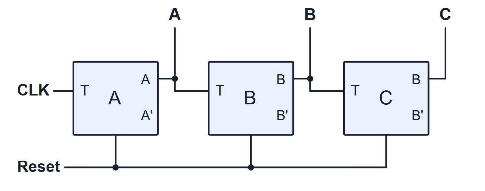
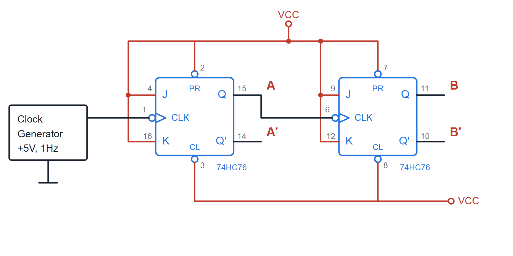
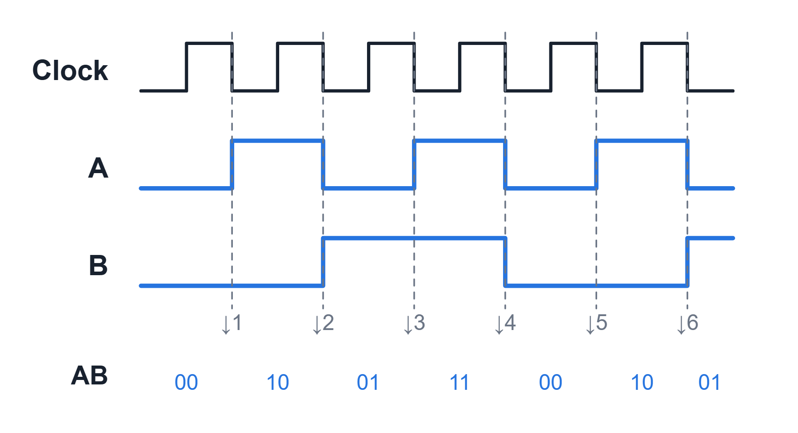
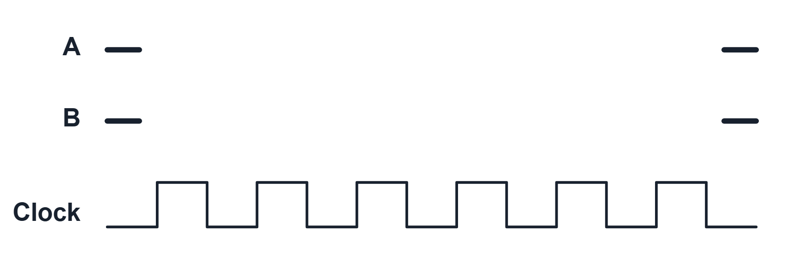
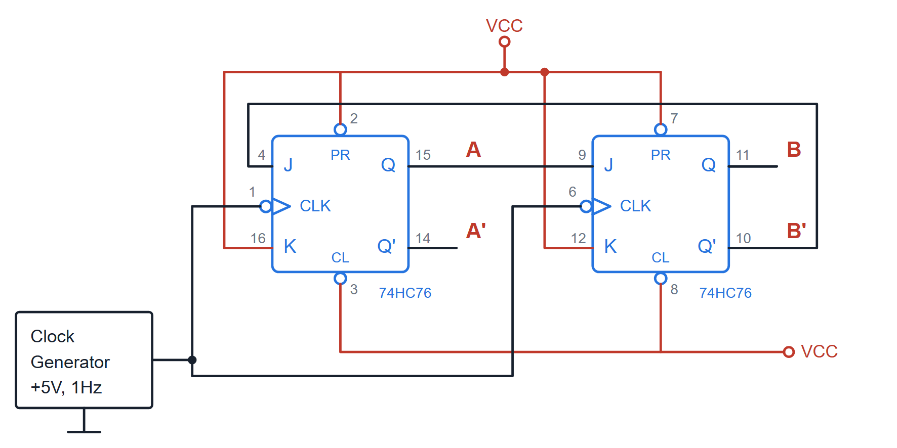
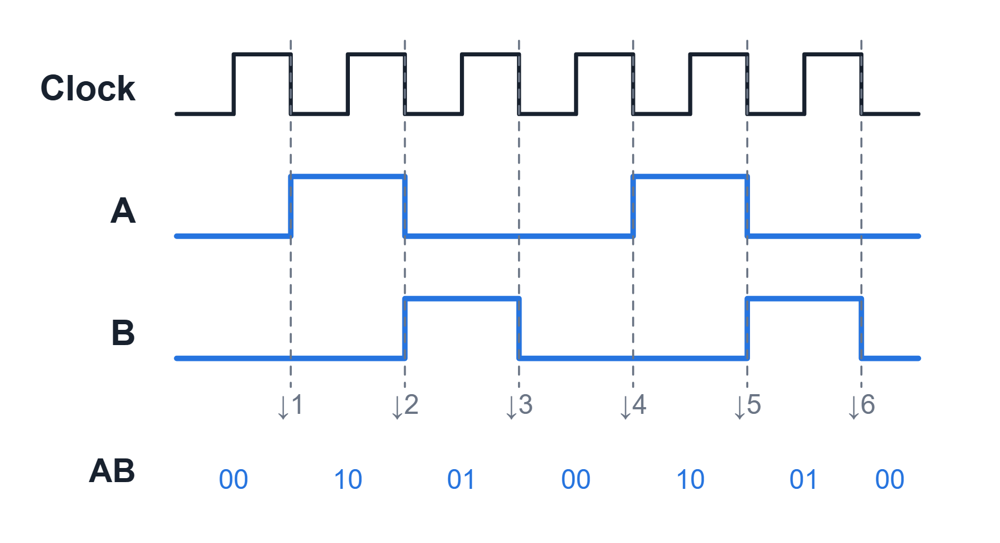
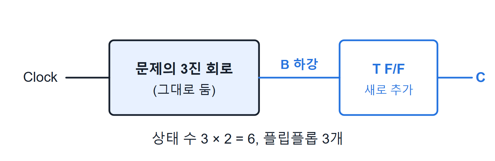
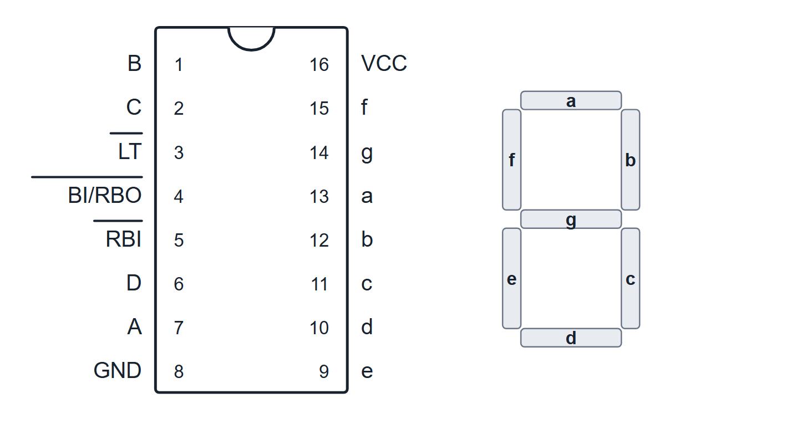
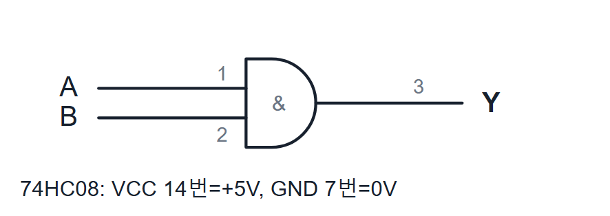
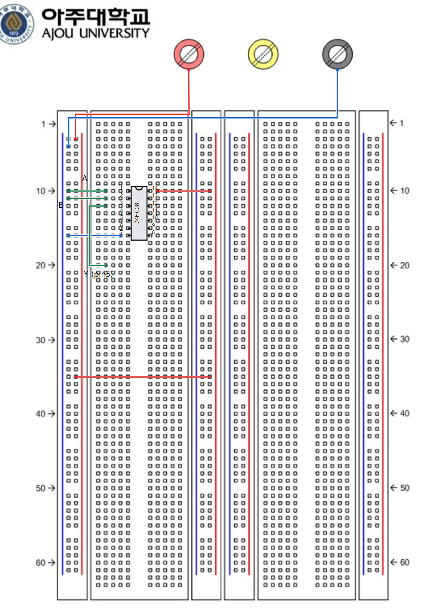

# 실험 8 · 문제 설명

      
첫 줄부터 완성 답과 검산까지 함께 풀어요.

## 문제를 함께 풀어요

### 문제 1 · JK F/F를 Toggle로 쓰는 네 핀 값

문제 읽기
#### 문제

JK F/F의 Clock이 Falling Edge일 때 출력(Q)이 Toggle로 동작하기 위한 PR, CLR, J, K핀의 입력값을 적으시오.

#### 구할 것

PR, CLR, J, K 네 핀의 값

이 문제에서 할 일
네 입력의 값을 정해요.

이 문제를 봤을 때 떠올릴 개념과 공식
JK 표의 반전 행에서 비동기 조건을 확인해요.

74HC76의 PR·CLR은 L에서 Q를 각각 1·0으로 강제해요. 두 입력을 해제하고 J·K가 안정되어야 하강 엣지에서 반전해요.

첫 줄을 이렇게 시작해요
PR=CLR=1로 두어요.

[필요한 개념으로 돌아가요](%EC%8B%A4%ED%97%9808_%EC%8B%A4%ED%97%98%EC%84%A4%EB%AA%85.md#t-toggle)

이유를 따라 완성해요
반전 행의 J=K=1을 합쳐 PR=CLR=J=K=1이에요.

| 핀 | 값 | 이유 |
| --- | --- | --- |
| PR | 1 | 강제 Set 쉼 |
| CLR | 1 | 강제 Reset 쉼 |
| J | 1 | J=K=1이어야 반전 |
| K | 1 | J=K=1이어야 반전 |

답과 검산을 확인해요
Q다음=J·Q′+K′·Q에 Q=0, 1을 넣으면 각각 1·1+0·0=1, 1·0+0·1=0이에요.

헷갈리기 쉬운 조건을 확인해요
PR이나 CLR을 0에 두면 클럭과 무관하게 출력이 고정돼요.

설명을 닫고 다시 해 봐요
- 표에서 반전 행을 골라 비동기 입력 두 값까지 적어요.

**떠올릴 것:** JK 표의 반전 행에서 비동기 조건을 확인해요.

74HC76의 PR·CLR은 L에서 Q를 각각 1·0으로 강제해요. 두 입력을 해제하고 J·K가 안정되어야 하강 엣지에서 반전해요.

PR=CLR=1로 두어요.

반전 행의 J=K=1을 합쳐 PR=CLR=J=K=1이에요.

Q다음=J·Q′+K′·Q에 Q=0, 1을 넣으면 각각 1·1+0·0=1, 1·0+0·1=0이에요.

PR이나 CLR을 0에 두면 클럭과 무관하게 출력이 고정돼요.

출처: [from_the_past/정리/퀴즈/실험8/실험8 퀴즈 예상문제_v1.pdf · PDF p1](../../../from_the_past/%EC%A0%95%EB%A6%AC/%ED%80%B4%EC%A6%88/%EC%8B%A4%ED%97%988/%EC%8B%A4%ED%97%988%20%ED%80%B4%EC%A6%88%20%EC%98%88%EC%83%81%EB%AC%B8%EC%A0%9C_v1.pdf#page=1) · [from_the_past/정리/퀴즈/실험8/실험8 퀴즈 예상문제_v2.pdf · PDF p1](../../../from_the_past/%EC%A0%95%EB%A6%AC/%ED%80%B4%EC%A6%88/%EC%8B%A4%ED%97%988/%EC%8B%A4%ED%97%988%20%ED%80%B4%EC%A6%88%20%EC%98%88%EC%83%81%EB%AC%B8%EC%A0%9C_v2.pdf#page=1) · [from_the_past/정리/퀴즈/실험8/실험8 퀴즈 예상문제_v3.pdf · PDF p1](../../../from_the_past/%EC%A0%95%EB%A6%AC/%ED%80%B4%EC%A6%88/%EC%8B%A4%ED%97%988/%EC%8B%A4%ED%97%988%20%ED%80%B4%EC%A6%88%20%EC%98%88%EC%83%81%EB%AC%B8%EC%A0%9C_v3.pdf#page=1) · [from_the_past/정리/퀴즈/실험8/실험8 퀴즈 예상문제_v4.pdf · PDF p1](../../../from_the_past/%EC%A0%95%EB%A6%AC/%ED%80%B4%EC%A6%88/%EC%8B%A4%ED%97%988/%EC%8B%A4%ED%97%988%20%ED%80%B4%EC%A6%88%20%EC%98%88%EC%83%81%EB%AC%B8%EC%A0%9C_v4.pdf#page=1) · [from_the_past/정리/퀴즈/실험8/실험8 퀴즈 예상문제_답안단순화_v1.pdf · PDF p1](../../../from_the_past/%EC%A0%95%EB%A6%AC/%ED%80%B4%EC%A6%88/%EC%8B%A4%ED%97%988/%EC%8B%A4%ED%97%988%20%ED%80%B4%EC%A6%88%20%EC%98%88%EC%83%81%EB%AC%B8%EC%A0%9C_%EB%8B%B5%EC%95%88%EB%8B%A8%EC%88%9C%ED%99%94_v1.pdf#page=1) · [from_the_past/정리/퀴즈/실험8/실험8 퀴즈 예상문제_답안단순화_v2.pdf · PDF p1](../../../from_the_past/%EC%A0%95%EB%A6%AC/%ED%80%B4%EC%A6%88/%EC%8B%A4%ED%97%988/%EC%8B%A4%ED%97%988%20%ED%80%B4%EC%A6%88%20%EC%98%88%EC%83%81%EB%AC%B8%EC%A0%9C_%EB%8B%B5%EC%95%88%EB%8B%A8%EC%88%9C%ED%99%94_v2.pdf#page=1) · [from_the_past/정리/퀴즈/실험8/실험8 퀴즈 예상문제_정리본_v1.pdf · PDF p1](../../../from_the_past/%EC%A0%95%EB%A6%AC/%ED%80%B4%EC%A6%88/%EC%8B%A4%ED%97%988/%EC%8B%A4%ED%97%988%20%ED%80%B4%EC%A6%88%20%EC%98%88%EC%83%81%EB%AC%B8%EC%A0%9C_%EC%A0%95%EB%A6%AC%EB%B3%B8_v1.pdf#page=1) · [from_the_past/정리/퀴즈/실험8/실험8 퀴즈 예상문제_정리본_v2.pdf · PDF p1](../../../from_the_past/%EC%A0%95%EB%A6%AC/%ED%80%B4%EC%A6%88/%EC%8B%A4%ED%97%988/%EC%8B%A4%ED%97%988%20%ED%80%B4%EC%A6%88%20%EC%98%88%EC%83%81%EB%AC%B8%EC%A0%9C_%EC%A0%95%EB%A6%AC%EB%B3%B8_v2.pdf#page=1) · [from_the_past/정리/퀴즈/실험8/실험8 퀴즈 예상문제_카운터심화.pdf · PDF p1](../../../from_the_past/%EC%A0%95%EB%A6%AC/%ED%80%B4%EC%A6%88/%EC%8B%A4%ED%97%988/%EC%8B%A4%ED%97%988%20%ED%80%B4%EC%A6%88%20%EC%98%88%EC%83%81%EB%AC%B8%EC%A0%9C_%EC%B9%B4%EC%9A%B4%ED%84%B0%EC%8B%AC%ED%99%94.pdf#page=1) · [from_the_past/정리/퀴즈/실험8/실험8 퀴즈 종합_기출문제 (8p).pdf · PDF p2](../../../from_the_past/%EC%A0%95%EB%A6%AC/%ED%80%B4%EC%A6%88/%EC%8B%A4%ED%97%988/%EC%8B%A4%ED%97%988%20%ED%80%B4%EC%A6%88%20%EC%A2%85%ED%95%A9_%EA%B8%B0%EC%B6%9C%EB%AC%B8%EC%A0%9C%20%288p%29.pdf#page=2) · [from_the_past/정리/퀴즈/실험8/원본_docx/실험8 정리중!!!!!!.docx](../../../from_the_past/%EC%A0%95%EB%A6%AC/%ED%80%B4%EC%A6%88/%EC%8B%A4%ED%97%988/%EC%9B%90%EB%B3%B8_docx/%EC%8B%A4%ED%97%988%20%EC%A0%95%EB%A6%AC%EC%A4%91%21%21%21%21%21%21.docx) · [from_the_past/정리/퀴즈/실험8/원본_docx/실험8 정리중-수정.docx](../../../from_the_past/%EC%A0%95%EB%A6%AC/%ED%80%B4%EC%A6%88/%EC%8B%A4%ED%97%988/%EC%9B%90%EB%B3%B8_docx/%EC%8B%A4%ED%97%988%20%EC%A0%95%EB%A6%AC%EC%A4%91-%EC%88%98%EC%A0%95.docx) · [from_the_past/정리/퀴즈/실험8/원본_docx/실험8 최종 - 답안 단순화!.docx](../../../from_the_past/%EC%A0%95%EB%A6%AC/%ED%80%B4%EC%A6%88/%EC%8B%A4%ED%97%988/%EC%9B%90%EB%B3%B8_docx/%EC%8B%A4%ED%97%988%20%EC%B5%9C%EC%A2%85%20-%20%EB%8B%B5%EC%95%88%20%EB%8B%A8%EC%88%9C%ED%99%94%21.docx) · [from_the_past/정리/퀴즈/실험8/원본_docx/실험8 최종 - 답안 단순화.docx](../../../from_the_past/%EC%A0%95%EB%A6%AC/%ED%80%B4%EC%A6%88/%EC%8B%A4%ED%97%988/%EC%9B%90%EB%B3%B8_docx/%EC%8B%A4%ED%97%988%20%EC%B5%9C%EC%A2%85%20-%20%EB%8B%B5%EC%95%88%20%EB%8B%A8%EC%88%9C%ED%99%94.docx) · [from_the_past/정리/퀴즈/실험8/원본_docx/실험8.docx](../../../from_the_past/%EC%A0%95%EB%A6%AC/%ED%80%B4%EC%A6%88/%EC%8B%A4%ED%97%988/%EC%9B%90%EB%B3%B8_docx/%EC%8B%A4%ED%97%988.docx)

### 문제 2 · J, K, CLR로 Toggle 만들기

문제 읽기
#### 문제

JK F/F의 출력 Q가 Toggle로 동작하기 위한 J, K, CLR핀의 입력값을 적으시오.

#### 구할 것

J, K, CLR 세 핀의 값

이 문제에서 할 일
J·K·CLR의 값을 정해요.

이 문제를 봤을 때 떠올릴 개념과 공식
Toggle을 하려면 비동기 입력이 해제돼야 해요.

74HC76의 PR·CLR은 active-low이고 클럭은 하강 엣지에서 유효해요.

첫 줄을 이렇게 시작해요
CLR=1부터 적어요.

[필요한 개념으로 돌아가요](%EC%8B%A4%ED%97%9808_%EC%8B%A4%ED%97%98%EC%84%A4%EB%AA%85.md#t-toggle)

이유를 따라 완성해요
JK 표의 반전 행을 골라 J=1, K=1, CLR=1을 적어요. 이때 PR=1이 전제예요.

답과 검산을 확인해요
CLR을 0으로 바꾸면 Q가 0에 고정되어 반전이 사라져요.

헷갈리기 쉬운 조건을 확인해요
문제에 PR과 엣지 방향이 없으니 74HC76 기준임을 밝히고, PR=0이면 Q가 1에 고정됨을 확인해요.

설명을 닫고 다시 해 봐요
- 세 핀을 답에 쓰고 묻지 않은 PR의 전제를 확인해요.

**떠올릴 것:** Toggle을 하려면 비동기 입력이 해제돼야 해요.

74HC76의 PR·CLR은 active-low이고 클럭은 하강 엣지에서 유효해요.

CLR=1부터 적어요.

JK 표의 반전 행을 골라 J=1, K=1, CLR=1을 적어요. 이때 PR=1이 전제예요.

CLR을 0으로 바꾸면 Q가 0에 고정되어 반전이 사라져요.

문제에 PR과 엣지 방향이 없으니 74HC76 기준임을 밝히고, PR=0이면 Q가 1에 고정됨을 확인해요.

출처: [from_the_past/정리/퀴즈/실험8/실험8 퀴즈 기출_단답형 (1p).pdf · PDF p1](../../../from_the_past/%EC%A0%95%EB%A6%AC/%ED%80%B4%EC%A6%88/%EC%8B%A4%ED%97%988/%EC%8B%A4%ED%97%988%20%ED%80%B4%EC%A6%88%20%EA%B8%B0%EC%B6%9C_%EB%8B%A8%EB%8B%B5%ED%98%95%20%281p%29.pdf#page=1) · [from_the_past/정리/퀴즈/실험8/실험8 퀴즈 기출_정답.pdf · PDF p1](../../../from_the_past/%EC%A0%95%EB%A6%AC/%ED%80%B4%EC%A6%88/%EC%8B%A4%ED%97%988/%EC%8B%A4%ED%97%988%20%ED%80%B4%EC%A6%88%20%EA%B8%B0%EC%B6%9C_%EC%A0%95%EB%8B%B5.pdf#page=1) · [from_the_past/정리/퀴즈/실험8/실험8 퀴즈 종합_기출문제 (8p).pdf · PDF p7](../../../from_the_past/%EC%A0%95%EB%A6%AC/%ED%80%B4%EC%A6%88/%EC%8B%A4%ED%97%988/%EC%8B%A4%ED%97%988%20%ED%80%B4%EC%A6%88%20%EC%A2%85%ED%95%A9_%EA%B8%B0%EC%B6%9C%EB%AC%B8%EC%A0%9C%20%288p%29.pdf#page=7)

### 문제 3 · 비동기식 카운터의 특징

문제 읽기
#### 문제

비동기식 카운터의 특징을 간략하게 적으시오.

#### 구할 것

비동기식의 특징

이 문제에서 할 일
클럭 연결과 지연의 관계를 설명해요.

이 문제를 봤을 때 떠올릴 개념과 공식
앞 단 출력이 다음 단 CLK로 가요.

앞 단의 전환이 다음 단의 클럭을 만들면 두 전환 사이에 전달 지연이 생겨요.

첫 줄을 이렇게 시작해요
첫 F/F의 CLK에만 외부 클럭을 표시해요.

[필요한 개념으로 돌아가요](%EC%8B%A4%ED%97%9808_%EC%8B%A4%ED%97%98%EC%84%A4%EB%AA%85.md#t-async)

이유를 따라 완성해요
이후 단계는 앞 단 출력을 CLK로 받아 차례로 전환하므로 뒤로 갈수록 전달 지연이 쌓여요.

답과 검산을 확인해요
AB=11에서 A가 먼저 떨어져 01을 거쳐 00으로 가요.

헷갈리기 쉬운 조건을 확인해요
앞 단의 출력이 J/K로 들어가는 되먹임만으로는 비동기식이라 판단할 수 없어요.

설명을 닫고 다시 해 봐요
- 두 단의 CLK 경로를 따라 지연이 생기는 순서를 적어요.

**떠올릴 것:** 앞 단 출력이 다음 단 CLK로 가요.

앞 단의 전환이 다음 단의 클럭을 만들면 두 전환 사이에 전달 지연이 생겨요.

첫 F/F의 CLK에만 외부 클럭을 표시해요.

이후 단계는 앞 단 출력을 CLK로 받아 차례로 전환하므로 뒤로 갈수록 전달 지연이 쌓여요.

AB=11에서 A가 먼저 떨어져 01을 거쳐 00으로 가요.

앞 단의 출력이 J/K로 들어가는 되먹임만으로는 비동기식이라 판단할 수 없어요.

출처: [from_the_past/정리/퀴즈/실험8/실험8 퀴즈 기출 2017-1.pdf · PDF p1](../../../from_the_past/%EC%A0%95%EB%A6%AC/%ED%80%B4%EC%A6%88/%EC%8B%A4%ED%97%988/%EC%8B%A4%ED%97%988%20%ED%80%B4%EC%A6%88%20%EA%B8%B0%EC%B6%9C%202017-1.pdf#page=1) · [from_the_past/정리/퀴즈/실험8/실험8 퀴즈 기출 2015-2_영문.pdf · PDF p1](../../../from_the_past/%EC%A0%95%EB%A6%AC/%ED%80%B4%EC%A6%88/%EC%8B%A4%ED%97%988/%EC%8B%A4%ED%97%988%20%ED%80%B4%EC%A6%88%20%EA%B8%B0%EC%B6%9C%202015-2_%EC%98%81%EB%AC%B8.pdf#page=1) · [from_the_past/정리/퀴즈/실험8/실험8 퀴즈 기출_단답형 (1p).pdf · PDF p1](../../../from_the_past/%EC%A0%95%EB%A6%AC/%ED%80%B4%EC%A6%88/%EC%8B%A4%ED%97%988/%EC%8B%A4%ED%97%988%20%ED%80%B4%EC%A6%88%20%EA%B8%B0%EC%B6%9C_%EB%8B%A8%EB%8B%B5%ED%98%95%20%281p%29.pdf#page=1) · [from_the_past/정리/퀴즈/실험8/실험8 퀴즈 기출_정답.pdf · PDF p1](../../../from_the_past/%EC%A0%95%EB%A6%AC/%ED%80%B4%EC%A6%88/%EC%8B%A4%ED%97%988/%EC%8B%A4%ED%97%988%20%ED%80%B4%EC%A6%88%20%EA%B8%B0%EC%B6%9C_%EC%A0%95%EB%8B%B5.pdf#page=1) · [from_the_past/정리/퀴즈/실험8/실험8 퀴즈 종합_기출문제 (8p).pdf · PDF p7](../../../from_the_past/%EC%A0%95%EB%A6%AC/%ED%80%B4%EC%A6%88/%EC%8B%A4%ED%97%988/%EC%8B%A4%ED%97%988%20%ED%80%B4%EC%A6%88%20%EC%A2%85%ED%95%A9_%EA%B8%B0%EC%B6%9C%EB%AC%B8%EC%A0%9C%20%288p%29.pdf#page=7) · [from_the_past/정리/퀴즈/실험8/실험8 퀴즈 예상문제_v1.pdf · PDF p1](../../../from_the_past/%EC%A0%95%EB%A6%AC/%ED%80%B4%EC%A6%88/%EC%8B%A4%ED%97%988/%EC%8B%A4%ED%97%988%20%ED%80%B4%EC%A6%88%20%EC%98%88%EC%83%81%EB%AC%B8%EC%A0%9C_v1.pdf#page=1) · [from_the_past/정리/퀴즈/실험8/실험8 퀴즈 예상문제_v2.pdf · PDF p1](../../../from_the_past/%EC%A0%95%EB%A6%AC/%ED%80%B4%EC%A6%88/%EC%8B%A4%ED%97%988/%EC%8B%A4%ED%97%988%20%ED%80%B4%EC%A6%88%20%EC%98%88%EC%83%81%EB%AC%B8%EC%A0%9C_v2.pdf#page=1) · [from_the_past/정리/퀴즈/실험8/실험8 퀴즈 예상문제_v3.pdf · PDF p1](../../../from_the_past/%EC%A0%95%EB%A6%AC/%ED%80%B4%EC%A6%88/%EC%8B%A4%ED%97%988/%EC%8B%A4%ED%97%988%20%ED%80%B4%EC%A6%88%20%EC%98%88%EC%83%81%EB%AC%B8%EC%A0%9C_v3.pdf#page=1) · [from_the_past/정리/퀴즈/실험8/실험8 퀴즈 예상문제_v4.pdf · PDF p1](../../../from_the_past/%EC%A0%95%EB%A6%AC/%ED%80%B4%EC%A6%88/%EC%8B%A4%ED%97%988/%EC%8B%A4%ED%97%988%20%ED%80%B4%EC%A6%88%20%EC%98%88%EC%83%81%EB%AC%B8%EC%A0%9C_v4.pdf#page=1) · [from_the_past/정리/퀴즈/실험8/실험8 퀴즈 예상문제_답안단순화_v1.pdf · PDF p1](../../../from_the_past/%EC%A0%95%EB%A6%AC/%ED%80%B4%EC%A6%88/%EC%8B%A4%ED%97%988/%EC%8B%A4%ED%97%988%20%ED%80%B4%EC%A6%88%20%EC%98%88%EC%83%81%EB%AC%B8%EC%A0%9C_%EB%8B%B5%EC%95%88%EB%8B%A8%EC%88%9C%ED%99%94_v1.pdf#page=1) · [from_the_past/정리/퀴즈/실험8/실험8 퀴즈 예상문제_답안단순화_v2.pdf · PDF p1](../../../from_the_past/%EC%A0%95%EB%A6%AC/%ED%80%B4%EC%A6%88/%EC%8B%A4%ED%97%988/%EC%8B%A4%ED%97%988%20%ED%80%B4%EC%A6%88%20%EC%98%88%EC%83%81%EB%AC%B8%EC%A0%9C_%EB%8B%B5%EC%95%88%EB%8B%A8%EC%88%9C%ED%99%94_v2.pdf#page=1) · [from_the_past/정리/퀴즈/실험8/실험8 퀴즈 예상문제_정리본_v1.pdf · PDF p1](../../../from_the_past/%EC%A0%95%EB%A6%AC/%ED%80%B4%EC%A6%88/%EC%8B%A4%ED%97%988/%EC%8B%A4%ED%97%988%20%ED%80%B4%EC%A6%88%20%EC%98%88%EC%83%81%EB%AC%B8%EC%A0%9C_%EC%A0%95%EB%A6%AC%EB%B3%B8_v1.pdf#page=1) · [from_the_past/정리/퀴즈/실험8/실험8 퀴즈 예상문제_정리본_v2.pdf · PDF p1](../../../from_the_past/%EC%A0%95%EB%A6%AC/%ED%80%B4%EC%A6%88/%EC%8B%A4%ED%97%988/%EC%8B%A4%ED%97%988%20%ED%80%B4%EC%A6%88%20%EC%98%88%EC%83%81%EB%AC%B8%EC%A0%9C_%EC%A0%95%EB%A6%AC%EB%B3%B8_v2.pdf#page=1) · [from_the_past/정리/퀴즈/실험8/실험8 퀴즈 예상문제_카운터심화.pdf · PDF p1](../../../from_the_past/%EC%A0%95%EB%A6%AC/%ED%80%B4%EC%A6%88/%EC%8B%A4%ED%97%988/%EC%8B%A4%ED%97%988%20%ED%80%B4%EC%A6%88%20%EC%98%88%EC%83%81%EB%AC%B8%EC%A0%9C_%EC%B9%B4%EC%9A%B4%ED%84%B0%EC%8B%AC%ED%99%94.pdf#page=1) · [from_the_past/정리/퀴즈/실험8/실험8 퀴즈 종합_기출문제 (8p).pdf · PDF p2](../../../from_the_past/%EC%A0%95%EB%A6%AC/%ED%80%B4%EC%A6%88/%EC%8B%A4%ED%97%988/%EC%8B%A4%ED%97%988%20%ED%80%B4%EC%A6%88%20%EC%A2%85%ED%95%A9_%EA%B8%B0%EC%B6%9C%EB%AC%B8%EC%A0%9C%20%288p%29.pdf#page=2) · [from_the_past/정리/퀴즈/실험8/원본_docx/실험8 정리중!!!!!!.docx](../../../from_the_past/%EC%A0%95%EB%A6%AC/%ED%80%B4%EC%A6%88/%EC%8B%A4%ED%97%988/%EC%9B%90%EB%B3%B8_docx/%EC%8B%A4%ED%97%988%20%EC%A0%95%EB%A6%AC%EC%A4%91%21%21%21%21%21%21.docx) · [from_the_past/정리/퀴즈/실험8/원본_docx/실험8 정리중-수정.docx](../../../from_the_past/%EC%A0%95%EB%A6%AC/%ED%80%B4%EC%A6%88/%EC%8B%A4%ED%97%988/%EC%9B%90%EB%B3%B8_docx/%EC%8B%A4%ED%97%988%20%EC%A0%95%EB%A6%AC%EC%A4%91-%EC%88%98%EC%A0%95.docx) · [from_the_past/정리/퀴즈/실험8/원본_docx/실험8 최종 - 답안 단순화!.docx](../../../from_the_past/%EC%A0%95%EB%A6%AC/%ED%80%B4%EC%A6%88/%EC%8B%A4%ED%97%988/%EC%9B%90%EB%B3%B8_docx/%EC%8B%A4%ED%97%988%20%EC%B5%9C%EC%A2%85%20-%20%EB%8B%B5%EC%95%88%20%EB%8B%A8%EC%88%9C%ED%99%94%21.docx) · [from_the_past/정리/퀴즈/실험8/원본_docx/실험8 최종 - 답안 단순화.docx](../../../from_the_past/%EC%A0%95%EB%A6%AC/%ED%80%B4%EC%A6%88/%EC%8B%A4%ED%97%988/%EC%9B%90%EB%B3%B8_docx/%EC%8B%A4%ED%97%988%20%EC%B5%9C%EC%A2%85%20-%20%EB%8B%B5%EC%95%88%20%EB%8B%A8%EC%88%9C%ED%99%94.docx) · [from_the_past/정리/퀴즈/실험8/원본_docx/실험8.docx](../../../from_the_past/%EC%A0%95%EB%A6%AC/%ED%80%B4%EC%A6%88/%EC%8B%A4%ED%97%988/%EC%9B%90%EB%B3%B8_docx/%EC%8B%A4%ED%97%988.docx)

### 문제 4 · T F/F 3단 블록도의 동작

문제 읽기
#### 문제

아래의 카운터가 어떻게 동작하는지 간략하게 적으시오. (X단 Y진 카운터, 출력값의 변화순서와 범위)

#### 주어진 조건

원문에는 블록 C 안의 출력 라벨도 B, B′로 인쇄돼 있어요. 위로 뽑힌 선의 이름은 C예요.

#### 구할 것

X, Y, 출력값의 변화 순서와 범위

이 문제에서 할 일
단 수, 모듈러스, 순환 순서를 구해요.

이 문제를 봤을 때 떠올릴 개념과 공식
T 블록 수와 앞 출력→뒤 CLK 연결을 확인해요.

공통 Reset 뒤부터 세요. 엣지는 블록도에 없으므로 교안 p5에 맞춰 하강으로 가정하면 A가 LSB인 증가 카운터예요.

첫 줄을 이렇게 시작해요
T 블록 3개에서 2³=8을 적어요.

[필요한 개념으로 돌아가요](%EC%8B%A4%ED%97%9808_%EC%8B%A4%ED%97%98%EC%84%A4%EB%AA%85.md#t-toggle)

이유를 따라 완성해요
3단 2진 비동기 카운터예요. A는 외부 CLK마다, B는 A 하강마다, C는 B 하강마다 반전해 CBA=000→001→…→111→000, 값은 0~7을 반복해요.

| CLK 하강 | C B A | 값 |
| --- | --- | --- |
| 시작 | 000 | 0 |
| 1 | 001 | 1 |
| 2 | 010 | 2 |
| 3 | 011 | 3 |
| 4 | 100 | 4 |
| 5 | 101 | 5 |
| 6 | 110 | 6 |
| 7 | 111 | 7 |
| 8 | 000 | 0 |

답과 검산을 확인해요
A·B·C가 각각 외부 CLK 1·2·4번 간격으로 반전하므로 여덟 번째에 모두 0이에요.

헷갈리기 쉬운 조건을 확인해요
원문 C 블록의 B·B′ 라벨은 C의 출력으로 읽어요. 상승 엣지 조건이라면 000→111→110… 순서예요.

설명을 닫고 다시 해 봐요
- CBA의 자리 순서와 엣지 조건을 써 놓고 상태를 세어요.

**떠올릴 것:** T 블록 수와 앞 출력→뒤 CLK 연결을 확인해요.

공통 Reset 뒤부터 세요. 엣지는 블록도에 없으므로 교안 p5에 맞춰 하강으로 가정하면 A가 LSB인 증가 카운터예요.

T 블록 3개에서 2³=8을 적어요.

3단 2진 비동기 카운터예요. A는 외부 CLK마다, B는 A 하강마다, C는 B 하강마다 반전해 CBA=000→001→…→111→000, 값은 0~7을 반복해요.

A·B·C가 각각 외부 CLK 1·2·4번 간격으로 반전하므로 여덟 번째에 모두 0이에요.

원문 C 블록의 B·B′ 라벨은 C의 출력으로 읽어요. 상승 엣지 조건이라면 000→111→110… 순서예요.

출처: [from_the_past/정리/퀴즈/실험8/실험8 퀴즈 기출 2017-1.pdf · PDF p1](../../../from_the_past/%EC%A0%95%EB%A6%AC/%ED%80%B4%EC%A6%88/%EC%8B%A4%ED%97%988/%EC%8B%A4%ED%97%988%20%ED%80%B4%EC%A6%88%20%EA%B8%B0%EC%B6%9C%202017-1.pdf#page=1) · [from_the_past/정리/퀴즈/실험8/실험8 퀴즈 기출 2015-2_영문.pdf · PDF p1](../../../from_the_past/%EC%A0%95%EB%A6%AC/%ED%80%B4%EC%A6%88/%EC%8B%A4%ED%97%988/%EC%8B%A4%ED%97%988%20%ED%80%B4%EC%A6%88%20%EA%B8%B0%EC%B6%9C%202015-2_%EC%98%81%EB%AC%B8.pdf#page=1) · [from_the_past/정리/퀴즈/실험8/실험8 퀴즈 예상문제_v1.pdf · PDF p1](../../../from_the_past/%EC%A0%95%EB%A6%AC/%ED%80%B4%EC%A6%88/%EC%8B%A4%ED%97%988/%EC%8B%A4%ED%97%988%20%ED%80%B4%EC%A6%88%20%EC%98%88%EC%83%81%EB%AC%B8%EC%A0%9C_v1.pdf#page=1) · [from_the_past/정리/퀴즈/실험8/실험8 퀴즈 예상문제_v2.pdf · PDF p1](../../../from_the_past/%EC%A0%95%EB%A6%AC/%ED%80%B4%EC%A6%88/%EC%8B%A4%ED%97%988/%EC%8B%A4%ED%97%988%20%ED%80%B4%EC%A6%88%20%EC%98%88%EC%83%81%EB%AC%B8%EC%A0%9C_v2.pdf#page=1) · [from_the_past/정리/퀴즈/실험8/실험8 퀴즈 예상문제_v3.pdf · PDF p1](../../../from_the_past/%EC%A0%95%EB%A6%AC/%ED%80%B4%EC%A6%88/%EC%8B%A4%ED%97%988/%EC%8B%A4%ED%97%988%20%ED%80%B4%EC%A6%88%20%EC%98%88%EC%83%81%EB%AC%B8%EC%A0%9C_v3.pdf#page=1) · [from_the_past/정리/퀴즈/실험8/실험8 퀴즈 예상문제_v4.pdf · PDF p1](../../../from_the_past/%EC%A0%95%EB%A6%AC/%ED%80%B4%EC%A6%88/%EC%8B%A4%ED%97%988/%EC%8B%A4%ED%97%988%20%ED%80%B4%EC%A6%88%20%EC%98%88%EC%83%81%EB%AC%B8%EC%A0%9C_v4.pdf#page=1) · [from_the_past/정리/퀴즈/실험8/실험8 퀴즈 예상문제_답안단순화_v1.pdf · PDF p1](../../../from_the_past/%EC%A0%95%EB%A6%AC/%ED%80%B4%EC%A6%88/%EC%8B%A4%ED%97%988/%EC%8B%A4%ED%97%988%20%ED%80%B4%EC%A6%88%20%EC%98%88%EC%83%81%EB%AC%B8%EC%A0%9C_%EB%8B%B5%EC%95%88%EB%8B%A8%EC%88%9C%ED%99%94_v1.pdf#page=1) · [from_the_past/정리/퀴즈/실험8/실험8 퀴즈 예상문제_답안단순화_v2.pdf · PDF p1](../../../from_the_past/%EC%A0%95%EB%A6%AC/%ED%80%B4%EC%A6%88/%EC%8B%A4%ED%97%988/%EC%8B%A4%ED%97%988%20%ED%80%B4%EC%A6%88%20%EC%98%88%EC%83%81%EB%AC%B8%EC%A0%9C_%EB%8B%B5%EC%95%88%EB%8B%A8%EC%88%9C%ED%99%94_v2.pdf#page=1) · [from_the_past/정리/퀴즈/실험8/실험8 퀴즈 예상문제_정리본_v1.pdf · PDF p1](../../../from_the_past/%EC%A0%95%EB%A6%AC/%ED%80%B4%EC%A6%88/%EC%8B%A4%ED%97%988/%EC%8B%A4%ED%97%988%20%ED%80%B4%EC%A6%88%20%EC%98%88%EC%83%81%EB%AC%B8%EC%A0%9C_%EC%A0%95%EB%A6%AC%EB%B3%B8_v1.pdf#page=1) · [from_the_past/정리/퀴즈/실험8/실험8 퀴즈 예상문제_정리본_v2.pdf · PDF p1](../../../from_the_past/%EC%A0%95%EB%A6%AC/%ED%80%B4%EC%A6%88/%EC%8B%A4%ED%97%988/%EC%8B%A4%ED%97%988%20%ED%80%B4%EC%A6%88%20%EC%98%88%EC%83%81%EB%AC%B8%EC%A0%9C_%EC%A0%95%EB%A6%AC%EB%B3%B8_v2.pdf#page=1) · [from_the_past/정리/퀴즈/실험8/실험8 퀴즈 예상문제_카운터심화.pdf · PDF p1](../../../from_the_past/%EC%A0%95%EB%A6%AC/%ED%80%B4%EC%A6%88/%EC%8B%A4%ED%97%988/%EC%8B%A4%ED%97%988%20%ED%80%B4%EC%A6%88%20%EC%98%88%EC%83%81%EB%AC%B8%EC%A0%9C_%EC%B9%B4%EC%9A%B4%ED%84%B0%EC%8B%AC%ED%99%94.pdf#page=1) · [from_the_past/정리/퀴즈/실험8/실험8 퀴즈 종합_기출문제 (8p).pdf · PDF p3](../../../from_the_past/%EC%A0%95%EB%A6%AC/%ED%80%B4%EC%A6%88/%EC%8B%A4%ED%97%988/%EC%8B%A4%ED%97%988%20%ED%80%B4%EC%A6%88%20%EC%A2%85%ED%95%A9_%EA%B8%B0%EC%B6%9C%EB%AC%B8%EC%A0%9C%20%288p%29.pdf#page=3) · [from_the_past/정리/퀴즈/실험8/원본_docx/실험8 정리중!!!!!!.docx](../../../from_the_past/%EC%A0%95%EB%A6%AC/%ED%80%B4%EC%A6%88/%EC%8B%A4%ED%97%988/%EC%9B%90%EB%B3%B8_docx/%EC%8B%A4%ED%97%988%20%EC%A0%95%EB%A6%AC%EC%A4%91%21%21%21%21%21%21.docx) · [from_the_past/정리/퀴즈/실험8/원본_docx/실험8 정리중-수정.docx](../../../from_the_past/%EC%A0%95%EB%A6%AC/%ED%80%B4%EC%A6%88/%EC%8B%A4%ED%97%988/%EC%9B%90%EB%B3%B8_docx/%EC%8B%A4%ED%97%988%20%EC%A0%95%EB%A6%AC%EC%A4%91-%EC%88%98%EC%A0%95.docx) · [from_the_past/정리/퀴즈/실험8/원본_docx/실험8 최종 - 답안 단순화!.docx](../../../from_the_past/%EC%A0%95%EB%A6%AC/%ED%80%B4%EC%A6%88/%EC%8B%A4%ED%97%988/%EC%9B%90%EB%B3%B8_docx/%EC%8B%A4%ED%97%988%20%EC%B5%9C%EC%A2%85%20-%20%EB%8B%B5%EC%95%88%20%EB%8B%A8%EC%88%9C%ED%99%94%21.docx) · [from_the_past/정리/퀴즈/실험8/원본_docx/실험8 최종 - 답안 단순화.docx](../../../from_the_past/%EC%A0%95%EB%A6%AC/%ED%80%B4%EC%A6%88/%EC%8B%A4%ED%97%988/%EC%9B%90%EB%B3%B8_docx/%EC%8B%A4%ED%97%988%20%EC%B5%9C%EC%A2%85%20-%20%EB%8B%B5%EC%95%88%20%EB%8B%A8%EC%88%9C%ED%99%94.docx) · [from_the_past/정리/퀴즈/실험8/원본_docx/실험8.docx](../../../from_the_past/%EC%A0%95%EB%A6%AC/%ED%80%B4%EC%A6%88/%EC%8B%A4%ED%97%988/%EC%9B%90%EB%B3%B8_docx/%EC%8B%A4%ED%97%988.docx)

### 문제 5 · 74HC76 비동기 회로의 A·B 파형

문제 읽기
#### 문제

아래의 카운터 회로를 보고 A,B핀의 출력파형을 Clock에 맞추어 그리시오 (4점)

#### 주어진 조건

회로는 원문 사진을 다시 그린 그림이에요. 사진에서 일부 핀 번호가 흐려도 배선은 교안 실험 1 회로와 같아요.

#### 구할 것

Clock에 맞춘 A, B 파형

이 문제에서 할 일
A·B 파형을 완성해요.

이 문제를 봤을 때 떠올릴 개념과 공식
둘째 단 CLK는 A에 묶여 있어요.

A 15번→둘째 CLK 6번이고, J·K·PR·CL 모두 VCC라 하강 엣지에서 반전해요. 원문에 초기값이 없어 AB=00을 가정해요.

첫 줄을 이렇게 시작해요
외부 CLK의 하강마다 세로선을 그어요.

[필요한 개념으로 돌아가요](%EC%8B%A4%ED%97%9808_%EC%8B%A4%ED%97%98%EC%84%A4%EB%AA%85.md#t-async)

이유를 따라 완성해요
A는 모든 세로선, B는 A가 떨어지는 2·4·6번째에서만 반전해요.

| CLK 하강 | A | B | AB (A부터) |
| --- | --- | --- | --- |
| 시작(가정) | 0 | 0 | 00 |
| 1 | 1 | 0 | 10 |
| 2 | 0 | 1 | 01 |
| 3 | 1 | 1 | 11 |
| 4 | 0 | 0 | 00 |
| 5 | 1 | 0 | 10 |
| 6 | 0 | 1 | 01 |

답과 검산을 확인해요
A·B 주기가 각각 CLK의 2배·4배인지 보고 네 번째에 AB=00으로 돌아오는지 확인해요. 파형을 두 하강 더 이어 그리면 AB=01이에요.

헷갈리기 쉬운 조건을 확인해요
B를 외부 CLK와 바로 맞추거나 상승 엣지에 맞추면 틀려요. 답란 끝 막대는 눈금이므로 출력값으로 읽지 않아요.

설명을 닫고 다시 해 봐요
- A부터 그린 뒤 A의 하강만 B에 옮겨요.

**떠올릴 것:** 둘째 단 CLK는 A에 묶여 있어요.

A 15번→둘째 CLK 6번이고, J·K·PR·CL 모두 VCC라 하강 엣지에서 반전해요. 원문에 초기값이 없어 AB=00을 가정해요.

외부 CLK의 하강마다 세로선을 그어요.

A는 모든 세로선, B는 A가 떨어지는 2·4·6번째에서만 반전해요.

A·B 주기가 각각 CLK의 2배·4배인지 보고 네 번째에 AB=00으로 돌아오는지 확인해요. 파형을 두 하강 더 이어 그리면 AB=01이에요.

B를 외부 CLK와 바로 맞추거나 상승 엣지에 맞추면 틀려요. 답란 끝 막대는 눈금이므로 출력값으로 읽지 않아요.

출처: [from_the_past/정리/퀴즈/실험8/실험8 퀴즈 기출_채점본.jpg](../../../from_the_past/%EC%A0%95%EB%A6%AC/%ED%80%B4%EC%A6%88/%EC%8B%A4%ED%97%988/%EC%8B%A4%ED%97%988%20%ED%80%B4%EC%A6%88%20%EA%B8%B0%EC%B6%9C_%EC%B1%84%EC%A0%90%EB%B3%B8.jpg) · [from_the_past/정리/퀴즈/실험8/실험8 퀴즈 기출_단답형 (1p).pdf · PDF p1](../../../from_the_past/%EC%A0%95%EB%A6%AC/%ED%80%B4%EC%A6%88/%EC%8B%A4%ED%97%988/%EC%8B%A4%ED%97%988%20%ED%80%B4%EC%A6%88%20%EA%B8%B0%EC%B6%9C_%EB%8B%A8%EB%8B%B5%ED%98%95%20%281p%29.pdf#page=1) · [from_the_past/정리/퀴즈/실험8/실험8 퀴즈 기출_정답.pdf · PDF p1](../../../from_the_past/%EC%A0%95%EB%A6%AC/%ED%80%B4%EC%A6%88/%EC%8B%A4%ED%97%988/%EC%8B%A4%ED%97%988%20%ED%80%B4%EC%A6%88%20%EA%B8%B0%EC%B6%9C_%EC%A0%95%EB%8B%B5.pdf#page=1) · [from_the_past/정리/퀴즈/실험8/실험8 퀴즈 종합_기출문제 (8p).pdf · PDF p7](../../../from_the_past/%EC%A0%95%EB%A6%AC/%ED%80%B4%EC%A6%88/%EC%8B%A4%ED%97%988/%EC%8B%A4%ED%97%988%20%ED%80%B4%EC%A6%88%20%EC%A2%85%ED%95%A9_%EA%B8%B0%EC%B6%9C%EB%AC%B8%EC%A0%9C%20%288p%29.pdf#page=7) · [from_the_past/정리/퀴즈/실험8/실험8 퀴즈 예상문제_v1.pdf · PDF p1](../../../from_the_past/%EC%A0%95%EB%A6%AC/%ED%80%B4%EC%A6%88/%EC%8B%A4%ED%97%988/%EC%8B%A4%ED%97%988%20%ED%80%B4%EC%A6%88%20%EC%98%88%EC%83%81%EB%AC%B8%EC%A0%9C_v1.pdf#page=1) · [from_the_past/정리/퀴즈/실험8/실험8 퀴즈 예상문제_v2.pdf · PDF p2](../../../from_the_past/%EC%A0%95%EB%A6%AC/%ED%80%B4%EC%A6%88/%EC%8B%A4%ED%97%988/%EC%8B%A4%ED%97%988%20%ED%80%B4%EC%A6%88%20%EC%98%88%EC%83%81%EB%AC%B8%EC%A0%9C_v2.pdf#page=2) · [from_the_past/정리/퀴즈/실험8/실험8 퀴즈 예상문제_v3.pdf · PDF p2](../../../from_the_past/%EC%A0%95%EB%A6%AC/%ED%80%B4%EC%A6%88/%EC%8B%A4%ED%97%988/%EC%8B%A4%ED%97%988%20%ED%80%B4%EC%A6%88%20%EC%98%88%EC%83%81%EB%AC%B8%EC%A0%9C_v3.pdf#page=2) · [from_the_past/정리/퀴즈/실험8/실험8 퀴즈 예상문제_v4.pdf · PDF p2](../../../from_the_past/%EC%A0%95%EB%A6%AC/%ED%80%B4%EC%A6%88/%EC%8B%A4%ED%97%988/%EC%8B%A4%ED%97%988%20%ED%80%B4%EC%A6%88%20%EC%98%88%EC%83%81%EB%AC%B8%EC%A0%9C_v4.pdf#page=2) · [from_the_past/정리/퀴즈/실험8/실험8 퀴즈 예상문제_답안단순화_v1.pdf · PDF p1](../../../from_the_past/%EC%A0%95%EB%A6%AC/%ED%80%B4%EC%A6%88/%EC%8B%A4%ED%97%988/%EC%8B%A4%ED%97%988%20%ED%80%B4%EC%A6%88%20%EC%98%88%EC%83%81%EB%AC%B8%EC%A0%9C_%EB%8B%B5%EC%95%88%EB%8B%A8%EC%88%9C%ED%99%94_v1.pdf#page=1) · [from_the_past/정리/퀴즈/실험8/실험8 퀴즈 예상문제_답안단순화_v2.pdf · PDF p1](../../../from_the_past/%EC%A0%95%EB%A6%AC/%ED%80%B4%EC%A6%88/%EC%8B%A4%ED%97%988/%EC%8B%A4%ED%97%988%20%ED%80%B4%EC%A6%88%20%EC%98%88%EC%83%81%EB%AC%B8%EC%A0%9C_%EB%8B%B5%EC%95%88%EB%8B%A8%EC%88%9C%ED%99%94_v2.pdf#page=1) · [from_the_past/정리/퀴즈/실험8/실험8 퀴즈 예상문제_정리본_v1.pdf · PDF p2](../../../from_the_past/%EC%A0%95%EB%A6%AC/%ED%80%B4%EC%A6%88/%EC%8B%A4%ED%97%988/%EC%8B%A4%ED%97%988%20%ED%80%B4%EC%A6%88%20%EC%98%88%EC%83%81%EB%AC%B8%EC%A0%9C_%EC%A0%95%EB%A6%AC%EB%B3%B8_v1.pdf#page=2) · [from_the_past/정리/퀴즈/실험8/실험8 퀴즈 예상문제_정리본_v2.pdf · PDF p2](../../../from_the_past/%EC%A0%95%EB%A6%AC/%ED%80%B4%EC%A6%88/%EC%8B%A4%ED%97%988/%EC%8B%A4%ED%97%988%20%ED%80%B4%EC%A6%88%20%EC%98%88%EC%83%81%EB%AC%B8%EC%A0%9C_%EC%A0%95%EB%A6%AC%EB%B3%B8_v2.pdf#page=2) · [from_the_past/정리/퀴즈/실험8/실험8 퀴즈 예상문제_카운터심화.pdf · PDF p2](../../../from_the_past/%EC%A0%95%EB%A6%AC/%ED%80%B4%EC%A6%88/%EC%8B%A4%ED%97%988/%EC%8B%A4%ED%97%988%20%ED%80%B4%EC%A6%88%20%EC%98%88%EC%83%81%EB%AC%B8%EC%A0%9C_%EC%B9%B4%EC%9A%B4%ED%84%B0%EC%8B%AC%ED%99%94.pdf#page=2) · [from_the_past/정리/퀴즈/실험8/실험8 퀴즈 종합_기출문제 (8p).pdf · PDF p3](../../../from_the_past/%EC%A0%95%EB%A6%AC/%ED%80%B4%EC%A6%88/%EC%8B%A4%ED%97%988/%EC%8B%A4%ED%97%988%20%ED%80%B4%EC%A6%88%20%EC%A2%85%ED%95%A9_%EA%B8%B0%EC%B6%9C%EB%AC%B8%EC%A0%9C%20%288p%29.pdf#page=3) · [from_the_past/정리/퀴즈/실험8/원본_docx/실험8 정리중!!!!!!.docx](../../../from_the_past/%EC%A0%95%EB%A6%AC/%ED%80%B4%EC%A6%88/%EC%8B%A4%ED%97%988/%EC%9B%90%EB%B3%B8_docx/%EC%8B%A4%ED%97%988%20%EC%A0%95%EB%A6%AC%EC%A4%91%21%21%21%21%21%21.docx) · [from_the_past/정리/퀴즈/실험8/원본_docx/실험8 정리중-수정.docx](../../../from_the_past/%EC%A0%95%EB%A6%AC/%ED%80%B4%EC%A6%88/%EC%8B%A4%ED%97%988/%EC%9B%90%EB%B3%B8_docx/%EC%8B%A4%ED%97%988%20%EC%A0%95%EB%A6%AC%EC%A4%91-%EC%88%98%EC%A0%95.docx) · [from_the_past/정리/퀴즈/실험8/원본_docx/실험8 최종 - 답안 단순화!.docx](../../../from_the_past/%EC%A0%95%EB%A6%AC/%ED%80%B4%EC%A6%88/%EC%8B%A4%ED%97%988/%EC%9B%90%EB%B3%B8_docx/%EC%8B%A4%ED%97%988%20%EC%B5%9C%EC%A2%85%20-%20%EB%8B%B5%EC%95%88%20%EB%8B%A8%EC%88%9C%ED%99%94%21.docx) · [from_the_past/정리/퀴즈/실험8/원본_docx/실험8 최종 - 답안 단순화.docx](../../../from_the_past/%EC%A0%95%EB%A6%AC/%ED%80%B4%EC%A6%88/%EC%8B%A4%ED%97%988/%EC%9B%90%EB%B3%B8_docx/%EC%8B%A4%ED%97%988%20%EC%B5%9C%EC%A2%85%20-%20%EB%8B%B5%EC%95%88%20%EB%8B%A8%EC%88%9C%ED%99%94.docx) · [from_the_past/정리/퀴즈/실험8/원본_docx/실험8.docx](../../../from_the_past/%EC%A0%95%EB%A6%AC/%ED%80%B4%EC%A6%88/%EC%8B%A4%ED%97%988/%EC%9B%90%EB%B3%B8_docx/%EC%8B%A4%ED%97%988.docx)

### 문제 6 · 비동기 회로는 몇 진 카운터인가요

문제 읽기
#### 문제

위 문제의 회로는 몇진 카운터인지 적으시오.

#### 주어진 조건

‘위 문제의 회로’는 Quiz 4번의 74HC76 회로예요. 이 문제지 5번 문항의 비동기 회로와 같아요. 첫 단 J(4)·K(16)·PR(2)·CL(3)과 둘째 단 J(9)·K(12)·PR(7)·CL(8)은 VCC, 첫 단 CLK(1)는 Clock Generator(+5V, 1Hz), 둘째 단 CLK(6)는 첫 단 Q(15, A)에 연결돼요.

#### 구할 것

몇 진 카운터인지

이 문제에서 할 일
되풀이되는 상태 수와 교안 이름을 써요.

이 문제를 봤을 때 떠올릴 개념과 공식
몇 진인지 물으면 한 순환의 상태를 세어요.

두 F/F는 J=K=1이고 둘째 단은 첫 단 출력의 하강에서만 반전해요.

첫 줄을 이렇게 시작해요
시작 AB=00에 CLK 하강을 하나 넣어요.

[필요한 개념으로 돌아가요](%EC%8B%A4%ED%97%9808_%EC%8B%A4%ED%97%98%EC%84%A4%EB%AA%85.md#t-toggle)

이유를 따라 완성해요
AB=00→10→01→11→00이므로 4진(mod-4, 0~3)이에요. 교안의 ‘2단 2진’은 두 개의 2진 단을 뜻해요.

답과 검산을 확인해요
B가 Clock의 2·4번째 하강에서 반전하므로 4번째에 두 출력이 함께 처음 상태로 돌아와요.

헷갈리기 쉬운 조건을 확인해요
답안 충돌. 제공 답 ‘2진 카운터’는 교안 이름의 축약으로 볼 수 있어요. 답에는 ‘4상태(0~3), 2단 2진’을 함께 쓰고 출제 의도는 미확정으로 남겨요.

설명을 닫고 다시 해 봐요
- 같은 상태가 다시 나올 때까지 AB를 적고 중복 없이 세어요.

**떠올릴 것:** 몇 진인지 물으면 한 순환의 상태를 세어요.

두 F/F는 J=K=1이고 둘째 단은 첫 단 출력의 하강에서만 반전해요.

시작 AB=00에 CLK 하강을 하나 넣어요.

AB=00→10→01→11→00이므로 4진(mod-4, 0~3)이에요. 교안의 ‘2단 2진’은 두 개의 2진 단을 뜻해요.

B가 Clock의 2·4번째 하강에서 반전하므로 4번째에 두 출력이 함께 처음 상태로 돌아와요.

답안 충돌. 제공 답 ‘2진 카운터’는 교안 이름의 축약으로 볼 수 있어요. 답에는 ‘4상태(0~3), 2단 2진’을 함께 쓰고 출제 의도는 미확정으로 남겨요.

출처: [from_the_past/정리/퀴즈/실험8/실험8 퀴즈 기출_단답형 (1p).pdf · PDF p1](../../../from_the_past/%EC%A0%95%EB%A6%AC/%ED%80%B4%EC%A6%88/%EC%8B%A4%ED%97%988/%EC%8B%A4%ED%97%988%20%ED%80%B4%EC%A6%88%20%EA%B8%B0%EC%B6%9C_%EB%8B%A8%EB%8B%B5%ED%98%95%20%281p%29.pdf#page=1) · [from_the_past/정리/퀴즈/실험8/실험8 퀴즈 기출_정답.pdf · PDF p1](../../../from_the_past/%EC%A0%95%EB%A6%AC/%ED%80%B4%EC%A6%88/%EC%8B%A4%ED%97%988/%EC%8B%A4%ED%97%988%20%ED%80%B4%EC%A6%88%20%EA%B8%B0%EC%B6%9C_%EC%A0%95%EB%8B%B5.pdf#page=1) · [from_the_past/정리/퀴즈/실험8/실험8 퀴즈 종합_기출문제 (8p).pdf · PDF p7](../../../from_the_past/%EC%A0%95%EB%A6%AC/%ED%80%B4%EC%A6%88/%EC%8B%A4%ED%97%988/%EC%8B%A4%ED%97%988%20%ED%80%B4%EC%A6%88%20%EC%A2%85%ED%95%A9_%EA%B8%B0%EC%B6%9C%EB%AC%B8%EC%A0%9C%20%288p%29.pdf#page=7)

### 문제 7 · 4단 2진 카운터를 AND로 확인하기

문제 읽기
#### 문제

4단 2진 카운터의 결과를 AND 게이트로만 확인하려면 몇 개의 AND 게이트가 필요한지 이유와 답을 적으시오.

#### 구할 것

필요한 AND 개수와 이유

이 문제에서 할 일
상태 확인에 필요한 AND 수를 구해요.

이 문제를 봤을 때 떠올릴 개념과 공식
상태마다 한 출력만 켜는 디코더예요.

4입력 AND에 각 상태의 Q 또는 Q′를 넣으면 한 조합에서만 출력이 1이에요.

첫 줄을 이렇게 시작해요
4단 2진의 상태를 2⁴=16으로 세어요.

[필요한 개념으로 돌아가요](%EC%8B%A4%ED%97%9808_%EC%8B%A4%ED%97%98%EC%84%A4%EB%AA%85.md#t-decode)

이유를 따라 완성해요
4입력 AND가 상태당 하나이므로 16개예요.

답과 검산을 확인해요
2단에 적용하면 2²=4개로 교안 실험 1과 같아요.

헷갈리기 쉬운 조건을 확인해요
2입력 AND만 허용하면 필요한 개수가 달라져요.

설명을 닫고 다시 해 봐요
- 각 상태에 한 AND를 대응시켜요.

**떠올릴 것:** 상태마다 한 출력만 켜는 디코더예요.

4입력 AND에 각 상태의 Q 또는 Q′를 넣으면 한 조합에서만 출력이 1이에요.

4단 2진의 상태를 2⁴=16으로 세어요.

4입력 AND가 상태당 하나이므로 16개예요.

2단에 적용하면 2²=4개로 교안 실험 1과 같아요.

2입력 AND만 허용하면 필요한 개수가 달라져요.

출처: [from_the_past/정리/퀴즈/실험8/실험8 퀴즈 예상문제_v1.pdf · PDF p1](../../../from_the_past/%EC%A0%95%EB%A6%AC/%ED%80%B4%EC%A6%88/%EC%8B%A4%ED%97%988/%EC%8B%A4%ED%97%988%20%ED%80%B4%EC%A6%88%20%EC%98%88%EC%83%81%EB%AC%B8%EC%A0%9C_v1.pdf#page=1) · [from_the_past/정리/퀴즈/실험8/실험8 퀴즈 예상문제_v2.pdf · PDF p1](../../../from_the_past/%EC%A0%95%EB%A6%AC/%ED%80%B4%EC%A6%88/%EC%8B%A4%ED%97%988/%EC%8B%A4%ED%97%988%20%ED%80%B4%EC%A6%88%20%EC%98%88%EC%83%81%EB%AC%B8%EC%A0%9C_v2.pdf#page=1) · [from_the_past/정리/퀴즈/실험8/실험8 퀴즈 예상문제_v3.pdf · PDF p1](../../../from_the_past/%EC%A0%95%EB%A6%AC/%ED%80%B4%EC%A6%88/%EC%8B%A4%ED%97%988/%EC%8B%A4%ED%97%988%20%ED%80%B4%EC%A6%88%20%EC%98%88%EC%83%81%EB%AC%B8%EC%A0%9C_v3.pdf#page=1) · [from_the_past/정리/퀴즈/실험8/실험8 퀴즈 예상문제_v4.pdf · PDF p2](../../../from_the_past/%EC%A0%95%EB%A6%AC/%ED%80%B4%EC%A6%88/%EC%8B%A4%ED%97%988/%EC%8B%A4%ED%97%988%20%ED%80%B4%EC%A6%88%20%EC%98%88%EC%83%81%EB%AC%B8%EC%A0%9C_v4.pdf#page=2) · [from_the_past/정리/퀴즈/실험8/실험8 퀴즈 예상문제_답안단순화_v1.pdf · PDF p1](../../../from_the_past/%EC%A0%95%EB%A6%AC/%ED%80%B4%EC%A6%88/%EC%8B%A4%ED%97%988/%EC%8B%A4%ED%97%988%20%ED%80%B4%EC%A6%88%20%EC%98%88%EC%83%81%EB%AC%B8%EC%A0%9C_%EB%8B%B5%EC%95%88%EB%8B%A8%EC%88%9C%ED%99%94_v1.pdf#page=1) · [from_the_past/정리/퀴즈/실험8/실험8 퀴즈 예상문제_답안단순화_v2.pdf · PDF p1](../../../from_the_past/%EC%A0%95%EB%A6%AC/%ED%80%B4%EC%A6%88/%EC%8B%A4%ED%97%988/%EC%8B%A4%ED%97%988%20%ED%80%B4%EC%A6%88%20%EC%98%88%EC%83%81%EB%AC%B8%EC%A0%9C_%EB%8B%B5%EC%95%88%EB%8B%A8%EC%88%9C%ED%99%94_v2.pdf#page=1) · [from_the_past/정리/퀴즈/실험8/실험8 퀴즈 예상문제_정리본_v1.pdf · PDF p2](../../../from_the_past/%EC%A0%95%EB%A6%AC/%ED%80%B4%EC%A6%88/%EC%8B%A4%ED%97%988/%EC%8B%A4%ED%97%988%20%ED%80%B4%EC%A6%88%20%EC%98%88%EC%83%81%EB%AC%B8%EC%A0%9C_%EC%A0%95%EB%A6%AC%EB%B3%B8_v1.pdf#page=2) · [from_the_past/정리/퀴즈/실험8/실험8 퀴즈 예상문제_정리본_v2.pdf · PDF p2](../../../from_the_past/%EC%A0%95%EB%A6%AC/%ED%80%B4%EC%A6%88/%EC%8B%A4%ED%97%988/%EC%8B%A4%ED%97%988%20%ED%80%B4%EC%A6%88%20%EC%98%88%EC%83%81%EB%AC%B8%EC%A0%9C_%EC%A0%95%EB%A6%AC%EB%B3%B8_v2.pdf#page=2) · [from_the_past/정리/퀴즈/실험8/실험8 퀴즈 예상문제_카운터심화.pdf · PDF p1](../../../from_the_past/%EC%A0%95%EB%A6%AC/%ED%80%B4%EC%A6%88/%EC%8B%A4%ED%97%988/%EC%8B%A4%ED%97%988%20%ED%80%B4%EC%A6%88%20%EC%98%88%EC%83%81%EB%AC%B8%EC%A0%9C_%EC%B9%B4%EC%9A%B4%ED%84%B0%EC%8B%AC%ED%99%94.pdf#page=1) · [from_the_past/정리/퀴즈/실험8/실험8 퀴즈 종합_기출문제 (8p).pdf · PDF p3](../../../from_the_past/%EC%A0%95%EB%A6%AC/%ED%80%B4%EC%A6%88/%EC%8B%A4%ED%97%988/%EC%8B%A4%ED%97%988%20%ED%80%B4%EC%A6%88%20%EC%A2%85%ED%95%A9_%EA%B8%B0%EC%B6%9C%EB%AC%B8%EC%A0%9C%20%288p%29.pdf#page=3) · [from_the_past/정리/퀴즈/실험8/원본_docx/실험8 정리중!!!!!!.docx](../../../from_the_past/%EC%A0%95%EB%A6%AC/%ED%80%B4%EC%A6%88/%EC%8B%A4%ED%97%988/%EC%9B%90%EB%B3%B8_docx/%EC%8B%A4%ED%97%988%20%EC%A0%95%EB%A6%AC%EC%A4%91%21%21%21%21%21%21.docx) · [from_the_past/정리/퀴즈/실험8/원본_docx/실험8 정리중-수정.docx](../../../from_the_past/%EC%A0%95%EB%A6%AC/%ED%80%B4%EC%A6%88/%EC%8B%A4%ED%97%988/%EC%9B%90%EB%B3%B8_docx/%EC%8B%A4%ED%97%988%20%EC%A0%95%EB%A6%AC%EC%A4%91-%EC%88%98%EC%A0%95.docx) · [from_the_past/정리/퀴즈/실험8/원본_docx/실험8 최종 - 답안 단순화!.docx](../../../from_the_past/%EC%A0%95%EB%A6%AC/%ED%80%B4%EC%A6%88/%EC%8B%A4%ED%97%988/%EC%9B%90%EB%B3%B8_docx/%EC%8B%A4%ED%97%988%20%EC%B5%9C%EC%A2%85%20-%20%EB%8B%B5%EC%95%88%20%EB%8B%A8%EC%88%9C%ED%99%94%21.docx) · [from_the_past/정리/퀴즈/실험8/원본_docx/실험8 최종 - 답안 단순화.docx](../../../from_the_past/%EC%A0%95%EB%A6%AC/%ED%80%B4%EC%A6%88/%EC%8B%A4%ED%97%988/%EC%9B%90%EB%B3%B8_docx/%EC%8B%A4%ED%97%988%20%EC%B5%9C%EC%A2%85%20-%20%EB%8B%B5%EC%95%88%20%EB%8B%A8%EC%88%9C%ED%99%94.docx) · [from_the_past/정리/퀴즈/실험8/원본_docx/실험8.docx](../../../from_the_past/%EC%A0%95%EB%A6%AC/%ED%80%B4%EC%A6%88/%EC%8B%A4%ED%97%988/%EC%9B%90%EB%B3%B8_docx/%EC%8B%A4%ED%97%988.docx)

### 문제 8 · 5진 카운터의 최소 출력핀

문제 읽기
#### 문제

5진카운터를 만들기 위한 최소한의 출력핀의 개수와 이유를 적으시오 (3점)

#### 구할 것

최소 출력핀 개수와 이유

이 문제에서 할 일
다섯 상태를 이진수로 표현할 최소 핀 수를 구해요.

이 문제를 봤을 때 떠올릴 개념과 공식
출력 k개는 최대 2ᵏ개 코드를 표현해요.

“최소한”이 단서이고, 별도 디코딩 조건이 없어 이진 Q 출력의 수를 구해요.

첫 줄을 이렇게 시작해요
2²=4<5, 2³=8≥5를 적어요.

[필요한 개념으로 돌아가요](%EC%8B%A4%ED%97%9808_%EC%8B%A4%ED%97%98%EC%84%A4%EB%AA%85.md#t-decode)

이유를 따라 완성해요
최소 3개예요. 000·001·010·011·100을 쓰고 101·110·111은 미사용이에요.

답과 검산을 확인해요
두 핀의 00·01·10·11을 다 써도 다섯 번째 상태를 못 적어요.

헷갈리기 쉬운 조건을 확인해요
채점본의 부분 판독은 3개예요. 유사 문항의 5개는 상태별 디코딩 출력으로 보면 성립해요.

설명을 닫고 다시 해 봐요
- 사용할 다섯 코드를 직접 적어요.

**떠올릴 것:** 출력 k개는 최대 2ᵏ개 코드를 표현해요.

“최소한”이 단서이고, 별도 디코딩 조건이 없어 이진 Q 출력의 수를 구해요.

2²=4<5, 2³=8≥5를 적어요.

최소 3개예요. 000·001·010·011·100을 쓰고 101·110·111은 미사용이에요.

두 핀의 00·01·10·11을 다 써도 다섯 번째 상태를 못 적어요.

채점본의 부분 판독은 3개예요. 유사 문항의 5개는 상태별 디코딩 출력으로 보면 성립해요.

출처: [from_the_past/정리/퀴즈/실험8/실험8 퀴즈 기출_채점본.jpg](../../../from_the_past/%EC%A0%95%EB%A6%AC/%ED%80%B4%EC%A6%88/%EC%8B%A4%ED%97%988/%EC%8B%A4%ED%97%988%20%ED%80%B4%EC%A6%88%20%EA%B8%B0%EC%B6%9C_%EC%B1%84%EC%A0%90%EB%B3%B8.jpg)

### 문제 9 · 5진 카운터 출력핀 (확인용 단서)

문제 읽기
#### 문제

5진 카운터를 만들기 위한 최소한의 출력핀의 개수와 이유를 적으시오. (출력을 확인하기 위한 최소한의 핀의 개수)

#### 구할 것

최소 출력핀 개수와 이유

이 문제에서 할 일
어떤 출력 핀을 세는지 나눠 답해요.

이 문제를 봤을 때 떠올릴 개념과 공식
이진 Q 출력과 상태별 디코딩 출력을 구분해요.

“출력을 확인하기 위한”을 상태마다 불 하나를 켠다는 뜻으로 읽으면 상태 수만큼 선이 필요해요.

첫 줄을 이렇게 시작해요
이진 Q 출력과 상태별 출력 두 경우를 적어요.

[필요한 개념으로 돌아가요](%EC%8B%A4%ED%97%9808_%EC%8B%A4%ED%97%98%EC%84%A4%EB%AA%85.md#t-decode)

이유를 따라 완성해요
이진 Q는 2²<5≤2³이므로 3개, 상태별 디코딩 출력은 다섯 상태에 5개예요. 제공 답 5개는 후자예요.

답과 검산을 확인해요
교안의 2단 2진은 Q 2개를 써서 디코더 출력 4개를 만들어요.

헷갈리기 쉬운 조건을 확인해요
답안 충돌. 예상 세트는 5개, 채점본 손글씨는 3개예요. 두 해석을 모두 쓰고 출제 의도는 미확정으로 남겨요.

설명을 닫고 다시 해 봐요
- 각 핀이 이진 자리인지 상태 하나의 표시인지 구분해 세어요.

**떠올릴 것:** 이진 Q 출력과 상태별 디코딩 출력을 구분해요.

“출력을 확인하기 위한”을 상태마다 불 하나를 켠다는 뜻으로 읽으면 상태 수만큼 선이 필요해요.

이진 Q 출력과 상태별 출력 두 경우를 적어요.

이진 Q는 2²<5≤2³이므로 3개, 상태별 디코딩 출력은 다섯 상태에 5개예요. 제공 답 5개는 후자예요.

교안의 2단 2진은 Q 2개를 써서 디코더 출력 4개를 만들어요.

답안 충돌. 예상 세트는 5개, 채점본 손글씨는 3개예요. 두 해석을 모두 쓰고 출제 의도는 미확정으로 남겨요.

출처: [from_the_past/정리/퀴즈/실험8/실험8 퀴즈 예상문제_v1.pdf · PDF p1](../../../from_the_past/%EC%A0%95%EB%A6%AC/%ED%80%B4%EC%A6%88/%EC%8B%A4%ED%97%988/%EC%8B%A4%ED%97%988%20%ED%80%B4%EC%A6%88%20%EC%98%88%EC%83%81%EB%AC%B8%EC%A0%9C_v1.pdf#page=1) · [from_the_past/정리/퀴즈/실험8/실험8 퀴즈 예상문제_v2.pdf · PDF p1](../../../from_the_past/%EC%A0%95%EB%A6%AC/%ED%80%B4%EC%A6%88/%EC%8B%A4%ED%97%988/%EC%8B%A4%ED%97%988%20%ED%80%B4%EC%A6%88%20%EC%98%88%EC%83%81%EB%AC%B8%EC%A0%9C_v2.pdf#page=1) · [from_the_past/정리/퀴즈/실험8/실험8 퀴즈 예상문제_v3.pdf · PDF p1](../../../from_the_past/%EC%A0%95%EB%A6%AC/%ED%80%B4%EC%A6%88/%EC%8B%A4%ED%97%988/%EC%8B%A4%ED%97%988%20%ED%80%B4%EC%A6%88%20%EC%98%88%EC%83%81%EB%AC%B8%EC%A0%9C_v3.pdf#page=1) · [from_the_past/정리/퀴즈/실험8/실험8 퀴즈 예상문제_v4.pdf · PDF p1](../../../from_the_past/%EC%A0%95%EB%A6%AC/%ED%80%B4%EC%A6%88/%EC%8B%A4%ED%97%988/%EC%8B%A4%ED%97%988%20%ED%80%B4%EC%A6%88%20%EC%98%88%EC%83%81%EB%AC%B8%EC%A0%9C_v4.pdf#page=1) · [from_the_past/정리/퀴즈/실험8/실험8 퀴즈 예상문제_답안단순화_v1.pdf · PDF p1](../../../from_the_past/%EC%A0%95%EB%A6%AC/%ED%80%B4%EC%A6%88/%EC%8B%A4%ED%97%988/%EC%8B%A4%ED%97%988%20%ED%80%B4%EC%A6%88%20%EC%98%88%EC%83%81%EB%AC%B8%EC%A0%9C_%EB%8B%B5%EC%95%88%EB%8B%A8%EC%88%9C%ED%99%94_v1.pdf#page=1) · [from_the_past/정리/퀴즈/실험8/실험8 퀴즈 예상문제_답안단순화_v2.pdf · PDF p1](../../../from_the_past/%EC%A0%95%EB%A6%AC/%ED%80%B4%EC%A6%88/%EC%8B%A4%ED%97%988/%EC%8B%A4%ED%97%988%20%ED%80%B4%EC%A6%88%20%EC%98%88%EC%83%81%EB%AC%B8%EC%A0%9C_%EB%8B%B5%EC%95%88%EB%8B%A8%EC%88%9C%ED%99%94_v2.pdf#page=1) · [from_the_past/정리/퀴즈/실험8/실험8 퀴즈 예상문제_정리본_v1.pdf · PDF p1](../../../from_the_past/%EC%A0%95%EB%A6%AC/%ED%80%B4%EC%A6%88/%EC%8B%A4%ED%97%988/%EC%8B%A4%ED%97%988%20%ED%80%B4%EC%A6%88%20%EC%98%88%EC%83%81%EB%AC%B8%EC%A0%9C_%EC%A0%95%EB%A6%AC%EB%B3%B8_v1.pdf#page=1) · [from_the_past/정리/퀴즈/실험8/실험8 퀴즈 예상문제_정리본_v2.pdf · PDF p1](../../../from_the_past/%EC%A0%95%EB%A6%AC/%ED%80%B4%EC%A6%88/%EC%8B%A4%ED%97%988/%EC%8B%A4%ED%97%988%20%ED%80%B4%EC%A6%88%20%EC%98%88%EC%83%81%EB%AC%B8%EC%A0%9C_%EC%A0%95%EB%A6%AC%EB%B3%B8_v2.pdf#page=1) · [from_the_past/정리/퀴즈/실험8/실험8 퀴즈 예상문제_카운터심화.pdf · PDF p1](../../../from_the_past/%EC%A0%95%EB%A6%AC/%ED%80%B4%EC%A6%88/%EC%8B%A4%ED%97%988/%EC%8B%A4%ED%97%988%20%ED%80%B4%EC%A6%88%20%EC%98%88%EC%83%81%EB%AC%B8%EC%A0%9C_%EC%B9%B4%EC%9A%B4%ED%84%B0%EC%8B%AC%ED%99%94.pdf#page=1) · [from_the_past/정리/퀴즈/실험8/실험8 퀴즈 종합_기출문제 (8p).pdf · PDF p2](../../../from_the_past/%EC%A0%95%EB%A6%AC/%ED%80%B4%EC%A6%88/%EC%8B%A4%ED%97%988/%EC%8B%A4%ED%97%988%20%ED%80%B4%EC%A6%88%20%EC%A2%85%ED%95%A9_%EA%B8%B0%EC%B6%9C%EB%AC%B8%EC%A0%9C%20%288p%29.pdf#page=2) · [from_the_past/정리/퀴즈/실험8/원본_docx/실험8 정리중!!!!!!.docx](../../../from_the_past/%EC%A0%95%EB%A6%AC/%ED%80%B4%EC%A6%88/%EC%8B%A4%ED%97%988/%EC%9B%90%EB%B3%B8_docx/%EC%8B%A4%ED%97%988%20%EC%A0%95%EB%A6%AC%EC%A4%91%21%21%21%21%21%21.docx) · [from_the_past/정리/퀴즈/실험8/원본_docx/실험8 정리중-수정.docx](../../../from_the_past/%EC%A0%95%EB%A6%AC/%ED%80%B4%EC%A6%88/%EC%8B%A4%ED%97%988/%EC%9B%90%EB%B3%B8_docx/%EC%8B%A4%ED%97%988%20%EC%A0%95%EB%A6%AC%EC%A4%91-%EC%88%98%EC%A0%95.docx) · [from_the_past/정리/퀴즈/실험8/원본_docx/실험8 최종 - 답안 단순화!.docx](../../../from_the_past/%EC%A0%95%EB%A6%AC/%ED%80%B4%EC%A6%88/%EC%8B%A4%ED%97%988/%EC%9B%90%EB%B3%B8_docx/%EC%8B%A4%ED%97%988%20%EC%B5%9C%EC%A2%85%20-%20%EB%8B%B5%EC%95%88%20%EB%8B%A8%EC%88%9C%ED%99%94%21.docx) · [from_the_past/정리/퀴즈/실험8/원본_docx/실험8 최종 - 답안 단순화.docx](../../../from_the_past/%EC%A0%95%EB%A6%AC/%ED%80%B4%EC%A6%88/%EC%8B%A4%ED%97%988/%EC%9B%90%EB%B3%B8_docx/%EC%8B%A4%ED%97%988%20%EC%B5%9C%EC%A2%85%20-%20%EB%8B%B5%EC%95%88%20%EB%8B%A8%EC%88%9C%ED%99%94.docx) · [from_the_past/정리/퀴즈/실험8/원본_docx/실험8.docx](../../../from_the_past/%EC%A0%95%EB%A6%AC/%ED%80%B4%EC%A6%88/%EC%8B%A4%ED%97%988/%EC%9B%90%EB%B3%B8_docx/%EC%8B%A4%ED%97%988.docx)

### 문제 10 · 동기식이 보완한 점

문제 읽기
#### 문제

동기식 카운터가 비동기식 카운터의 어떤 점을 보완한 것인지 적으시오.

#### 구할 것

동기식이 보완한 점

이 문제에서 할 일
지연 문제의 보완점을 써요.

이 문제를 봤을 때 떠올릴 개념과 공식
동기식은 모든 F/F에 공통 CLK를 줘요.

같은 엣지가 두 단에 도착하면 뒷단이 앞 단의 전환을 기다릴 필요가 없어요.

첫 줄을 이렇게 시작해요
비동기식의 앞 Q→뒤 CLK 경로를 적어요.

[필요한 개념으로 돌아가요](%EC%8B%A4%ED%97%9808_%EC%8B%A4%ED%97%98%EC%84%A4%EB%AA%85.md#t-sync)

이유를 따라 완성해요
비동기식에는 이 경로를 따라 전달 지연이 누적돼요. 동기식은 각 CLK를 공통선에 묶어 그 누적을 없애고 더 빠른 클럭에 유리해요.

답과 검산을 확인해요
AB=11→00에서 비동기식은 앞 단이 먼저 바뀌어 01을 지나고, 동기식은 두 단이 같은 엣지를 받아요.

헷갈리기 쉬운 조건을 확인해요
제공 답의 ‘지연이 없다’는 단별 누적을 뜻해요. F/F 개별 전달 지연은 남아요.

설명을 닫고 다시 해 봐요
- 클럭 경로와 지연이 쌓이는 지점을 연결해 설명해요.

**떠올릴 것:** 동기식은 모든 F/F에 공통 CLK를 줘요.

같은 엣지가 두 단에 도착하면 뒷단이 앞 단의 전환을 기다릴 필요가 없어요.

비동기식의 앞 Q→뒤 CLK 경로를 적어요.

비동기식에는 이 경로를 따라 전달 지연이 누적돼요. 동기식은 각 CLK를 공통선에 묶어 그 누적을 없애고 더 빠른 클럭에 유리해요.

AB=11→00에서 비동기식은 앞 단이 먼저 바뀌어 01을 지나고, 동기식은 두 단이 같은 엣지를 받아요.

제공 답의 ‘지연이 없다’는 단별 누적을 뜻해요. F/F 개별 전달 지연은 남아요.

출처: [from_the_past/정리/퀴즈/실험8/실험8 퀴즈 기출_단답형 (1p).pdf · PDF p1](../../../from_the_past/%EC%A0%95%EB%A6%AC/%ED%80%B4%EC%A6%88/%EC%8B%A4%ED%97%988/%EC%8B%A4%ED%97%988%20%ED%80%B4%EC%A6%88%20%EA%B8%B0%EC%B6%9C_%EB%8B%A8%EB%8B%B5%ED%98%95%20%281p%29.pdf#page=1) · [from_the_past/정리/퀴즈/실험8/실험8 퀴즈 기출_정답.pdf · PDF p1](../../../from_the_past/%EC%A0%95%EB%A6%AC/%ED%80%B4%EC%A6%88/%EC%8B%A4%ED%97%988/%EC%8B%A4%ED%97%988%20%ED%80%B4%EC%A6%88%20%EA%B8%B0%EC%B6%9C_%EC%A0%95%EB%8B%B5.pdf#page=1) · [from_the_past/정리/퀴즈/실험8/실험8 퀴즈 종합_기출문제 (8p).pdf · PDF p7](../../../from_the_past/%EC%A0%95%EB%A6%AC/%ED%80%B4%EC%A6%88/%EC%8B%A4%ED%97%988/%EC%8B%A4%ED%97%988%20%ED%80%B4%EC%A6%88%20%EC%A2%85%ED%95%A9_%EA%B8%B0%EC%B6%9C%EB%AC%B8%EC%A0%9C%20%288p%29.pdf#page=7) · [from_the_past/정리/퀴즈/실험8/실험8 퀴즈 예상문제_v1.pdf · PDF p1](../../../from_the_past/%EC%A0%95%EB%A6%AC/%ED%80%B4%EC%A6%88/%EC%8B%A4%ED%97%988/%EC%8B%A4%ED%97%988%20%ED%80%B4%EC%A6%88%20%EC%98%88%EC%83%81%EB%AC%B8%EC%A0%9C_v1.pdf#page=1) · [from_the_past/정리/퀴즈/실험8/실험8 퀴즈 예상문제_v2.pdf · PDF p1](../../../from_the_past/%EC%A0%95%EB%A6%AC/%ED%80%B4%EC%A6%88/%EC%8B%A4%ED%97%988/%EC%8B%A4%ED%97%988%20%ED%80%B4%EC%A6%88%20%EC%98%88%EC%83%81%EB%AC%B8%EC%A0%9C_v2.pdf#page=1) · [from_the_past/정리/퀴즈/실험8/실험8 퀴즈 예상문제_v3.pdf · PDF p1](../../../from_the_past/%EC%A0%95%EB%A6%AC/%ED%80%B4%EC%A6%88/%EC%8B%A4%ED%97%988/%EC%8B%A4%ED%97%988%20%ED%80%B4%EC%A6%88%20%EC%98%88%EC%83%81%EB%AC%B8%EC%A0%9C_v3.pdf#page=1) · [from_the_past/정리/퀴즈/실험8/실험8 퀴즈 예상문제_v4.pdf · PDF p1](../../../from_the_past/%EC%A0%95%EB%A6%AC/%ED%80%B4%EC%A6%88/%EC%8B%A4%ED%97%988/%EC%8B%A4%ED%97%988%20%ED%80%B4%EC%A6%88%20%EC%98%88%EC%83%81%EB%AC%B8%EC%A0%9C_v4.pdf#page=1) · [from_the_past/정리/퀴즈/실험8/실험8 퀴즈 예상문제_답안단순화_v1.pdf · PDF p1](../../../from_the_past/%EC%A0%95%EB%A6%AC/%ED%80%B4%EC%A6%88/%EC%8B%A4%ED%97%988/%EC%8B%A4%ED%97%988%20%ED%80%B4%EC%A6%88%20%EC%98%88%EC%83%81%EB%AC%B8%EC%A0%9C_%EB%8B%B5%EC%95%88%EB%8B%A8%EC%88%9C%ED%99%94_v1.pdf#page=1) · [from_the_past/정리/퀴즈/실험8/실험8 퀴즈 예상문제_답안단순화_v2.pdf · PDF p1](../../../from_the_past/%EC%A0%95%EB%A6%AC/%ED%80%B4%EC%A6%88/%EC%8B%A4%ED%97%988/%EC%8B%A4%ED%97%988%20%ED%80%B4%EC%A6%88%20%EC%98%88%EC%83%81%EB%AC%B8%EC%A0%9C_%EB%8B%B5%EC%95%88%EB%8B%A8%EC%88%9C%ED%99%94_v2.pdf#page=1) · [from_the_past/정리/퀴즈/실험8/실험8 퀴즈 예상문제_정리본_v1.pdf · PDF p1](../../../from_the_past/%EC%A0%95%EB%A6%AC/%ED%80%B4%EC%A6%88/%EC%8B%A4%ED%97%988/%EC%8B%A4%ED%97%988%20%ED%80%B4%EC%A6%88%20%EC%98%88%EC%83%81%EB%AC%B8%EC%A0%9C_%EC%A0%95%EB%A6%AC%EB%B3%B8_v1.pdf#page=1) · [from_the_past/정리/퀴즈/실험8/실험8 퀴즈 예상문제_정리본_v2.pdf · PDF p1](../../../from_the_past/%EC%A0%95%EB%A6%AC/%ED%80%B4%EC%A6%88/%EC%8B%A4%ED%97%988/%EC%8B%A4%ED%97%988%20%ED%80%B4%EC%A6%88%20%EC%98%88%EC%83%81%EB%AC%B8%EC%A0%9C_%EC%A0%95%EB%A6%AC%EB%B3%B8_v2.pdf#page=1) · [from_the_past/정리/퀴즈/실험8/실험8 퀴즈 예상문제_카운터심화.pdf · PDF p1](../../../from_the_past/%EC%A0%95%EB%A6%AC/%ED%80%B4%EC%A6%88/%EC%8B%A4%ED%97%988/%EC%8B%A4%ED%97%988%20%ED%80%B4%EC%A6%88%20%EC%98%88%EC%83%81%EB%AC%B8%EC%A0%9C_%EC%B9%B4%EC%9A%B4%ED%84%B0%EC%8B%AC%ED%99%94.pdf#page=1) · [from_the_past/정리/퀴즈/실험8/실험8 퀴즈 종합_기출문제 (8p).pdf · PDF p2](../../../from_the_past/%EC%A0%95%EB%A6%AC/%ED%80%B4%EC%A6%88/%EC%8B%A4%ED%97%988/%EC%8B%A4%ED%97%988%20%ED%80%B4%EC%A6%88%20%EC%A2%85%ED%95%A9_%EA%B8%B0%EC%B6%9C%EB%AC%B8%EC%A0%9C%20%288p%29.pdf#page=2) · [from_the_past/정리/퀴즈/실험8/원본_docx/실험8 정리중!!!!!!.docx](../../../from_the_past/%EC%A0%95%EB%A6%AC/%ED%80%B4%EC%A6%88/%EC%8B%A4%ED%97%988/%EC%9B%90%EB%B3%B8_docx/%EC%8B%A4%ED%97%988%20%EC%A0%95%EB%A6%AC%EC%A4%91%21%21%21%21%21%21.docx) · [from_the_past/정리/퀴즈/실험8/원본_docx/실험8 정리중-수정.docx](../../../from_the_past/%EC%A0%95%EB%A6%AC/%ED%80%B4%EC%A6%88/%EC%8B%A4%ED%97%988/%EC%9B%90%EB%B3%B8_docx/%EC%8B%A4%ED%97%988%20%EC%A0%95%EB%A6%AC%EC%A4%91-%EC%88%98%EC%A0%95.docx) · [from_the_past/정리/퀴즈/실험8/원본_docx/실험8 최종 - 답안 단순화!.docx](../../../from_the_past/%EC%A0%95%EB%A6%AC/%ED%80%B4%EC%A6%88/%EC%8B%A4%ED%97%988/%EC%9B%90%EB%B3%B8_docx/%EC%8B%A4%ED%97%988%20%EC%B5%9C%EC%A2%85%20-%20%EB%8B%B5%EC%95%88%20%EB%8B%A8%EC%88%9C%ED%99%94%21.docx) · [from_the_past/정리/퀴즈/실험8/원본_docx/실험8 최종 - 답안 단순화.docx](../../../from_the_past/%EC%A0%95%EB%A6%AC/%ED%80%B4%EC%A6%88/%EC%8B%A4%ED%97%988/%EC%9B%90%EB%B3%B8_docx/%EC%8B%A4%ED%97%988%20%EC%B5%9C%EC%A2%85%20-%20%EB%8B%B5%EC%95%88%20%EB%8B%A8%EC%88%9C%ED%99%94.docx) · [from_the_past/정리/퀴즈/실험8/원본_docx/실험8.docx](../../../from_the_past/%EC%A0%95%EB%A6%AC/%ED%80%B4%EC%A6%88/%EC%8B%A4%ED%97%988/%EC%9B%90%EB%B3%B8_docx/%EC%8B%A4%ED%97%988.docx)

### 문제 11 · 비동기식과 동기식 설명·보완점

문제 읽기
#### 문제

비동기식 카운터와 동기식 카운터에 대해서 설명하고 동기식 카운터가 비동기식 카운터의 어떤점을 보완한 것인지 적으시오 (3점)

#### 구할 것

두 방식의 설명과 보완점

이 문제에서 할 일
두 회로의 CLK 연결과 보완점을 설명해요.

이 문제를 봤을 때 떠올릴 개념과 공식
CLK가 어디서 오는지 두 회로를 비교해요.

교안 p4의 분류 기준은 모든 F/F가 같은 CLK를 받는가예요.

첫 줄을 이렇게 시작해요
외부 CLK에서 첫 F/F로 가는 선을 적어요.

[필요한 개념으로 돌아가요](%EC%8B%A4%ED%97%9808_%EC%8B%A4%ED%97%98%EC%84%A4%EB%AA%85.md#t-sync)

이유를 따라 완성해요
비동기식은 이후 F/F의 CLK를 앞 단 출력에서 받아 전달 지연이 쌓여요. 동기식은 모든 CLK를 묶어 같은 엣지에 전환시키므로 단별 누적을 없애요.

답과 검산을 확인해요
예를 들어 두 비트가 11→00으로 갈 때 동기식에는 앞 단의 전환이 뒷단의 클럭을 만드는 과정이 없어요.

헷갈리기 쉬운 조건을 확인해요
채점본은 부분 판독이에요. 비동기식·동기식·보완점을 모두 쓰고, 각 F/F의 고유 지연은 남음을 구분해요.

설명을 닫고 다시 해 봐요
- 두 회로의 CLK 선을 각각 그리고 지연을 비교해요.

**떠올릴 것:** CLK가 어디서 오는지 두 회로를 비교해요.

교안 p4의 분류 기준은 모든 F/F가 같은 CLK를 받는가예요.

외부 CLK에서 첫 F/F로 가는 선을 적어요.

비동기식은 이후 F/F의 CLK를 앞 단 출력에서 받아 전달 지연이 쌓여요. 동기식은 모든 CLK를 묶어 같은 엣지에 전환시키므로 단별 누적을 없애요.

예를 들어 두 비트가 11→00으로 갈 때 동기식에는 앞 단의 전환이 뒷단의 클럭을 만드는 과정이 없어요.

채점본은 부분 판독이에요. 비동기식·동기식·보완점을 모두 쓰고, 각 F/F의 고유 지연은 남음을 구분해요.

출처: [from_the_past/정리/퀴즈/실험8/실험8 퀴즈 기출_채점본.jpg](../../../from_the_past/%EC%A0%95%EB%A6%AC/%ED%80%B4%EC%A6%88/%EC%8B%A4%ED%97%988/%EC%8B%A4%ED%97%988%20%ED%80%B4%EC%A6%88%20%EA%B8%B0%EC%B6%9C_%EC%B1%84%EC%A0%90%EB%B3%B8.jpg)

### 문제 12 · 74HC76 동기 회로의 A·B 파형

문제 읽기
#### 문제

아래의 카운터 회로를 보고 A, B핀의 출력파형을 Clock에 맞추어 그리시오.

#### 주어진 조건

#### 구할 것

Clock에 맞춘 A, B 파형

이 문제에서 할 일
공통 CLK에 맞춰 A·B 파형을 그려요.

이 문제를 봤을 때 떠올릴 개념과 공식
공통 하강 엣지 직전 값으로 J를 정해요.

J1 4번←B′ 10번, J2 9번←A 15번이에요. K1·K2·PR·CL=1이므로 J=1이면 반전, J=0이면 0이에요.

첫 줄을 이렇게 시작해요
원문에 초기값이 없어 AB=00을 가정하고 J1=1, J2=0부터 적어요.

[필요한 개념으로 돌아가요](%EC%8B%A4%ED%97%9808_%EC%8B%A4%ED%97%98%EC%84%A4%EB%AA%85.md#t-sync)

이유를 따라 완성해요
공통 하강마다 10→01→00을 반복해요. A는 1·4번째, B는 2·5번째 하강 뒤 한 주기 동안 H예요.

| CLK 하강 | J1=B′ | J2=A | 다음 A | 다음 B | AB (A부터) |
| --- | --- | --- | --- | --- | --- |
| 시작(가정) | — | — | 0 | 0 | 00 |
| 1 | 1 | 0 | 1 | 0 | 10 |
| 2 | 1 | 1 | 0 | 1 | 01 |
| 3 | 0 | 0 | 0 | 0 | 00 |
| 4 | 1 | 0 | 1 | 0 | 10 |
| 5 | 1 | 1 | 0 | 1 | 01 |
| 6 | 0 | 0 | 0 | 0 | 00 |

답과 검산을 확인해요
11에서 시작해도 J1=0·J2=1이므로 다음은 00이에요. 00에서 시작하면 매 세 번째에 00으로 돌아와요.

헷갈리기 쉬운 조건을 확인해요
B도 외부 CLK의 하강에서만 변해요. A의 하강을 B의 CLK로 읽으면 결과가 달라져요.

설명을 닫고 다시 해 봐요
- 한 행의 J1·J2를 모두 구한 뒤 A·B의 다음 행을 써요.

**떠올릴 것:** 공통 하강 엣지 직전 값으로 J를 정해요.

J1 4번←B′ 10번, J2 9번←A 15번이에요. K1·K2·PR·CL=1이므로 J=1이면 반전, J=0이면 0이에요.

원문에 초기값이 없어 AB=00을 가정하고 J1=1, J2=0부터 적어요.

공통 하강마다 10→01→00을 반복해요. A는 1·4번째, B는 2·5번째 하강 뒤 한 주기 동안 H예요.

11에서 시작해도 J1=0·J2=1이므로 다음은 00이에요. 00에서 시작하면 매 세 번째에 00으로 돌아와요.

B도 외부 CLK의 하강에서만 변해요. A의 하강을 B의 CLK로 읽으면 결과가 달라져요.

출처: [from_the_past/정리/퀴즈/실험8/실험8 퀴즈 기출 2017-1.pdf · PDF p1](../../../from_the_past/%EC%A0%95%EB%A6%AC/%ED%80%B4%EC%A6%88/%EC%8B%A4%ED%97%988/%EC%8B%A4%ED%97%988%20%ED%80%B4%EC%A6%88%20%EA%B8%B0%EC%B6%9C%202017-1.pdf#page=1) · [from_the_past/정리/퀴즈/실험8/실험8 퀴즈 기출 2015-2_영문.pdf · PDF p1](../../../from_the_past/%EC%A0%95%EB%A6%AC/%ED%80%B4%EC%A6%88/%EC%8B%A4%ED%97%988/%EC%8B%A4%ED%97%988%20%ED%80%B4%EC%A6%88%20%EA%B8%B0%EC%B6%9C%202015-2_%EC%98%81%EB%AC%B8.pdf#page=1) · [from_the_past/정리/퀴즈/실험8/실험8 퀴즈 예상문제_v1.pdf · PDF p2](../../../from_the_past/%EC%A0%95%EB%A6%AC/%ED%80%B4%EC%A6%88/%EC%8B%A4%ED%97%988/%EC%8B%A4%ED%97%988%20%ED%80%B4%EC%A6%88%20%EC%98%88%EC%83%81%EB%AC%B8%EC%A0%9C_v1.pdf#page=2) · [from_the_past/정리/퀴즈/실험8/실험8 퀴즈 예상문제_v2.pdf · PDF p2](../../../from_the_past/%EC%A0%95%EB%A6%AC/%ED%80%B4%EC%A6%88/%EC%8B%A4%ED%97%988/%EC%8B%A4%ED%97%988%20%ED%80%B4%EC%A6%88%20%EC%98%88%EC%83%81%EB%AC%B8%EC%A0%9C_v2.pdf#page=2) · [from_the_past/정리/퀴즈/실험8/실험8 퀴즈 예상문제_v3.pdf · PDF p2](../../../from_the_past/%EC%A0%95%EB%A6%AC/%ED%80%B4%EC%A6%88/%EC%8B%A4%ED%97%988/%EC%8B%A4%ED%97%988%20%ED%80%B4%EC%A6%88%20%EC%98%88%EC%83%81%EB%AC%B8%EC%A0%9C_v3.pdf#page=2) · [from_the_past/정리/퀴즈/실험8/실험8 퀴즈 예상문제_v4.pdf · PDF p3](../../../from_the_past/%EC%A0%95%EB%A6%AC/%ED%80%B4%EC%A6%88/%EC%8B%A4%ED%97%988/%EC%8B%A4%ED%97%988%20%ED%80%B4%EC%A6%88%20%EC%98%88%EC%83%81%EB%AC%B8%EC%A0%9C_v4.pdf#page=3) · [from_the_past/정리/퀴즈/실험8/실험8 퀴즈 예상문제_답안단순화_v1.pdf · PDF p1](../../../from_the_past/%EC%A0%95%EB%A6%AC/%ED%80%B4%EC%A6%88/%EC%8B%A4%ED%97%988/%EC%8B%A4%ED%97%988%20%ED%80%B4%EC%A6%88%20%EC%98%88%EC%83%81%EB%AC%B8%EC%A0%9C_%EB%8B%B5%EC%95%88%EB%8B%A8%EC%88%9C%ED%99%94_v1.pdf#page=1) · [from_the_past/정리/퀴즈/실험8/실험8 퀴즈 예상문제_답안단순화_v2.pdf · PDF p1](../../../from_the_past/%EC%A0%95%EB%A6%AC/%ED%80%B4%EC%A6%88/%EC%8B%A4%ED%97%988/%EC%8B%A4%ED%97%988%20%ED%80%B4%EC%A6%88%20%EC%98%88%EC%83%81%EB%AC%B8%EC%A0%9C_%EB%8B%B5%EC%95%88%EB%8B%A8%EC%88%9C%ED%99%94_v2.pdf#page=1) · [from_the_past/정리/퀴즈/실험8/실험8 퀴즈 예상문제_정리본_v1.pdf · PDF p3](../../../from_the_past/%EC%A0%95%EB%A6%AC/%ED%80%B4%EC%A6%88/%EC%8B%A4%ED%97%988/%EC%8B%A4%ED%97%988%20%ED%80%B4%EC%A6%88%20%EC%98%88%EC%83%81%EB%AC%B8%EC%A0%9C_%EC%A0%95%EB%A6%AC%EB%B3%B8_v1.pdf#page=3) · [from_the_past/정리/퀴즈/실험8/실험8 퀴즈 예상문제_정리본_v2.pdf · PDF p3](../../../from_the_past/%EC%A0%95%EB%A6%AC/%ED%80%B4%EC%A6%88/%EC%8B%A4%ED%97%988/%EC%8B%A4%ED%97%988%20%ED%80%B4%EC%A6%88%20%EC%98%88%EC%83%81%EB%AC%B8%EC%A0%9C_%EC%A0%95%EB%A6%AC%EB%B3%B8_v2.pdf#page=3) · [from_the_past/정리/퀴즈/실험8/실험8 퀴즈 예상문제_카운터심화.pdf · PDF p2](../../../from_the_past/%EC%A0%95%EB%A6%AC/%ED%80%B4%EC%A6%88/%EC%8B%A4%ED%97%988/%EC%8B%A4%ED%97%988%20%ED%80%B4%EC%A6%88%20%EC%98%88%EC%83%81%EB%AC%B8%EC%A0%9C_%EC%B9%B4%EC%9A%B4%ED%84%B0%EC%8B%AC%ED%99%94.pdf#page=2) · [from_the_past/정리/퀴즈/실험8/실험8 퀴즈 종합_기출문제 (8p).pdf · PDF p4](../../../from_the_past/%EC%A0%95%EB%A6%AC/%ED%80%B4%EC%A6%88/%EC%8B%A4%ED%97%988/%EC%8B%A4%ED%97%988%20%ED%80%B4%EC%A6%88%20%EC%A2%85%ED%95%A9_%EA%B8%B0%EC%B6%9C%EB%AC%B8%EC%A0%9C%20%288p%29.pdf#page=4) · [from_the_past/정리/퀴즈/실험8/원본_docx/실험8 정리중!!!!!!.docx](../../../from_the_past/%EC%A0%95%EB%A6%AC/%ED%80%B4%EC%A6%88/%EC%8B%A4%ED%97%988/%EC%9B%90%EB%B3%B8_docx/%EC%8B%A4%ED%97%988%20%EC%A0%95%EB%A6%AC%EC%A4%91%21%21%21%21%21%21.docx) · [from_the_past/정리/퀴즈/실험8/원본_docx/실험8 정리중-수정.docx](../../../from_the_past/%EC%A0%95%EB%A6%AC/%ED%80%B4%EC%A6%88/%EC%8B%A4%ED%97%988/%EC%9B%90%EB%B3%B8_docx/%EC%8B%A4%ED%97%988%20%EC%A0%95%EB%A6%AC%EC%A4%91-%EC%88%98%EC%A0%95.docx) · [from_the_past/정리/퀴즈/실험8/원본_docx/실험8 최종 - 답안 단순화!.docx](../../../from_the_past/%EC%A0%95%EB%A6%AC/%ED%80%B4%EC%A6%88/%EC%8B%A4%ED%97%988/%EC%9B%90%EB%B3%B8_docx/%EC%8B%A4%ED%97%988%20%EC%B5%9C%EC%A2%85%20-%20%EB%8B%B5%EC%95%88%20%EB%8B%A8%EC%88%9C%ED%99%94%21.docx) · [from_the_past/정리/퀴즈/실험8/원본_docx/실험8 최종 - 답안 단순화.docx](../../../from_the_past/%EC%A0%95%EB%A6%AC/%ED%80%B4%EC%A6%88/%EC%8B%A4%ED%97%988/%EC%9B%90%EB%B3%B8_docx/%EC%8B%A4%ED%97%988%20%EC%B5%9C%EC%A2%85%20-%20%EB%8B%B5%EC%95%88%20%EB%8B%A8%EC%88%9C%ED%99%94.docx) · [from_the_past/정리/퀴즈/실험8/원본_docx/실험8.docx](../../../from_the_past/%EC%A0%95%EB%A6%AC/%ED%80%B4%EC%A6%88/%EC%8B%A4%ED%97%988/%EC%9B%90%EB%B3%B8_docx/%EC%8B%A4%ED%97%988.docx)

### 문제 13 · 몇 진인지와 2배 진수로 바꾸는 법

문제 읽기
#### 문제

위 3번 문제에 주어진 회로는 몇진 카운터인지 적으시오. 만약에 ‘X’진 카운터라면 회로의 수정 없이 ‘2*X’(2배)진 카운터로 바꾸고 싶으면 어떻게 하면 되는지 적으시오.

#### 주어진 조건

원문의 ‘위 3번 문제에 주어진 회로’는 앞의 74HC76 동기 회로예요. 아래 그림이 그 회로예요.

#### 구할 것

몇 진인지와 2배로 바꾸는 방법

이 문제에서 할 일
모듈러스를 구하고 두 배로 늘리는 방법을 제시해요.

이 문제를 봤을 때 떠올릴 개념과 공식
순환 상태 수와 저장 가능한 최대 상태 수를 비교해요.

n개 F/F로 최대 2ⁿ상태를 저장해요. 원 회로의 배선은 유지하되 뒤에 단을 추가할 수 있는 해석을 적용해요.

첫 줄을 이렇게 시작해요
AB=00→10→01→00에서 고리의 길이를 세어요.

[필요한 개념으로 돌아가요](%EC%8B%A4%ED%97%9808_%EC%8B%A4%ED%97%98%EC%84%A4%EB%AA%85.md#t-sync)

이유를 따라 완성해요
공통 CLK의 3진 동기 카운터예요. 2²=4<6이므로 J=K=1인 F/F를 더하고 B를 새 단의 하강 엣지 CLK에 연결해요. 앞 회로 한 바퀴에 새 단이 한 번 반전돼 3×2=6상태예요.

| CLK 하강 | A B | C |
| --- | --- | --- |
| 시작 | 00 | 0 |
| 1 | 10 | 0 |
| 2 | 01 | 0 |
| 3 | 00 | 1 |
| 4 | 10 | 1 |
| 5 | 01 | 1 |
| 6 | 00 | 0 |

답과 검산을 확인해요
ABC는 000→100→010→001→101→011→000으로 여섯 상태를 돌아요.

헷갈리기 쉬운 조건을 확인해요
답안 충돌. 일부는 3진과 4진을 함께 쓰고, 2배 방법은 엇갈린 결합·AND 6개·존슨 변환·F/F 추가로 갈려요. 기존 2개로 6상태는 불가능하고 AND는 상태를 읽기만 해요. F/F 추가가 계산과 맞으며 출제 의도는 미확정이에요.

설명을 닫고 다시 해 봐요
- B가 하강하는 행을 표시하고 새 단의 상태를 이어 써요.

**떠올릴 것:** 순환 상태 수와 저장 가능한 최대 상태 수를 비교해요.

n개 F/F로 최대 2ⁿ상태를 저장해요. 원 회로의 배선은 유지하되 뒤에 단을 추가할 수 있는 해석을 적용해요.

AB=00→10→01→00에서 고리의 길이를 세어요.

공통 CLK의 3진 동기 카운터예요. 2²=4<6이므로 J=K=1인 F/F를 더하고 B를 새 단의 하강 엣지 CLK에 연결해요. 앞 회로 한 바퀴에 새 단이 한 번 반전돼 3×2=6상태예요.

ABC는 000→100→010→001→101→011→000으로 여섯 상태를 돌아요.

답안 충돌. 일부는 3진과 4진을 함께 쓰고, 2배 방법은 엇갈린 결합·AND 6개·존슨 변환·F/F 추가로 갈려요. 기존 2개로 6상태는 불가능하고 AND는 상태를 읽기만 해요. F/F 추가가 계산과 맞으며 출제 의도는 미확정이에요.

출처: [from_the_past/정리/퀴즈/실험8/실험8 퀴즈 기출 2017-1.pdf · PDF p1](../../../from_the_past/%EC%A0%95%EB%A6%AC/%ED%80%B4%EC%A6%88/%EC%8B%A4%ED%97%988/%EC%8B%A4%ED%97%988%20%ED%80%B4%EC%A6%88%20%EA%B8%B0%EC%B6%9C%202017-1.pdf#page=1) · [from_the_past/정리/퀴즈/실험8/실험8 퀴즈 기출 2015-2_영문.pdf · PDF p1](../../../from_the_past/%EC%A0%95%EB%A6%AC/%ED%80%B4%EC%A6%88/%EC%8B%A4%ED%97%988/%EC%8B%A4%ED%97%988%20%ED%80%B4%EC%A6%88%20%EA%B8%B0%EC%B6%9C%202015-2_%EC%98%81%EB%AC%B8.pdf#page=1) · [from_the_past/정리/퀴즈/실험8/실험8 퀴즈 예상문제_v1.pdf · PDF p2](../../../from_the_past/%EC%A0%95%EB%A6%AC/%ED%80%B4%EC%A6%88/%EC%8B%A4%ED%97%988/%EC%8B%A4%ED%97%988%20%ED%80%B4%EC%A6%88%20%EC%98%88%EC%83%81%EB%AC%B8%EC%A0%9C_v1.pdf#page=2) · [from_the_past/정리/퀴즈/실험8/실험8 퀴즈 예상문제_v2.pdf · PDF p3](../../../from_the_past/%EC%A0%95%EB%A6%AC/%ED%80%B4%EC%A6%88/%EC%8B%A4%ED%97%988/%EC%8B%A4%ED%97%988%20%ED%80%B4%EC%A6%88%20%EC%98%88%EC%83%81%EB%AC%B8%EC%A0%9C_v2.pdf#page=3) · [from_the_past/정리/퀴즈/실험8/실험8 퀴즈 예상문제_v3.pdf · PDF p3](../../../from_the_past/%EC%A0%95%EB%A6%AC/%ED%80%B4%EC%A6%88/%EC%8B%A4%ED%97%988/%EC%8B%A4%ED%97%988%20%ED%80%B4%EC%A6%88%20%EC%98%88%EC%83%81%EB%AC%B8%EC%A0%9C_v3.pdf#page=3) · [from_the_past/정리/퀴즈/실험8/실험8 퀴즈 예상문제_v4.pdf · PDF p4](../../../from_the_past/%EC%A0%95%EB%A6%AC/%ED%80%B4%EC%A6%88/%EC%8B%A4%ED%97%988/%EC%8B%A4%ED%97%988%20%ED%80%B4%EC%A6%88%20%EC%98%88%EC%83%81%EB%AC%B8%EC%A0%9C_v4.pdf#page=4) · [from_the_past/정리/퀴즈/실험8/실험8 퀴즈 예상문제_답안단순화_v1.pdf · PDF p2](../../../from_the_past/%EC%A0%95%EB%A6%AC/%ED%80%B4%EC%A6%88/%EC%8B%A4%ED%97%988/%EC%8B%A4%ED%97%988%20%ED%80%B4%EC%A6%88%20%EC%98%88%EC%83%81%EB%AC%B8%EC%A0%9C_%EB%8B%B5%EC%95%88%EB%8B%A8%EC%88%9C%ED%99%94_v1.pdf#page=2) · [from_the_past/정리/퀴즈/실험8/실험8 퀴즈 예상문제_답안단순화_v2.pdf · PDF p2](../../../from_the_past/%EC%A0%95%EB%A6%AC/%ED%80%B4%EC%A6%88/%EC%8B%A4%ED%97%988/%EC%8B%A4%ED%97%988%20%ED%80%B4%EC%A6%88%20%EC%98%88%EC%83%81%EB%AC%B8%EC%A0%9C_%EB%8B%B5%EC%95%88%EB%8B%A8%EC%88%9C%ED%99%94_v2.pdf#page=2) · [from_the_past/정리/퀴즈/실험8/실험8 퀴즈 예상문제_정리본_v1.pdf · PDF p4](../../../from_the_past/%EC%A0%95%EB%A6%AC/%ED%80%B4%EC%A6%88/%EC%8B%A4%ED%97%988/%EC%8B%A4%ED%97%988%20%ED%80%B4%EC%A6%88%20%EC%98%88%EC%83%81%EB%AC%B8%EC%A0%9C_%EC%A0%95%EB%A6%AC%EB%B3%B8_v1.pdf#page=4) · [from_the_past/정리/퀴즈/실험8/실험8 퀴즈 예상문제_정리본_v2.pdf · PDF p4](../../../from_the_past/%EC%A0%95%EB%A6%AC/%ED%80%B4%EC%A6%88/%EC%8B%A4%ED%97%988/%EC%8B%A4%ED%97%988%20%ED%80%B4%EC%A6%88%20%EC%98%88%EC%83%81%EB%AC%B8%EC%A0%9C_%EC%A0%95%EB%A6%AC%EB%B3%B8_v2.pdf#page=4) · [from_the_past/정리/퀴즈/실험8/실험8 퀴즈 예상문제_카운터심화.pdf · PDF p3](../../../from_the_past/%EC%A0%95%EB%A6%AC/%ED%80%B4%EC%A6%88/%EC%8B%A4%ED%97%988/%EC%8B%A4%ED%97%988%20%ED%80%B4%EC%A6%88%20%EC%98%88%EC%83%81%EB%AC%B8%EC%A0%9C_%EC%B9%B4%EC%9A%B4%ED%84%B0%EC%8B%AC%ED%99%94.pdf#page=3) · [from_the_past/정리/퀴즈/실험8/실험8 퀴즈 종합_기출문제 (8p).pdf · PDF p5](../../../from_the_past/%EC%A0%95%EB%A6%AC/%ED%80%B4%EC%A6%88/%EC%8B%A4%ED%97%988/%EC%8B%A4%ED%97%988%20%ED%80%B4%EC%A6%88%20%EC%A2%85%ED%95%A9_%EA%B8%B0%EC%B6%9C%EB%AC%B8%EC%A0%9C%20%288p%29.pdf#page=5) · [from_the_past/정리/퀴즈/실험8/원본_docx/실험8 정리중!!!!!!.docx](../../../from_the_past/%EC%A0%95%EB%A6%AC/%ED%80%B4%EC%A6%88/%EC%8B%A4%ED%97%988/%EC%9B%90%EB%B3%B8_docx/%EC%8B%A4%ED%97%988%20%EC%A0%95%EB%A6%AC%EC%A4%91%21%21%21%21%21%21.docx) · [from_the_past/정리/퀴즈/실험8/원본_docx/실험8 정리중-수정.docx](../../../from_the_past/%EC%A0%95%EB%A6%AC/%ED%80%B4%EC%A6%88/%EC%8B%A4%ED%97%988/%EC%9B%90%EB%B3%B8_docx/%EC%8B%A4%ED%97%988%20%EC%A0%95%EB%A6%AC%EC%A4%91-%EC%88%98%EC%A0%95.docx) · [from_the_past/정리/퀴즈/실험8/원본_docx/실험8 최종 - 답안 단순화!.docx](../../../from_the_past/%EC%A0%95%EB%A6%AC/%ED%80%B4%EC%A6%88/%EC%8B%A4%ED%97%988/%EC%9B%90%EB%B3%B8_docx/%EC%8B%A4%ED%97%988%20%EC%B5%9C%EC%A2%85%20-%20%EB%8B%B5%EC%95%88%20%EB%8B%A8%EC%88%9C%ED%99%94%21.docx) · [from_the_past/정리/퀴즈/실험8/원본_docx/실험8 최종 - 답안 단순화.docx](../../../from_the_past/%EC%A0%95%EB%A6%AC/%ED%80%B4%EC%A6%88/%EC%8B%A4%ED%97%988/%EC%9B%90%EB%B3%B8_docx/%EC%8B%A4%ED%97%988%20%EC%B5%9C%EC%A2%85%20-%20%EB%8B%B5%EC%95%88%20%EB%8B%A8%EC%88%9C%ED%99%94.docx) · [from_the_past/정리/퀴즈/실험8/원본_docx/실험8.docx](../../../from_the_past/%EC%A0%95%EB%A6%AC/%ED%80%B4%EC%A6%88/%EC%8B%A4%ED%97%988/%EC%9B%90%EB%B3%B8_docx/%EC%8B%A4%ED%97%988.docx)

### 문제 14 · 7447 입력 0101의 핀 출력

문제 읽기
#### 문제

아래의 왼쪽은 BCD-TO-SEVEN-SEGMENT DECODERS/DRIVERS 이고 오른쪽은 7-Segment이다. ‘ A = H, B = L, C= H, D = L, 3~5번핀은 H ’로 입력되었을 때 9~15번 핀으로 나오는 출력을 적으시오.

#### 주어진 조건

원문 그림의 핀 배치를 옮긴 표예요. 16번 라벨은 원문에서 잘려 인쇄됐어요. 원문은 칩 번호 없이 “BCD-TO-SEVEN-SEGMENT DECODERS/DRIVERS”라고만 적어요.

| 핀 | 이름 | 핀 | 이름 |
| --- | --- | --- | --- |
| 1 | B | 16 | VCC |
| 2 | C | 15 | f |
| 3 | LT(윗줄) | 14 | g |
| 4 | BI/RBO(윗줄) | 13 | a |
| 5 | RBI(윗줄) | 12 | b |
| 6 | D | 11 | c |
| 7 | A | 10 | d |
| 8 | GND | 9 | e |

#### 구할 것

핀 9~15의 출력

이 문제에서 할 일
숫자와 a~g의 핀별 출력을 구해요.

이 문제를 봤을 때 떠올릴 개념과 공식
BCD를 읽고 7447의 출력 극성을 적용해요.

3~5번 제어 입력은 active-low예요. 모두 H라 정상 표시이고, 교안의 7447·공통 애노드에서는 켤 때 L을 내요.

첫 줄을 이렇게 시작해요
D C B A=0101을 십진수 5로 읽어요.

[필요한 개념으로 돌아가요](%EC%8B%A4%ED%97%9808_%EC%8B%A4%ED%97%98%EC%84%A4%EB%AA%85.md#t-7447)

이유를 따라 완성해요
교안 p15에서 5는 a·c·d·f·g가 켜져요. 켜짐을 L, 꺼짐을 H로 옮겨요.

| 핀 | 세그먼트 | 숫자 5 | 출력 |
| --- | --- | --- | --- |
| 13 | a | 켜짐 | L |
| 12 | b | 꺼짐 | H |
| 11 | c | 켜짐 | L |
| 10 | d | 켜짐 | L |
| 9 | e | 꺼짐 | H |
| 15 | f | 켜짐 | L |
| 14 | g | 켜짐 | L |

답과 검산을 확인해요
b·e만 H인지 5의 개형에서 확인해요.

헷갈리기 쉬운 조건을 확인해요
답안 충돌. 자료에 H/L이 반대인 답, 오류 의심 주석이 붙은 답, 숫자 5만 쓴 답이 있어요. 원문에 칩 번호가 없으므로 7447·공통 애노드 기준을 밝혀요.

설명을 닫고 다시 해 봐요
- 세그먼트 이름과 핀 번호를 한 칸씩 맞춰요.

**떠올릴 것:** BCD를 읽고 7447의 출력 극성을 적용해요.

3~5번 제어 입력은 active-low예요. 모두 H라 정상 표시이고, 교안의 7447·공통 애노드에서는 켤 때 L을 내요.

D C B A=0101을 십진수 5로 읽어요.

7447에서 13·11·10·15·14번은 L, 12·9번은 H예요.

b·e만 H인지 5의 개형에서 확인해요.

답안 충돌. 자료에 H/L이 반대인 답, 오류 의심 주석이 붙은 답, 숫자 5만 쓴 답이 있어요. 원문에 칩 번호가 없으므로 7447·공통 애노드 기준을 밝혀요.

출처: [from_the_past/정리/퀴즈/실험8/실험8 퀴즈 예상문제_v1.pdf · PDF p2](../../../from_the_past/%EC%A0%95%EB%A6%AC/%ED%80%B4%EC%A6%88/%EC%8B%A4%ED%97%988/%EC%8B%A4%ED%97%988%20%ED%80%B4%EC%A6%88%20%EC%98%88%EC%83%81%EB%AC%B8%EC%A0%9C_v1.pdf#page=2) · [from_the_past/정리/퀴즈/실험8/실험8 퀴즈 예상문제_v2.pdf · PDF p3](../../../from_the_past/%EC%A0%95%EB%A6%AC/%ED%80%B4%EC%A6%88/%EC%8B%A4%ED%97%988/%EC%8B%A4%ED%97%988%20%ED%80%B4%EC%A6%88%20%EC%98%88%EC%83%81%EB%AC%B8%EC%A0%9C_v2.pdf#page=3) · [from_the_past/정리/퀴즈/실험8/실험8 퀴즈 예상문제_v3.pdf · PDF p3](../../../from_the_past/%EC%A0%95%EB%A6%AC/%ED%80%B4%EC%A6%88/%EC%8B%A4%ED%97%988/%EC%8B%A4%ED%97%988%20%ED%80%B4%EC%A6%88%20%EC%98%88%EC%83%81%EB%AC%B8%EC%A0%9C_v3.pdf#page=3) · [from_the_past/정리/퀴즈/실험8/실험8 퀴즈 예상문제_v4.pdf · PDF p4](../../../from_the_past/%EC%A0%95%EB%A6%AC/%ED%80%B4%EC%A6%88/%EC%8B%A4%ED%97%988/%EC%8B%A4%ED%97%988%20%ED%80%B4%EC%A6%88%20%EC%98%88%EC%83%81%EB%AC%B8%EC%A0%9C_v4.pdf#page=4) · [from_the_past/정리/퀴즈/실험8/실험8 퀴즈 예상문제_답안단순화_v1.pdf · PDF p2](../../../from_the_past/%EC%A0%95%EB%A6%AC/%ED%80%B4%EC%A6%88/%EC%8B%A4%ED%97%988/%EC%8B%A4%ED%97%988%20%ED%80%B4%EC%A6%88%20%EC%98%88%EC%83%81%EB%AC%B8%EC%A0%9C_%EB%8B%B5%EC%95%88%EB%8B%A8%EC%88%9C%ED%99%94_v1.pdf#page=2) · [from_the_past/정리/퀴즈/실험8/실험8 퀴즈 예상문제_답안단순화_v2.pdf · PDF p2](../../../from_the_past/%EC%A0%95%EB%A6%AC/%ED%80%B4%EC%A6%88/%EC%8B%A4%ED%97%988/%EC%8B%A4%ED%97%988%20%ED%80%B4%EC%A6%88%20%EC%98%88%EC%83%81%EB%AC%B8%EC%A0%9C_%EB%8B%B5%EC%95%88%EB%8B%A8%EC%88%9C%ED%99%94_v2.pdf#page=2) · [from_the_past/정리/퀴즈/실험8/실험8 퀴즈 예상문제_정리본_v1.pdf · PDF p5](../../../from_the_past/%EC%A0%95%EB%A6%AC/%ED%80%B4%EC%A6%88/%EC%8B%A4%ED%97%988/%EC%8B%A4%ED%97%988%20%ED%80%B4%EC%A6%88%20%EC%98%88%EC%83%81%EB%AC%B8%EC%A0%9C_%EC%A0%95%EB%A6%AC%EB%B3%B8_v1.pdf#page=5) · [from_the_past/정리/퀴즈/실험8/실험8 퀴즈 예상문제_정리본_v2.pdf · PDF p5](../../../from_the_past/%EC%A0%95%EB%A6%AC/%ED%80%B4%EC%A6%88/%EC%8B%A4%ED%97%988/%EC%8B%A4%ED%97%988%20%ED%80%B4%EC%A6%88%20%EC%98%88%EC%83%81%EB%AC%B8%EC%A0%9C_%EC%A0%95%EB%A6%AC%EB%B3%B8_v2.pdf#page=5) · [from_the_past/정리/퀴즈/실험8/실험8 퀴즈 예상문제_카운터심화.pdf · PDF p3](../../../from_the_past/%EC%A0%95%EB%A6%AC/%ED%80%B4%EC%A6%88/%EC%8B%A4%ED%97%988/%EC%8B%A4%ED%97%988%20%ED%80%B4%EC%A6%88%20%EC%98%88%EC%83%81%EB%AC%B8%EC%A0%9C_%EC%B9%B4%EC%9A%B4%ED%84%B0%EC%8B%AC%ED%99%94.pdf#page=3) · [from_the_past/정리/퀴즈/실험8/실험8 퀴즈 종합_기출문제 (8p).pdf · PDF p5](../../../from_the_past/%EC%A0%95%EB%A6%AC/%ED%80%B4%EC%A6%88/%EC%8B%A4%ED%97%988/%EC%8B%A4%ED%97%988%20%ED%80%B4%EC%A6%88%20%EC%A2%85%ED%95%A9_%EA%B8%B0%EC%B6%9C%EB%AC%B8%EC%A0%9C%20%288p%29.pdf#page=5) · [from_the_past/정리/퀴즈/실험8/원본_docx/실험8 정리중!!!!!!.docx](../../../from_the_past/%EC%A0%95%EB%A6%AC/%ED%80%B4%EC%A6%88/%EC%8B%A4%ED%97%988/%EC%9B%90%EB%B3%B8_docx/%EC%8B%A4%ED%97%988%20%EC%A0%95%EB%A6%AC%EC%A4%91%21%21%21%21%21%21.docx) · [from_the_past/정리/퀴즈/실험8/원본_docx/실험8 정리중-수정.docx](../../../from_the_past/%EC%A0%95%EB%A6%AC/%ED%80%B4%EC%A6%88/%EC%8B%A4%ED%97%988/%EC%9B%90%EB%B3%B8_docx/%EC%8B%A4%ED%97%988%20%EC%A0%95%EB%A6%AC%EC%A4%91-%EC%88%98%EC%A0%95.docx) · [from_the_past/정리/퀴즈/실험8/원본_docx/실험8 최종 - 답안 단순화!.docx](../../../from_the_past/%EC%A0%95%EB%A6%AC/%ED%80%B4%EC%A6%88/%EC%8B%A4%ED%97%988/%EC%9B%90%EB%B3%B8_docx/%EC%8B%A4%ED%97%988%20%EC%B5%9C%EC%A2%85%20-%20%EB%8B%B5%EC%95%88%20%EB%8B%A8%EC%88%9C%ED%99%94%21.docx) · [from_the_past/정리/퀴즈/실험8/원본_docx/실험8 최종 - 답안 단순화.docx](../../../from_the_past/%EC%A0%95%EB%A6%AC/%ED%80%B4%EC%A6%88/%EC%8B%A4%ED%97%988/%EC%9B%90%EB%B3%B8_docx/%EC%8B%A4%ED%97%988%20%EC%B5%9C%EC%A2%85%20-%20%EB%8B%B5%EC%95%88%20%EB%8B%A8%EC%88%9C%ED%99%94.docx) · [from_the_past/정리/퀴즈/실험8/원본_docx/실험8.docx](../../../from_the_past/%EC%A0%95%EB%A6%AC/%ED%80%B4%EC%A6%88/%EC%8B%A4%ED%97%988/%EC%9B%90%EB%B3%B8_docx/%EC%8B%A4%ED%97%988.docx)

### 문제 15 · 둘째 단이 바뀌는 순간

문제 읽기
#### 문제

A가 0에서 1로 올라갈 때 B가 뒤집힌다. T/F

#### 주어진 조건

교안 실험 1의 74HC76 비동기 2단 카운터예요. J=K=1, PR=CL=1이에요.

#### 구할 것

참(T)·거짓(F) 판정

이 문제에서 할 일
둘째 단이 바뀌는 순간을 판단해요.

이 문제를 봤을 때 떠올릴 개념과 공식
FFB는 A의 하강 엣지에서 반전해요.

FFB의 CLK에 A가 연결되므로 A의 전환 방향을 먼저 확인해요.

첫 줄을 이렇게 시작해요
AB=00의 첫 외부 CLK 하강에서 A의 방향을 표시해요.

[필요한 개념으로 돌아가요](%EC%8B%A4%ED%97%9808_%EC%8B%A4%ED%97%98%EC%84%A4%EB%AA%85.md#t-async)

이유를 따라 완성해요
F예요. A의 0→1은 FFB를 트리거하지 않아요.

답과 검산을 확인해요
실제로 첫 하강 후 AB=10이며, 두 번째 외부 하강에서야 A가 떨어져 AB=01이에요.

헷갈리기 쉬운 조건을 확인해요
FFB에는 외부 CLK의 하강을 그대로 세지 않아요.

설명을 닫고 다시 해 봐요
- 연속 두 하강에서 A와 B를 차례로 추적해요.

**떠올릴 것:** FFB는 A의 하강 엣지에서 반전해요.

FFB의 CLK에 A가 연결되므로 A의 전환 방향을 먼저 확인해요.

AB=00의 첫 외부 CLK 하강에서 A의 방향을 표시해요.

F예요. A의 0→1은 FFB를 트리거하지 않아요.

실제로 첫 하강 후 AB=10이며, 두 번째 외부 하강에서야 A가 떨어져 AB=01이에요.

FFB에는 외부 CLK의 하강을 그대로 세지 않아요.

출처: [강의노트/실험8_Counter_회로정정본.pdf · PDF p5](../../../%EA%B0%95%EC%9D%98%EB%85%B8%ED%8A%B8/%EC%8B%A4%ED%97%988_Counter_%ED%9A%8C%EB%A1%9C%EC%A0%95%EC%A0%95%EB%B3%B8.pdf#page=5)

### 문제 16 · 단 수와 상태 수

문제 읽기
#### 문제

n단 2진 카운터의 상태 수는 2ⁿ개이다. T/F

#### 주어진 조건

되먹임 없이 T F/F를 n단 이은 카운터예요.

#### 구할 것

참(T)·거짓(F) 판정

이 문제에서 할 일
단 수와 상태 수의 관계를 판단해요.

이 문제를 봤을 때 떠올릴 개념과 공식
2진 단 하나를 이으면 주기가 두 배예요.

되먹임 없이 T단을 직렬로 잇는 조건에서 각각 앞 단의 주기를 2배로 늘려요.

첫 줄을 이렇게 시작해요
교안 2단 2진의 상태가 00·10·01·11임을 적어요.

[필요한 개념으로 돌아가요](%EC%8B%A4%ED%97%9808_%EC%8B%A4%ED%97%98%EC%84%A4%EB%AA%85.md#t-toggle)

이유를 따라 완성해요
T예요. n단의 상태 수는 2ⁿ개예요.

답과 검산을 확인해요
세 번째 단은 두 번째 단의 하강마다 반전하므로 처음으로 돌아오는 데 8클럭이 걸려요.

헷갈리기 쉬운 조건을 확인해요
되먹임이 있는 교안 p10의 동기 회로는 2단이라도 3상태만 순환해요.

설명을 닫고 다시 해 봐요
- 두 단에 한 단을 이었을 때 복귀 클럭을 다시 세어요.

**떠올릴 것:** 2진 단 하나를 이으면 주기가 두 배예요.

되먹임 없이 T단을 직렬로 잇는 조건에서 각각 앞 단의 주기를 2배로 늘려요.

교안 2단 2진의 상태가 00·10·01·11임을 적어요.

T예요. n단의 상태 수는 2ⁿ개예요.

세 번째 단은 두 번째 단의 하강마다 반전하므로 처음으로 돌아오는 데 8클럭이 걸려요.

되먹임이 있는 교안 p10의 동기 회로는 2단이라도 3상태만 순환해요.

출처: [강의노트/실험8_Counter_회로정정본.pdf · PDF p5](../../../%EA%B0%95%EC%9D%98%EB%85%B8%ED%8A%B8/%EC%8B%A4%ED%97%988_Counter_%ED%9A%8C%EB%A1%9C%EC%A0%95%EC%A0%95%EB%B3%B8.pdf#page=5)

### 문제 17 · R0로 0에 고정

문제 읽기
#### 문제

이때 클럭이 들어와도 출력은 QD QC QB QA = L L L L을 유지한다. T/F

#### 주어진 조건

7490에서 R0(1)=R0(2)=H, R9(1)=R9(2)=L이에요.

#### 구할 것

참(T)·거짓(F) 판정

이 문제에서 할 일
7490이 0으로 강제되는지 판정해요.

이 문제를 봤을 때 떠올릴 개념과 공식
7490은 Reset 표로 판정해요.

R0 두 핀이 H이고 R9 중 하나라도 L인 줄을 사용해요.

첫 줄을 이렇게 시작해요
교안 p7 표에 R0와 R9를 대입해요.

[필요한 개념으로 돌아가요](%EC%8B%A4%ED%97%9808_%EC%8B%A4%ED%97%98%EC%84%A4%EB%AA%85.md#t-7490)

이유를 따라 완성해요
T예요. 해당 줄의 QD·QC·QB·QA는 L·L·L·L이에요.

답과 검산을 확인해요
R9 조건을 유지하고 R0 하나만 L로 바꾸면 COUNT 줄로 바뀌어요.

헷갈리기 쉬운 조건을 확인해요
R0는 하나만 H여서는 0을 강제하지 못해요.

설명을 닫고 다시 해 봐요
- 강제 조건을 만족하는 행과 COUNT 행을 구분해요.

**떠올릴 것:** 7490은 Reset 표로 판정해요.

R0 두 핀이 H이고 R9 중 하나라도 L인 줄을 사용해요.

교안 p7 표에 R0와 R9를 대입해요.

T예요. 해당 줄의 QD·QC·QB·QA는 L·L·L·L이에요.

R9 조건을 유지하고 R0 하나만 L로 바꾸면 COUNT 줄로 바뀌어요.

R0는 하나만 H여서는 0을 강제하지 못해요.

출처: [강의노트/실험8_Counter_회로정정본.pdf · PDF p7](../../../%EA%B0%95%EC%9D%98%EB%85%B8%ED%8A%B8/%EC%8B%A4%ED%97%988_Counter_%ED%9A%8C%EB%A1%9C%EC%A0%95%EC%A0%95%EB%B3%B8.pdf#page=7)

### 문제 18 · LT 입력의 동작

문제 읽기
#### 문제

LT에 L을 주면 모든 세그먼트가 꺼진다. T/F

#### 주어진 조건

교안 7447 Control Pins 표는 “0: On, 1: Off”예요.

#### 구할 것

참(T)·거짓(F) 판정

이 문제에서 할 일
LT가 꺼지게 하는지 판정해요.

이 문제를 봤을 때 떠올릴 개념과 공식
Lamp-Test와 Blanking을 구분해요.

교안 p14에서 BI가 해제되어 있으면 LT=L에서 램프 시험이 동작해요.

첫 줄을 이렇게 시작해요
LT=L인 표의 행을 찾아요.

[필요한 개념으로 돌아가요](%EC%8B%A4%ED%97%9808_%EC%8B%A4%ED%97%98%EC%84%A4%EB%AA%85.md#t-7447)

이유를 따라 완성해요
F예요. LT가 활성화되면 모든 세그먼트가 켜져요.

답과 검산을 확인해요
교안 표의 LT 행은 전부 ON, BI 활성 행은 전부 OFF예요.

헷갈리기 쉬운 조건을 확인해요
L은 제어 입력의 활성 값이에요. 표시의 꺼짐과 구분해요.

설명을 닫고 다시 해 봐요
- 두 제어 행의 세그먼트 출력을 비교해요.

**떠올릴 것:** Lamp-Test와 Blanking을 구분해요.

교안 p14에서 BI가 해제되어 있으면 LT=L에서 램프 시험이 동작해요.

LT=L인 표의 행을 찾아요.

F예요. LT가 활성화되면 모든 세그먼트가 켜져요.

교안 표의 LT 행은 전부 ON, BI 활성 행은 전부 OFF예요.

L은 제어 입력의 활성 값이에요. 표시의 꺼짐과 구분해요.

출처: [강의노트/실험8_Counter_회로정정본.pdf · PDF p14](../../../%EA%B0%95%EC%9D%98%EB%85%B8%ED%8A%B8/%EC%8B%A4%ED%97%988_Counter_%ED%9A%8C%EB%A1%9C%EC%A0%95%EC%A0%95%EB%B3%B8.pdf#page=14)

### 문제 19 · 켜지는 출력 찾기

문제 읽기
#### 문제

이때 입력이 모두 1인 AND는 ① ( )이고, 켜지는 출력 번호는 ② ( )예요.

#### 주어진 조건

교안 실험 1 디코더예요. A를 앞에 적어 AB=01이에요. 즉 A=0, B=1이에요.

#### 구할 것

빈칸의 값

이 문제에서 할 일
켜지는 AND의 식과 출력 번호를 써요.

이 문제를 봤을 때 떠올릴 개념과 공식
A는 낮은 자리이고 B는 높은 자리예요.

AB=01에서 AND의 두 입력을 모두 1로 만드는 항을 골라요.

첫 줄을 이렇게 시작해요
A=0이므로 A′=1을 적어요.

[필요한 개념으로 돌아가요](%EC%8B%A4%ED%97%9808_%EC%8B%A4%ED%97%98%EC%84%A4%EB%AA%85.md#t-decode)

이유를 따라 완성해요
① A′·B ② 출력 2예요. 교안의 세 번째 AND예요.

답과 검산을 확인해요
자리값 2B+A에 대입하면 2예요.

헷갈리기 쉬운 조건을 확인해요
AB를 그대로 이진 문자열 01=1로 읽으면 틀려요. BA′도 같은 식이에요.

설명을 닫고 다시 해 봐요
- A와 B의 자리 가중치를 먼저 표시해요.

**떠올릴 것:** A는 낮은 자리이고 B는 높은 자리예요.

AB=01에서 AND의 두 입력을 모두 1로 만드는 항을 골라요.

A=0이므로 A′=1을 적어요.

① A′·B ② 출력 2예요. 교안의 세 번째 AND예요.

자리값 2B+A에 대입하면 2예요.

AB를 그대로 이진 문자열 01=1로 읽으면 틀려요. BA′도 같은 식이에요.

출처: [강의노트/실험8_Counter_회로정정본.pdf · PDF p5](../../../%EA%B0%95%EC%9D%98%EB%85%B8%ED%8A%B8/%EC%8B%A4%ED%97%988_Counter_%ED%9A%8C%EB%A1%9C%EC%A0%95%EC%A0%95%EB%B3%B8.pdf#page=5)

### 문제 20 · 7490의 두 연결

문제 읽기
#### 문제

클럭은 ① ( )번 핀(INPUT A)에 넣고, QA인 ② ( )번 핀을 ③ ( )번 핀(INPUT B)에 연결해요.

#### 주어진 조건

교안 p11처럼 7490을 0~9 카운터로 써요.

#### 구할 것

빈칸의 값

이 문제에서 할 일
7490의 클럭 입력과 단 사이의 핀 번호를 찾아요.

이 문제를 봤을 때 떠올릴 개념과 공식
7490의 2진과 5진 단을 직렬로 이어요.

10을 세는 연결은 2진 단의 QA를 5진 단 입력으로 보내요.

첫 줄을 이렇게 시작해요
외부 CLK가 닿는 INPUT A 14번을 찾아요.

[필요한 개념으로 돌아가요](%EC%8B%A4%ED%97%9808_%EC%8B%A4%ED%97%98%EC%84%A4%EB%AA%85.md#t-7490)

이유를 따라 완성해요
① INPUT A=14, ② QA=12, ③ INPUT B=1이에요.

답과 검산을 확인해요
교안 p6 핀맵의 QA 12번과 p11 연결선을 대조해요.

헷갈리기 쉬운 조건을 확인해요
QA는 5진 단의 입력으로 신호를 보내는 출력이에요. 번호와 방향을 함께 확인해요.

설명을 닫고 다시 해 봐요
- INPUT A에서 QA를 거쳐 INPUT B까지 손으로 짚어 봐요.

**떠올릴 것:** 7490의 2진과 5진 단을 직렬로 이어요.

10을 세는 연결은 2진 단의 QA를 5진 단 입력으로 보내요.

외부 CLK가 닿는 INPUT A 14번을 찾아요.

① INPUT A=14, ② QA=12, ③ INPUT B=1이에요.

교안 p6 핀맵의 QA 12번과 p11 연결선을 대조해요.

QA는 5진 단의 입력으로 신호를 보내는 출력이에요. 번호와 방향을 함께 확인해요.

출처: [강의노트/실험8_Counter_회로정정본.pdf · PDF p11](../../../%EA%B0%95%EC%9D%98%EB%85%B8%ED%8A%B8/%EC%8B%A4%ED%97%988_Counter_%ED%9A%8C%EB%A1%9C%EC%A0%95%EC%A0%95%EB%B3%B8.pdf#page=11)

### 문제 21 · 입력 0011의 표시

문제 읽기
#### 문제

표시되는 숫자는 ① ( )이고, 켜지는 세그먼트는 ② ( )예요.

#### 주어진 조건

7447 제어 핀은 모두 H이고 입력 D C B A=0011이에요.

#### 구할 것

빈칸의 값

이 문제에서 할 일
숫자와 켜지는 세그먼트를 적어요.

이 문제를 봤을 때 떠올릴 개념과 공식
7447 입력은 D C B A 순서예요.

A와 B의 자리 가중치는 각각 1과 2예요.

첫 줄을 이렇게 시작해요
0011=2+1을 적어요.

[필요한 개념으로 돌아가요](%EC%8B%A4%ED%97%9808_%EC%8B%A4%ED%97%98%EC%84%A4%EB%AA%85.md#t-7447)

이유를 따라 완성해요
① 3, ② a·b·c·d·g예요(교안 p15).

답과 검산을 확인해요
3의 개형에서 e와 f만 비어 있는지 봐요.

헷갈리기 쉬운 조건을 확인해요
순서가 달라도 켜지는 세그먼트의 집합은 같아요.

설명을 닫고 다시 해 봐요
- 숫자 3을 그려 켜지는 위치에 a~g 라벨을 붙여요.

**떠올릴 것:** 7447 입력은 D C B A 순서예요.

A와 B의 자리 가중치는 각각 1과 2예요.

0011=2+1을 적어요.

① 3, ② a·b·c·d·g예요(교안 p15).

3의 개형에서 e와 f만 비어 있는지 봐요.

순서가 달라도 켜지는 세그먼트의 집합은 같아요.

출처: [강의노트/실험8_Counter_회로정정본.pdf · PDF p15](../../../%EA%B0%95%EC%9D%98%EB%85%B8%ED%8A%B8/%EC%8B%A4%ED%97%988_Counter_%ED%9A%8C%EB%A1%9C%EC%A0%95%EC%A0%95%EB%B3%B8.pdf#page=15)

### 문제 22 · 출력 3의 AND를 작도해요

문제 읽기
#### 문제

주어진 AND 회로와 핀 명세를 빈 보드에 옮겨 전원·입력·출력과 미사용 핀을 표시하세요.

#### 주어진 조건

74HC08 한 게이트로 실험 1의 출력 3(A·B)을 만들어요. A는 1번, B는 2번에 넣고 3번 출력을 측정점 Y로 둬요. 입력 A, B는 0V 또는 5V 외부 신호예요. LED는 쓰지 않아요.

| 핀 | 이름 | 역할 |
| --- | --- | --- |
| 1 | A | 입력 A |
| 2 | B | 입력 B |
| 3 | Y | 출력(측정점) |
| 14 | VCC | +5V |
| 7 | GND | 0V |
| 4,5,9,10,12,13 | 미사용 입력 | 수업 작도 명세: NC(개방), 실사용 일반 권장과 구분 |
| 6,8,11 | 미사용 출력 | NC, 접지 금지 |

#### 구할 것

완성한 작도

이 문제에서 할 일
출력 3의 AND 한 개를 작도해요.

이 문제를 봤을 때 떠올릴 개념과 공식
출력 3은 AB=11을 찾아요.

A·B를 구현할 74HC08의 첫 게이트 핀 1·2·3을 골라요.

첫 줄을 이렇게 시작해요
14번은 +5V, 7번은 GND로 연결해요.

[필요한 개념으로 돌아가요](%EC%8B%A4%ED%97%9808_%EC%8B%A4%ED%97%98%EC%84%A4%EB%AA%85.md#t-decode)

이유를 따라 완성해요
핀 1은 A, 핀 2는 B, 핀 3은 측정점 Y예요. 같은 넷이면 홀 위치가 달라도 돼요. 그림은 A=B=0이고 입력 점퍼를 +5V로 옮기면 1이에요.

| 넷 | 핀 |
| --- | --- |
| +5V | 14 |
| GND | 7 |
| A | 1 |
| B | 2 |
| Y | 3 |
| NC | 4,5,6,8,9,10,11,12,13 |

답과 검산을 확인해요
10·01에서 Y=0, 11에서 Y=1인지 확인해요.

헷갈리기 쉬운 조건을 확인해요
입력 1·2번을 묶으면 A·B를 따로 줄 수 없어요. 지정된 미사용 핀은 NC이고 미사용 출력을 접지하지 않아요.

설명을 닫고 다시 해 봐요
- 보드에서 넷 표의 연결을 따라간 뒤 진리표와 맞춰요.

**떠올릴 것:** 출력 3은 AB=11을 찾아요.

A·B를 구현할 74HC08의 첫 게이트 핀 1·2·3을 골라요.

14번은 +5V, 7번은 GND로 연결해요.

핀 1은 A, 핀 2는 B, 핀 3은 측정점 Y예요. 같은 넷이면 홀 위치가 달라도 돼요. 그림은 A=B=0이고 입력 점퍼를 +5V로 옮기면 1이에요.

10·01에서 Y=0, 11에서 Y=1인지 확인해요.

입력 1·2번을 묶으면 A·B를 따로 줄 수 없어요. 지정된 미사용 핀은 NC이고 미사용 출력을 접지하지 않아요.

출처: [강의노트/실험8_Counter_회로정정본.pdf · PDF p9](../../../%EA%B0%95%EC%9D%98%EB%85%B8%ED%8A%B8/%EC%8B%A4%ED%97%988_Counter_%ED%9A%8C%EB%A1%9C%EC%A0%95%EC%A0%95%EB%B3%B8.pdf#page=9) · [강의노트/공지사항/Breadboard.pdf · PDF p1](../../../%EA%B0%95%EC%9D%98%EB%85%B8%ED%8A%B8/%EA%B3%B5%EC%A7%80%EC%82%AC%ED%95%AD/Breadboard.pdf#page=1)

### 문제 23 · 가짜 상태가 생기는 이유

문제 읽기
#### 문제

최종 AB와, 그 사이에 잠깐 나타나는 값을 이유와 함께 두세 문장으로 설명하세요.

#### 주어진 조건

교안 실험 1의 비동기 2단 카운터예요. AB=11에서 CLK가 떨어져요. A를 앞에 적어요.

#### 구할 것

이유를 담은 설명

이 문제에서 할 일
11에서 00으로 갈 때의 중간 상태를 설명해요.

이 문제를 봤을 때 떠올릴 개념과 공식
A의 하강이 FFB의 클럭이에요.

AB=11에서 두 비트가 한 번에 바뀌지 않는 이유는 B의 반전이 A의 하강 뒤에 시작되기 때문이에요.

첫 줄을 이렇게 시작해요
A=1→0을 첫 변화로 적어요.

[필요한 개념으로 돌아가요](%EC%8B%A4%ED%97%9808_%EC%8B%A4%ED%97%98%EC%84%A4%EB%AA%85.md#t-async)

이유를 따라 완성해요
AB는 11→01→00으로 가요. FFB가 A의 하강을 받은 뒤 전달 지연만큼 지나 B=0이 돼요.

답과 검산을 확인해요
반대로 B가 먼저라면 중간값은 10이에요. 이 회로에서 B를 먼저 바꿀 클럭 경로가 없어요.

헷갈리기 쉬운 조건을 확인해요
01은 A를 앞에 쓴 중간 상태예요. 자리값은 B가 더 높아요.

설명을 닫고 다시 해 봐요
- 상태마다 어느 비트가 바뀌는지 표시해요.

**떠올릴 것:** A의 하강이 FFB의 클럭이에요.

AB=11에서 두 비트가 한 번에 바뀌지 않는 이유는 B의 반전이 A의 하강 뒤에 시작되기 때문이에요.

A=1→0을 첫 변화로 적어요.

AB는 11→01→00으로 가요. FFB가 A의 하강을 받은 뒤 전달 지연만큼 지나 B=0이 돼요.

반대로 B가 먼저라면 중간값은 10이에요. 이 회로에서 B를 먼저 바꿀 클럭 경로가 없어요.

01은 A를 앞에 쓴 중간 상태예요. 자리값은 B가 더 높아요.

출처: [강의노트/실험8_Counter_회로정정본.pdf · PDF p4](../../../%EA%B0%95%EC%9D%98%EB%85%B8%ED%8A%B8/%EC%8B%A4%ED%97%988_Counter_%ED%9A%8C%EB%A1%9C%EC%A0%95%EC%A0%95%EB%B3%B8.pdf#page=4)

### 문제 24 · L일 때 켜지는 이유

문제 읽기
#### 문제

7447 출력이 L일 때 세그먼트가 켜지는 이유를 전류가 흐르는 길로 설명하세요.

#### 주어진 조건

FND는 Common Anode이고 3·8번이 +5V예요. 각 세그먼트는 330Ω을 거쳐 7447 출력에 연결돼요.

#### 구할 것

이유를 담은 설명

이 문제에서 할 일
출력이 L일 때 전류 경로를 설명해요.

이 문제를 봤을 때 떠올릴 개념과 공식
공통 애노드는 LED의 +쪽을 +5V에 묶어요.

캐소드 쪽 출력이 낮을 때 LED 양단에 순방향 전압이 생겨요.

첫 줄을 이렇게 시작해요
+5V에서 전류 경로를 그리기 시작해요.

[필요한 개념으로 돌아가요](%EC%8B%A4%ED%97%9808_%EC%8B%A4%ED%97%98%EC%84%A4%EB%AA%85.md#t-fnd)

이유를 따라 완성해요
+5V→공통 애노드→LED→330Ω→L 출력으로 전류가 흘러 켜져요.

답과 검산을 확인해요
출력을 H로 바꾸면 LED 양단에 순방향 전류를 만들 전압 차가 없어 꺼져요.

헷갈리기 쉬운 조건을 확인해요
공통 캐소드는 극성이 반대여서 이 실험의 7447 연결에서 그대로 동작하지 않아요.

설명을 닫고 다시 해 봐요
- 전류가 드나드는 곳을 표시하고 H일 때를 비교해요.

**떠올릴 것:** 공통 애노드는 LED의 +쪽을 +5V에 묶어요.

캐소드 쪽 출력이 낮을 때 LED 양단에 순방향 전압이 생겨요.

+5V에서 전류 경로를 그리기 시작해요.

+5V→공통 애노드→LED→330Ω→L 출력으로 전류가 흘러 켜져요.

출력을 H로 바꾸면 LED 양단에 순방향 전류를 만들 전압 차가 없어 꺼져요.

공통 캐소드는 극성이 반대여서 이 실험의 7447 연결에서 그대로 동작하지 않아요.

출처: [강의노트/실험8_Counter_회로정정본.pdf · PDF p16](../../../%EA%B0%95%EC%9D%98%EB%85%B8%ED%8A%B8/%EC%8B%A4%ED%97%988_Counter_%ED%9A%8C%EB%A1%9C%EC%A0%95%EC%A0%95%EB%B3%B8.pdf#page=16)
