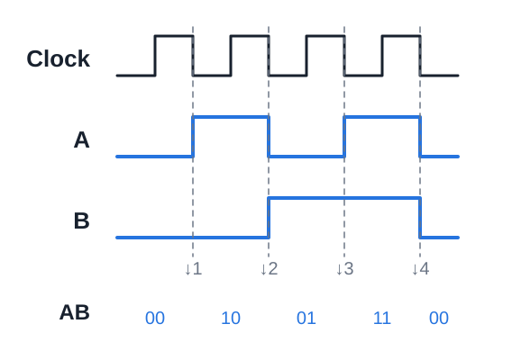
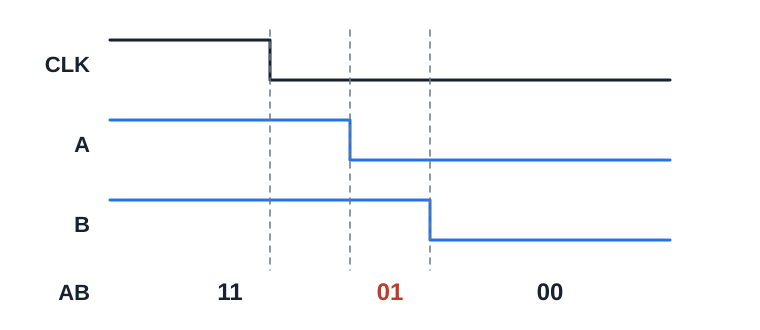

# 실험 8 · Counter — 클럭을 세어 숫자로 보여 줘요 · 실험 설명

      
이번 학기 교안 기준

## 실험 이해

### 왜 이 회로를 쓰는지 먼저 알아봐요

스위치를 누른 횟수를 기억해 숫자로 보여 줘요
**카운터는 클럭 펄스마다 현재 숫자를 자동으로 갱신하고 저장하는 회로예요.** 전선 하나에는 지금 신호가 0인지 1인지만 있어서, 스위치를 누른 지난 횟수는 어디에도 남지 않아요(이해를 위한 예시).

플립플롭 여러 개가 지금 숫자를 기억하고, 클럭이 올 때마다 다음 숫자로 바뀌어요. 그래서 입력은 클럭 한 선인데 출력에서 지금까지의 횟수를 읽을 수 있어요.

클럭마다 00→10→01→11로 세고 다시 돌아와요
이해를 위한 예시로 플립플롭 두 개(A, B)가 00에서 시작했다고 두고 따라가요. A를 앞에 적는 표기에서는 A가 낮은 자리라서 10이 1, 01이 2예요.

| 순서 | CLK 하강 | A | B | AB (A부터) | 값 | 왜 이 값인가요 |
| --- | --- | --- | --- | --- | --- | --- |
| 시작 | — | 0 | 0 | 00 | 0 | 초기 상태 가정(실제 회로는 미정) |
| **①** | **1번째** | **1** | **0** | **10** | **1** | **A가 먼저 반전되어 1이 돼요** |
| **②** | **2번째** | **0** | **1** | **01** | **2** | **A 하강에 B가 반전되어 2가 돼요** |
| ③ | 3번째 | 1 | 1 | 11 | 3 | A가 다시 반전되어 3이 돼요 |
| ④ | 4번째 | 0 | 0 | 00 | 0 | A·B 하강으로 처음 0으로 돌아와요 |

색칠한 ①과 ②를 비교해 봐요. 10은 1, 01은 2로 자릿수 순서가 A부터예요. 네 상태(0~3)를 순서대로 세고 다시 00으로 돌아와요.

이번 실험에서 확인하는 세 회로
| 실험 | 칩 | 구성 | 확인할 것 |
| --- | --- | --- | --- |
| 실험 1 | 74HC76, 74HC08 | 2단 2진 비동기 카운터 + 디코더 | 네 상태를 LED로 하나씩 확인 |
| 실험 2 (보충) | 74HC76 | 3진 동기 카운터 | 되먹임으로 세 상태만 도는 동작 |
| 실험 3 | 7490, 7447, FND | BCD 카운터 + 7-Segment | 0~9를 세고 숫자로 표시 |

외울 규칙

- **해결하는 문제** → 지난 클럭 수를 기억해 숫자로 읽어요
- **카운터** → 클럭마다 숫자를 갱신해 저장하는 레지스터
- **A를 앞에 적은 2단 2진** → 00→10→01→11→00 (0~3)
- **실험 3의 흐름** → 7490이 세고 → 7447이 번역하고 → FND가 보여 줘요

이유

전선은 지금 값만 알고 지난 횟수를 몰라요. 플립플롭이 숫자를 기억하고 클럭이 갱신해 줘서 횟수를 읽을 수 있어요.

헷갈리지 마요

- 보고서 범위는 실험 1·3이에요. 실험 2(3진 동기)는 범위 밖이지만 기출에 나왔고, 시험 제외로 단정하지 않아요.
- 교안 표지는 25-1이에요.
- 값은 예상 상태이며 실제 측정 결과가 아니에요.
- 실험 1 회로는 초기화 입력이 없어 시작 상태가 정해지지 않아요.

출처: [강의노트/실험8_Counter_회로정정본.pdf · PDF p2](../../../%EA%B0%95%EC%9D%98%EB%85%B8%ED%8A%B8/%EC%8B%A4%ED%97%988_Counter_%ED%9A%8C%EB%A1%9C%EC%A0%95%EC%A0%95%EB%B3%B8.pdf#page=2) · [강의노트/실험8_Counter_회로정정본.pdf · PDF p3](../../../%EA%B0%95%EC%9D%98%EB%85%B8%ED%8A%B8/%EC%8B%A4%ED%97%988_Counter_%ED%9A%8C%EB%A1%9C%EC%A0%95%EC%A0%95%EB%B3%B8.pdf#page=3) · [강의노트/실험8_Counter_회로정정본.pdf · PDF p4](../../../%EA%B0%95%EC%9D%98%EB%85%B8%ED%8A%B8/%EC%8B%A4%ED%97%988_Counter_%ED%9A%8C%EB%A1%9C%EC%A0%95%EC%A0%95%EB%B3%B8.pdf#page=4) · [강의노트/공지사항/2026-09-14_\[필독\]_논리회로실험_보고서_관련_공지.md](../../../%EA%B0%95%EC%9D%98%EB%85%B8%ED%8A%B8/%EA%B3%B5%EC%A7%80%EC%82%AC%ED%95%AD/2026-09-14_%5B%ED%95%84%EB%8F%85%5D_%EB%85%BC%EB%A6%AC%ED%9A%8C%EB%A1%9C%EC%8B%A4%ED%97%98_%EB%B3%B4%EA%B3%A0%EC%84%9C_%EA%B4%80%EB%A0%A8_%EA%B3%B5%EC%A7%80.md)

교안 표지는 25-1이에요. 보고서 범위(실험 1, 3)는 공지에서 확인했어요.

### 레지스터에서 카운터로: Toggle과 진수

Toggle은 유효 엣지마다 출력을 뒤집어요
**Toggle은 전등 스위치처럼 유효 엣지마다 이전 Q를 반대로 뒤집는 동작이에요.** 레지스터가 값을 저장한다면, 카운터는 엣지마다 값을 바꾸며 숫자를 세요.

이 동작만 하는 플립플롭을 T F/F라고 불러요. 74HC76에서는 J=K=1로 두고 클럭을 주면 Toggle해요. PR과 CLR은 0일 때 강제로 Q를 정하는 버튼이므로, 카운터로 세는 동안에는 둘 다 1로 두어 쉬게 해요.

플립플롭 n개는 최대 2ⁿ개 상태를 세요
“2단 2진”은 두 상태를 오가는 플립플롭 두 개를 써서 이진수로 센다는 이름이에요. 두 단이 모든 조합을 거치면 전체 상태는 네 개(0~3)예요. 전체 회로가 한 바퀴 도는 상태 수는 mod로 따로 적어요. 이 회로는 mod-4예요.

| 이름 | 플립플롭 수 | 전체 상태 수 | 세는 범위 | 왜 이 값인가요 |
| --- | --- | --- | --- | --- |
| **2단 2진** | **2개** | **2²=4** | **0~3** | **단마다 상태가 2배로 늘어나요** |
| 3단 2진 | 3개 | 2³=8 | 0~7 | 플립플롭 1개 추가로 상태가 2배 |
| **4단 2진** | **4개** | **2⁴=16** | **0~15** | **플립플롭 2개 추가로 상태가 4배** |

색칠한 2단과 4단을 비교해 봐요. 플립플롭이 2개 늘어났을 뿐인데 상태는 4개에서 16개로 4배가 돼요. 한 단을 더할 때마다 상태 수가 2배가 되기 때문이에요.

Toggle이 일어날 때마다 주기도 바뀌어요. Q가 한 번 올라갔다 내려오려면 유효 엣지가 두 번 필요해서, 출력 주기는 입력의 2배, 주파수는 절반이 돼요. 이 성질을 이용한 회로가 분주기(Clock Divider)예요.

mod는 전체 회로가 한 바퀴 도는 상태 수예요
같은 두 단으로도 되먹임을 달아 00→01→10→00만 돌게 하면 mod-3이에요. 회로 전체의 진수(mod)를 물으면 실제로 거치는 상태를 세요.

J=K=1이어도 PR이나 CLR이 0이면 강제 버튼이 이겨서 Toggle이 일어나지 않아요.

플립플롭 세 개도 연결에 따라 여덟 가지 중 일부 조합만 돌 수 있어요.

한 단계만 풀어 봐요
5단 2진 카운터가 세는 상태는 몇 개이고, 세는 범위는 어디까지일까요?

#### 힌트

한 단마다 상태가 2배예요.

#### 연습 답

2⁵=32개, 0부터 31까지예요.

외울 규칙

- **$\mathrm{PR}=1$, $\mathrm{CLR}=1$, $J=K=1$, 하강 엣지** → Toggle (Q 반전)
- **n비트 레지스터** → 플립플롭 n개
- **n단 2진 카운터** → 상태 $2^n$개
- **한 사이클의 상태 수가 N개** → N진 카운터(mod-N)
- **한 단이 Toggle** → 출력 주기가 입력의 2배

이유

Q가 한 번 오르내리는 데 유효 엣지가 두 번 필요해서 한 단마다 주기가 2배, 상태 수도 2배가 돼요. 예: 5단 2진은 $2^5=32$개, 0~31이에요.

헷갈리지 마요

- “2단 2진”의 2진은 전체 상태 수가 아니에요. 전체는 4상태(0~3)예요.
- $J=K=1$이어도 PR이나 CLR이 0이면 강제 버튼이 이겨요.
- 플립플롭 수와 상태 수는 달라요. 되먹임이 있으면 $2^n$보다 적게 돌 수 있어요.

이 개념으로 풀 문제: [JK F/F를 Toggle로 쓰는 네 핀 값](%EC%8B%A4%ED%97%9808_%EA%B8%B0%EC%B6%9C%ED%92%80%EC%9D%B4.md#q-jk-toggle) · [J, K, CLR로 Toggle 만들기](%EC%8B%A4%ED%97%9808_%EA%B8%B0%EC%B6%9C%ED%92%80%EC%9D%B4.md#q-jk-toggle-3pin) · [T F/F 3단 블록도의 동작](%EC%8B%A4%ED%97%9808_%EA%B8%B0%EC%B6%9C%ED%92%80%EC%9D%B4.md#q-xbit-ymod) · [비동기 회로는 몇 진 카운터인가요](%EC%8B%A4%ED%97%9808_%EA%B8%B0%EC%B6%9C%ED%92%80%EC%9D%B4.md#q-ripple-mod) · [단 수와 상태 수](%EC%8B%A4%ED%97%9808_%EA%B8%B0%EC%B6%9C%ED%92%80%EC%9D%B4.md#q-qp-e08-tf-02)

출처: [강의노트/실험8_Counter_회로정정본.pdf · PDF p3](../../../%EA%B0%95%EC%9D%98%EB%85%B8%ED%8A%B8/%EC%8B%A4%ED%97%988_Counter_%ED%9A%8C%EB%A1%9C%EC%A0%95%EC%A0%95%EB%B3%B8.pdf#page=3) · [강의노트/실험8_Counter_회로정정본.pdf · PDF p4](../../../%EA%B0%95%EC%9D%98%EB%85%B8%ED%8A%B8/%EC%8B%A4%ED%97%988_Counter_%ED%9A%8C%EB%A1%9C%EC%A0%95%EC%A0%95%EB%B3%B8.pdf#page=4) · [강의노트/실험8_Counter_회로정정본.pdf · PDF p5](../../../%EA%B0%95%EC%9D%98%EB%85%B8%ED%8A%B8/%EC%8B%A4%ED%97%988_Counter_%ED%9A%8C%EB%A1%9C%EC%A0%95%EC%A0%95%EB%B3%B8.pdf#page=5)

### 비동기 카운터: 앞 단 출력이 다음 단의 클럭이에요

다음 단은 앞 단 출력이 1에서 0으로 떨어질 때만 움직여요
**비동기 카운터는 외부 클럭을 첫 플립플롭만 받고, 다음 플립플롭은 앞 단의 출력 신호로 움직여요.** 앞 주자가 끝나야 다음 주자가 출발하는 이어달리기와 같아서 리플 카운터(보충 용어)라고도 불러요.

74HC76은 하강 엣지(1→0)에서 동작하므로, 둘째 단 FFB는 앞 단 A가 1에서 0으로 떨어지는 순간에만 Toggle해요. A가 0에서 1로 올라갈 때는 움직이지 않아요.

A가 떨어질 때만 B가 반전되어 00→10→01→11을 돌아요
두 플립플롭의 J·K·PR·CLR은 모두 1(+5V)로 묶여 Toggle 동작을 해요. 첫 단 CLK에는 외부 클럭이, 둘째 단 CLK에는 FFA의 출력 A가 들어가요(AB=00에서 시작 가정).

클록 삼각형 앞의 작은 원은 하강 엣지(1→0)를 뜻해요. 외부 CLK는 FFA로, FFA의 출력 A는 FFB의 클록 입력으로 가요. T=1은 두 단이 각자의 하강 엣지에서 반전한다는 뜻이에요(J=K=1로 구현).

| CLK 하강 번호 | A 변화 | B 변화 | AB (A부터) | 값(BA 이진수) | 왜 이 값인가요 |
| --- | --- | --- | --- | --- | --- |
| 시작 | — | — | 00 | 0 | 초기 상태(가정)예요 |
| 1 | 0→1 | 그대로 | 10 | 1 | CLK 하강에 A만 반전, B는 A가 안 떨어져 유지 |
| **2** | **1→0** | **0→1** | **01** | **2** | **A가 1→0으로 떨어져 B도 반전돼요** |
| **3** | **0→1** | **그대로** | **11** | **3** | **CLK 하강에 A만 반전, B는 유지** |
| 4 | 1→0 | 1→0 | 00 | 0 | A 하강에 B도 반전되어 00으로 복귀 |

A는 CLK의 2배, B는 CLK의 4배 주기예요. 시작 00은 가정이에요.

색칠한 2번과 3번을 비교해 봐요. 둘 다 외부 CLK가 떨어졌지만 2번에서는 A가 1→0으로 떨어져 B가 바뀌고, 3번에서는 A가 0→1로 올라가 B가 그대로예요.

AB를 A부터 적으면 10이 값 1이에요. A가 낮은 자리(LSB)이고 B가 높은 자리(MSB)이기 때문이에요. 파형과 출력 단자 순서 모두 00→10→01→11 순서예요.

전파지연이 쌓여 11에서 00으로 갈 때 01을 잠깐 지나요
각 플립플롭은 클럭을 받고 출력이 바뀔 때까지 짧은 시간(전파지연)이 걸려요. 앞 단이 바뀐 뒤에야 다음 단이 움직이니까 지연이 단마다 누적돼요.

시간축을 크게 늘린 그림이에요. 실제 지연 값이 아니에요.

| 순간 | A | B | AB | 동작 · 이유 |
| --- | --- | --- | --- | --- |
| **CLK 하강 직전** | **1** | **1** | **11** | **정상 상태 3이에요** |
| **지연 1번 뒤** | **0** | **1** | **01** | **A만 먼저 0으로 떨어지고 B는 아직 1이에요** |
| 지연 2번 뒤 | 0 | 0 | 00 | A 하강을 본 B가 마침내 0으로 떨어져요 |

색칠한 두 순간을 비교해 봐요. 11에서 00으로 바로 가지 않고 01을 잠깐 지나요. 이 짧은 가짜 상태를 뒤쪽 디코더가 읽으면 원치 않는 출력이 순간적으로 켜지는 글리치(보충)가 생길 수 있어요.

시작값과 엣지를 조심해요
PR·CLR이 VCC에 묶여 있어 외부 초기화 버튼이 없어요. 전원을 켠 직후의 AB는 정해지지 않으므로, 파형을 그릴 때 “00에서 시작한다고 가정”을 밝혀요.

74HC76의 CLK는 하강 엣지예요. CLK나 A가 올라갈 때 다음 단을 뒤집으면 틀려요.

1Hz 클럭에서는 플립플롭 사이 수십 나노초의 지연이 눈에 보이지 않아요. 실험은 네 상태가 순서대로 도는 것을 확인하는 것이 목적이에요.

한 단계만 풀어 봐요
AB=11(A부터)에서 CLK가 한 번 떨어지면 최종 AB는 무엇일까요?

#### 힌트

A를 먼저 뒤집고, A가 떨어졌는지 봐요.

#### 연습 답

A가 1→0으로 떨어져 B도 뒤집혀요. 최종 AB=00이에요.

외울 규칙

- **CLK 하강 엣지** → A 반전
- **A 하강 엣지(1→0)** → B 반전
- **A 상승 엣지(0→1)** → B 그대로
- **AB를 A부터 적으면** → 00→10→01→11→00

이유

둘째 단의 클럭 자리에 A가 들어가서 B는 A가 떨어질 때만 움직여요. 앞 단이 바뀐 뒤 다음 단이 움직이니 전파지연이 단마다 쌓이고, 11에서 00으로 갈 때 01을 잠깐 지나요.

헷갈리지 마요

- 교안 회로는 초기화 입력이 없어요. 시작값 00은 가정이라고 밝혀요.
- A를 앞에 적으면 10이 값 1이에요. A가 낮은 자리예요.
- 교안 본문 “00, 01, 10, 11”과 달리 파형 순서는 00, 10, 01, 11이에요.
- 74HC76은 하강 엣지예요.
- 글리치 설명은 교안 밖 보충이에요.

이 개념으로 풀 문제: [비동기식 카운터의 특징](%EC%8B%A4%ED%97%9808_%EA%B8%B0%EC%B6%9C%ED%92%80%EC%9D%B4.md#q-async-char) · [74HC76 비동기 회로의 A·B 파형](%EC%8B%A4%ED%97%9808_%EA%B8%B0%EC%B6%9C%ED%92%80%EC%9D%B4.md#q-ripple-wave) · [둘째 단이 바뀌는 순간](%EC%8B%A4%ED%97%9808_%EA%B8%B0%EC%B6%9C%ED%92%80%EC%9D%B4.md#q-qp-e08-tf-01) · [가짜 상태가 생기는 이유](%EC%8B%A4%ED%97%9808_%EA%B8%B0%EC%B6%9C%ED%92%80%EC%9D%B4.md#q-qp-e08-short-01)

출처: [강의노트/실험8_Counter_회로정정본.pdf · PDF p4](../../../%EA%B0%95%EC%9D%98%EB%85%B8%ED%8A%B8/%EC%8B%A4%ED%97%988_Counter_%ED%9A%8C%EB%A1%9C%EC%A0%95%EC%A0%95%EB%B3%B8.pdf#page=4) · [강의노트/실험8_Counter_회로정정본.pdf · PDF p5](../../../%EA%B0%95%EC%9D%98%EB%85%B8%ED%8A%B8/%EC%8B%A4%ED%97%988_Counter_%ED%9A%8C%EB%A1%9C%EC%A0%95%EC%A0%95%EB%B3%B8.pdf#page=5) · [강의노트/실험8_Counter_회로정정본.pdf · PDF p9](../../../%EA%B0%95%EC%9D%98%EB%85%B8%ED%8A%B8/%EC%8B%A4%ED%97%988_Counter_%ED%9A%8C%EB%A1%9C%EC%A0%95%EC%A0%95%EB%B3%B8.pdf#page=9) · [보고서/실험08/결선도/netlist.md](../../../%EB%B3%B4%EA%B3%A0%EC%84%9C/%EC%8B%A4%ED%97%9808/%EA%B2%B0%EC%84%A0%EB%8F%84/netlist.md)

교안 본문은 조합을 00, 01, 10, 11로 적고 파형은 00, 10, 01, 11이에요. 파형과 p9 출력 순서를 따랐어요(netlist M10). 글리치·리플 용어는 교안 밖 보충이에요.

### 상태를 AND로 하나씩 읽어요

원하는 상태에서만 1이 나오도록 AND 게이트로 조합해요
**디코딩은 카운터의 2진 상태를 사람이 알아보기 쉽게 특정 전구 하나만 켜는 신호로 바꾸는 일이에요.** A, B 두 선만 보면 몇 번째 상태인지 바로 알기 어려워요.

74HC76은 Q와 Q′ 출력을 모두 내어주므로 A, A′, B, B′를 바로 쓸 수 있어요. AND 게이트는 입력이 모두 1일 때만 1을 내므로, 특정 상태에 맞춰 신호를 조합해요.

네 상태마다 AND 하나씩 켜져 어느 전구가 켜졌는지가 숫자가 돼요

네 AND 조합이에요. 위에서부터 출력 0~3이에요.

| AB (A부터) | 출력 0 | 출력 1 | 출력 2 | 출력 3 | 왜 이 값인가요 |
| --- | --- | --- | --- | --- | --- |
| 00 | 1 | 0 | 0 | 0 | A′·B′ = 1이라 출력 0만 켜져요 |
| **10** | **0** | **1** | **0** | **0** | **A·B′ = 1이라 출력 1만 켜져요** |
| **01** | **0** | **0** | **1** | **0** | **A′·B = 1이라 출력 2만 켜져요** |
| 11 | 0 | 0 | 0 | 1 | A·B = 1이라 출력 3만 켜져요 |

색칠한 10과 01을 비교해 봐요. 1의 개수는 1개로 같은데 켜지는 출력이 달라요. AND 입력이 A·B′와 A′·B로 달라서 어느 자리가 1인지까지 구분하기 때문이에요.

상태 N개를 이진으로 적으려면 2ᵏ≥N인 k개 출력이 필요해요
카운터 자체의 이진 Q 출력선 수와, 디코더를 거쳐 각 상태를 하나씩 켜는 상태별 출력선 수는 달라요.

| 세고 싶은 상태 | Q 출력(이진) | 상태별 출력 선(디코딩) | 왜 이 값인가요 |
| --- | --- | --- | --- |
| **4** | **2개** | **4개** | **2²=4이므로 2비트로 4개 상태 표현** |
| **5** | **3개** | **5개** | **2²=4로는 모자라고 2³=8이라 3비트 필요** |
| 16 | 4개 | 16개 | 2⁴=16이므로 4비트 필요 |

색칠한 4상태와 5상태를 비교해 봐요. 상태가 하나만 늘어도 2²=4로는 모자라 Q 출력이 3개로 늘어나요. 문제에서 “출력핀 수”를 물으면 이진 Q 출력인지 상태별 출력 선인지 구분해서 적어요.

입력 개수와 비동기 글리치를 조심해요
AND 16개는 4입력 AND 게이트 기준이에요. 2입력 AND 게이트만 쓴다면 16개보다 훨씬 많이 필요해요. 답안에 “4입력 AND 기준”을 밝혀요.

비동기 카운터에 디코더를 붙이면 비동기 토픽에서 본 가짜 상태 때문에 순간 글리치가 생길 수 있어요(1Hz LED에서는 눈으로 보기 어려워요).

Y0~Y3은 저장소 명세가 붙인 이름이에요. 교안은 이 출력에 문자 이름을 주지 않고 0~3 번호로 적어요.

한 단계만 풀어 봐요
출력 2가 켜졌어요. A와 B는 각각 몇일까요?

#### 힌트

출력 2의 AND에 어떤 두 신호가 들어가는지 봐요.

#### 연습 답

A′·B=1이니까 A=0, B=1이에요.

외울 규칙

- **$A'\cdot B' = 1$** → $\mathrm{AB}=00$, 출력 0
- **$A\cdot B' = 1$** → $\mathrm{AB}=10$, 출력 1
- **$A'\cdot B = 1$** → $\mathrm{AB}=01$, 출력 2
- **$A\cdot B = 1$** → $\mathrm{AB}=11$, 출력 3
- **n단 2진을 모두 구분** → AND $2^n$개 (게이트 입력 n개)
- **5상태 구분** → Q 출력 3개, 상태별 출력 선 5개

이유

AND는 입력이 모두 1일 때만 1이라서, Q와 Q′를 골라 넣으면 한 상태에서만 1이 돼요. 상태 N개는 $2^k\ge N$인 k개의 선이면 이진으로 구분할 수 있어요.

헷갈리지 마요

- AND 16개는 4입력 AND 기준이에요.
- “출력핀 개수”는 이진 Q 출력인지 상태별 출력 선인지에 따라 3개·5개로 갈려요.
- Y0~Y3은 교안 이름이 아니에요.
- 비동기 카운터의 디코더에는 순간 글리치가 생길 수 있어요.

이 개념으로 풀 문제: [4단 2진 카운터를 AND로 확인하기](%EC%8B%A4%ED%97%9808_%EA%B8%B0%EC%B6%9C%ED%92%80%EC%9D%B4.md#q-and-gates) · [5진 카운터의 최소 출력핀](%EC%8B%A4%ED%97%9808_%EA%B8%B0%EC%B6%9C%ED%92%80%EC%9D%B4.md#q-mod5-pins-graded) · [5진 카운터 출력핀 (확인용 단서)](%EC%8B%A4%ED%97%9808_%EA%B8%B0%EC%B6%9C%ED%92%80%EC%9D%B4.md#q-mod5-pins) · [켜지는 출력 찾기](%EC%8B%A4%ED%97%9808_%EA%B8%B0%EC%B6%9C%ED%92%80%EC%9D%B4.md#q-qp-e08-blank-01) · [출력 3의 AND를 작도해요](%EC%8B%A4%ED%97%9808_%EA%B8%B0%EC%B6%9C%ED%92%80%EC%9D%B4.md#q-qp-e08-board-01)

출처: [강의노트/실험8_Counter_회로정정본.pdf · PDF p5](../../../%EA%B0%95%EC%9D%98%EB%85%B8%ED%8A%B8/%EC%8B%A4%ED%97%988_Counter_%ED%9A%8C%EB%A1%9C%EC%A0%95%EC%A0%95%EB%B3%B8.pdf#page=5) · [강의노트/실험8_Counter_회로정정본.pdf · PDF p9](../../../%EA%B0%95%EC%9D%98%EB%85%B8%ED%8A%B8/%EC%8B%A4%ED%97%988_Counter_%ED%9A%8C%EB%A1%9C%EC%A0%95%EC%A0%95%EB%B3%B8.pdf#page=9) · [보고서/실험08/체크리스트/명세.md](../../../%EB%B3%B4%EA%B3%A0%EC%84%9C/%EC%8B%A4%ED%97%9808/%EC%B2%B4%ED%81%AC%EB%A6%AC%EC%8A%A4%ED%8A%B8/%EB%AA%85%EC%84%B8.md)

Y0~Y3은 교안 이름이 아니라 명세의 이름이에요. 출력 번호 0~3은 p5 그림을 따랐어요.

### 동기 카운터: 같은 클럭을 함께 받아요

모든 플립플롭이 같은 클럭을 받아 동시에 바뀌어요
**동기 카운터는 모든 플립플롭이 하나의 공통 클럭 신호에 맞춰 동시에 동작해요.** 다음 상태로 갈지 말지는 엣지가 오기 전에 J, K 입력이 미리 정해 놓아요.

심판의 호루라기에 맞춰 모든 선수가 일제히 출발하는 달리기와 같아요. 앞 단의 출력이 바뀔 때까지 다음 단이 기다리지 않으므로 단마다 누적되는 전파지연이 없어요.

되먹임 B′가 11로 가는 길을 막아 세 상태만 돌아요
실험 회로는 J1=B′, K1=1, J2=A, K2=1이에요. PR·CLR은 1(+5V)이고 두 플립플롭의 클럭에 같은 클럭 신호가 들어가요. K가 늘 1이라서 J=1이면 반전, J=0이면 0으로 Reset돼요.

CLK를 두 F/F가 함께 받아요. 되먹임 B′가 카운트를 짧게 끊어요.

| 지금 AB | J1=B′ | K1 | J2=A | K2 | 다음 A | 다음 B | 다음 AB | 동작 · 이유 |
| --- | --- | --- | --- | --- | --- | --- | --- | --- |
| **00** | **1** | **1** | **0** | **1** | **1** | **0** | **10** | **J1=1이라 A 반전(0→1), J2=0이라 B는 0 유지** |
| 10 | 1 | 1 | 1 | 1 | 0 | 1 | 01 | J1=1, J2=1이라 A·B 둘 다 반전 |
| **01** | **0** | **1** | **0** | **1** | **0** | **0** | **00** | **J1=0, J2=0이라 둘 다 Reset되어 00으로 복귀** |
| 11 | 0 | 1 | 1 | 1 | 0 | 0 | 00 | 쓰지 않는 상태: 엣지가 오면 정상 고리(00)로 합류 |

세 상태가 돌아요. 11은 다음 엣지에 고리로 들어와요.

색칠한 00과 01을 비교해 봐요. 둘 다 K는 1인데 00에서는 J1=B′=1이라 A가 0→1로 뒤집히고, 01에서는 B=1이라 J1=0이 되어 A가 0을 유지해요. 이 되먹임이 11로 가는 길을 막아 세 상태(00→10→01)만 돌아요.

피해야 할 11 상태를 봐요. 정상 동작에서는 11이 생기지 않지만, 전원을 켠 직후 우연히 11에 있더라도 다음 엣지에서 바로 00으로 흡수되어 정상 고리로 들어와요.

비동기와 나란히 봐요
같은 입력 클럭을 두 카운터에 넣고 AB=00에서 시작했다고 가정해요.

| CLK 하강 | 비동기 2단 AB | 동기 3진 AB | 동작 · 이유 |
| --- | --- | --- | --- |
| 시작 | 00 | 00 | 초기 상태(가정)예요 |
| 1 | 10 | 10 | 첫 엣지: 둘 다 10으로 같아요 |
| **2** | **01** | **01** | **둘째 엣지: 둘 다 01로 같아요** |
| **3** | **11** | **00** | **비동기는 11로 가지만 동기는 되먹임으로 00 복귀** |
| 4 | 00 | 10 | 비동기는 이제 00, 동기는 다시 10 시작 |
| 5 | 10 | 01 | 동기는 00→10→01의 세 상태 순환 |
| 6 | 01 | 00 | 동기는 다시 00으로 돌아와요 |

색칠한 2번째와 3번째 엣지를 비교해 봐요. 앞의 두 번은 같은데 3번에서 비동기는 11로, 동기는 00으로 갈라져요. 동기 회로는 B=1이면 J1=0이라 A를 올리지 못하기 때문이에요.

이름과 범위를 조심해요
“동기식은 전파지연이 0이다”라고 쓰면 부정확해요. 플립플롭 하나의 지연은 그대로 있어요. 단마다 누적되는 전달 지연이 없어지는 거예요.

실험 2는 보고서 범위 밖이지만 기출문제에 출제된 핵심 회로예요.

이 회로도 초기화 입력이 없어요. 시작 상태는 정해지지 않지만 11에서 시작해도 한 엣지 뒤 00으로 들어와요.

한 단계만 풀어 봐요
이 회로에서 AB=01이면 다음 AB는 무엇일까요?

#### 힌트

B′와 A를 먼저 적어서 J1, J2를 구해요.

#### 연습 답

J1=0, J2=0이고 K는 둘 다 1이라 둘 다 Reset, 다음 AB=00이에요.

외울 규칙

- **모든 F/F** → 같은 CLK 하강 엣지에서 함께 변함
- **$\mathrm{AB}=00$** → 다음 10
- **$\mathrm{AB}=10$** → 다음 01
- **$\mathrm{AB}=01$** → 다음 00
- **$\mathrm{AB}=11$ (쓰지 않는 상태)** → 다음 00

이유

교안 p10은 $J_1=B'$, $K_1=1$, $J_2=A$, $K_2=1$이에요. K가 늘 1이라 $J=1$이면 반전, $J=0$이면 0이 돼요. $B=1$이면 $J_1=0$이 되어 A가 못 올라가므로 세 상태만 돌아요.

헷갈리지 마요

- “전파지연 0”이 아니라 단마다 쌓이는 전달 지연이 없어지는 거예요.
- 실험 2는 보고서 범위 밖이지만 기출에 나왔어요.
- 초기화 입력이 없어 시작 상태는 정해지지 않아요. 11에서 시작해도 00으로 들어와요.

이 개념으로 풀 문제: [동기식이 보완한 점](%EC%8B%A4%ED%97%9808_%EA%B8%B0%EC%B6%9C%ED%92%80%EC%9D%B4.md#q-sync-improve) · [비동기식과 동기식 설명·보완점](%EC%8B%A4%ED%97%9808_%EA%B8%B0%EC%B6%9C%ED%92%80%EC%9D%B4.md#q-async-sync-compare) · [74HC76 동기 회로의 A·B 파형](%EC%8B%A4%ED%97%9808_%EA%B8%B0%EC%B6%9C%ED%92%80%EC%9D%B4.md#q-sync-wave) · [몇 진인지와 2배 진수로 바꾸는 법](%EC%8B%A4%ED%97%9808_%EA%B8%B0%EC%B6%9C%ED%92%80%EC%9D%B4.md#q-mod-and-double)

출처: [강의노트/실험8_Counter_회로정정본.pdf · PDF p4](../../../%EA%B0%95%EC%9D%98%EB%85%B8%ED%8A%B8/%EC%8B%A4%ED%97%988_Counter_%ED%9A%8C%EB%A1%9C%EC%A0%95%EC%A0%95%EB%B3%B8.pdf#page=4) · [강의노트/실험8_Counter_회로정정본.pdf · PDF p10](../../../%EA%B0%95%EC%9D%98%EB%85%B8%ED%8A%B8/%EC%8B%A4%ED%97%988_Counter_%ED%9A%8C%EB%A1%9C%EC%A0%95%EC%A0%95%EB%B3%B8.pdf#page=10)

실험 2는 보고서 범위 밖이에요. J1=B′, K1=1, J2=A, K2=1은 p10 회로를 직접 읽었고 2017-1 기출 회로와 같아요.

### 7490: 0부터 9까지 세는 BCD 카운터

2진 단과 5진 단을 이어 0부터 9까지 열 개 상태를 세요
**7490은 2진 카운터(QA)와 5진 카운터(QB·QC·QD)를 내장해, 둘을 직렬로 연결해 0~9(BCD)를 세는 IC예요.** 9 다음에는 10이 아니라 다시 0으로 돌아가요.

BCD(Binary Coded Decimal)는 십진수 한 자리(0~9)를 2진수 네 비트로 적는 방법이에요. 7490 내부의 QA(12번) 출력을 INPUT B(1번)에 연결하면 2×5=10진 카운터가 완성돼요.

R0와 R9는 강제 버튼이에요. R0(1)·R0(2)가 모두 H이면 0으로, R9(1)·R9(2)가 모두 H이면 9로 고정돼요. 평소에 카운트하려면 이 핀들을 L(GND)에 두어 해제해야 해요.

QA를 INPUT B에 연결하면 0부터 9까지 순서대로 세요

12번과 1번을 이어 2진 단과 5진 단을 직렬로 연결해요.

| 핀 | 이름 | 실험 연결 | 왜 이 값인가요 |
| --- | --- | --- | --- |
| 14 | INPUT A | Clock Generator (+5V, 1Hz) | 첫 2진 단 QA의 클럭 입력이에요 |
| 1 | INPUT B | QA(12번)에 연결 | QA 출력을 받아 뒤쪽 5진 단을 움직여요 |
| 2, 3 | R0(1), R0(2) | 스위치 D0로 VCC 또는 GND | 둘 다 H이면 0으로 리셋, L이면 카운트 |
| 6, 7 | R9(1), R9(2) | GND 접지 | 둘 다 H이면 9로 세트, 평소엔 GND에 묶어요 |
| 12, 9, 8, 11 | QA, QB, QC, QD | 출력 A, B, C, D | QA가 LSB, QD가 MSB예요 |
| 5, 10 | VCC, GND | 전원 | 일반 14핀 칩과 위치가 달라요 (5번 VCC, 10번 GND) |

QD QC QB를 하나의 이진수로 읽으면 0~4를 세는 5진 단의 값이에요. 전체 COUNT는 2×(QD QC QB)+QA예요. 예를 들어 7은 상위 011과 QA=1이에요. 외부 하강에서 QA가 0으로 바뀌면 그 하강을 받은 상위 단이 011→100으로 한 칸 세어요. 그래서 2×4+0=8이에요.

| COUNT | QD | QC | QB | QA | 왜 이 값인가요 |
| --- | --- | --- | --- | --- | --- |
| 0 | L | L | L | L | 시작 상태 (0000) |
| **1** | **L** | **L** | **L** | **H** | **클럭 하강에 QA만 H로 반전** |
| **2** | **L** | **L** | **H** | **L** | **QA가 H→L로 떨어져 5진 단이 000→001로 전이** |
| 3 | L | L | H | H | QA만 H로 반전 (5진 단은 QA 상승에 유지) |
| 4 | L | H | L | L | QA 하강에 5진 단 전이 (QC=H) |
| 5 | L | H | L | H | QA만 H로 반전 |
| 6 | L | H | H | L | QA 하강에 5진 단 전이 |
| 7 | L | H | H | H | QA만 H로 반전 |
| 8 | H | L | L | L | QA가 H→L로 떨어져 5진 단이 011→100으로 전이 |
| 9 | H | L | L | H | QA만 H로 반전 (최대값 1001) |

맨 오른쪽 QA가 낮은 자리(LSB)이고 QD가 높은 자리(MSB)예요.

색칠한 COUNT 1과 2를 비교해 봐요. 1에서 2로 갈 때 QA가 H→L로 떨어지면서 그 하강이 5진 단의 클럭이 되어 QB를 올려요. COUNT 2에서 3으로 갈 때는 QA가 L→H로 올라가므로 5진 단은 그대로예요.

COUNT 9에서 다음 하강 엣지가 오면 QA가 H→L로 떨어지고 그 하강으로 5진 단이 다시 처음으로 돌아가요. 그래서 1001 다음이 0000이에요. 1010~1111은 정상 세기에서 나오지 않아요.

R9가 눌리면 R0보다 우선하여 9로 만들어요
X는 어느 값이든 상관없다는 don’t care예요. R0와 R9가 동시에 눌리면 R9가 이겨요(우선순위 R0<R9).

| R0(1) | R0(2) | R9(1) | R9(2) | QD QC QB QA | 왜 이 값인가요 |
| --- | --- | --- | --- | --- | --- |
| **H** | **H** | **L** | **X** | **L L L L** | **R0만 눌려 0000으로 리셋** |
| H | H | X | L | L L L L | R0만 눌려 0000으로 리셋 |
| **X** | **X** | **H** | **H** | **H L L H** | **R9가 눌리면 R0 값과 무관하게 9(1001)로 세트** |
| X | L | X | L | COUNT | 둘 다 해제되어 정상 카운트 동작 |
| X | L | L | X | COUNT | 둘 다 해제되어 정상 카운트 동작 |
| L | X | X | L | COUNT | 둘 다 해제되어 정상 카운트 동작 |
| L | X | L | X | COUNT | 둘 다 해제되어 정상 카운트 동작 |

색칠한 첫째 줄과 셋째 줄을 비교해 봐요. 셋째 줄은 R0가 X이니까 R0(1)=R0(2)=H여도 9가 돼요. 첫째 줄은 R9 쪽이 눌리지 않아서 0이 돼요. R9가 눌리면 R0를 이겨요.

실험 회로는 R9 두 핀을 GND에 묶고 R0 두 핀을 스위치 하나로 함께 조작해요. R0=1이면 클럭이 돌아도 0에 머물고, R0=0으로 내리면 세기 시작해요.

교안의 표기 차이를 조심해요
p6 핀맵은 6·7번을 No Connect로 적었지만, p6 내부 회로와 p7 표, p11 회로는 R9로 써요. p11대로 GND에 연결해요.

VCC는 5번, GND는 10번이에요. 일반 14핀 칩의 14번·7번과 달라요. 잘못 꽂으면 칩이 망가질 수 있어요.

p11의 스위치 D0는 준비물에 없어요. 저장소 명세는 R0 점퍼를 +5V와 GND로 옮겨 꽂는 방법을 써요. 교안 원문이 아니에요.

QA를 INPUT B에 잇지 않으면 QA 혼자 2진으로만 움직이고 나머지는 멈춰요. 12번→1번 연결을 빠뜨리지 않아요.

교안 표기가 갈려요. 준비물은 7490·7447인데 본문은 DM7490A·SN7447A, 회로도는 74HC90·74HC47이에요. 표시기도 FND 507과 FND 205가 섞여 있어요. 받은 부품의 각인을 보고 핀을 맞춰요.

한 단계만 풀어 봐요
R0 해제 상태에서 지금 QD QC QB QA = L H H H예요. 다음 하강 엣지 뒤의 값은 무엇일까요?

#### 힌트

QA가 떨어질 때 5진 단이 한 칸 센다는 규칙을 써요.

#### 연습 답

QA가 1→0으로 떨어지고, 상위 세 비트는 011→100으로 바뀌어요. 그래서 H L L L, COUNT 8이에요.

외울 규칙

- **$R_9(1)=R_9(2)=\mathrm{H}$** → 9로 고정 (H L L H)
- **$R_0(1)=R_0(2)=\mathrm{H}$, R9 중 하나 L** → 0으로 고정
- **R0, R9 모두 해제** → COUNT 동작
- **클럭→14번, 12번→1번** → 0~9를 세요
- **9에서 다음 하강 엣지** → 0으로 돌아가요
- **전원** → VCC 5번, GND 10번

이유

7490은 QA 2진 단과 QB·QC·QD 5진 단으로 나뉘고, QA의 하강이 5진 단의 클럭이 되어 $2\times 5=10$을 세요. 예: COUNT 7(L H H H) 다음은 8(H L L L)이에요.

헷갈리지 마요

- p6 핀맵의 6·7번 No Connect와 달리 p7·p11은 R9예요. GND에 연결해요.
- 우선순위는 $R_0 < R_9$예요. R9가 눌리면 R0를 이겨요.
- R0·R9는 H일 때 눌려요. 74HC76 PR·CLR은 L일 때 눌려요.
- X는 상관없음이지 알 수 없는 값이 아니에요.
- p11 스위치 D0는 준비물에 없어요.
- 교안의 IC 이름이 DM7490A·74HC90·7490으로 갈려요.

이 개념으로 풀 문제: [R0로 0에 고정](%EC%8B%A4%ED%97%9808_%EA%B8%B0%EC%B6%9C%ED%92%80%EC%9D%B4.md#q-qp-e08-tf-03) · [7490의 두 연결](%EC%8B%A4%ED%97%9808_%EA%B8%B0%EC%B6%9C%ED%92%80%EC%9D%B4.md#q-qp-e08-blank-02)

출처: [강의노트/실험8_Counter_회로정정본.pdf · PDF p6](../../../%EA%B0%95%EC%9D%98%EB%85%B8%ED%8A%B8/%EC%8B%A4%ED%97%988_Counter_%ED%9A%8C%EB%A1%9C%EC%A0%95%EC%A0%95%EB%B3%B8.pdf#page=6) · [강의노트/실험8_Counter_회로정정본.pdf · PDF p7](../../../%EA%B0%95%EC%9D%98%EB%85%B8%ED%8A%B8/%EC%8B%A4%ED%97%988_Counter_%ED%9A%8C%EB%A1%9C%EC%A0%95%EC%A0%95%EB%B3%B8.pdf#page=7) · [강의노트/실험8_Counter_회로정정본.pdf · PDF p11](../../../%EA%B0%95%EC%9D%98%EB%85%B8%ED%8A%B8/%EC%8B%A4%ED%97%988_Counter_%ED%9A%8C%EB%A1%9C%EC%A0%95%EC%A0%95%EB%B3%B8.pdf#page=11) · [보고서/실험08/결선도/netlist.md](../../../%EB%B3%B4%EA%B3%A0%EC%84%9C/%EC%8B%A4%ED%97%9808/%EA%B2%B0%EC%84%A0%EB%8F%84/netlist.md)

p6 핀맵의 6·7번 No Connect와 p7·p11의 R9 충돌은 netlist M4, 스위치 D0는 M7, IC 표기 차이는 M5예요. 2진·5진 나눔은 p6 내부 회로의 클럭 경로로 확인했고 실제 측정은 없어요.

### 7447: 숫자를 세그먼트 신호로 번역해요

2진수 네 비트를 받아 7-Segment의 a~g 핀 신호로 번역해요
**7447은 0~9의 BCD 입력을 받아 7-Segment의 일곱 막대(a~g) 중 켤 막대의 출력을 L(0V)로 내리는 Active Low 디코더예요.** 카운터의 2진 출력(A~D)을 사람이 읽는 숫자로 바꾸는 번역기예요.

7-Segment는 막대 일곱 개로 숫자를 만드는 표시기예요. 위부터 시계 방향으로 a, b, c, d, e, f이고 가운데가 g예요. 7447의 출력 핀은 세그먼트를 켜고 싶을 때 L이 돼요.

LT, BI/RBO, RBI는 제어 핀이에요. 이름 위에 줄이 있어서 L일 때 눌리는 버튼이에요. 평소에는 모두 1로 둬요.

입력 D C B A에 따라 켜지는 세그먼트가 정해져 있어요
입력은 D, C, B, A 순서로 읽어요. 교안 머리글은 DBCA로 적혔지만 0010이 숫자 2, 0100이 숫자 4로 나오려면 D, C, B, A 순서여야 해요.

| D C B A | 숫자 | 켜지는 세그먼트 | 왜 이 값인가요 |
| --- | --- | --- | --- |
| 0000 | 0 | abcdef | 가운데 g만 빼고 테두리 6개가 켜져요 |
| 0001 | 1 | bc | 오른쪽 두 막대 b, c만 켜져요 |
| 0010 | 2 | abdeg | c와 f를 뺀 5개 막대가 켜져요 |
| 0011 | 3 | abcdg | 왼쪽 e와 f를 뺀 5개 막대가 켜져요 |
| 0100 | 4 | bcfg | a, d, e를 뺀 4개 막대가 켜져요 |
| **0101** | **5** | **acdfg** | **b와 e를 뺀 5개 막대가 켜져요** |
| **0110** | **6** | **cdefg** | **교안 값: 위쪽 a, b를 뺀 5개 막대가 켜져요** |
| 0111 | 7 | abc | 위쪽 a와 오른쪽 b, c가 켜져요 |
| 1000 | 8 | abcdefg | 일곱 막대가 모두 켜져요 |
| 1001 | 9 | abcdfg | 교안 값: e만 꺼지고 아랫변 d는 켜져요 |

숫자 5예요. 파란 막대가 켜지는 세그먼트예요.

색칠한 숫자 5와 숫자 6을 비교해 봐요. 입력은 맨 뒤 두 자리만 다른데, 5의 acdfg에서 6의 cdefg로 가면서 e가 켜지고 a가 꺼져요. 입력 패턴만 보고 세그먼트를 짐작할 수 없어서 표가 필요해요. 교안 숫자 6은 a를 켜지 않아요.

완성 예제: A=H, B=L, C=H, D=L이면 D C B A=0101, 숫자 5예요. 표에서 acdfg가 켜지니까 핀 출력은 아래와 같아요.

| 핀 | 세그먼트 | 숫자 5에서 | 출력 | 왜 이 값인가요 |
| --- | --- | --- | --- | --- |
| **13** | **a** | **켜짐** | **L** | **acdfg에 포함되어 Active Low 출력 L** |
| **12** | **b** | **꺼짐** | **H** | **5에는 꺼지므로 비활성 H** |
| 11 | c | 켜짐 | L | acdfg에 포함되어 출력 L |
| 10 | d | 켜짐 | L | acdfg에 포함되어 출력 L |
| 9 | e | 꺼짐 | H | 5에는 꺼지므로 비활성 H |
| 15 | f | 켜짐 | L | acdfg에 포함되어 출력 L |
| 14 | g | 켜짐 | L | acdfg에 포함되어 출력 L |

색칠한 13번(a)과 12번(b)을 비교해 봐요. 켜지는 세그먼트는 L, 꺼지는 세그먼트는 H예요.

핀 순서와 교안의 9를 조심해요
입력 핀 번호는 순서대로가 아니에요. A는 7번, B는 1번, C는 2번, D는 6번이에요. 출력도 a가 13번, b가 12번 … g가 14번, f가 15번이에요.

p15의 숫자 9는 abcdfg(d 켜짐)이에요. 저장소 명세가 대조한 TI 7447 자료의 9는 d가 꺼진 모양이에요. 그래서 실제로 켰을 때 d가 어떤지 봐요. 이 노트는 교안 값을 썼어요.

제공 답안 중 H·L을 반대로 적은 자료가 있어요. 그 답은 “켜짐=H”인 다른 칩의 극성이에요. 7447은 켜짐이 L이에요.

RBI·RBO는 선행 0을 지우는 기능이에요. 이번 회로는 RBI를 1로 둬서 쓰지 않아요.

보충: 7447 출력은 오픈 컬렉터예요. “꺼짐 = H”는 전압을 내보낸다기보다 전류 길을 끊는다는 뜻이에요. 저항과 표시기를 거쳐 +5V 쪽으로 읽혀요.

한 단계만 풀어 봐요
D C B A=0100이면 어떤 세그먼트가 켜지고, 그때 a(13번)의 출력은 무엇일까요?

#### 힌트

표에서 숫자를 찾고 a가 목록에 있는지 봐요.

#### 연습 답

숫자 4, bcfg가 켜져요. a는 꺼지니까 13번은 H예요.

외울 규칙

- **제어 핀 모두 H, 입력 0~9** → 그 숫자의 세그먼트가 켜져요
- **켜지는 세그먼트 출력** → L
- **꺼지는 세그먼트 출력** → H(켜지 않음)
- **$\mathrm{LT}=\mathrm{L}$** → 모든 세그먼트 ON
- **$\mathrm{BI}=\mathrm{L}$** → 모든 세그먼트 OFF
- **입력 핀** → A 7번, B 1번, C 2번, D 6번
- **숫자 5** → acdfg: 13 L, 12 H, 11 L, 10 L, 9 H, 15 L, 14 L

이유

7447은 네 비트를 받아 일곱 출력을 정하는 디코더이고, 켤 세그먼트의 출력을 L로 만드는 Active Low 출력이에요. 예: 0100은 숫자 4, bcfg가 켜지고 a(13번)는 H예요.

헷갈리지 마요

- 입력 순서는 머리글 DBCA와 달리 D, C, B, A로 읽어요.
- 교안 p15의 9는 d가 켜진 abcdfg예요. TI 7447 자료는 d가 꺼진 모양이에요.
- 켜짐을 H로 적은 제공 답안은 7447 극성과 반대예요.
- 교안 숫자 6은 a를 켜지 않아요.

이 개념으로 풀 문제: [7447 입력 0101의 핀 출력](%EC%8B%A4%ED%97%9808_%EA%B8%B0%EC%B6%9C%ED%92%80%EC%9D%B4.md#q-7447) · [LT 입력의 동작](%EC%8B%A4%ED%97%9808_%EA%B8%B0%EC%B6%9C%ED%92%80%EC%9D%B4.md#q-qp-e08-tf-04) · [입력 0011의 표시](%EC%8B%A4%ED%97%9808_%EA%B8%B0%EC%B6%9C%ED%92%80%EC%9D%B4.md#q-qp-e08-blank-03)

출처: [강의노트/실험8_Counter_회로정정본.pdf · PDF p12](../../../%EA%B0%95%EC%9D%98%EB%85%B8%ED%8A%B8/%EC%8B%A4%ED%97%988_Counter_%ED%9A%8C%EB%A1%9C%EC%A0%95%EC%A0%95%EB%B3%B8.pdf#page=12) · [강의노트/실험8_Counter_회로정정본.pdf · PDF p14](../../../%EA%B0%95%EC%9D%98%EB%85%B8%ED%8A%B8/%EC%8B%A4%ED%97%988_Counter_%ED%9A%8C%EB%A1%9C%EC%A0%95%EC%A0%95%EB%B3%B8.pdf#page=14) · [강의노트/실험8_Counter_회로정정본.pdf · PDF p15](../../../%EA%B0%95%EC%9D%98%EB%85%B8%ED%8A%B8/%EC%8B%A4%ED%97%988_Counter_%ED%9A%8C%EB%A1%9C%EC%A0%95%EC%A0%95%EB%B3%B8.pdf#page=15) · [보고서/실험08/결선도/netlist.md](../../../%EB%B3%B4%EA%B3%A0%EC%84%9C/%EC%8B%A4%ED%97%9808/%EA%B2%B0%EC%84%A0%EB%8F%84/netlist.md)

머리글 DBCA와 값 순서 D, C, B, A는 netlist M9, 숫자 9의 d 세그먼트 차이는 M8(TI SDLS111 p3)이에요. 오픈 컬렉터 설명은 netlist 37행이 인용한 TI SDLS111 p1이에요.

### FND까지 이어서 숫자를 보여 줘요

Common Anode는 +5V에서 7447의 L 출력 쪽으로 전류가 흘러 켜져요
**Common Anode FND는 모든 LED의 양극(+)을 +5V에 공통 연결하고, 7447이 음극(−)을 L(0V)로 당길 때만 전류가 흘러 불이 들어와요.** 7447이 켤 때 L을 내는 이유가 바로 이 구조 때문이에요.

FND의 세그먼트 하나는 LED 하나예요. LED는 애노드(+)에서 캐소드(−)로 전류가 흐를 때 켜져요. Common Anode는 모든 애노드를 한 핀으로 묶어 +5V에 대는 구조예요. 나머지 쪽 끝을 낮게 당긴 세그먼트만 전류가 흘러서 켜져요.

7447은 오픈 컬렉터 출력이에요. L이면 내부 스위치가 닫혀 +5V → LED → 330Ω → 7447 → GND로 전류가 흘러요. 표의 H는 내부 스위치가 열려 GND로 가는 경로가 끊겼다는 뜻이에요. 그래서 해당 LED가 꺼져요.

세고, 번역하고, 전류를 제한해 보여 줘요

세고(7490), 번역하고(7447), 전류를 제한해(330Ω), 보여 줘요(FND).

FND 핀 표예요. 3번과 8번이 Common Anode이고 5번은 소수점(.)이에요.

| FND 핀 | 세그먼트 | 7447 핀(330Ω 거쳐) | 왜 이 값인가요 |
| --- | --- | --- | --- |
| 7 | A(a) | 13 | a 세그먼트 구동 신호 |
| 6 | B(b) | 12 | b 세그먼트 구동 신호 |
| 4 | C(c) | 11 | c 세그먼트 구동 신호 |
| 2 | D(d) | 10 | d 세그먼트 구동 신호 |
| 1 | E(e) | 9 | e 세그먼트 구동 신호 |
| 9 | F(f) | 15 | f 세그먼트 구동 신호 |
| 10 | G(g) | 14 | g 세그먼트 구동 신호 |
| 3, 8 | Common Anode | +5V (저항 없이) | 공통 애노드 핀에 +5V 전원을 직접 연결해요 |

세 단계를 합친 추적표예요. R0를 해제하고 클럭이 도는 동안이에요.

| COUNT | D C B A | L이 되는 7447 출력 | FND 숫자 | 왜 이 값인가요 |
| --- | --- | --- | --- | --- |
| 0 | 0000 | abcdef | 0 | 0000 카운트 → 테두리 6개 켜짐 |
| **1** | **0001** | **bc** | **1** | **0001 카운트 → 오른쪽 2개 켜짐** |
| **2** | **0010** | **abdeg** | **2** | **0010 카운트 → 5개 막대 켜짐** |
| 5 | 0101 | acdfg | 5 | 0101 카운트 → 5개 막대 켜짐 |
| 9 | 1001 | abcdfg | 9 | 1001 카운트 → 6개 막대 켜짐 |

색칠한 COUNT 1과 COUNT 2를 비교해 봐요. 입력은 두 비트가 바뀌는데 세그먼트는 bc에서 abdeg로 많이 달라져요. 입력의 이진 패턴과 세그먼트 패턴은 규칙이 달라서 번역기가 필요한 거예요.

교안의 핀 충돌과 부품 수를 조심해요
p12 그림의 FND 핀 번호(VCC→1·5, e→2, d→3 …)는 p16 핀표(E=1, D=2, Common Anode=3·8 …)와 어긋나요. 그대로 꽂으면 안 맞을 수 있어요. 교안은 “Pin map은 Appendix 참고”라고 하고, 저장소 명세는 p16을 따라요. 실물은 공통 핀 테스트로 확인해요.

p16은 “FND가 Common Anode가 맞는지 테스트 후 실험할 것”이라고 적어요. Common Cathode는 이 실험에서 동작하지 않아요.

330Ω은 준비물이 4개인데 p12 회로만 해도 7개를 써요. 실험 전에 수량을 확인해요.

저항 없이 세그먼트를 7447에 바로 연결하지 않아요. 전류를 제한하는 330Ω이 필요해요.

교안 표기가 갈려요. 준비물은 7490·7447인데 본문은 DM7490A·SN7447A, 회로도는 74HC90·74HC47이에요. 표시기도 FND 507과 FND 205가 섞여 있어요. 받은 부품의 각인을 보고 핀을 맞춰요.

한 단계만 풀어 봐요
7447 13번이 H예요. FND의 어느 세그먼트가 어떻게 될까요? 왜 그런가요?

#### 힌트

13번은 a예요. 전류가 +5V에서 어디로 흘러야 하는지 봐요.

#### 연습 답

a 세그먼트가 꺼져요. 7447의 13번이 H이면 내부 스위치가 열려요. a 세그먼트에서 GND로 흐를 길이 끊겨요.

외울 규칙

- **FND 공통 핀** → +5V (3·8번)
- **세그먼트 끝이 330Ω 거쳐 7447 L** → 전류가 흘러 켜져요
- **세그먼트 끝이 7447 H** → GND로 흐를 길이 끊겨 꺼져요
- **7490 A~D → 7447 A~D** → 세는 값이 숫자로 보여요
- **Common Cathode 표시기** → 이 실험에서 동작하지 않아요

이유

Common Anode는 애노드가 +5V로 묶여 있어서 반대쪽을 L로 당긴 세그먼트에만 전류가 흘러요. 그래서 7447은 켤 때 L을 내요. 예: 13번이 H면 a는 꺼져요.

헷갈리지 마요

- p12 그림의 FND 핀 번호와 p16 핀표가 어긋나요. 저장소 명세는 p16을 따라요.
- 실험 전에 Common Anode인지 테스트해요.
- 330Ω은 준비물 4개, p12 회로 7개로 달라요.
- 표시기 이름이 FND 507과 FND 205로 갈려요.
- 저항 없이 세그먼트를 바로 연결하지 않아요.

이 개념으로 풀 문제: [L일 때 켜지는 이유](%EC%8B%A4%ED%97%9808_%EA%B8%B0%EC%B6%9C%ED%92%80%EC%9D%B4.md#q-qp-e08-short-02)

출처: [강의노트/실험8_Counter_회로정정본.pdf · PDF p12](../../../%EA%B0%95%EC%9D%98%EB%85%B8%ED%8A%B8/%EC%8B%A4%ED%97%988_Counter_%ED%9A%8C%EB%A1%9C%EC%A0%95%EC%A0%95%EB%B3%B8.pdf#page=12) · [강의노트/실험8_Counter_회로정정본.pdf · PDF p13](../../../%EA%B0%95%EC%9D%98%EB%85%B8%ED%8A%B8/%EC%8B%A4%ED%97%988_Counter_%ED%9A%8C%EB%A1%9C%EC%A0%95%EC%A0%95%EB%B3%B8.pdf#page=13) · [강의노트/실험8_Counter_회로정정본.pdf · PDF p16](../../../%EA%B0%95%EC%9D%98%EB%85%B8%ED%8A%B8/%EC%8B%A4%ED%97%988_Counter_%ED%9A%8C%EB%A1%9C%EC%A0%95%EC%A0%95%EB%B3%B8.pdf#page=16) · [보고서/실험08/결선도/netlist.md](../../../%EB%B3%B4%EA%B3%A0%EC%84%9C/%EC%8B%A4%ED%97%9808/%EA%B2%B0%EC%84%A0%EB%8F%84/netlist.md)

p12 그림과 p16 핀표의 FND 핀 충돌은 netlist M2, 표시기 이름은 M3, 330Ω 수량은 M6이에요.
