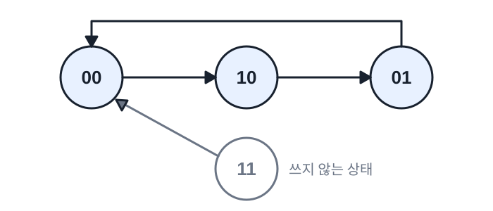
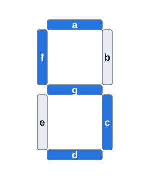
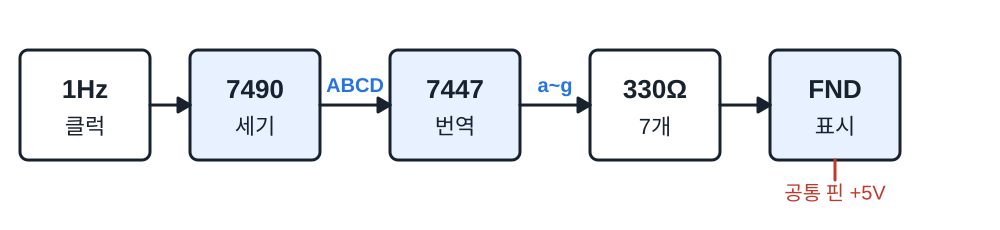

# 실험 8 · Counter — 클럭을 세어 숫자로 보여 줘요 · 실험 설명

      
이번 학기 교안 기준

## 실험 이해

### 왜 이 회로를 쓰는지 먼저 알아봐요

작은 예부터 살펴봐요
이해를 위한 예시: 스위치를 누른 횟수를 숫자로 보고 싶다고 해 봐요. 사람은 머릿속에서 “지금까지 세 번”을 기억하며 하나씩 더하지만, 전선에는 지금 신호가 0인지 1인지만 있어요. 지난 횟수는 어디에도 남지 않아요.

조건과 작동 원리를 확인해요
카운터는 이 문제를 풀어요. 교안은 카운터를 “클럭 펄스마다 현재 숫자를 자동으로 갱신하고 저장하는 레지스터”라고 해요. 플립플롭 여러 개가 지금 숫자를 기억하고, 클럭이 올 때마다 다음 숫자로 바뀌어요. 그래서 입력은 클럭 한 선인데 출력에서 지금까지의 횟수를 읽을 수 있어요.

작은 예를 볼게요. 플립플롭 두 개의 출력을 A, B라고 하고 둘 다 0에서 시작했다고 가정해요. A를 앞에 적으면 클럭이 떨어질 때마다 00, 10, 01, 11 순서로 바뀌고 다시 00으로 돌아와요. 네 상태를 순서대로 지나니까 0부터 3까지 세는 거예요. 이 표기에서는 A가 낮은 자리라서 10이 1, 01이 2예요. 실제 회로는 초기화 입력이 없어서 전원을 켠 뒤의 시작 상태는 정해지지 않아요.

이번 실험에서는 세 가지를 확인해요. 실험 1은 74HC76으로 2단 2진 비동기 카운터를 만들고 74HC08로 네 상태를 하나씩 켜 봐요. 실험 3은 7490으로 0~9를 세고 7447과 7-Segment로 숫자를 보여 줘요. 카운터가 세고, 디코더가 번역하고, 표시기가 보여 주는 흐름이에요.

현재 공지에서 정한 보고서 작성 범위는 실험 1(2단 2진 비동기)과 실험 3(BCD 카운터 + 7-Segment)이에요. 실험 2의 3진 동기 카운터는 보고서 범위 밖이지만 기출에 나왔어요. 보고서 범위 밖이라고 시험에서 빠진다는 뜻은 아니에요. 교안 표지는 25-1이고 현재 배포 파일을 썼어요. 이 노트의 값은 모두 예상 논리 상태이며 실제 측정 결과가 아니에요.

외울 규칙

- **해결하는 문제** → 지난 클럭 수를 기억해 숫자로 읽어요
- **카운터** → 클럭마다 숫자를 갱신해 저장하는 레지스터
- **A를 앞에 적은 2단 2진** → 00→10→01→11→00 (0~3)
- **실험 3의 흐름** → 7490이 세고 → 7447이 번역하고 → FND가 보여 줘요

이유

전선은 지금 값만 알고 지난 횟수를 몰라요. 플립플롭이 숫자를 기억하고 클럭이 갱신해 줘서 횟수를 읽을 수 있어요.

헷갈리지 마요

- 보고서 범위는 실험 1·3이에요. 실험 2(3진 동기)는 범위 밖이지만 기출에 나왔고, 시험 제외로 단정하지 않아요.
- 교안 표지는 25-1이에요.
- 값은 예상 상태이며 실제 측정 결과가 아니에요.
- 실험 1 회로는 초기화 입력이 없어 시작 상태가 정해지지 않아요.

출처: [강의노트/실험8_Counter_회로정정본.pdf · PDF p2](../../../%EA%B0%95%EC%9D%98%EB%85%B8%ED%8A%B8/%EC%8B%A4%ED%97%988_Counter_%ED%9A%8C%EB%A1%9C%EC%A0%95%EC%A0%95%EB%B3%B8.pdf#page=2) · [강의노트/실험8_Counter_회로정정본.pdf · PDF p3](../../../%EA%B0%95%EC%9D%98%EB%85%B8%ED%8A%B8/%EC%8B%A4%ED%97%988_Counter_%ED%9A%8C%EB%A1%9C%EC%A0%95%EC%A0%95%EB%B3%B8.pdf#page=3) · [강의노트/실험8_Counter_회로정정본.pdf · PDF p4](../../../%EA%B0%95%EC%9D%98%EB%85%B8%ED%8A%B8/%EC%8B%A4%ED%97%988_Counter_%ED%9A%8C%EB%A1%9C%EC%A0%95%EC%A0%95%EB%B3%B8.pdf#page=4) · [강의노트/공지사항/2026-09-14_\[필독\]_논리회로실험_보고서_관련_공지.md](../../../%EA%B0%95%EC%9D%98%EB%85%B8%ED%8A%B8/%EA%B3%B5%EC%A7%80%EC%82%AC%ED%95%AD/2026-09-14_%5B%ED%95%84%EB%8F%85%5D_%EB%85%BC%EB%A6%AC%ED%9A%8C%EB%A1%9C%EC%8B%A4%ED%97%98_%EB%B3%B4%EA%B3%A0%EC%84%9C_%EA%B4%80%EB%A0%A8_%EA%B3%B5%EC%A7%80.md)

교안 표지는 25-1이에요. 보고서 범위(실험 1, 3)는 공지에서 확인했어요.

### 레지스터에서 카운터로: Toggle과 진수

새 이름부터 알아봐요
레지스터는 플립플롭 여러 개를 묶어 처리 중인 값을 잠깐 저장하는 기억 장치예요. n비트 레지스터에는 플립플롭 n개가 들어가요. 실험07의 시프트 레지스터도 레지스터의 한 종류였어요.

Toggle은 전등 스위치를 한 번 누를 때마다 켜짐·꺼짐이 뒤바뀌는 것과 같아요. 유효 엣지마다 이전 Q를 뒤집어요. 이렇게만 동작하는 플립플롭을 T F/F라고 불러요. 교안은 “이전 출력을 Toggle”이라고 적어요.

74HC76의 PR·CLR은 실험06에서 본 강제 버튼이에요. 0을 주면 클록 없이 Q를 정해 버리고, 1이면 쉬어요. 카운터로 세려면 강제 버튼이 쉬어야 하니까 둘 다 1로 둬요.

한눈에 보기
다섯 줄로 기억하면 충분해요.

| 조건 | 결과 |
| --- | --- |
| PR=1, CLR=1, J=K=1, 하강 엣지 | Toggle (Q 반전) |
| n비트 레지스터 | 플립플롭 n개 |
| n단 2진 카운터 | 상태 2ⁿ개 |
| 한 사이클의 상태 수가 N개 | N진 카운터(mod-N) |
| 한 단이 Toggle | 출력 주기가 입력의 2배 |

실험06의 JK 규칙과 같고, J=K=1 한 줄만 골라서 쓰는 거예요.

아래 표는 외울 필요 없고, 몇 진인지 세라는 문제에서 꺼내 쓰면 돼요.

“X단 Y진”을 읽는 법
“단”은 플립플롭을 몇 개 이었는지, “진”은 몇 개의 상태를 세는지를 말해요. 그런데 교안의 “2단 2진 Counter”는 조금 달라요. 교안은 0-3 Counter라고 함께 적어요. 2단 2진은 “한 단이 2진(0·1)인 플립플롭을 2단 이었다”는 이름이고, 전체가 세는 상태는 4개예요.

| 이름 | 플립플롭 | 전체 상태 수 | 세는 범위 |
| --- | --- | --- | --- |
| 2단 2진 | 2개 | 2²=4 | 0~3 |
| 3단 2진 | 3개 | 2³=8 | 0~7 |
| 4단 2진 | 4개 | 2⁴=16 | 0~15 |

첫째 줄과 셋째 줄을 비교해 봐요. 플립플롭이 2개 늘었을 뿐인데 상태는 4개에서 16개로 4배가 됐어요. 한 단을 더할 때마다 상태가 2배가 되기 때문이에요.

Toggle의 주기도 따라가 봐요. Q가 한 번 올라갔다 내려오려면 유효 엣지가 두 번 필요해요. 그래서 Q의 주기는 입력의 2배, 주파수는 절반이에요. 교안이 말한 Clock Divider(분주기)가 이 원리예요.

“진”이라는 말을 조심해요
시험에서 “몇 진 카운터”를 물으면 먼저 상태를 세요. “2단 2진”의 “2진”은 전체 상태 수가 아니에요. 2단 회로의 상태는 4개이므로 mod-4예요.

J=K=1이어도 PR이나 CLR이 0이면 Toggle이 일어나지 않아요. 강제 버튼이 이겨요.

플립플롭 수와 상태 수는 달라요. 플립플롭 3개로도 되먹임을 쓰면 8보다 적은 상태만 돌 수 있어요.

한 단계만 풀어 봐요
5단 2진 카운터가 세는 상태는 몇 개이고, 세는 범위는 어디까지일까요?

#### 힌트

한 단마다 상태가 2배예요.

#### 연습 답

2⁵=32개, 0부터 31까지예요.

외울 규칙

- **PR=1, CLR=1, J=K=1, 하강 엣지** → Toggle (Q 반전)
- **n비트 레지스터** → 플립플롭 n개
- **n단 2진 카운터** → 상태 2ⁿ개
- **한 사이클의 상태 수가 N개** → N진 카운터(mod-N)
- **한 단이 Toggle** → 출력 주기가 입력의 2배

이유

Q가 한 번 오르내리는 데 유효 엣지가 두 번 필요해서 한 단마다 주기가 2배, 상태 수도 2배가 돼요. 예: 5단 2진은 2⁵=32개, 0~31이에요.

헷갈리지 마요

- “2단 2진”의 2진은 전체 상태 수가 아니에요. 전체는 4상태(0~3)예요.
- J=K=1이어도 PR이나 CLR이 0이면 강제 버튼이 이겨요.
- 플립플롭 수와 상태 수는 달라요. 되먹임이 있으면 2ⁿ보다 적게 돌 수 있어요.

이 개념으로 풀 문제: [JK F/F를 Toggle로 쓰는 네 핀 값](%EC%8B%A4%ED%97%9808_%EA%B8%B0%EC%B6%9C%ED%92%80%EC%9D%B4.md#q-jk-toggle) · [J, K, CLR로 Toggle 만들기](%EC%8B%A4%ED%97%9808_%EA%B8%B0%EC%B6%9C%ED%92%80%EC%9D%B4.md#q-jk-toggle-3pin) · [T F/F 3단 블록도의 동작](%EC%8B%A4%ED%97%9808_%EA%B8%B0%EC%B6%9C%ED%92%80%EC%9D%B4.md#q-xbit-ymod) · [비동기 회로는 몇 진 카운터인가요](%EC%8B%A4%ED%97%9808_%EA%B8%B0%EC%B6%9C%ED%92%80%EC%9D%B4.md#q-ripple-mod) · [단 수와 상태 수](%EC%8B%A4%ED%97%9808_%EA%B8%B0%EC%B6%9C%ED%92%80%EC%9D%B4.md#q-qp-e08-tf-02)

출처: [강의노트/실험8_Counter_회로정정본.pdf · PDF p3](../../../%EA%B0%95%EC%9D%98%EB%85%B8%ED%8A%B8/%EC%8B%A4%ED%97%988_Counter_%ED%9A%8C%EB%A1%9C%EC%A0%95%EC%A0%95%EB%B3%B8.pdf#page=3) · [강의노트/실험8_Counter_회로정정본.pdf · PDF p4](../../../%EA%B0%95%EC%9D%98%EB%85%B8%ED%8A%B8/%EC%8B%A4%ED%97%988_Counter_%ED%9A%8C%EB%A1%9C%EC%A0%95%EC%A0%95%EB%B3%B8.pdf#page=4) · [강의노트/실험8_Counter_회로정정본.pdf · PDF p5](../../../%EA%B0%95%EC%9D%98%EB%85%B8%ED%8A%B8/%EC%8B%A4%ED%97%988_Counter_%ED%9A%8C%EB%A1%9C%EC%A0%95%EC%A0%95%EB%B3%B8.pdf#page=5)

### 비동기 카운터: 앞 단 출력이 다음 단의 클럭이에요

이어달리기로 먼저 봐요
비동기식은 이어달리기예요. 외부 클럭은 첫 주자 FFA만 받아요. FFB는 A가 1에서 0으로 떨어지는 순간을 신호로 삼아 움직여요. 앞 주자가 끝나야 다음 주자가 출발해요. 그래서 다른 이름으로 리플 카운터라고도 불러요(보충 용어).

한눈에 보기
네 줄로 기억하면 충분해요.

| 조건 | 결과 |
| --- | --- |
| CLK 하강 엣지 | A 반전 |
| A 하강 엣지(1→0) | B 반전 |
| A 상승 엣지(0→1) | B 그대로 |
| AB를 A부터 적으면 | 00→10→01→11→00 |

앞 토픽의 Toggle 규칙 그대로이고, 둘째 단의 클럭 자리에 CLK 대신 A가 들어간 것만 달라요.

아래 추적표는 외울 필요 없고, 파형을 그리라는 문제에서 꺼내 쓰면 돼요.

두 단을 따라가요
교안 p9 회로에서 두 F/F의 J·K·PR·CL은 모두 VCC예요. 첫 단 CLK(1번)에는 Clock Generator, 둘째 단 CLK(6번)에는 A(15번)가 들어가요. 그래서 두 단 모두 Toggle만 해요. 아래 표는 AB=00에서 시작했다고 가정해요.

CLK는 FFA에만 들어가요. FFB의 클록은 A예요.

| CLK 하강 번호 | A 변화 | B 변화 | AB (A부터) | 값(BA 이진수) |
| --- | --- | --- | --- | --- |
| 시작 | — | — | 00 | 0 |
| 1 | 0→1 | 그대로 | 10 | 1 |
| 2 | 1→0 | 0→1 | 01 | 2 |
| 3 | 0→1 | 그대로 | 11 | 3 |
| 4 | 1→0 | 1→0 | 00 | 0 |

A는 CLK의 2배, B는 CLK의 4배 주기예요. 시작 00은 가정이에요.

2번과 3번을 비교해 봐요. 둘 다 CLK가 떨어졌는데 2번에서는 B가 바뀌고 3번에서는 안 바뀌어요. 2번에서는 A가 1→0으로 떨어졌지만 3번에서는 A가 0→1로 올라갔기 때문이에요. B는 A가 떨어질 때만 움직여요.

AB를 A부터 적으면 10이 값 1이에요. A가 낮은 자리이고 B가 높은 자리이기 때문이에요. 교안 본문은 조합을 “00, 01, 10, 11”로 적었지만, 교안 파형과 p9 출력 순서는 00, 10, 01, 11이에요. 이 노트는 파형 쪽 순서를 써요.

왜 “비동기”인가요
각 F/F는 클럭을 받고 잠깐 뒤에 출력이 바뀌어요. 이 시간이 전파지연이에요. 비동기식에서는 앞 단 출력이 바뀐 뒤에야 다음 단이 움직이니까 지연이 단마다 쌓여요. 교안은 이를 “순차적으로 동작하며, 전송 지연이 발생하는 구조”라고 적어요.

시간축을 크게 늘린 그림이에요. 실제 지연 값이 아니에요.

| 순간 | A | B | AB |
| --- | --- | --- | --- |
| CLK 하강 직전 | 1 | 1 | 11 |
| 지연 1번 뒤 | 0 | 1 | 01 |
| 지연 2번 뒤 | 0 | 0 | 00 |

첫째 줄과 둘째 줄을 비교해 봐요. 11에서 00으로 바로 가지 않고 01을 잠깐 지나요. A가 떨어진 것을 보고 나서야 B가 움직이기 때문이에요. 이 짧은 가짜 상태를 디코더가 읽으면 엉뚱한 출력이 순간적으로 켜질 수 있어요. 이걸 글리치라고 해요(보충).

시작값과 엣지를 조심해요
이 회로는 PR·CL이 VCC에 묶여 있어 초기화할 수 없어요. 전원을 켠 직후의 AB는 정해지지 않아요. 문제가 시작값을 주지 않으면 “00에서 시작한다고 가정”을 밝히고 그려요.

74HC76의 CLK는 입력 앞에 동그라미(버블)가 있어 하강 엣지예요. 파형에서 CLK나 A가 올라갈 때 다음 단이 바뀌도록 그리면 틀려요.

교안의 1Hz 클럭이면 F/F 사이 지연은 눈에 안 보여요. 실험 1은 네 LED가 차례로 켜지는 순서를 확인하는 실험이에요.

한 단계만 풀어 봐요
AB=11(A부터)에서 CLK가 한 번 떨어지면 최종 AB는 무엇일까요?

#### 힌트

A를 먼저 뒤집고, A가 떨어졌는지 봐요.

#### 연습 답

A가 1→0으로 떨어져 B도 뒤집혀요. 최종 AB=00이에요.

외울 규칙

- **CLK 하강 엣지** → A 반전
- **A 하강 엣지(1→0)** → B 반전
- **A 상승 엣지(0→1)** → B 그대로
- **AB를 A부터 적으면** → 00→10→01→11→00

이유

둘째 단의 클럭 자리에 A가 들어가서 B는 A가 떨어질 때만 움직여요. 앞 단이 바뀐 뒤 다음 단이 움직이니 전파지연이 단마다 쌓이고, 11에서 00으로 갈 때 01을 잠깐 지나요.

헷갈리지 마요

- 교안 회로는 초기화 입력이 없어요. 시작값 00은 가정이라고 밝혀요.
- A를 앞에 적으면 10이 값 1이에요. A가 낮은 자리예요.
- 교안 본문 “00, 01, 10, 11”과 달리 파형 순서는 00, 10, 01, 11이에요.
- 74HC76은 하강 엣지예요.
- 글리치 설명은 교안 밖 보충이에요.

이 개념으로 풀 문제: [비동기식 카운터의 특징](%EC%8B%A4%ED%97%9808_%EA%B8%B0%EC%B6%9C%ED%92%80%EC%9D%B4.md#q-async-char) · [74HC76 비동기 회로의 A·B 파형](%EC%8B%A4%ED%97%9808_%EA%B8%B0%EC%B6%9C%ED%92%80%EC%9D%B4.md#q-ripple-wave) · [둘째 단이 바뀌는 순간](%EC%8B%A4%ED%97%9808_%EA%B8%B0%EC%B6%9C%ED%92%80%EC%9D%B4.md#q-qp-e08-tf-01) · [가짜 상태가 생기는 이유](%EC%8B%A4%ED%97%9808_%EA%B8%B0%EC%B6%9C%ED%92%80%EC%9D%B4.md#q-qp-e08-short-01)

출처: [강의노트/실험8_Counter_회로정정본.pdf · PDF p4](../../../%EA%B0%95%EC%9D%98%EB%85%B8%ED%8A%B8/%EC%8B%A4%ED%97%988_Counter_%ED%9A%8C%EB%A1%9C%EC%A0%95%EC%A0%95%EB%B3%B8.pdf#page=4) · [강의노트/실험8_Counter_회로정정본.pdf · PDF p5](../../../%EA%B0%95%EC%9D%98%EB%85%B8%ED%8A%B8/%EC%8B%A4%ED%97%988_Counter_%ED%9A%8C%EB%A1%9C%EC%A0%95%EC%A0%95%EB%B3%B8.pdf#page=5) · [강의노트/실험8_Counter_회로정정본.pdf · PDF p9](../../../%EA%B0%95%EC%9D%98%EB%85%B8%ED%8A%B8/%EC%8B%A4%ED%97%988_Counter_%ED%9A%8C%EB%A1%9C%EC%A0%95%EC%A0%95%EB%B3%B8.pdf#page=9) · [보고서/실험08/결선도/netlist.md](../../../%EB%B3%B4%EA%B3%A0%EC%84%9C/%EC%8B%A4%ED%97%9808/%EA%B2%B0%EC%84%A0%EB%8F%84/netlist.md)

교안 본문은 조합을 00, 01, 10, 11로 적고 파형은 00, 10, 01, 11이에요. 파형과 p9 출력 순서를 따랐어요(netlist M10). 글리치·리플 용어는 교안 밖 보충이에요.

### 상태를 AND로 하나씩 읽어요

디코딩이라는 말부터 알아봐요
A, B 두 줄을 보고 지금 숫자가 몇인지 사람이 바로 알긴 어려워요. 디코딩은 “지금이 2번 상태일 때만 불이 켜지게” 바꾸는 일이에요. 네 상태마다 전구를 하나씩 두면 켜진 전구의 위치가 곧 숫자예요.

74HC76에는 Q와 Q′가 둘 다 있어서 A, A′, B, B′를 모두 쓸 수 있어요. AND는 입력이 모두 1일 때만 1이에요. 그래서 “A=0이고 B=1”을 찾고 싶으면 A′와 B를 AND에 넣어요.

한눈에 보기
다섯 줄로 기억하면 충분해요.

| 조건 | 결과 |
| --- | --- |
| A′·B′ = 1 | AB=00, 출력 0 켜짐 |
| A·B′ = 1 | AB=10, 출력 1 켜짐 |
| A′·B = 1 | AB=01, 출력 2 켜짐 |
| A·B = 1 | AB=11, 출력 3 켜짐 |
| n단 2진을 모두 구분 | AND 2ⁿ개 (게이트 입력 n개) |

2단 2진 카운터의 상태표와 같고, 상태마다 AND 하나를 붙인 것만 달라요.

아래 표는 외울 필요 없고, 어떤 출력이 켜지는지 묻는 문제에서 꺼내 쓰면 돼요.

상태마다 출력 하나만 1이에요

교안 p5·p9의 네 AND 조합이에요. 위에서부터 출력 0~3이에요.

| AB (A부터) | 출력 0 | 출력 1 | 출력 2 | 출력 3 |
| --- | --- | --- | --- | --- |
| 00 | 1 | 0 | 0 | 0 |
| 10 | 0 | 1 | 0 | 0 |
| 01 | 0 | 0 | 1 | 0 |
| 11 | 0 | 0 | 0 | 1 |

둘째 줄과 셋째 줄을 비교해 봐요. 10과 01은 1의 개수가 같은데 켜지는 출력이 달라요. AND 입력이 A·B′와 A′·B로 달라서, 어느 자리가 1인지까지 구분하기 때문이에요.

출력핀과 AND는 몇 개 필요할까요
상태 N개를 이진수로 구분하려면 N 이상이 되는 2ᵏ를 찾아 k개의 출력 선이 필요해요. 5상태면 2²=4로는 모자라고 2³=8이면 되니까 Q 출력 3개예요. 000~100으로 다섯 상태를 다르게 적을 수 있어요.

| 세고 싶은 상태 | Q 출력(이진) | 상태별 출력 선(디코딩) |
| --- | --- | --- |
| 4 | 2개 | 4개 |
| 5 | 3개 | 5개 |
| 16 | 4개 | 16개 |

둘째 줄을 봐요. 같은 5진인데 3개와 5개 두 답이 나와요. 이진수로 읽는 선을 세면 3개이고, 상태마다 불을 하나씩 켜는 선을 세면 5개예요. 무엇을 세는지가 달라서 답이 갈려요. 문제가 “확인하기 위한”이라고 하면 어느 쪽을 묻는지 답안에 적어요.

입력 개수와 비동기 글리치를 조심해요
AND 16개는 4입력 AND 기준이에요. 두 입력 AND만 쓴다면 16개로는 모자라요. 답에 “4입력 AND 기준”을 밝혀요.

비동기 카운터에 디코더를 붙이면 비동기 토픽에서 본 가짜 상태 때문에 순간 글리치가 생길 수 있어요. 1Hz LED에서는 눈으로 보기 어려워요.

Y0~Y3은 저장소 명세가 붙인 이름이에요. 교안은 이 출력에 문자 이름을 주지 않고 0~3 번호로 적어요.

한 단계만 풀어 봐요
출력 2가 켜졌어요. A와 B는 각각 몇일까요?

#### 힌트

출력 2의 AND에 어떤 두 신호가 들어가는지 봐요.

#### 연습 답

A′·B=1이니까 A=0, B=1이에요.

외울 규칙

- **A′·B′ = 1** → AB=00, 출력 0
- **A·B′ = 1** → AB=10, 출력 1
- **A′·B = 1** → AB=01, 출력 2
- **A·B = 1** → AB=11, 출력 3
- **n단 2진을 모두 구분** → AND 2ⁿ개 (게이트 입력 n개)
- **5상태 구분** → Q 출력 3개, 상태별 출력 선 5개

이유

AND는 입력이 모두 1일 때만 1이라서, Q와 Q′를 골라 넣으면 한 상태에서만 1이 돼요. 상태 N개는 2ᵏ≥N인 k개의 선이면 이진으로 구분할 수 있어요.

헷갈리지 마요

- AND 16개는 4입력 AND 기준이에요.
- “출력핀 개수”는 이진 Q 출력인지 상태별 출력 선인지에 따라 3개·5개로 갈려요.
- Y0~Y3은 교안 이름이 아니에요.
- 비동기 카운터의 디코더에는 순간 글리치가 생길 수 있어요.

이 개념으로 풀 문제: [4단 2진 카운터를 AND로 확인하기](%EC%8B%A4%ED%97%9808_%EA%B8%B0%EC%B6%9C%ED%92%80%EC%9D%B4.md#q-and-gates) · [5진 카운터의 최소 출력핀](%EC%8B%A4%ED%97%9808_%EA%B8%B0%EC%B6%9C%ED%92%80%EC%9D%B4.md#q-mod5-pins-graded) · [5진 카운터 출력핀 (확인용 단서)](%EC%8B%A4%ED%97%9808_%EA%B8%B0%EC%B6%9C%ED%92%80%EC%9D%B4.md#q-mod5-pins) · [켜지는 출력 찾기](%EC%8B%A4%ED%97%9808_%EA%B8%B0%EC%B6%9C%ED%92%80%EC%9D%B4.md#q-qp-e08-blank-01) · [출력 3의 AND를 작도해요](%EC%8B%A4%ED%97%9808_%EA%B8%B0%EC%B6%9C%ED%92%80%EC%9D%B4.md#q-qp-e08-board-01)

출처: [강의노트/실험8_Counter_회로정정본.pdf · PDF p5](../../../%EA%B0%95%EC%9D%98%EB%85%B8%ED%8A%B8/%EC%8B%A4%ED%97%988_Counter_%ED%9A%8C%EB%A1%9C%EC%A0%95%EC%A0%95%EB%B3%B8.pdf#page=5) · [강의노트/실험8_Counter_회로정정본.pdf · PDF p9](../../../%EA%B0%95%EC%9D%98%EB%85%B8%ED%8A%B8/%EC%8B%A4%ED%97%988_Counter_%ED%9A%8C%EB%A1%9C%EC%A0%95%EC%A0%95%EB%B3%B8.pdf#page=9) · [보고서/실험08/체크리스트/명세.md](../../../%EB%B3%B4%EA%B3%A0%EC%84%9C/%EC%8B%A4%ED%97%9808/%EC%B2%B4%ED%81%AC%EB%A6%AC%EC%8A%A4%ED%8A%B8/%EB%AA%85%EC%84%B8.md)

Y0~Y3은 교안 이름이 아니라 명세의 이름이에요. 출력 번호 0~3은 p5 그림을 따랐어요.

### 동기 카운터: 같은 클럭을 함께 받아요

심판의 호루라기로 먼저 봐요
동기식은 모두 한 호루라기를 듣고 동시에 움직이는 달리기예요. 모든 F/F의 CLK가 같은 신호에 묶여 있어요. 대신 “이번에 뒤집을지 말지”는 J, K 입력이 미리 정해 놓아요.

다음 상태는 지금 상태로 계산해요. 지금 상태에서 J, K를 구하고, 엣지가 오면 모두 함께 바뀌어요. 실험07의 “엣지 직전 값을 함께 받는다”와 같아요.

한눈에 보기
다섯 줄로 기억하면 충분해요. 교안 p10 회로 기준이에요.

| 조건 | 결과 |
| --- | --- |
| 모든 F/F | 같은 CLK 하강 엣지에서 함께 변함 |
| AB=00 | 다음 10 |
| AB=10 | 다음 01 |
| AB=01 | 다음 00 |
| AB=11 (쓰지 않는 상태) | 다음 00 |

JK 규칙은 실험06 그대로이고, J 자리에 상대편 출력이 들어간 것만 달라요.

아래 표는 외울 필요 없고, 회로를 보고 다음 상태를 계산하라는 문제에서 꺼내 쓰면 돼요.

다음 상태표로 3진을 찾아요
교안 p10 회로는 J1=B′, K1=1, J2=A, K2=1이에요. PR·CL은 VCC이고 CLK 1번·6번은 Clock Generator에 함께 연결돼요. K가 늘 1이라서 J=1이면 반전, J=0이면 0으로 Reset돼요.

CLK를 두 F/F가 함께 받아요. 되먹임 B′가 카운트를 짧게 끊어요.

| 지금 AB | J1=B′ | K1 | J2=A | K2 | 다음 A | 다음 B | 다음 AB |
| --- | --- | --- | --- | --- | --- | --- | --- |
| 00 | 1 | 1 | 0 | 1 | 1 | 0 | 10 |
| 10 | 1 | 1 | 1 | 1 | 0 | 1 | 01 |
| 01 | 0 | 1 | 0 | 1 | 0 | 0 | 00 |
| 11 | 0 | 1 | 1 | 1 | 0 | 0 | 00 |

세 상태가 돌아요. 11은 다음 엣지에 고리로 들어와요.

첫째 줄과 셋째 줄을 비교해 봐요. 둘 다 K가 1인데 첫째 줄에서 A는 0→1로 뒤집히고 셋째 줄에서는 0을 유지해요. J1=B′가 1과 0으로 달랐기 때문이에요. B=1이면 J1이 0이 되어 A가 0에 머물러요. 이 되먹임이 11로 가는 길을 막아요.

완성 예제: AB=10이면 J1=1, K1=1이라 A는 반전되어 0, J2=1, K2=1이라 B도 반전되어 1이에요. 그래서 다음은 01이에요. 두 F/F가 같은 엣지에서 함께 바뀌니까 비동기처럼 가짜 상태를 지나지 않아요. 세 상태를 돌므로 3진 카운터이고, 교안 실험 2의 출력 조합 AB′, A′B, A′B′가 차례로 켜져요.

비동기와 나란히 봐요
같은 입력 클럭을 두 카운터에 넣고 AB=00에서 시작했다고 가정해요.

| CLK 하강 | 비동기 2단 AB | 동기 3진 AB |
| --- | --- | --- |
| 시작 | 00 | 00 |
| 1 | 10 | 10 |
| 2 | 01 | 01 |
| 3 | 11 | 00 |
| 4 | 00 | 10 |
| 5 | 10 | 01 |
| 6 | 01 | 00 |

3번을 비교해 봐요. 앞의 두 번은 같은데 3번에서 비동기는 11로, 동기는 00으로 갈라져요. 동기 회로는 B=1이면 J1=0이라 A를 올리지 못하기 때문이에요.

이름과 범위를 조심해요
“동기식은 전파지연이 0이다”라고 쓰면 부정확해요. F/F 하나의 지연은 그대로 있어요. 단마다 쌓이는 전달 지연이 없어지는 거예요.

현재 공지에서 정한 보고서 작성 범위는 실험 1(2단 2진 비동기)과 실험 3(BCD 카운터 + 7-Segment)이에요. 실험 2의 3진 동기 카운터는 보고서 범위 밖이지만 기출에 나왔어요. 보고서 범위 밖이라고 시험에서 빠진다는 뜻은 아니에요.

p10 회로도 초기화 입력이 없어요. 시작 상태는 정해지지 않지만 11에서 시작해도 한 엣지 뒤 00으로 들어와요.

한 단계만 풀어 봐요
이 회로에서 AB=01이면 다음 AB는 무엇일까요?

#### 힌트

B′와 A를 먼저 적어서 J1, J2를 구해요.

#### 연습 답

J1=0, J2=0이고 K는 둘 다 1이라 둘 다 Reset, 다음 AB=00이에요.

외울 규칙

- **모든 F/F** → 같은 CLK 하강 엣지에서 함께 변함
- **AB=00** → 다음 10
- **AB=10** → 다음 01
- **AB=01** → 다음 00
- **AB=11 (쓰지 않는 상태)** → 다음 00

이유

교안 p10은 J1=B′, K1=1, J2=A, K2=1이에요. K가 늘 1이라 J=1이면 반전, J=0이면 0이 돼요. B=1이면 J1=0이 되어 A가 못 올라가므로 세 상태만 돌아요.

헷갈리지 마요

- “전파지연 0”이 아니라 단마다 쌓이는 전달 지연이 없어지는 거예요.
- 실험 2는 보고서 범위 밖이지만 기출에 나왔어요.
- 초기화 입력이 없어 시작 상태는 정해지지 않아요. 11에서 시작해도 00으로 들어와요.

이 개념으로 풀 문제: [동기식이 보완한 점](%EC%8B%A4%ED%97%9808_%EA%B8%B0%EC%B6%9C%ED%92%80%EC%9D%B4.md#q-sync-improve) · [비동기식과 동기식 설명·보완점](%EC%8B%A4%ED%97%9808_%EA%B8%B0%EC%B6%9C%ED%92%80%EC%9D%B4.md#q-async-sync-compare) · [74HC76 동기 회로의 A·B 파형](%EC%8B%A4%ED%97%9808_%EA%B8%B0%EC%B6%9C%ED%92%80%EC%9D%B4.md#q-sync-wave) · [몇 진인지와 2배 진수로 바꾸는 법](%EC%8B%A4%ED%97%9808_%EA%B8%B0%EC%B6%9C%ED%92%80%EC%9D%B4.md#q-mod-and-double)

출처: [강의노트/실험8_Counter_회로정정본.pdf · PDF p4](../../../%EA%B0%95%EC%9D%98%EB%85%B8%ED%8A%B8/%EC%8B%A4%ED%97%988_Counter_%ED%9A%8C%EB%A1%9C%EC%A0%95%EC%A0%95%EB%B3%B8.pdf#page=4) · [강의노트/실험8_Counter_회로정정본.pdf · PDF p10](../../../%EA%B0%95%EC%9D%98%EB%85%B8%ED%8A%B8/%EC%8B%A4%ED%97%988_Counter_%ED%9A%8C%EB%A1%9C%EC%A0%95%EC%A0%95%EB%B3%B8.pdf#page=10)

실험 2는 보고서 범위 밖이에요. J1=B′, K1=1, J2=A, K2=1은 p10 회로를 직접 읽었고 2017-1 기출 회로와 같아요.

### 7490: 0부터 9까지 세는 BCD 카운터

새 이름부터 알아봐요
BCD는 Binary Coded Decimal이에요. 십진수 한 자리(0~9)를 이진수 네 비트로 적는 방법이에요. 그래서 BCD 카운터는 9 다음에 10이 아니라 0으로 돌아가요.

7490 안에는 카운터가 둘 들어 있어요. INPUT A로 움직이는 QA 한 단(2진)과 INPUT B로 움직이는 QB·QC·QD 세 단(5진)이에요. 둘을 이으면 2×5=10이에요.

R0와 R9는 강제 버튼이에요. R0는 “0으로”, R9는 “9로” 만드는 버튼이에요. 두 핀 (1)·(2)가 모두 H여야 눌려요. 74HC76의 강제 버튼은 L일 때 눌리지만 이 버튼은 H일 때 눌려요.

한눈에 보기
다섯 줄로 기억하면 충분해요.

| 조건 | 결과 |
| --- | --- |
| R9(1)=R9(2)=H | 9로 고정 (QD QC QB QA = H L L H) |
| R0(1)=R0(2)=H, R9 중 하나 L | 0으로 고정 |
| R0, R9 모두 해제 | COUNT 동작 |
| 클럭→14번, 12번→1번 | 0~9를 세요 |
| 9에서 다음 하강 엣지 | 0으로 돌아가요 |

2단 2진 비동기 카운터처럼 앞 단 QA가 뒤 단의 클럭이 돼요. 뒤 단이 2진 대신 5진인 것만 달라요.

아래 표는 외울 필요 없고, 출력 값을 읽으라는 문제에서 꺼내 쓰면 돼요.

p11 회로를 읽어요

12번과 1번을 이어 2진 단과 5진 단을 직렬로 연결해요.

| 핀 | 이름 | 교안 p11 연결 |
| --- | --- | --- |
| 14 | INPUT A | Clock Generator (+5V, 1Hz) |
| 1 | INPUT B | QA(12번)에 연결 |
| 2, 3 | R0(1), R0(2) | 스위치 D0로 VCC 또는 GND |
| 6, 7 | R9(1), R9(2) | GND |
| 12, 9, 8, 11 | QA, QB, QC, QD | 출력 A, B, C, D |
| 5, 10 | VCC, GND | 전원 (일반 칩과 위치가 달라요) |

| COUNT | QD | QC | QB | QA |
| --- | --- | --- | --- | --- |
| 0 | L | L | L | L |
| 1 | L | L | L | H |
| 2 | L | L | H | L |
| 3 | L | L | H | H |
| 4 | L | H | L | L |
| 5 | L | H | L | H |
| 6 | L | H | H | L |
| 7 | L | H | H | H |
| 8 | H | L | L | L |
| 9 | H | L | L | H |

이 표는 교안 p7의 COUNT 표예요. 맨 오른쪽 QA가 낮은 자리이고 QD가 높은 자리예요.

COUNT 1과 COUNT 2를 비교해 봐요. 1에서 2로 갈 때 QA가 H→L로 떨어지고 QB가 올라가요. QA의 하강이 5진 단의 클럭이기 때문이에요. COUNT 2에서 3으로 갈 때는 QA가 올라가기만 하니 QB가 그대로예요.

COUNT 9에서 다음 하강 엣지가 오면 QA가 H→L로 떨어지고 그 하강으로 5진 단이 다시 처음으로 돌아가요. 그래서 1001 다음이 0000이에요. 1010~1111은 정상 세기에서 나오지 않아요.

강제 버튼 표를 읽어요
교안 p7 Reset 표예요. X는 어느 값이든 상관없다는 뜻이고 알 수 없는 값이 아니에요. 교안은 “우선순위 R0<R9”라고 적어요.

| R0(1) | R0(2) | R9(1) | R9(2) | QD QC QB QA |
| --- | --- | --- | --- | --- |
| H | H | L | X | L L L L |
| H | H | X | L | L L L L |
| X | X | H | H | H L L H |
| X | L | X | L | COUNT |
| X | L | L | X | COUNT |
| L | X | X | L | COUNT |
| L | X | L | X | COUNT |

첫째 줄과 셋째 줄을 비교해 봐요. 셋째 줄은 R0가 X이니까 R0(1)=R0(2)=H여도 9가 돼요. 첫째 줄은 R9 쪽이 눌리지 않아서 0이 돼요. R9가 눌리면 R0를 이겨요.

p11 회로는 R9 두 핀을 GND에 묶고 R0 두 핀을 스위치 하나로 함께 조작해요. R0=1이면 클럭이 돌아도 0에 머물고, R0=0으로 내리면 세기 시작해요.

교안의 표기 차이를 조심해요
p6 핀맵은 6·7번을 No Connect로 적었지만, p6 내부 회로와 p7 표, p11 회로는 R9로 써요. p11대로 GND에 연결해요.

VCC는 5번, GND는 10번이에요. 일반 14핀 칩의 14번·7번과 달라요. 잘못 꽂으면 칩이 망가질 수 있어요.

p11의 스위치 D0는 준비물에 없어요. 저장소 명세는 R0 점퍼를 +5V와 GND로 옮겨 꽂는 방법을 써요. 교안 원문이 아니에요.

QA를 INPUT B에 잇지 않으면 QA 혼자 2진으로만 움직이고 나머지는 멈춰요. 12번→1번 연결을 빠뜨리지 않아요.

교안 표기가 갈려요. 준비물은 7490·7447인데 본문은 DM7490A·SN7447A, 회로도는 74HC90·74HC47이에요. 표시기도 FND 507과 FND 205가 섞여 있어요. 받은 부품의 각인을 보고 핀을 맞춰요.

한 단계만 풀어 봐요
R0 해제 상태에서 지금 QD QC QB QA = L H H H예요. 다음 하강 엣지 뒤의 값은 무엇일까요?

#### 힌트

지금 COUNT가 몇인지 표에서 찾아요.

#### 연습 답

지금은 COUNT 7이고 다음은 COUNT 8, H L L L이에요.

외울 규칙

- **R9(1)=R9(2)=H** → 9로 고정 (H L L H)
- **R0(1)=R0(2)=H, R9 중 하나 L** → 0으로 고정
- **R0, R9 모두 해제** → COUNT 동작
- **클럭→14번, 12번→1번** → 0~9를 세요
- **9에서 다음 하강 엣지** → 0으로 돌아가요
- **전원** → VCC 5번, GND 10번

이유

7490은 QA 2진 단과 QB·QC·QD 5진 단으로 나뉘고, QA의 하강이 5진 단의 클럭이 되어 2×5=10을 세요. 예: COUNT 7(L H H H) 다음은 8(H L L L)이에요.

헷갈리지 마요

- p6 핀맵의 6·7번 No Connect와 달리 p7·p11은 R9예요. GND에 연결해요.
- 우선순위는 R0<R9예요. R9가 눌리면 R0를 이겨요.
- R0·R9는 H일 때 눌려요. 74HC76 PR·CLR은 L일 때 눌려요.
- X는 상관없음이지 알 수 없는 값이 아니에요.
- p11 스위치 D0는 준비물에 없어요.
- 교안의 IC 이름이 DM7490A·74HC90·7490으로 갈려요.

이 개념으로 풀 문제: [R0로 0에 고정](%EC%8B%A4%ED%97%9808_%EA%B8%B0%EC%B6%9C%ED%92%80%EC%9D%B4.md#q-qp-e08-tf-03) · [7490의 두 연결](%EC%8B%A4%ED%97%9808_%EA%B8%B0%EC%B6%9C%ED%92%80%EC%9D%B4.md#q-qp-e08-blank-02)

출처: [강의노트/실험8_Counter_회로정정본.pdf · PDF p6](../../../%EA%B0%95%EC%9D%98%EB%85%B8%ED%8A%B8/%EC%8B%A4%ED%97%988_Counter_%ED%9A%8C%EB%A1%9C%EC%A0%95%EC%A0%95%EB%B3%B8.pdf#page=6) · [강의노트/실험8_Counter_회로정정본.pdf · PDF p7](../../../%EA%B0%95%EC%9D%98%EB%85%B8%ED%8A%B8/%EC%8B%A4%ED%97%988_Counter_%ED%9A%8C%EB%A1%9C%EC%A0%95%EC%A0%95%EB%B3%B8.pdf#page=7) · [강의노트/실험8_Counter_회로정정본.pdf · PDF p11](../../../%EA%B0%95%EC%9D%98%EB%85%B8%ED%8A%B8/%EC%8B%A4%ED%97%988_Counter_%ED%9A%8C%EB%A1%9C%EC%A0%95%EC%A0%95%EB%B3%B8.pdf#page=11) · [보고서/실험08/결선도/netlist.md](../../../%EB%B3%B4%EA%B3%A0%EC%84%9C/%EC%8B%A4%ED%97%9808/%EA%B2%B0%EC%84%A0%EB%8F%84/netlist.md)

p6 핀맵의 6·7번 No Connect와 p7·p11의 R9 충돌은 netlist M4, 스위치 D0는 M7, IC 표기 차이는 M5예요. 2진·5진 나눔은 p6 내부 회로의 클럭 경로로 확인했고 실제 측정은 없어요.

### 7447: 숫자를 세그먼트 신호로 번역해요

새 이름부터 알아봐요
7-Segment는 막대 일곱 개로 숫자를 만드는 표시기예요. 위부터 시계 방향으로 a, b, c, d, e, f이고 가운데가 g예요. 7490의 A~D는 이진수라서 표시기에 바로 넣을 수 없어요. 7447이 번역기예요. 네 비트를 받아 어느 막대를 켤지 정해요.

LT, BI/RBO, RBI는 제어 핀이에요. 이름 위에 줄이 있어서 L일 때 눌리는 버튼이에요. 교안 표의 “0: On, 1: Off”가 이 뜻이에요. 평소에는 모두 1로 둬요.

Active Low는 “0일 때 켠다”는 뜻이에요. 7447의 출력 핀은 세그먼트를 켜고 싶을 때 L이 돼요. 왜 그런지는 다음 토픽에서 전류 길로 봐요.

한눈에 보기
다섯 줄로 기억하면 충분해요.

| 조건 | 결과 |
| --- | --- |
| 제어 핀 모두 H, 입력 0~9 | 그 숫자의 세그먼트가 켜져요 |
| 켜지는 세그먼트 출력 | L |
| 꺼지는 세그먼트 출력 | H(켜지 않음) |
| LT=L | 모든 세그먼트 ON |
| BI=L | 모든 세그먼트 OFF |

AND로 상태를 읽은 디코더처럼 입력 조합을 찾아 출력을 만드는 디코더예요. 출력이 하나가 아니라 일곱 개이고, 켤 때 L이 된다는 점이 달라요.

아래 표는 외울 필요 없고, 핀 출력을 적으라는 문제에서 꺼내 쓰면 돼요.

입력 순서와 세그먼트 표
교안 p15 표의 값이에요. 왼쪽 네 칸은 D, C, B, A 순서예요. 교안 머리글은 DBCA로 적혔지만 0010이 숫자 2, 0100이 숫자 4로 나오려면 D, C, B, A 순서여야 해요.

| D C B A | 숫자 | 켜지는 세그먼트 |
| --- | --- | --- |
| 0000 | 0 | abcdef |
| 0001 | 1 | bc |
| 0010 | 2 | abdeg |
| 0011 | 3 | abcdg |
| 0100 | 4 | bcfg |
| 0101 | 5 | acdfg |
| 0110 | 6 | cdefg |
| 0111 | 7 | abc |
| 1000 | 8 | abcdefg |
| 1001 | 9 | abcdfg |

숫자 5예요. 파란 막대가 켜지는 세그먼트예요.

완성 예제: A=H, B=L, C=H, D=L이면 D C B A=0101, 숫자 5예요. 표에서 acdfg가 켜지니까 핀 출력은 아래와 같아요.

| 핀 | 세그먼트 | 숫자 5에서 | 출력 |
| --- | --- | --- | --- |
| 13 | a | 켜짐 | L |
| 12 | b | 꺼짐 | H |
| 11 | c | 켜짐 | L |
| 10 | d | 켜짐 | L |
| 9 | e | 꺼짐 | H |
| 15 | f | 켜짐 | L |
| 14 | g | 켜짐 | L |

숫자 5와 숫자 6을 비교해 봐요. 입력은 맨 뒤 두 자리만 다른데, 5의 acdfg에서 6의 cdefg로 가면서 e가 켜지고 a가 꺼져요. 입력 패턴만 보고 세그먼트를 짐작할 수 없어서 표가 필요해요. 교안 숫자 6은 a를 켜지 않아요.

핀 순서와 교안의 9를 조심해요
입력 핀 번호는 순서대로가 아니에요. A는 7번, B는 1번, C는 2번, D는 6번이에요. 출력도 a가 13번, b가 12번 … g가 14번, f가 15번이에요.

p15의 숫자 9는 abcdfg(d 켜짐)이에요. 저장소 명세가 대조한 TI 7447 자료의 9는 d가 꺼진 모양이에요. 그래서 실제로 켰을 때 d가 어떤지 봐요. 이 노트는 교안 값을 썼어요.

제공 답안 중 H·L을 반대로 적은 자료가 있어요. 그 답은 “켜짐=H”인 다른 칩의 극성이에요. 7447은 켜짐이 L이에요.

RBI·RBO는 선행 0을 지우는 기능이에요. 이번 회로는 RBI를 1로 둬서 쓰지 않아요.

보충: 7447 출력은 오픈 컬렉터예요. “꺼짐 = H”는 전압을 내보낸다기보다 전류 길을 끊는다는 뜻이에요. 저항과 표시기를 거쳐 +5V 쪽으로 읽혀요.

한 단계만 풀어 봐요
D C B A=0100이면 어떤 세그먼트가 켜지고, 그때 a(13번)의 출력은 무엇일까요?

#### 힌트

표에서 숫자를 찾고 a가 목록에 있는지 봐요.

#### 연습 답

숫자 4, bcfg가 켜져요. a는 꺼지니까 13번은 H예요.

외울 규칙

- **제어 핀 모두 H, 입력 0~9** → 그 숫자의 세그먼트가 켜져요
- **켜지는 세그먼트 출력** → L
- **꺼지는 세그먼트 출력** → H(켜지 않음)
- **LT=L** → 모든 세그먼트 ON
- **BI=L** → 모든 세그먼트 OFF
- **입력 핀** → A 7번, B 1번, C 2번, D 6번
- **숫자 5** → acdfg: 13 L, 12 H, 11 L, 10 L, 9 H, 15 L, 14 L

이유

7447은 네 비트를 받아 일곱 출력을 정하는 디코더이고, 켤 세그먼트의 출력을 L로 만드는 Active Low 출력이에요. 예: 0100은 숫자 4, bcfg가 켜지고 a(13번)는 H예요.

헷갈리지 마요

- 입력 순서는 머리글 DBCA와 달리 D, C, B, A로 읽어요.
- 교안 p15의 9는 d가 켜진 abcdfg예요. TI 7447 자료는 d가 꺼진 모양이에요.
- 켜짐을 H로 적은 제공 답안은 7447 극성과 반대예요.
- 교안 숫자 6은 a를 켜지 않아요.

이 개념으로 풀 문제: [7447 입력 0101의 핀 출력](%EC%8B%A4%ED%97%9808_%EA%B8%B0%EC%B6%9C%ED%92%80%EC%9D%B4.md#q-7447) · [LT 입력의 동작](%EC%8B%A4%ED%97%9808_%EA%B8%B0%EC%B6%9C%ED%92%80%EC%9D%B4.md#q-qp-e08-tf-04) · [입력 0011의 표시](%EC%8B%A4%ED%97%9808_%EA%B8%B0%EC%B6%9C%ED%92%80%EC%9D%B4.md#q-qp-e08-blank-03)

출처: [강의노트/실험8_Counter_회로정정본.pdf · PDF p12](../../../%EA%B0%95%EC%9D%98%EB%85%B8%ED%8A%B8/%EC%8B%A4%ED%97%988_Counter_%ED%9A%8C%EB%A1%9C%EC%A0%95%EC%A0%95%EB%B3%B8.pdf#page=12) · [강의노트/실험8_Counter_회로정정본.pdf · PDF p14](../../../%EA%B0%95%EC%9D%98%EB%85%B8%ED%8A%B8/%EC%8B%A4%ED%97%988_Counter_%ED%9A%8C%EB%A1%9C%EC%A0%95%EC%A0%95%EB%B3%B8.pdf#page=14) · [강의노트/실험8_Counter_회로정정본.pdf · PDF p15](../../../%EA%B0%95%EC%9D%98%EB%85%B8%ED%8A%B8/%EC%8B%A4%ED%97%988_Counter_%ED%9A%8C%EB%A1%9C%EC%A0%95%EC%A0%95%EB%B3%B8.pdf#page=15) · [보고서/실험08/결선도/netlist.md](../../../%EB%B3%B4%EA%B3%A0%EC%84%9C/%EC%8B%A4%ED%97%9808/%EA%B2%B0%EC%84%A0%EB%8F%84/netlist.md)

머리글 DBCA와 값 순서 D, C, B, A는 netlist M9, 숫자 9의 d 세그먼트 차이는 M8(TI SDLS111 p3)이에요. 오픈 컬렉터 설명은 netlist 37행이 인용한 TI SDLS111 p1이에요.

### FND까지 이어서 숫자를 보여 줘요

Common Anode부터 알아봐요
FND의 세그먼트 하나는 LED 하나예요. LED는 애노드(+)에서 캐소드(−)로 전류가 흐를 때 켜져요. Common Anode는 모든 애노드를 한 핀으로 묶어 +5V에 대는 구조예요. 나머지 쪽 끝을 낮게 당긴 세그먼트만 전류가 흘러서 켜져요.

수도꼭지로 생각해 봐요. +5V는 물탱크이고, 7447 출력이 L이 되면 배수구가 열려 물이 흘러요. H면 배수구가 닫혀 흐르지 않아요. 그래서 7447은 켤 때 L이에요.

한눈에 보기
다섯 줄로 기억하면 충분해요.

| 조건 | 결과 |
| --- | --- |
| FND 공통 핀 | +5V |
| 세그먼트 끝이 330Ω 거쳐 7447 L | 전류가 흘러 켜져요 |
| 세그먼트 끝이 7447 H | 꺼져요 |
| 7490 A~D → 7447 A~D | 세는 값이 숫자로 보여요 |
| Common Cathode 표시기 | 이 실험에서 동작하지 않아요 |

앞 토픽 7447의 Active Low 출력에, 전류를 흘릴 LED를 붙인 것뿐이에요.

아래 표는 외울 필요 없고, 결선하거나 전류 길을 설명하라는 문제에서 꺼내 쓰면 돼요.

전체 회로의 흐름

세고(7490), 번역하고(7447), 전류를 제한해(330Ω), 보여 줘요(FND).

교안 p16 FND 핀표예요. 3번과 8번이 Common Anode이고 5번은 소수점(.)이에요.

| FND 핀 | 세그먼트 | 7447 핀(330Ω 거쳐) |
| --- | --- | --- |
| 7 | A(a) | 13 |
| 6 | B(b) | 12 |
| 4 | C(c) | 11 |
| 2 | D(d) | 10 |
| 1 | E(e) | 9 |
| 9 | F(f) | 15 |
| 10 | G(g) | 14 |
| 3, 8 | Common Anode | +5V (저항 없이) |

세 단계를 합친 추적표예요. R0를 해제하고 클럭이 도는 동안이에요.

| COUNT | D C B A | L이 되는 7447 출력 | FND 숫자 |
| --- | --- | --- | --- |
| 0 | 0000 | abcdef | 0 |
| 1 | 0001 | bc | 1 |
| 2 | 0010 | abdeg | 2 |
| 5 | 0101 | acdfg | 5 |
| 9 | 1001 | abcdfg | 9 |

COUNT 1과 COUNT 2를 비교해 봐요. 입력은 두 비트가 바뀌는데 세그먼트는 bc에서 abdeg로 많이 달라져요. 입력의 이진 패턴과 세그먼트 패턴은 규칙이 달라서 번역기가 필요한 거예요.

교안의 핀 충돌과 부품 수를 조심해요
p12 그림의 FND 핀 번호(VCC→1·5, e→2, d→3 …)는 p16 핀표(E=1, D=2, Common Anode=3·8 …)와 어긋나요. 그대로 꽂으면 안 맞을 수 있어요. 교안은 “Pin map은 Appendix 참고”라고 하고, 저장소 명세는 p16을 따라요. 실물은 공통 핀 테스트로 확인해요.

p16은 “FND가 Common Anode가 맞는지 테스트 후 실험할 것”이라고 적어요. Common Cathode는 이 실험에서 동작하지 않아요.

330Ω은 준비물이 4개인데 p12 회로만 해도 7개를 써요. 실험 전에 수량을 확인해요.

저항 없이 세그먼트를 7447에 바로 연결하지 않아요. 전류를 제한하는 330Ω이 필요해요.

교안 표기가 갈려요. 준비물은 7490·7447인데 본문은 DM7490A·SN7447A, 회로도는 74HC90·74HC47이에요. 표시기도 FND 507과 FND 205가 섞여 있어요. 받은 부품의 각인을 보고 핀을 맞춰요.

한 단계만 풀어 봐요
7447 13번이 H예요. FND의 어느 세그먼트가 어떻게 될까요? 왜 그런가요?

#### 힌트

13번은 a예요. 전류가 +5V에서 어디로 흘러야 하는지 봐요.

#### 연습 답

a 세그먼트가 꺼져요. 공통 애노드가 +5V이고 출력도 H라서 양쪽 전압 차가 없어 전류가 흐르지 않아요.

외울 규칙

- **FND 공통 핀** → +5V (3·8번)
- **세그먼트 끝이 330Ω 거쳐 7447 L** → 전류가 흘러 켜져요
- **세그먼트 끝이 7447 H** → 꺼져요
- **7490 A~D → 7447 A~D** → 세는 값이 숫자로 보여요
- **Common Cathode 표시기** → 이 실험에서 동작하지 않아요

이유

Common Anode는 애노드가 +5V로 묶여 있어서 반대쪽을 L로 당긴 세그먼트에만 전류가 흘러요. 그래서 7447은 켤 때 L을 내요. 예: 13번이 H면 a는 꺼져요.

헷갈리지 마요

- p12 그림의 FND 핀 번호와 p16 핀표가 어긋나요. 저장소 명세는 p16을 따라요.
- 실험 전에 Common Anode인지 테스트해요.
- 330Ω은 준비물 4개, p12 회로 7개로 달라요.
- 표시기 이름이 FND 507과 FND 205로 갈려요.
- 저항 없이 세그먼트를 바로 연결하지 않아요.

이 개념으로 풀 문제: [L일 때 켜지는 이유](%EC%8B%A4%ED%97%9808_%EA%B8%B0%EC%B6%9C%ED%92%80%EC%9D%B4.md#q-qp-e08-short-02)

출처: [강의노트/실험8_Counter_회로정정본.pdf · PDF p12](../../../%EA%B0%95%EC%9D%98%EB%85%B8%ED%8A%B8/%EC%8B%A4%ED%97%988_Counter_%ED%9A%8C%EB%A1%9C%EC%A0%95%EC%A0%95%EB%B3%B8.pdf#page=12) · [강의노트/실험8_Counter_회로정정본.pdf · PDF p13](../../../%EA%B0%95%EC%9D%98%EB%85%B8%ED%8A%B8/%EC%8B%A4%ED%97%988_Counter_%ED%9A%8C%EB%A1%9C%EC%A0%95%EC%A0%95%EB%B3%B8.pdf#page=13) · [강의노트/실험8_Counter_회로정정본.pdf · PDF p16](../../../%EA%B0%95%EC%9D%98%EB%85%B8%ED%8A%B8/%EC%8B%A4%ED%97%988_Counter_%ED%9A%8C%EB%A1%9C%EC%A0%95%EC%A0%95%EB%B3%B8.pdf#page=16) · [보고서/실험08/결선도/netlist.md](../../../%EB%B3%B4%EA%B3%A0%EC%84%9C/%EC%8B%A4%ED%97%9808/%EA%B2%B0%EC%84%A0%EB%8F%84/netlist.md)

p12 그림과 p16 핀표의 FND 핀 충돌은 netlist M2, 표시기 이름은 M3, 330Ω 수량은 M6이에요.
