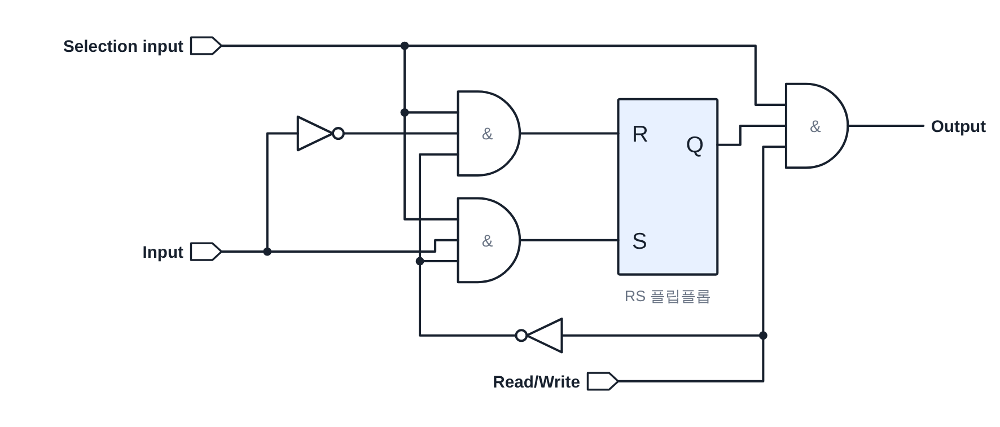
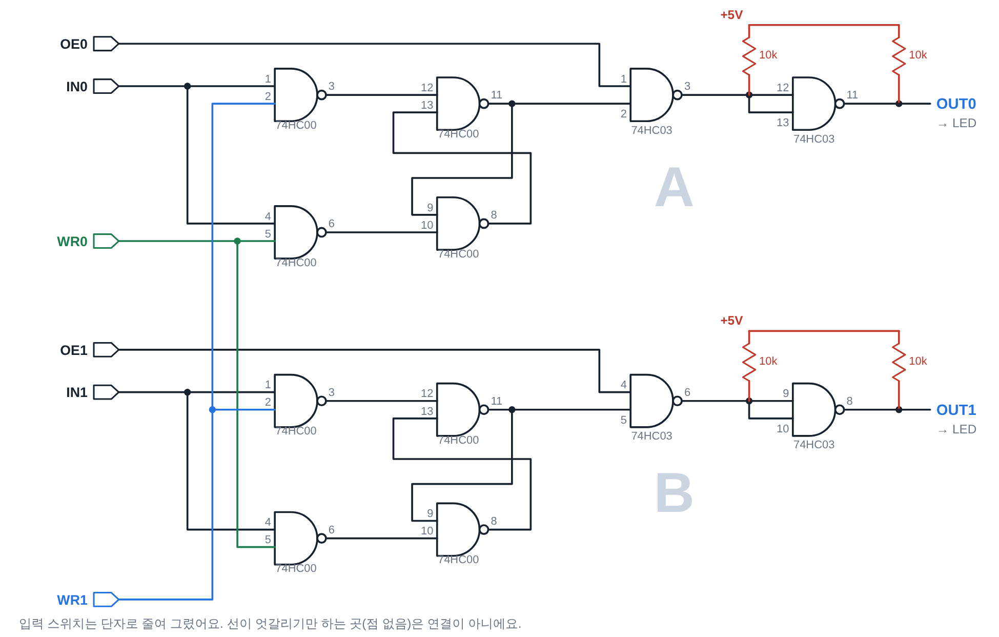
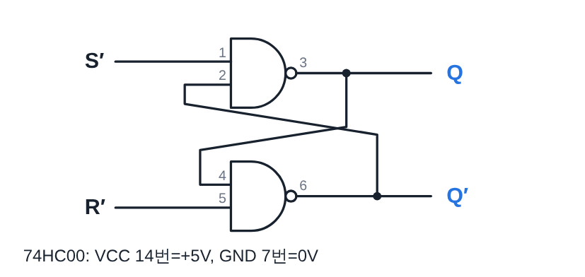

# 실험 9 · 기출문제와 퀴즈 유형 연습

[실험 설명](실험09_실험설명.md) · [문제/해설](실험09_기출풀이.md)

## 1. RAM의 역할
기출 · 실험 9 · 풀이 검토됨

### 문제 원문
RAM의 역할에 대해 쓰시오.

### 구할 것
RAM의 역할 서술

### 힌트 · 접근 순서
무엇을 하는 장치인지(읽기·쓰기), 어떻게 접근하는지, 어디에 쓰이는지 세 가지를 차례로 써요.

## 2. Static RAM(SRAM)이란
기출 · 실험 9 · 풀이 검토됨

### 문제 원문
Static RAM (SRAM)이란 무엇인지 간단히 서술하시오. (3점)

### 구할 것
SRAM이 무엇인지 간단한 서술

### 힌트 · 접근 순서
Static이 무엇을 가리키는지, 무엇으로 저장하는지, 전원과의 관계를 차례로 써요.

## 3. SRAM의 저장 회로
예상문제 · 실험 9 · 풀이 검토됨

### 문제 원문
Static Ram에서 정보를 저장하는데 사용하는 회로의 이름은?

### 구할 것
SRAM에서 정보를 저장하는 회로 이름

### 힌트 · 접근 순서
이번 실험에서 A, B 한 칸이 무엇으로 만들어졌는지 떠올려요.

## 4. 읽기 때 Read/Write 값
예상문제 · 실험 9 · 풀이 검토됨

### 문제 원문
Read operation 일 때의 Read/Write 입력 값은?

### 조건
원문 그림은 은행에 답 표시 없는 사본이 없어 다시 싣지 않았어요. 회로는 다음 문항(1 bit RAM에 1 쓰기)의 그림과 같은 교안 p4 1 bit RAM이에요. Selection input은 세 AND에 모두 들어가요. Input은 그대로 S 쪽 AND에, 인버터를 거쳐 R 쪽 AND에 들어가요. Read/Write는 인버터를 거쳐 S·R 쪽 AND에, 그대로 출력 AND에 들어가요. 출력 AND의 나머지 입력은 Q예요.

### 구할 것
Read operation 때의 Read/Write 입력 값

### 힌트 · 접근 순서
Read/Write가 어느 AND에 그대로, 어느 AND에 뒤집혀 들어가는지 따라가요.

## 5. 1 bit RAM에 1 쓰기
기출 · 실험 9 · 풀이 검토됨

### 문제 원문
다음 1bit RAM에 1의 데이터를 쓰려고 할 때 입력되야하는 Selection input, input, Read/Write 값을 쓰시오.

### 조건
회로는 원문 그림을 다시 그린 그림이에요. 교안 p4의 1 bit RAM과 연결이 같아요. 가운데 RS 플립플롭은 S=1이면 Set, R=1이면 Reset, 둘 다 0이면 유지예요.

### 구할 것
1을 쓸 때의 Selection input, Input, Read/Write 값

### 힌트 · 접근 순서
Q=1이 되려면 S와 R 중 어느 쪽이 1이어야 하는지부터 정해요.

## 6. 1 bit RAM에 0 쓰기
예상문제 · 실험 9 · 풀이 검토됨

### 문제 원문
다음 1bit RAM에 0의 데이터를 쓰려고 할 때 입력되야하는 Selection input, input, Read/Write 값을 쓰시오.

### 조건
회로는 원문 그림을 다시 그린 그림이에요. 교안 p4의 1 bit RAM과 연결이 같아요. 가운데 RS 플립플롭은 S=1이면 Set, R=1이면 Reset, 둘 다 0이면 유지예요.

### 구할 것
0을 쓸 때의 Selection input, Input, Read/Write 값

### 힌트 · 접근 순서
Q=0이 되려면 R=1이어야 해요. R 쪽 AND에는 Input이 어떻게 들어가나요?

## 7. 2bit RAM의 A에 1 쓰기
예상문제 · 실험 9 · 풀이 검토됨

### 문제 원문
A part에 1의 데이터를 쓰기 위한 OE0,1 In0,1, WR0,1 의 값은?

### 조건
회로는 교안 p6(원문 그림과 같은 회로)을 다시 그린 그림이에요. 입력 스위치는 단자로 줄였고 핀 번호는 원문 그대로예요.

교안 범례: OE는 Read Select(0: Off, 1: On), IN은 Write Select(0: Off, 1: On), WR은 Write Value(0 or 1)예요. 범례는 OE0, IN0, WR0을 A part, OE1, IN1, WR1을 B part라고 적어요.

### 구할 것
A part에 1을 쓰기 위한 OE0, OE1, IN0, IN1, WR0, WR1 값

### 힌트 · 접근 순서
A의 Set 쪽 NAND 두 입력이 무엇인지 회로도에서 찾아요. 범례 이름만 믿지 말아요.

## 8. 2bit RAM의 B에 1 쓰기
출처 미확인 · 실험 9 · 풀이 검토됨

### 문제 원문
9. B part에 1의 데이터를 쓰기 위한 OE0,1 In0,1, WR0,1 의 값은?

### 조건
회로는 교안 p6(원문 그림과 같은 회로)을 다시 그린 그림이에요. 입력 스위치는 단자로 줄였고 핀 번호는 원문 그대로예요.

교안 범례: OE는 Read Select(0: Off, 1: On), IN은 Write Select(0: Off, 1: On), WR은 Write Value(0 or 1)예요. 범례는 OE0, IN0, WR0을 A part, OE1, IN1, WR1을 B part라고 적어요.

원문 그림은 은행에 답 표시 없는 사본이 없어 다시 싣지 않았어요. 회로는 앞 문항(A part에 1 쓰기)의 그림과 같은 교안 p6 2bit RAM이에요. B의 Set 쪽 NAND(1·2번)는 IN1과 WR1, Reset 쪽 NAND(4·5번)는 IN1과 WR0을 받아요.

### 구할 것
B part에 1을 쓰기 위한 OE0, OE1, IN0, IN1, WR0, WR1 값

### 힌트 · 접근 순서
B의 Set 쪽 NAND 두 입력을 찾고, A를 지키려면 무엇을 0으로 둘지 생각해요.

## 9. 2bit RAM의 B에 0 쓰기
기출 · 실험 9 · 풀이 검토됨

### 문제 원문
B part에 0의 데이터를 쓰기 위한 OE0,1 In0,1, WR0,1 의 값은?

### 조건
회로는 교안 p6(원문 그림과 같은 회로)을 다시 그린 그림이에요. 입력 스위치는 단자로 줄였고 핀 번호는 원문 그대로예요.

교안 범례: OE는 Read Select(0: Off, 1: On), IN은 Write Select(0: Off, 1: On), WR은 Write Value(0 or 1)예요. 범례는 OE0, IN0, WR0을 A part, OE1, IN1, WR1을 B part라고 적어요.

### 구할 것
B part에 0을 쓰기 위한 OE0, OE1, IN0, IN1, WR0, WR1 값

### 힌트 · 접근 순서
0을 쓰려면 B의 Reset 쪽 NAND 출력이 0이 돼야 해요. 그 NAND의 두 입력을 찾아요.

## 10. WE에 1을 주면
연습문제 · 실험 9 · 풀이 검토됨 · 퀴즈 유형 연습 — 자체 출제 · T/F

### 문제 원문
74670에서 WE에 1을 주면 쓰기 주소의 칸에 D1~D4가 저장된다. T/F

### 조건
교안 p8 범례: WE: Write Enable (0: On, 1: Off). 74670의 쓰기 주소와 D1~D4는 이미 맞춰 두었어요.

### 구할 것
참(T)·거짓(F) 판정

### 힌트 · 접근 단서
이름 위 줄 = 0일 때 켜짐

## 11. IN0=0이면 A는 그대로
연습문제 · 실험 9 · 풀이 검토됨 · 퀴즈 유형 연습 — 자체 출제 · T/F

### 문제 원문
이때 WR0과 WR1을 어떤 값으로 바꿔도 A의 저장값은 1로 유지된다. T/F

### 조건
교안 p6 2bit RAM의 칸 A에 1이 저장돼 있어요. IN0=0, IN1=0이에요.

### 구할 것
참(T)·거짓(F) 판정

### 힌트 · 접근 단서
IN=0이면 S′=R′=1

## 12. 전원을 껐다 켜면
연습문제 · 실험 9 · 풀이 검토됨 · 퀴즈 유형 연습 — 자체 출제 · T/F

### 문제 원문
RAM은 전원을 껐다 켜도 저장한 값이 그대로 남는 메모리이다. T/F

### 조건
교안 실험 2의 3번은 74670의 전원을 제거했다가 다시 연결한 뒤 값의 변화를 보는 휘발성 실험이에요.

### 구할 것
참(T)·거짓(F) 판정

### 힌트 · 접근 단서
휘발성 = 전원이 꺼지면 사라짐

## 13. 읽기 때의 Output
연습문제 · 실험 9 · 풀이 검토됨 · 퀴즈 유형 연습 — 자체 출제 · T/F

### 문제 원문
이때 Output은 저장된 Q와 같고, Input을 바꿔도 Q는 바뀌지 않는다. T/F

### 조건
교안 p4 1 bit RAM이에요. Selection Input=1, Read/Write=1이에요.

### 구할 것
참(T)·거짓(F) 판정

### 힌트 · 접근 단서
R/W=1은 읽기

## 14. NAND 래치의 금지 입력
연습문제 · 실험 9 · 풀이 검토됨 · 퀴즈 유형 연습 — 자체 출제 · 빈칸

### 문제 원문
피해야 할 입력은 S′R′ = ① ( )이에요. 이때 Q와 Q′가 모두 ② ( )이 되어 부정 상태가 돼요.

### 조건
NAND 게이트 두 개로 만든 SR 래치예요. 입력은 S′, R′이에요.

### 구할 것
빈칸의 값

### 힌트 · 접근 단서
NAND는 0이 하나라도 있으면 1

## 15. 74670의 칸과 주소
연습문제 · 실험 9 · 풀이 검토됨 · 퀴즈 유형 연습 — 자체 출제 · 빈칸

### 문제 원문
74670은 ① ( )비트짜리 칸 ② ( )개로 16비트를 저장하고, 칸을 고르는 쓰기 주소 입력은 ③ ( )개(WA, WB)예요.

### 조건
교안 p8의 74670(16bit RAM)이에요.

### 구할 것
빈칸의 값

### 힌트 · 접근 단서
주소 n비트 → 2ⁿ칸

## 16. 74HC03 출력과 저항
연습문제 · 실험 9 · 풀이 검토됨 · 퀴즈 유형 연습 — 자체 출제 · 빈칸

### 문제 원문
74HC03 출력은 결과가 0일 때만 핀을 GND로 당기는 ① ( ) 출력이라, 1을 만들려면 +5V에 이은 ② ( ) 저항이 필요해요.

### 조건
교안 p6 2bit RAM의 출력단은 74HC03이고 출력마다 10K 저항이 +5V에 연결돼요.

### 구할 것
빈칸의 값

### 힌트 · 접근 단서
0만 당기고 1은 놓는 출력

## 17. RAM 한 칸(NAND SR 래치)을 작도해요
연습문제 · 실험 9 · 풀이 검토됨 · 퀴즈 유형 연습 — 자체 출제 · 브레드보드 작도

### 문제 원문
주어진 NAND SR 래치 회로와 핀 명세를 빈 보드에 옮겨 전원·입력·되먹임·측정점과 미사용 핀을 표시하세요.

### 조건
74HC00 두 게이트로 2bit RAM 한 칸인 NAND SR 래치를 만들어요. S′, R′는 0V 또는 5V 외부 입력이고 LED는 쓰지 않아요.

| 핀 | 이름 | 역할 |
| --- | --- | --- |
| 1 | S′ | 입력 (0일 때 Set) |
| 5 | R′ | 입력 (0일 때 Reset) |
| 3 | Q | 출력·측정점, 4번으로 되먹임 |
| 6 | Q′ | 출력, 2번으로 되먹임 |
| 14 | VCC | +5V |
| 7 | GND | 0V |
| 9,10,12,13 | 미사용 입력 | 수업 작도 명세: NC(개방), 실사용 일반 권장과 구분 |
| 8,11 | 미사용 출력 | NC, 접지 금지 |

### 구할 것
완성한 작도

### 힌트 · 접근 단서
같은 넷을 같은 도통 홀에 옮겨요

## 18. 쓴 뒤 IN을 접지하는 이유
연습문제 · 실험 9 · 풀이 검토됨 · 퀴즈 유형 연습 — 자체 출제 · 짧은 서술형

### 문제 원문
2bit RAM에서 쓴 뒤 IN을 먼저 접지하고 OE로 읽어야 하는 이유를 래치 입력과 출력의 관점에서 두세 문장으로 설명하세요.

### 조건
교안 p7 주의 3: Write 후에는 Write Select(IN)를 접지하여 값을 저장하고, Read Select(OE)에 전압을 가하여 저장된 값을 읽는다.

### 구할 것
이유를 담은 설명

### 힌트 · 접근 단서
IN=0이면 래치 입력 11

## 19. 주소 입력이 하는 일
연습문제 · 실험 9 · 풀이 검토됨 · 퀴즈 유형 연습 — 자체 출제 · 짧은 서술형

### 문제 원문
74670에서 주소 입력이 하는 일을 설명하고, 쓰기 주소와 읽기 주소가 따로 있으면 무엇이 가능한지 두세 문장으로 쓰세요.

### 조건
교안 p8 범례: RA-B: Read Adress, WA-B: Write Adress, “데이터를 읽거나 쓸 메모리 주소 선택 (00 01 10 11)”.

### 구할 것
이유를 담은 설명

### 힌트 · 접근 단서
주소 n비트 → 2ⁿ칸 중 하나
