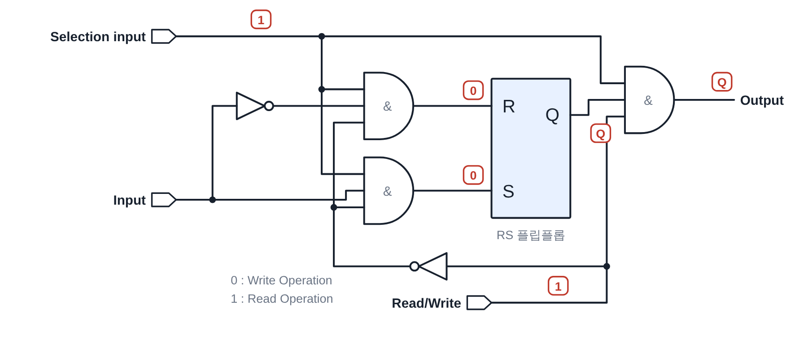
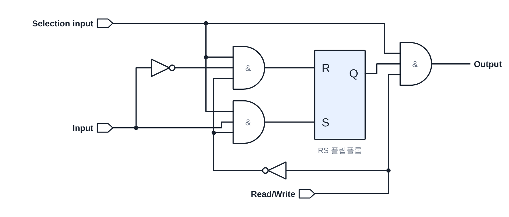
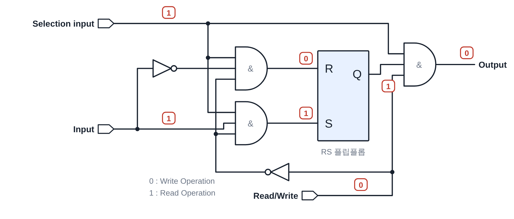
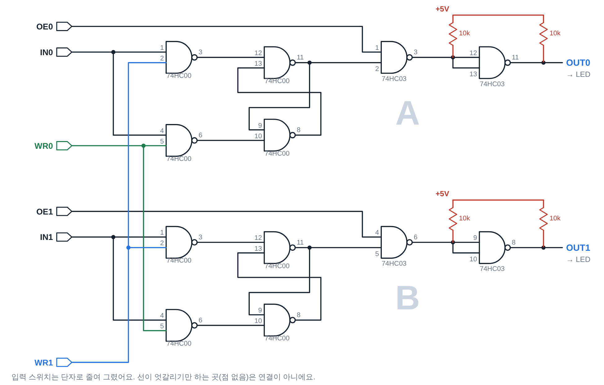
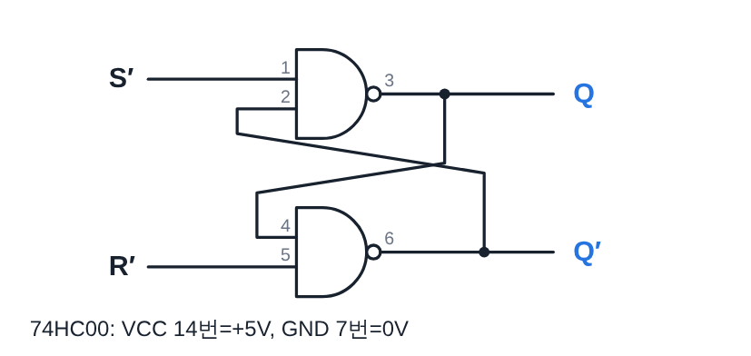
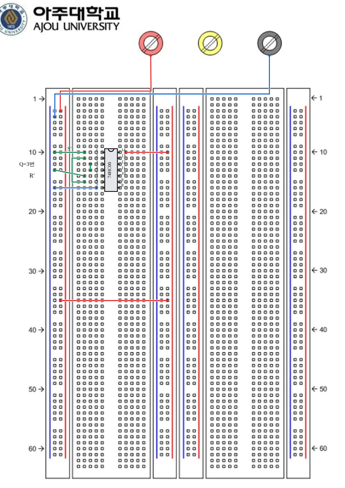

# 실험 9 · 기출풀이와 퀴즈 유형 연습

[실험 설명](실험09_실험설명.md) · [문제/해설](실험09_기출문제.md)

## 1. RAM의 역할
기출 · 실험 9 · 풀이 검토됨

### 문제 원문
RAM의 역할에 대해 쓰시오.

### 구할 것
RAM의 역할 서술

### 힌트 · 접근 순서
무엇을 하는 장치인지(읽기·쓰기), 어떻게 접근하는지, 어디에 쓰이는지 세 가지를 차례로 써요.

### 풀이 1 · 정의
교안 p3: 기억된 정보를 읽거나 새로운 정보를 기억시킬 수 있는 메모리예요.

### 풀이 2 · 접근 방식
메모리 안 물리적 위치에 관계없이 거의 같은 시간에 원하는 위치를 읽거나 써요. 이것이 Random Access예요.

### 풀이 3 · 쓰임
기억장치, 응용 프로그램의 일시적 로딩, 데이터의 일시적 저장에 써요.

### 풀이 4 · 검산
제공 답안 일곱 개 모두 “정보를 읽거나 기억”과 “일시적 로딩·저장”을 담고 있어 이 풀이와 같은 내용이에요.

### 풀이 5 · 주의
Random을 “무작위 값”으로 쓰지 않아요. 읽기만 쓰고 쓰기(기억시키기)를 빠뜨리면 정의가 모자라요.

### 최종 답
기억된 정보를 읽거나 새로운 정보를 기억시킬 수 있는 메모리예요. 위치에 관계없이 거의 같은 시간에 원하는 위치에 접근해 데이터를 읽고 써요(Random Access). 기억장치, 응용 프로그램의 일시적 로딩, 데이터의 일시적 저장에 쓰여요.

### 출처
- [from_the_past/정리/퀴즈/실험9/실험9 퀴즈 기출 2016-2.pdf](../../../from_the_past/%EC%A0%95%EB%A6%AC/%ED%80%B4%EC%A6%88/%EC%8B%A4%ED%97%989/%EC%8B%A4%ED%97%989%20%ED%80%B4%EC%A6%88%20%EA%B8%B0%EC%B6%9C%202016-2.pdf#page=1)
- [from_the_past/정리/퀴즈/실험9/실험9 퀴즈 기출_단답형.pdf](../../../from_the_past/%EC%A0%95%EB%A6%AC/%ED%80%B4%EC%A6%88/%EC%8B%A4%ED%97%989/%EC%8B%A4%ED%97%989%20%ED%80%B4%EC%A6%88%20%EA%B8%B0%EC%B6%9C_%EB%8B%A8%EB%8B%B5%ED%98%95.pdf#page=1)
- [from_the_past/정리/퀴즈/실험9/실험9 퀴즈 예상문제_v1.pdf](../../../from_the_past/%EC%A0%95%EB%A6%AC/%ED%80%B4%EC%A6%88/%EC%8B%A4%ED%97%989/%EC%8B%A4%ED%97%989%20%ED%80%B4%EC%A6%88%20%EC%98%88%EC%83%81%EB%AC%B8%EC%A0%9C_v1.pdf#page=1)
- [from_the_past/정리/퀴즈/실험9/실험9 퀴즈 예상문제_v2.pdf](../../../from_the_past/%EC%A0%95%EB%A6%AC/%ED%80%B4%EC%A6%88/%EC%8B%A4%ED%97%989/%EC%8B%A4%ED%97%989%20%ED%80%B4%EC%A6%88%20%EC%98%88%EC%83%81%EB%AC%B8%EC%A0%9C_v2.pdf#page=1)
- [from_the_past/정리/퀴즈/실험9/실험9 퀴즈 예상문제_v3.pdf](../../../from_the_past/%EC%A0%95%EB%A6%AC/%ED%80%B4%EC%A6%88/%EC%8B%A4%ED%97%989/%EC%8B%A4%ED%97%989%20%ED%80%B4%EC%A6%88%20%EC%98%88%EC%83%81%EB%AC%B8%EC%A0%9C_v3.pdf#page=1)
- [from_the_past/정리/퀴즈/실험9/실험9 퀴즈 예상문제_v4.pdf](../../../from_the_past/%EC%A0%95%EB%A6%AC/%ED%80%B4%EC%A6%88/%EC%8B%A4%ED%97%989/%EC%8B%A4%ED%97%989%20%ED%80%B4%EC%A6%88%20%EC%98%88%EC%83%81%EB%AC%B8%EC%A0%9C_v4.pdf#page=1)
- [from_the_past/정리/퀴즈/실험9/실험9 퀴즈 종합_기출문제 (2p).pdf](../../../from_the_past/%EC%A0%95%EB%A6%AC/%ED%80%B4%EC%A6%88/%EC%8B%A4%ED%97%989/%EC%8B%A4%ED%97%989%20%ED%80%B4%EC%A6%88%20%EC%A2%85%ED%95%A9_%EA%B8%B0%EC%B6%9C%EB%AC%B8%EC%A0%9C%20%282p%29.pdf#page=1)
- [from_the_past/정리/퀴즈/실험9/원본_docx/실험9_예상.doc](../../../from_the_past/%EC%A0%95%EB%A6%AC/%ED%80%B4%EC%A6%88/%EC%8B%A4%ED%97%989/%EC%9B%90%EB%B3%B8_docx/%EC%8B%A4%ED%97%989_%EC%98%88%EC%83%81.doc)
- [from_the_past/정리/퀴즈/실험9/실험9 퀴즈 예상문제_수기메모.jpg](../../../from_the_past/%EC%A0%95%EB%A6%AC/%ED%80%B4%EC%A6%88/%EC%8B%A4%ED%97%989/%EC%8B%A4%ED%97%989%20%ED%80%B4%EC%A6%88%20%EC%98%88%EC%83%81%EB%AC%B8%EC%A0%9C_%EC%88%98%EA%B8%B0%EB%A9%94%EB%AA%A8.jpg)
- [from_the_past/정리/퀴즈/실험9/원본_docx/quiz_09.hwp](../../../from_the_past/%EC%A0%95%EB%A6%AC/%ED%80%B4%EC%A6%88/%EC%8B%A4%ED%97%989/%EC%9B%90%EB%B3%B8_docx/quiz_09.hwp)

## 2. Static RAM(SRAM)이란
기출 · 실험 9 · 풀이 검토됨

### 문제 원문
Static RAM (SRAM)이란 무엇인지 간단히 서술하시오. (3점)

### 구할 것
SRAM이 무엇인지 간단한 서술

### 힌트 · 접근 순서
Static이 무엇을 가리키는지, 무엇으로 저장하는지, 전원과의 관계를 차례로 써요.

### 풀이 1 · 저장 방식
플립플롭(래치)이 비트 하나를 붙잡아요. 이번 실험의 NAND SR 래치가 그 예예요.

### 풀이 2 · Static의 뜻
전원이 있는 동안 리프레시 없이 값이 유지돼요. DRAM은 전하가 새서 주기적으로 다시 써야 해요(보충).

### 풀이 3 · RAM의 성질
주소로 어느 위치든 거의 같은 시간에 읽고 쓰고, 전원을 끄면 값이 사라져요(휘발성).

### 풀이 4 · 검산
채점본의 수기 답안(부분 판독)도 “접근속도가 같고, 휘발성”을 적었어요. 이 풀이와 겹치는 핵심이에요.

### 풀이 5 · 주의
Static을 “전원 없이도 유지”로 쓰면 틀려요. 비휘발성은 ROM·플래시 같은 다른 메모리의 성질이에요(보충).

### 최종 답
SRAM은 플립플롭(래치)으로 한 비트씩 저장하는 RAM이에요. 전원이 있는 동안에는 다시 써 주지(리프레시) 않아도 값이 유지되고, 주소로 어느 위치든 거의 같은 시간에 읽고 써요. 전원을 끄면 값이 사라지는 휘발성 메모리예요.

### 출처
- [from_the_past/정리/퀴즈/실험9/실험9 퀴즈 기출_채점본_1.jpg](../../../from_the_past/%EC%A0%95%EB%A6%AC/%ED%80%B4%EC%A6%88/%EC%8B%A4%ED%97%989/%EC%8B%A4%ED%97%989%20%ED%80%B4%EC%A6%88%20%EA%B8%B0%EC%B6%9C_%EC%B1%84%EC%A0%90%EB%B3%B8_1.jpg)

## 3. SRAM의 저장 회로
예상문제 · 실험 9 · 풀이 검토됨

### 문제 원문
Static Ram에서 정보를 저장하는데 사용하는 회로의 이름은?

### 구할 것
SRAM에서 정보를 저장하는 회로 이름

### 힌트 · 접근 순서
이번 실험에서 A, B 한 칸이 무엇으로 만들어졌는지 떠올려요.

### 풀이 1 · 저장 회로
되먹임으로 Q를 붙잡는 플립플롭(래치)이에요.

### 풀이 2 · 이번 실험
74HC00 NAND 두 개로 만든 NAND SR 래치가 비트 하나예요. S′=R′=1이면 앞의 값을 유지해요.

### 풀이 3 · 검산
제공 답안은 “플립플롭, 인버터”, “플립플롭이 사용되며…”, “R-S F/F” 세 가지예요. 셋 다 플립플롭(래치) 계열이라 이 풀이와 맞아요.

### 풀이 4 · 주의
레지스터는 플립플롭 여러 개를 묶은 것이에요. 한 비트를 붙잡는 회로의 이름은 플립플롭(래치)이에요.

### 최종 답
플립플롭(래치)이에요. 이번 실험에서는 NAND 게이트 두 개로 만든 NAND SR 래치가 한 비트를 저장해요.

### 출처
- [from_the_past/정리/퀴즈/실험9/실험9 퀴즈 기출_단답형.pdf](../../../from_the_past/%EC%A0%95%EB%A6%AC/%ED%80%B4%EC%A6%88/%EC%8B%A4%ED%97%989/%EC%8B%A4%ED%97%989%20%ED%80%B4%EC%A6%88%20%EA%B8%B0%EC%B6%9C_%EB%8B%A8%EB%8B%B5%ED%98%95.pdf#page=1)
- [from_the_past/정리/퀴즈/실험9/실험9 퀴즈 예상문제_v1.pdf](../../../from_the_past/%EC%A0%95%EB%A6%AC/%ED%80%B4%EC%A6%88/%EC%8B%A4%ED%97%989/%EC%8B%A4%ED%97%989%20%ED%80%B4%EC%A6%88%20%EC%98%88%EC%83%81%EB%AC%B8%EC%A0%9C_v1.pdf#page=1)
- [from_the_past/정리/퀴즈/실험9/실험9 퀴즈 예상문제_v2.pdf](../../../from_the_past/%EC%A0%95%EB%A6%AC/%ED%80%B4%EC%A6%88/%EC%8B%A4%ED%97%989/%EC%8B%A4%ED%97%989%20%ED%80%B4%EC%A6%88%20%EC%98%88%EC%83%81%EB%AC%B8%EC%A0%9C_v2.pdf#page=1)
- [from_the_past/정리/퀴즈/실험9/실험9 퀴즈 예상문제_v3.pdf](../../../from_the_past/%EC%A0%95%EB%A6%AC/%ED%80%B4%EC%A6%88/%EC%8B%A4%ED%97%989/%EC%8B%A4%ED%97%989%20%ED%80%B4%EC%A6%88%20%EC%98%88%EC%83%81%EB%AC%B8%EC%A0%9C_v3.pdf#page=1)
- [from_the_past/정리/퀴즈/실험9/실험9 퀴즈 예상문제_v4.pdf](../../../from_the_past/%EC%A0%95%EB%A6%AC/%ED%80%B4%EC%A6%88/%EC%8B%A4%ED%97%989/%EC%8B%A4%ED%97%989%20%ED%80%B4%EC%A6%88%20%EC%98%88%EC%83%81%EB%AC%B8%EC%A0%9C_v4.pdf#page=1)
- [from_the_past/정리/퀴즈/실험9/실험9 퀴즈 종합_기출문제 (2p).pdf](../../../from_the_past/%EC%A0%95%EB%A6%AC/%ED%80%B4%EC%A6%88/%EC%8B%A4%ED%97%989/%EC%8B%A4%ED%97%989%20%ED%80%B4%EC%A6%88%20%EC%A2%85%ED%95%A9_%EA%B8%B0%EC%B6%9C%EB%AC%B8%EC%A0%9C%20%282p%29.pdf#page=1)
- [from_the_past/정리/퀴즈/실험9/원본_docx/실험9_예상.doc](../../../from_the_past/%EC%A0%95%EB%A6%AC/%ED%80%B4%EC%A6%88/%EC%8B%A4%ED%97%989/%EC%9B%90%EB%B3%B8_docx/%EC%8B%A4%ED%97%989_%EC%98%88%EC%83%81.doc)
- [from_the_past/정리/퀴즈/실험9/실험9 퀴즈 예상문제_수기메모.jpg](../../../from_the_past/%EC%A0%95%EB%A6%AC/%ED%80%B4%EC%A6%88/%EC%8B%A4%ED%97%989/%EC%8B%A4%ED%97%989%20%ED%80%B4%EC%A6%88%20%EC%98%88%EC%83%81%EB%AC%B8%EC%A0%9C_%EC%88%98%EA%B8%B0%EB%A9%94%EB%AA%A8.jpg)
- [from_the_past/정리/퀴즈/실험9/원본_docx/quiz_09.hwp](../../../from_the_past/%EC%A0%95%EB%A6%AC/%ED%80%B4%EC%A6%88/%EC%8B%A4%ED%97%989/%EC%9B%90%EB%B3%B8_docx/quiz_09.hwp)

## 4. 읽기 때 Read/Write 값
예상문제 · 실험 9 · 풀이 검토됨

### 문제 원문
Read operation 일 때의 Read/Write 입력 값은?

### 조건
원문 그림은 은행에 답 표시 없는 사본이 없어 다시 싣지 않았어요. 회로는 다음 문항(1 bit RAM에 1 쓰기)의 그림과 같은 교안 p4 1 bit RAM이에요. Selection input은 세 AND에 모두 들어가요. Input은 그대로 S 쪽 AND에, 인버터를 거쳐 R 쪽 AND에 들어가요. Read/Write는 인버터를 거쳐 S·R 쪽 AND에, 그대로 출력 AND에 들어가요. 출력 AND의 나머지 입력은 Q예요.

### 구할 것
Read operation 때의 Read/Write 입력 값

### 힌트 · 접근 순서
Read/Write가 어느 AND에 그대로, 어느 AND에 뒤집혀 들어가는지 따라가요.

### 풀이 1 · 출력 문
Output = Sel·(R/W)·Q예요. R/W=1, Sel=1이면 Output=Q예요.

### 풀이 2 · 쓰기 문 닫힘
(R/W)′=0이라 S=R=0이에요. 래치는 유지돼요. 교안 표의 Read 줄(1, 1, X → Q(t-1), Q(t-1))과 같아요.

### 풀이 3 · 검산
R/W=0이면 출력 AND가 0을 내서 Q를 볼 수 없어요. 그래서 읽기는 1뿐이에요.

### 풀이 4 · 주의
읽기는 1, 쓰기는 0이에요. 제공 답안 일부의 “Read = 1, Write = 1” 표기는 모호해요.

### 최종 답
1

### 출처
- [from_the_past/정리/퀴즈/실험9/실험9 퀴즈 기출_단답형.pdf](../../../from_the_past/%EC%A0%95%EB%A6%AC/%ED%80%B4%EC%A6%88/%EC%8B%A4%ED%97%989/%EC%8B%A4%ED%97%989%20%ED%80%B4%EC%A6%88%20%EA%B8%B0%EC%B6%9C_%EB%8B%A8%EB%8B%B5%ED%98%95.pdf#page=1)
- [from_the_past/정리/퀴즈/실험9/실험9 퀴즈 예상문제_수기메모.jpg](../../../from_the_past/%EC%A0%95%EB%A6%AC/%ED%80%B4%EC%A6%88/%EC%8B%A4%ED%97%989/%EC%8B%A4%ED%97%989%20%ED%80%B4%EC%A6%88%20%EC%98%88%EC%83%81%EB%AC%B8%EC%A0%9C_%EC%88%98%EA%B8%B0%EB%A9%94%EB%AA%A8.jpg)
- [from_the_past/정리/퀴즈/실험9/원본_docx/quiz_09.hwp](../../../from_the_past/%EC%A0%95%EB%A6%AC/%ED%80%B4%EC%A6%88/%EC%8B%A4%ED%97%989/%EC%9B%90%EB%B3%B8_docx/quiz_09.hwp)

## 5. 1 bit RAM에 1 쓰기
기출 · 실험 9 · 풀이 검토됨

### 문제 원문
다음 1bit RAM에 1의 데이터를 쓰려고 할 때 입력되야하는 Selection input, input, Read/Write 값을 쓰시오.

### 조건
회로는 원문 그림을 다시 그린 그림이에요. 교안 p4의 1 bit RAM과 연결이 같아요. 가운데 RS 플립플롭은 S=1이면 Set, R=1이면 Reset, 둘 다 0이면 유지예요.

### 구할 것
1을 쓸 때의 Selection input, Input, Read/Write 값

### 힌트 · 접근 순서
Q=1이 되려면 S와 R 중 어느 쪽이 1이어야 하는지부터 정해요.

### 풀이 1 · 목표
Q=1이려면 S=1, R=0이에요.

### 풀이 2 · S 쪽 AND
Sel=1, (R/W)′=1, Input=1이라야 S=1이에요. 그래서 Read/Write=0이에요.

### 풀이 3 · R 쪽 확인
R = Sel·(R/W)′·Input′ = 1·1·0 = 0이에요.

### 풀이 4 · 검산
p4 표 셋째 줄(1, 0, 1 → Q=1, Output=0)과 같아요. 쓰는 동안 Output은 0이에요. 처음 Q가 0이든 1이든 Q=1이 돼요.

### 풀이 5 · 주의
Read/Write=0이 쓰기예요. 교안 p4 식은 S·R이 그림과 바뀌어 있으니 회로도로 판단해요.

### 최종 답
Selection input=1, Input=1, Read/Write=0

### 출처
- [from_the_past/정리/퀴즈/실험9/실험9 퀴즈 기출 2016-2.pdf](../../../from_the_past/%EC%A0%95%EB%A6%AC/%ED%80%B4%EC%A6%88/%EC%8B%A4%ED%97%989/%EC%8B%A4%ED%97%989%20%ED%80%B4%EC%A6%88%20%EA%B8%B0%EC%B6%9C%202016-2.pdf#page=1)
- [from_the_past/정리/퀴즈/실험9/실험9 퀴즈 기출_채점본_1.jpg](../../../from_the_past/%EC%A0%95%EB%A6%AC/%ED%80%B4%EC%A6%88/%EC%8B%A4%ED%97%989/%EC%8B%A4%ED%97%989%20%ED%80%B4%EC%A6%88%20%EA%B8%B0%EC%B6%9C_%EC%B1%84%EC%A0%90%EB%B3%B8_1.jpg)
- [from_the_past/정리/퀴즈/실험9/실험9 퀴즈 기출_단답형.pdf](../../../from_the_past/%EC%A0%95%EB%A6%AC/%ED%80%B4%EC%A6%88/%EC%8B%A4%ED%97%989/%EC%8B%A4%ED%97%989%20%ED%80%B4%EC%A6%88%20%EA%B8%B0%EC%B6%9C_%EB%8B%A8%EB%8B%B5%ED%98%95.pdf#page=1)
- [from_the_past/정리/퀴즈/실험9/실험9 퀴즈 예상문제_v1.pdf](../../../from_the_past/%EC%A0%95%EB%A6%AC/%ED%80%B4%EC%A6%88/%EC%8B%A4%ED%97%989/%EC%8B%A4%ED%97%989%20%ED%80%B4%EC%A6%88%20%EC%98%88%EC%83%81%EB%AC%B8%EC%A0%9C_v1.pdf#page=1)
- [from_the_past/정리/퀴즈/실험9/실험9 퀴즈 예상문제_v2.pdf](../../../from_the_past/%EC%A0%95%EB%A6%AC/%ED%80%B4%EC%A6%88/%EC%8B%A4%ED%97%989/%EC%8B%A4%ED%97%989%20%ED%80%B4%EC%A6%88%20%EC%98%88%EC%83%81%EB%AC%B8%EC%A0%9C_v2.pdf#page=1)
- [from_the_past/정리/퀴즈/실험9/실험9 퀴즈 예상문제_v3.pdf](../../../from_the_past/%EC%A0%95%EB%A6%AC/%ED%80%B4%EC%A6%88/%EC%8B%A4%ED%97%989/%EC%8B%A4%ED%97%989%20%ED%80%B4%EC%A6%88%20%EC%98%88%EC%83%81%EB%AC%B8%EC%A0%9C_v3.pdf#page=1)
- [from_the_past/정리/퀴즈/실험9/실험9 퀴즈 예상문제_v4.pdf](../../../from_the_past/%EC%A0%95%EB%A6%AC/%ED%80%B4%EC%A6%88/%EC%8B%A4%ED%97%989/%EC%8B%A4%ED%97%989%20%ED%80%B4%EC%A6%88%20%EC%98%88%EC%83%81%EB%AC%B8%EC%A0%9C_v4.pdf#page=1)
- [from_the_past/정리/퀴즈/실험9/실험9 퀴즈 종합_기출문제 (2p).pdf](../../../from_the_past/%EC%A0%95%EB%A6%AC/%ED%80%B4%EC%A6%88/%EC%8B%A4%ED%97%989/%EC%8B%A4%ED%97%989%20%ED%80%B4%EC%A6%88%20%EC%A2%85%ED%95%A9_%EA%B8%B0%EC%B6%9C%EB%AC%B8%EC%A0%9C%20%282p%29.pdf#page=1)
- [from_the_past/정리/퀴즈/실험9/원본_docx/실험9_예상.doc](../../../from_the_past/%EC%A0%95%EB%A6%AC/%ED%80%B4%EC%A6%88/%EC%8B%A4%ED%97%989/%EC%9B%90%EB%B3%B8_docx/%EC%8B%A4%ED%97%989_%EC%98%88%EC%83%81.doc)
- [from_the_past/정리/퀴즈/실험9/실험9 퀴즈 예상문제_수기메모.jpg](../../../from_the_past/%EC%A0%95%EB%A6%AC/%ED%80%B4%EC%A6%88/%EC%8B%A4%ED%97%989/%EC%8B%A4%ED%97%989%20%ED%80%B4%EC%A6%88%20%EC%98%88%EC%83%81%EB%AC%B8%EC%A0%9C_%EC%88%98%EA%B8%B0%EB%A9%94%EB%AA%A8.jpg)
- [from_the_past/정리/퀴즈/실험9/원본_docx/quiz_09.hwp](../../../from_the_past/%EC%A0%95%EB%A6%AC/%ED%80%B4%EC%A6%88/%EC%8B%A4%ED%97%989/%EC%9B%90%EB%B3%B8_docx/quiz_09.hwp)

## 6. 1 bit RAM에 0 쓰기
예상문제 · 실험 9 · 풀이 검토됨

### 문제 원문
다음 1bit RAM에 0의 데이터를 쓰려고 할 때 입력되야하는 Selection input, input, Read/Write 값을 쓰시오.

### 조건
회로는 원문 그림을 다시 그린 그림이에요. 교안 p4의 1 bit RAM과 연결이 같아요. 가운데 RS 플립플롭은 S=1이면 Set, R=1이면 Reset, 둘 다 0이면 유지예요.

### 구할 것
0을 쓸 때의 Selection input, Input, Read/Write 값

### 힌트 · 접근 순서
Q=0이 되려면 R=1이어야 해요. R 쪽 AND에는 Input이 어떻게 들어가나요?

### 풀이 1 · 목표
Q=0이려면 R=1, S=0이에요.

### 풀이 2 · R 쪽 AND
Sel=1, (R/W)′=1, Input′=1이라야 R=1이에요. 그래서 Input=0, Read/Write=0이에요.

### 풀이 3 · S 쪽 확인
S = 1·1·0 = 0이에요.

### 풀이 4 · 검산
p4 표 둘째 줄(1, 0, 0 → Q=0, Output=0)과 같아요. 제공 답안 일곱 개도 1, 0, 0이에요(덧쓴 수기 한 장은 판독 보류).

### 풀이 5 · 주의
Selection을 0으로 두면 아무것도 써지지 않아요. p4 표 첫 줄은 그때 Q=0이라 적었지만 회로대로면 Q는 유지예요.

### 최종 답
Selection input=1, Input=0, Read/Write=0

### 출처
- [from_the_past/정리/퀴즈/실험9/실험9 퀴즈 기출_단답형.pdf](../../../from_the_past/%EC%A0%95%EB%A6%AC/%ED%80%B4%EC%A6%88/%EC%8B%A4%ED%97%989/%EC%8B%A4%ED%97%989%20%ED%80%B4%EC%A6%88%20%EA%B8%B0%EC%B6%9C_%EB%8B%A8%EB%8B%B5%ED%98%95.pdf#page=2)
- [from_the_past/정리/퀴즈/실험9/실험9 퀴즈 예상문제_v1.pdf](../../../from_the_past/%EC%A0%95%EB%A6%AC/%ED%80%B4%EC%A6%88/%EC%8B%A4%ED%97%989/%EC%8B%A4%ED%97%989%20%ED%80%B4%EC%A6%88%20%EC%98%88%EC%83%81%EB%AC%B8%EC%A0%9C_v1.pdf#page=1)
- [from_the_past/정리/퀴즈/실험9/실험9 퀴즈 예상문제_v2.pdf](../../../from_the_past/%EC%A0%95%EB%A6%AC/%ED%80%B4%EC%A6%88/%EC%8B%A4%ED%97%989/%EC%8B%A4%ED%97%989%20%ED%80%B4%EC%A6%88%20%EC%98%88%EC%83%81%EB%AC%B8%EC%A0%9C_v2.pdf#page=1)
- [from_the_past/정리/퀴즈/실험9/실험9 퀴즈 예상문제_v3.pdf](../../../from_the_past/%EC%A0%95%EB%A6%AC/%ED%80%B4%EC%A6%88/%EC%8B%A4%ED%97%989/%EC%8B%A4%ED%97%989%20%ED%80%B4%EC%A6%88%20%EC%98%88%EC%83%81%EB%AC%B8%EC%A0%9C_v3.pdf#page=1)
- [from_the_past/정리/퀴즈/실험9/실험9 퀴즈 예상문제_v4.pdf](../../../from_the_past/%EC%A0%95%EB%A6%AC/%ED%80%B4%EC%A6%88/%EC%8B%A4%ED%97%989/%EC%8B%A4%ED%97%989%20%ED%80%B4%EC%A6%88%20%EC%98%88%EC%83%81%EB%AC%B8%EC%A0%9C_v4.pdf#page=1)
- [from_the_past/정리/퀴즈/실험9/실험9 퀴즈 종합_기출문제 (2p).pdf](../../../from_the_past/%EC%A0%95%EB%A6%AC/%ED%80%B4%EC%A6%88/%EC%8B%A4%ED%97%989/%EC%8B%A4%ED%97%989%20%ED%80%B4%EC%A6%88%20%EC%A2%85%ED%95%A9_%EA%B8%B0%EC%B6%9C%EB%AC%B8%EC%A0%9C%20%282p%29.pdf#page=1)
- [from_the_past/정리/퀴즈/실험9/원본_docx/실험9_예상.doc](../../../from_the_past/%EC%A0%95%EB%A6%AC/%ED%80%B4%EC%A6%88/%EC%8B%A4%ED%97%989/%EC%9B%90%EB%B3%B8_docx/%EC%8B%A4%ED%97%989_%EC%98%88%EC%83%81.doc)
- [from_the_past/정리/퀴즈/실험9/실험9 퀴즈 예상문제_수기메모.jpg](../../../from_the_past/%EC%A0%95%EB%A6%AC/%ED%80%B4%EC%A6%88/%EC%8B%A4%ED%97%989/%EC%8B%A4%ED%97%989%20%ED%80%B4%EC%A6%88%20%EC%98%88%EC%83%81%EB%AC%B8%EC%A0%9C_%EC%88%98%EA%B8%B0%EB%A9%94%EB%AA%A8.jpg)
- [from_the_past/정리/퀴즈/실험9/원본_docx/quiz_09.hwp](../../../from_the_past/%EC%A0%95%EB%A6%AC/%ED%80%B4%EC%A6%88/%EC%8B%A4%ED%97%989/%EC%9B%90%EB%B3%B8_docx/quiz_09.hwp)

## 7. 2bit RAM의 A에 1 쓰기
예상문제 · 실험 9 · 풀이 검토됨

### 문제 원문
A part에 1의 데이터를 쓰기 위한 OE0,1 In0,1, WR0,1 의 값은?

### 조건
회로는 교안 p6(원문 그림과 같은 회로)을 다시 그린 그림이에요. 입력 스위치는 단자로 줄였고 핀 번호는 원문 그대로예요.

교안 범례: OE는 Read Select(0: Off, 1: On), IN은 Write Select(0: Off, 1: On), WR은 Write Value(0 or 1)예요. 범례는 OE0, IN0, WR0을 A part, OE1, IN1, WR1을 B part라고 적어요.

### 구할 것
A part에 1을 쓰기 위한 OE0, OE1, IN0, IN1, WR0, WR1 값

### 힌트 · 접근 순서
A의 Set 쪽 NAND 두 입력이 무엇인지 회로도에서 찾아요. 범례 이름만 믿지 말아요.

### 풀이 1 · A의 래치
Set하려면 S′_A=0, R′_A=1이에요. IN0=1, WR1=1, WR0=0이면 S′_A=(1·1)′=0, R′_A=(1·0)′=1이에요.

### 풀이 2 · B 지키기
IN1=0이면 S′_B=R′_B=1이라 B는 유지돼요.

### 풀이 3 · OE
OE0=1이면 OUT0=OE0·Q로 쓰는 값 1이 바로 보이고, OE1=0이면 OUT1=0이에요. OE를 바꿔도 저장값은 같아요.

| OE0 | OE1 | IN0 | IN1 | WR0 | WR1 |
| --- | --- | --- | --- | --- | --- |
| 1 | 0 | 1 | 0 | 0 | 1 |

### 풀이 4 · 검산
처음 A, B가 0이든 1이든, OE를 어떻게 두든 S′_A=0, R′_A=1, S′_B=R′_B=1이라 A=1이 되고 B는 그대로예요. 제공 답안 일곱 개도 같은 값이에요.

### 풀이 5 · 주의
범례만 보면 WR0=1로 착각해요. 회로도대로 저장값은 WR1과 같아요. IN1=1이면 B도 바뀌어요.

### 최종 답
OE0=1, OE1=0, IN0=1, IN1=0, WR0=0, WR1=1 (쓰기에 필요한 것은 IN0=1, IN1=0, WR1=1, WR0=0이고 OE는 저장에 영향을 주지 않아요)

### 출처
- [from_the_past/정리/퀴즈/실험9/실험9 퀴즈 기출_단답형.pdf](../../../from_the_past/%EC%A0%95%EB%A6%AC/%ED%80%B4%EC%A6%88/%EC%8B%A4%ED%97%989/%EC%8B%A4%ED%97%989%20%ED%80%B4%EC%A6%88%20%EA%B8%B0%EC%B6%9C_%EB%8B%A8%EB%8B%B5%ED%98%95.pdf#page=2)
- [from_the_past/정리/퀴즈/실험9/실험9 퀴즈 예상문제_v1.pdf](../../../from_the_past/%EC%A0%95%EB%A6%AC/%ED%80%B4%EC%A6%88/%EC%8B%A4%ED%97%989/%EC%8B%A4%ED%97%989%20%ED%80%B4%EC%A6%88%20%EC%98%88%EC%83%81%EB%AC%B8%EC%A0%9C_v1.pdf#page=2)
- [from_the_past/정리/퀴즈/실험9/실험9 퀴즈 예상문제_v2.pdf](../../../from_the_past/%EC%A0%95%EB%A6%AC/%ED%80%B4%EC%A6%88/%EC%8B%A4%ED%97%989/%EC%8B%A4%ED%97%989%20%ED%80%B4%EC%A6%88%20%EC%98%88%EC%83%81%EB%AC%B8%EC%A0%9C_v2.pdf#page=2)
- [from_the_past/정리/퀴즈/실험9/실험9 퀴즈 예상문제_v3.pdf](../../../from_the_past/%EC%A0%95%EB%A6%AC/%ED%80%B4%EC%A6%88/%EC%8B%A4%ED%97%989/%EC%8B%A4%ED%97%989%20%ED%80%B4%EC%A6%88%20%EC%98%88%EC%83%81%EB%AC%B8%EC%A0%9C_v3.pdf#page=2)
- [from_the_past/정리/퀴즈/실험9/실험9 퀴즈 예상문제_v4.pdf](../../../from_the_past/%EC%A0%95%EB%A6%AC/%ED%80%B4%EC%A6%88/%EC%8B%A4%ED%97%989/%EC%8B%A4%ED%97%989%20%ED%80%B4%EC%A6%88%20%EC%98%88%EC%83%81%EB%AC%B8%EC%A0%9C_v4.pdf#page=2)
- [from_the_past/정리/퀴즈/실험9/실험9 퀴즈 종합_기출문제 (2p).pdf](../../../from_the_past/%EC%A0%95%EB%A6%AC/%ED%80%B4%EC%A6%88/%EC%8B%A4%ED%97%989/%EC%8B%A4%ED%97%989%20%ED%80%B4%EC%A6%88%20%EC%A2%85%ED%95%A9_%EA%B8%B0%EC%B6%9C%EB%AC%B8%EC%A0%9C%20%282p%29.pdf#page=2)
- [from_the_past/정리/퀴즈/실험9/원본_docx/실험9_예상.doc](../../../from_the_past/%EC%A0%95%EB%A6%AC/%ED%80%B4%EC%A6%88/%EC%8B%A4%ED%97%989/%EC%9B%90%EB%B3%B8_docx/%EC%8B%A4%ED%97%989_%EC%98%88%EC%83%81.doc)
- [from_the_past/정리/퀴즈/실험9/실험9 퀴즈 예상문제_수기메모.jpg](../../../from_the_past/%EC%A0%95%EB%A6%AC/%ED%80%B4%EC%A6%88/%EC%8B%A4%ED%97%989/%EC%8B%A4%ED%97%989%20%ED%80%B4%EC%A6%88%20%EC%98%88%EC%83%81%EB%AC%B8%EC%A0%9C_%EC%88%98%EA%B8%B0%EB%A9%94%EB%AA%A8.jpg)
- [from_the_past/정리/퀴즈/실험9/원본_docx/quiz_09.hwp](../../../from_the_past/%EC%A0%95%EB%A6%AC/%ED%80%B4%EC%A6%88/%EC%8B%A4%ED%97%989/%EC%9B%90%EB%B3%B8_docx/quiz_09.hwp)

## 8. 2bit RAM의 B에 1 쓰기
출처 미확인 · 실험 9 · 풀이 검토됨

### 문제 원문
9. B part에 1의 데이터를 쓰기 위한 OE0,1 In0,1, WR0,1 의 값은?

### 조건
회로는 교안 p6(원문 그림과 같은 회로)을 다시 그린 그림이에요. 입력 스위치는 단자로 줄였고 핀 번호는 원문 그대로예요.

교안 범례: OE는 Read Select(0: Off, 1: On), IN은 Write Select(0: Off, 1: On), WR은 Write Value(0 or 1)예요. 범례는 OE0, IN0, WR0을 A part, OE1, IN1, WR1을 B part라고 적어요.

원문 그림은 은행에 답 표시 없는 사본이 없어 다시 싣지 않았어요. 회로는 앞 문항(A part에 1 쓰기)의 그림과 같은 교안 p6 2bit RAM이에요. B의 Set 쪽 NAND(1·2번)는 IN1과 WR1, Reset 쪽 NAND(4·5번)는 IN1과 WR0을 받아요.

### 구할 것
B part에 1을 쓰기 위한 OE0, OE1, IN0, IN1, WR0, WR1 값

### 힌트 · 접근 순서
B의 Set 쪽 NAND 두 입력을 찾고, A를 지키려면 무엇을 0으로 둘지 생각해요.

### 풀이 1 · B의 래치
IN1=1, WR1=1, WR0=0이면 S′_B=0, R′_B=1이라 B가 Set돼요.

### 풀이 2 · A 지키기
IN0=0이면 A의 두 NAND가 1을 내서 A는 유지돼요.

| OE0 | OE1 | IN0 | IN1 | WR0 | WR1 |
| --- | --- | --- | --- | --- | --- |
| 0 | 1 | 0 | 1 | 0 | 1 |

### 풀이 3 · 검산
처음 값과 OE에 관계없이 S′_B=0, R′_B=1, S′_A=R′_A=1이라 B=1, A 유지예요. 제공 답안 두 개도 같은 값이에요(덧쓴 수기 두 장은 WR 값 판독 보류).

### 풀이 4 · 주의
WR은 A와 B가 같이 써요. 칸을 고르는 것은 IN뿐이에요. 범례대로 WR1만 B의 값이라고 생각해도 이 문항의 값은 같지만, B에 0을 쓸 때는 WR0=1도 필요해요.

### 최종 답
OE0=0, OE1=1, IN0=0, IN1=1, WR0=0, WR1=1

### 출처
- [from_the_past/정리/퀴즈/실험9/실험9 퀴즈 기출_단답형.pdf](../../../from_the_past/%EC%A0%95%EB%A6%AC/%ED%80%B4%EC%A6%88/%EC%8B%A4%ED%97%989/%EC%8B%A4%ED%97%989%20%ED%80%B4%EC%A6%88%20%EA%B8%B0%EC%B6%9C_%EB%8B%A8%EB%8B%B5%ED%98%95.pdf#page=3)
- [from_the_past/정리/퀴즈/실험9/실험9 퀴즈 기출_채점본_2.jpg](../../../from_the_past/%EC%A0%95%EB%A6%AC/%ED%80%B4%EC%A6%88/%EC%8B%A4%ED%97%989/%EC%8B%A4%ED%97%989%20%ED%80%B4%EC%A6%88%20%EA%B8%B0%EC%B6%9C_%EC%B1%84%EC%A0%90%EB%B3%B8_2.jpg)
- [from_the_past/정리/퀴즈/실험9/실험9 퀴즈 기출_채점본_3.jpg](../../../from_the_past/%EC%A0%95%EB%A6%AC/%ED%80%B4%EC%A6%88/%EC%8B%A4%ED%97%989/%EC%8B%A4%ED%97%989%20%ED%80%B4%EC%A6%88%20%EA%B8%B0%EC%B6%9C_%EC%B1%84%EC%A0%90%EB%B3%B8_3.jpg)
- [from_the_past/정리/퀴즈/실험9/원본_docx/quiz_09.hwp](../../../from_the_past/%EC%A0%95%EB%A6%AC/%ED%80%B4%EC%A6%88/%EC%8B%A4%ED%97%989/%EC%9B%90%EB%B3%B8_docx/quiz_09.hwp)

## 9. 2bit RAM의 B에 0 쓰기
기출 · 실험 9 · 풀이 검토됨

### 문제 원문
B part에 0의 데이터를 쓰기 위한 OE0,1 In0,1, WR0,1 의 값은?

### 조건
회로는 교안 p6(원문 그림과 같은 회로)을 다시 그린 그림이에요. 입력 스위치는 단자로 줄였고 핀 번호는 원문 그대로예요.

교안 범례: OE는 Read Select(0: Off, 1: On), IN은 Write Select(0: Off, 1: On), WR은 Write Value(0 or 1)예요. 범례는 OE0, IN0, WR0을 A part, OE1, IN1, WR1을 B part라고 적어요.

### 구할 것
B part에 0을 쓰기 위한 OE0, OE1, IN0, IN1, WR0, WR1 값

### 힌트 · 접근 순서
0을 쓰려면 B의 Reset 쪽 NAND 출력이 0이 돼야 해요. 그 NAND의 두 입력을 찾아요.

### 풀이 1 · B의 래치
IN1=1, WR0=1, WR1=0이면 R′_B=0, S′_B=1이라 B가 Reset(Q=0)돼요.

### 풀이 2 · A 지키기와 OE
IN0=0이라 A는 유지돼요. OE1=1이면 OUT1이 0을 보여 줘요.

| OE0 | OE1 | IN0 | IN1 | WR0 | WR1 |
| --- | --- | --- | --- | --- | --- |
| 0 | 1 | 0 | 1 | 1 | 0 |

### 풀이 3 · 검산
처음 값과 OE에 관계없이 R′_B=0, S′_B=1, S′_A=R′_A=1이라 B=0, A 유지예요. 제공 답안 여섯 개(덧쓴 수기 두 장 제외)도 같은 값이에요.

### 풀이 4 · 주의
범례를 그대로 읽어 “B의 값 WR1=0”만 두고 WR0을 0으로 두면 R′_B=1이라 아무것도 써지지 않아요. WR0=1이 필요해요.

### 최종 답
OE0=0, OE1=1, IN0=0, IN1=1, WR0=1, WR1=0

### 출처
- [from_the_past/정리/퀴즈/실험9/실험9 퀴즈 기출 2016-2.pdf](../../../from_the_past/%EC%A0%95%EB%A6%AC/%ED%80%B4%EC%A6%88/%EC%8B%A4%ED%97%989/%EC%8B%A4%ED%97%989%20%ED%80%B4%EC%A6%88%20%EA%B8%B0%EC%B6%9C%202016-2.pdf#page=1)
- [from_the_past/정리/퀴즈/실험9/실험9 퀴즈 기출_단답형.pdf](../../../from_the_past/%EC%A0%95%EB%A6%AC/%ED%80%B4%EC%A6%88/%EC%8B%A4%ED%97%989/%EC%8B%A4%ED%97%989%20%ED%80%B4%EC%A6%88%20%EA%B8%B0%EC%B6%9C_%EB%8B%A8%EB%8B%B5%ED%98%95.pdf#page=3)
- [from_the_past/정리/퀴즈/실험9/실험9 퀴즈 기출_채점본_2.jpg](../../../from_the_past/%EC%A0%95%EB%A6%AC/%ED%80%B4%EC%A6%88/%EC%8B%A4%ED%97%989/%EC%8B%A4%ED%97%989%20%ED%80%B4%EC%A6%88%20%EA%B8%B0%EC%B6%9C_%EC%B1%84%EC%A0%90%EB%B3%B8_2.jpg)
- [from_the_past/정리/퀴즈/실험9/실험9 퀴즈 기출_채점본_3.jpg](../../../from_the_past/%EC%A0%95%EB%A6%AC/%ED%80%B4%EC%A6%88/%EC%8B%A4%ED%97%989/%EC%8B%A4%ED%97%989%20%ED%80%B4%EC%A6%88%20%EA%B8%B0%EC%B6%9C_%EC%B1%84%EC%A0%90%EB%B3%B8_3.jpg)
- [from_the_past/정리/퀴즈/실험9/실험9 퀴즈 예상문제_v1.pdf](../../../from_the_past/%EC%A0%95%EB%A6%AC/%ED%80%B4%EC%A6%88/%EC%8B%A4%ED%97%989/%EC%8B%A4%ED%97%989%20%ED%80%B4%EC%A6%88%20%EC%98%88%EC%83%81%EB%AC%B8%EC%A0%9C_v1.pdf#page=2)
- [from_the_past/정리/퀴즈/실험9/실험9 퀴즈 예상문제_v2.pdf](../../../from_the_past/%EC%A0%95%EB%A6%AC/%ED%80%B4%EC%A6%88/%EC%8B%A4%ED%97%989/%EC%8B%A4%ED%97%989%20%ED%80%B4%EC%A6%88%20%EC%98%88%EC%83%81%EB%AC%B8%EC%A0%9C_v2.pdf#page=2)
- [from_the_past/정리/퀴즈/실험9/실험9 퀴즈 예상문제_v3.pdf](../../../from_the_past/%EC%A0%95%EB%A6%AC/%ED%80%B4%EC%A6%88/%EC%8B%A4%ED%97%989/%EC%8B%A4%ED%97%989%20%ED%80%B4%EC%A6%88%20%EC%98%88%EC%83%81%EB%AC%B8%EC%A0%9C_v3.pdf#page=2)
- [from_the_past/정리/퀴즈/실험9/실험9 퀴즈 예상문제_v4.pdf](../../../from_the_past/%EC%A0%95%EB%A6%AC/%ED%80%B4%EC%A6%88/%EC%8B%A4%ED%97%989/%EC%8B%A4%ED%97%989%20%ED%80%B4%EC%A6%88%20%EC%98%88%EC%83%81%EB%AC%B8%EC%A0%9C_v4.pdf#page=2)
- [from_the_past/정리/퀴즈/실험9/실험9 퀴즈 종합_기출문제 (2p).pdf](../../../from_the_past/%EC%A0%95%EB%A6%AC/%ED%80%B4%EC%A6%88/%EC%8B%A4%ED%97%989/%EC%8B%A4%ED%97%989%20%ED%80%B4%EC%A6%88%20%EC%A2%85%ED%95%A9_%EA%B8%B0%EC%B6%9C%EB%AC%B8%EC%A0%9C%20%282p%29.pdf#page=2)
- [from_the_past/정리/퀴즈/실험9/원본_docx/실험9_예상.doc](../../../from_the_past/%EC%A0%95%EB%A6%AC/%ED%80%B4%EC%A6%88/%EC%8B%A4%ED%97%989/%EC%9B%90%EB%B3%B8_docx/%EC%8B%A4%ED%97%989_%EC%98%88%EC%83%81.doc)
- [from_the_past/정리/퀴즈/실험9/원본_docx/quiz_09.hwp](../../../from_the_past/%EC%A0%95%EB%A6%AC/%ED%80%B4%EC%A6%88/%EC%8B%A4%ED%97%989/%EC%9B%90%EB%B3%B8_docx/quiz_09.hwp)

## 10. WE에 1을 주면
연습문제 · 실험 9 · 풀이 검토됨 · 퀴즈 유형 연습 — 자체 출제 · T/F

### 문제 원문
74670에서 WE에 1을 주면 쓰기 주소의 칸에 D1~D4가 저장된다. T/F

### 조건
교안 p8 범례: WE: Write Enable (0: On, 1: Off). 74670의 쓰기 주소와 D1~D4는 이미 맞춰 두었어요.

### 구할 것
참(T)·거짓(F) 판정

### 힌트 · 접근 단서
이름 위 줄 = 0일 때 켜짐

### 풀이 1 · 판정 근거
교안은 WE를 0: On, 1: Off로 적어요. WE=1이면 쓰기가 꺼져 칸이 그대로예요. 저장은 WE=0일 때예요.

### 풀이 2 · 문장 확인
바른 문장은 “WE에 0을 주면 저장된다”예요. 1을 켜짐으로 읽는 습관을 조심해요.

RE도 같은 극성(0: On, 1: Off)이에요. 이름 위 줄이 0일 때 켜진다는 표시예요.

### 최종 답
F

### 출처
- [강의노트/실험9. RAM.pdf](../../../%EA%B0%95%EC%9D%98%EB%85%B8%ED%8A%B8/%EC%8B%A4%ED%97%989.%20RAM.pdf#page=8)

## 11. IN0=0이면 A는 그대로
연습문제 · 실험 9 · 풀이 검토됨 · 퀴즈 유형 연습 — 자체 출제 · T/F

### 문제 원문
이때 WR0과 WR1을 어떤 값으로 바꿔도 A의 저장값은 1로 유지된다. T/F

### 조건
교안 p6 2bit RAM의 칸 A에 1이 저장돼 있어요. IN0=0, IN1=0이에요.

### 구할 것
참(T)·거짓(F) 판정

### 힌트 · 접근 단서
IN=0이면 S′=R′=1

### 풀이 1 · 판정 근거
IN0=0이면 앞단 NAND 두 출력 S′=(IN0·WR1)′, R′=(IN0·WR0)′가 모두 1이에요. NAND 래치의 S′=R′=1은 유지 줄이에요.

### 풀이 2 · 문장 확인
성립 조건은 IN0=0이에요. IN0=1이면 WR이 그대로 래치에 닿아요. WR0=WR1=1이어도 IN0=0이면 금지 입력이 되지 않아요.

WR 네 조합(00, 01, 10, 11)을 모두 넣어도 S′=R′=1이라 Q=1이에요.

### 최종 답
T

### 출처
- [강의노트/실험9. RAM.pdf](../../../%EA%B0%95%EC%9D%98%EB%85%B8%ED%8A%B8/%EC%8B%A4%ED%97%989.%20RAM.pdf#page=6)

## 12. 전원을 껐다 켜면
연습문제 · 실험 9 · 풀이 검토됨 · 퀴즈 유형 연습 — 자체 출제 · T/F

### 문제 원문
RAM은 전원을 껐다 켜도 저장한 값이 그대로 남는 메모리이다. T/F

### 조건
교안 실험 2의 3번은 74670의 전원을 제거했다가 다시 연결한 뒤 값의 변화를 보는 휘발성 실험이에요.

### 구할 것
참(T)·거짓(F) 판정

### 힌트 · 접근 단서
휘발성 = 전원이 꺼지면 사라짐

### 풀이 1 · 판정 근거
RAM은 전원이 있는 동안만 값을 붙잡는 휘발성 메모리예요. 교안이 이 실험을 휘발성 실험이라고 불러요.

### 풀이 2 · 문장 확인
바른 문장은 “RAM은 전원을 끄면 저장한 값이 사라지는 휘발성 메모리이다”예요. 다시 켠 뒤 우연히 같은 값이 보여도 남았다는 근거가 아니에요.

래치는 게이트가 켜져 있어야 되먹임으로 값을 붙잡아요. 전원이 끊기면 되먹임도 끊겨요.

### 최종 답
F

### 출처
- [강의노트/실험9. RAM.pdf](../../../%EA%B0%95%EC%9D%98%EB%85%B8%ED%8A%B8/%EC%8B%A4%ED%97%989.%20RAM.pdf#page=8)

## 13. 읽기 때의 Output
연습문제 · 실험 9 · 풀이 검토됨 · 퀴즈 유형 연습 — 자체 출제 · T/F

### 문제 원문
이때 Output은 저장된 Q와 같고, Input을 바꿔도 Q는 바뀌지 않는다. T/F

### 조건
교안 p4 1 bit RAM이에요. Selection Input=1, Read/Write=1이에요.

### 구할 것
참(T)·거짓(F) 판정

### 힌트 · 접근 단서
R/W=1은 읽기

### 풀이 1 · 판정 근거
R/W=1이면 (R/W)′=0이라 S 쪽, R 쪽 AND가 모두 0이에요. 래치는 유지되고 출력 AND는 Sel·(R/W)·Q=Q예요.

### 풀이 2 · 문장 확인
성립 조건은 Sel=1, R/W=1이에요. Input 칸의 X는 무엇을 줘도 영향이 없다는 뜻이에요.

교안 p4 표 마지막 줄 Read: 1, 1, X → Q(t-1), Q(t-1)과 같아요.

### 최종 답
T

### 출처
- [강의노트/실험9. RAM.pdf](../../../%EA%B0%95%EC%9D%98%EB%85%B8%ED%8A%B8/%EC%8B%A4%ED%97%989.%20RAM.pdf#page=4)

## 14. NAND 래치의 금지 입력
연습문제 · 실험 9 · 풀이 검토됨 · 퀴즈 유형 연습 — 자체 출제 · 빈칸

### 문제 원문
피해야 할 입력은 S′R′ = ① ( )이에요. 이때 Q와 Q′가 모두 ② ( )이 되어 부정 상태가 돼요.

### 조건
NAND 게이트 두 개로 만든 SR 래치예요. 입력은 S′, R′이에요.

### 구할 것
빈칸의 값

### 힌트 · 접근 단서
NAND는 0이 하나라도 있으면 1

### 풀이 1 · 빈칸별 근거
NAND는 입력 중 하나라도 0이면 1을 내요. S′=R′=0이면 두 게이트 모두 1을 내요. 교안 p7도 “NAND SR Latch에 00이 입력되어 출력이 부정 상태가 되는 것을 방지”하라고 해요.

두 출력이 같으면 Q와 Q′가 반대라는 약속이 깨져요. 그 뒤 둘을 동시에 1로 돌리면 어느 쪽이 될지 정해지지 않아요.

①은 “S′=0, R′=0”, “둘 다 0”도 인정해요. p4의 Active High RS 표에서는 11이 금지라 섞지 않아요.

### 최종 답
① 00, ② 1

### 출처
- [강의노트/실험9. RAM.pdf](../../../%EA%B0%95%EC%9D%98%EB%85%B8%ED%8A%B8/%EC%8B%A4%ED%97%989.%20RAM.pdf#page=7)

## 15. 74670의 칸과 주소
연습문제 · 실험 9 · 풀이 검토됨 · 퀴즈 유형 연습 — 자체 출제 · 빈칸

### 문제 원문
74670은 ① ( )비트짜리 칸 ② ( )개로 16비트를 저장하고, 칸을 고르는 쓰기 주소 입력은 ③ ( )개(WA, WB)예요.

### 조건
교안 p8의 74670(16bit RAM)이에요.

### 구할 것
빈칸의 값

### 힌트 · 접근 단서
주소 n비트 → 2ⁿ칸

### 풀이 1 · 빈칸별 근거
데이터 입력이 D1~D4 네 개라 한 칸이 4비트예요. 교안은 “4개 주소에 4bit 값을 쓰거나 읽어”라고 해요. 주소 두 비트로 00, 01, 10, 11 네 칸을 골라요.

4 × 4 = 16비트, 2² = 4칸이에요.

주소 입력 수(2)와 칸 수(4)를 섞지 않아요. 읽기 주소 RA, RB도 따로 두 개예요. 순서대로 4, 4, 2만 인정해요.

### 최종 답
① 4, ② 4, ③ 2

### 출처
- [강의노트/실험9. RAM.pdf](../../../%EA%B0%95%EC%9D%98%EB%85%B8%ED%8A%B8/%EC%8B%A4%ED%97%989.%20RAM.pdf#page=8)

## 16. 74HC03 출력과 저항
연습문제 · 실험 9 · 풀이 검토됨 · 퀴즈 유형 연습 — 자체 출제 · 빈칸

### 문제 원문
74HC03 출력은 결과가 0일 때만 핀을 GND로 당기는 ① ( ) 출력이라, 1을 만들려면 +5V에 이은 ② ( ) 저항이 필요해요.

### 조건
교안 p6 2bit RAM의 출력단은 74HC03이고 출력마다 10K 저항이 +5V에 연결돼요.

### 구할 것
빈칸의 값

### 힌트 · 접근 단서
0만 당기고 1은 놓는 출력

### 풀이 1 · 빈칸별 근거
결과가 1이면 칩이 핀을 놓아 버려요. 그때 10kΩ 풀업이 핀을 +5V로 끌어올려 1이 돼요.

풀업이 없으면 결과 1에서 핀이 떠서 다음 NAND 입력값이 정해지지 않아요.

①은 “오픈 드레인”, “open drain”을 인정해요. “오픈 컬렉터”는 바이폴라(TTL) 칩의 같은 구조 이름이라 뜻은 통해요. ②를 “풀다운”으로 쓰면 틀려요.

### 최종 답
① 열린 드레인(오픈 드레인), ② 풀업(10kΩ)

### 출처
- [강의노트/실험9. RAM.pdf](../../../%EA%B0%95%EC%9D%98%EB%85%B8%ED%8A%B8/%EC%8B%A4%ED%97%989.%20RAM.pdf#page=6)

## 17. RAM 한 칸(NAND SR 래치)을 작도해요
연습문제 · 실험 9 · 풀이 검토됨 · 퀴즈 유형 연습 — 자체 출제 · 브레드보드 작도

### 문제 원문
주어진 NAND SR 래치 회로와 핀 명세를 빈 보드에 옮겨 전원·입력·되먹임·측정점과 미사용 핀을 표시하세요.

### 조건
74HC00 두 게이트로 2bit RAM 한 칸인 NAND SR 래치를 만들어요. S′, R′는 0V 또는 5V 외부 입력이고 LED는 쓰지 않아요.

| 핀 | 이름 | 역할 |
| --- | --- | --- |
| 1 | S′ | 입력 (0일 때 Set) |
| 5 | R′ | 입력 (0일 때 Reset) |
| 3 | Q | 출력·측정점, 4번으로 되먹임 |
| 6 | Q′ | 출력, 2번으로 되먹임 |
| 14 | VCC | +5V |
| 7 | GND | 0V |
| 9,10,12,13 | 미사용 입력 | 수업 작도 명세: NC(개방), 실사용 일반 권장과 구분 |
| 8,11 | 미사용 출력 | NC, 접지 금지 |

### 구할 것
완성한 작도

### 힌트 · 접근 단서
같은 넷을 같은 도통 홀에 옮겨요

### 풀이 1 · 연결 기준
14→+5V, 7→GND, 1→S′, 5→R′, 3→4(Q, 측정점), 6→2(Q′). 미사용 입력 9·10·12·13과 출력 8·11은 명세대로 NC.

| 넷 | 핀 |
| --- | --- |
| +5V | 14 |
| GND | 7 |
| S′ | 1 |
| R′ | 5 |
| Q | 3, 4 |
| Q′ | 6, 2 |
| NC | 8, 9, 10, 11, 12, 13 |

외부 S′, R′는 신호원이고 Q는 측정점이에요. IC 위치·홀 좌표가 달라도 같은 넷이면 인정해요.

### 풀이 2 · 완성 결선도
그림은 S′, R′ 점퍼를 GND 레일에 둔 모습이에요. 실제로 쓸 때는 쉬는 값 1(+5V)로 옮겨 두고, Set·Reset할 때만 해당 점퍼를 0V로 내려요. 둘을 함께 0V에 두지 않아요.

### 풀이 3 · 논리 검산
두 NAND가 서로의 출력을 입력으로 받아야 값을 붙잡아요. 3→4, 6→2 두 선이 그 되먹임이에요.

S′=0, R′=1이면 Q=1, S′=1, R′=0이면 Q=0, 둘 다 1이면 유지인지 넷으로 따라가요.

출력끼리(3번과 6번) 잇거나 되먹임을 같은 게이트 입력으로 돌리면 래치가 아니에요. 미사용 출력은 접지하지 않아요.

### 최종 답
14→+5V, 7→GND, 1→S′, 5→R′, 3→4(Q, 측정점), 6→2(Q′). 미사용 입력 9·10·12·13과 출력 8·11은 명세대로 NC.

### 출처
- [강의노트/실험9. RAM.pdf](../../../%EA%B0%95%EC%9D%98%EB%85%B8%ED%8A%B8/%EC%8B%A4%ED%97%989.%20RAM.pdf#page=2)
- [강의노트/공지사항/Breadboard.pdf](../../../%EA%B0%95%EC%9D%98%EB%85%B8%ED%8A%B8/%EA%B3%B5%EC%A7%80%EC%82%AC%ED%95%AD/Breadboard.pdf#page=1)

## 18. 쓴 뒤 IN을 접지하는 이유
연습문제 · 실험 9 · 풀이 검토됨 · 퀴즈 유형 연습 — 자체 출제 · 짧은 서술형

### 문제 원문
2bit RAM에서 쓴 뒤 IN을 먼저 접지하고 OE로 읽어야 하는 이유를 래치 입력과 출력의 관점에서 두세 문장으로 설명하세요.

### 조건
교안 p7 주의 3: Write 후에는 Write Select(IN)를 접지하여 값을 저장하고, Read Select(OE)에 전압을 가하여 저장된 값을 읽는다.

### 구할 것
이유를 담은 설명

### 힌트 · 접근 단서
IN=0이면 래치 입력 11

### 풀이 1 · 모범 답
IN을 0으로 내리면 앞단 NAND 두 출력(S′, R′)이 모두 1이 되어 래치가 쓴 값을 유지해요. 그 상태에서 OE를 켜면 OUT은 저장된 Q를 보여 줘요. IN과 OE를 함께 켜 두면 래치가 WR 값을 계속 받아 출력이 WR을 바로 따라가므로, 이미 저장돼 있던 값을 읽을 수 없어요.

교안도 “Read, Write를 모두 켜게 되면, WR 값이 즉시 출력되며 기존 저장된 값을 Read 할 수 없음”이라고 적어요.

### 풀이 2 · 채점 핵심
채점 요소: IN=0 → S′=R′=1 → 유지, OE=1 → OUT=OE·Q=Q, IN·OE를 함께 켜면 WR이 바로 출력.

### 풀이 3 · 허용 표현
같은 인과와 순서를 밝힌 동치 표현을 인정해요.

OE를 켜는 순서만 쓰고 IN=0이 래치를 유지시키는 이유를 빠뜨리지 않아요.

### 최종 답
IN을 0으로 내리면 앞단 NAND 두 출력(S′, R′)이 모두 1이 되어 래치가 쓴 값을 유지해요. 그 상태에서 OE를 켜면 OUT은 저장된 Q를 보여 줘요. IN과 OE를 함께 켜 두면 래치가 WR 값을 계속 받아 출력이 WR을 바로 따라가므로, 이미 저장돼 있던 값을 읽을 수 없어요.

### 출처
- [강의노트/실험9. RAM.pdf](../../../%EA%B0%95%EC%9D%98%EB%85%B8%ED%8A%B8/%EC%8B%A4%ED%97%989.%20RAM.pdf#page=7)

## 19. 주소 입력이 하는 일
연습문제 · 실험 9 · 풀이 검토됨 · 퀴즈 유형 연습 — 자체 출제 · 짧은 서술형

### 문제 원문
74670에서 주소 입력이 하는 일을 설명하고, 쓰기 주소와 읽기 주소가 따로 있으면 무엇이 가능한지 두세 문장으로 쓰세요.

### 조건
교안 p8 범례: RA-B: Read Adress, WA-B: Write Adress, “데이터를 읽거나 쓸 메모리 주소 선택 (00 01 10 11)”.

### 구할 것
이유를 담은 설명

### 힌트 · 접근 단서
주소 n비트 → 2ⁿ칸 중 하나

### 풀이 1 · 모범 답
주소 두 비트는 네 칸(00, 01, 10, 11) 중 쓰거나 읽을 칸 하나를 골라요. 쓰기 주소(WA, WB)와 읽기 주소(RA, RB)가 따로라서, 한 칸에 쓰는 동안 다른 칸을 읽을 수 있어요.

쓰기 쪽은 WE·WA·WB·D1~D4, 읽기 쪽은 RE·RA·RB·Q1~Q4로 핀이 나뉘어 있어요. 동시 쓰기·읽기는 이 핀 구성에서 읽은 보충이에요.

### 풀이 2 · 채점 핵심
채점 요소: 주소 2비트 → 4칸 중 하나 선택, 쓰기·읽기 주소 분리, 쓰는 칸과 읽는 칸을 따로 정할 수 있음.

### 풀이 3 · 허용 표현
같은 인과와 순서를 밝힌 동치 표현을 인정해요.

주소는 데이터 값이 아니에요. 주소가 칸을 고르고 D1~D4가 값이에요.

### 최종 답
주소 두 비트는 네 칸(00, 01, 10, 11) 중 쓰거나 읽을 칸 하나를 골라요. 쓰기 주소(WA, WB)와 읽기 주소(RA, RB)가 따로라서, 한 칸에 쓰는 동안 다른 칸을 읽을 수 있어요.

### 출처
- [강의노트/실험9. RAM.pdf](../../../%EA%B0%95%EC%9D%98%EB%85%B8%ED%8A%B8/%EC%8B%A4%ED%97%989.%20RAM.pdf#page=8)

## 중복·보류·다른 실험 문항

- q-write-op-rw · held: 예상문항이에요. Write 때 Read/Write=0은 기출 q-write1(1 쓰기 입력값)과 q-write0에서 이미 답해요. 새 개념 공백이 없어 미선별했고 원문·제공 답안은 보존해요.

- q-apart0 · held: 예상문항이에요. A part 선택(IN0)은 q-apart1, 0 쓰기(WR0=1, WR1=0)는 기출 q-bpart0에서 다뤄요. 새 개념 공백이 없어 미선별했고 원문·제공 답안은 보존해요.

- q-74670 · held: 대표 등장(채점본_1 3번)이 부분 판독이에요. 74670 그림 위에 수기 답안이 겹쳐 Data Output 단자 이름 등 일부 라벨이 가려졌어요. 문제 조건을 추측해 채우지 않고 은행에서 판독을 해결한 뒤 다시 가져와요. 74670의 주소·입력·출력·레지스터 수는 실험설명 t-74670과 자체 연습(빈칸 2, 서술 2)에서 다뤄요.

- q-online-74670 · held: 온라인 개별과제 슬라이드의 축소 이미지라 수기 서술 일부를 판독하지 못했어요(부분 판독). 퀴즈 시행 근거도 없어요. 단자 의미(GWN·GRN·D·Q·W·R)는 실험설명 t-74670에서 다뤄요.
