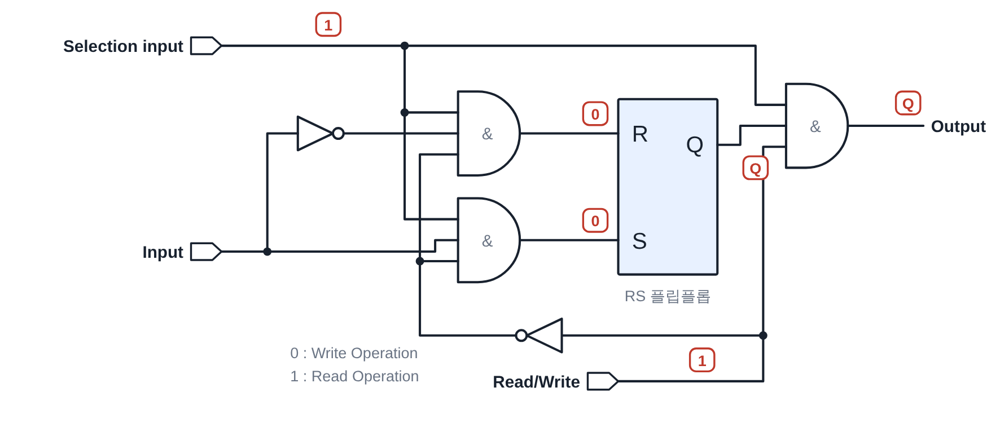
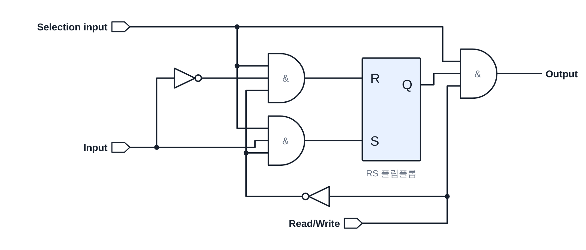
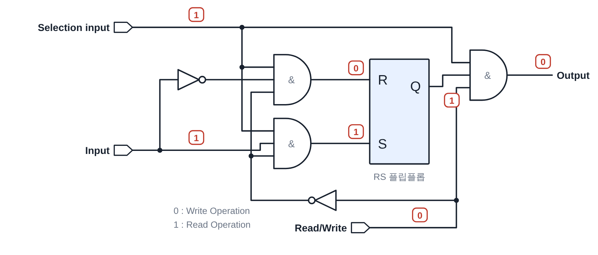
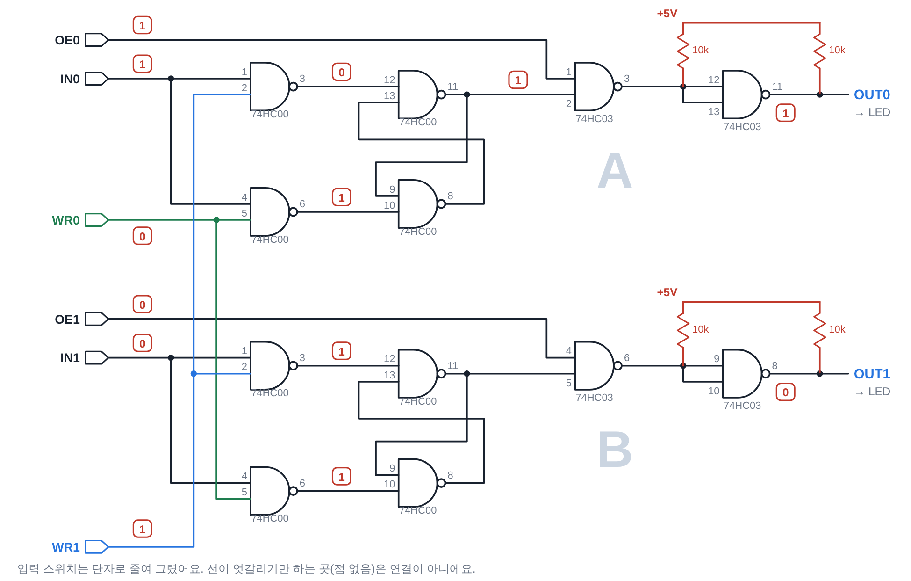
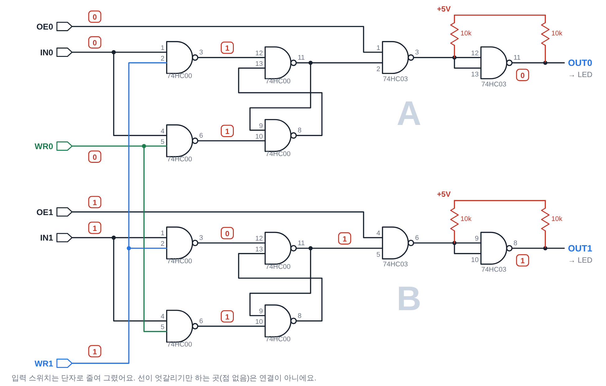
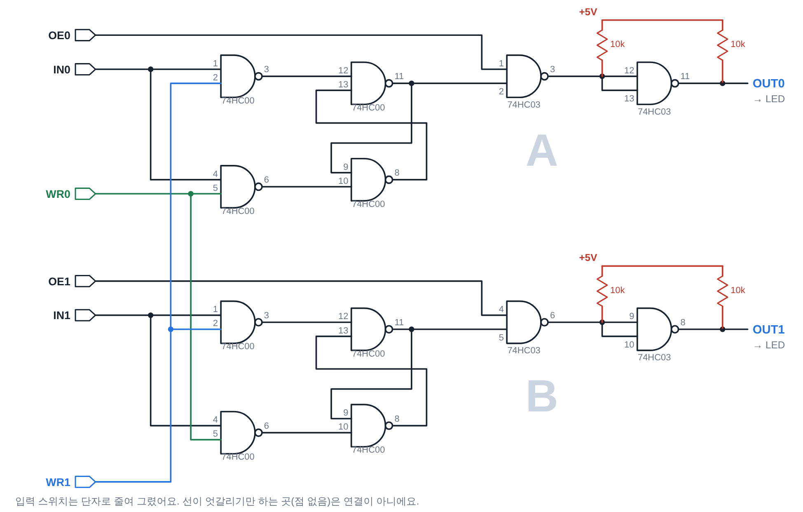
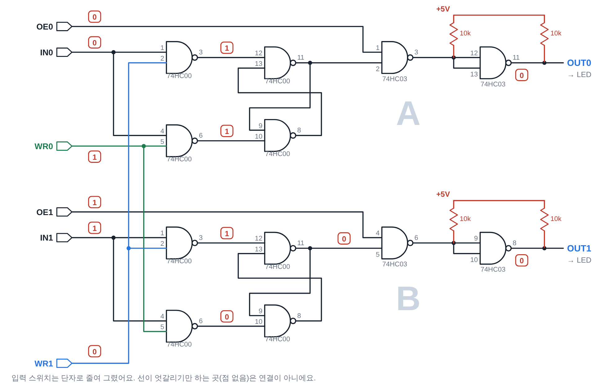
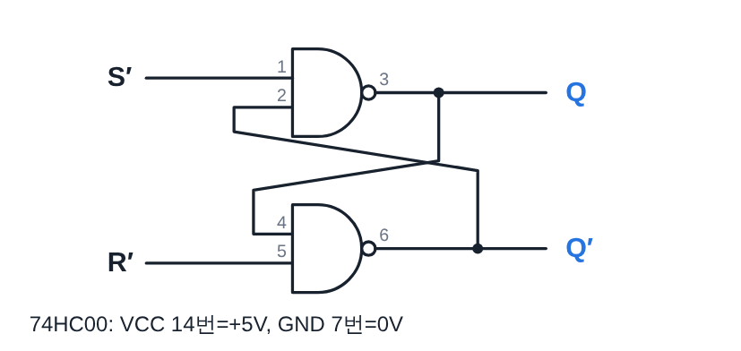
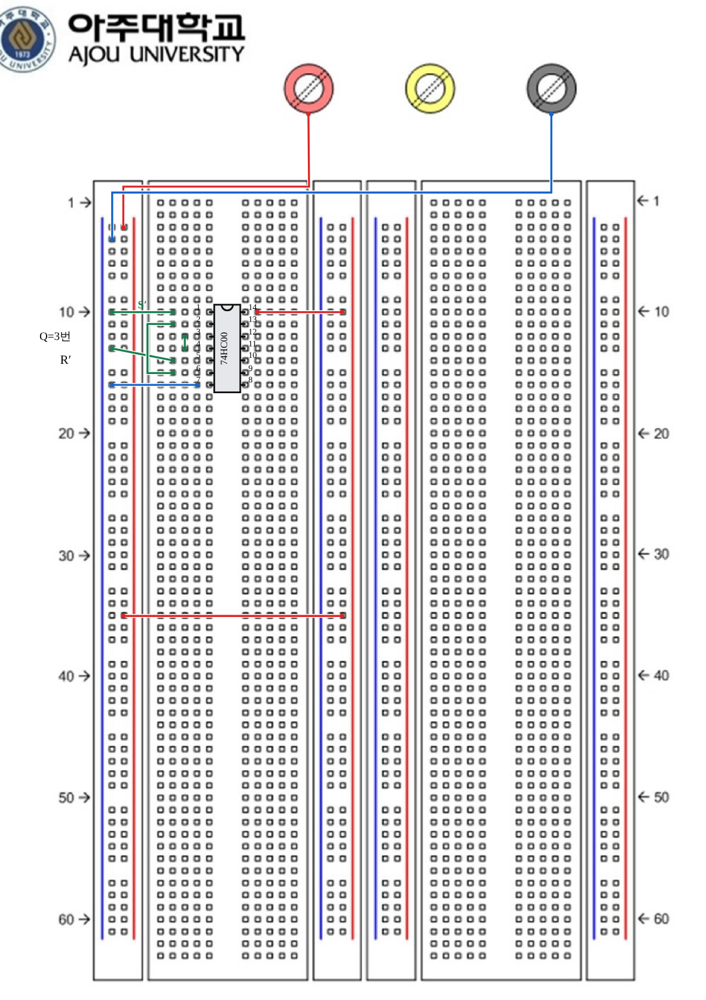

# 실험 9 · 문제 설명

      
첫 줄부터 완성 답과 검산까지 함께 풀어요.

## 문제를 함께 풀어요

### 문제 1 · RAM의 역할

문제 읽기
#### 문제

RAM의 역할에 대해 쓰시오.

#### 구할 것

RAM의 역할 서술

이 문제에서 할 일
RAM의 역할과 쓰임을 설명해요.

이 문제를 봤을 때 떠올릴 개념과 공식
읽기·쓰기와 임의 접근

역할에는 할 수 있는 일과 실제 쓰임이 모두 들어가요.

첫 줄을 이렇게 시작해요
읽기와 쓰기를 한 문장에 넣어요.

[필요한 개념으로 돌아가요](%EC%8B%A4%ED%97%9809_%EC%8B%A4%ED%97%98%EC%84%A4%EB%AA%85.md#t-ram)

이유를 따라 완성해요
RAM은 정보를 읽고 새 정보를 저장해요. 원하는 위치에 거의 같은 시간에 접근하며, 컴퓨터가 실행하는 프로그램과 데이터를 임시로 담아 둬요.

답과 검산을 확인해요
교안 p3의 예처럼 프로그램 로딩과 작업 중인 데이터 저장을 모두 설명할 수 있는지 확인해요.

헷갈리기 쉬운 조건을 확인해요
Random Access의 random은 원하는 주소를 고를 수 있다는 뜻이에요.

설명을 닫고 다시 해 봐요
- 읽기·쓰기, 주소 접근, 임시 저장을 각각 짚어요.

**떠올릴 것:** 읽기·쓰기와 임의 접근

역할에는 할 수 있는 일과 실제 쓰임이 모두 들어가요.

첫 실행: 읽기와 쓰기를 한 문장에 넣어요.

RAM은 읽고 쓸 수 있고, 주소에 거의 같은 시간에 접근하며, 프로그램과 데이터를 임시로 저장해요.

교안 p3의 예처럼 프로그램 로딩과 작업 중인 데이터 저장을 모두 설명할 수 있는지 확인해요.

Random Access의 random은 원하는 주소를 고를 수 있다는 뜻이에요.

출처: [from_the_past/정리/퀴즈/실험9/실험9 퀴즈 기출 2016-2.pdf · PDF p1](../../../from_the_past/%EC%A0%95%EB%A6%AC/%ED%80%B4%EC%A6%88/%EC%8B%A4%ED%97%989/%EC%8B%A4%ED%97%989%20%ED%80%B4%EC%A6%88%20%EA%B8%B0%EC%B6%9C%202016-2.pdf#page=1) · [from_the_past/정리/퀴즈/실험9/실험9 퀴즈 기출_단답형.pdf · PDF p1](../../../from_the_past/%EC%A0%95%EB%A6%AC/%ED%80%B4%EC%A6%88/%EC%8B%A4%ED%97%989/%EC%8B%A4%ED%97%989%20%ED%80%B4%EC%A6%88%20%EA%B8%B0%EC%B6%9C_%EB%8B%A8%EB%8B%B5%ED%98%95.pdf#page=1) · [from_the_past/정리/퀴즈/실험9/실험9 퀴즈 예상문제_v1.pdf · PDF p1](../../../from_the_past/%EC%A0%95%EB%A6%AC/%ED%80%B4%EC%A6%88/%EC%8B%A4%ED%97%989/%EC%8B%A4%ED%97%989%20%ED%80%B4%EC%A6%88%20%EC%98%88%EC%83%81%EB%AC%B8%EC%A0%9C_v1.pdf#page=1) · [from_the_past/정리/퀴즈/실험9/실험9 퀴즈 예상문제_v2.pdf · PDF p1](../../../from_the_past/%EC%A0%95%EB%A6%AC/%ED%80%B4%EC%A6%88/%EC%8B%A4%ED%97%989/%EC%8B%A4%ED%97%989%20%ED%80%B4%EC%A6%88%20%EC%98%88%EC%83%81%EB%AC%B8%EC%A0%9C_v2.pdf#page=1) · [from_the_past/정리/퀴즈/실험9/실험9 퀴즈 예상문제_v3.pdf · PDF p1](../../../from_the_past/%EC%A0%95%EB%A6%AC/%ED%80%B4%EC%A6%88/%EC%8B%A4%ED%97%989/%EC%8B%A4%ED%97%989%20%ED%80%B4%EC%A6%88%20%EC%98%88%EC%83%81%EB%AC%B8%EC%A0%9C_v3.pdf#page=1) · [from_the_past/정리/퀴즈/실험9/실험9 퀴즈 예상문제_v4.pdf · PDF p1](../../../from_the_past/%EC%A0%95%EB%A6%AC/%ED%80%B4%EC%A6%88/%EC%8B%A4%ED%97%989/%EC%8B%A4%ED%97%989%20%ED%80%B4%EC%A6%88%20%EC%98%88%EC%83%81%EB%AC%B8%EC%A0%9C_v4.pdf#page=1) · [from_the_past/정리/퀴즈/실험9/실험9 퀴즈 종합_기출문제 (2p).pdf · PDF p1](../../../from_the_past/%EC%A0%95%EB%A6%AC/%ED%80%B4%EC%A6%88/%EC%8B%A4%ED%97%989/%EC%8B%A4%ED%97%989%20%ED%80%B4%EC%A6%88%20%EC%A2%85%ED%95%A9_%EA%B8%B0%EC%B6%9C%EB%AC%B8%EC%A0%9C%20%282p%29.pdf#page=1) · [from_the_past/정리/퀴즈/실험9/원본_docx/실험9_예상.doc](../../../from_the_past/%EC%A0%95%EB%A6%AC/%ED%80%B4%EC%A6%88/%EC%8B%A4%ED%97%989/%EC%9B%90%EB%B3%B8_docx/%EC%8B%A4%ED%97%989_%EC%98%88%EC%83%81.doc) · [from_the_past/정리/퀴즈/실험9/실험9 퀴즈 예상문제_수기메모.jpg](../../../from_the_past/%EC%A0%95%EB%A6%AC/%ED%80%B4%EC%A6%88/%EC%8B%A4%ED%97%989/%EC%8B%A4%ED%97%989%20%ED%80%B4%EC%A6%88%20%EC%98%88%EC%83%81%EB%AC%B8%EC%A0%9C_%EC%88%98%EA%B8%B0%EB%A9%94%EB%AA%A8.jpg) · [from_the_past/정리/퀴즈/실험9/원본_docx/quiz_09.hwp](../../../from_the_past/%EC%A0%95%EB%A6%AC/%ED%80%B4%EC%A6%88/%EC%8B%A4%ED%97%989/%EC%9B%90%EB%B3%B8_docx/quiz_09.hwp)

### 문제 2 · Static RAM(SRAM)이란

문제 읽기
#### 문제

Static RAM (SRAM)이란 무엇인지 간단히 서술하시오. (3점)

#### 구할 것

SRAM이 무엇인지 간단한 서술

이 문제에서 할 일
SRAM의 저장 방식과 성질을 설명해요.

이 문제를 봤을 때 떠올릴 개념과 공식
래치·리프레시 없음·휘발성

Static은 전원을 공급하는 동안의 유지 방식이에요. 교안에는 SRAM 정의가 따로 없어 일반 지식으로 보충해요.

첫 줄을 이렇게 시작해요
저장 소자를 래치로 잡아요.

[필요한 개념으로 돌아가요](%EC%8B%A4%ED%97%9809_%EC%8B%A4%ED%97%98%EC%84%A4%EB%AA%85.md#t-ram)

이유를 따라 완성해요
SRAM은 래치로 비트를 저장하고 전원이 있는 동안 리프레시 없이 값을 유지해요. 주소로 원하는 위치를 거의 같은 시간에 읽고 쓰며, 전원을 끄면 값이 사라져요.

답과 검산을 확인해요
전원은 유지하고 쓰기만 멈췄을 때는 값이 남아요. DRAM은 이 조건에서도 주기적인 리프레시가 필요해요(보충).

헷갈리기 쉬운 조건을 확인해요
Static을 비휘발성으로 해석하면 틀려요.

설명을 닫고 다시 해 봐요
- 전원 유지와 전원 차단 두 경우를 나눠 설명해요.

**떠올릴 것:** 래치·리프레시 없음·휘발성

Static은 전원을 공급하는 동안의 유지 방식이에요. 교안에는 SRAM 정의가 따로 없어 일반 지식으로 보충해요.

첫 실행: 저장 소자를 래치로 잡아요.

교안 밖 보충이에요. 래치에 저장하고 전원 공급 중에는 리프레시가 필요 없으며, 전원 차단 시 휘발돼요.

전원은 유지하고 쓰기만 멈췄을 때는 값이 남아요. DRAM은 이 조건에서도 주기적인 리프레시가 필요해요(보충).

Static을 비휘발성으로 해석하면 틀려요.

출처: [from_the_past/정리/퀴즈/실험9/실험9 퀴즈 기출_채점본_1.jpg](../../../from_the_past/%EC%A0%95%EB%A6%AC/%ED%80%B4%EC%A6%88/%EC%8B%A4%ED%97%989/%EC%8B%A4%ED%97%989%20%ED%80%B4%EC%A6%88%20%EA%B8%B0%EC%B6%9C_%EC%B1%84%EC%A0%90%EB%B3%B8_1.jpg)

### 문제 3 · SRAM의 저장 회로

문제 읽기
#### 문제

Static Ram에서 정보를 저장하는데 사용하는 회로의 이름은?

#### 구할 것

SRAM에서 정보를 저장하는 회로 이름

이 문제에서 할 일
SRAM 한 비트의 저장 회로를 말해요.

이 문제를 봤을 때 떠올릴 개념과 공식
엇갈린 되먹임으로 한 비트 저장

입력이 쉬는 동안에도 Q가 남으려면 서로의 출력을 되먹임해야 해요.

첫 줄을 이렇게 시작해요
2bit RAM 회로에서 칸 A의 NAND 두 개를 찾아요.

[필요한 개념으로 돌아가요](%EC%8B%A4%ED%97%9809_%EC%8B%A4%ED%97%98%EC%84%A4%EB%AA%85.md#t-latch)

이유를 따라 완성해요
답은 플립플롭(래치)이에요. 교안 실험에서는 74HC00의 NAND 두 개를 교차 연결한 NAND SR 래치예요. 반도체 SRAM 셀은 인버터 두 개를 교차 연결해 설명하기도 해요(보충).

답과 검산을 확인해요
S′=R′=1을 넣고 초기 Q=0과 Q=1이 모두 유지되는지 확인해요.

헷갈리기 쉬운 조건을 확인해요
레지스터는 저장 소자를 묶은 것이고 이 문항은 한 비트의 저장 소자를 물어요.

설명을 닫고 다시 해 봐요
- 되먹임 한 쌍을 따라가며 회로 이름을 적어요.

**떠올릴 것:** 엇갈린 되먹임으로 한 비트 저장

입력이 쉬는 동안에도 Q가 남으려면 서로의 출력을 되먹임해야 해요.

첫 실행: 2bit RAM 회로에서 칸 A의 NAND 두 개를 찾아요.

교안의 한 칸은 NAND SR 래치예요. 교차 인버터 래치는 일반 SRAM 셀의 보충 예예요.

S′=R′=1을 넣고 초기 Q=0과 Q=1이 모두 유지되는지 확인해요.

레지스터는 저장 소자를 묶은 것이고 이 문항은 한 비트의 저장 소자를 물어요.

출처: [from_the_past/정리/퀴즈/실험9/실험9 퀴즈 기출_단답형.pdf · PDF p1](../../../from_the_past/%EC%A0%95%EB%A6%AC/%ED%80%B4%EC%A6%88/%EC%8B%A4%ED%97%989/%EC%8B%A4%ED%97%989%20%ED%80%B4%EC%A6%88%20%EA%B8%B0%EC%B6%9C_%EB%8B%A8%EB%8B%B5%ED%98%95.pdf#page=1) · [from_the_past/정리/퀴즈/실험9/실험9 퀴즈 예상문제_v1.pdf · PDF p1](../../../from_the_past/%EC%A0%95%EB%A6%AC/%ED%80%B4%EC%A6%88/%EC%8B%A4%ED%97%989/%EC%8B%A4%ED%97%989%20%ED%80%B4%EC%A6%88%20%EC%98%88%EC%83%81%EB%AC%B8%EC%A0%9C_v1.pdf#page=1) · [from_the_past/정리/퀴즈/실험9/실험9 퀴즈 예상문제_v2.pdf · PDF p1](../../../from_the_past/%EC%A0%95%EB%A6%AC/%ED%80%B4%EC%A6%88/%EC%8B%A4%ED%97%989/%EC%8B%A4%ED%97%989%20%ED%80%B4%EC%A6%88%20%EC%98%88%EC%83%81%EB%AC%B8%EC%A0%9C_v2.pdf#page=1) · [from_the_past/정리/퀴즈/실험9/실험9 퀴즈 예상문제_v3.pdf · PDF p1](../../../from_the_past/%EC%A0%95%EB%A6%AC/%ED%80%B4%EC%A6%88/%EC%8B%A4%ED%97%989/%EC%8B%A4%ED%97%989%20%ED%80%B4%EC%A6%88%20%EC%98%88%EC%83%81%EB%AC%B8%EC%A0%9C_v3.pdf#page=1) · [from_the_past/정리/퀴즈/실험9/실험9 퀴즈 예상문제_v4.pdf · PDF p1](../../../from_the_past/%EC%A0%95%EB%A6%AC/%ED%80%B4%EC%A6%88/%EC%8B%A4%ED%97%989/%EC%8B%A4%ED%97%989%20%ED%80%B4%EC%A6%88%20%EC%98%88%EC%83%81%EB%AC%B8%EC%A0%9C_v4.pdf#page=1) · [from_the_past/정리/퀴즈/실험9/실험9 퀴즈 종합_기출문제 (2p).pdf · PDF p1](../../../from_the_past/%EC%A0%95%EB%A6%AC/%ED%80%B4%EC%A6%88/%EC%8B%A4%ED%97%989/%EC%8B%A4%ED%97%989%20%ED%80%B4%EC%A6%88%20%EC%A2%85%ED%95%A9_%EA%B8%B0%EC%B6%9C%EB%AC%B8%EC%A0%9C%20%282p%29.pdf#page=1) · [from_the_past/정리/퀴즈/실험9/원본_docx/실험9_예상.doc](../../../from_the_past/%EC%A0%95%EB%A6%AC/%ED%80%B4%EC%A6%88/%EC%8B%A4%ED%97%989/%EC%9B%90%EB%B3%B8_docx/%EC%8B%A4%ED%97%989_%EC%98%88%EC%83%81.doc) · [from_the_past/정리/퀴즈/실험9/실험9 퀴즈 예상문제_수기메모.jpg](../../../from_the_past/%EC%A0%95%EB%A6%AC/%ED%80%B4%EC%A6%88/%EC%8B%A4%ED%97%989/%EC%8B%A4%ED%97%989%20%ED%80%B4%EC%A6%88%20%EC%98%88%EC%83%81%EB%AC%B8%EC%A0%9C_%EC%88%98%EA%B8%B0%EB%A9%94%EB%AA%A8.jpg) · [from_the_past/정리/퀴즈/실험9/원본_docx/quiz_09.hwp](../../../from_the_past/%EC%A0%95%EB%A6%AC/%ED%80%B4%EC%A6%88/%EC%8B%A4%ED%97%989/%EC%9B%90%EB%B3%B8_docx/quiz_09.hwp)

### 문제 4 · 읽기 때 Read/Write 값

문제 읽기
#### 문제

Read operation 일 때의 Read/Write 입력 값은?

#### 주어진 조건

원문 그림은 은행에 답 표시 없는 사본이 없어 다시 싣지 않았어요. 회로는 다음 문항(1 bit RAM에 1 쓰기)의 그림과 같은 교안 p4 1 bit RAM이에요. Selection input은 세 AND에 모두 들어가요. Input은 그대로 S 쪽 AND에, 인버터를 거쳐 R 쪽 AND에 들어가요. Read/Write는 인버터를 거쳐 S·R 쪽 AND에, 그대로 출력 AND에 들어가요. 출력 AND의 나머지 입력은 Q예요.

#### 구할 것

Read operation 때의 Read/Write 입력 값

이 문제에서 할 일
1bit RAM을 읽는 R/W 값을 정해요.

이 문제를 봤을 때 떠올릴 개념과 공식
읽기는 출력 AND를 열어요

Sel=1일 때 출력에 Q를 통과시키려면 R/W도 1이어야 해요.

첫 줄을 이렇게 시작해요
Output = Sel·(R/W)·Q를 적어요.

[필요한 개념으로 돌아가요](%EC%8B%A4%ED%97%9809_%EC%8B%A4%ED%97%98%EC%84%A4%EB%AA%85.md#t-1bit)

이유를 따라 완성해요
R/W=1이에요. Sel=1이면 Output=Q이고, (R/W)′=0이라 S=R=0이 되어 Q가 유지돼요.

답과 검산을 확인해요
Q=1에서 R/W=0을 넣으면 Output=0이어서 읽기 조건을 만족하지 못해요.

헷갈리기 쉬운 조건을 확인해요
제공 답안 일부의 “Read = 1, Write = 1”은 표기가 모호해요. 여기서는 회로가 요구하는 R/W 값 1을 적어요.

설명을 닫고 다시 해 봐요
- 출력 AND와 쓰기 쪽 AND를 각각 확인해요.

**떠올릴 것:** 읽기는 출력 AND를 열어요

Sel=1일 때 출력에 Q를 통과시키려면 R/W도 1이어야 해요.

첫 실행: Output = Sel·(R/W)·Q를 적어요.

Sel=1, R/W=1이면 Output=Q이고 쓰기 경로는 닫혀요.

Q=1에서 R/W=0을 넣으면 Output=0이어서 읽기 조건을 만족하지 못해요.

제공 답안 일부의 “Read = 1, Write = 1”은 표기가 모호해요. 여기서는 회로가 요구하는 R/W 값 1을 적어요.

출처: [from_the_past/정리/퀴즈/실험9/실험9 퀴즈 기출_단답형.pdf · PDF p1](../../../from_the_past/%EC%A0%95%EB%A6%AC/%ED%80%B4%EC%A6%88/%EC%8B%A4%ED%97%989/%EC%8B%A4%ED%97%989%20%ED%80%B4%EC%A6%88%20%EA%B8%B0%EC%B6%9C_%EB%8B%A8%EB%8B%B5%ED%98%95.pdf#page=1) · [from_the_past/정리/퀴즈/실험9/실험9 퀴즈 예상문제_수기메모.jpg](../../../from_the_past/%EC%A0%95%EB%A6%AC/%ED%80%B4%EC%A6%88/%EC%8B%A4%ED%97%989/%EC%8B%A4%ED%97%989%20%ED%80%B4%EC%A6%88%20%EC%98%88%EC%83%81%EB%AC%B8%EC%A0%9C_%EC%88%98%EA%B8%B0%EB%A9%94%EB%AA%A8.jpg) · [from_the_past/정리/퀴즈/실험9/원본_docx/quiz_09.hwp](../../../from_the_past/%EC%A0%95%EB%A6%AC/%ED%80%B4%EC%A6%88/%EC%8B%A4%ED%97%989/%EC%9B%90%EB%B3%B8_docx/quiz_09.hwp)

### 문제 5 · 1 bit RAM에 1 쓰기

문제 읽기
#### 문제

다음 1bit RAM에 1의 데이터를 쓰려고 할 때 입력되야하는 Selection input, input, Read/Write 값을 쓰시오.

#### 주어진 조건

회로는 원문 그림을 다시 그린 그림이에요. 교안 p4의 1 bit RAM과 연결이 같아요. 가운데 RS 플립플롭은 S=1이면 Set, R=1이면 Reset, 둘 다 0이면 유지예요.

#### 구할 것

1을 쓸 때의 Selection input, Input, Read/Write 값

이 문제에서 할 일
Q에 1을 쓰는 세 입력을 구해요.

이 문제를 봤을 때 떠올릴 개념과 공식
Set은 S=1, R=0

회로도에서 S 쪽 AND에 Input이 그대로 들어가요.

첫 줄을 이렇게 시작해요
S = Sel·(R/W)′·Input = 1로 놓아요.

[필요한 개념으로 돌아가요](%EC%8B%A4%ED%97%9809_%EC%8B%A4%ED%97%98%EC%84%A4%EB%AA%85.md#t-1bit)

이유를 따라 완성해요
Sel=1, Input=1, R/W=0이에요. R = Sel·(R/W)′·Input′ = 1·1·0 = 0이라 Reset은 걸리지 않아요.

답과 검산을 확인해요
초기 Q=0에서 확인해요. 교안 p4 표 셋째 줄처럼 Q=1로 바뀌고 Output=0이에요.

헷갈리기 쉬운 조건을 확인해요
R/W=1은 읽기예요. 교안 p4의 S·R 식은 회로도와 뒤바뀌어 있어요. 덧칠된 수기 한 장의 Input 값은 판독이 불확실해요.

설명을 닫고 다시 해 봐요
- S의 세 항을 1로 만든 뒤 R을 계산해요.

**떠올릴 것:** Set은 S=1, R=0

회로도에서 S 쪽 AND에 Input이 그대로 들어가요.

첫 실행: S = Sel·(R/W)′·Input = 1로 놓아요.

Sel=1, Input=1, R/W=0이면 Set돼요. S·R 연결은 회로도를 따라요.

초기 Q=0에서 확인해요. 교안 p4 표 셋째 줄처럼 Q=1로 바뀌고 Output=0이에요.

R/W=1은 읽기예요. 교안 p4의 S·R 식은 회로도와 뒤바뀌어 있어요. 덧칠된 수기 한 장의 Input 값은 판독이 불확실해요.

출처: [from_the_past/정리/퀴즈/실험9/실험9 퀴즈 기출 2016-2.pdf · PDF p1](../../../from_the_past/%EC%A0%95%EB%A6%AC/%ED%80%B4%EC%A6%88/%EC%8B%A4%ED%97%989/%EC%8B%A4%ED%97%989%20%ED%80%B4%EC%A6%88%20%EA%B8%B0%EC%B6%9C%202016-2.pdf#page=1) · [from_the_past/정리/퀴즈/실험9/실험9 퀴즈 기출_채점본_1.jpg](../../../from_the_past/%EC%A0%95%EB%A6%AC/%ED%80%B4%EC%A6%88/%EC%8B%A4%ED%97%989/%EC%8B%A4%ED%97%989%20%ED%80%B4%EC%A6%88%20%EA%B8%B0%EC%B6%9C_%EC%B1%84%EC%A0%90%EB%B3%B8_1.jpg) · [from_the_past/정리/퀴즈/실험9/실험9 퀴즈 기출_단답형.pdf · PDF p1](../../../from_the_past/%EC%A0%95%EB%A6%AC/%ED%80%B4%EC%A6%88/%EC%8B%A4%ED%97%989/%EC%8B%A4%ED%97%989%20%ED%80%B4%EC%A6%88%20%EA%B8%B0%EC%B6%9C_%EB%8B%A8%EB%8B%B5%ED%98%95.pdf#page=1) · [from_the_past/정리/퀴즈/실험9/실험9 퀴즈 예상문제_v1.pdf · PDF p1](../../../from_the_past/%EC%A0%95%EB%A6%AC/%ED%80%B4%EC%A6%88/%EC%8B%A4%ED%97%989/%EC%8B%A4%ED%97%989%20%ED%80%B4%EC%A6%88%20%EC%98%88%EC%83%81%EB%AC%B8%EC%A0%9C_v1.pdf#page=1) · [from_the_past/정리/퀴즈/실험9/실험9 퀴즈 예상문제_v2.pdf · PDF p1](../../../from_the_past/%EC%A0%95%EB%A6%AC/%ED%80%B4%EC%A6%88/%EC%8B%A4%ED%97%989/%EC%8B%A4%ED%97%989%20%ED%80%B4%EC%A6%88%20%EC%98%88%EC%83%81%EB%AC%B8%EC%A0%9C_v2.pdf#page=1) · [from_the_past/정리/퀴즈/실험9/실험9 퀴즈 예상문제_v3.pdf · PDF p1](../../../from_the_past/%EC%A0%95%EB%A6%AC/%ED%80%B4%EC%A6%88/%EC%8B%A4%ED%97%989/%EC%8B%A4%ED%97%989%20%ED%80%B4%EC%A6%88%20%EC%98%88%EC%83%81%EB%AC%B8%EC%A0%9C_v3.pdf#page=1) · [from_the_past/정리/퀴즈/실험9/실험9 퀴즈 예상문제_v4.pdf · PDF p1](../../../from_the_past/%EC%A0%95%EB%A6%AC/%ED%80%B4%EC%A6%88/%EC%8B%A4%ED%97%989/%EC%8B%A4%ED%97%989%20%ED%80%B4%EC%A6%88%20%EC%98%88%EC%83%81%EB%AC%B8%EC%A0%9C_v4.pdf#page=1) · [from_the_past/정리/퀴즈/실험9/실험9 퀴즈 종합_기출문제 (2p).pdf · PDF p1](../../../from_the_past/%EC%A0%95%EB%A6%AC/%ED%80%B4%EC%A6%88/%EC%8B%A4%ED%97%989/%EC%8B%A4%ED%97%989%20%ED%80%B4%EC%A6%88%20%EC%A2%85%ED%95%A9_%EA%B8%B0%EC%B6%9C%EB%AC%B8%EC%A0%9C%20%282p%29.pdf#page=1) · [from_the_past/정리/퀴즈/실험9/원본_docx/실험9_예상.doc](../../../from_the_past/%EC%A0%95%EB%A6%AC/%ED%80%B4%EC%A6%88/%EC%8B%A4%ED%97%989/%EC%9B%90%EB%B3%B8_docx/%EC%8B%A4%ED%97%989_%EC%98%88%EC%83%81.doc) · [from_the_past/정리/퀴즈/실험9/실험9 퀴즈 예상문제_수기메모.jpg](../../../from_the_past/%EC%A0%95%EB%A6%AC/%ED%80%B4%EC%A6%88/%EC%8B%A4%ED%97%989/%EC%8B%A4%ED%97%989%20%ED%80%B4%EC%A6%88%20%EC%98%88%EC%83%81%EB%AC%B8%EC%A0%9C_%EC%88%98%EA%B8%B0%EB%A9%94%EB%AA%A8.jpg) · [from_the_past/정리/퀴즈/실험9/원본_docx/quiz_09.hwp](../../../from_the_past/%EC%A0%95%EB%A6%AC/%ED%80%B4%EC%A6%88/%EC%8B%A4%ED%97%989/%EC%9B%90%EB%B3%B8_docx/quiz_09.hwp)

### 문제 6 · 1 bit RAM에 0 쓰기

문제 읽기
#### 문제

다음 1bit RAM에 0의 데이터를 쓰려고 할 때 입력되야하는 Selection input, input, Read/Write 값을 쓰시오.

#### 주어진 조건

회로는 원문 그림을 다시 그린 그림이에요. 교안 p4의 1 bit RAM과 연결이 같아요. 가운데 RS 플립플롭은 S=1이면 Set, R=1이면 Reset, 둘 다 0이면 유지예요.

#### 구할 것

0을 쓸 때의 Selection input, Input, Read/Write 값

이 문제에서 할 일
Q에 0을 쓰는 세 입력을 구해요.

이 문제를 봤을 때 떠올릴 개념과 공식
Reset은 R=1, S=0

회로도에서 R 쪽 AND는 반전된 Input을 받아요.

첫 줄을 이렇게 시작해요
R = Sel·(R/W)′·Input′ = 1로 놓아요.

[필요한 개념으로 돌아가요](%EC%8B%A4%ED%97%9809_%EC%8B%A4%ED%97%98%EC%84%A4%EB%AA%85.md#t-1bit)

이유를 따라 완성해요
Sel=1, Input=0, R/W=0이에요. S = 1·1·0 = 0이어서 Set은 걸리지 않아요.

답과 검산을 확인해요
초기 Q=1에서 확인해요. 교안 p4 표 둘째 줄처럼 Q=0으로 바뀌고 Output=0이에요.

헷갈리기 쉬운 조건을 확인해요
Sel=0이면 회로상 Q는 유지돼요(p4 표 첫 줄은 Q=0). 덧쓴 수기 한 장은 판독 보류예요.

설명을 닫고 다시 해 봐요
- R의 세 항을 1로 만든 뒤 S를 계산해요.

**떠올릴 것:** Reset은 R=1, S=0

회로도에서 R 쪽 AND는 반전된 Input을 받아요.

첫 실행: R = Sel·(R/W)′·Input′ = 1로 놓아요.

Sel=1, Input=0, R/W=0이면 Reset돼요. Sel=0은 저장값 유지예요.

초기 Q=1에서 확인해요. 교안 p4 표 둘째 줄처럼 Q=0으로 바뀌고 Output=0이에요.

Sel=0이면 회로상 Q는 유지돼요(p4 표 첫 줄은 Q=0). 덧쓴 수기 한 장은 판독 보류예요.

출처: [from_the_past/정리/퀴즈/실험9/실험9 퀴즈 기출_단답형.pdf · PDF p2](../../../from_the_past/%EC%A0%95%EB%A6%AC/%ED%80%B4%EC%A6%88/%EC%8B%A4%ED%97%989/%EC%8B%A4%ED%97%989%20%ED%80%B4%EC%A6%88%20%EA%B8%B0%EC%B6%9C_%EB%8B%A8%EB%8B%B5%ED%98%95.pdf#page=2) · [from_the_past/정리/퀴즈/실험9/실험9 퀴즈 예상문제_v1.pdf · PDF p1](../../../from_the_past/%EC%A0%95%EB%A6%AC/%ED%80%B4%EC%A6%88/%EC%8B%A4%ED%97%989/%EC%8B%A4%ED%97%989%20%ED%80%B4%EC%A6%88%20%EC%98%88%EC%83%81%EB%AC%B8%EC%A0%9C_v1.pdf#page=1) · [from_the_past/정리/퀴즈/실험9/실험9 퀴즈 예상문제_v2.pdf · PDF p1](../../../from_the_past/%EC%A0%95%EB%A6%AC/%ED%80%B4%EC%A6%88/%EC%8B%A4%ED%97%989/%EC%8B%A4%ED%97%989%20%ED%80%B4%EC%A6%88%20%EC%98%88%EC%83%81%EB%AC%B8%EC%A0%9C_v2.pdf#page=1) · [from_the_past/정리/퀴즈/실험9/실험9 퀴즈 예상문제_v3.pdf · PDF p1](../../../from_the_past/%EC%A0%95%EB%A6%AC/%ED%80%B4%EC%A6%88/%EC%8B%A4%ED%97%989/%EC%8B%A4%ED%97%989%20%ED%80%B4%EC%A6%88%20%EC%98%88%EC%83%81%EB%AC%B8%EC%A0%9C_v3.pdf#page=1) · [from_the_past/정리/퀴즈/실험9/실험9 퀴즈 예상문제_v4.pdf · PDF p1](../../../from_the_past/%EC%A0%95%EB%A6%AC/%ED%80%B4%EC%A6%88/%EC%8B%A4%ED%97%989/%EC%8B%A4%ED%97%989%20%ED%80%B4%EC%A6%88%20%EC%98%88%EC%83%81%EB%AC%B8%EC%A0%9C_v4.pdf#page=1) · [from_the_past/정리/퀴즈/실험9/실험9 퀴즈 종합_기출문제 (2p).pdf · PDF p1](../../../from_the_past/%EC%A0%95%EB%A6%AC/%ED%80%B4%EC%A6%88/%EC%8B%A4%ED%97%989/%EC%8B%A4%ED%97%989%20%ED%80%B4%EC%A6%88%20%EC%A2%85%ED%95%A9_%EA%B8%B0%EC%B6%9C%EB%AC%B8%EC%A0%9C%20%282p%29.pdf#page=1) · [from_the_past/정리/퀴즈/실험9/원본_docx/실험9_예상.doc](../../../from_the_past/%EC%A0%95%EB%A6%AC/%ED%80%B4%EC%A6%88/%EC%8B%A4%ED%97%989/%EC%9B%90%EB%B3%B8_docx/%EC%8B%A4%ED%97%989_%EC%98%88%EC%83%81.doc) · [from_the_past/정리/퀴즈/실험9/실험9 퀴즈 예상문제_수기메모.jpg](../../../from_the_past/%EC%A0%95%EB%A6%AC/%ED%80%B4%EC%A6%88/%EC%8B%A4%ED%97%989/%EC%8B%A4%ED%97%989%20%ED%80%B4%EC%A6%88%20%EC%98%88%EC%83%81%EB%AC%B8%EC%A0%9C_%EC%88%98%EA%B8%B0%EB%A9%94%EB%AA%A8.jpg) · [from_the_past/정리/퀴즈/실험9/원본_docx/quiz_09.hwp](../../../from_the_past/%EC%A0%95%EB%A6%AC/%ED%80%B4%EC%A6%88/%EC%8B%A4%ED%97%989/%EC%9B%90%EB%B3%B8_docx/quiz_09.hwp)

### 문제 7 · 2bit RAM의 A에 1 쓰기

문제 읽기
#### 문제

A part에 1의 데이터를 쓰기 위한 OE0,1 In0,1, WR0,1 의 값은?

#### 주어진 조건

회로는 교안 p6(원문 그림과 같은 회로)을 다시 그린 그림이에요. 입력 스위치는 단자로 줄였고 핀 번호는 원문 그대로예요.

교안 범례: OE는 Read Select(0: Off, 1: On), IN은 Write Select(0: Off, 1: On), WR은 Write Value(0 or 1)예요. 범례는 OE0, IN0, WR0을 A part, OE1, IN1, WR1을 B part라고 적어요.

#### 구할 것

A part에 1을 쓰기 위한 OE0, OE1, IN0, IN1, WR0, WR1 값

이 문제에서 할 일
A에만 1을 쓰는 입력을 구해요.

이 문제를 봤을 때 떠올릴 개념과 공식
A의 Set NAND에 IN0·WR1

Set은 S′_A=0, R′_A=1이에요. 교안 p6에서 WR1·WR0은 각각 Set(1·2번)·Reset(4·5번) 쪽에 들어가요.

첫 줄을 이렇게 시작해요
S′_A = (IN0·WR1)′ = 0으로 놓아요.

[필요한 개념으로 돌아가요](%EC%8B%A4%ED%97%9809_%EC%8B%A4%ED%97%98%EC%84%A4%EB%AA%85.md#t-2bit)

이유를 따라 완성해요
IN0=WR1=1, WR0=0이면 S′_A=(1·1)′=0, R′_A=(1·0)′=1이에요. IN1=0으로 B를 유지해요. OE는 저장과 무관하고, 제공 답의 OE0=1이면 OUT0=OE0·Q=1, OE1=0이면 OUT1=0이에요.

| OE0 | OE1 | IN0 | IN1 | WR0 | WR1 |
| --- | --- | --- | --- | --- | --- |
| 1 | 0 | 1 | 0 | 0 | 1 |

답과 검산을 확인해요
초기 A=0, B=1에서 OE0을 꺼도 A는 1이 돼요. B 선택 여부는 IN1을 바꿔 초기 B=0일 때 비교해요.

헷갈리기 쉬운 조건을 확인해요
WR0은 A에 쓸 값을 고르는 선이 아니에요. IN1도 1로 두면 B까지 Set돼요.

설명을 닫고 다시 해 봐요
- WR 쌍으로 값, IN 쌍으로 칸을 고른 뒤 OE를 채워요.

**떠올릴 것:** A의 Set NAND에 IN0·WR1

Set은 S′_A=0, R′_A=1이에요. 교안 p6에서 WR1·WR0은 각각 Set(1·2번)·Reset(4·5번) 쪽에 들어가요.

첫 실행: S′_A = (IN0·WR1)′ = 0으로 놓아요.

(OE0, OE1, IN0, IN1, WR0, WR1)=(1,0,1,0,0,1). OE는 표시만 바꿔요.

초기 A=0, B=1에서 OE0을 꺼도 A는 1이 돼요. B 선택 여부는 IN1을 바꿔 초기 B=0일 때 비교해요.

WR0은 A에 쓸 값을 고르는 선이 아니에요. IN1도 1로 두면 B까지 Set돼요.

출처: [from_the_past/정리/퀴즈/실험9/실험9 퀴즈 기출_단답형.pdf · PDF p2](../../../from_the_past/%EC%A0%95%EB%A6%AC/%ED%80%B4%EC%A6%88/%EC%8B%A4%ED%97%989/%EC%8B%A4%ED%97%989%20%ED%80%B4%EC%A6%88%20%EA%B8%B0%EC%B6%9C_%EB%8B%A8%EB%8B%B5%ED%98%95.pdf#page=2) · [from_the_past/정리/퀴즈/실험9/실험9 퀴즈 예상문제_v1.pdf · PDF p2](../../../from_the_past/%EC%A0%95%EB%A6%AC/%ED%80%B4%EC%A6%88/%EC%8B%A4%ED%97%989/%EC%8B%A4%ED%97%989%20%ED%80%B4%EC%A6%88%20%EC%98%88%EC%83%81%EB%AC%B8%EC%A0%9C_v1.pdf#page=2) · [from_the_past/정리/퀴즈/실험9/실험9 퀴즈 예상문제_v2.pdf · PDF p2](../../../from_the_past/%EC%A0%95%EB%A6%AC/%ED%80%B4%EC%A6%88/%EC%8B%A4%ED%97%989/%EC%8B%A4%ED%97%989%20%ED%80%B4%EC%A6%88%20%EC%98%88%EC%83%81%EB%AC%B8%EC%A0%9C_v2.pdf#page=2) · [from_the_past/정리/퀴즈/실험9/실험9 퀴즈 예상문제_v3.pdf · PDF p2](../../../from_the_past/%EC%A0%95%EB%A6%AC/%ED%80%B4%EC%A6%88/%EC%8B%A4%ED%97%989/%EC%8B%A4%ED%97%989%20%ED%80%B4%EC%A6%88%20%EC%98%88%EC%83%81%EB%AC%B8%EC%A0%9C_v3.pdf#page=2) · [from_the_past/정리/퀴즈/실험9/실험9 퀴즈 예상문제_v4.pdf · PDF p2](../../../from_the_past/%EC%A0%95%EB%A6%AC/%ED%80%B4%EC%A6%88/%EC%8B%A4%ED%97%989/%EC%8B%A4%ED%97%989%20%ED%80%B4%EC%A6%88%20%EC%98%88%EC%83%81%EB%AC%B8%EC%A0%9C_v4.pdf#page=2) · [from_the_past/정리/퀴즈/실험9/실험9 퀴즈 종합_기출문제 (2p).pdf · PDF p2](../../../from_the_past/%EC%A0%95%EB%A6%AC/%ED%80%B4%EC%A6%88/%EC%8B%A4%ED%97%989/%EC%8B%A4%ED%97%989%20%ED%80%B4%EC%A6%88%20%EC%A2%85%ED%95%A9_%EA%B8%B0%EC%B6%9C%EB%AC%B8%EC%A0%9C%20%282p%29.pdf#page=2) · [from_the_past/정리/퀴즈/실험9/원본_docx/실험9_예상.doc](../../../from_the_past/%EC%A0%95%EB%A6%AC/%ED%80%B4%EC%A6%88/%EC%8B%A4%ED%97%989/%EC%9B%90%EB%B3%B8_docx/%EC%8B%A4%ED%97%989_%EC%98%88%EC%83%81.doc) · [from_the_past/정리/퀴즈/실험9/실험9 퀴즈 예상문제_수기메모.jpg](../../../from_the_past/%EC%A0%95%EB%A6%AC/%ED%80%B4%EC%A6%88/%EC%8B%A4%ED%97%989/%EC%8B%A4%ED%97%989%20%ED%80%B4%EC%A6%88%20%EC%98%88%EC%83%81%EB%AC%B8%EC%A0%9C_%EC%88%98%EA%B8%B0%EB%A9%94%EB%AA%A8.jpg) · [from_the_past/정리/퀴즈/실험9/원본_docx/quiz_09.hwp](../../../from_the_past/%EC%A0%95%EB%A6%AC/%ED%80%B4%EC%A6%88/%EC%8B%A4%ED%97%989/%EC%9B%90%EB%B3%B8_docx/quiz_09.hwp)

### 문제 8 · 2bit RAM의 B에 1 쓰기

문제 읽기
#### 문제

9. B part에 1의 데이터를 쓰기 위한 OE0,1 In0,1, WR0,1 의 값은?

#### 주어진 조건

회로는 교안 p6(원문 그림과 같은 회로)을 다시 그린 그림이에요. 입력 스위치는 단자로 줄였고 핀 번호는 원문 그대로예요.

교안 범례: OE는 Read Select(0: Off, 1: On), IN은 Write Select(0: Off, 1: On), WR은 Write Value(0 or 1)예요. 범례는 OE0, IN0, WR0을 A part, OE1, IN1, WR1을 B part라고 적어요.

원문 그림은 은행에 답 표시 없는 사본이 없어 다시 싣지 않았어요. 회로는 앞 문항(A part에 1 쓰기)의 그림과 같은 교안 p6 2bit RAM이에요. B의 Set 쪽 NAND(1·2번)는 IN1과 WR1, Reset 쪽 NAND(4·5번)는 IN1과 WR0을 받아요.

#### 구할 것

B part에 1을 쓰기 위한 OE0, OE1, IN0, IN1, WR0, WR1 값

이 문제에서 할 일
B에만 1을 쓰는 입력을 구해요.

이 문제를 봤을 때 떠올릴 개념과 공식
B의 Set NAND에 IN1·WR1

Set은 S′_B=0, R′_B=1이에요. 두 칸이 WR1(1·2번 쪽)과 WR0(4·5번 쪽)을 함께 받아요.

첫 줄을 이렇게 시작해요
S′_B = (IN1·WR1)′ = 0으로 놓아요.

[필요한 개념으로 돌아가요](%EC%8B%A4%ED%97%9809_%EC%8B%A4%ED%97%98%EC%84%A4%EB%AA%85.md#t-2bit)

이유를 따라 완성해요
IN1=WR1=1, WR0=0으로 B를 Set해요. IN0=0이면 A의 두 NAND 출력이 1이라 유지돼요. 제공 답의 OE1=1이면 OUT1=B이고 OE0=0이면 OUT0=0이에요.

| OE0 | OE1 | IN0 | IN1 | WR0 | WR1 |
| --- | --- | --- | --- | --- | --- |
| 0 | 1 | 0 | 1 | 0 | 1 |

답과 검산을 확인해요
초기 B=0에서 OE1을 꺼도 B는 1로 바뀌어요. 제공 답 두 개와 일치하며 덧쓴 수기 두 장의 WR은 판독 보류예요.

헷갈리기 쉬운 조건을 확인해요
칸은 IN으로 골라요. B에 0을 쓰려면 WR1만 내리는 것으로는 부족하고 WR0을 1로 올려야 해요.

설명을 닫고 다시 해 봐요
- B의 Set 조건을 만든 뒤 IN0으로 A를 차단해요.

**떠올릴 것:** B의 Set NAND에 IN1·WR1

Set은 S′_B=0, R′_B=1이에요. 두 칸이 WR1(1·2번 쪽)과 WR0(4·5번 쪽)을 함께 받아요.

첫 실행: S′_B = (IN1·WR1)′ = 0으로 놓아요.

(OE0, OE1, IN0, IN1, WR0, WR1)=(0,1,0,1,0,1). IN0=0에서 A가 유지돼요.

초기 B=0에서 OE1을 꺼도 B는 1로 바뀌어요. 제공 답 두 개와 일치하며 덧쓴 수기 두 장의 WR은 판독 보류예요.

칸은 IN으로 골라요. B에 0을 쓰려면 WR1만 내리는 것으로는 부족하고 WR0을 1로 올려야 해요.

출처: [from_the_past/정리/퀴즈/실험9/실험9 퀴즈 기출_단답형.pdf · PDF p3](../../../from_the_past/%EC%A0%95%EB%A6%AC/%ED%80%B4%EC%A6%88/%EC%8B%A4%ED%97%989/%EC%8B%A4%ED%97%989%20%ED%80%B4%EC%A6%88%20%EA%B8%B0%EC%B6%9C_%EB%8B%A8%EB%8B%B5%ED%98%95.pdf#page=3) · [from_the_past/정리/퀴즈/실험9/실험9 퀴즈 기출_채점본_2.jpg](../../../from_the_past/%EC%A0%95%EB%A6%AC/%ED%80%B4%EC%A6%88/%EC%8B%A4%ED%97%989/%EC%8B%A4%ED%97%989%20%ED%80%B4%EC%A6%88%20%EA%B8%B0%EC%B6%9C_%EC%B1%84%EC%A0%90%EB%B3%B8_2.jpg) · [from_the_past/정리/퀴즈/실험9/실험9 퀴즈 기출_채점본_3.jpg](../../../from_the_past/%EC%A0%95%EB%A6%AC/%ED%80%B4%EC%A6%88/%EC%8B%A4%ED%97%989/%EC%8B%A4%ED%97%989%20%ED%80%B4%EC%A6%88%20%EA%B8%B0%EC%B6%9C_%EC%B1%84%EC%A0%90%EB%B3%B8_3.jpg) · [from_the_past/정리/퀴즈/실험9/원본_docx/quiz_09.hwp](../../../from_the_past/%EC%A0%95%EB%A6%AC/%ED%80%B4%EC%A6%88/%EC%8B%A4%ED%97%989/%EC%9B%90%EB%B3%B8_docx/quiz_09.hwp)

### 문제 9 · 2bit RAM의 B에 0 쓰기

문제 읽기
#### 문제

B part에 0의 데이터를 쓰기 위한 OE0,1 In0,1, WR0,1 의 값은?

#### 주어진 조건

회로는 교안 p6(원문 그림과 같은 회로)을 다시 그린 그림이에요. 입력 스위치는 단자로 줄였고 핀 번호는 원문 그대로예요.

교안 범례: OE는 Read Select(0: Off, 1: On), IN은 Write Select(0: Off, 1: On), WR은 Write Value(0 or 1)예요. 범례는 OE0, IN0, WR0을 A part, OE1, IN1, WR1을 B part라고 적어요.

#### 구할 것

B part에 0을 쓰기 위한 OE0, OE1, IN0, IN1, WR0, WR1 값

이 문제에서 할 일
B에만 0을 쓰는 입력을 구해요.

이 문제를 봤을 때 떠올릴 개념과 공식
B의 Reset NAND에 IN1·WR0

Reset은 R′_B=0, S′_B=1이에요. 회로도에서 Reset 쪽 4·5번 NAND가 IN1과 WR0을 받아요.

첫 줄을 이렇게 시작해요
R′_B = (IN1·WR0)′ = 0으로 놓아요.

[필요한 개념으로 돌아가요](%EC%8B%A4%ED%97%9809_%EC%8B%A4%ED%97%98%EC%84%A4%EB%AA%85.md#t-2bit)

이유를 따라 완성해요
IN1=WR0=1, WR1=0으로 B를 Reset하고 IN0=0으로 A를 유지해요. 제공 답은 OE1=1로 Reset된 B를 OUT1에서 보게 해요.

| OE0 | OE1 | IN0 | IN1 | WR0 | WR1 |
| --- | --- | --- | --- | --- | --- |
| 0 | 1 | 0 | 1 | 1 | 0 |

답과 검산을 확인해요
초기 B=1에서 OE1을 꺼도 B는 0으로 바뀌어요. 제공 답 여섯 개와 일치하며 덧쓴 수기 두 장은 제외했어요.

헷갈리기 쉬운 조건을 확인해요
WR1=0에 WR0=0까지 두면 B는 유지돼요. 두 WR은 교안 주의 2처럼 반대로 둬요.

설명을 닫고 다시 해 봐요
- B의 Reset 조건을 만든 뒤 IN0으로 A를 차단해요.

**떠올릴 것:** B의 Reset NAND에 IN1·WR0

Reset은 R′_B=0, S′_B=1이에요. 회로도에서 Reset 쪽 4·5번 NAND가 IN1과 WR0을 받아요.

첫 실행: R′_B = (IN1·WR0)′ = 0으로 놓아요.

(OE0, OE1, IN0, IN1, WR0, WR1)=(0,1,0,1,1,0). WR0이 1이어야 Reset돼요.

초기 B=1에서 OE1을 꺼도 B는 0으로 바뀌어요. 제공 답 여섯 개와 일치하며 덧쓴 수기 두 장은 제외했어요.

WR1=0에 WR0=0까지 두면 B는 유지돼요. 두 WR은 교안 주의 2처럼 반대로 둬요.

출처: [from_the_past/정리/퀴즈/실험9/실험9 퀴즈 기출 2016-2.pdf · PDF p1](../../../from_the_past/%EC%A0%95%EB%A6%AC/%ED%80%B4%EC%A6%88/%EC%8B%A4%ED%97%989/%EC%8B%A4%ED%97%989%20%ED%80%B4%EC%A6%88%20%EA%B8%B0%EC%B6%9C%202016-2.pdf#page=1) · [from_the_past/정리/퀴즈/실험9/실험9 퀴즈 기출_단답형.pdf · PDF p3](../../../from_the_past/%EC%A0%95%EB%A6%AC/%ED%80%B4%EC%A6%88/%EC%8B%A4%ED%97%989/%EC%8B%A4%ED%97%989%20%ED%80%B4%EC%A6%88%20%EA%B8%B0%EC%B6%9C_%EB%8B%A8%EB%8B%B5%ED%98%95.pdf#page=3) · [from_the_past/정리/퀴즈/실험9/실험9 퀴즈 기출_채점본_2.jpg](../../../from_the_past/%EC%A0%95%EB%A6%AC/%ED%80%B4%EC%A6%88/%EC%8B%A4%ED%97%989/%EC%8B%A4%ED%97%989%20%ED%80%B4%EC%A6%88%20%EA%B8%B0%EC%B6%9C_%EC%B1%84%EC%A0%90%EB%B3%B8_2.jpg) · [from_the_past/정리/퀴즈/실험9/실험9 퀴즈 기출_채점본_3.jpg](../../../from_the_past/%EC%A0%95%EB%A6%AC/%ED%80%B4%EC%A6%88/%EC%8B%A4%ED%97%989/%EC%8B%A4%ED%97%989%20%ED%80%B4%EC%A6%88%20%EA%B8%B0%EC%B6%9C_%EC%B1%84%EC%A0%90%EB%B3%B8_3.jpg) · [from_the_past/정리/퀴즈/실험9/실험9 퀴즈 예상문제_v1.pdf · PDF p2](../../../from_the_past/%EC%A0%95%EB%A6%AC/%ED%80%B4%EC%A6%88/%EC%8B%A4%ED%97%989/%EC%8B%A4%ED%97%989%20%ED%80%B4%EC%A6%88%20%EC%98%88%EC%83%81%EB%AC%B8%EC%A0%9C_v1.pdf#page=2) · [from_the_past/정리/퀴즈/실험9/실험9 퀴즈 예상문제_v2.pdf · PDF p2](../../../from_the_past/%EC%A0%95%EB%A6%AC/%ED%80%B4%EC%A6%88/%EC%8B%A4%ED%97%989/%EC%8B%A4%ED%97%989%20%ED%80%B4%EC%A6%88%20%EC%98%88%EC%83%81%EB%AC%B8%EC%A0%9C_v2.pdf#page=2) · [from_the_past/정리/퀴즈/실험9/실험9 퀴즈 예상문제_v3.pdf · PDF p2](../../../from_the_past/%EC%A0%95%EB%A6%AC/%ED%80%B4%EC%A6%88/%EC%8B%A4%ED%97%989/%EC%8B%A4%ED%97%989%20%ED%80%B4%EC%A6%88%20%EC%98%88%EC%83%81%EB%AC%B8%EC%A0%9C_v3.pdf#page=2) · [from_the_past/정리/퀴즈/실험9/실험9 퀴즈 예상문제_v4.pdf · PDF p2](../../../from_the_past/%EC%A0%95%EB%A6%AC/%ED%80%B4%EC%A6%88/%EC%8B%A4%ED%97%989/%EC%8B%A4%ED%97%989%20%ED%80%B4%EC%A6%88%20%EC%98%88%EC%83%81%EB%AC%B8%EC%A0%9C_v4.pdf#page=2) · [from_the_past/정리/퀴즈/실험9/실험9 퀴즈 종합_기출문제 (2p).pdf · PDF p2](../../../from_the_past/%EC%A0%95%EB%A6%AC/%ED%80%B4%EC%A6%88/%EC%8B%A4%ED%97%989/%EC%8B%A4%ED%97%989%20%ED%80%B4%EC%A6%88%20%EC%A2%85%ED%95%A9_%EA%B8%B0%EC%B6%9C%EB%AC%B8%EC%A0%9C%20%282p%29.pdf#page=2) · [from_the_past/정리/퀴즈/실험9/원본_docx/실험9_예상.doc](../../../from_the_past/%EC%A0%95%EB%A6%AC/%ED%80%B4%EC%A6%88/%EC%8B%A4%ED%97%989/%EC%9B%90%EB%B3%B8_docx/%EC%8B%A4%ED%97%989_%EC%98%88%EC%83%81.doc) · [from_the_past/정리/퀴즈/실험9/원본_docx/quiz_09.hwp](../../../from_the_past/%EC%A0%95%EB%A6%AC/%ED%80%B4%EC%A6%88/%EC%8B%A4%ED%97%989/%EC%9B%90%EB%B3%B8_docx/quiz_09.hwp)

### 문제 10 · WE에 1을 주면

문제 읽기
#### 문제

74670에서 WE에 1을 주면 쓰기 주소의 칸에 D1~D4가 저장된다. T/F

#### 주어진 조건

교안 p8 범례: WE: Write Enable (0: On, 1: Off). 74670의 쓰기 주소와 D1~D4는 이미 맞춰 두었어요.

#### 구할 것

참(T)·거짓(F) 판정

이 문제에서 할 일
WE=1에서 저장 여부를 판정해요.

이 문제를 봤을 때 떠올릴 개념과 공식
WE 위의 줄은 active-low 표시

교안 p8에서 WE는 0: On, 1: Off예요.

첫 줄을 이렇게 시작해요
WE=1을 Off 줄에 대입해요.

[필요한 개념으로 돌아가요](%EC%8B%A4%ED%97%9809_%EC%8B%A4%ED%97%98%EC%84%A4%EB%AA%85.md#t-74670)

이유를 따라 완성해요
거짓(F)이에요. WE=1이면 저장값이 유지되고, WE=0에서 써요.

답과 검산을 확인해요
저장값과 다른 D를 넣어도 WE=1인 동안에는 선택한 칸이 바뀌지 않아요.

헷갈리기 쉬운 조건을 확인해요
RE도 0에서 읽기가 켜져요.

설명을 닫고 다시 해 봐요
- WE의 On 값을 써서 문장을 바로잡아요.

**떠올릴 것:** WE 위의 줄은 active-low 표시

교안 p8에서 WE는 0: On, 1: Off예요.

첫 실행: WE=1을 Off 줄에 대입해요.

WE=1은 쓰기 꺼짐이므로 F예요. WE·RE 모두 0에서 활성화돼요.

저장값과 다른 D를 넣어도 WE=1인 동안에는 선택한 칸이 바뀌지 않아요.

RE도 0에서 읽기가 켜져요.

출처: [강의노트/실험9. RAM.pdf · PDF p8](../../../%EA%B0%95%EC%9D%98%EB%85%B8%ED%8A%B8/%EC%8B%A4%ED%97%989.%20RAM.pdf#page=8)

### 문제 11 · IN0=0이면 A는 그대로

문제 읽기
#### 문제

이때 WR0과 WR1을 어떤 값으로 바꿔도 A의 저장값은 1로 유지된다. T/F

#### 주어진 조건

교안 p6 2bit RAM의 칸 A에 1이 저장돼 있어요. IN0=0, IN1=0이에요.

#### 구할 것

참(T)·거짓(F) 판정

이 문제에서 할 일
IN0=0에서 A가 유지되는지 판정해요.

이 문제를 봤을 때 떠올릴 개념과 공식
IN0=0이면 앞단 NAND 둘 다 1

NAND는 입력 한쪽이 0이면 다른 쪽과 무관하게 1을 내요.

첫 줄을 이렇게 시작해요
S′ = (IN0·WR1)′을 계산해요.

[필요한 개념으로 돌아가요](%EC%8B%A4%ED%97%9809_%EC%8B%A4%ED%97%98%EC%84%A4%EB%AA%85.md#t-2bit)

이유를 따라 완성해요
참(T)이에요. R′ = (IN0·WR0)′도 1이어서 래치는 초기 Q를 유지해요.

답과 검산을 확인해요
WR0=WR1=1을 넣어도 IN0=0에서는 S′=R′=1이에요. 문항의 초기 Q=1도 남아요.

헷갈리기 쉬운 조건을 확인해요
IN0을 1로 바꾸면 같은 WR 조합이 S′=R′=0을 만들어요.

설명을 닫고 다시 해 봐요
- IN0=0을 두 NAND에 각각 대입해요.

**떠올릴 것:** IN0=0이면 앞단 NAND 둘 다 1

NAND는 입력 한쪽이 0이면 다른 쪽과 무관하게 1을 내요.

첫 실행: S′ = (IN0·WR1)′을 계산해요.

IN0=0 → S′=R′=1 → A 유지(T). WR이 둘 다 1이어도 성립해요.

WR0=WR1=1을 넣어도 IN0=0에서는 S′=R′=1이에요. 문항의 초기 Q=1도 남아요.

IN0을 1로 바꾸면 같은 WR 조합이 S′=R′=0을 만들어요.

출처: [강의노트/실험9. RAM.pdf · PDF p6](../../../%EA%B0%95%EC%9D%98%EB%85%B8%ED%8A%B8/%EC%8B%A4%ED%97%989.%20RAM.pdf#page=6)

### 문제 12 · 전원을 껐다 켜면

문제 읽기
#### 문제

RAM은 전원을 껐다 켜도 저장한 값이 그대로 남는 메모리이다. T/F

#### 주어진 조건

교안 실험 2의 3번은 74670의 전원을 제거했다가 다시 연결한 뒤 값의 변화를 보는 휘발성 실험이에요.

#### 구할 것

참(T)·거짓(F) 판정

이 문제에서 할 일
전원 재인가 후 저장 보장을 판정해요.

이 문제를 봤을 때 떠올릴 개념과 공식
휘발성은 전원 유지가 필요해요

게이트가 동작해야 되먹임으로 값을 붙잡아요.

첫 줄을 이렇게 시작해요
전원 차단 때 되먹임이 동작하는지 확인해요.

[필요한 개념으로 돌아가요](%EC%8B%A4%ED%97%9809_%EC%8B%A4%ED%97%98%EC%84%A4%EB%AA%85.md#t-ram)

이유를 따라 완성해요
거짓(F)이에요. 교안의 RAM은 휘발성이어서 전원이 끊기면 저장 상태를 잃어요.

답과 검산을 확인해요
전원이 켜져 있을 때는 쓰기를 꺼도 Q가 남아요. 전원을 끄면 이 유지 경로 자체가 멈춰요.

헷갈리기 쉬운 조건을 확인해요
다시 켰을 때 우연히 같은 값이 보여도 저장이 유지됐다는 증거는 아니에요.

설명을 닫고 다시 해 봐요
- 전원 유지와 차단 때 Q의 보장을 나눠 적어요.

**떠올릴 것:** 휘발성은 전원 유지가 필요해요

게이트가 동작해야 되먹임으로 값을 붙잡아요.

첫 실행: 전원 차단 때 되먹임이 동작하는지 확인해요.

이 RAM은 휘발성이므로 전원을 껐다 켜도 값이 보존된다는 말은 F예요.

전원이 켜져 있을 때는 쓰기를 꺼도 Q가 남아요. 전원을 끄면 이 유지 경로 자체가 멈춰요.

다시 켰을 때 우연히 같은 값이 보여도 저장이 유지됐다는 증거는 아니에요.

출처: [강의노트/실험9. RAM.pdf · PDF p8](../../../%EA%B0%95%EC%9D%98%EB%85%B8%ED%8A%B8/%EC%8B%A4%ED%97%989.%20RAM.pdf#page=8)

### 문제 13 · 읽기 때의 Output

문제 읽기
#### 문제

이때 Output은 저장된 Q와 같고, Input을 바꿔도 Q는 바뀌지 않는다. T/F

#### 주어진 조건

교안 p4 1 bit RAM이에요. Selection Input=1, Read/Write=1이에요.

#### 구할 것

참(T)·거짓(F) 판정

이 문제에서 할 일
읽기 조건에서 기존 Q가 출력되는지 판정해요.

이 문제를 봤을 때 떠올릴 개념과 공식
읽기는 쓰기를 닫고 출력을 열어요

Sel=1, R/W=1이면 출력 AND에는 Q만 남아요.

첫 줄을 이렇게 시작해요
(R/W)′=0을 쓰기 경로에 넣어요.

[필요한 개념으로 돌아가요](%EC%8B%A4%ED%97%9809_%EC%8B%A4%ED%97%98%EC%84%A4%EB%AA%85.md#t-1bit)

이유를 따라 완성해요
참(T)이에요. S=R=0이라 래치는 유지되고 Output=Sel·(R/W)·Q=Q예요.

답과 검산을 확인해요
교안 p4 Read 행은 (1, 1, X) → (Q(t-1), Q(t-1))이에요.

헷갈리기 쉬운 조건을 확인해요
Sel=0이면 읽기 출력은 0이에요. Input의 X는 0과 1 모두 허용해요.

설명을 닫고 다시 해 봐요
- 쓰기 쪽 S·R과 출력 AND를 모두 확인해요.

**떠올릴 것:** 읽기는 쓰기를 닫고 출력을 열어요

Sel=1, R/W=1이면 출력 AND에는 Q만 남아요.

첫 실행: (R/W)′=0을 쓰기 경로에 넣어요.

Sel=1, R/W=1에서는 Input과 무관하게 Q가 나오므로 T예요.

교안 p4 Read 행은 (1, 1, X) → (Q(t-1), Q(t-1))이에요.

Sel=0이면 읽기 출력은 0이에요. Input의 X는 0과 1 모두 허용해요.

출처: [강의노트/실험9. RAM.pdf · PDF p4](../../../%EA%B0%95%EC%9D%98%EB%85%B8%ED%8A%B8/%EC%8B%A4%ED%97%989.%20RAM.pdf#page=4)

### 문제 14 · NAND 래치의 금지 입력

문제 읽기
#### 문제

피해야 할 입력은 S′R′ = ① ( )이에요. 이때 Q와 Q′가 모두 ② ( )이 되어 부정 상태가 돼요.

#### 주어진 조건

NAND 게이트 두 개로 만든 SR 래치예요. 입력은 S′, R′이에요.

#### 구할 것

빈칸의 값

이 문제에서 할 일
금지 입력과 그때의 출력을 채워요.

이 문제를 봤을 때 떠올릴 개념과 공식
NAND 입력 하나가 0이면 출력은 1

교안 p7의 래치는 S′·R′가 0에서 활성화돼요.

첫 줄을 이렇게 시작해요
S′=0을 위쪽 NAND에 넣어요.

[필요한 개념으로 돌아가요](%EC%8B%A4%ED%97%9809_%EC%8B%A4%ED%97%98%EC%84%A4%EB%AA%85.md#t-latch)

이유를 따라 완성해요
① 00, ② 1이에요. 두 NAND가 모두 1을 내서 Q와 Q′가 같아져요.

답과 검산을 확인해요
S′·R′를 동시에 11로 되돌리면 어느 상태가 남을지 보장할 수 없어요.

헷갈리기 쉬운 조건을 확인해요
p4의 Active High RS 표에서는 11이 금지예요.

설명을 닫고 다시 해 봐요
- S′=R′=0에서 두 게이트 출력을 각각 써요.

**떠올릴 것:** NAND 입력 하나가 0이면 출력은 1

교안 p7의 래치는 S′·R′가 0에서 활성화돼요.

첫 실행: S′=0을 위쪽 NAND에 넣어요.

S′=R′=00이면 Q=Q′=1이므로 금지예요. Active High RS 표와 극성이 달라요.

S′·R′를 동시에 11로 되돌리면 어느 상태가 남을지 보장할 수 없어요.

p4의 Active High RS 표에서는 11이 금지예요.

출처: [강의노트/실험9. RAM.pdf · PDF p7](../../../%EA%B0%95%EC%9D%98%EB%85%B8%ED%8A%B8/%EC%8B%A4%ED%97%989.%20RAM.pdf#page=7)

### 문제 15 · 74670의 칸과 주소

문제 읽기
#### 문제

74670은 ① ( )비트짜리 칸 ② ( )개로 16비트를 저장하고, 칸을 고르는 쓰기 주소 입력은 ③ ( )개(WA, WB)예요.

#### 주어진 조건

교안 p8의 74670(16bit RAM)이에요.

#### 구할 것

빈칸의 값

이 문제에서 할 일
74670의 칸 수·한 칸 비트 수·주소 폭을 채워요.

이 문제를 봤을 때 떠올릴 개념과 공식
주소 n비트로 2ⁿ칸 선택

교안 p8의 데이터 핀 D1~D4가 한 칸 폭을 정해요.

첫 줄을 이렇게 시작해요
D 핀 네 개를 세어요.

[필요한 개념으로 돌아가요](%EC%8B%A4%ED%97%9809_%EC%8B%A4%ED%97%98%EC%84%A4%EB%AA%85.md#t-74670)

이유를 따라 완성해요
① 4칸, ② 4비트, ③ 2비트예요. 주소 00, 01, 10, 11은 서로 다른 칸을 골라요.

답과 검산을 확인해요
4 × 4 = 16비트이고, 2² = 4칸이에요.

헷갈리기 쉬운 조건을 확인해요
주소 핀 2개와 칸 4개를 구분해요. 읽기 주소 RA·RB도 따로 두 비트예요.

설명을 닫고 다시 해 봐요
- D와 주소 핀을 따로 세어 칸 폭과 개수를 적어요.

**떠올릴 것:** 주소 n비트로 2ⁿ칸 선택

교안 p8의 데이터 핀 D1~D4가 한 칸 폭을 정해요.

첫 실행: D 핀 네 개를 세어요.

74670은 4칸 × 4비트이고 읽기·쓰기 주소는 각각 2비트예요.

4 × 4 = 16비트이고, 2² = 4칸이에요.

주소 핀 2개와 칸 4개를 구분해요. 읽기 주소 RA·RB도 따로 두 비트예요.

출처: [강의노트/실험9. RAM.pdf · PDF p8](../../../%EA%B0%95%EC%9D%98%EB%85%B8%ED%8A%B8/%EC%8B%A4%ED%97%989.%20RAM.pdf#page=8)

### 문제 16 · 74HC03 출력과 저항

문제 읽기
#### 문제

74HC03 출력은 결과가 0일 때만 핀을 GND로 당기는 ① ( ) 출력이라, 1을 만들려면 +5V에 이은 ② ( ) 저항이 필요해요.

#### 주어진 조건

교안 p6 2bit RAM의 출력단은 74HC03이고 출력마다 10K 저항이 +5V에 연결돼요.

#### 구할 것

빈칸의 값

이 문제에서 할 일
74HC03 출력 구조와 저항을 채워요.

이 문제를 봤을 때 떠올릴 개념과 공식
출력이 0일 때만 아래로 당겨요

교안 p6의 출력은 핀이 풀렸을 때 외부에서 높은 전압을 만들어야 해요.

첫 줄을 이렇게 시작해요
출력 1일 때 핀이 어느 전압에 연결되는지 따라가요.

[필요한 개념으로 돌아가요](%EC%8B%A4%ED%97%9809_%EC%8B%A4%ED%97%98%EC%84%A4%EB%AA%85.md#t-opendrain)

이유를 따라 완성해요
① 열린 드레인(오픈 드레인), ② 풀업(10kΩ)이에요. 핀이 풀리면 저항이 +5V로 올려요.

답과 검산을 확인해요
풀업을 빼면 핀이 풀렸을 때 다음 NAND의 입력 레벨이 정해지지 않아요.

헷갈리기 쉬운 조건을 확인해요
풀다운은 반대 방향이에요. 오픈 컬렉터는 대응하는 바이폴라 출력 구조 이름이에요.

설명을 닫고 다시 해 봐요
- 낮은 출력과 풀린 출력에서 각각 전류 경로를 그려요.

**떠올릴 것:** 출력이 0일 때만 아래로 당겨요

교안 p6의 출력은 핀이 풀렸을 때 외부에서 높은 전압을 만들어야 해요.

첫 실행: 출력 1일 때 핀이 어느 전압에 연결되는지 따라가요.

열린 드레인은 핀을 놓으면 10kΩ 풀업으로 1을 만들어요.

풀업을 빼면 핀이 풀렸을 때 다음 NAND의 입력 레벨이 정해지지 않아요.

풀다운은 반대 방향이에요. 오픈 컬렉터는 대응하는 바이폴라 출력 구조 이름이에요.

출처: [강의노트/실험9. RAM.pdf · PDF p6](../../../%EA%B0%95%EC%9D%98%EB%85%B8%ED%8A%B8/%EC%8B%A4%ED%97%989.%20RAM.pdf#page=6)

### 문제 17 · RAM 한 칸(NAND SR 래치)을 작도해요

문제 읽기
#### 문제

주어진 NAND SR 래치 회로와 핀 명세를 빈 보드에 옮겨 전원·입력·되먹임·측정점과 미사용 핀을 표시하세요.

#### 주어진 조건

74HC00 두 게이트로 2bit RAM 한 칸인 NAND SR 래치를 만들어요. S′, R′는 0V 또는 5V 외부 입력이고 LED는 쓰지 않아요.

| 핀 | 이름 | 역할 |
| --- | --- | --- |
| 1 | S′ | 입력 (0일 때 Set) |
| 5 | R′ | 입력 (0일 때 Reset) |
| 3 | Q | 출력·측정점, 4번으로 되먹임 |
| 6 | Q′ | 출력, 2번으로 되먹임 |
| 14 | VCC | +5V |
| 7 | GND | 0V |
| 9,10,12,13 | 미사용 입력 | 수업 작도 명세: NC(개방), 실사용 일반 권장과 구분 |
| 8,11 | 미사용 출력 | NC, 접지 금지 |

#### 구할 것

완성한 작도

이 문제에서 할 일
NAND 두 개로 래치 한 칸을 작도해요.

이 문제를 봤을 때 떠올릴 개념과 공식
상대 게이트 입력으로 교차 되먹임

두 NAND가 서로의 출력을 받아야 Q를 유지해요. 선이 속한 넷을 기준으로 배치해요.

첫 줄을 이렇게 시작해요
14번을 +5V, 7번을 GND에 연결해요.

[필요한 개념으로 돌아가요](%EC%8B%A4%ED%97%9809_%EC%8B%A4%ED%97%98%EC%84%A4%EB%AA%85.md#t-latch)

이유를 따라 완성해요
3→4가 Q(측정점), 6→2가 Q′예요. 외부 S′·R′는 표의 핀에 연결하고, 미사용 핀은 작도 명세대로 NC예요. 동치 넷이면 홀 위치는 달라도 돼요. 그림의 두 입력 점퍼는 GND에 그려져 있으므로 사용할 때는 둘 다 +5V로 옮긴 뒤 필요한 하나만 0V로 내려요.

| 넷 | 핀 |
| --- | --- |
| +5V | 14 |
| GND | 7 |
| S′ | 1 |
| R′ | 5 |
| Q | 3, 4 |
| Q′ | 6, 2 |
| NC | 8, 9, 10, 11, 12, 13 |

답과 검산을 확인해요
(S′, R′)=(0,1)에서 Q=1, (1,0)에서 Q=0인지 추적한 뒤 (1,1)에서 각각 유지되는지 확인해요.

헷갈리기 쉬운 조건을 확인해요
두 점퍼를 동시에 0V에 두거나 3번·6번 출력을 직접 잇지 않아요. 미사용 출력도 접지하지 않아요.

설명을 닫고 다시 해 봐요
- 완성표의 전원·외부 입력·두 되먹임 넷을 보드에 옮겨요.

**떠올릴 것:** 상대 게이트 입력으로 교차 되먹임

두 NAND가 서로의 출력을 받아야 Q를 유지해요. 선이 속한 넷을 기준으로 배치해요.

첫 실행: 14번을 +5V, 7번을 GND에 연결해요.

14→+5V, 7→GND, 1→S′, 5→R′, 3→4(Q), 6→2(Q′). 미사용 9·10·12·13·8·11은 NC예요.

(S′, R′)=(0,1)에서 Q=1, (1,0)에서 Q=0인지 추적한 뒤 (1,1)에서 각각 유지되는지 확인해요.

두 점퍼를 동시에 0V에 두거나 3번·6번 출력을 직접 잇지 않아요. 미사용 출력도 접지하지 않아요.

출처: [강의노트/실험9. RAM.pdf · PDF p2](../../../%EA%B0%95%EC%9D%98%EB%85%B8%ED%8A%B8/%EC%8B%A4%ED%97%989.%20RAM.pdf#page=2) · [강의노트/공지사항/Breadboard.pdf · PDF p1](../../../%EA%B0%95%EC%9D%98%EB%85%B8%ED%8A%B8/%EA%B3%B5%EC%A7%80%EC%82%AC%ED%95%AD/Breadboard.pdf#page=1)

### 문제 18 · 쓴 뒤 IN을 접지하는 이유

문제 읽기
#### 문제

2bit RAM에서 쓴 뒤 IN을 먼저 접지하고 OE로 읽어야 하는 이유를 래치 입력과 출력의 관점에서 두세 문장으로 설명하세요.

#### 주어진 조건

교안 p7 주의 3: Write 후에는 Write Select(IN)를 접지하여 값을 저장하고, Read Select(OE)에 전압을 가하여 저장된 값을 읽는다.

#### 구할 것

이유를 담은 설명

이 문제에서 할 일
쓴 뒤 IN을 0으로 내리는 이유를 설명해요.

이 문제를 봤을 때 떠올릴 개념과 공식
읽기 전에 쓰기 경로 차단

앞단은 NAND라 IN=0이면 쓰기 신호가 래치까지 못 가요.

첫 줄을 이렇게 시작해요
IN=0을 두 앞단 NAND에 넣어요.

[필요한 개념으로 돌아가요](%EC%8B%A4%ED%97%9809_%EC%8B%A4%ED%97%98%EC%84%A4%EB%AA%85.md#t-rules)

이유를 따라 완성해요
S′=R′=1이라 먼저 쓴 Q가 유지되고, OE=1이면 OUT=OE·Q=Q예요. IN과 OE를 함께 켜 두면 쓰기 중인 WR 값이 출력돼요.

답과 검산을 확인해요
Q=1을 저장하고 WR 쌍을 0 쓰기 조합으로 바꿔요. IN=0이면 OUT=1을 읽고, IN=1까지 켜면 OUT이 0으로 바뀌어요.

헷갈리기 쉬운 조건을 확인해요
OE를 켜는 순서만 쓰면 래치가 이전 값을 유지하는 이유가 빠져요.

설명을 닫고 다시 해 봐요
- 쓰기 종료 신호부터 Q, OUT 순으로 따라가요.

**떠올릴 것:** 읽기 전에 쓰기 경로 차단

앞단은 NAND라 IN=0이면 쓰기 신호가 래치까지 못 가요.

첫 실행: IN=0을 두 앞단 NAND에 넣어요.

IN=0 → S′=R′=1 → Q 유지. 그 뒤 OE=1에서 OUT=Q예요.

Q=1을 저장하고 WR 쌍을 0 쓰기 조합으로 바꿔요. IN=0이면 OUT=1을 읽고, IN=1까지 켜면 OUT이 0으로 바뀌어요.

OE를 켜는 순서만 쓰면 래치가 이전 값을 유지하는 이유가 빠져요.

출처: [강의노트/실험9. RAM.pdf · PDF p7](../../../%EA%B0%95%EC%9D%98%EB%85%B8%ED%8A%B8/%EC%8B%A4%ED%97%989.%20RAM.pdf#page=7)

### 문제 19 · 주소 입력이 하는 일

문제 읽기
#### 문제

74670에서 주소 입력이 하는 일을 설명하고, 쓰기 주소와 읽기 주소가 따로 있으면 무엇이 가능한지 두세 문장으로 쓰세요.

#### 주어진 조건

교안 p8 범례: RA-B: Read Adress, WA-B: Write Adress, “데이터를 읽거나 쓸 메모리 주소 선택 (00 01 10 11)”.

#### 구할 것

이유를 담은 설명

이 문제에서 할 일
74670에서 주소 입력의 역할을 설명해요.

이 문제를 봤을 때 떠올릴 개념과 공식
쓰기 주소와 읽기 주소가 따로 있어요

WE·WA·WB·D1~D4와 RE·RA·RB·Q1~Q4가 서로 다른 경로에 있어요.

첫 줄을 이렇게 시작해요
두 비트 주소 00, 01, 10, 11을 적어요.

[필요한 개념으로 돌아가요](%EC%8B%A4%ED%97%9809_%EC%8B%A4%ED%97%98%EC%84%A4%EB%AA%85.md#t-74670)

이유를 따라 완성해요
각 주소는 네 칸 중 하나를 골라요. WA·WB와 RA·RB가 따로여서 한 칸에 쓰면서 다른 칸을 읽을 수 있어요(핀 구성에서 읽은 보충).

답과 검산을 확인해요
WE=RE=0에서 쓰기 주소 01, 읽기 주소 10을 주면 쓰는 칸과 읽는 칸이 달라요.

헷갈리기 쉬운 조건을 확인해요
주소는 칸을 고르고, D1~D4는 그 칸에 쓸 값을 담아요.

설명을 닫고 다시 해 봐요
- 서로 다른 쓰기 주소와 읽기 주소의 예를 들어요.

**떠올릴 것:** 쓰기 주소와 읽기 주소가 따로 있어요

WE·WA·WB·D1~D4와 RE·RA·RB·Q1~Q4가 서로 다른 경로에 있어요.

첫 실행: 두 비트 주소 00, 01, 10, 11을 적어요.

쓰기와 읽기는 각자 2비트로 네 칸 중 하나를 선택해요. 서로 다른 칸을 동시에 다루는 설명은 보충이에요.

WE=RE=0에서 쓰기 주소 01, 읽기 주소 10을 주면 쓰는 칸과 읽는 칸이 달라요.

주소는 칸을 고르고, D1~D4는 그 칸에 쓸 값을 담아요.

출처: [강의노트/실험9. RAM.pdf · PDF p8](../../../%EA%B0%95%EC%9D%98%EB%85%B8%ED%8A%B8/%EC%8B%A4%ED%97%989.%20RAM.pdf#page=8)
