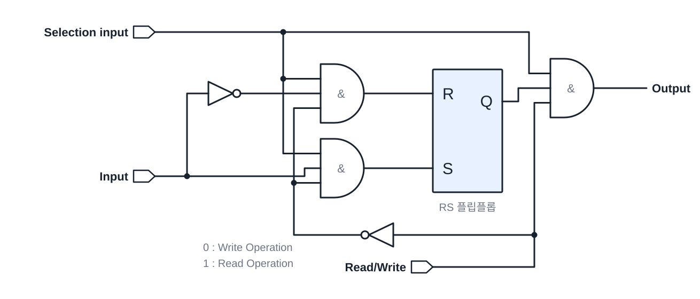
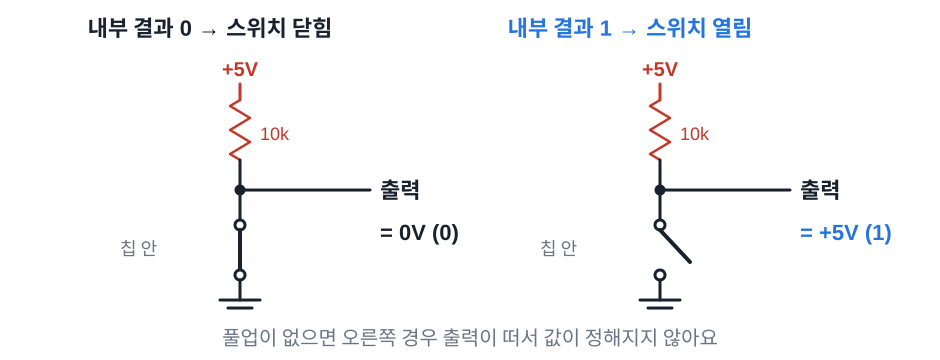
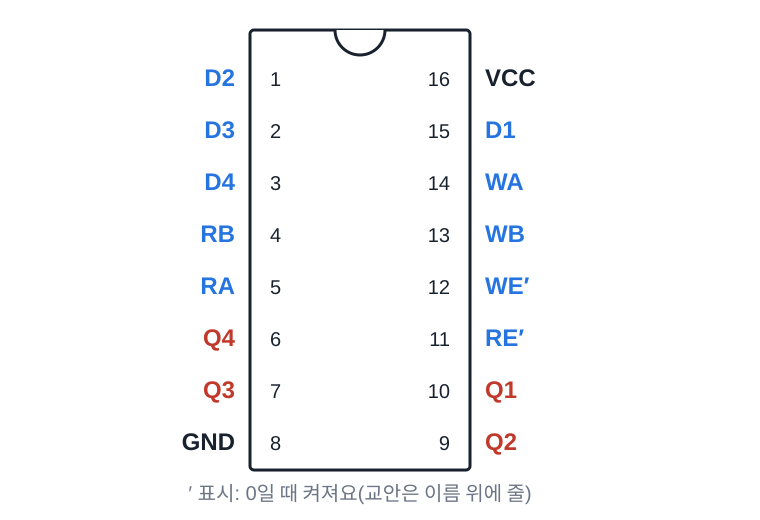
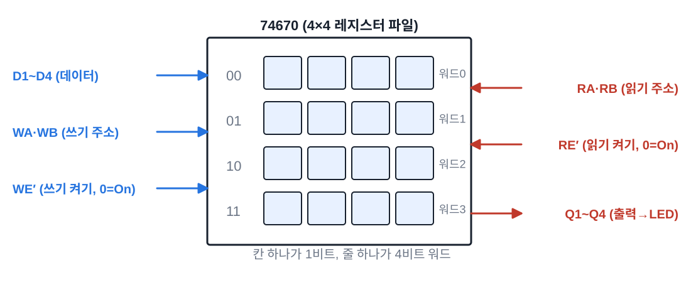

# 실험 9 · RAM — 값을 쓰고 붙잡았다가 읽어요 · 실험 설명

      
이번 학기 교안 기준

## 실험 이해

### 왜 이 회로를 쓰는지 먼저 알아봐요

작은 예부터 살펴봐요
이해를 위한 예시: 계산기에서 3을 누르고 +를 누르는 동안, 계산기는 3을 어딘가에 붙잡아 둬야 해요. 그런데 전선은 지금 0인지 1인지만 전해요. 손을 떼면 그 값은 어디에도 남지 않아요.

조건과 작동 원리를 확인해요
RAM은 이 문제를 풀어요. 교안은 RAM을 “기억된 정보를 읽거나 새로운 정보를 기억시킬 수 있는 메모리”라고 해요. 값을 칸에 넣는 일을 쓰기(Write), 칸의 값을 꺼내 보는 일을 읽기(Read)라고 불러요. 칸이 여러 개라서 어느 칸을 쓰고 읽을지 고르는 신호도 필요해요.

작은 예를 따라가 볼게요. 칸 A 하나가 있어요. 쓰기를 켠 채 값 1을 주면 A에 1이 들어가요. 쓰기를 끄면 값 선을 0으로 바꿔도 A는 1을 붙잡고 있어요. 나중에 읽기를 켜면 출력에 1이 나와요. 이 노트는 이 순서를 “쓰기 → 저장 → 읽기”라고 불러요. 전원을 켠 직후 A의 값은 정해지지 않아요.

이번 실험에서는 두 가지를 확인해요. 실험 1은 74HC00 두 개로 NAND SR 래치 칸 A, B를 만들고 74HC03 출력단으로 LED에 읽어 내는 2bit RAM이에요. 실험 2는 74670 한 칩으로 4개 주소에 4비트씩(16비트) 쓰고 읽은 뒤, 전원을 껐다 켜서 값이 남는지 보는 휘발성 실험까지 해요.

현재 공지에서 정한 실험 9 보고서 범위는 실험 1(2bit RAM)과 실험 2(16bit RAM, 74670)예요. 교안의 실험 항목이 이 둘뿐이라 빠진 항목은 없어요. 교안 표지는 25-1이고 현재 배포 파일을 썼어요. 이 노트의 값은 모두 예상 논리 상태이며 실제 측정 결과가 아니에요.

외울 규칙

- **해결하는 문제** → 지난 값을 칸에 붙잡아 두었다가 다시 꺼내요
- **쓰기(Write)** → 칸에 새 값을 넣어요
- **읽기(Read)** → 칸의 값을 꺼내 보여 줘요
- **실험 1** → NAND SR 래치 두 칸(A, B) = 2bit RAM
- **실험 2** → 74670 = 4주소 × 4비트 = 16bit RAM, 휘발성 확인

이유

전선은 지금 값만 전해서 지난 값을 남기지 못해요. 값을 붙잡는 칸과 칸을 고르는 신호가 있어야 나중에 다시 꺼낼 수 있어요.

헷갈리지 마요

- 보고서 범위는 실험 1·2예요. 교안 실험이 이 둘뿐이에요.
- 교안 표지는 25-1이에요.
- 값은 예상 상태이며 실제 측정 결과가 아니에요.
- 전원 직후 칸의 값은 정해지지 않아요.

출처: [강의노트/실험9. RAM.pdf · PDF p2](../../../%EA%B0%95%EC%9D%98%EB%85%B8%ED%8A%B8/%EC%8B%A4%ED%97%989.%20RAM.pdf#page=2) · [강의노트/실험9. RAM.pdf · PDF p3](../../../%EA%B0%95%EC%9D%98%EB%85%B8%ED%8A%B8/%EC%8B%A4%ED%97%989.%20RAM.pdf#page=3) · [강의노트/실험9. RAM.pdf · PDF p6](../../../%EA%B0%95%EC%9D%98%EB%85%B8%ED%8A%B8/%EC%8B%A4%ED%97%989.%20RAM.pdf#page=6) · [강의노트/실험9. RAM.pdf · PDF p8](../../../%EA%B0%95%EC%9D%98%EB%85%B8%ED%8A%B8/%EC%8B%A4%ED%97%989.%20RAM.pdf#page=8) · [강의노트/공지사항/2026-09-14_\[필독\]_논리회로실험_보고서_관련_공지.md](../../../%EA%B0%95%EC%9D%98%EB%85%B8%ED%8A%B8/%EA%B3%B5%EC%A7%80%EC%82%AC%ED%95%AD/2026-09-14_%5B%ED%95%84%EB%8F%85%5D_%EB%85%BC%EB%A6%AC%ED%9A%8C%EB%A1%9C%EC%8B%A4%ED%97%98_%EB%B3%B4%EA%B3%A0%EC%84%9C_%EA%B4%80%EB%A0%A8_%EA%B3%B5%EC%A7%80.md)

교안 표지는 25-1이에요. 보고서 범위(실험 1, 2)는 2026-09-14 공지(_350547_1)와 config.EXPERIMENT_SCOPE[9]에서 확인했어요.

### RAM: 주소로 칸을 골라 쓰고 읽어요

새 이름부터 알아봐요
메모리는 값을 담아 두는 칸의 모음이에요. 주소는 칸의 번호예요. 쓰기(Write)는 고른 칸에 새 값을 넣는 일이고, 읽기(Read)는 고른 칸의 값을 꺼내 보는 일이에요. 읽어도 칸의 값은 그대로 남아요.

Random Access는 “무작위 값”이 아니에요. 교안은 “메모리 내 물리적 위치에 관계없이, 거의 동일한 시간 내에 랜덤 위치에 접근하여 데이터를 읽거나 쓸 수 있음”이라고 적어요. 앞 칸부터 차례로 지나가지 않고 주소로 원하는 칸에 바로 가요.

휘발성은 전원이 꺼지면 값이 사라지는 성질이에요. 교안 실험 2의 3번이 이것을 확인하는 “휘발성 실험”이에요.

이해를 위한 예시: 네 칸 중 주소 01을 골라 1을 쓰고, 나중에 같은 주소를 읽어요.

한눈에 보기
다섯 줄로 기억하면 충분해요.

| 조건 | 결과 |
| --- | --- |
| 쓰기(Write) | 고른 칸에 새 값을 넣어요 |
| 읽기(Read) | 고른 칸의 값을 꺼내요 (칸의 값은 그대로) |
| 주소로 칸 고르기 | 어느 칸이든 거의 같은 시간에 접근 (Random Access) |
| 전원을 끄면 | 값이 사라져요 (휘발성) |
| 쓰임 | 기억장치, 응용 프로그램의 일시적 로딩, 데이터의 일시적 저장 |

실험07의 시프트 레지스터는 값을 한 칸씩 밀어 차례로 꺼냈어요. RAM은 주소로 원하는 칸에 바로 가는 것만 달라요.

아래 추적표는 외울 필요 없고, RAM의 역할이나 성질을 쓰라는 문제에서 꺼내 쓰면 돼요.

네 칸 메모리를 따라가요
교안의 정의는 두 문장이에요. “기억된 정보를 읽거나 새로운 정보를 기억시킬 수 있는 메모리”이고, 위치에 관계없이 거의 같은 시간에 접근해 읽거나 쓸 수 있어요. 쓰임은 “기억장치, 응용 프로그램의 일시적 로딩, 데이터의 일시적 저장 등”이에요.

아래는 이해를 위한 예시예요. 네 칸이 모두 0으로 쓰여 있다고 가정하고 쓰기와 읽기를 차례로 해요.

| 순서 | 동작 | 주소 | 값 | 칸 00 01 10 11 | 꺼낸 값 |
| --- | --- | --- | --- | --- | --- |
| ① | 쓰기 | 01 | 1 | 0 1 0 0 | — |
| ② | 읽기 | 01 | — | 0 1 0 0 | 1 |
| ③ | 쓰기 | 10 | 1 | 0 1 1 0 | — |
| ④ | 읽기 | 00 | — | 0 1 1 0 | 0 |
| ⑤ | 전원 끄고 켜기 | — | — | 정해지지 않음 | — |
| ⑥ | 읽기 | 01 | — | 정해지지 않음 | 알 수 없음 |

②와 ⑥을 비교해 봐요. 둘 다 주소 01을 읽지만 ②는 1, ⑥은 알 수 없어요. 그 사이 ⑤에서 전원이 끊겨 칸이 값을 잃었기 때문이에요. ②와 ④도 비교해 봐요. 둘 다 읽기인데 고른 주소가 달라서 다른 칸의 값이 나와요.

왜 전원이 꺼지면 사라질까요? 이번 실험의 칸은 게이트끼리 출력을 되돌려 주며 값을 붙잡는 래치예요. 전원이 끊기면 게이트가 꺼져 되먹임도 끊기고, 다시 켜면 각 래치가 어느 쪽으로 설지 정해지지 않아요. 교안은 다시 켠 뒤의 값을 적지 않았어요. 실험 2에서 직접 확인할 일이에요.

보충: SRAM과 DRAM
보충(교안 밖 일반 지식): 교안의 RAM 예에는 DRAM, SDRAM 같은 이름이 나와요. SRAM(Static RAM)은 플립플롭(래치)으로 한 비트씩 붙잡아요. 전원이 있는 동안에는 다시 써 주지(리프레시) 않아도 값이 유지돼요. DRAM(Dynamic RAM)은 작은 축전기의 전하로 기억해서, 전하가 새기 전에 주기적으로 다시 써 줘야 해요.

둘 다 전원을 끄면 값이 사라지는 휘발성 메모리예요. 래치로 칸을 만드는 이번 실험의 RAM은 SRAM 방식이에요.

헷갈리기 쉬운 말
읽기는 칸의 값을 지우지 않아요. 같은 칸을 여러 번 읽어도 같은 값이 나와요.

Static은 “리프레시 없이 유지”라는 뜻이에요. 전원 없이 유지된다는 뜻이 아니에요. SRAM도 휘발성이에요.

전원을 다시 켠 뒤 우연히 같은 값이 보여도 값이 남았다는 근거가 아니에요. 그 값은 정해지지 않은 값이에요.

한 단계만 풀어 봐요
위 표 ④ 다음에 주소 10에 0을 쓰고 주소 01을 읽으면 무엇이 나올까요?

#### 힌트

쓰기는 고른 칸만 바꿔요.

#### 연습 답

1이에요. 주소 10만 0이 되고 주소 01의 1은 그대로예요.

외울 규칙

- **쓰기(Write)** → 고른 칸에 새 값을 넣어요
- **읽기(Read)** → 고른 칸의 값을 꺼내요 (칸의 값은 그대로)
- **주소로 칸 고르기** → 어느 칸이든 거의 같은 시간에 접근 (Random Access)
- **전원을 끄면** → 값이 사라져요 (휘발성)
- **쓰임** → 기억장치, 응용 프로그램의 일시적 로딩, 데이터의 일시적 저장

이유

칸은 전원이 있는 동안 되먹임으로 값을 붙잡아요. 그래서 주소로 고른 칸만 바뀌고, 전원이 끊기면 값을 잃어요.

헷갈리지 마요

- Random Access는 무작위 값이 아니라 어느 칸이든 바로 접근한다는 뜻이에요.
- 읽기는 칸의 값을 지우지 않아요.
- SRAM·DRAM 비교는 교안 밖 보충이에요. Static도 휘발성이에요.
- 전원을 다시 켠 뒤의 값은 교안에 없고 정해지지 않아요(예상).

이 개념으로 풀 문제: [RAM의 역할](%EC%8B%A4%ED%97%9809_%EA%B8%B0%EC%B6%9C%ED%92%80%EC%9D%B4.md#q-ram-role) · [Static RAM(SRAM)이란](%EC%8B%A4%ED%97%9809_%EA%B8%B0%EC%B6%9C%ED%92%80%EC%9D%B4.md#q-sram-def) · [전원을 껐다 켜면](%EC%8B%A4%ED%97%9809_%EA%B8%B0%EC%B6%9C%ED%92%80%EC%9D%B4.md#q-qp-e09-tf-03)

출처: [강의노트/실험9. RAM.pdf · PDF p3](../../../%EA%B0%95%EC%9D%98%EB%85%B8%ED%8A%B8/%EC%8B%A4%ED%97%989.%20RAM.pdf#page=3) · [강의노트/실험9. RAM.pdf · PDF p8](../../../%EA%B0%95%EC%9D%98%EB%85%B8%ED%8A%B8/%EC%8B%A4%ED%97%989.%20RAM.pdf#page=8)

p3 정의·쓰임 문장을 옮겼어요. SRAM·DRAM 비교와 휘발성의 원리 설명은 교안 밖 보충이에요. 전원을 다시 켠 뒤의 값은 교안에 없어요(netlist M9). 네 칸 추적표는 이해를 위한 예시예요.

### NAND SR 래치: RAM 한 칸이 값을 붙잡는 법

새 이름부터 알아봐요
교안 목표의 첫 줄은 “NAND SR Latch 기반의 회로 구성 및 동작 확인”이에요. 실험06에서 본 NAND 두 개짜리 래치가 이번 RAM의 한 칸이에요. 한 게이트의 출력이 다른 게이트의 입력으로 돌아가서(되먹임) 입력을 쉬게 해도 값을 붙잡아요.

입력 이름 S′, R′의 ′는 “0일 때 눌리는 입력”이라는 표시예요. S′는 Q를 1로 만드는 Set 버튼, R′는 Q를 0으로 만드는 Reset 버튼이고, 둘 다 1이면 버튼에서 손을 뗀 상태예요.

S′와 R′가 들어가고, 위 NAND의 Q가 아래 NAND로, 아래 NAND의 Q′가 위 NAND로 돌아가요.

한눈에 보기
네 줄로 기억하면 충분해요.

| 조건 | 결과 |
| --- | --- |
| S′=0, R′=1 | Set (Q=1) |
| S′=1, R′=0 | Reset (Q=0) |
| S′=1, R′=1 | 유지 (Q 그대로) |
| S′=0, R′=0 | 금지 (Q=Q′=1, 부정 상태) |

p4의 RS 플립플롭 표(S=1이 Set)와 같은 규칙이고, 입력이 0일 때 눌리는 것만 반대예요. 그래서 피할 입력이 p4 표의 11 대신 00이에요.

아래 추적표는 외울 필요 없고, 래치 값을 따라가라는 문제에서 꺼내 쓰면 돼요.

두 NAND를 따라가요
NAND는 입력 중 하나라도 0이면 1을 내요. 위 게이트는 Q = (S′·Q′)′, 아래 게이트는 Q′ = (R′·Q)′예요. 0인 입력이 들어간 쪽 출력이 1로 정해지고, 그 1이 반대쪽으로 돌아가 나머지 값을 정해요. 0이 된 쪽이 이겨요.

$$Q = \overline{S' \cdot Q'},\quad Q' = \overline{R' \cdot Q}$$

아래 표는 전원 직후 값을 모른다고 두고 입력을 차례로 바꾼 거예요.

| 순서 | S′ | R′ | Q | Q′ | 동작 |
| --- | --- | --- | --- | --- | --- |
| 시작 | 1 | 1 | ? | ? | 전원 직후 미정 |
| ① | 0 | 1 | 1 | 0 | Set |
| ② | 1 | 1 | 1 | 0 | 유지 |
| ③ | 1 | 0 | 0 | 1 | Reset |
| ④ | 1 | 1 | 0 | 1 | 유지 |
| ⑤ | 0 | 0 | 1 | 1 | 금지(부정) |

②와 ④를 비교해 봐요. 둘 다 S′=R′=1로 입력이 같은데 ②는 Q=1, ④는 Q=0이에요. 바로 앞에 Set(①)을 했는지 Reset(③)을 했는지가 달라서예요. 같은 입력에서 앞의 값을 그대로 보여 주는 것, 이것이 칸이 “기억한다”는 뜻이에요.

00을 피하는 이유
⑤처럼 S′=R′=0이면 두 출력이 모두 1이 돼요. Q와 Q′가 늘 반대라는 약속이 깨지고, 그 뒤 두 입력을 동시에 1로 돌리면 어느 쪽으로 설지 정해지지 않아요. 교안 p7도 “NAND SR Latch에 00이 입력되어 출력이 부정 상태가 되는 것을 방지”하라고 해요.

p4 표의 S·R은 1일 때 눌리는 입력이라 금지가 11이에요. NAND 래치의 S′·R′와 섞지 않아요. 전원 직후 Q는 정해지지 않아요. 0으로 가정하지 않아요.

한 단계만 풀어 봐요
Q=0인 래치에 S′=0을 잠깐 줬다가 다시 1로 되돌렸어요(R′=1 그대로). Q는 얼마일까요?

#### 힌트

S′=0인 순간 Set, 되돌린 뒤는 유지 줄이에요.

#### 연습 답

1이에요. S′=0에서 Set되고, S′=R′=1이 되어도 1을 유지해요.

외울 규칙

- **S′=0, R′=1** → Set (Q=1)
- **S′=1, R′=0** → Reset (Q=0)
- **S′=1, R′=1** → 유지 (Q 그대로)
- **S′=0, R′=0** → 금지 (Q=Q′=1, 부정 상태)

이유

NAND는 0이 하나라도 들어가면 1을 내요. 그 1이 반대쪽 게이트로 돌아가 값을 붙잡아서, 입력이 11로 쉬어도 앞의 값이 남아요.

헷갈리지 마요

- p4 RS 표(Active High)의 금지는 11이고 NAND 래치의 금지는 00이에요.
- 00을 주면 Q=Q′=1이라 Q와 Q′가 반대라는 약속이 깨져요.
- 전원 직후 Q는 정해지지 않아요.

이 개념으로 풀 문제: [SRAM의 저장 회로](%EC%8B%A4%ED%97%9809_%EA%B8%B0%EC%B6%9C%ED%92%80%EC%9D%B4.md#q-sram-cell) · [NAND 래치의 금지 입력](%EC%8B%A4%ED%97%9809_%EA%B8%B0%EC%B6%9C%ED%92%80%EC%9D%B4.md#q-qp-e09-blank-01) · [RAM 한 칸(NAND SR 래치)을 작도해요](%EC%8B%A4%ED%97%9809_%EA%B8%B0%EC%B6%9C%ED%92%80%EC%9D%B4.md#q-qp-e09-board-01)

출처: [강의노트/실험9. RAM.pdf · PDF p2](../../../%EA%B0%95%EC%9D%98%EB%85%B8%ED%8A%B8/%EC%8B%A4%ED%97%989.%20RAM.pdf#page=2) · [강의노트/실험9. RAM.pdf · PDF p4](../../../%EA%B0%95%EC%9D%98%EB%85%B8%ED%8A%B8/%EC%8B%A4%ED%97%989.%20RAM.pdf#page=4) · [강의노트/실험9. RAM.pdf · PDF p7](../../../%EA%B0%95%EC%9D%98%EB%85%B8%ED%8A%B8/%EC%8B%A4%ED%97%989.%20RAM.pdf#page=7)

p2 목표의 “NAND SR Latch 기반”, p7 주의의 00 금지를 따랐어요. NAND 래치 규칙은 실험06 노트와 같고 check_values.py 가 네 입력 조합을 다시 계산했어요.

### 1 bit RAM: 래치 앞에 쓰기·읽기 문을 달아요

새 이름부터 알아봐요
교안 p4의 1 bit RAM은 칸 하나짜리 RAM이에요. 입력은 셋이에요. Selection Input은 이 칸을 고르는 선이에요(교안은 Enable이라고 덧붙여요). Read/Write는 0이면 쓰기, 1이면 읽기예요(회로 옆 “0 : Write Operation, 1 : Read Operation”). Input은 쓸 값이고, Output은 읽어 낸 값이에요.

가운데 RS 플립플롭은 p4 오른쪽 표를 따라요. S=1이면 Set, R=1이면 Reset, 둘 다 0이면 유지예요. 앞 토픽의 NAND 래치와 달리 1일 때 눌리는 입력이에요.

교안 p4 회로를 다시 그렸어요. Input은 그대로 S 쪽 AND에, 인버터를 거쳐 R 쪽 AND에 들어가요. Read/Write는 인버터를 거쳐 두 AND에, 그대로 출력 AND에 들어가요.

한눈에 보기
네 줄로 기억하면 충분해요.

| 조건 | 결과 |
| --- | --- |
| Selection=0 | 쓰지도 읽지도 않아요 (Q 유지, Output=0) |
| Selection=1, R/W=0, Input=1 | 1 쓰기 (S=1 → Q=1) |
| Selection=1, R/W=0, Input=0 | 0 쓰기 (R=1 → Q=0) |
| Selection=1, R/W=1 | 읽기 (Output=Q, Input은 영향 없음) |

RS 플립플롭 앞에 AND 문 두 개를 달아 S와 R을 대신 만들어 주는 회로예요. Input 하나가 S와 R을 함께 정하니까 RS 표로 읽어 보면 이래요.

| Input (Sel=1, R/W=0) | S, R 자리 | RS 표로 본 결과 |
| --- | --- | --- |
| 1 | S=1, R=0 | Set (Q=1) |
| 0 | S=0, R=1 | Reset (Q=0) |

RS 표의 S=R=1(X) 줄은 생기지 않아요. Input과 Input′가 동시에 1일 수 없어서예요. RS 표 중 Set 줄과 Reset 줄만 남은 게 1 bit RAM의 쓰기예요.

아래 식은 외울 필요 없고, 입력값을 구하라는 문제에서 꺼내 쓰면 돼요.

앞단 식을 대입해요
뒤의 RS 플립플롭은 p4 표 그대로예요. 앞단 AND 세 개의 식만 회로도에서 읽어 대입해요. (R/W)′는 Read/Write를 뒤집은 값이에요.

$$S = \mathrm{Sel}\cdot\overline{\mathrm{R/W}}\cdot \mathrm{Input},\quad R = \mathrm{Sel}\cdot\overline{\mathrm{R/W}}\cdot\overline{\mathrm{Input}}$$

$$\mathrm{Output} = \mathrm{Sel}\cdot \mathrm{R/W}\cdot Q$$

R/W=0일 때만 (R/W)′=1이라 S, R 쪽 문이 열려요. R/W=1이면 두 문이 닫혀 래치는 유지되고, 대신 출력 문이 열려 Q가 나가요. 아래 표는 처음 Q=0이라고 가정하고 차례로 바꾼 거예요.

| 순서 | Sel | R/W | Input | S | R | Q | Output | 동작 |
| --- | --- | --- | --- | --- | --- | --- | --- | --- |
| ① | 1 | 0 | 1 | 1 | 0 | 1 | 0 | 1 쓰기 |
| ② | 1 | 1 | X | 0 | 0 | 1 | 1 | 읽기 |
| ③ | 0 | X | X | 0 | 0 | 1 | 0 | 선택 안 함(유지) |
| ④ | 1 | 0 | 0 | 0 | 1 | 0 | 0 | 0 쓰기 |
| ⑤ | 1 | 1 | X | 0 | 0 | 0 | 0 | 읽기 |

②와 ⑤를 비교해 봐요. 입력은 Sel=1, R/W=1로 같은데 Output이 1과 0으로 달라요. 앞에서 쓴 값(①은 1, ④는 0)이 Q에 남아 있어서예요. ①과 ④는 Input 하나만 다르고, 그래서 S와 R 중 켜지는 쪽이 바뀌어요.

교안 식과 그림이 어긋나요
교안 p4의 식은 S에 Input′, R에 Input을 넣어 적었어요. 그런데 같은 쪽 회로도는 Input을 그대로 S 쪽 AND에, 인버터를 거쳐 R 쪽 AND에 넣고, 표도 Input=1이면 Q=1이에요. 회로도·표와 맞추려면 식의 S와 R이 서로 바뀌어야 해요. 이 노트는 회로도와 표를 따랐어요.

p4 표 첫 줄은 Selection=0일 때 Q=0이라고 적었어요. 회로대로면 S=R=0이라 Q는 그대로이고 Output만 0이에요. 쓰는 동안(R/W=0)에는 Output이 0이라 쓰는 값을 바로 보여 주지 않아요.

한 단계만 풀어 봐요
Sel=1, R/W=0, Input=0을 준 뒤 R/W를 1로 바꾸면 Output은 얼마일까요?

#### 힌트

먼저 무엇이 써졌는지 보고, R/W=1은 읽기예요.

#### 연습 답

0이에요. Input=0으로 0이 써졌고 R/W=1에서 그 Q가 나와요.

외울 규칙

- **Selection=0** → 쓰지도 읽지도 않아요 (Q 유지, Output=0)
- **Selection=1, R/W=0, Input=1** → 1 쓰기 (S=1 → Q=1)
- **Selection=1, R/W=0, Input=0** → 0 쓰기 (R=1 → Q=0)
- **Selection=1, R/W=1** → 읽기 (Output=Q, Input은 영향 없음)

이유

R/W=0일 때만 S·R 쪽 AND가 열려 Input이 래치에 닿고, R/W=1이면 그 문이 닫히는 대신 출력 AND가 열려 Q가 나가요.

헷갈리지 마요

- 교안 p4 식은 S·R이 그림·표와 바뀌어 있어요. 회로도·표대로 Input=1이면 Q=1이에요.
- p4 표 첫 줄(Sel=0이면 Q=0)과 달리 회로대로면 Q는 유지되고 Output만 0이에요.
- Read/Write는 0이 쓰기, 1이 읽기예요.

이 개념으로 풀 문제: [읽기 때 Read/Write 값](%EC%8B%A4%ED%97%9809_%EA%B8%B0%EC%B6%9C%ED%92%80%EC%9D%B4.md#q-read-op-rw) · [1 bit RAM에 1 쓰기](%EC%8B%A4%ED%97%9809_%EA%B8%B0%EC%B6%9C%ED%92%80%EC%9D%B4.md#q-write1) · [1 bit RAM에 0 쓰기](%EC%8B%A4%ED%97%9809_%EA%B8%B0%EC%B6%9C%ED%92%80%EC%9D%B4.md#q-write0) · [읽기 때의 Output](%EC%8B%A4%ED%97%9809_%EA%B8%B0%EC%B6%9C%ED%92%80%EC%9D%B4.md#q-qp-e09-tf-04)

출처: [강의노트/실험9. RAM.pdf · PDF p4](../../../%EA%B0%95%EC%9D%98%EB%85%B8%ED%8A%B8/%EC%8B%A4%ED%97%989.%20RAM.pdf#page=4) · [보고서/실험09/결선도/netlist.md](../../../%EB%B3%B4%EA%B3%A0%EC%84%9C/%EC%8B%A4%ED%97%9809/%EA%B2%B0%EC%84%A0%EB%8F%84/netlist.md)

p4의 부울식은 S·R이 그림·표와 바뀌어 있어요(300dpi 판독, netlist M15). 회로도·표를 따랐어요. 표 첫 행(Selection=0이면 Q=0)도 회로의 유지와 달라요(M15). 회로 그림은 p4를 직접 다시 그렸고 Input 인버터가 R 쪽 AND로 가는 것을 400dpi 크롭으로 확인했어요.

### 2bit RAM: OE·IN·WR로 칸 A, B를 다뤄요

새 이름부터 알아봐요
교안 범례는 입력 세 종류를 이렇게 적어요. OE는 Read Select(0: Off, 1: On)로 읽기를 켜요. IN은 Write Select(0: Off, 1: On)로 쓰기를 켜요. WR은 Write Value(0 or 1)로 쓸 값이에요. 범례는 OE0, IN0, WR0을 A part, OE1, IN1, WR1을 B part라고 적어요.

그런데 회로도를 따라가 보면 WR0과 WR1은 A와 B 양쪽에 함께 들어가요. WR1은 두 칸의 Set 쪽 NAND(2번 핀)에, WR0은 두 칸의 Reset 쪽 NAND(5번 핀)에 이어져요. 그래서 WR0과 WR1은 “A의 값, B의 값”이 아니라 늘 반대로 두는 한 쌍이에요. 칸 A, B는 각각 74HC00 하나로 만든 NAND SR 래치예요.

교안 p6 회로를 다시 그렸어요. 파란 WR1은 두 칸의 2번 핀, 초록 WR0은 두 칸의 5번 핀에 함께 들어가요. 핀 번호는 교안 회로도 그대로예요.

한눈에 보기
다섯 줄로 기억하면 충분해요. B는 IN1, OE1, OUT1로 똑같아요.

| 조건 | 결과 |
| --- | --- |
| IN0=1, WR1=1, WR0=0 | A에 1 쓰기 (Q=1) |
| IN0=1, WR1=0, WR0=1 | A에 0 쓰기 (Q=0) |
| IN0=0 | A 유지 (WR을 바꿔도 그대로) |
| OE0=1 | OUT0 = A의 Q |
| OE0=0 | OUT0 = 0 |

1 bit RAM과 같은 일을 해요. Selection과 Read/Write가 IN(쓰기 켜기)과 OE(읽기 켜기) 두 선으로 나뉘고, Input 하나 대신 WR1·WR0 두 선이 S′·R′ 자리를 따로 정해요.

| 쓰기 입력 | 래치 입력 자리 | NAND 래치 규칙으로 본 결과 |
| --- | --- | --- |
| IN0=1, WR1=1, WR0=0 | S′=0, R′=1 | Set (Q=1) |
| IN0=1, WR1=0, WR0=1 | S′=1, R′=0 | Reset (Q=0) |
| IN0=0 (WR은 무엇이든) | S′=1, R′=1 | 유지 |
| IN0=1, WR1=1, WR0=1 | S′=0, R′=0 | 금지 |

NAND 래치 규칙 네 줄이 모두 생길 수 있어요. 그래서 금지 줄을 막는 약속이 다음 토픽의 주의사항이에요.

아래 식은 외울 필요 없고, OE·IN·WR 값을 구하라는 문제에서 꺼내 쓰면 돼요.

앞단과 아는 래치로 나눠요
칸 A의 앞단 NAND 두 개 출력에 S′, R′라는 이름을 붙여요. 1·2번 → 3번 게이트가 S′, 4·5번 → 6번 게이트가 R′예요. 뒤의 래치(12·13번 → 11번이 Q, 9·10번 → 8번이 Q′)는 앞 토픽의 NAND SR 래치 식 그대로예요. 0이 된 쪽이 이겨요.

$$S'_A = \overline{\mathrm{IN0}\cdot \mathrm{WR1}},\quad R'_A = \overline{\mathrm{IN0}\cdot \mathrm{WR0}}$$

읽기 쪽은 74HC03 두 게이트예요. 첫 게이트가 (OE0·Q)′를 만들고, 두 입력을 묶은 둘째 게이트가 한 번 더 뒤집어요. 그래서 OUT0 = OE0·Q예요. 자세한 출력 구조는 열린 드레인 토픽에서 봐요.

아래 표는 체크리스트의 기록 순서예요. OUT은 회로에서 셈한 예상값이고, 전원 직후 값과 관계없이 같아요(S1 행 제외).

| 스텝 | OE0 | IN0 | WR0 | OE1 | IN1 | WR1 | OUT0 | OUT1 | 동작 |
| --- | --- | --- | --- | --- | --- | --- | --- | --- | --- |
| S1 | 0 | 0 | 0 | 0 | 0 | 1 | 0 | 0 | 전원 직후(A·B 미정, OE=0이라 0) |
| W1 | 0 | 1 | 0 | 0 | 0 | 1 | 0 | 0 | A에 1 쓰기 |
| R1 | 1 | 0 | 0 | 0 | 0 | 1 | 1 | 0 | IN0 내리고 A 읽기 |
| W2 | 0 | 0 | 1 | 0 | 1 | 0 | 0 | 0 | B에 0 쓰기 |
| R2 | 1 | 0 | 1 | 1 | 0 | 0 | 1 | 0 | A·B 읽기 |
| W3 | 0 | 0 | 0 | 0 | 1 | 1 | 0 | 0 | B에 1 쓰기 |
| R3 | 1 | 0 | 0 | 1 | 0 | 1 | 1 | 1 | A·B 읽기 |
| W4 | 0 | 1 | 1 | 0 | 0 | 0 | 0 | 0 | A에 0 쓰기 |
| R4 | 1 | 0 | 1 | 1 | 0 | 0 | 0 | 1 | A·B 읽기 |

R2와 R4를 비교해 봐요. 입력이 OE0=OE1=1, IN0=IN1=0, WR0=1, WR1=0으로 똑같은데 OUT0이 1과 0으로 달라요. 그 사이 W4에서 A에 0을 썼기 때문이에요. W2와 R2도 비교해 봐요. 두 줄 모두 WR0=1인데 A는 그대로 1이에요. IN0=0이라 A의 문이 닫혀 있었어요.

범례만 보고 풀면 틀려요
범례만 보면 “A에 1 쓰기”를 WR0=1로 착각하기 쉬워요. 회로도대로면 저장되는 값은 WR1과 같고 WR0과 반대예요. A에 1을 쓰려면 IN0=1, WR1=1, WR0=0이에요. 기출 제공 답도 이 값이에요.

전원 직후 A, B는 정해지지 않아요. 아직 쓰지 않은 칸의 OE는 0으로 둬요. 핀 번호는 교안 회로도 기준이에요. 실제 결선도는 배선을 줄이려고 74HC00 안 게이트 자리를 바꿨을 수 있으니 결선도 표를 따로 확인해요.

한 단계만 풀어 봐요
A에 1, B에 0이 저장된 상태에서 OE0=OE1=1, IN0=IN1=0으로 두면 OUT0, OUT1은 얼마일까요?

#### 힌트

IN이 모두 0이면 유지, OE가 1이면 OUT=Q예요.

#### 연습 답

OUT0=1, OUT1=0이에요.

외울 규칙

- **IN0=1, WR1=1, WR0=0** → A에 1 쓰기 (Q=1)
- **IN0=1, WR1=0, WR0=1** → A에 0 쓰기 (Q=0)
- **IN0=0** → A 유지 (WR을 바꿔도 그대로)
- **OE0=1** → OUT0 = A의 Q
- **OE0=0** → OUT0 = 0

이유

IN이 앞단 NAND의 문을 열어 WR1이 S′, WR0이 R′를 정해요. 뒤 래치는 NAND SR 래치 그대로이고, 출력단은 OUT=OE·Q예요.

헷갈리지 마요

- 범례는 WR0을 A, WR1을 B라 적지만 회로도는 WR1이 두 칸의 Set 쪽, WR0이 Reset 쪽이에요. 저장값은 WR1과 같아요.
- 전원 직후 A, B는 정해지지 않아요.
- B는 IN1, OE1, OUT1로 같은 규칙이에요.

이 개념으로 풀 문제: [2bit RAM의 A에 1 쓰기](%EC%8B%A4%ED%97%9809_%EA%B8%B0%EC%B6%9C%ED%92%80%EC%9D%B4.md#q-apart1) · [2bit RAM의 B에 1 쓰기](%EC%8B%A4%ED%97%9809_%EA%B8%B0%EC%B6%9C%ED%92%80%EC%9D%B4.md#q-bpart1) · [2bit RAM의 B에 0 쓰기](%EC%8B%A4%ED%97%9809_%EA%B8%B0%EC%B6%9C%ED%92%80%EC%9D%B4.md#q-bpart0) · [IN0=0이면 A는 그대로](%EC%8B%A4%ED%97%9809_%EA%B8%B0%EC%B6%9C%ED%92%80%EC%9D%B4.md#q-qp-e09-tf-02)

출처: [강의노트/실험9. RAM.pdf · PDF p6](../../../%EA%B0%95%EC%9D%98%EB%85%B8%ED%8A%B8/%EC%8B%A4%ED%97%989.%20RAM.pdf#page=6) · [보고서/실험09/결선도/netlist.md](../../../%EB%B3%B4%EA%B3%A0%EC%84%9C/%EC%8B%A4%ED%97%9809/%EA%B2%B0%EC%84%A0%EB%8F%84/netlist.md) · [보고서/실험09/체크리스트/명세.md](../../../%EB%B3%B4%EA%B3%A0%EC%84%9C/%EC%8B%A4%ED%97%9809/%EC%B2%B4%ED%81%AC%EB%A6%AC%EC%8A%A4%ED%8A%B8/%EB%AA%85%EC%84%B8.md)

p6 범례는 WR0을 A, WR1을 B 값으로 적지만 회로도는 WR1을 두 래치의 세트 쪽(2번), WR0을 리셋 쪽(5번)에 공통으로 잇는다(netlist M2, p6 400dpi 크롭 직접 판독). 추적표는 명세 T1 값이며 check_values.py 가 네 초기 상태 모두에서 다시 계산했어요. 실제 결선도는 U1·U2 게이트 자리를 바꿨어요(M13). 이 노트의 핀 번호는 교안 회로도 기준이에요.

### 주의사항 세 가지: 왜 그렇게 조작하나요

왜 약속이 필요한지 먼저 봐요
2bit RAM은 WR 선 두 개를 A와 B가 같이 써요. 그래서 어느 칸에 쓸지는 IN만 정해요. 잘못 켜면 두 칸이 같이 바뀌거나 래치가 금지 입력을 받아요. 교안 p7의 주의사항 세 가지가 이것을 막아요.

한눈에 보기
네 줄로 기억하면 충분해요.

| 조건 | 결과 |
| --- | --- |
| 한 번에 한 비트만 | IN0, IN1을 동시에 1로 두지 않아요 |
| WR0 = WR1′ | WR0과 WR1은 늘 반대로 (래치에 00이 들어가지 않게) |
| 쓴 뒤 IN 접지 → OE로 읽기 | 저장된 값을 읽어요 |
| IN과 OE를 함께 켜면 | WR 값이 바로 출력 (저장된 값을 못 읽어요) |

앞 토픽의 쓰기 규칙에서 위험한 줄(금지 입력, 두 칸 동시 쓰기)을 막는 약속이에요.

아래 표는 외울 필요 없고, 왜 그렇게 조작하는지 묻는 서술 문제에서 꺼내 쓰면 돼요.

어기면 무슨 일이 생기는지 따라가요
| 순서 | 조작 | 래치 입력 | 결과 |
| --- | --- | --- | --- |
| ① | IN0=1, WR1=1, WR0=1 | A: S′=0, R′=0 | A가 금지 입력 (Q=Q′=1, 부정 상태) |
| ② | IN0=1, WR1=0, WR0=0 | A: S′=1, R′=1 | 아무것도 써지지 않아요 (유지) |
| ③ | IN0=IN1=1, WR1=1, WR0=0 | A·B 모두 S′=0 | A와 B에 함께 1이 써져요 |
| ④ | OE0=1, IN0=1 | A가 계속 써지는 중 | OUT0이 WR1을 바로 따라가요 |
| ⑤ | OE0=1, IN0=0 | A: S′=1, R′=1 | OUT0 = 저장된 A |

④와 ⑤를 비교해 봐요. 둘 다 OE0=1인데 ④는 IN0=1이라 지금 쓰고 있는 WR 값이 보이고, ⑤는 IN0=0이라 저장된 값이 보여요. 교안도 “Read, Write를 모두 켜게 되면, WR 값이 즉시 출력되며 기존 저장된 값을 Read 할 수 없음”이라고 적어요.

교안 주의 1의 괄호는 IN0 = IN1′예요(이름 위 줄). 글자 그대로 지키면 IN0과 IN1 중 하나는 늘 1이라, 주의 3의 “IN을 접지하여 값을 저장”과 함께 지킬 수 없어요. 그래서 이 노트는 “IN0과 IN1을 동시에 1로 두지 않는다”로 읽고, 쓰기 사이에는 둘 다 0으로 둬요(해석이에요). 또 WR을 바꾸는 것은 IN0, IN1이 둘 다 0일 때만 해요. 바꾸는 순간 잠깐 WR0=WR1이 되어도 문이 닫혀 있으면 래치에 닿지 않아요(결선도의 운영 규칙이에요).

헷갈리기 쉬운 것
②는 위험하지 않지만 쓰기가 되지 않아요. 금지는 ①의 WR0=WR1=1(래치에 00)이에요.

“IN0 = IN1′”를 글자 그대로 따르면 쓰기 뒤 접지를 할 수 없어요. 해석임을 밝히고 조교 확인이 필요할 수 있어요.

한 단계만 풀어 봐요
A에 0이 저장돼 있어요. B에 1을 쓰는 동안(IN1=1, WR1=1, WR0=0) OE0=1로 두면 OUT0에는 무엇이 보일까요?

#### 힌트

IN0이 얼마인지 먼저 봐요.

#### 연습 답

0이에요. IN0=0이라 A는 유지되고 OUT0은 저장된 A(0)를 보여 줘요.

외울 규칙

- **한 번에 한 비트만** → IN0, IN1을 동시에 1로 두지 않아요
- **WR0 = WR1′** → WR0과 WR1은 늘 반대로 (래치에 00이 들어가지 않게)
- **쓴 뒤 IN 접지 → OE로 읽기** → 저장된 값을 읽어요
- **IN과 OE를 함께 켜면** → WR 값이 바로 출력 (저장된 값을 못 읽어요)

이유

WR 선을 두 칸이 같이 써서 IN만이 칸을 골라요. IN을 내리면 S′=R′=1로 유지되고, 그때 OE를 켜야 저장된 Q가 나와요.

헷갈리지 마요

- 교안 괄호 IN0 = IN1′를 글자대로 지키면 IN 접지와 함께 지킬 수 없어요. 이 노트는 “동시에 1 금지”로 해석했어요.
- WR0=WR1=0은 금지가 아니라 쓰기가 안 되는 거예요. 금지는 WR0=WR1=1이에요.
- WR은 IN이 둘 다 0일 때 바꿔요(결선도 운영 규칙).

이 개념으로 풀 문제: [쓴 뒤 IN을 접지하는 이유](%EC%8B%A4%ED%97%9809_%EA%B8%B0%EC%B6%9C%ED%92%80%EC%9D%B4.md#q-qp-e09-short-01)

출처: [강의노트/실험9. RAM.pdf · PDF p7](../../../%EA%B0%95%EC%9D%98%EB%85%B8%ED%8A%B8/%EC%8B%A4%ED%97%989.%20RAM.pdf#page=7) · [보고서/실험09/결선도/netlist.md](../../../%EB%B3%B4%EA%B3%A0%EC%84%9C/%EC%8B%A4%ED%97%9809/%EA%B2%B0%EC%84%A0%EB%8F%84/netlist.md)

p7 주의 1의 괄호 IN0 = IN1′(300dpi 판독, 텍스트 추출은 바를 잃어요)의 해석은 netlist M3을 따랐어요. WR을 IN이 둘 다 0일 때만 바꾸는 규칙은 결선도 운영 규칙이에요(netlist 공통 규칙). ①~⑤의 결과는 check_values.py rules_checks 로 다시 계산했어요.

### 74HC03 출력단: 열린 드레인과 풀업

새 이름부터 알아봐요
보충(교안은 그림만 있고 설명이 없어요): 74HC03은 74HC00처럼 NAND 네 개가 든 칩이지만 출력이 “열린 드레인”이에요. 결과가 0일 때만 핀을 GND로 당기고, 결과가 1일 때는 핀을 놓아 버려요. 핀이 떠 있으면 값이 정해지지 않아요.

그래서 교안 회로처럼 출력마다 10kΩ 저항을 +5V에 이어요. 이것을 풀업이라고 해요. 핀을 놓으면 풀업이 +5V로 끌어올려 1이 돼요.

보충: 칩 안을 스위치로 그린 모형이에요. 결과 0이면 스위치가 닫혀 0V, 결과 1이면 열려서 풀업이 +5V로 끌어올려요.

한눈에 보기
네 줄로 기억하면 충분해요.

| 조건 | 결과 |
| --- | --- |
| NAND 결과 0 | 핀을 GND로 당겨 0 |
| NAND 결과 1 | 핀을 놓아요 → 풀업이 1로 만들어요 |
| 풀업이 없으면 | 결과 1일 때 값이 정해지지 않아요 |
| NAND 두 개(뒤는 입력 묶음) | AND: OUT0 = OE0·Q |

논리값은 74HC00 NAND와 같고, 1을 내는 방법만 달라요. 1은 풀업 저항이 만들어요.

아래 표는 외울 필요 없고, 출력단 값을 따라가라는 문제에서 꺼내 쓰면 돼요.

출력단 두 게이트를 따라가요
칸 A의 출력단은 74HC03 1·2번 → 3번 게이트와, 12·13번을 묶은 → 11번 게이트예요. 3번과 11번에 10kΩ 풀업이 하나씩 달려 있어요. 입력을 묶은 NAND는 입력을 뒤집는 인버터가 돼요.

$$\mathrm{OUT0} = \overline{\overline{\mathrm{OE0}\cdot Q}\cdot\overline{\mathrm{OE0}\cdot Q}} = \mathrm{OE0}\cdot Q$$

| OE0 | A의 Q | 3번 (OE0·Q)′ | OUT0 (11번) |
| --- | --- | --- | --- |
| 0 | 0 | 1 (풀업) | 0 |
| 0 | 1 | 1 (풀업) | 0 |
| 1 | 0 | 1 (풀업) | 0 |
| 1 | 1 | 0 | 1 (풀업) |

셋째 줄과 넷째 줄을 비교해 봐요. 둘 다 OE0=1인데 Q가 0, 1로 다르니 OUT0도 0, 1로 달라져요. OUT0이 Q를 그대로 보여 줘요. 첫째·둘째 줄은 OE0=0이라 Q와 상관없이 OUT0=0이에요.

이 식은 1 bit RAM의 Output = Selection·(Read/Write)·Q와 같은 꼴이에요. OE가 Selection과 Read를 한꺼번에 맡은 셈이에요(대응은 이 노트의 해석이에요).

왜 74HC00이 아니라 74HC03일까요 (추론)
보충·추론: 교안은 74HC03을 고른 이유를 적지 않았어요. 아래는 회로 모양에서 거꾸로 읽은 이 노트의 해석이에요. 먼저 사실부터 봐요. 교안 회로는 출력 3·6·8·11번이 서로 묶여 있지 않아요. 그래서 핀 배치가 같은 74HC00으로 바꿔도 OUT0 = OE0·Q는 그대로 나와요. 74HC03의 성질이 쓸모 있어지는 건 여러 칸의 출력을 한 선에 묶을 때예요.

① 쓰기 쪽은 이미 선을 함께 써요. WR1과 WR0은 A와 B 두 칸에 함께 들어가고, 칸을 고르는 건 IN0·IN1뿐이에요. 데이터선은 같이 쓰고 선택 신호로 한 칸만 받게 하는 실제 RAM의 쓰기 방식이에요. 실제 RAM이라면 읽기 쪽도 칸마다 출력선을 두지 않고 데이터선 하나를 같이 써요.

② 출력단 모양이 공유선용이에요. AND만 필요하면 74HC08 한 게이트면 되는데, 교안은 NAND (OE·Q)′와 인버터로 나눴어요. A의 3번과 B의 6번을 한 선으로 묶고 풀업을 하나만 달아 봐요. 열린 드레인 출력을 묶은 선은 AND가 돼요(wired-AND). 그 선을 인버터에 넣어 뒤집으면 OUT은 고른 칸의 값이 돼요.

$$\text{선} = \overline{\mathrm{OE0}\cdot Q_A}\cdot\overline{\mathrm{OE1}\cdot Q_B}$$

$$\mathrm{OUT} = \mathrm{OE0}\cdot Q_A + \mathrm{OE1}\cdot Q_B$$

| OE0 | OE1 | 묶은 선 | OUT |
| --- | --- | --- | --- |
| 1 | 0 | QA′ | QA |
| 0 | 1 | QB′ | QB |
| 0 | 0 | 1 | 0 |
| 1 | 1 | (QA+QB)′ | QA+QB |

첫 줄은 A를, 둘째 줄은 B를 읽어요. 셋째 줄은 아무 칸도 고르지 않아 풀업이 선을 1로 두고 OUT=0이에요. 넷째 줄처럼 둘을 함께 켜면 두 칸의 값이 섞여서, 실제 메모리도 한 번에 한 칸만 골라요. 출력선 하나로 OE가 고른 칸을 읽는 읽기 버스가 돼요. 지금 교안 회로는 3번과 6번을 묶지 않고 LED 두 개로 A와 B를 함께 보도록 펼쳐 놓은 모양으로 읽혀요.

③ “OE=0이면 선에서 빠진다”는 74HC03만 가진 성질이에요. 메모리에서 OE는 원래 Output Enable, 안 고른 칸은 공유선에서 손을 뗀다는 뜻이에요. 74HC03은 OE=0이면 NAND 결과가 1이라 핀을 놓아요. 그 칸은 선에서 빠진 것과 같아요. 74HC00은 OE=0이어도 핀을 +5V로 밀어 올려서 선에서 빠지지 못해요.

④ 실험 2와 짝을 이뤄요. 74670의 출력은 RE=1일 때 고임피던스(3상태)가 되어 선에서 빠져요. 실험 1은 같은 동작을 열린 드레인과 풀업으로 직접 만들어 보고, 실험 2는 칩 안에 든 것을 쓰는 흐름으로 읽혀요.

⑤ 칩 수와 준비물도 같은 쪽을 가리켜요. 74HC03 하나의 게이트 4개가 두 칸의 NAND·인버터(2 × 2)에 딱 맞아요. 둘째 단 인버터는 열린 드레인일 필요가 없지만 같은 칩의 남은 게이트를 쓴 결과로 보여요. 준비물 10kΩ 4개는 이 풀업에만 쓰여요. 회로도 모양이 옛 TTL 교재의 7403(오픈 컬렉터) 그림과 비슷해서 그 그림을 HC 계열로 옮긴 것일 수도 있어요(근거가 약한 추측이에요).

정리: 지금 회로처럼 출력을 따로 빼면 74HC00이나 74HC08로도 똑같이 동작하고 LED도 더 밝아요. 74HC03은 여러 칸의 출력을 한 선에 묶을 때 의미가 있어요. 쓰기 선을 같이 쓰는 설계, NAND와 인버터로 나눈 출력단, OE라는 이름을 함께 보면 메모리 읽기 버스를 흉내 낸 회로로 읽혀요. 보고서에 쓸 때는 “열린 드레인은 OE가 꺼진 칸이 선에서 빠지게 해서 여러 칸의 출력을 한 선에 묶을 수 있다(wired-AND)” 정도로 쓰고, 교안에 없는 추론임을 밝혀요.

74HC03 대신 74HC00을 꽂으면 망가질까요
보충: 망가질 수 있는 쪽은 전원이 아니라 칩이에요. 경우를 둘로 나눠 봐요.

| 상황 | 결과 |
| --- | --- |
| 교안 회로 그대로 칩만 74HC00 | 정상 동작해요. OUT0 = OE0·Q 그대로이고 아무것도 망가지지 않아요 |
| 출력끼리 한 선에 묶은 채 74HC00 | 고른 칸은 0으로 당기고 안 고른 칸은 1로 밀면 +5V에서 GND로 단락이 생겨요. 위험한 것은 칩이에요 |

교안 회로 그대로라면: 출력이 0일 때 10kΩ 풀업을 지나 약 5V ÷ 10kΩ = 0.5mA가 칩으로 들어올 뿐이에요. 출력이 1일 때는 칩이 직접 +5V로 밀어 올려서 풀업에는 전류가 거의 흐르지 않아요. 풀업은 할 일이 없어지고 빼도 돼요. LED는 칩이 직접 켜서 지금보다 밝아져요. 330Ω이면 대략 (5 − 2)V ÷ 330Ω ≈ 9mA로 74HC 출력이 감당할 수 있는 범위예요(LED 전압 2V는 어림값이에요).

출력을 묶었다면: 예를 들어 3번과 6번을 묶고 A만 읽으면(OE0=1, QA=1, OE1=0), A의 출력은 선을 GND로 당기고 B의 출력은 같은 선을 +5V로 밀어요. 사이에 저항이 없어서 사실상 단락이에요. 전류는 출력 트랜지스터의 내부 저항만으로 막혀 대략 수십 mA가 될 수 있어요. 흔한 74HC 데이터시트의 출력 핀 절대 최대 정격(±25mA) 근처이거나 넘는 값이에요(일반적인 74HC 기준이고, 이번 칩 데이터시트로 확인한 값은 아니에요). 잠깐이면 대개 버티지만 오래 두면 칩이 뜨거워지고 출력단이 상할 수 있어요. 선 전압은 중간쯤(약 2~3V)에 걸려 0도 1도 아니어서, 망가지지 않더라도 읽은 값은 틀려요.

전원 장치는 이 정도 전류를 문제없이 내고 대개 전류 제한도 있어서 망가지는 일은 거의 없어요. 순간적으로 +5V 레일이 조금 흔들릴 수는 있어요. 74HC03이면 안 고른 칸이 선을 놓아 버려서 이 단락이 생기지 않아요. 이것이 위에서 추론한 “03을 쓰는 이유”예요.

실험할 때 주의해요
풀업을 빼먹으면 결과 1인 순간 핀이 떠서 다음 게이트 입력이 정해지지 않아요. 74HC03 출력 네 개에 10kΩ이 하나씩, 모두 네 개 필요해요(준비물 10kΩ 4개).

OUT0=1일 때 LED 전류는 10kΩ 풀업을 지나서 아주 작아요. LED가 흐리게 보일 수 있어요(예상). 74HC03의 전원 핀(14번 +5V, 7번 GND)은 74HC00과 같은 배치로 보고 있어요. 받은 칩의 자료로 확인해요.

한 단계만 풀어 봐요
OE0=1인데 3번 핀의 풀업을 빼먹었어요. A에 0이 저장돼 있으면 OUT0은 어떻게 될까요?

#### 힌트

Q=0이면 첫 게이트 결과는 1이에요. 결과 1일 때 열린 드레인 핀은 어떻게 되나요?

#### 연습 답

정해지지 않아요. 3번 핀이 떠서 둘째 게이트 입력이 0인지 1인지 알 수 없어요.

외울 규칙

- **NAND 결과 0** → 핀을 GND로 당겨 0
- **NAND 결과 1** → 핀을 놓아요 → 풀업이 1로 만들어요
- **풀업이 없으면** → 결과 1일 때 값이 정해지지 않아요
- **NAND 두 개(뒤는 입력 묶음)** → AND: OUT0 = OE0·Q

이유

열린 드레인은 0만 직접 내고 1은 풀업 저항이 만들어요. 두 NAND를 이어 뒤집기를 두 번 하니 OUT0 = OE0·Q예요.

헷갈리지 마요

- 열린 드레인 설명은 교안 밖 보충이에요. 교안 회로의 10K 풀업이 그 표시예요.
- OUT0=1일 때 LED 전류가 10kΩ을 지나 작아요(예상).
- 74HC03 전원 핀은 받은 칩 자료로 확인해요.
- 74HC03을 쓴 이유(OE가 꺼진 칸이 선에서 빠져 출력을 한 선에 묶을 수 있음)는 교안에 없는 이 노트의 추론이에요.
- 교안 회로 그대로는 74HC00으로 바꿔도 동작해요. 출력을 한 선에 묶은 채 74HC00을 쓰면 단락으로 칩이 상할 수 있어요.

이 개념으로 풀 문제: [74HC03 출력과 저항](%EC%8B%A4%ED%97%9809_%EA%B8%B0%EC%B6%9C%ED%92%80%EC%9D%B4.md#q-qp-e09-blank-03)

출처: [강의노트/실험9. RAM.pdf · PDF p6](../../../%EA%B0%95%EC%9D%98%EB%85%B8%ED%8A%B8/%EC%8B%A4%ED%97%989.%20RAM.pdf#page=6) · [보고서/실험09/결선도/netlist.md](../../../%EB%B3%B4%EA%B3%A0%EC%84%9C/%EC%8B%A4%ED%97%9809/%EA%B2%B0%EC%84%A0%EB%8F%84/netlist.md)

74HC03이 열린 드레인이라는 것은 .claude/데이터시트_출처.md 의 Nexperia 74HC_HCT03 서지 제목(“Quad 2-input NAND gate (open drain)”)과 p6의 10K 풀업에 근거해요. 데이터시트 본문과 전원 핀은 1차 자료로 확인하지 못했어요(netlist M6). LED 전류가 작다는 말은 M5의 계산(순방향 2V 가정, 약 0.29mA)에 근거한 예상이에요. 74HC03을 쓴 이유(읽기 버스·wired-AND)와 74HC00으로 바꿨을 때의 결과는 교안에 없는 추론·보충이에요. wired-AND 식과 74HC00 대체 시 OUT 값은 check_values.py가 다시 계산했고, 단락 전류·±25mA는 일반적인 74HC 기준 어림값이라 이번 칩 데이터시트로 확인하지 않았어요.

### 74670: 4주소 × 4비트 16bit RAM

새 이름부터 알아봐요
74670은 4비트짜리 칸(워드) 네 개를 담은 칩이에요. 4 × 4 = 16비트라서 교안은 16bit RAM이라고 불러요. D1~D4는 쓸 4비트(Data In), Q1~Q4는 읽은 4비트(Data Out)예요.

WA·WB는 쓰기 주소, RA·RB는 읽기 주소예요. 두 비트로 00, 01, 10, 11 네 칸 중 하나를 골라요. WE는 쓰기 켜기, RE는 읽기 켜기인데 교안은 둘 다 “0: On, 1: Off”로 적고 이름 위에 줄을 그었어요. 0을 줘야 켜져요.

교안 p8 핀맵을 다시 그렸어요. 전원은 16번 VCC, 8번 GND예요.

왼쪽은 쓰기 쪽(D1~D4, WA·WB, WE′), 오른쪽은 읽기 쪽(RA·RB, RE′, Q1~Q4)이에요.

한눈에 보기
다섯 줄로 기억하면 충분해요.

| 조건 | 결과 |
| --- | --- |
| WE=0 | 쓰기 주소(WB WA) 칸에 D4~D1 저장 |
| WE=1 | 쓰지 않아요 (칸 유지) |
| RE=0 | 읽기 주소(RB RA) 칸의 4비트가 Q4~Q1로 |
| RE=1 | 출력이 끊겨요 (고임피던스, LED 꺼짐) |
| 주소 2비트 | 4개 칸 중 하나 (00 01 10 11) |

2bit RAM의 IN·OE 자리에 WE·RE가 들어갔고, 0일 때 켜지는 것만 반대예요. A·B를 고르던 일은 주소 두 비트가 맡아요.

| 2bit RAM | 74670 | 다른 점 |
| --- | --- | --- |
| IN0·IN1 (쓰기 켜기 + 칸 고르기) | WE + WA·WB | 켜기는 WE=0, 칸은 주소로 |
| OE0·OE1 (읽기 켜기 + 칸 고르기) | RE + RA·RB | 켜기는 RE=0, 칸은 주소로 |
| WR1·WR0 (값 한 쌍) | D1~D4 | 4비트를 한 번에 |
| OUT0·OUT1 | Q1~Q4 | 고른 칸 하나의 4비트 |

칸을 고르는 일이 켜기 선에서 주소로 옮겨 간 게 74670이에요.

아래 표는 외울 필요 없고, 주소·데이터 값을 정하라는 문제에서 꺼내 쓰면 돼요.

네 칸에 쓰고 읽어요
교안은 “4개 주소에 4bit 값을 쓰거나 읽어보고, LED를 통해 결과를 확인한다”라고만 적어요. 아래 값은 체크리스트가 고른 예시예요. 주소는 WB WA(또는 RB RA) 순서, 데이터는 D4 D3 D2 D1 순서로 적었어요. 주소와 데이터는 WE=1일 때 바꾸고, 다 맞춘 뒤 WE를 0으로 내려 써요.

| 순서 | WB WA | WE | D4~D1 | RB RA | RE | Q4~Q1 | 동작 |
| --- | --- | --- | --- | --- | --- | --- | --- |
| ① | 00 | 0 | 0001 | — | 1 | 꺼짐 | 00에 쓰기 |
| ② | 01 | 0 | 0010 | — | 1 | 꺼짐 | 01에 쓰기 |
| ③ | 10 | 0 | 0100 | — | 1 | 꺼짐 | 10에 쓰기 |
| ④ | 11 | 0 | 1000 | — | 1 | 꺼짐 | 11에 쓰기 |
| ⑤ | — | 1 | — | 00 | 0 | 0001 | 00 읽기 |
| ⑥ | — | 1 | — | 01 | 0 | 0010 | 01 읽기 |
| ⑦ | — | 1 | — | 10 | 0 | 0100 | 10 읽기 |
| ⑧ | — | 1 | — | 11 | 0 | 1000 | 11 읽기 |

①과 ⑤를 비교해 봐요. 둘 다 주소 00을 다루지만 ①은 WE=0, RE=1이라 칸에 넣기만 하고 LED는 꺼져 있어요. ⑤는 WE=1, RE=0이라 칸을 바꾸지 않고 꺼내 보여 줘요. ⑤~⑧은 읽기 주소만 바뀌고 Q4~Q1의 1 자리가 따라 움직여요.

교안 실험 2의 3번은 칩의 전원을 뺐다가 다시 연결한 뒤 저장해 둔 값이 어떻게 됐는지 보라고 해요(휘발성 실험). 다시 켠 뒤의 값은 교안에 없어요. 칸이 전원으로 값을 붙잡는다면 값이 남지 않고 정해지지 않을 것이라고 예상해요.

보충: 쓰기와 읽기가 따로예요
보충(핀 구성에서 읽은 성질): 쓰기 쪽(WE, WA, WB, D1~D4)과 읽기 쪽(RE, RA, RB, Q1~Q4)의 핀이 따로 있어요. 그래서 한 칸에 쓰는 동안 다른 칸을 읽을 수 있는 구조예요. 2bit RAM의 IN·OE도 따로였던 것과 같은 생각이에요.

헷갈리기 쉬운 것
WE·RE는 0일 때 켜져요. 1을 켜짐으로 읽지 않아요. RE=1일 때 LED가 꺼진 것은 0을 읽은 게 아니라 출력이 끊긴 거예요.

교안은 주소 두 비트의 순서를 밝히지 않아요. 이 노트는 칩 자료의 표처럼 WB WA 순서로 적었어요. 표를 볼 때 열 이름을 확인해요. 74670의 전원은 16번·8번이라 74HC00 계열(14·7번)과 달라요.

한 단계만 풀어 봐요
주소 10의 4비트를 LED로 보려면 RB, RA, RE를 얼마로 둬야 할까요?

#### 힌트

읽기 주소를 B, A 순서로 적고, RE의 On 값을 찾아요.

#### 연습 답

RB=1, RA=0, RE=0이에요.

외울 규칙

- **WE=0** → 쓰기 주소(WB WA) 칸에 D4~D1 저장
- **WE=1** → 쓰지 않아요 (칸 유지)
- **RE=0** → 읽기 주소(RB RA) 칸의 4비트가 Q4~Q1로
- **RE=1** → 출력이 끊겨요 (고임피던스, LED 꺼짐)
- **주소 2비트** → 4개 칸 중 하나 (00 01 10 11)

이유

주소 두 비트가 네 칸 중 하나를 고르고, WE·RE가 0일 때 쓰기·읽기 문이 열려요. 쓰기 쪽과 읽기 쪽 핀이 따로예요.

헷갈리지 마요

- WE·RE는 0일 때 켜져요(교안 0: On, 1: Off).
- RE=1로 꺼진 LED는 0을 읽은 게 아니에요.
- 주소 비트 순서는 교안에 없어요. 이 노트는 WB WA 순서예요.
- 전원 핀은 16·8번이에요.
- 동시 쓰기·읽기는 핀 구성에서 읽은 보충이에요.

이 개념으로 풀 문제: [WE에 1을 주면](%EC%8B%A4%ED%97%9809_%EA%B8%B0%EC%B6%9C%ED%92%80%EC%9D%B4.md#q-qp-e09-tf-01) · [74670의 칸과 주소](%EC%8B%A4%ED%97%9809_%EA%B8%B0%EC%B6%9C%ED%92%80%EC%9D%B4.md#q-qp-e09-blank-02) · [주소 입력이 하는 일](%EC%8B%A4%ED%97%9809_%EA%B8%B0%EC%B6%9C%ED%92%80%EC%9D%B4.md#q-qp-e09-short-02)

출처: [강의노트/실험9. RAM.pdf · PDF p8](../../../%EA%B0%95%EC%9D%98%EB%85%B8%ED%8A%B8/%EC%8B%A4%ED%97%989.%20RAM.pdf#page=8) · [보고서/실험09/결선도/netlist.md](../../../%EB%B3%B4%EA%B3%A0%EC%84%9C/%EC%8B%A4%ED%97%9809/%EA%B2%B0%EC%84%A0%EB%8F%84/netlist.md) · [보고서/실험09/체크리스트/명세.md](../../../%EB%B3%B4%EA%B3%A0%EC%84%9C/%EC%8B%A4%ED%97%9809/%EC%B2%B4%ED%81%AC%EB%A6%AC%EC%8A%A4%ED%8A%B8/%EB%AA%85%EC%84%B8.md)

p8 핀맵과 범례를 따랐어요. 핀은 TI SDLS193(SN74LS670) p1과 같고, RE=1일 때 고임피던스·Write/Read Function Table은 .claude/데이터시트_출처.md 와 netlist 의 2026-11-09 확인 기록이에요(이번에는 PDF를 다시 열지 못했어요, 네트워크 403). 주소 비트 순서 WB WA는 TI 표 기준이에요(M8). 수령 칩 계열은 확인 전이에요(M7). 쓰기·읽기 예시 값은 명세 T4의 저작 값이에요(M10). 쓰기·읽기 동시 가능은 핀 구성에서 읽은 보충이에요.
