# 실험 9 · RAM — 값을 쓰고 붙잡았다가 읽어요 · 실험 설명

      
이번 학기 교안 기준

## 실험 이해

### 왜 이 회로를 쓰는지 먼저 알아봐요

전선은 지난 값을 남기지 못해요
**RAM은 값을 칸에 붙잡아 두었다가 다시 꺼내는 회로예요.** 전선은 지금 0인지 1인지만 전해서, 계산기에서 3을 누르고 손을 떼면 그 3은 어디에도 남지 않아요(이해를 위한 예시).

칸에 값을 넣는 일을 쓰기(Write), 칸의 값을 꺼내 보는 일을 읽기(Read)라고 해요. 칸이 여러 개라서 어느 칸을 쓰고 읽을지 고르는 신호도 필요해요.

쓰기 → 저장 → 읽기
이해를 위한 예시로 칸 A 하나를 따라가요.

| 순서 | 쓰기 | 값 선 | 읽기 | A | 출력 | 왜 이 값인가요 |
| --- | --- | --- | --- | --- | --- | --- |
| 시작 | — | — | — | ? | — | 전원 직후라 정해지지 않아요 |
| **쓰기** | **켬** | **1** | **—** | **1** | **—** | **쓰기가 켜져 값 선의 1이 들어가요** |
| **저장** | **끔** | **0** | **—** | **1** | **—** | **쓰기가 꺼져 값 선을 바꿔도 그대로예요** |
| 읽기 | 끔 | — | 켬 | 1 | 1 | 붙잡은 값이 출력에 나와요 |

색칠한 두 행은 값 선이 1과 0으로 다른데 A는 둘 다 1이에요. 쓰기를 끈 뒤에는 칸이 값을 붙잡아요.

이번에 확인하는 두 회로
| 실험 | 칩 | 크기 | 확인할 것 |
| --- | --- | --- | --- |
| 실험 1 | 74HC00 ×2 (칸 A, B), 74HC03 (읽기) | 2bit | 쓰고 읽어 LED로 보기 |
| 실험 2 | 74670 | 4주소 × 4비트 = 16bit | 쓰고 읽기, 전원 껐다 켜기(휘발성) |

외울 규칙

- **해결하는 문제** → 지난 값을 칸에 붙잡아 두었다가 다시 꺼내요
- **쓰기(Write)** → 칸에 새 값을 넣어요
- **읽기(Read)** → 칸의 값을 꺼내 보여 줘요
- **실험 1** → NAND SR 래치 두 칸(A, B) = 2bit RAM
- **실험 2** → 74670 = $4\text{주소}\times 4\text{비트}=16\,\mathrm{bit}$ RAM, 휘발성 확인

이유

전선은 지금 값만 전해서 지난 값을 남기지 못해요. 값을 붙잡는 칸과 칸을 고르는 신호가 있어야 나중에 다시 꺼낼 수 있어요.

헷갈리지 마요

- 보고서 범위는 실험 1·2예요. 교안 실험이 이 둘뿐이에요.
- 교안 표지는 25-1이에요.
- 값은 예상 상태이며 실제 측정 결과가 아니에요.
- 전원 직후 칸의 값은 정해지지 않아요.

출처: [강의노트/실험9. RAM.pdf · PDF p2](../../../%EA%B0%95%EC%9D%98%EB%85%B8%ED%8A%B8/%EC%8B%A4%ED%97%989.%20RAM.pdf#page=2) · [강의노트/실험9. RAM.pdf · PDF p3](../../../%EA%B0%95%EC%9D%98%EB%85%B8%ED%8A%B8/%EC%8B%A4%ED%97%989.%20RAM.pdf#page=3) · [강의노트/실험9. RAM.pdf · PDF p6](../../../%EA%B0%95%EC%9D%98%EB%85%B8%ED%8A%B8/%EC%8B%A4%ED%97%989.%20RAM.pdf#page=6) · [강의노트/실험9. RAM.pdf · PDF p8](../../../%EA%B0%95%EC%9D%98%EB%85%B8%ED%8A%B8/%EC%8B%A4%ED%97%989.%20RAM.pdf#page=8) · [강의노트/공지사항/2026-09-14_\[필독\]_논리회로실험_보고서_관련_공지.md](../../../%EA%B0%95%EC%9D%98%EB%85%B8%ED%8A%B8/%EA%B3%B5%EC%A7%80%EC%82%AC%ED%95%AD/2026-09-14_%5B%ED%95%84%EB%8F%85%5D_%EB%85%BC%EB%A6%AC%ED%9A%8C%EB%A1%9C%EC%8B%A4%ED%97%98_%EB%B3%B4%EA%B3%A0%EC%84%9C_%EA%B4%80%EB%A0%A8_%EA%B3%B5%EC%A7%80.md)

교안 표지는 25-1이에요. 보고서 범위(실험 1, 2)는 2026-09-14 공지(_350547_1)와 config.EXPERIMENT_SCOPE[9]에서 확인했어요.

### RAM: 주소로 칸을 골라 쓰고 읽어요

RAM은 주소로 원하는 칸에 바로 가요
**주소로 칸을 골라 쓰고 읽고, 전원이 꺼지면 값을 잃어요.** 읽어도 칸의 값은 그대로예요.

주소는 칸의 번호예요. Random Access는 “무작위 값”이 아니라, 앞 칸부터 차례로 지나가지 않고 어느 칸이든 거의 같은 시간에 간다는 뜻이에요. 실험07의 시프트 레지스터가 값을 한 칸씩 밀어 꺼낸 것과 이 점이 달라요.

이해를 위한 예시: 네 칸 중 주소 01을 골라 1을 쓰고, 나중에 같은 주소를 읽어요.

같은 주소를 읽어도 전원이 끊겼으면 값이 달라요
이해를 위한 예시로, 네 칸이 모두 0이라고 두고 차례로 쓰고 읽어요.

| 순서 | 동작 | 주소 | 값 | 칸 00 01 10 11 | 꺼낸 값 | 왜 이 값인가요 |
| --- | --- | --- | --- | --- | --- | --- |
| ① | 쓰기 | 01 | 1 | 0 1 0 0 | — | 01 칸만 바뀌어요 |
| **②** | **읽기** | **01** | **—** | **0 1 0 0** | **1** | **①에서 쓴 1을 꺼내요** |
| ③ | 쓰기 | 10 | 1 | 0 1 1 0 | — | 10 칸만 바뀌어요 |
| ④ | 읽기 | 00 | — | 0 1 1 0 | 0 | 다른 주소라 다른 칸의 값이 나와요 |
| ⑤ | 전원 끄고 켜기 | — | — | 정해지지 않음 | — | 되먹임이 끊겨 값을 잃어요 |
| **⑥** | **읽기** | **01** | **—** | **정해지지 않음** | **알 수 없음** | **②와 같은 주소지만 ⑤를 지났어요** |

색칠한 ②와 ⑥은 같은 주소를 읽는데 결과가 달라요. 전원이 꺼지면 값이 사라지는 이 성질이 휘발성이에요.

칸은 게이트끼리 출력을 되돌려 주며 값을 붙잡는 래치라서, 전원이 끊기면 되먹임도 끊겨요. 다시 켠 뒤 값이 어떻게 되는지는 실험 2에서 직접 확인해요.

보충(교안 밖): SRAM도 전원을 끄면 값을 잃어요
| 종류 | 기억하는 방법 | 다시 써 주기(리프레시) | 전원을 끄면 |
| --- | --- | --- | --- |
| SRAM (Static) | 래치(플립플롭) | 필요 없어요 | 사라져요 |
| DRAM (Dynamic) | 작은 축전기의 전하 | 전하가 새기 전에 주기적으로 | 사라져요 |

래치로 칸을 만드는 이번 실험의 RAM은 SRAM 방식이에요. Static은 “리프레시 없이 유지”라는 뜻이지, 전원 없이 유지된다는 뜻이 아니에요.

다시 켠 뒤 같은 값이 보여도 남은 게 아니에요
전원을 다시 켠 뒤의 값은 정해지지 않은 값이에요. 우연히 전과 같아도 값이 남았다는 근거가 되지 않아요.

한 단계만 풀어 봐요
위 표 ④ 다음에 주소 10에 0을 쓰고 주소 01을 읽으면 무엇이 나올까요?

#### 힌트

쓰기는 고른 칸만 바꿔요.

#### 연습 답

1이에요. 주소 10만 0이 되고 주소 01의 1은 그대로예요.

외울 규칙

- **쓰기(Write)** → 고른 칸에 새 값을 넣어요
- **읽기(Read)** → 고른 칸의 값을 꺼내요 (칸의 값은 그대로)
- **주소로 칸 고르기** → 어느 칸이든 거의 같은 시간에 접근 (Random Access)
- **전원을 끄면** → 값이 사라져요 (휘발성)
- **쓰임** → 기억장치, 응용 프로그램의 일시적 로딩, 데이터의 일시적 저장

이유

칸은 전원이 있는 동안 되먹임으로 값을 붙잡아요. 그래서 주소로 고른 칸만 바뀌고, 전원이 끊기면 값을 잃어요.

헷갈리지 마요

- Random Access는 무작위 값이 아니라 어느 칸이든 바로 접근한다는 뜻이에요.
- 읽기는 칸의 값을 지우지 않아요.
- SRAM·DRAM 비교는 교안 밖 보충이에요. Static도 휘발성이에요.
- 전원을 다시 켠 뒤의 값은 교안에 없고 정해지지 않아요(예상).

이 개념으로 풀 문제: [RAM의 역할](%EC%8B%A4%ED%97%9809_%EA%B8%B0%EC%B6%9C%ED%92%80%EC%9D%B4.md#q-ram-role) · [Static RAM(SRAM)이란](%EC%8B%A4%ED%97%9809_%EA%B8%B0%EC%B6%9C%ED%92%80%EC%9D%B4.md#q-sram-def) · [전원을 껐다 켜면](%EC%8B%A4%ED%97%9809_%EA%B8%B0%EC%B6%9C%ED%92%80%EC%9D%B4.md#q-qp-e09-tf-03)

출처: [강의노트/실험9. RAM.pdf · PDF p3](../../../%EA%B0%95%EC%9D%98%EB%85%B8%ED%8A%B8/%EC%8B%A4%ED%97%989.%20RAM.pdf#page=3) · [강의노트/실험9. RAM.pdf · PDF p8](../../../%EA%B0%95%EC%9D%98%EB%85%B8%ED%8A%B8/%EC%8B%A4%ED%97%989.%20RAM.pdf#page=8)

p3 정의·쓰임 문장을 옮겼어요. SRAM·DRAM 비교와 휘발성의 원리 설명은 교안 밖 보충이에요. 전원을 다시 켠 뒤의 값은 교안에 없어요(netlist M9). 네 칸 추적표는 이해를 위한 예시예요.

### NAND SR 래치: RAM 한 칸이 값을 붙잡는 법

S′=R′=1이면 Q는 얼마일까요?
**입력만으로는 정할 수 없어요.** 직전에 Set 했으면 1, Reset 했으면 0이에요. 같은 입력에서 앞의 값을 그대로 내는 것이 칸이 “기억한다”는 뜻이에요.

실험06의 NAND 두 개짜리 래치가 그대로 이번 RAM의 한 칸이에요.

′가 붙은 입력은 0일 때 눌려요
**S′=0**은 Set 버튼(Q를 1로), **R′=0**은 Reset 버튼(Q를 0으로)을 누른 것이고, 둘 다 1이면 손을 뗀 상태예요.

각 NAND의 출력이 상대 NAND의 입력으로 돌아가요(되먹임).

0이 들어간 쪽 출력이 먼저 1로 정해져요
NAND는 입력 중 하나라도 0이면 1을 내요. 그 1이 반대쪽 게이트로 돌아가 나머지 출력을 정해요.

$$Q = \overline{S' \cdot Q'},\quad Q' = \overline{R' \cdot Q}$$

| 순서 | S′ | R′ | Q | Q′ | 동작 | 왜 이 값인가요 |
| --- | --- | --- | --- | --- | --- | --- |
| 시작 | 1 | 1 | ? | ? | 미정 | 전원 직후라 붙잡을 앞 값이 없어요 |
| ① | 0 | 1 | 1 | 0 | Set | S′=0 → Q=1, 그 1이 돌아가 Q′=0 |
| **②** | **1** | **1** | **1** | **0** | **유지** | **①의 Q=1을 붙잡아요** |
| ③ | 1 | 0 | 0 | 1 | Reset | R′=0 → Q′=1, 그 1이 돌아가 Q=0 |
| **④** | **1** | **1** | **0** | **1** | **유지** | **③의 Q=0을 붙잡아요** |
| ⑤ | 0 | 0 | 1 | 1 | 금지 | 둘 다 0 → 두 출력이 모두 1 |

색칠한 ②와 ④는 입력이 같고 Q만 달라요.

00은 주지 않아요: Q와 Q′가 둘 다 1이 돼요
Q와 Q′가 늘 반대라는 약속이 깨지고, 그 뒤 두 입력을 동시에 1로 돌리면 어느 쪽으로 설지 정해지지 않아요.

p4의 RS 표는 1일 때 눌리는 입력이라 금지가 **11**이에요. 여기는 0일 때 눌려서 금지가 **00**이에요.

한 단계만 풀어 봐요
Q=0인 래치에 S′=0을 잠깐 줬다가 다시 1로 되돌렸어요(R′=1 그대로). Q는 얼마일까요?

#### 힌트

S′=0인 순간 Set, 되돌린 뒤는 유지 줄이에요.

#### 연습 답

1이에요. S′=0에서 Set되고, S′=R′=1이 되어도 1을 유지해요.

외울 규칙

- **$S'=0$, $R'=1$** → Set ($Q=1$)
- **$S'=1$, $R'=0$** → Reset ($Q=0$)
- **$S'=1$, $R'=1$** → 유지 (Q 그대로)
- **$S'=0$, $R'=0$** → 금지 ($Q=Q'=1$, 부정 상태)

이유

NAND는 0이 하나라도 들어가면 1을 내요. 그 1이 반대쪽 게이트로 돌아가 값을 붙잡아서, 입력이 11로 쉬어도 앞의 값이 남아요.

헷갈리지 마요

- p4 RS 표(Active High)의 금지는 11이고 NAND 래치의 금지는 00이에요.
- 00을 주면 $Q=Q'=1$이라 Q와 Q′가 반대라는 약속이 깨져요.
- 전원 직후 Q는 정해지지 않아요.

이 개념으로 풀 문제: [SRAM의 저장 회로](%EC%8B%A4%ED%97%9809_%EA%B8%B0%EC%B6%9C%ED%92%80%EC%9D%B4.md#q-sram-cell) · [NAND 래치의 금지 입력](%EC%8B%A4%ED%97%9809_%EA%B8%B0%EC%B6%9C%ED%92%80%EC%9D%B4.md#q-qp-e09-blank-01) · [RAM 한 칸(NAND SR 래치)을 작도해요](%EC%8B%A4%ED%97%9809_%EA%B8%B0%EC%B6%9C%ED%92%80%EC%9D%B4.md#q-qp-e09-board-01)

출처: [강의노트/실험9. RAM.pdf · PDF p2](../../../%EA%B0%95%EC%9D%98%EB%85%B8%ED%8A%B8/%EC%8B%A4%ED%97%989.%20RAM.pdf#page=2) · [강의노트/실험9. RAM.pdf · PDF p4](../../../%EA%B0%95%EC%9D%98%EB%85%B8%ED%8A%B8/%EC%8B%A4%ED%97%989.%20RAM.pdf#page=4) · [강의노트/실험9. RAM.pdf · PDF p7](../../../%EA%B0%95%EC%9D%98%EB%85%B8%ED%8A%B8/%EC%8B%A4%ED%97%989.%20RAM.pdf#page=7)

p2 목표의 “NAND SR Latch 기반”, p7 주의의 00 금지를 따랐어요. NAND 래치 규칙은 실험06 노트와 같고 check_values.py 가 네 입력 조합을 다시 계산했어요.

### 1 bit RAM: 래치 앞에 쓰기·읽기 문을 달아요

Sel=1일 때 R/W=0이면 쓰고, R/W=1이면 읽어요
**RS 플립플롭 앞에 AND 문을 달아, 고른 칸에만 쓰고 읽게 만든 회로예요.** Input=1이면 1이, 0이면 0이 써지고, 읽을 때 Output으로 Q가 나와요.

| 입력·출력 | 하는 일 |
| --- | --- |
| Selection | 이 칸을 고르는 선 (Enable) |
| Read/Write | 0이면 쓰기, 1이면 읽기 |
| Input | 쓸 값 |
| Output | 읽어 낸 값 |

가운데 RS 플립플롭은 1일 때 눌리는 입력이에요. S=1이면 Set, R=1이면 Reset, 둘 다 0이면 유지예요. 앞 토픽의 NAND 래치와 반대예요.

Input은 그대로 S 쪽 AND에, 인버터를 거쳐 R 쪽 AND에 들어가요. Read/Write는 인버터를 거쳐 두 AND에, 그대로 출력 AND에 들어가요.

Input 하나가 S와 R을 함께 정해서 금지 입력이 생기지 않아요
$$S = \mathrm{Sel}\cdot\overline{\mathrm{R/W}}\cdot \mathrm{Input},\quad R = \mathrm{Sel}\cdot\overline{\mathrm{R/W}}\cdot\overline{\mathrm{Input}}$$

Sel=1, R/W=0, Input=1이면 두 AND에서 S,R=10이 나와요. 가운데 블록은 1로 명령하므로 Set이에요. 앞 토픽의 0으로 명령하는 NAND 래치에 같은 명령을 주려면 S′,R′=01이 되고, 두 표에서 모두 Q=1이에요. Input과 Input′가 동시에 1일 수 없어 두 명령이 동시에 걸리지 않아요.

R/W=1이면 쓰기 문이 닫히고 출력 문이 열려요
$$\mathrm{Output} = \mathrm{Sel}\cdot \mathrm{R/W}\cdot Q$$

처음 Q=0이라고 두고 차례로 바꿔요.

| 순서 | Sel | R/W | Input | S | R | Q | Output | 동작 · 이유 |
| --- | --- | --- | --- | --- | --- | --- | --- | --- |
| ① | 1 | 0 | 1 | 1 | 0 | 1 | 0 | 1 쓰기: Input=1 → S=1 → Set |
| **②** | **1** | **1** | **X** | **0** | **0** | **1** | **1** | **읽기: ①에서 쓴 1이 나와요** |
| ③ | 0 | X | X | 0 | 0 | 1 | 0 | 선택 안 함: 문이 모두 닫혀 Q 유지, Output=0 |
| ④ | 1 | 0 | 0 | 0 | 1 | 0 | 0 | 0 쓰기: Input=0 → R=1 → Reset |
| **⑤** | **1** | **1** | **X** | **0** | **0** | **0** | **0** | **읽기: ④에서 쓴 0이 나와요** |

색칠한 ②와 ⑤는 입력이 같고 Output만 달라요. 쓰는 동안(R/W=0)은 Output이 0이라 쓰는 값을 바로 보여 주지 않아요.

교안 p4 식은 S와 R이 바뀌어 있어요: 회로도와 표를 따라요
교안 식은 S에 Input′, R에 Input을 넣었지만, 같은 쪽 회로도와 표는 Input=1이면 Q=1이에요. 이 노트는 회로도와 표를 따랐어요.

p4 표 첫 줄은 Selection=0일 때 Q=0이라고 적었지만, 회로대로면 Q는 그대로이고 Output만 0이에요.

한 단계만 풀어 봐요
Sel=1, R/W=0, Input=0을 준 뒤 R/W를 1로 바꾸면 Output은 얼마일까요?

#### 힌트

먼저 무엇이 써졌는지 보고, R/W=1은 읽기예요.

#### 연습 답

0이에요. Input=0으로 0이 써졌고 R/W=1에서 그 Q가 나와요.

외울 규칙

- **$\mathrm{Selection}=0$** → 쓰지도 읽지도 않아요 (Q 유지, $\mathrm{Output}=0$)
- **$\mathrm{Selection}=1$, $\mathrm{R/W}=0$, $\mathrm{Input}=1$** → 1 쓰기 ($S=1$ → $Q=1$)
- **$\mathrm{Selection}=1$, $\mathrm{R/W}=0$, $\mathrm{Input}=0$** → 0 쓰기 ($R=1$ → $Q=0$)
- **$\mathrm{Selection}=1$, $\mathrm{R/W}=1$** → 읽기 ($\mathrm{Output}=Q$, Input은 영향 없음)

이유

$\mathrm{R/W}=0$일 때만 S·R 쪽 AND가 열려 Input이 래치에 닿고, $\mathrm{R/W}=1$이면 그 문이 닫히는 대신 출력 AND가 열려 Q가 나가요.

헷갈리지 마요

- 교안 p4 식은 S·R이 그림·표와 바뀌어 있어요. 회로도·표대로 $\mathrm{Input}=1$이면 $Q=1$이에요.
- p4 표 첫 줄($\mathrm{Sel}=0$이면 $Q=0$)과 달리 회로대로면 Q는 유지되고 Output만 0이에요.
- Read/Write는 0이 쓰기, 1이 읽기예요.

이 개념으로 풀 문제: [읽기 때 Read/Write 값](%EC%8B%A4%ED%97%9809_%EA%B8%B0%EC%B6%9C%ED%92%80%EC%9D%B4.md#q-read-op-rw) · [1 bit RAM에 1 쓰기](%EC%8B%A4%ED%97%9809_%EA%B8%B0%EC%B6%9C%ED%92%80%EC%9D%B4.md#q-write1) · [1 bit RAM에 0 쓰기](%EC%8B%A4%ED%97%9809_%EA%B8%B0%EC%B6%9C%ED%92%80%EC%9D%B4.md#q-write0) · [읽기 때의 Output](%EC%8B%A4%ED%97%9809_%EA%B8%B0%EC%B6%9C%ED%92%80%EC%9D%B4.md#q-qp-e09-tf-04)

출처: [강의노트/실험9. RAM.pdf · PDF p4](../../../%EA%B0%95%EC%9D%98%EB%85%B8%ED%8A%B8/%EC%8B%A4%ED%97%989.%20RAM.pdf#page=4) · [보고서/실험09/결선도/netlist.md](../../../%EB%B3%B4%EA%B3%A0%EC%84%9C/%EC%8B%A4%ED%97%9809/%EA%B2%B0%EC%84%A0%EB%8F%84/netlist.md)

p4의 부울식은 S·R이 그림·표와 바뀌어 있어요(300dpi 판독, netlist M15). 회로도·표를 따랐어요. 표 첫 행(Selection=0이면 Q=0)도 회로의 유지와 달라요(M15). 회로 그림은 p4를 직접 다시 그렸고 Input 인버터가 R 쪽 AND로 가는 것을 400dpi 크롭으로 확인했어요.

### 2bit RAM: OE·IN·WR로 칸 A, B를 다뤄요

칸 A에 1을 쓰려면 IN0=1, WR1=1, WR0=0이에요
**WR1과 WR0이 서로 반대일 때, IN이 1인 칸에 WR1 값을 저장해요.** 범례는 WR0·WR1을 A, B 부품처럼 적었지만, 회로도에서는 두 선 모두 A와 B에 함께 들어가는 한 쌍이에요. 기출 제공 답도 이 값이에요.

| 신호 | 들어가는 곳 | 하는 일 |
| --- | --- | --- |
| OE0 · OE1 | A · B의 출력단(74HC03) | 1이면 읽기 켜기 |
| IN0 · IN1 | A · B의 앞단 NAND | 1이면 쓰기 켜기 |
| WR1 | A·B 둘 다, Set 쪽 NAND(2번 핀) | 쓸 값 |
| WR0 | A·B 둘 다, Reset 쪽 NAND(5번 핀) | 쓸 값의 반대 (WR1과 늘 반대로) |

파란 WR1은 A와 B의 세트 쪽 NAND 2번, 빨간 WR0은 두 칸의 리셋 쪽 NAND 5번에 들어가요. 입력 스위치는 단자로 줄여 그렸어요.

앞단 NAND가 S′·R′를 만들고, 뒤는 앞에서 본 래치예요
칸 A의 앞단 NAND 두 개(1·2번 → 3번, 4·5번 → 6번) 출력이 래치의 S′, R′예요.

$$S'_A = \overline{\mathrm{IN0}\cdot \mathrm{WR1}},\quad R'_A = \overline{\mathrm{IN0}\cdot \mathrm{WR0}}$$

| 쓰기 입력 | 래치 입력 | 왜 이 값인가요 |
| --- | --- | --- |
| IN0=1, WR1=1, WR0=0 | S′=0, R′=1 | Set (Q=1) |
| IN0=1, WR1=0, WR0=1 | S′=1, R′=0 | Reset (Q=0) |
| IN0=0 (WR은 무엇이든) | S′=1, R′=1 | 문이 닫혀 유지 |
| IN0=1, WR1=1, WR0=1 | S′=0, R′=0 | 금지: 다음 토픽의 약속이 막아요 |

읽기 쪽은 OUT0 = OE0·Q예요. 출력단 구조는 74HC03 토픽에서 봐요.

IN0=0이면 WR을 바꿔도 A는 그대로예요
체크리스트의 기록 순서예요. A·B 열에는 각 조작 직후 두 칸에 남은 값을 적었어요. OUT은 OE가 1일 때만 그 칸의 값을 보여 줘요. 이 표는 입력이 안정된 뒤의 예상값이에요.

| 스텝 | OE0 | IN0 | WR0 | OE1 | IN1 | WR1 | 저장 A | 저장 B | OUT0 | OUT1 | 동작 · 이유 |
| --- | --- | --- | --- | --- | --- | --- | --- | --- | --- | --- | --- |
| S1 | 0 | 0 | 0 | 0 | 0 | 1 | 미정 | 미정 | 0 | 0 | 전원 직후 A·B 미정, OE=0이라 0 |
| W1 | 0 | 1 | 0 | 0 | 0 | 1 | 1 | 미정 | 0 | 0 | A에 1 쓰기: IN0=1, WR1=1 |
| R1 | 1 | 0 | 0 | 0 | 0 | 1 | 1 | 미정 | 1 | 0 | IN0 내리고 A 읽기 |
| W2 | 0 | 0 | 1 | 0 | 1 | 0 | 1 | 0 | 0 | 0 | B에 0 쓰기: IN1=1, WR0=1 |
| **R2** | **1** | **0** | **1** | **1** | **0** | **0** | **1** | **0** | **1** | **0** | **A·B 읽기: A=1, B=0** |
| W3 | 0 | 0 | 0 | 0 | 1 | 1 | 1 | 1 | 0 | 0 | B에 1 쓰기: IN1=1, WR1=1 |
| R3 | 1 | 0 | 0 | 1 | 0 | 1 | 1 | 1 | 1 | 1 | A·B 읽기 |
| W4 | 0 | 1 | 1 | 0 | 0 | 0 | 0 | 1 | 0 | 0 | A에 0 쓰기: IN0=1, WR0=1 |
| **R4** | **1** | **0** | **1** | **1** | **0** | **0** | **0** | **1** | **0** | **1** | **R2와 입력이 같고 A만 0** |

W1에서는 A만 1로 바뀌어 (1, 미정)이에요. W2에서는 IN0=0이라 A를 지키고 B에 0을 써서 (1, 0)이 돼요. 색칠한 R2와 R4는 두 OE를 켜므로 각 행의 저장값 (1, 0)과 (0, 1)이 각각 OUT에 보여요.

핀 번호는 결선도 표로 다시 확인해요
핀 번호는 교안 회로도 기준이에요. 실제 결선도는 배선을 줄이려고 74HC00 안 게이트 자리를 바꿨을 수 있어요.

전원 직후 A, B는 정해지지 않아요. 아직 쓰지 않은 칸의 OE는 0으로 둬요.

한 단계만 풀어 봐요
A에 1, B에 0이 저장된 상태에서 OE0=OE1=1, IN0=IN1=0으로 두면 OUT0, OUT1은 얼마일까요?

#### 힌트

IN이 모두 0이면 유지, OE가 1이면 OUT=Q예요.

#### 연습 답

OUT0=1, OUT1=0이에요.

외울 규칙

- **$\mathrm{IN}_0=1$, $\mathrm{WR}_1=1$, $\mathrm{WR}_0=0$** → A에 1 쓰기 ($Q=1$)
- **$\mathrm{IN}_0=1$, $\mathrm{WR}_1=0$, $\mathrm{WR}_0=1$** → A에 0 쓰기 ($Q=0$)
- **$\mathrm{IN}_0=0$** → A 유지 (WR을 바꿔도 그대로)
- **$\mathrm{OE}_0=1$** → $\mathrm{OUT}_0=A\text{의 }Q$
- **$\mathrm{OE}_0=0$** → $\mathrm{OUT}_0=0$

이유

IN이 앞단 NAND의 문을 열어 WR1이 S′, WR0이 R′를 정해요. 뒤 래치는 NAND SR 래치 그대로이고, 출력단은 $\mathrm{OUT}=\mathrm{OE}\cdot Q$예요.

헷갈리지 마요

- 범례는 WR0을 A, WR1을 B라 적지만 회로도는 WR1이 두 칸의 Set 쪽, WR0이 Reset 쪽이에요. IN이 1이고 WR0=WR1′일 때 그 칸에 WR1을 써요.
- 전원 직후 A, B는 정해지지 않아요.
- B는 IN1, OE1, OUT1로 같은 규칙이에요.

이 개념으로 풀 문제: [2bit RAM의 A에 1 쓰기](%EC%8B%A4%ED%97%9809_%EA%B8%B0%EC%B6%9C%ED%92%80%EC%9D%B4.md#q-apart1) · [2bit RAM의 B에 1 쓰기](%EC%8B%A4%ED%97%9809_%EA%B8%B0%EC%B6%9C%ED%92%80%EC%9D%B4.md#q-bpart1) · [2bit RAM의 B에 0 쓰기](%EC%8B%A4%ED%97%9809_%EA%B8%B0%EC%B6%9C%ED%92%80%EC%9D%B4.md#q-bpart0) · [IN0=0이면 A는 그대로](%EC%8B%A4%ED%97%9809_%EA%B8%B0%EC%B6%9C%ED%92%80%EC%9D%B4.md#q-qp-e09-tf-02)

출처: [강의노트/실험9. RAM.pdf · PDF p6](../../../%EA%B0%95%EC%9D%98%EB%85%B8%ED%8A%B8/%EC%8B%A4%ED%97%989.%20RAM.pdf#page=6) · [보고서/실험09/결선도/netlist.md](../../../%EB%B3%B4%EA%B3%A0%EC%84%9C/%EC%8B%A4%ED%97%9809/%EA%B2%B0%EC%84%A0%EB%8F%84/netlist.md) · [보고서/실험09/체크리스트/명세.md](../../../%EB%B3%B4%EA%B3%A0%EC%84%9C/%EC%8B%A4%ED%97%9809/%EC%B2%B4%ED%81%AC%EB%A6%AC%EC%8A%A4%ED%8A%B8/%EB%AA%85%EC%84%B8.md)

p6 범례는 WR0을 A, WR1을 B 값으로 적지만 회로도는 WR1을 두 래치의 세트 쪽(2번), WR0을 리셋 쪽(5번)에 공통으로 잇는다(netlist M2, p6 400dpi 크롭 직접 판독). 추적표는 명세 T1 값이며 check_values.py 가 네 초기 상태 모두에서 다시 계산했어요. 실제 결선도는 U1·U2 게이트 자리를 바꿨어요(M13). 이 노트의 핀 번호는 교안 회로도 기준이에요.

### 주의사항 세 가지: 왜 그렇게 조작하나요

WR 선을 두 칸이 같이 써서, 어느 칸에 쓸지는 IN만 정해요
**잘못 켜면 두 칸이 같이 바뀌거나 래치에 금지 입력(00)이 들어가요.** 세 약속이 이것을 막아요.

| 약속 | 지키는 방법 | 어기면 |
| --- | --- | --- |
| 1. 한 번에 한 비트만 | IN0, IN1을 동시에 1로 두지 않아요 | A와 B에 함께 써져요 (아래 ③) |
| 2. WR0 = WR1′ | WR0과 WR1은 늘 반대로 | 11이면 래치에 00 (①), 00이면 안 써져요 (②) |
| 3. 쓴 뒤 IN 접지 → OE로 읽기 | IN을 0으로 내린 뒤 OE=1 | 유효한 WR 쌍이면 쓰는 중인 값이 보여요 (④) |

어기면 무슨 일이 생기나요
| 순서 | 조작 | 래치 입력 | 왜 이 값인가요 |
| --- | --- | --- | --- |
| ① | IN0=1, WR1=1, WR0=1 | A: S′=0, R′=0 | A가 금지 입력 (Q=Q′=1, 부정 상태) |
| ② | IN0=1, WR1=0, WR0=0 | A: S′=1, R′=1 | 위험하진 않지만 아무것도 안 써져요 |
| ③ | IN0=IN1=1, WR1=1, WR0=0 | A·B 모두 S′=0 | A와 B에 함께 1이 써져요 |
| **④** | **OE0=IN0=1, WR0=WR1′** | **WR1=1이면 01, 0이면 10** | **유효한 WR 쌍이면 A의 Q가 WR1이 되고 OUT0도 WR1이에요** |
| **⑤** | **OE0=1, IN0=0** | **A: S′=1, R′=1** | **OUT0 = 저장된 A** |

색칠한 ④에서는 유효한 WR 쌍이 Q를 정하고 OE0=1이라 그 값이 보여요. ⑤에서는 IN0=0이라 WR에 관계없이 저장된 Q가 보여요. ②의 WR=00은 유지, ①의 WR=11은 금지라서 둘 다 ④의 OUT0=WR1 규칙을 적용하지 않아요.

교안의 “IN0 = IN1′”는 글자 그대로 지킬 수 없어요 (해석)
그대로면 IN0과 IN1 중 하나는 늘 1이라, 약속 3의 “IN 접지”와 함께 지킬 수 없어요. 이 노트는 “동시에 1로 두지 않는다”로 읽고, 쓰기 사이에는 둘 다 0으로 둬요. 조교 확인이 필요할 수 있어요.

WR은 IN0, IN1이 둘 다 0일 때만 바꿔요. 바꾸는 순간 잠깐 WR0=WR1이 되어도 문이 닫혀 있으면 래치에 닿지 않아요.

한 단계만 풀어 봐요
A에 0이 저장돼 있어요. B에 1을 쓰는 동안(IN1=1, WR1=1, WR0=0) OE0=1로 두면 OUT0에는 무엇이 보일까요?

#### 힌트

IN0이 얼마인지 먼저 봐요.

#### 연습 답

0이에요. IN0=0이라 A는 유지되고 OUT0은 저장된 A(0)를 보여 줘요.

외울 규칙

- **한 번에 한 비트만** → IN0, IN1을 동시에 1로 두지 않아요
- **$\mathrm{WR}_0=\mathrm{WR}_1'$** → WR0과 WR1은 늘 반대로 (래치에 00이 들어가지 않게)
- **쓴 뒤 IN 접지 → OE로 읽기** → 저장된 값을 읽어요
- **IN과 OE를 함께 켜고 WR0=WR1′이면** → OUT이 WR1을 따라가요

이유

WR 선을 두 칸이 같이 써서 IN만이 칸을 골라요. IN을 내리면 $S'=R'=1$로 유지되고, 그때 OE를 켜야 저장된 Q가 나와요.

헷갈리지 마요

- 교안 괄호 $\mathrm{IN}_0=\mathrm{IN}_1'$를 글자대로 지키면 IN 접지와 함께 지킬 수 없어요. 이 노트는 “동시에 1 금지”로 해석했어요.
- $\mathrm{WR}_0=\mathrm{WR}_1=0$은 금지가 아니라 쓰기가 안 되는 거예요. 금지는 $\mathrm{WR}_0=\mathrm{WR}_1=1$이에요.
- WR은 IN이 둘 다 0일 때 바꿔요(결선도 운영 규칙).

이 개념으로 풀 문제: [쓴 뒤 IN을 접지하는 이유](%EC%8B%A4%ED%97%9809_%EA%B8%B0%EC%B6%9C%ED%92%80%EC%9D%B4.md#q-qp-e09-short-01)

출처: [강의노트/실험9. RAM.pdf · PDF p7](../../../%EA%B0%95%EC%9D%98%EB%85%B8%ED%8A%B8/%EC%8B%A4%ED%97%989.%20RAM.pdf#page=7) · [보고서/실험09/결선도/netlist.md](../../../%EB%B3%B4%EA%B3%A0%EC%84%9C/%EC%8B%A4%ED%97%9809/%EA%B2%B0%EC%84%A0%EB%8F%84/netlist.md)

p7 주의 1의 괄호 IN0 = IN1′(300dpi 판독, 텍스트 추출은 바를 잃어요)의 해석은 netlist M3을 따랐어요. WR을 IN이 둘 다 0일 때만 바꾸는 규칙은 결선도 운영 규칙이에요(netlist 공통 규칙). ①~⑤의 결과는 check_values.py rules_checks 로 다시 계산했어요.

### 74HC03 출력단: 열린 드레인과 풀업

74HC03은 0일 때만 당기고, 1은 풀업 저항이 만들어요
**논리값은 74HC00 NAND와 같고, 1을 내는 방법만 달라요.** 결과가 0이면 핀을 GND로 당기고, 1이면 핀을 놓아 버려요. 그래서 출력마다 단 10kΩ 저항이 +5V로 끌어올려야 1이 돼요.

핀을 놓는 이런 출력을 열린 드레인, 끌어올리는 저항을 풀업이라고 해요.

보충: 칩 안을 스위치로 그린 모형이에요. 결과 0이면 스위치가 닫혀 0V, 결과 1이면 열려서 풀업이 +5V로 끌어올려요.

출력단 두 게이트를 지나면 OUT0 = OE0·Q예요
칸 A의 출력단은 1·2번 → 3번 게이트와, 입력을 묶어 인버터가 된 12·13번 → 11번 게이트예요.

$$\mathrm{OUT0} = \overline{\overline{\mathrm{OE0}\cdot Q}\cdot\overline{\mathrm{OE0}\cdot Q}} = \mathrm{OE0}\cdot Q$$

| OE0 | A의 Q | 3번 (OE0·Q)′ | OUT0 (11번) | 왜 이 값인가요 |
| --- | --- | --- | --- | --- |
| 0 | 0 | 1 (풀업) | 0 | OE0=0이라 꺼져 있어요 |
| 0 | 1 | 1 (풀업) | 0 | OE0=0이라 꺼져 있어요 |
| **1** | **0** | **1 (풀업)** | **0** | **Q=0을 그대로 보여 줘요** |
| **1** | **1** | **0** | **1 (풀업)** | **Q=1을 그대로 보여 줘요** |

풀업을 빼먹으면 1이어야 할 때 값이 떠요
74HC03 출력 네 개에 10kΩ이 하나씩, 모두 네 개 필요해요.

OUT0=1일 때 LED 전류는 10kΩ 풀업을 지나서 아주 작아 LED가 흐리게 보일 수 있어요(예상). 전원 핀(14번 +5V, 7번 GND)은 74HC00과 같은 배치로 보고 있으니 받은 칩의 자료로 확인해요.

왜 74HC00이 아니라 74HC03일까요 (추론)
**여러 칸의 출력을 한 선에 묶을 때 의미가 있어요.** 지금 회로처럼 출력을 따로 빼면 74HC00으로도 똑같이 동작해요. 교안은 이유를 적지 않았고, 아래는 회로 모양에서 읽은 해석이에요.

A의 3번과 B의 6번을 한 선으로 묶고 풀업을 하나만 달면, 그 선은 AND(wired-AND)가 되고 인버터를 지나면 OE가 고른 칸의 값이 나와요.

$$\text{선} = \overline{\mathrm{OE0}\cdot Q_A}\cdot\overline{\mathrm{OE1}\cdot Q_B}$$

$$\mathrm{OUT} = \mathrm{OE0}\cdot Q_A + \mathrm{OE1}\cdot Q_B$$

| OE0 | OE1 | 묶은 선 | OUT | 왜 이 값인가요 |
| --- | --- | --- | --- | --- |
| 1 | 0 | QA′ | QA | A를 읽어요 |
| 0 | 1 | QB′ | QB | B를 읽어요 |
| 0 | 0 | 1 | 0 | 아무 칸도 안 골라 풀업이 선을 1로 |
| 1 | 1 | (QA+QB)′ | QA+QB | 두 칸 값이 섞여요: 한 번에 한 칸만 |

OE=0인 칸은 74HC03에서 핀을 놓아 선에서 빠지지만, 74HC00은 핀을 +5V로 밀어서 빠지지 못해요. 실험 2의 74670 출력이 RE=1일 때 고임피던스로 선에서 빠지는 것과 같은 일을, 실험 1에서 직접 만들어 보는 흐름으로 읽혀요. 74HC03 한 칩의 게이트 4개가 두 칸의 NAND·인버터(2 × 2)에, 준비물 10kΩ 4개가 풀업에 딱 맞는 것도 같은 쪽을 가리켜요.

보고서에는 “열린 드레인은 OE가 꺼진 칸이 선에서 빠지게 해서 여러 칸의 출력을 한 선에 묶을 수 있다(wired-AND)” 정도로 쓰고, 교안에 없는 추론임을 밝혀요.

74HC00을 꽂아도 지금 회로는 괜찮지만, 출력을 묶으면 칩이 상할 수 있어요
| 상황 | 결과 | 왜 그런가요 |
| --- | --- | --- |
| 교안 회로 그대로 칩만 74HC00 | 정상 동작, LED가 더 밝아요 | 출력 0일 때 풀업으로 약 5V ÷ 10kΩ = 0.5mA만 흘러요. LED는 칩이 직접 켜서 (5 − 2)V ÷ 330Ω ≈ 9mA (LED 전압은 어림값) |
| 출력을 한 선에 묶은 채 74HC00 | 칩 출력단이 상할 수 있고 읽은 값도 틀려요 | 한 칸은 GND로, 다른 칸은 +5V로 밀어 단락이 생겨요. 수십 mA로 흔한 74HC 출력 절대 최대 정격(±25mA) 근처이거나 넘어요(일반 74HC 기준) |

묶은 선의 전압은 약 2~3V에 걸려 0도 1도 아니에요. 전원 장치는 대개 전류 제한이 있어 망가지지 않아요. 74HC03이면 안 고른 칸이 선을 놓아서 이 단락이 생기지 않아요.

한 단계만 풀어 봐요
OE0=1인데 3번 핀의 풀업을 빼먹었어요. A에 0이 저장돼 있으면 OUT0은 어떻게 될까요?

#### 힌트

Q=0이면 첫 게이트 결과는 1이에요. 결과 1일 때 열린 드레인 핀은 어떻게 되나요?

#### 연습 답

정해지지 않아요. 3번 핀이 떠서 둘째 게이트 입력이 0인지 1인지 알 수 없어요.

외울 규칙

- **NAND 결과 0** → 핀을 GND로 당겨 0
- **NAND 결과 1** → 핀을 놓아요 → 풀업이 1로 만들어요
- **풀업이 없으면** → 결과 1일 때 값이 정해지지 않아요
- **NAND 두 개(뒤는 입력 묶음)** → AND: $\mathrm{OUT}_0=\mathrm{OE}_0\cdot Q$

이유

열린 드레인은 0만 직접 내고 1은 풀업 저항이 만들어요. 두 NAND를 이어 뒤집기를 두 번 하니 $\mathrm{OUT}_0=\mathrm{OE}_0\cdot Q$예요.

헷갈리지 마요

- 열린 드레인 설명은 교안 밖 보충이에요. 교안 회로의 10K 풀업이 그 표시예요.
- $\mathrm{OUT}_0=1$일 때 LED 전류가 10kΩ을 지나 작아요(예상).
- 74HC03 전원 핀은 받은 칩 자료로 확인해요.
- 74HC03을 쓴 이유(OE가 꺼진 칸이 선에서 빠져 출력을 한 선에 묶을 수 있음)는 교안에 없는 이 노트의 추론이에요.
- 교안 회로 그대로는 74HC00으로 바꿔도 동작해요. 출력을 한 선에 묶은 채 74HC00을 쓰면 단락으로 칩이 상할 수 있어요.

이 개념으로 풀 문제: [74HC03 출력과 저항](%EC%8B%A4%ED%97%9809_%EA%B8%B0%EC%B6%9C%ED%92%80%EC%9D%B4.md#q-qp-e09-blank-03)

출처: [강의노트/실험9. RAM.pdf · PDF p6](../../../%EA%B0%95%EC%9D%98%EB%85%B8%ED%8A%B8/%EC%8B%A4%ED%97%989.%20RAM.pdf#page=6) · [보고서/실험09/결선도/netlist.md](../../../%EB%B3%B4%EA%B3%A0%EC%84%9C/%EC%8B%A4%ED%97%9809/%EA%B2%B0%EC%84%A0%EB%8F%84/netlist.md)

74HC03이 열린 드레인이라는 것은 .claude/데이터시트_출처.md 의 Nexperia 74HC_HCT03 서지 제목(“Quad 2-input NAND gate (open drain)”)과 p6의 10K 풀업에 근거해요. 데이터시트 본문과 전원 핀은 1차 자료로 확인하지 못했어요(netlist M6). LED 전류가 작다는 말은 M5의 계산(순방향 2V 가정, 약 0.29mA)에 근거한 예상이에요. 74HC03을 쓴 이유(읽기 버스·wired-AND)와 74HC00으로 바꿨을 때의 결과는 교안에 없는 추론·보충이에요. wired-AND 식과 74HC00 대체 시 OUT 값은 check_values.py가 다시 계산했고, 단락 전류·±25mA는 일반적인 74HC 기준 어림값이라 이번 칩 데이터시트로 확인하지 않았어요.

### 74670: 4주소 × 4비트 16bit RAM

WE·RE는 0을 줘야 켜져요
**4비트 칸 네 개를 주소 두 비트로 골라 쓰고 읽는 칩이에요(4 × 4 = 16비트).** 쓰기 쪽과 읽기 쪽 핀이 따로라서, 한 칸에 쓰는 동안 다른 칸을 읽을 수 있는 구조예요.

| 쪽 | 켜기 | 주소 | 데이터 |
| --- | --- | --- | --- |
| 쓰기 | WE=0 | WB WA | D4~D1 (Data In) |
| 읽기 | RE=0 | RB RA | Q4~Q1 (Data Out) |

RE=1이면 출력이 끊겨(고임피던스) LED가 꺼져요. 전원은 16번 VCC, 8번 GND로 74HC00 계열(14·7번)과 달라요.

74670 핀 배치예요.

왼쪽은 쓰기 쪽(D1~D4, WA·WB, WE′), 오른쪽은 읽기 쪽(RA·RB, RE′, Q1~Q4)이에요.

2bit RAM에서 칸을 고르던 일을 주소가 맡아요
| 2bit RAM | 74670 | 다른 점 |
| --- | --- | --- |
| IN0·IN1 (쓰기 켜기 + 칸 고르기) | WE + WA·WB | 켜기는 WE=0, 칸은 주소로 |
| OE0·OE1 (읽기 켜기 + 칸 고르기) | RE + RA·RB | 켜기는 RE=0, 칸은 주소로 |
| WR1·WR0 (값 한 쌍) | D1~D4 | 4비트를 한 번에 |
| OUT0·OUT1 | Q1~Q4 | 고른 칸 하나의 4비트 |

읽기 주소만 바꾸면 Q4~Q1의 1 자리가 따라 움직여요
쓰기 주소와 데이터는 WE=1일 때 맞추고, 둘 다 맞춘 뒤 WE를 0으로 내려요. 주소를 옮기기 전에는 WE를 먼저 1로 올려 쓰기를 끝내요. 읽기 주소는 00에 두고 H1까지 RE=1로 유지해요. 아래 값은 체크리스트의 예시예요.

| 순서 | WB WA | WE | D4~D1 | RB RA | RE | Q4~Q1 | 동작 · 이유 |
| --- | --- | --- | --- | --- | --- | --- | --- |
| S1 | 00 | 1 | 0001 | 00 | 1 | Hi-Z | 쓰기·읽기를 끈 채 첫 주소와 데이터를 맞춰요 |
| **W1** | **00** | **0** | **0001** | **00** | **1** | **Hi-Z** | **WE를 내려 00에 0001을 써요** |
| A2 | 01 | 1 | 0010 | 00 | 1 | Hi-Z | WE를 먼저 올린 뒤 주소와 데이터를 바꿔요 |
| W2 | 01 | 0 | 0010 | 00 | 1 | Hi-Z | WE를 내려 01에 0010을 써요 |
| A3 | 10 | 1 | 0100 | 00 | 1 | Hi-Z | WE를 먼저 올린 뒤 주소와 데이터를 바꿔요 |
| W3 | 10 | 0 | 0100 | 00 | 1 | Hi-Z | WE를 내려 10에 0100을 써요 |
| A4 | 11 | 1 | 1000 | 00 | 1 | Hi-Z | WE를 먼저 올린 뒤 주소와 데이터를 바꿔요 |
| W4 | 11 | 0 | 1000 | 00 | 1 | Hi-Z | WE를 내려 11에 1000을 써요 |
| H1 | 11 | 1 | 1000 | 00 | 1 | Hi-Z | WE를 올려 쓰기를 끝내요 |
| **R1** | **11** | **1** | **1000** | **00** | **0** | **0001** | **RE를 내려 W1에서 쓴 값을 읽어요** |
| R2 | 11 | 1 | 1000 | 01 | 0 | 0010 | 읽기 주소만 바꿔 W2에서 쓴 값을 읽어요 |
| R3 | 11 | 1 | 1000 | 10 | 0 | 0100 | W3에서 쓴 값을 읽어요 |
| R4 | 11 | 1 | 1000 | 11 | 0 | 1000 | W4에서 쓴 값을 읽어요 |

색칠한 W1에서는 주소 00에 쓰고, R1에서는 그 주소에서 읽어요. RE=1인 행의 Hi-Z는 출력 핀이 전기적으로 끊긴 상태이고, LED는 꺼져요.

실험 2의 3번은 전원을 뺐다가 다시 연결한 뒤 값을 봐요(휘발성 실험). 칸이 전원으로 값을 붙잡는다면 값은 남지 않고 정해지지 않을 거라고 예상해요.

주소 비트 순서는 WB WA로 적었어요
교안은 주소 두 비트의 순서를 밝히지 않아서, 칩 자료의 표처럼 WB WA(RB RA) 순서로 적었어요. 표를 볼 때 열 이름을 확인해요.

한 단계만 풀어 봐요
주소 10의 4비트를 LED로 보려면 RB, RA, RE를 얼마로 둬야 할까요?

#### 힌트

읽기 주소를 B, A 순서로 적고, RE의 On 값을 찾아요.

#### 연습 답

RB=1, RA=0, RE=0이에요.

외울 규칙

- **$\mathrm{WE}=0$** → 쓰기 주소(WB WA) 칸에 D4~D1 저장
- **$\mathrm{WE}=1$** → 쓰지 않아요 (칸 유지)
- **$\mathrm{RE}=0$** → 읽기 주소(RB RA) 칸의 4비트가 Q4~Q1로
- **$\mathrm{RE}=1$** → 출력이 끊겨요 (고임피던스, LED 꺼짐)
- **주소 2비트** → 4개 칸 중 하나 (00 01 10 11)

이유

주소 두 비트가 네 칸 중 하나를 골라요. WE를 먼저 1로 올리고 쓰기 주소와 데이터를 바꿔요. 마지막 쓰기 뒤에도 WE를 1로 올린 후 RE를 0으로 내려요.

헷갈리지 마요

- WE·RE는 0일 때 켜져요(교안 0: On, 1: Off).
- $\mathrm{RE}=1$로 꺼진 LED는 0을 읽은 게 아니에요.
- 주소 비트 순서는 교안에 없어요. 이 노트는 WB WA 순서예요.
- 전원 핀은 16·8번이에요.
- 동시 쓰기·읽기는 핀 구성에서 읽은 보충이에요.

이 개념으로 풀 문제: [WE에 1을 주면](%EC%8B%A4%ED%97%9809_%EA%B8%B0%EC%B6%9C%ED%92%80%EC%9D%B4.md#q-qp-e09-tf-01) · [74670의 칸과 주소](%EC%8B%A4%ED%97%9809_%EA%B8%B0%EC%B6%9C%ED%92%80%EC%9D%B4.md#q-qp-e09-blank-02) · [주소 입력이 하는 일](%EC%8B%A4%ED%97%9809_%EA%B8%B0%EC%B6%9C%ED%92%80%EC%9D%B4.md#q-qp-e09-short-02)

출처: [강의노트/실험9. RAM.pdf · PDF p8](../../../%EA%B0%95%EC%9D%98%EB%85%B8%ED%8A%B8/%EC%8B%A4%ED%97%989.%20RAM.pdf#page=8) · [보고서/실험09/결선도/netlist.md](../../../%EB%B3%B4%EA%B3%A0%EC%84%9C/%EC%8B%A4%ED%97%9809/%EA%B2%B0%EC%84%A0%EB%8F%84/netlist.md) · [보고서/실험09/체크리스트/명세.md](../../../%EB%B3%B4%EA%B3%A0%EC%84%9C/%EC%8B%A4%ED%97%9809/%EC%B2%B4%ED%81%AC%EB%A6%AC%EC%8A%A4%ED%8A%B8/%EB%AA%85%EC%84%B8.md)

p8 핀맵과 범례를 따랐어요. 핀은 TI SDLS193(SN74LS670) p1과 같고, RE=1일 때 고임피던스·Write/Read Function Table은 .claude/데이터시트_출처.md 와 netlist 의 2026-11-09 확인 기록이에요(이번에는 PDF를 다시 열지 못했어요, 네트워크 403). 주소 비트 순서 WB WA는 TI 표 기준이에요(M8). 수령 칩 계열은 확인 전이에요(M7). 쓰기·읽기 예시 값은 명세 T4의 저작 값이에요(M10). 쓰기·읽기 동시 가능은 핀 구성에서 읽은 보충이에요.
