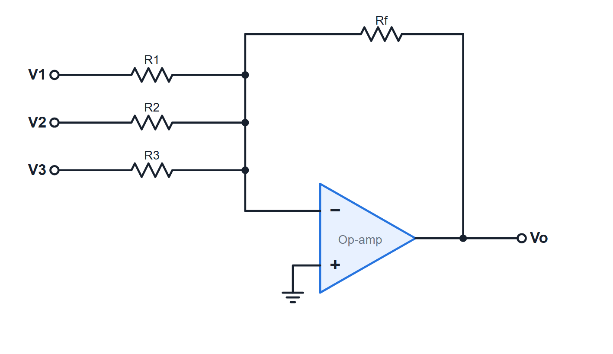
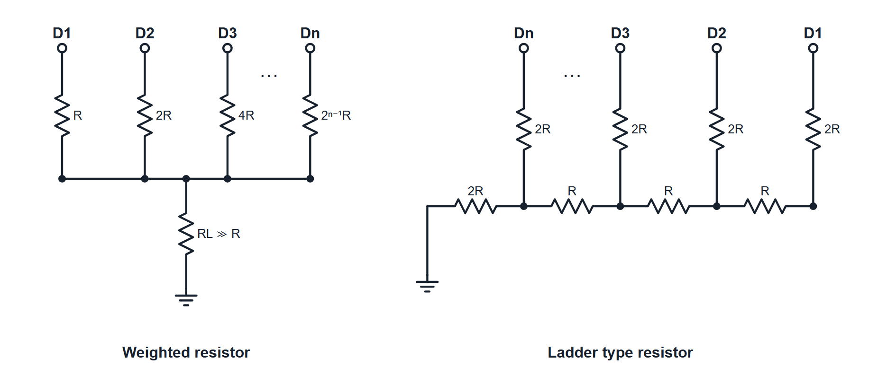
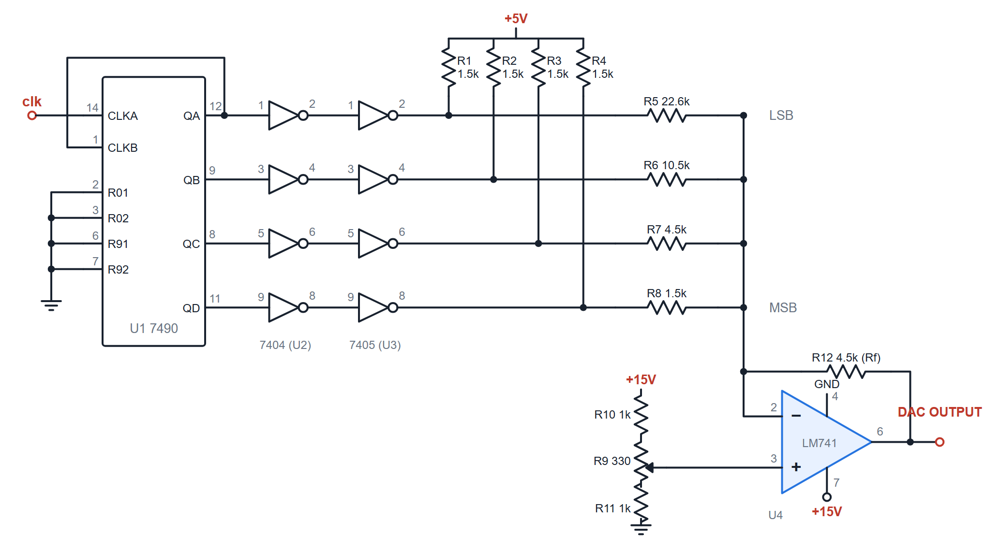
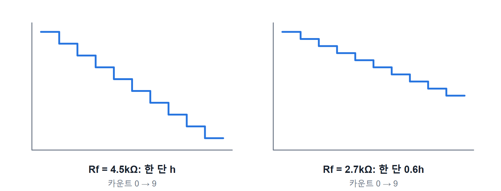
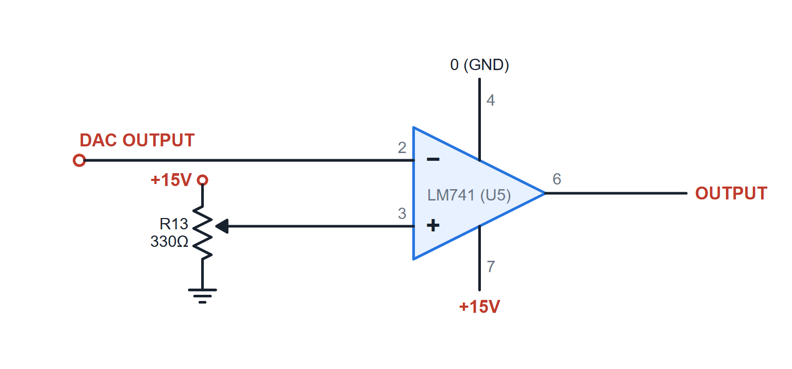
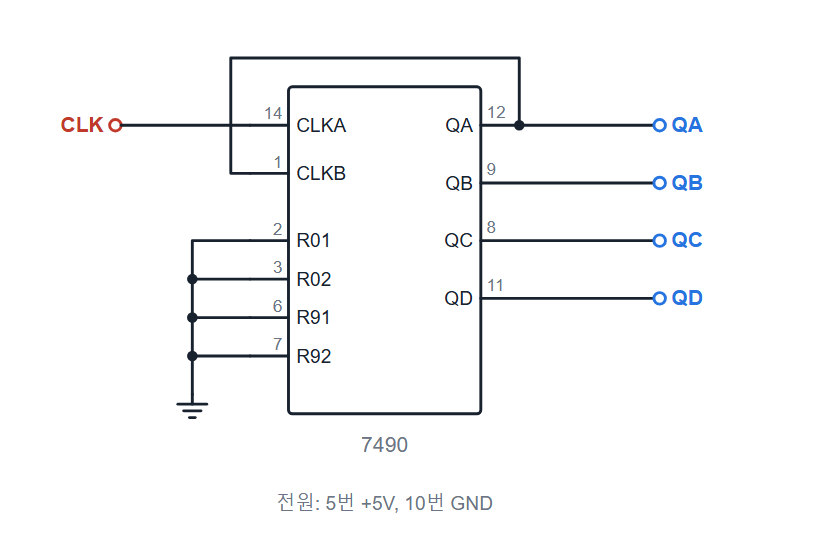
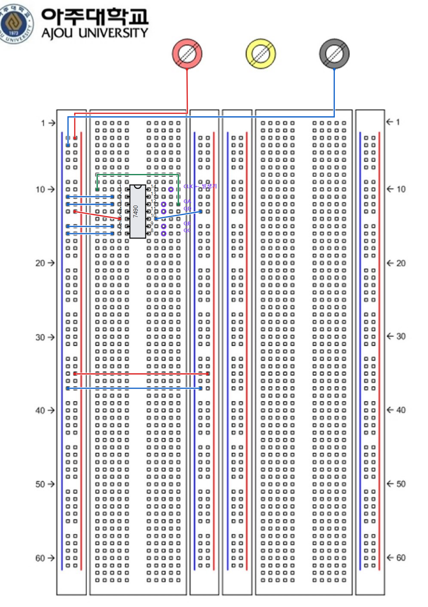

# 실험 10 · 기출풀이와 퀴즈 유형 연습

[실험 설명](실험10_실험설명.md) · [문제/해설](실험10_기출문제.md)

## 1. DAC와 ADC의 역할과 쓰임
기출 · 실험 10 · 풀이 검토됨

### 문제 원문
D/A converter와 A/D converter의 역할 및 쓰임에 대하여 설명하시오.

### 구할 것
D/A converter와 A/D converter의 역할 및 쓰임 설명

### 힌트 · 접근 순서
변환 방향(무엇을 무엇으로)과 그 변환이 필요한 장치를 하나씩 짝지어 써요.

### 풀이 1 · D/A 역할
디지털 신호(0과 1로 된 숫자)를 아날로그 신호(연속된 전압·전류)로 바꿔요.

### 풀이 2 · D/A 쓰임
디지털 오디오를 스피커가 낼 소리 전압으로 바꿔요(TV, 휴대폰). 컴퓨터 제어 출력을 아날로그 양으로 내보낼 때도 써요.

### 풀이 3 · A/D 역할과 쓰임
아날로그 신호를 디지털 숫자로 바꿔요. 마이크·센서 전압을 컴퓨터가 처리할 수 있게 읽어들일 때 써요.

### 풀이 4 · 검산
제공 답안(DAC: 디지털 → 아날로그, 스피커 / ADC: 아날로그 → 디지털, 마이크)과 같은 내용이에요. 방향을 이름의 글자 순서로 한 번 더 확인해요.

### 풀이 5 · 주의
D/A와 A/D의 방향을 바꿔 쓰지 않아요. 쓰임만 쓰고 무엇을 무엇으로 바꾸는지 빠뜨리면 역할이 모자라요.

### 최종 답
D/A converter는 디지털 신호를 아날로그 신호(전압·전류)로 바꿔요. 컴퓨터의 디지털 데이터를 스피커 소리처럼 아날로그 양으로 내보낼 때 써요(디지털 오디오를 아날로그 오디오로, TV·휴대폰). A/D converter는 아날로그 신호를 디지털 신호로 바꿔요. 마이크·센서의 전압을 컴퓨터가 다룰 수 있는 숫자로 읽어들일 때 써요.

### 출처
- [from_the_past/정리/퀴즈/실험10/실험10 퀴즈 기출 2016-2.pdf](../../../from_the_past/%EC%A0%95%EB%A6%AC/%ED%80%B4%EC%A6%88/%EC%8B%A4%ED%97%9810/%EC%8B%A4%ED%97%9810%20%ED%80%B4%EC%A6%88%20%EA%B8%B0%EC%B6%9C%202016-2.pdf#page=1)
- [from_the_past/정리/퀴즈/실험10/실험10 퀴즈 예상문제_v1.pdf](../../../from_the_past/%EC%A0%95%EB%A6%AC/%ED%80%B4%EC%A6%88/%EC%8B%A4%ED%97%9810/%EC%8B%A4%ED%97%9810%20%ED%80%B4%EC%A6%88%20%EC%98%88%EC%83%81%EB%AC%B8%EC%A0%9C_v1.pdf#page=3)
- [from_the_past/정리/퀴즈/실험10/실험10 퀴즈 예상문제_v2.pdf](../../../from_the_past/%EC%A0%95%EB%A6%AC/%ED%80%B4%EC%A6%88/%EC%8B%A4%ED%97%9810/%EC%8B%A4%ED%97%9810%20%ED%80%B4%EC%A6%88%20%EC%98%88%EC%83%81%EB%AC%B8%EC%A0%9C_v2.pdf#page=2)
- [from_the_past/정리/퀴즈/실험10/실험10 퀴즈 예상문제_v3.pdf](../../../from_the_past/%EC%A0%95%EB%A6%AC/%ED%80%B4%EC%A6%88/%EC%8B%A4%ED%97%9810/%EC%8B%A4%ED%97%9810%20%ED%80%B4%EC%A6%88%20%EC%98%88%EC%83%81%EB%AC%B8%EC%A0%9C_v3.pdf#page=2)
- [from_the_past/정리/퀴즈/실험10/실험10 퀴즈 예상문제_v4.pdf](../../../from_the_past/%EC%A0%95%EB%A6%AC/%ED%80%B4%EC%A6%88/%EC%8B%A4%ED%97%9810/%EC%8B%A4%ED%97%9810%20%ED%80%B4%EC%A6%88%20%EC%98%88%EC%83%81%EB%AC%B8%EC%A0%9C_v4.pdf#page=3)
- [from_the_past/정리/퀴즈/실험10/실험10 퀴즈 예상문제_v5.pdf](../../../from_the_past/%EC%A0%95%EB%A6%AC/%ED%80%B4%EC%A6%88/%EC%8B%A4%ED%97%9810/%EC%8B%A4%ED%97%9810%20%ED%80%B4%EC%A6%88%20%EC%98%88%EC%83%81%EB%AC%B8%EC%A0%9C_v5.pdf#page=2)
- [from_the_past/정리/퀴즈/실험10/실험10 퀴즈 종합_기출문제 (4p).pdf](../../../from_the_past/%EC%A0%95%EB%A6%AC/%ED%80%B4%EC%A6%88/%EC%8B%A4%ED%97%9810/%EC%8B%A4%ED%97%9810%20%ED%80%B4%EC%A6%88%20%EC%A2%85%ED%95%A9_%EA%B8%B0%EC%B6%9C%EB%AC%B8%EC%A0%9C%20%284p%29.pdf#page=4)
- [from_the_past/정리/퀴즈/실험10/원본_docx/실험10.docx](../../../from_the_past/%EC%A0%95%EB%A6%AC/%ED%80%B4%EC%A6%88/%EC%8B%A4%ED%97%9810/%EC%9B%90%EB%B3%B8_docx/%EC%8B%A4%ED%97%9810.docx)
- [from_the_past/정리/퀴즈/실험10/원본_docx/실험10_예상.docx](../../../from_the_past/%EC%A0%95%EB%A6%AC/%ED%80%B4%EC%A6%88/%EC%8B%A4%ED%97%9810/%EC%9B%90%EB%B3%B8_docx/%EC%8B%A4%ED%97%9810_%EC%98%88%EC%83%81.docx)
- [from_the_past/정리/퀴즈/실험10/원본_docx/실험10_예상.pdf](../../../from_the_past/%EC%A0%95%EB%A6%AC/%ED%80%B4%EC%A6%88/%EC%8B%A4%ED%97%9810/%EC%9B%90%EB%B3%B8_docx/%EC%8B%A4%ED%97%9810_%EC%98%88%EC%83%81.pdf#page=3)
- [from_the_past/정리/퀴즈/실험10/실험10 퀴즈 예상문제_v1.pdf](../../../from_the_past/%EC%A0%95%EB%A6%AC/%ED%80%B4%EC%A6%88/%EC%8B%A4%ED%97%9810/%EC%8B%A4%ED%97%9810%20%ED%80%B4%EC%A6%88%20%EC%98%88%EC%83%81%EB%AC%B8%EC%A0%9C_v1.pdf#page=1)

## 2. 반전 가산증폭기의 Vo
기출 · 실험 10 · 풀이 검토됨

### 문제 원문
아래의 반전 가산증폭기에서 입력전압 V1, V2, V3에 대한 출력전압 Vo의 관계식을 구하시오.

### 조건
회로는 원문 그림을 다시 그린 그림이에요. V1·V2·V3이 R1·R2·R3을 지나 Op-amp의 반전 입력(−)에서 만나고, Rf가 출력 Vo를 같은 점으로 되돌려요. 비반전 입력(+)은 접지예요.

### 구할 것
반전 가산증폭기의 입력전압 V1, V2, V3에 대한 출력전압 Vo의 관계식

### 힌트 · 접근 순서
반전 입력이 몇 V인지 먼저 정하고, 가지마다 흐르는 전류를 적어요.

### 풀이 1 · 반전 입력 전압
비반전 입력이 접지이고 음의 피드백이 있어 반전 입력도 거의 0V예요.

### 풀이 2 · 가지 전류
I1 = V1/R1, I2 = V2/R2, I3 = V3/R3이에요. 서로의 전압이 다른 가지 전류를 바꾸지 않아요.

### 풀이 3 · Rf와 출력
세 전류의 합이 Rf를 지나 출력으로 가요. 0 − Vo = Rf(I1 + I2 + I3)이에요.

$$V_o = -\left(\frac{R_f}{R_1}V_1 + \frac{R_f}{R_2}V_2 + \frac{R_f}{R_3}V_3\right)$$

### 풀이 4 · 검산
R1=R2=R3=Rf로 두면 Vo = −(V1+V2+V3)이라 이름 그대로 “반전해서 더하기”예요. 제공 답안 수식과 같아요.

### 풀이 5 · 주의
앞의 − 부호를 빠뜨리지 않아요. 비반전 증폭기의 1 + Rf/R 꼴과 섞지 않아요.

### 최종 답
Vo = −(Rf/R1·V1 + Rf/R2·V2 + Rf/R3·V3)

### 출처
- [from_the_past/정리/퀴즈/실험10/실험10 퀴즈 기출 2016-2.pdf](../../../from_the_past/%EC%A0%95%EB%A6%AC/%ED%80%B4%EC%A6%88/%EC%8B%A4%ED%97%9810/%EC%8B%A4%ED%97%9810%20%ED%80%B4%EC%A6%88%20%EA%B8%B0%EC%B6%9C%202016-2.pdf#page=1)
- [from_the_past/정리/퀴즈/실험10/실험10 퀴즈 예상문제_v1.pdf](../../../from_the_past/%EC%A0%95%EB%A6%AC/%ED%80%B4%EC%A6%88/%EC%8B%A4%ED%97%9810/%EC%8B%A4%ED%97%9810%20%ED%80%B4%EC%A6%88%20%EC%98%88%EC%83%81%EB%AC%B8%EC%A0%9C_v1.pdf#page=2)
- [from_the_past/정리/퀴즈/실험10/실험10 퀴즈 예상문제_v2.pdf](../../../from_the_past/%EC%A0%95%EB%A6%AC/%ED%80%B4%EC%A6%88/%EC%8B%A4%ED%97%9810/%EC%8B%A4%ED%97%9810%20%ED%80%B4%EC%A6%88%20%EC%98%88%EC%83%81%EB%AC%B8%EC%A0%9C_v2.pdf#page=2)
- [from_the_past/정리/퀴즈/실험10/실험10 퀴즈 예상문제_v3.pdf](../../../from_the_past/%EC%A0%95%EB%A6%AC/%ED%80%B4%EC%A6%88/%EC%8B%A4%ED%97%9810/%EC%8B%A4%ED%97%9810%20%ED%80%B4%EC%A6%88%20%EC%98%88%EC%83%81%EB%AC%B8%EC%A0%9C_v3.pdf#page=2)
- [from_the_past/정리/퀴즈/실험10/실험10 퀴즈 예상문제_v4.pdf](../../../from_the_past/%EC%A0%95%EB%A6%AC/%ED%80%B4%EC%A6%88/%EC%8B%A4%ED%97%9810/%EC%8B%A4%ED%97%9810%20%ED%80%B4%EC%A6%88%20%EC%98%88%EC%83%81%EB%AC%B8%EC%A0%9C_v4.pdf#page=2)
- [from_the_past/정리/퀴즈/실험10/실험10 퀴즈 예상문제_v5.pdf](../../../from_the_past/%EC%A0%95%EB%A6%AC/%ED%80%B4%EC%A6%88/%EC%8B%A4%ED%97%9810/%EC%8B%A4%ED%97%9810%20%ED%80%B4%EC%A6%88%20%EC%98%88%EC%83%81%EB%AC%B8%EC%A0%9C_v5.pdf#page=2)
- [from_the_past/정리/퀴즈/실험10/실험10 퀴즈 종합_기출문제 (4p).pdf](../../../from_the_past/%EC%A0%95%EB%A6%AC/%ED%80%B4%EC%A6%88/%EC%8B%A4%ED%97%9810/%EC%8B%A4%ED%97%9810%20%ED%80%B4%EC%A6%88%20%EC%A2%85%ED%95%A9_%EA%B8%B0%EC%B6%9C%EB%AC%B8%EC%A0%9C%20%284p%29.pdf#page=3)
- [from_the_past/정리/퀴즈/실험10/원본_docx/실험10.docx](../../../from_the_past/%EC%A0%95%EB%A6%AC/%ED%80%B4%EC%A6%88/%EC%8B%A4%ED%97%9810/%EC%9B%90%EB%B3%B8_docx/%EC%8B%A4%ED%97%9810.docx)
- [from_the_past/정리/퀴즈/실험10/원본_docx/실험10_예상.docx](../../../from_the_past/%EC%A0%95%EB%A6%AC/%ED%80%B4%EC%A6%88/%EC%8B%A4%ED%97%9810/%EC%9B%90%EB%B3%B8_docx/%EC%8B%A4%ED%97%9810_%EC%98%88%EC%83%81.docx)
- [from_the_past/정리/퀴즈/실험10/원본_docx/실험10_예상.pdf](../../../from_the_past/%EC%A0%95%EB%A6%AC/%ED%80%B4%EC%A6%88/%EC%8B%A4%ED%97%9810/%EC%9B%90%EB%B3%B8_docx/%EC%8B%A4%ED%97%9810_%EC%98%88%EC%83%81.pdf#page=2)

## 3. 가산증폭기의 Vo와 역할
출처 미확인 · 실험 10 · 풀이 검토됨

### 문제 원문
아래 변수를 이용해 Op-amp의 Vo 수식을 쓰고(1) 역할과 특징을 설명(2)하시오

### 조건
회로는 앞 문항(반전 가산증폭기의 Vo)의 그림과 같아요. 원문 캡처에는 손글씨 답 메모가 함께 있어 다시 싣지 않았어요. V1·V2·V3이 R1·R2·R3을 지나 Op-amp의 반전 입력(−)에서 만나고, Rf가 출력 Vo를 같은 점으로 되돌려요. 비반전 입력(+)은 접지예요.

원문은 온라인 개별과제 캡처예요. 기출 시험지에 같은 문항이 실렸는지는 확인되지 않았어요.

### 구할 것
(1) Op-amp의 Vo 수식 (2) 역할과 특징 설명

### 힌트 · 접근 순서
(1)은 가지 전류의 합이고, (2)는 그 식이 무엇을 더하는지 말로 풀어요.

### 풀이 1 · (1) 식
반전 입력 ≈ 0V, 가지 전류 합 = Rf 전류라서 아래 식이 돼요.

$$V_o = -\left(\frac{R_f}{R_1}V_1 + \frac{R_f}{R_2}V_2 + \frac{R_f}{R_3}V_3\right)$$

### 풀이 2 · (2) 역할
입력 전압마다 Rf/Ri의 무게를 달아 더하고 부호를 뒤집어요. 그래서 반전 가산증폭기라고 불러요.

### 풀이 3 · (2) 특징
입력끼리 서로 영향을 주지 않고, Rf 하나로 전체 크기를 바꿔요. DAC에서는 가지 저항을 2배씩 달리 해 디지털 값을 아날로그 전압으로 바꿔요.

### 풀이 4 · 검산
Rf = R1 = R2 = R3이면 Vo = −(V1+V2+V3)이에요. 원문 옆 손글씨 메모(후보 답안, 부분 판독)는 카운터 출력에 따라 입력 전류와 출력 전압 레벨이 바뀐다고만 적어 (2)의 DAC 역할과 같은 방향이에요.

### 풀이 5 · 주의
(1)의 − 부호를 빠뜨리지 않아요. (2)는 무게 단 덧셈·반전·Rf로 크기 조절을 함께 써요.

### 최종 답
(1) Vo = −(Rf/R1·V1 + Rf/R2·V2 + Rf/R3·V3) (2) 여러 입력 전압에 저항 비만큼 무게를 달아 더하고 부호를 뒤집어 내는 반전 가산증폭기예요. 반전 입력이 거의 0V라 입력끼리 서로 영향을 주지 않고, Rf로 전체 크기를 바꿀 수 있어요. DAC에서는 비트마다 무게가 다른 가지 저항을 달아 디지털 값을 아날로그 전압으로 바꿔요.

### 출처
- [from_the_past/정리/퀴즈/실험10/실험10 퀴즈 예상문제_v1.pdf](../../../from_the_past/%EC%A0%95%EB%A6%AC/%ED%80%B4%EC%A6%88/%EC%8B%A4%ED%97%9810/%EC%8B%A4%ED%97%9810%20%ED%80%B4%EC%A6%88%20%EC%98%88%EC%83%81%EB%AC%B8%EC%A0%9C_v1.pdf#page=1)

## 4. 가중 저항과 래더 저항의 장단점
기출 · 실험 10 · 풀이 검토됨

### 문제 원문
D/A converter의 weighted resistor와 ladder type resistor의 장단점을 설명하시오.

### 조건
그림은 원문 도해를 다시 그린 그림이에요. 왼쪽 weighted resistor는 D1~Dn에 R·2R·4R·2ⁿ⁻¹R을 달아 한 점에 모으고 RL ≫ R로 접지해요. 오른쪽 ladder type resistor는 Dn~D1마다 2R, 사이사이 R, 끝을 2R로 접지해요.

### 구할 것
weighted resistor와 ladder type resistor의 장단점

### 힌트 · 접근 순서
두 회로에 쓰이는 저항값의 종류와 개수를 먼저 세어 봐요.

### 풀이 1 · 가중 저항
좋은 점: 비트마다 저항 하나라 구조가 간단해요. 아쉬운 점: 8비트면 R~128R처럼 범위가 넓어져 정밀도가 떨어지고, 큰 저항은 온도 드리프트·스위칭 속도에 불리해요.

### 풀이 2 · 래더 저항
좋은 점: R과 2R만 정확히 맞추면 돼 정밀하고 빨라요. 그래서 요즘 DAC에 주로 써요. 아쉬운 점: 비트마다 저항 두 개라 수가 많고 연결이 조금 복잡해요.

### 풀이 3 · 검산
제공 답안(가중: 간단하지만 범위가 넓어 정확도 저하·온도 드리프트·속도 / 래더: 조금 복잡하지만 R, 2R뿐이라 고정도·고속)과 같은 내용이에요.

### 풀이 4 · 주의
래더가 “저항이 적어서 간단하다”고 쓰면 반대예요. 래더는 저항 수가 더 많아요.

### 최종 답
가중 저항(weighted): 구조가 간단하고 저항 수가 적지만, 비트가 늘수록 저항값 범위(R ~ 2ⁿ⁻¹R)가 넓어져 정밀하게 맞추기 어렵고, 큰 저항은 온도 드리프트·스위칭 속도에 불리해요. 래더(ladder, R-2R): R과 2R 두 값만 써서 정밀도와 속도를 얻기 쉬워 지금 DAC에 주로 쓰지만, 저항 수가 많고 구성이 조금 복잡해요.

### 출처
- [from_the_past/정리/퀴즈/실험10/실험10 퀴즈 기출 2016-2.pdf](../../../from_the_past/%EC%A0%95%EB%A6%AC/%ED%80%B4%EC%A6%88/%EC%8B%A4%ED%97%9810/%EC%8B%A4%ED%97%9810%20%ED%80%B4%EC%A6%88%20%EA%B8%B0%EC%B6%9C%202016-2.pdf#page=1)
- [from_the_past/정리/퀴즈/실험10/실험10 퀴즈 예상문제_v1.pdf](../../../from_the_past/%EC%A0%95%EB%A6%AC/%ED%80%B4%EC%A6%88/%EC%8B%A4%ED%97%9810/%EC%8B%A4%ED%97%9810%20%ED%80%B4%EC%A6%88%20%EC%98%88%EC%83%81%EB%AC%B8%EC%A0%9C_v1.pdf#page=1)
- [from_the_past/정리/퀴즈/실험10/실험10 퀴즈 예상문제_v2.pdf](../../../from_the_past/%EC%A0%95%EB%A6%AC/%ED%80%B4%EC%A6%88/%EC%8B%A4%ED%97%9810/%EC%8B%A4%ED%97%9810%20%ED%80%B4%EC%A6%88%20%EC%98%88%EC%83%81%EB%AC%B8%EC%A0%9C_v2.pdf#page=1)
- [from_the_past/정리/퀴즈/실험10/실험10 퀴즈 예상문제_v3.pdf](../../../from_the_past/%EC%A0%95%EB%A6%AC/%ED%80%B4%EC%A6%88/%EC%8B%A4%ED%97%9810/%EC%8B%A4%ED%97%9810%20%ED%80%B4%EC%A6%88%20%EC%98%88%EC%83%81%EB%AC%B8%EC%A0%9C_v3.pdf#page=1)
- [from_the_past/정리/퀴즈/실험10/실험10 퀴즈 예상문제_v4.pdf](../../../from_the_past/%EC%A0%95%EB%A6%AC/%ED%80%B4%EC%A6%88/%EC%8B%A4%ED%97%9810/%EC%8B%A4%ED%97%9810%20%ED%80%B4%EC%A6%88%20%EC%98%88%EC%83%81%EB%AC%B8%EC%A0%9C_v4.pdf#page=1)
- [from_the_past/정리/퀴즈/실험10/실험10 퀴즈 예상문제_v5.pdf](../../../from_the_past/%EC%A0%95%EB%A6%AC/%ED%80%B4%EC%A6%88/%EC%8B%A4%ED%97%9810/%EC%8B%A4%ED%97%9810%20%ED%80%B4%EC%A6%88%20%EC%98%88%EC%83%81%EB%AC%B8%EC%A0%9C_v5.pdf#page=1)
- [from_the_past/정리/퀴즈/실험10/실험10 퀴즈 종합_기출문제 (4p).pdf](../../../from_the_past/%EC%A0%95%EB%A6%AC/%ED%80%B4%EC%A6%88/%EC%8B%A4%ED%97%9810/%EC%8B%A4%ED%97%9810%20%ED%80%B4%EC%A6%88%20%EC%A2%85%ED%95%A9_%EA%B8%B0%EC%B6%9C%EB%AC%B8%EC%A0%9C%20%284p%29.pdf#page=2)
- [from_the_past/정리/퀴즈/실험10/원본_docx/실험10.docx](../../../from_the_past/%EC%A0%95%EB%A6%AC/%ED%80%B4%EC%A6%88/%EC%8B%A4%ED%97%9810/%EC%9B%90%EB%B3%B8_docx/%EC%8B%A4%ED%97%9810.docx)
- [from_the_past/정리/퀴즈/실험10/원본_docx/실험10_예상.docx](../../../from_the_past/%EC%A0%95%EB%A6%AC/%ED%80%B4%EC%A6%88/%EC%8B%A4%ED%97%9810/%EC%9B%90%EB%B3%B8_docx/%EC%8B%A4%ED%97%9810_%EC%98%88%EC%83%81.docx)
- [from_the_past/정리/퀴즈/실험10/원본_docx/실험10_예상.pdf](../../../from_the_past/%EC%A0%95%EB%A6%AC/%ED%80%B4%EC%A6%88/%EC%8B%A4%ED%97%9810/%EC%9B%90%EB%B3%B8_docx/%EC%8B%A4%ED%97%9810_%EC%98%88%EC%83%81.pdf#page=1)

## 5. 7490(74HC90)의 기능과 출력
예상문제 · 실험 10 · 풀이 검토됨

### 문제 원문
앞의 D/A converter에서 74HC90 IC의 기능을 설명하고, 출력 QA, QB, QC, QD가 무엇을 의미하는지 답하시오.

### 조건
회로는 원문 그림(교안 p12 회로와 같아요)을 다시 그린 그림이에요. 7490의 QA·QB·QC·QD가 각각 7404 → 7405를 지나고, 7405 출력마다 +5V로 가는 1.5kΩ 풀업(R1~R4)이 있어요. 가중 저항 R5 22.6k(QA)·R6 10.5k(QB)·R7 4.5k(QC)·R8 1.5k(QD)가 LM741(U4) 2번에 모이고, 귀환 저항 R12 4.5k가 6번(DAC OUTPUT)과 2번 사이에 있어요. 3번은 +15V–R10 1k–R9 330(가변)–R11 1k–GND 분배기의 가운데 단자, 4번은 GND, 7번은 +15V예요.

원문은 “74HC90”이라고 적었지만 회로도의 칩 이름은 7490이에요. 핀 번호와 동작은 같아요.

### 구할 것
DAC의 74HC90 IC 기능과 출력 QA, QB, QC, QD의 의미

### 힌트 · 접근 순서
클럭이 어디로 들어가고 QA가 어디로 이어지는지 회로도에서 찾아요.

### 풀이 1 · 기능
클럭 펄스가 들어올 때마다 1씩 세고, 9 다음에는 0으로 돌아가요(0000 → 0001 → … → 1001 → 0000).

### 풀이 2 · 출력의 뜻
QD QC QB QA를 이진수로 읽으면 센 값이에요. QA=2⁰(1), QB=2¹(2), QC=2²(4), QD=2³(8)의 무게예요.

### 풀이 3 · DAC에서의 쓰임
이 네 비트가 가중 저항을 거쳐 무게대로 더해져 아날로그 전압이 돼요.

### 풀이 4 · 검산
0110 → 4 + 2 = 6처럼 무게를 더하면 센 수가 나와요. 제공 답안(0~9 카운트, 2⁰~2³로 가중된 BCD)과 같아요.

### 풀이 5 · 주의
0~15를 세는 4비트 이진 카운터와 섞지 않아요. QA가 가장 무거운 비트라고 쓰면 반대예요.

### 최종 답
74HC90(교안 회로도의 7490)은 클럭 펄스를 세는 10진(BCD) 카운터예요. QA를 CLKB에 이어 0부터 9까지 세고 다시 0으로 돌아가요. QA, QB, QC, QD는 지금까지 센 값을 나타내는 BCD 비트로, 각각 2⁰, 2¹, 2², 2³의 무게예요(QA=LSB, QD=MSB).

### 출처
- [from_the_past/정리/퀴즈/실험10/실험10 퀴즈 예상문제_v1.pdf](../../../from_the_past/%EC%A0%95%EB%A6%AC/%ED%80%B4%EC%A6%88/%EC%8B%A4%ED%97%9810/%EC%8B%A4%ED%97%9810%20%ED%80%B4%EC%A6%88%20%EC%98%88%EC%83%81%EB%AC%B8%EC%A0%9C_v1.pdf#page=2)
- [from_the_past/정리/퀴즈/실험10/실험10 퀴즈 예상문제_v2.pdf](../../../from_the_past/%EC%A0%95%EB%A6%AC/%ED%80%B4%EC%A6%88/%EC%8B%A4%ED%97%9810/%EC%8B%A4%ED%97%9810%20%ED%80%B4%EC%A6%88%20%EC%98%88%EC%83%81%EB%AC%B8%EC%A0%9C_v2.pdf#page=1)
- [from_the_past/정리/퀴즈/실험10/실험10 퀴즈 예상문제_v3.pdf](../../../from_the_past/%EC%A0%95%EB%A6%AC/%ED%80%B4%EC%A6%88/%EC%8B%A4%ED%97%9810/%EC%8B%A4%ED%97%9810%20%ED%80%B4%EC%A6%88%20%EC%98%88%EC%83%81%EB%AC%B8%EC%A0%9C_v3.pdf#page=1)
- [from_the_past/정리/퀴즈/실험10/실험10 퀴즈 예상문제_v4.pdf](../../../from_the_past/%EC%A0%95%EB%A6%AC/%ED%80%B4%EC%A6%88/%EC%8B%A4%ED%97%9810/%EC%8B%A4%ED%97%9810%20%ED%80%B4%EC%A6%88%20%EC%98%88%EC%83%81%EB%AC%B8%EC%A0%9C_v4.pdf#page=2)
- [from_the_past/정리/퀴즈/실험10/실험10 퀴즈 예상문제_v5.pdf](../../../from_the_past/%EC%A0%95%EB%A6%AC/%ED%80%B4%EC%A6%88/%EC%8B%A4%ED%97%9810/%EC%8B%A4%ED%97%9810%20%ED%80%B4%EC%A6%88%20%EC%98%88%EC%83%81%EB%AC%B8%EC%A0%9C_v5.pdf#page=1)
- [from_the_past/정리/퀴즈/실험10/실험10 퀴즈 종합_기출문제 (4p).pdf](../../../from_the_past/%EC%A0%95%EB%A6%AC/%ED%80%B4%EC%A6%88/%EC%8B%A4%ED%97%9810/%EC%8B%A4%ED%97%9810%20%ED%80%B4%EC%A6%88%20%EC%A2%85%ED%95%A9_%EA%B8%B0%EC%B6%9C%EB%AC%B8%EC%A0%9C%20%284p%29.pdf#page=3)
- [from_the_past/정리/퀴즈/실험10/원본_docx/실험10.docx](../../../from_the_past/%EC%A0%95%EB%A6%AC/%ED%80%B4%EC%A6%88/%EC%8B%A4%ED%97%9810/%EC%9B%90%EB%B3%B8_docx/%EC%8B%A4%ED%97%9810.docx)
- [from_the_past/정리/퀴즈/실험10/원본_docx/실험10_예상.docx](../../../from_the_past/%EC%A0%95%EB%A6%AC/%ED%80%B4%EC%A6%88/%EC%8B%A4%ED%97%9810/%EC%9B%90%EB%B3%B8_docx/%EC%8B%A4%ED%97%9810_%EC%98%88%EC%83%81.docx)
- [from_the_past/정리/퀴즈/실험10/원본_docx/실험10_예상.pdf](../../../from_the_past/%EC%A0%95%EB%A6%AC/%ED%80%B4%EC%A6%88/%EC%8B%A4%ED%97%9810/%EC%9B%90%EB%B3%B8_docx/%EC%8B%A4%ED%97%9810_%EC%98%88%EC%83%81.pdf#page=2)

## 6. DAC 회로의 동작 원리
예상문제 · 실험 10 · 풀이 검토됨

### 문제 원문
아래 D/A converter의 동작 원리를 설명하시오.

### 조건
회로는 원문 그림(교안 p12 회로와 같아요)을 다시 그린 그림이에요. 7490의 QA·QB·QC·QD가 각각 7404 → 7405를 지나고, 7405 출력마다 +5V로 가는 1.5kΩ 풀업(R1~R4)이 있어요. 가중 저항 R5 22.6k(QA)·R6 10.5k(QB)·R7 4.5k(QC)·R8 1.5k(QD)가 LM741(U4) 2번에 모이고, 귀환 저항 R12 4.5k가 6번(DAC OUTPUT)과 2번 사이에 있어요. 3번은 +15V–R10 1k–R9 330(가변)–R11 1k–GND 분배기의 가운데 단자, 4번은 GND, 7번은 +15V예요.

### 구할 것
주어진 D/A converter의 동작 원리

### 힌트 · 접근 순서
왼쪽부터 칩 하나씩 “무엇이 들어와서 무엇이 나가는지” 한 줄로 적어요.

### 풀이 1 · ① 카운트
클럭마다 7490이 0000~1001을 차례로 내요.

### 풀이 2 · ② 0V·5V 맞추기
7404가 뒤집고 7405가 다시 뒤집어 논리값은 그대로예요. 7405는 1일 때 출력을 놓아서 1.5kΩ 풀업이 정확한 5V를 만들어요.

### 풀이 3 · ③ 무게
R5 22.6k(QA)·R6 10.5k·R7 4.5k·R8 1.5k(QD)가 2⁰~2³의 무게를 줘요(풀업과 합치면 약 24k : 12k : 6k : 3k).

### 풀이 4 · ④ 더하기와 반전
LM741 반전 가산기가 가지 전류를 더해 Rf(R12 4.5k)로 전압을 만들어요. 카운트가 클수록 출력이 내려가 내림차순 계단이 돼요.

### 풀이 5 · ⑤ 분배기
LM741 음전원이 GND라 V+를 올려 출력을 0V 위에서 움직이게 해요.

### 풀이 6 · 검산
카운트 0 → 9 동안 무게 합이 0 → 9로 한 칸씩 늘어 출력이 열 단 내려가고, 9 → 0에서 맨 위로 돌아와요. 제공 답안(카운트 → 74HC05 풀업 → 가중 저항 → OP AMP로 아날로그 출력)과 같은 흐름이고, 7404의 역할을 더했어요.

### 풀이 7 · 주의
7405만 있다고 쓰면 비트가 뒤집혀요. 7404가 반전을 되돌리는 것까지 써요. 각 단의 전압 숫자는 교안에 없어 지어내지 않아요.

### 최종 답
클럭이 들어올 때마다 7490이 0~9를 세어 QA~QD로 내요. 각 비트는 7404와 오픈 컬렉터 7405를 거쳐(두 번 반전이라 값은 그대로) 1.5kΩ 풀업으로 정확한 0V 또는 5V가 돼요. 가중 저항(22.6k·10.5k·4.5k·1.5k)이 비트마다 2⁰~2³의 무게를 주고, LM741 반전 가산증폭기가 가지 전류를 더해 Rf(4.5k)로 전압을 만들어요. 그래서 카운트에 따라 한 단씩 바뀌는 아날로그 전압이 나오고, 반전이라 0~9 동안 내림차순 계단이 돼요. 전압 분배기는 V+를 올려 출력이 0V 아래로 내려가지 않게 해요.

### 출처
- [from_the_past/정리/퀴즈/실험10/실험10 퀴즈 예상문제_v1.pdf](../../../from_the_past/%EC%A0%95%EB%A6%AC/%ED%80%B4%EC%A6%88/%EC%8B%A4%ED%97%9810/%EC%8B%A4%ED%97%9810%20%ED%80%B4%EC%A6%88%20%EC%98%88%EC%83%81%EB%AC%B8%EC%A0%9C_v1.pdf#page=1)
- [from_the_past/정리/퀴즈/실험10/실험10 퀴즈 예상문제_v2.pdf](../../../from_the_past/%EC%A0%95%EB%A6%AC/%ED%80%B4%EC%A6%88/%EC%8B%A4%ED%97%9810/%EC%8B%A4%ED%97%9810%20%ED%80%B4%EC%A6%88%20%EC%98%88%EC%83%81%EB%AC%B8%EC%A0%9C_v2.pdf#page=1)
- [from_the_past/정리/퀴즈/실험10/실험10 퀴즈 예상문제_v3.pdf](../../../from_the_past/%EC%A0%95%EB%A6%AC/%ED%80%B4%EC%A6%88/%EC%8B%A4%ED%97%9810/%EC%8B%A4%ED%97%9810%20%ED%80%B4%EC%A6%88%20%EC%98%88%EC%83%81%EB%AC%B8%EC%A0%9C_v3.pdf#page=1)
- [from_the_past/정리/퀴즈/실험10/실험10 퀴즈 예상문제_v4.pdf](../../../from_the_past/%EC%A0%95%EB%A6%AC/%ED%80%B4%EC%A6%88/%EC%8B%A4%ED%97%9810/%EC%8B%A4%ED%97%9810%20%ED%80%B4%EC%A6%88%20%EC%98%88%EC%83%81%EB%AC%B8%EC%A0%9C_v4.pdf#page=1)
- [from_the_past/정리/퀴즈/실험10/실험10 퀴즈 예상문제_v5.pdf](../../../from_the_past/%EC%A0%95%EB%A6%AC/%ED%80%B4%EC%A6%88/%EC%8B%A4%ED%97%9810/%EC%8B%A4%ED%97%9810%20%ED%80%B4%EC%A6%88%20%EC%98%88%EC%83%81%EB%AC%B8%EC%A0%9C_v5.pdf#page=1)
- [from_the_past/정리/퀴즈/실험10/실험10 퀴즈 종합_기출문제 (4p).pdf](../../../from_the_past/%EC%A0%95%EB%A6%AC/%ED%80%B4%EC%A6%88/%EC%8B%A4%ED%97%9810/%EC%8B%A4%ED%97%9810%20%ED%80%B4%EC%A6%88%20%EC%A2%85%ED%95%A9_%EA%B8%B0%EC%B6%9C%EB%AC%B8%EC%A0%9C%20%284p%29.pdf#page=3)
- [from_the_past/정리/퀴즈/실험10/원본_docx/실험10.docx](../../../from_the_past/%EC%A0%95%EB%A6%AC/%ED%80%B4%EC%A6%88/%EC%8B%A4%ED%97%9810/%EC%9B%90%EB%B3%B8_docx/%EC%8B%A4%ED%97%9810.docx)
- [from_the_past/정리/퀴즈/실험10/원본_docx/실험10_예상.docx](../../../from_the_past/%EC%A0%95%EB%A6%AC/%ED%80%B4%EC%A6%88/%EC%8B%A4%ED%97%9810/%EC%9B%90%EB%B3%B8_docx/%EC%8B%A4%ED%97%9810_%EC%98%88%EC%83%81.docx)
- [from_the_past/정리/퀴즈/실험10/원본_docx/실험10_예상.pdf](../../../from_the_past/%EC%A0%95%EB%A6%AC/%ED%80%B4%EC%A6%88/%EC%8B%A4%ED%97%9810/%EC%9B%90%EB%B3%B8_docx/%EC%8B%A4%ED%97%9810_%EC%98%88%EC%83%81.pdf#page=1)

## 7. Rf와 DAC 출력 크기
예상문제 · 실험 10 · 풀이 검토됨

### 문제 원문
앞의 D/A converter에서 Rf 저항 값에 따른 DAC output 전압 크기의 변화를 설명하시오.

### 조건
회로는 원문 그림(교안 p12 회로와 같아요)을 다시 그린 그림이에요. 7490의 QA·QB·QC·QD가 각각 7404 → 7405를 지나고, 7405 출력마다 +5V로 가는 1.5kΩ 풀업(R1~R4)이 있어요. 가중 저항 R5 22.6k(QA)·R6 10.5k(QB)·R7 4.5k(QC)·R8 1.5k(QD)가 LM741(U4) 2번에 모이고, 귀환 저항 R12 4.5k가 6번(DAC OUTPUT)과 2번 사이에 있어요. 3번은 +15V–R10 1k–R9 330(가변)–R11 1k–GND 분배기의 가운데 단자, 4번은 GND, 7번은 +15V예요.

Rf는 귀환 저항 R12(4.5k)예요.

### 구할 것
Rf 저항 값에 따른 DAC output 전압 크기의 변화

### 힌트 · 접근 순서
반전 가산기 식에서 Rf가 어디에 곱해지는지 봐요.

### 풀이 1 · 식
가지 전류의 합은 Rf와 상관없어요. 출력 크기 = Rf × (가지 전류 합)이에요.

### 풀이 2 · 비교
Rf 4.5k → 2.7k이면 2.7/4.5 = 0.6배라 계단 한 단과 전체 폭이 0.6배로 작아져요.

### 풀이 3 · 조건
출력이 공급 범위를 넘으면 그 부분은 한계에 붙어 비례하지 않아요.

### 풀이 4 · 검산
Rf를 2배로 하면 한 단도 2배인지 식으로 확인해요. 제공 답안(“Rf가 작아지면 출력도 작아진다, 증폭률이 Rf에 비례”)과 같아요.

### 풀이 5 · 주의
Rf가 커지면 출력이 작아진다고 반대로 쓰지 않아요. 가지 저항 Ri와 Rf를 섞지 않아요(Ri는 분모, Rf는 분자).

### 최종 답
Rf가 작아지면 DAC output 전압의 크기(계단 한 단의 높이와 전체 폭)가 Rf에 비례해 작아지고, Rf가 커지면 커져요. 반전 가산기의 출력이 −Rf × (가지 전류의 합)이기 때문이에요. 예를 들어 4.5kΩ → 2.7kΩ이면 0.6배예요. 단, 출력이 공급 전압(0~15V) 안에 있을 때만 그래요.

### 출처
- [from_the_past/정리/퀴즈/실험10/실험10 퀴즈 예상문제_v1.pdf](../../../from_the_past/%EC%A0%95%EB%A6%AC/%ED%80%B4%EC%A6%88/%EC%8B%A4%ED%97%9810/%EC%8B%A4%ED%97%9810%20%ED%80%B4%EC%A6%88%20%EC%98%88%EC%83%81%EB%AC%B8%EC%A0%9C_v1.pdf#page=2)
- [from_the_past/정리/퀴즈/실험10/실험10 퀴즈 예상문제_v2.pdf](../../../from_the_past/%EC%A0%95%EB%A6%AC/%ED%80%B4%EC%A6%88/%EC%8B%A4%ED%97%9810/%EC%8B%A4%ED%97%9810%20%ED%80%B4%EC%A6%88%20%EC%98%88%EC%83%81%EB%AC%B8%EC%A0%9C_v2.pdf#page=2)
- [from_the_past/정리/퀴즈/실험10/실험10 퀴즈 예상문제_v3.pdf](../../../from_the_past/%EC%A0%95%EB%A6%AC/%ED%80%B4%EC%A6%88/%EC%8B%A4%ED%97%9810/%EC%8B%A4%ED%97%9810%20%ED%80%B4%EC%A6%88%20%EC%98%88%EC%83%81%EB%AC%B8%EC%A0%9C_v3.pdf#page=2)
- [from_the_past/정리/퀴즈/실험10/실험10 퀴즈 예상문제_v4.pdf](../../../from_the_past/%EC%A0%95%EB%A6%AC/%ED%80%B4%EC%A6%88/%EC%8B%A4%ED%97%9810/%EC%8B%A4%ED%97%9810%20%ED%80%B4%EC%A6%88%20%EC%98%88%EC%83%81%EB%AC%B8%EC%A0%9C_v4.pdf#page=2)
- [from_the_past/정리/퀴즈/실험10/실험10 퀴즈 예상문제_v5.pdf](../../../from_the_past/%EC%A0%95%EB%A6%AC/%ED%80%B4%EC%A6%88/%EC%8B%A4%ED%97%9810/%EC%8B%A4%ED%97%9810%20%ED%80%B4%EC%A6%88%20%EC%98%88%EC%83%81%EB%AC%B8%EC%A0%9C_v5.pdf#page=2)
- [from_the_past/정리/퀴즈/실험10/실험10 퀴즈 종합_기출문제 (4p).pdf](../../../from_the_past/%EC%A0%95%EB%A6%AC/%ED%80%B4%EC%A6%88/%EC%8B%A4%ED%97%9810/%EC%8B%A4%ED%97%9810%20%ED%80%B4%EC%A6%88%20%EC%A2%85%ED%95%A9_%EA%B8%B0%EC%B6%9C%EB%AC%B8%EC%A0%9C%20%284p%29.pdf#page=4)
- [from_the_past/정리/퀴즈/실험10/원본_docx/실험10.docx](../../../from_the_past/%EC%A0%95%EB%A6%AC/%ED%80%B4%EC%A6%88/%EC%8B%A4%ED%97%9810/%EC%9B%90%EB%B3%B8_docx/%EC%8B%A4%ED%97%9810.docx)
- [from_the_past/정리/퀴즈/실험10/원본_docx/실험10_예상.docx](../../../from_the_past/%EC%A0%95%EB%A6%AC/%ED%80%B4%EC%A6%88/%EC%8B%A4%ED%97%9810/%EC%9B%90%EB%B3%B8_docx/%EC%8B%A4%ED%97%9810_%EC%98%88%EC%83%81.docx)
- [from_the_past/정리/퀴즈/실험10/원본_docx/실험10_예상.pdf](../../../from_the_past/%EC%A0%95%EB%A6%AC/%ED%80%B4%EC%A6%88/%EC%8B%A4%ED%97%9810/%EC%9B%90%EB%B3%B8_docx/%EC%8B%A4%ED%97%9810_%EC%98%88%EC%83%81.pdf#page=2)

## 8. 비교기와 가변저항
예상문제 · 실험 10 · 답안 충돌

### 문제 원문
. 아래 비교기 회로의 동작원리와 가변저항의 역할을 설명하시오.

### 조건
회로는 원문 그림(교안 p22와 같아요)을 다시 그린 그림이에요. DAC OUTPUT이 LM741(U5) 2번(−)에, +15V와 GND 사이 가변저항 R13(330Ω)의 가운데 단자가 3번(+)에 들어가요. 7번 +15V, 4번 GND, 6번이 OUTPUT이에요.

### 구할 것
비교기 회로의 동작원리와 가변저항의 역할

### 힌트 · 접근 순서
피드백이 있는지, DAC OUTPUT이 + 와 − 중 어디로 들어가는지 먼저 봐요.

### 풀이 1 · 동작 원리
피드백이 없어 출력은 +15V 또는 0V예요. V+ > V−(DAC가 기준보다 낮음)면 15V, V+ < V−(DAC가 기준보다 높음)면 0V예요.

### 풀이 2 · 계단과 함께
DAC 출력이 카운트마다 한 단씩 내려가다가 기준보다 낮아지는 순간 출력이 0V에서 15V로 바뀌어요.

### 풀이 3 · 가변저항의 역할
R13이 3번 핀의 기준 전압을 정해요. 돌려서 기준을 바꾸면 출력이 바뀌는 카운트가 달라져, 아날로그 전압을 디지털 값으로 읽는 셈이에요.

### 풀이 4 · 검산
예시: 기준 8.5V, DAC가 10, 9, 8V로 내려가면 9V까지는 0V, 8V에서 15V예요. 식 A(V+ − V−)의 부호와 맞는지 확인해요.

### 풀이 5 · 주의
답안 충돌: 제공 답안은 “기준보다 높으면 1”이에요. 이 회로는 DAC가 반전 입력이라 DAC가 기준보다 높으면 0V예요. 식 A(V+ − V−)와 회로도를 따랐어요.

### 최종 답
피드백이 없는 Op-Amp라 두 입력의 작은 차이도 크게 키워 출력이 +15V 또는 0V에 붙어요. 이 회로는 DAC OUTPUT이 반전 입력(2번), 가변저항 가운데 단자가 비반전 입력(3번)이라, DAC 출력이 기준보다 낮으면 15V, 높으면 0V예요. 가변저항(R13 330Ω)은 +15V와 GND 사이에서 기준 전압을 정해요. 기준을 바꿔 가며 출력이 바뀌는 지점을 찾으면, 그 아날로그 전압에 해당하는 디지털 값(카운트)을 알 수 있어요.

### 출처
- [from_the_past/정리/퀴즈/실험10/실험10 퀴즈 예상문제_v1.pdf](../../../from_the_past/%EC%A0%95%EB%A6%AC/%ED%80%B4%EC%A6%88/%EC%8B%A4%ED%97%9810/%EC%8B%A4%ED%97%9810%20%ED%80%B4%EC%A6%88%20%EC%98%88%EC%83%81%EB%AC%B8%EC%A0%9C_v1.pdf#page=2)
- [from_the_past/정리/퀴즈/실험10/실험10 퀴즈 예상문제_v2.pdf](../../../from_the_past/%EC%A0%95%EB%A6%AC/%ED%80%B4%EC%A6%88/%EC%8B%A4%ED%97%9810/%EC%8B%A4%ED%97%9810%20%ED%80%B4%EC%A6%88%20%EC%98%88%EC%83%81%EB%AC%B8%EC%A0%9C_v2.pdf#page=2)
- [from_the_past/정리/퀴즈/실험10/실험10 퀴즈 예상문제_v3.pdf](../../../from_the_past/%EC%A0%95%EB%A6%AC/%ED%80%B4%EC%A6%88/%EC%8B%A4%ED%97%9810/%EC%8B%A4%ED%97%9810%20%ED%80%B4%EC%A6%88%20%EC%98%88%EC%83%81%EB%AC%B8%EC%A0%9C_v3.pdf#page=2)
- [from_the_past/정리/퀴즈/실험10/실험10 퀴즈 예상문제_v4.pdf](../../../from_the_past/%EC%A0%95%EB%A6%AC/%ED%80%B4%EC%A6%88/%EC%8B%A4%ED%97%9810/%EC%8B%A4%ED%97%9810%20%ED%80%B4%EC%A6%88%20%EC%98%88%EC%83%81%EB%AC%B8%EC%A0%9C_v4.pdf#page=2)
- [from_the_past/정리/퀴즈/실험10/실험10 퀴즈 예상문제_v5.pdf](../../../from_the_past/%EC%A0%95%EB%A6%AC/%ED%80%B4%EC%A6%88/%EC%8B%A4%ED%97%9810/%EC%8B%A4%ED%97%9810%20%ED%80%B4%EC%A6%88%20%EC%98%88%EC%83%81%EB%AC%B8%EC%A0%9C_v5.pdf#page=2)
- [from_the_past/정리/퀴즈/실험10/실험10 퀴즈 종합_기출문제 (4p).pdf](../../../from_the_past/%EC%A0%95%EB%A6%AC/%ED%80%B4%EC%A6%88/%EC%8B%A4%ED%97%9810/%EC%8B%A4%ED%97%9810%20%ED%80%B4%EC%A6%88%20%EC%A2%85%ED%95%A9_%EA%B8%B0%EC%B6%9C%EB%AC%B8%EC%A0%9C%20%284p%29.pdf#page=4)
- [from_the_past/정리/퀴즈/실험10/원본_docx/실험10.docx](../../../from_the_past/%EC%A0%95%EB%A6%AC/%ED%80%B4%EC%A6%88/%EC%8B%A4%ED%97%9810/%EC%9B%90%EB%B3%B8_docx/%EC%8B%A4%ED%97%9810.docx)
- [from_the_past/정리/퀴즈/실험10/원본_docx/실험10_예상.docx](../../../from_the_past/%EC%A0%95%EB%A6%AC/%ED%80%B4%EC%A6%88/%EC%8B%A4%ED%97%9810/%EC%9B%90%EB%B3%B8_docx/%EC%8B%A4%ED%97%9810_%EC%98%88%EC%83%81.docx)
- [from_the_past/정리/퀴즈/실험10/원본_docx/실험10_예상.pdf](../../../from_the_past/%EC%A0%95%EB%A6%AC/%ED%80%B4%EC%A6%88/%EC%8B%A4%ED%97%9810/%EC%9B%90%EB%B3%B8_docx/%EC%8B%A4%ED%97%9810_%EC%98%88%EC%83%81.pdf#page=3)

## 9. ADC의 두 가지 type
기출 · 실험 10 · 풀이 검토됨

### 문제 원문
A/D converter는 feedback path의 유무에 따라 두 가지 type으로 구분할 수 있다. 이들의 차이점을 설명하시오.

### 구할 것
feedback path 유무에 따른 두 A/D converter type의 차이점

### 힌트 · 접근 순서
비교를 “한 번에 모두” 하는지 “결과를 되돌려 여러 번” 하는지로 나눠요.

### 풀이 1 · Simultaneous (Flash)
피드백이 없어 Vin을 2ⁿ−1개의 기준과 동시에 비교해요. 한 번에 끝나 매우 빠르지만 비교기가 많이 필요해 비경제적이에요.

### 풀이 2 · Feedback path
비교기 결과를 DAC로 되돌려 출력을 조절하며 디지털 값을 점점 찾아요. 비교기가 적지만 여러 번 비교해 느려요.

### 풀이 3 · 세부 종류
Ramp·Counter type은 느리고, SAR type은 이진 탐색이라 n번 비교로 빠르고 정확해요.

### 풀이 4 · 검산
4비트 예: Flash는 비교기 15개로 한 번, SAR은 비교기 하나로 4번, Counter는 최대 15번이에요. 제공 답안(Flash: 비교기 많음·매우 빠름 / Feedback: 느림)과 같아요.

### 풀이 5 · 주의
Feedback path에는 Ramp·Counter·SAR이 있어요. 변환 시간이 늘 같은 것은 SAR이에요(보충).

### 최종 답
Simultaneous(Flash) type은 feedback path가 없어 입력 전압을 여러 기준 전압과 비교기로 동시에 비교해요. 변환이 매우 빠르지만 n비트에 2ⁿ−1개의 비교기가 필요해 비경제적이에요. Feedback path type은 비교기 결과에 따라 DAC 출력(또는 내부 상태)을 조절해 점진적으로 디지털 값을 찾아요. 비교기가 적은 대신 여러 번 비교해서 Flash보다 느려요. 그중 Ramp·Counter type은 느리고, SAR type은 이진 탐색으로 빠르고 정확하며 경제적이에요.

### 출처
- [from_the_past/정리/퀴즈/실험10/실험10 퀴즈 기출 2016-2.pdf](../../../from_the_past/%EC%A0%95%EB%A6%AC/%ED%80%B4%EC%A6%88/%EC%8B%A4%ED%97%9810/%EC%8B%A4%ED%97%9810%20%ED%80%B4%EC%A6%88%20%EA%B8%B0%EC%B6%9C%202016-2.pdf#page=1)
- [from_the_past/정리/퀴즈/실험10/실험10 퀴즈 예상문제_v1.pdf](../../../from_the_past/%EC%A0%95%EB%A6%AC/%ED%80%B4%EC%A6%88/%EC%8B%A4%ED%97%9810/%EC%8B%A4%ED%97%9810%20%ED%80%B4%EC%A6%88%20%EC%98%88%EC%83%81%EB%AC%B8%EC%A0%9C_v1.pdf#page=1)
- [from_the_past/정리/퀴즈/실험10/실험10 퀴즈 예상문제_v2.pdf](../../../from_the_past/%EC%A0%95%EB%A6%AC/%ED%80%B4%EC%A6%88/%EC%8B%A4%ED%97%9810/%EC%8B%A4%ED%97%9810%20%ED%80%B4%EC%A6%88%20%EC%98%88%EC%83%81%EB%AC%B8%EC%A0%9C_v2.pdf#page=1)
- [from_the_past/정리/퀴즈/실험10/실험10 퀴즈 예상문제_v3.pdf](../../../from_the_past/%EC%A0%95%EB%A6%AC/%ED%80%B4%EC%A6%88/%EC%8B%A4%ED%97%9810/%EC%8B%A4%ED%97%9810%20%ED%80%B4%EC%A6%88%20%EC%98%88%EC%83%81%EB%AC%B8%EC%A0%9C_v3.pdf#page=1)
- [from_the_past/정리/퀴즈/실험10/실험10 퀴즈 예상문제_v4.pdf](../../../from_the_past/%EC%A0%95%EB%A6%AC/%ED%80%B4%EC%A6%88/%EC%8B%A4%ED%97%9810/%EC%8B%A4%ED%97%9810%20%ED%80%B4%EC%A6%88%20%EC%98%88%EC%83%81%EB%AC%B8%EC%A0%9C_v4.pdf#page=1)
- [from_the_past/정리/퀴즈/실험10/실험10 퀴즈 예상문제_v5.pdf](../../../from_the_past/%EC%A0%95%EB%A6%AC/%ED%80%B4%EC%A6%88/%EC%8B%A4%ED%97%9810/%EC%8B%A4%ED%97%9810%20%ED%80%B4%EC%A6%88%20%EC%98%88%EC%83%81%EB%AC%B8%EC%A0%9C_v5.pdf#page=1)
- [from_the_past/정리/퀴즈/실험10/실험10 퀴즈 종합_기출문제 (4p).pdf](../../../from_the_past/%EC%A0%95%EB%A6%AC/%ED%80%B4%EC%A6%88/%EC%8B%A4%ED%97%9810/%EC%8B%A4%ED%97%9810%20%ED%80%B4%EC%A6%88%20%EC%A2%85%ED%95%A9_%EA%B8%B0%EC%B6%9C%EB%AC%B8%EC%A0%9C%20%284p%29.pdf#page=2)
- [from_the_past/정리/퀴즈/실험10/원본_docx/실험10.docx](../../../from_the_past/%EC%A0%95%EB%A6%AC/%ED%80%B4%EC%A6%88/%EC%8B%A4%ED%97%9810/%EC%9B%90%EB%B3%B8_docx/%EC%8B%A4%ED%97%9810.docx)
- [from_the_past/정리/퀴즈/실험10/원본_docx/실험10_예상.docx](../../../from_the_past/%EC%A0%95%EB%A6%AC/%ED%80%B4%EC%A6%88/%EC%8B%A4%ED%97%9810/%EC%9B%90%EB%B3%B8_docx/%EC%8B%A4%ED%97%9810_%EC%98%88%EC%83%81.docx)
- [from_the_past/정리/퀴즈/실험10/원본_docx/실험10_예상.pdf](../../../from_the_past/%EC%A0%95%EB%A6%AC/%ED%80%B4%EC%A6%88/%EC%8B%A4%ED%97%9810/%EC%9B%90%EB%B3%B8_docx/%EC%8B%A4%ED%97%9810_%EC%98%88%EC%83%81.pdf#page=1)

## 10. 비교기의 피드백
연습문제 · 실험 10 · 풀이 검토됨 · 퀴즈 유형 연습 — 자체 출제 · T/F

### 문제 원문
비교기는 출력 신호의 일부를 입력에 되돌려 주는 피드백 구조로, 입력에 비례하게 출력을 낸다. T/F

### 조건
교안 p5: Op-Amp를 비교기로 쓰는 회로예요.

### 구할 것
참(T)·거짓(F) 판정

### 힌트 · 접근 단서
비교기 = 피드백 없음

### 풀이 1 · 판정 근거
교안은 비교기를 피드백 구조가 없어 두 입력 간 작은 차이에도 출력이 Vs+ 또는 Vs−로 치우치는 회로라고 적어요. 입력에 비례하는 출력은 피드백이 있는 증폭기(p4)의 설명이에요.

### 풀이 2 · 문장 확인
바른 문장은 “비교기는 피드백이 없어 출력이 Vs+ 또는 Vs−로 치우친다”예요.

p4 증폭기·연산기(피드백 있음, 비례 출력)와 p5 비교기(피드백 없음, 전원으로 치우침)를 나란히 놓고 확인해요.

### 최종 답
F

### 출처
- [강의노트/실험10. DAC & ADC.pdf](../../../%EA%B0%95%EC%9D%98%EB%85%B8%ED%8A%B8/%EC%8B%A4%ED%97%9810.%20DAC%20%26%20ADC.pdf#page=5)

## 11. Rf를 두 배로
연습문제 · 실험 10 · 풀이 검토됨 · 퀴즈 유형 연습 — 자체 출제 · T/F

### 문제 원문
R1과 Vin을 그대로 두고 Rf만 2배로 하면 Vout의 크기도 2배가 된다. T/F

### 조건
교안 p4 반전 증폭기예요. 출력은 공급 전압 안에 있어요(포화하지 않아요).

### 구할 것
참(T)·거짓(F) 판정

### 힌트 · 접근 단서
Vout ∝ Rf

### 풀이 1 · 판정 근거
Vout = −(Rf/R1)·Vin이라 Vout은 Rf에 비례해요.

### 풀이 2 · 문장 확인
성립 조건은 출력이 공급 전압 안에 있는 것이에요. 포화하면 더 커지지 않아요.

R1=1.5kΩ, Vin=1V에서 Rf 4.5kΩ이면 −3V, 9kΩ이면 −6V로 2배예요.

### 최종 답
T

### 출처
- [강의노트/실험10. DAC & ADC.pdf](../../../%EA%B0%95%EC%9D%98%EB%85%B8%ED%8A%B8/%EC%8B%A4%ED%97%9810.%20DAC%20%26%20ADC.pdf#page=4)

## 12. 3비트 Flash의 비교기 수
연습문제 · 실험 10 · 풀이 검토됨 · 퀴즈 유형 연습 — 자체 출제 · T/F

### 문제 원문
3비트 Flash ADC는 비교기가 3개면 충분하다. T/F

### 조건
교안 p13 Simultaneous Type(Flash ADC)이에요.

### 구할 것
참(T)·거짓(F) 판정

### 힌트 · 접근 단서
비교기 2ⁿ−1개

### 풀이 1 · 판정 근거
n비트 변환에 2ⁿ−1개의 비교기가 필요해요. 3비트면 2³−1 = 7개예요.

### 풀이 2 · 문장 확인
바른 문장은 “3비트 Flash ADC는 비교기가 7개 필요하다”예요. 비트 수만큼으로 세지 않아요.

3비트는 8구간이라 구간 경계가 7개 필요해요.

### 최종 답
F

### 출처
- [강의노트/실험10. DAC & ADC.pdf](../../../%EA%B0%95%EC%9D%98%EB%85%B8%ED%8A%B8/%EC%8B%A4%ED%97%9810.%20DAC%20%26%20ADC.pdf#page=13)

## 13. 7404 + 7405의 논리값
연습문제 · 실험 10 · 풀이 검토됨 · 퀴즈 유형 연습 — 자체 출제 · T/F

### 문제 원문
7405 출력(풀업 쪽 전압)의 논리값은 7490 출력과 같다. T/F

### 조건
교안 p9 DAC 회로예요. 7490 출력이 7404를 거쳐 7405로 가고, 7405 출력에는 +5V로 가는 1.5kΩ 풀업이 있어요.

### 구할 것
참(T)·거짓(F) 판정

### 힌트 · 접근 단서
두 번 뒤집으면 그대로

### 풀이 1 · 판정 근거
7404와 7405가 각각 한 번씩 뒤집어 두 번 반전이에요. 교안도 IC 05의 결과 반전을 피하려고 IC 04를 함께 쓴다고 적어요.

### 풀이 2 · 문장 확인
성립 조건은 풀업이 있는 것이에요. 풀업이 없으면 1이 만들어지지 않아요.

Q=1이면 7404 0 → 7405가 놓음 → 풀업 5V(1). Q=0이면 7404 1 → 7405가 당김 → 0V(0).

### 최종 답
T

### 출처
- [강의노트/실험10. DAC & ADC.pdf](../../../%EA%B0%95%EC%9D%98%EB%85%B8%ED%8A%B8/%EC%8B%A4%ED%97%9810.%20DAC%20%26%20ADC.pdf#page=9)

## 14. 7490 출력의 무게
연습문제 · 실험 10 · 풀이 검토됨 · 퀴즈 유형 연습 — 자체 출제 · 빈칸

### 문제 원문
QA의 무게는 ① ( ), QD의 무게는 ② ( )이고, 카운트는 0부터 ③ ( )까지 반복돼요.

### 조건
교안 p8·p10 DAC 회로의 7490(BCD 카운터)이에요.

### 구할 것
빈칸의 값

### 힌트 · 접근 단서
QA=LSB, QD=MSB, BCD

### 풀이 1 · 빈칸별 근거
p10은 QA를 LSB, QD를 MSB로 표시하고 각 비트가 2⁰, 2¹, 2², 2³의 비중을 갖게 해요. p8은 0000~1001이 반복된다고 적어요.

1001(9) 다음은 0000이에요.

①·②는 “1”, “8”도 인정해요. ③을 15로 쓰면 4비트 이진 카운터와 섞은 거예요.

### 최종 답
① 2⁰ (1), ② 2³ (8), ③ 9

### 출처
- [강의노트/실험10. DAC & ADC.pdf](../../../%EA%B0%95%EC%9D%98%EB%85%B8%ED%8A%B8/%EC%8B%A4%ED%97%9810.%20DAC%20%26%20ADC.pdf#page=10)

## 15. 반전 증폭기의 이득
연습문제 · 실험 10 · 풀이 검토됨 · 퀴즈 유형 연습 — 자체 출제 · 빈칸

### 문제 원문
Vout = −(① ( ) ÷ ② ( ))·Vin이고, 이 회로의 이득은 ③ ( )이에요.

### 조건
교안 p4 반전 증폭기예요. R1=1.5kΩ, Rf=4.5kΩ이에요.

### 구할 것
빈칸의 값

### 힌트 · 접근 단서
Vout = −(Rf/R1)·Vin

### 풀이 1 · 빈칸별 근거
I = Vin/R1 = −Vout/Rf에서 Vout = −(Rf/R1)·Vin이에요. 4.5 ÷ 1.5 = 3에 부호 −를 붙여요.

Vin=1V면 Vout=−3V예요.

③은 “−3배”도 인정해요. 3으로만 쓰면 부호(반전)를 빠뜨린 거예요.

### 최종 답
① Rf, ② R1, ③ −3

### 출처
- [강의노트/실험10. DAC & ADC.pdf](../../../%EA%B0%95%EC%9D%98%EB%85%B8%ED%8A%B8/%EC%8B%A4%ED%97%9810.%20DAC%20%26%20ADC.pdf#page=4)

## 16. R-2R 래더와 가중 저항
연습문제 · 실험 10 · 풀이 검토됨 · 퀴즈 유형 연습 — 자체 출제 · 빈칸

### 문제 원문
래더(R-2R)는 ① ( )과 ② ( ) 두 값의 저항만 쓰고, 4비트 가중 저항에서 가장 큰 저항은 ③ ( )R이에요.

### 조건
교안 p6 Register Network 그림이에요.

### 구할 것
빈칸의 값

### 힌트 · 접근 단서
래더 = 두 값, 가중 = 2ⁿ⁻¹R까지

### 풀이 1 · 빈칸별 근거
래더는 비트마다 2R, 사이사이 R을 써요. 가중 저항은 R, 2R, 4R, …, 2ⁿ⁻¹R이라 n=4면 2³R = 8R이에요.

4비트 가중 저항은 R, 2R, 4R, 8R이에요.

①·②의 순서는 바뀌어도 인정해요. ③을 16으로 쓰면 2ⁿ과 섞은 거예요.

### 최종 답
① R, ② 2R, ③ 8

### 출처
- [강의노트/실험10. DAC & ADC.pdf](../../../%EA%B0%95%EC%9D%98%EB%85%B8%ED%8A%B8/%EC%8B%A4%ED%97%9810.%20DAC%20%26%20ADC.pdf#page=6)

## 17. 7490을 0~9 카운터로 작도해요
연습문제 · 실험 10 · 풀이 검토됨 · 퀴즈 유형 연습 — 자체 출제 · 브레드보드 작도

### 문제 원문
주어진 7490 카운터 회로와 핀 명세를 빈 보드에 옮겨 전원·클럭·QA→CLKB 연결·초기화 핀 처리·측정점과 미사용 핀을 표시하세요.

### 조건
7490 하나를 0~9 BCD 카운터로 연결해요. 클럭은 외부 사각파, QA~QD는 측정점이고 LED는 쓰지 않아요.

| 핀 | 이름 | 역할 |
| --- | --- | --- |
| 14 · 1 | CLKA · CLKB | 클럭 입력 · QA를 받는 입력 |
| 12 · 9 · 8 · 11 | QA · QB · QC · QD | 출력·측정점 |
| 2 · 3 · 6 · 7 | R01 · R02 · R91 · R92 | 초기화 입력 |
| 5 · 10 | VCC · GND | +5V · 0V |
| 4 · 13 | NC | 내부 연결 없음 |

### 구할 것
완성한 작도

### 힌트 · 접근 단서
7490 전원은 5·10번

### 풀이 1 · 연결 기준
5→+5V, 10→GND, 2·3·6·7→GND, 12→1, 14←CLK, 12·9·8·11 측정점, 4·13 NC.

| 넷 | 핀 |
| --- | --- |
| +5V | 5 |
| GND | 10, 2, 3, 6, 7 |
| CLK (발생기) | 14 |
| QA | 12, 1 |
| QB · QC · QD (측정점) | 9 · 8 · 11 |
| NC | 4, 13 |

CLK는 외부 신호원이고 QA~QD는 측정점이에요. IC 위치·홀 좌표가 달라도 같은 넷이면 인정해요.

### 풀이 2 · 완성 결선도
초록 선은 QA(12번) → CLKB(1번), 파란 선은 GND, 빨간 선은 +5V예요. 보라 원은 신호발생기를 물릴 CLK(14번) 자리와 QA~QD 측정점이에요. 7490은 5번이 +5V, 10번이 GND예요.

### 풀이 3 · 논리 검산
QA→CLKB로 2진·5진 단이 이어져 0~9를 세고, 초기화 핀 네 개가 GND라 계속 세요.

5·10번 전원, 2·3·6·7번 GND, 12번과 1번이 한 넷인지 따라가요.

14·7번을 전원으로 잇지 않아요(14번 CLKA, 7번 R92).

### 최종 답
5→+5V, 10→GND, 2·3·6·7→GND, 12→1, 14←CLK, 12·9·8·11 측정점, 4·13 NC.

### 출처
- [강의노트/실험10. DAC & ADC.pdf](../../../%EA%B0%95%EC%9D%98%EB%85%B8%ED%8A%B8/%EC%8B%A4%ED%97%9810.%20DAC%20%26%20ADC.pdf#page=8)
- [강의노트/공지사항/Breadboard.pdf](../../../%EA%B0%95%EC%9D%98%EB%85%B8%ED%8A%B8/%EA%B3%B5%EC%A7%80%EC%82%AC%ED%95%AD/Breadboard.pdf#page=1)

## 18. V+에 전압 분배기를 잇는 이유
연습문제 · 실험 10 · 풀이 검토됨 · 퀴즈 유형 연습 — 자체 출제 · 짧은 서술형

### 문제 원문
이 DAC에서 V+를 GND가 아니라 전압 분배기에 연결하는 이유를 출력 전압의 범위와 관련지어 두세 문장으로 설명하세요.

### 조건
교안 p12: LM741은 +15V와 GND로 동작하고, 반전 가산증폭기의 V+(3번)를 +15V–1k–330Ω(가변)–1k 분배기의 가운데 단자에 이어요.

### 구할 것
이유를 담은 설명

### 힌트 · 접근 단서
음전원이 GND → 출력은 0V 아래로 못 가요

### 풀이 1 · 모범 답
반전 가산증폭기는 V+가 GND이면 Vout = −Rf·Σ(Vi/Ri)라 출력이 0V 이하가 돼요. 그런데 LM741의 음전원이 GND라 출력이 0V 아래로 내려갈 수 없어 계단이 나오지 않아요. 분배기로 V+를 올리면 출력이 0V보다 높은 쪽에서 움직여 카운트에 따라 내려가는 계단이 보여요.

교안 p12는 DAC Output이 음의 값(0V 이하)을 갖지 않도록 전압 분배기를 설계한다고 적어요.

### 풀이 2 · 채점 핵심
채점 요소: V+=GND면 출력이 0V 이하, 음전원이 GND라 0V 아래 불가, 분배기로 V+를 올려 출력 범위를 0V 위로.

### 풀이 3 · 허용 표현
같은 인과와 순서를 밝힌 동치 표현을 인정해요.

“증폭률을 키우려고”는 틀려요. 이득은 Rf와 가지 저항이 정해요.

### 최종 답
반전 가산증폭기는 V+가 GND이면 Vout = −Rf·Σ(Vi/Ri)라 출력이 0V 이하가 돼요. 그런데 LM741의 음전원이 GND라 출력이 0V 아래로 내려갈 수 없어 계단이 나오지 않아요. 분배기로 V+를 올리면 출력이 0V보다 높은 쪽에서 움직여 카운트에 따라 내려가는 계단이 보여요.

### 출처
- [강의노트/실험10. DAC & ADC.pdf](../../../%EA%B0%95%EC%9D%98%EB%85%B8%ED%8A%B8/%EC%8B%A4%ED%97%9810.%20DAC%20%26%20ADC.pdf#page=12)

## 19. SAR이 Counter type보다 빠른 이유
연습문제 · 실험 10 · 풀이 검토됨 · 퀴즈 유형 연습 — 자체 출제 · 짧은 서술형

### 문제 원문
같은 n비트 ADC에서 SAR type이 Counter type보다 빠른 이유를 비교 횟수로 두세 문장 설명하세요.

### 조건
교안 p13 Feedback path Type의 Counter type과 SAR type이에요.

### 구할 것
이유를 담은 설명

### 힌트 · 접근 단서
이진 탐색 = n번

### 풀이 1 · 모범 답
Counter type은 0부터 하나씩 올리며 DAC 출력과 Vin을 비교해서, 최악에는 2ⁿ−1번 가까이 비교해요. SAR type은 위 비트부터 1을 넣어 보고 남길지 정하는 이진 탐색이라 n번 비교로 끝나요. 그래서 비트가 많을수록 SAR이 훨씬 빨라요.

교안은 Counter type을 Slow, SAR을 이진 탐색으로 디지털 값을 정하는 Fast 방식이라고 적어요.

### 풀이 2 · 채점 핵심
채점 요소: Counter = 하나씩(최대 약 2ⁿ번), SAR = 이진 탐색(n번), 8비트면 255번 대 8번.

### 풀이 3 · 허용 표현
같은 인과와 순서를 밝힌 동치 표현을 인정해요.

SAR도 비교기와 DAC를 써요. 비교기 수가 아니라 비교 횟수가 달라요.

### 최종 답
Counter type은 0부터 하나씩 올리며 DAC 출력과 Vin을 비교해서, 최악에는 2ⁿ−1번 가까이 비교해요. SAR type은 위 비트부터 1을 넣어 보고 남길지 정하는 이진 탐색이라 n번 비교로 끝나요. 그래서 비트가 많을수록 SAR이 훨씬 빨라요.

### 출처
- [강의노트/실험10. DAC & ADC.pdf](../../../%EA%B0%95%EC%9D%98%EB%85%B8%ED%8A%B8/%EC%8B%A4%ED%97%9810.%20DAC%20%26%20ADC.pdf#page=13)

## 중복·보류·다른 실험 문항

- q-lm741 · held: 예상문항이에요. LM741의 기능(반전 가산증폭기)과 output의 의미(카운트에 따른 아날로그 전압)는 기출 q-summing-amp·미확인 q-opamp-online의 식과 역할, 예상 q-dac-operation의 신호 흐름에서 이미 답해요. 새 개념 공백이 없어 미선별했고 원문·제공 답안은 보존해요.
