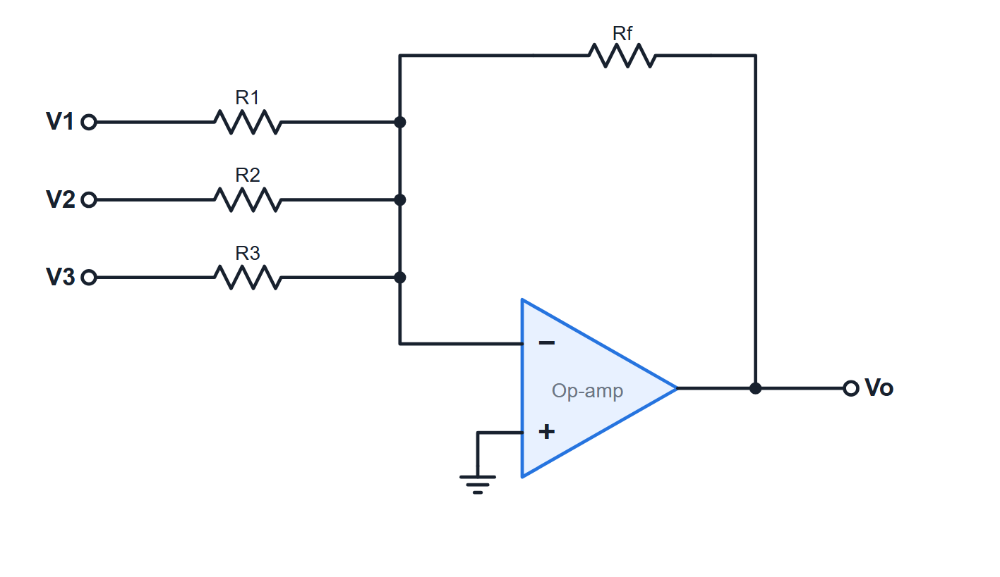
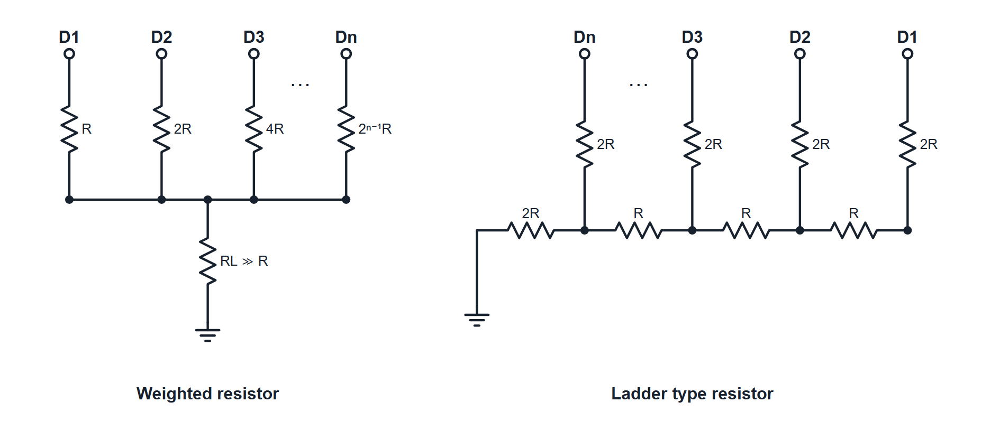
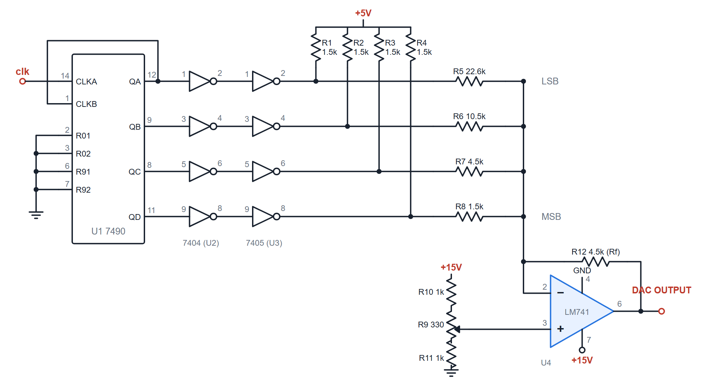
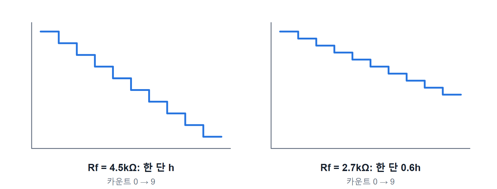
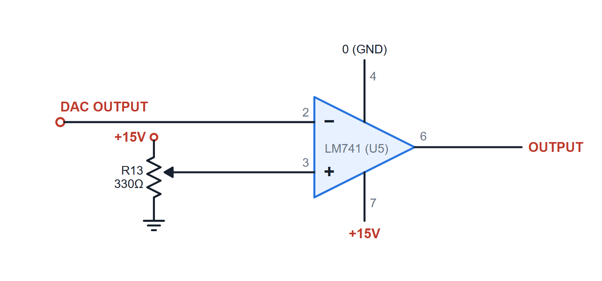
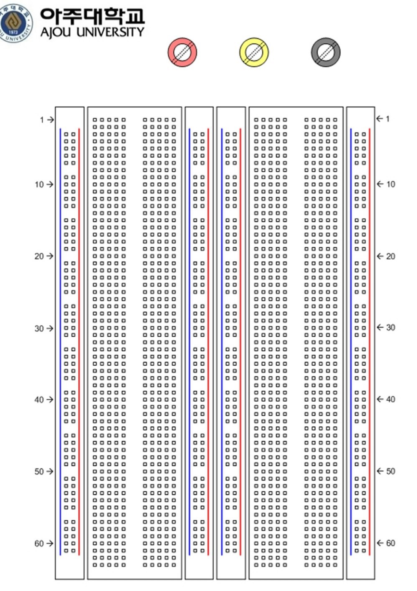
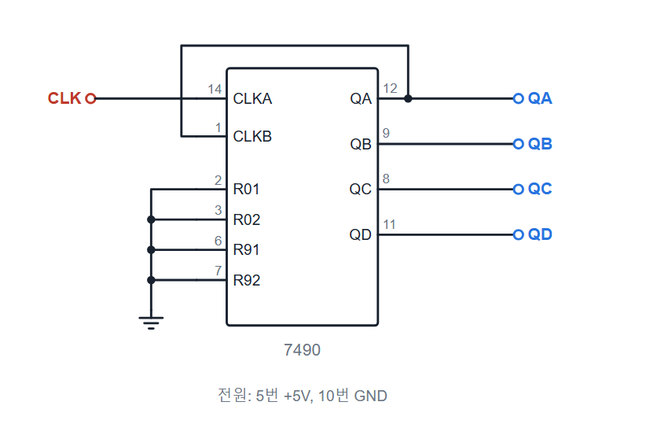
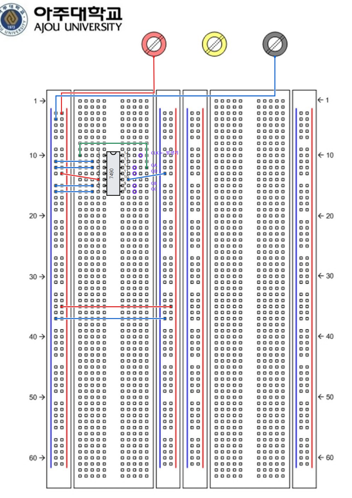

# 실험 10 · 문제 설명

      
첫 줄부터 완성 답과 검산까지 함께 풀어요.

## 문제를 함께 풀어요

### 문제 1 · DAC와 ADC의 역할과 쓰임

문제 읽기
#### 문제

D/A converter와 A/D converter의 역할 및 쓰임에 대하여 설명하시오.

#### 구할 것

D/A converter와 A/D converter의 역할 및 쓰임 설명

이 문제에서 할 일
변환 방향과 용도를 각각 써요.

이 문제를 봤을 때 떠올릴 개념과 공식
D/A = 숫자 → 전압, A/D = 전압 → 숫자

D/A와 A/D에서 앞 글자가 입력, 뒤 글자가 출력이에요.

첫 줄을 이렇게 시작해요
D/A부터 D → A로 적어요.

[필요한 개념으로 돌아가요](%EC%8B%A4%ED%97%9810_%EC%8B%A4%ED%97%98%EC%84%A4%EB%AA%85.md#t-start)

이유를 따라 완성해요
DAC는 디지털 데이터를 아날로그 전압·전류로 바꿔 스피커에 소리 신호를 보내요. ADC는 마이크·센서의 아날로그 전압을 컴퓨터가 읽을 숫자로 바꿔요.

답과 검산을 확인해요
손에 든 마이크에서 컴퓨터로 들어가는 방향이 A → D인지 확인해요.

헷갈리기 쉬운 조건을 확인해요
D/A와 A/D의 방향을 바꿔 쓰지 않아요. 쓰임만 쓰고 무엇을 무엇으로 바꾸는지 빠뜨리면 역할이 모자라요.

설명을 닫고 다시 해 봐요
- 각 이름에 입력 → 출력과 쓰임을 붙여요.

**떠올릴 것:** D/A = 숫자 → 전압, A/D = 전압 → 숫자

D/A와 A/D에서 앞 글자가 입력, 뒤 글자가 출력이에요.

첫 실행 · D/A부터 D → A로 적어요.

결론 · DAC는 디지털 → 아날로그(스피커), ADC는 아날로그 → 디지털(마이크·센서)이에요.

검산 · 손에 든 마이크에서 컴퓨터로 들어가는 방향이 A → D인지 확인해요.

D/A와 A/D의 방향을 바꿔 쓰지 않아요. 쓰임만 쓰고 무엇을 무엇으로 바꾸는지 빠뜨리면 역할이 모자라요.

출처: [from_the_past/정리/퀴즈/실험10/실험10 퀴즈 기출 2016-2.pdf · PDF p1](../../../from_the_past/%EC%A0%95%EB%A6%AC/%ED%80%B4%EC%A6%88/%EC%8B%A4%ED%97%9810/%EC%8B%A4%ED%97%9810%20%ED%80%B4%EC%A6%88%20%EA%B8%B0%EC%B6%9C%202016-2.pdf#page=1) · [from_the_past/정리/퀴즈/실험10/실험10 퀴즈 예상문제_v1.pdf · PDF p3](../../../from_the_past/%EC%A0%95%EB%A6%AC/%ED%80%B4%EC%A6%88/%EC%8B%A4%ED%97%9810/%EC%8B%A4%ED%97%9810%20%ED%80%B4%EC%A6%88%20%EC%98%88%EC%83%81%EB%AC%B8%EC%A0%9C_v1.pdf#page=3) · [from_the_past/정리/퀴즈/실험10/실험10 퀴즈 예상문제_v2.pdf · PDF p2](../../../from_the_past/%EC%A0%95%EB%A6%AC/%ED%80%B4%EC%A6%88/%EC%8B%A4%ED%97%9810/%EC%8B%A4%ED%97%9810%20%ED%80%B4%EC%A6%88%20%EC%98%88%EC%83%81%EB%AC%B8%EC%A0%9C_v2.pdf#page=2) · [from_the_past/정리/퀴즈/실험10/실험10 퀴즈 예상문제_v3.pdf · PDF p2](../../../from_the_past/%EC%A0%95%EB%A6%AC/%ED%80%B4%EC%A6%88/%EC%8B%A4%ED%97%9810/%EC%8B%A4%ED%97%9810%20%ED%80%B4%EC%A6%88%20%EC%98%88%EC%83%81%EB%AC%B8%EC%A0%9C_v3.pdf#page=2) · [from_the_past/정리/퀴즈/실험10/실험10 퀴즈 예상문제_v4.pdf · PDF p3](../../../from_the_past/%EC%A0%95%EB%A6%AC/%ED%80%B4%EC%A6%88/%EC%8B%A4%ED%97%9810/%EC%8B%A4%ED%97%9810%20%ED%80%B4%EC%A6%88%20%EC%98%88%EC%83%81%EB%AC%B8%EC%A0%9C_v4.pdf#page=3) · [from_the_past/정리/퀴즈/실험10/실험10 퀴즈 예상문제_v5.pdf · PDF p2](../../../from_the_past/%EC%A0%95%EB%A6%AC/%ED%80%B4%EC%A6%88/%EC%8B%A4%ED%97%9810/%EC%8B%A4%ED%97%9810%20%ED%80%B4%EC%A6%88%20%EC%98%88%EC%83%81%EB%AC%B8%EC%A0%9C_v5.pdf#page=2) · [from_the_past/정리/퀴즈/실험10/실험10 퀴즈 종합_기출문제 (4p).pdf · PDF p4](../../../from_the_past/%EC%A0%95%EB%A6%AC/%ED%80%B4%EC%A6%88/%EC%8B%A4%ED%97%9810/%EC%8B%A4%ED%97%9810%20%ED%80%B4%EC%A6%88%20%EC%A2%85%ED%95%A9_%EA%B8%B0%EC%B6%9C%EB%AC%B8%EC%A0%9C%20%284p%29.pdf#page=4) · [from_the_past/정리/퀴즈/실험10/원본_docx/실험10.docx](../../../from_the_past/%EC%A0%95%EB%A6%AC/%ED%80%B4%EC%A6%88/%EC%8B%A4%ED%97%9810/%EC%9B%90%EB%B3%B8_docx/%EC%8B%A4%ED%97%9810.docx) · [from_the_past/정리/퀴즈/실험10/원본_docx/실험10_예상.docx](../../../from_the_past/%EC%A0%95%EB%A6%AC/%ED%80%B4%EC%A6%88/%EC%8B%A4%ED%97%9810/%EC%9B%90%EB%B3%B8_docx/%EC%8B%A4%ED%97%9810_%EC%98%88%EC%83%81.docx) · [from_the_past/정리/퀴즈/실험10/원본_docx/실험10_예상.pdf · PDF p3](../../../from_the_past/%EC%A0%95%EB%A6%AC/%ED%80%B4%EC%A6%88/%EC%8B%A4%ED%97%9810/%EC%9B%90%EB%B3%B8_docx/%EC%8B%A4%ED%97%9810_%EC%98%88%EC%83%81.pdf#page=3) · [from_the_past/정리/퀴즈/실험10/실험10 퀴즈 예상문제_v1.pdf · PDF p1](../../../from_the_past/%EC%A0%95%EB%A6%AC/%ED%80%B4%EC%A6%88/%EC%8B%A4%ED%97%9810/%EC%8B%A4%ED%97%9810%20%ED%80%B4%EC%A6%88%20%EC%98%88%EC%83%81%EB%AC%B8%EC%A0%9C_v1.pdf#page=1)

### 문제 2 · 반전 가산증폭기의 Vo

문제 읽기
#### 문제

아래의 반전 가산증폭기에서 입력전압 V1, V2, V3에 대한 출력전압 Vo의 관계식을 구하시오.

#### 주어진 조건

회로는 원문 그림을 다시 그린 그림이에요. V1·V2·V3이 R1·R2·R3을 지나 Op-amp의 반전 입력(−)에서 만나고, Rf가 출력 Vo를 같은 점으로 되돌려요. 비반전 입력(+)은 접지예요.

#### 구할 것

반전 가산증폭기의 입력전압 V1, V2, V3에 대한 출력전압 Vo의 관계식

이 문제에서 할 일
세 입력의 출력식을 구해요.

이 문제를 봤을 때 떠올릴 개념과 공식
반전 입력 ≈ 0V → 가지 전류의 합 = Rf 전류

(+) 입력이 접지되고 음의 피드백이 선형으로 동작하면 반전 입력도 약 0V예요.

첫 줄을 이렇게 시작해요
가지 전류를 I₁=V₁/R₁, I₂=V₂/R₂, I₃=V₃/R₃으로 적어요.

[필요한 개념으로 돌아가요](%EC%8B%A4%ED%97%9810_%EC%8B%A4%ED%97%98%EC%84%A4%EB%AA%85.md#t-summing)

이유를 따라 완성해요
Op-Amp 입력 전류를 무시하면 세 가지 전류가 모두 Rf로 흘러 0−Vo=Rf(I₁+I₂+I₃)이에요.

$$V_o = -\left(\frac{R_f}{R_1}V_1 + \frac{R_f}{R_2}V_2 + \frac{R_f}{R_3}V_3\right)$$

답과 검산을 확인해요
Rf=R₁=R₂=R₃이면 Vo=−(V₁+V₂+V₃)이에요.

헷갈리기 쉬운 조건을 확인해요
앞의 − 부호를 빠뜨리지 않아요. 비반전 증폭기의 1 + Rf/R 꼴과 섞지 않아요.

설명을 닫고 다시 해 봐요
- 가상 접지에서 전류식을 세우고 Vo를 풀어요.

**떠올릴 것:** 반전 입력 ≈ 0V → 가지 전류의 합 = Rf 전류

(+) 입력이 접지되고 음의 피드백이 선형으로 동작하면 반전 입력도 약 0V예요.

첫 실행 · 가지 전류를 I₁=V₁/R₁, I₂=V₂/R₂, I₃=V₃/R₃으로 적어요.

결론 · Vo=−Rf(V₁/R₁+V₂/R₂+V₃/R₃)이에요.

검산 · Rf=R₁=R₂=R₃이면 Vo=−(V₁+V₂+V₃)이에요.

앞의 − 부호를 빠뜨리지 않아요. 비반전 증폭기의 1 + Rf/R 꼴과 섞지 않아요.

출처: [from_the_past/정리/퀴즈/실험10/실험10 퀴즈 기출 2016-2.pdf · PDF p1](../../../from_the_past/%EC%A0%95%EB%A6%AC/%ED%80%B4%EC%A6%88/%EC%8B%A4%ED%97%9810/%EC%8B%A4%ED%97%9810%20%ED%80%B4%EC%A6%88%20%EA%B8%B0%EC%B6%9C%202016-2.pdf#page=1) · [from_the_past/정리/퀴즈/실험10/실험10 퀴즈 예상문제_v1.pdf · PDF p2](../../../from_the_past/%EC%A0%95%EB%A6%AC/%ED%80%B4%EC%A6%88/%EC%8B%A4%ED%97%9810/%EC%8B%A4%ED%97%9810%20%ED%80%B4%EC%A6%88%20%EC%98%88%EC%83%81%EB%AC%B8%EC%A0%9C_v1.pdf#page=2) · [from_the_past/정리/퀴즈/실험10/실험10 퀴즈 예상문제_v2.pdf · PDF p2](../../../from_the_past/%EC%A0%95%EB%A6%AC/%ED%80%B4%EC%A6%88/%EC%8B%A4%ED%97%9810/%EC%8B%A4%ED%97%9810%20%ED%80%B4%EC%A6%88%20%EC%98%88%EC%83%81%EB%AC%B8%EC%A0%9C_v2.pdf#page=2) · [from_the_past/정리/퀴즈/실험10/실험10 퀴즈 예상문제_v3.pdf · PDF p2](../../../from_the_past/%EC%A0%95%EB%A6%AC/%ED%80%B4%EC%A6%88/%EC%8B%A4%ED%97%9810/%EC%8B%A4%ED%97%9810%20%ED%80%B4%EC%A6%88%20%EC%98%88%EC%83%81%EB%AC%B8%EC%A0%9C_v3.pdf#page=2) · [from_the_past/정리/퀴즈/실험10/실험10 퀴즈 예상문제_v4.pdf · PDF p2](../../../from_the_past/%EC%A0%95%EB%A6%AC/%ED%80%B4%EC%A6%88/%EC%8B%A4%ED%97%9810/%EC%8B%A4%ED%97%9810%20%ED%80%B4%EC%A6%88%20%EC%98%88%EC%83%81%EB%AC%B8%EC%A0%9C_v4.pdf#page=2) · [from_the_past/정리/퀴즈/실험10/실험10 퀴즈 예상문제_v5.pdf · PDF p2](../../../from_the_past/%EC%A0%95%EB%A6%AC/%ED%80%B4%EC%A6%88/%EC%8B%A4%ED%97%9810/%EC%8B%A4%ED%97%9810%20%ED%80%B4%EC%A6%88%20%EC%98%88%EC%83%81%EB%AC%B8%EC%A0%9C_v5.pdf#page=2) · [from_the_past/정리/퀴즈/실험10/실험10 퀴즈 종합_기출문제 (4p).pdf · PDF p3](../../../from_the_past/%EC%A0%95%EB%A6%AC/%ED%80%B4%EC%A6%88/%EC%8B%A4%ED%97%9810/%EC%8B%A4%ED%97%9810%20%ED%80%B4%EC%A6%88%20%EC%A2%85%ED%95%A9_%EA%B8%B0%EC%B6%9C%EB%AC%B8%EC%A0%9C%20%284p%29.pdf#page=3) · [from_the_past/정리/퀴즈/실험10/원본_docx/실험10.docx](../../../from_the_past/%EC%A0%95%EB%A6%AC/%ED%80%B4%EC%A6%88/%EC%8B%A4%ED%97%9810/%EC%9B%90%EB%B3%B8_docx/%EC%8B%A4%ED%97%9810.docx) · [from_the_past/정리/퀴즈/실험10/원본_docx/실험10_예상.docx](../../../from_the_past/%EC%A0%95%EB%A6%AC/%ED%80%B4%EC%A6%88/%EC%8B%A4%ED%97%9810/%EC%9B%90%EB%B3%B8_docx/%EC%8B%A4%ED%97%9810_%EC%98%88%EC%83%81.docx) · [from_the_past/정리/퀴즈/실험10/원본_docx/실험10_예상.pdf · PDF p2](../../../from_the_past/%EC%A0%95%EB%A6%AC/%ED%80%B4%EC%A6%88/%EC%8B%A4%ED%97%9810/%EC%9B%90%EB%B3%B8_docx/%EC%8B%A4%ED%97%9810_%EC%98%88%EC%83%81.pdf#page=2)

### 문제 3 · 가산증폭기의 Vo와 역할

문제 읽기
#### 문제

아래 변수를 이용해 Op-amp의 Vo 수식을 쓰고(1) 역할과 특징을 설명(2)하시오

#### 주어진 조건

회로는 앞 문항(반전 가산증폭기의 Vo)의 그림과 같아요. 원문 캡처에는 손글씨 답 메모가 함께 있어 다시 싣지 않았어요. V1·V2·V3이 R1·R2·R3을 지나 Op-amp의 반전 입력(−)에서 만나고, Rf가 출력 Vo를 같은 점으로 되돌려요. 비반전 입력(+)은 접지예요.

원문은 온라인 개별과제 캡처예요. 기출 시험지에 같은 문항이 실렸는지는 확인되지 않았어요.

#### 구할 것

(1) Op-amp의 Vo 수식 (2) 역할과 특징 설명

이 문제에서 할 일
(1) 출력식과 (2) 역할·특징을 써요.

이 문제를 봤을 때 떠올릴 개념과 공식
가지 전류 합 × Rf, 부호 반전

귀환 Rf와 접지된 (+) 입력이 보이면 선형 동작에서 반전 입력을 약 0V로 놓고 전류를 더해요.

첫 줄을 이렇게 시작해요
I₁+I₂+I₃=(0−Vo)/Rf로 시작해요.

[필요한 개념으로 돌아가요](%EC%8B%A4%ED%97%9810_%EC%8B%A4%ED%97%98%EC%84%A4%EB%AA%85.md#t-summing)

이유를 따라 완성해요
(1) 가지 전류 Vi/Ri를 대입하면 아래 식이에요.

$$V_o = -\left(\frac{R_f}{R_1}V_1 + \frac{R_f}{R_2}V_2 + \frac{R_f}{R_3}V_3\right)$$

(2) 입력을 Rf/Ri만큼 가중해 더하고 부호를 뒤집어요. 가상 접지 덕분에 각 가지의 입력 전류는 다른 입력에 좌우되지 않고, Rf로 전체 이득을 조절해요. DAC에서는 가지 저항으로 비트의 무게를 줘요.

답과 검산을 확인해요
저항이 모두 같으면 Vo=−(V₁+V₂+V₃)이에요. 원문의 부분 판독 메모는 (2)의 DAC 역할과 방향이 같아요.

헷갈리기 쉬운 조건을 확인해요
(1)의 − 부호를 빠뜨리지 않아요. 손글씨 메모는 (1) 식이 없고 판독이 불확실한 후보라 정답 근거로 쓰지 않았어요.

설명을 닫고 다시 해 봐요
- 전류식으로 (1)을 구한 뒤 계수와 부호를 말로 풀어 (2)를 써요.

**떠올릴 것:** 가지 전류 합 × Rf, 부호 반전

귀환 Rf와 접지된 (+) 입력이 보이면 선형 동작에서 반전 입력을 약 0V로 놓고 전류를 더해요.

첫 실행 · I₁+I₂+I₃=(0−Vo)/Rf로 시작해요.

결론 · Vo=−Rf(V₁/R₁+V₂/R₂+V₃/R₃)이에요. DAC에서는 가지 저항으로 비트의 무게를 주고 Rf로 전체 이득을 조절해요.

검산 · 저항이 모두 같으면 Vo=−(V₁+V₂+V₃)이에요. 원문의 부분 판독 메모는 (2)의 DAC 역할과 방향이 같아요.

(1)의 − 부호를 빠뜨리지 않아요. 손글씨 메모는 (1) 식이 없고 판독이 불확실한 후보라 정답 근거로 쓰지 않았어요.

출처: [from_the_past/정리/퀴즈/실험10/실험10 퀴즈 예상문제_v1.pdf · PDF p1](../../../from_the_past/%EC%A0%95%EB%A6%AC/%ED%80%B4%EC%A6%88/%EC%8B%A4%ED%97%9810/%EC%8B%A4%ED%97%9810%20%ED%80%B4%EC%A6%88%20%EC%98%88%EC%83%81%EB%AC%B8%EC%A0%9C_v1.pdf#page=1)

### 문제 4 · 가중 저항과 래더 저항의 장단점

문제 읽기
#### 문제

D/A converter의 weighted resistor와 ladder type resistor의 장단점을 설명하시오.

#### 주어진 조건

그림은 원문 도해를 다시 그린 그림이에요. 왼쪽 weighted resistor는 D1~Dn에 R·2R·4R·2ⁿ⁻¹R을 달아 한 점에 모으고 RL ≫ R로 접지해요. 오른쪽 ladder type resistor는 Dn~D1마다 2R, 사이사이 R, 끝을 2R로 접지해요.

#### 구할 것

weighted resistor와 ladder type resistor의 장단점

이 문제에서 할 일
두 저항망의 장단점을 비교해요.

이 문제를 봤을 때 떠올릴 개념과 공식
가중: 값이 n가지, 래더: 값이 2가지

그림의 라벨을 보면 가중 저항은 R~2ⁿ⁻¹R, 래더는 R·2R 두 값이에요. 교안 p6의 두 식은 비트 무게가 2배씩이고 분모는 각각 2ⁿ−1과 2ⁿ이에요.

첫 줄을 이렇게 시작해요
그림에서 저항값 종류와 저항 개수를 따로 세요.

[필요한 개념으로 돌아가요](%EC%8B%A4%ED%97%9810_%EC%8B%A4%ED%97%98%EC%84%A4%EB%AA%85.md#t-network)

이유를 따라 완성해요
가중 저항은 비트당 저항 하나라 구조가 간단하지만 8비트면 R~128R을 맞춰야 하고 큰 저항의 온도 드리프트와 스위칭 속도에 불리해요. 래더는 두 값만 맞춰 고정도·고속에 유리하지만 저항 수와 배선이 늘어요(장단점은 제공 답안 보충).

답과 검산을 확인해요
8비트로 늘려도 래더의 값은 R과 2R 두 종류예요.

헷갈리기 쉬운 조건을 확인해요
래더가 “저항이 적어서 간단하다”고 쓰면 반대예요. 래더는 저항 수가 더 많아요.

설명을 닫고 다시 해 봐요
- 값의 종류와 소자 수로 두 회로를 비교해요.

**떠올릴 것:** 가중: 값이 n가지, 래더: 값이 2가지

그림의 라벨을 보면 가중 저항은 R~2ⁿ⁻¹R, 래더는 R·2R 두 값이에요. 교안 p6의 두 식은 비트 무게가 2배씩이고 분모는 각각 2ⁿ−1과 2ⁿ이에요.

첫 실행 · 그림에서 저항값 종류와 저항 개수를 따로 세요.

결론 · 가중 저항은 구조가 간단하지만 값 범위가 넓어요. 래더는 R·2R만 맞추면 되지만 소자 수와 배선이 늘어요.

검산 · 8비트로 늘려도 래더의 값은 R과 2R 두 종류예요.

래더가 “저항이 적어서 간단하다”고 쓰면 반대예요. 래더는 저항 수가 더 많아요.

출처: [from_the_past/정리/퀴즈/실험10/실험10 퀴즈 기출 2016-2.pdf · PDF p1](../../../from_the_past/%EC%A0%95%EB%A6%AC/%ED%80%B4%EC%A6%88/%EC%8B%A4%ED%97%9810/%EC%8B%A4%ED%97%9810%20%ED%80%B4%EC%A6%88%20%EA%B8%B0%EC%B6%9C%202016-2.pdf#page=1) · [from_the_past/정리/퀴즈/실험10/실험10 퀴즈 예상문제_v1.pdf · PDF p1](../../../from_the_past/%EC%A0%95%EB%A6%AC/%ED%80%B4%EC%A6%88/%EC%8B%A4%ED%97%9810/%EC%8B%A4%ED%97%9810%20%ED%80%B4%EC%A6%88%20%EC%98%88%EC%83%81%EB%AC%B8%EC%A0%9C_v1.pdf#page=1) · [from_the_past/정리/퀴즈/실험10/실험10 퀴즈 예상문제_v2.pdf · PDF p1](../../../from_the_past/%EC%A0%95%EB%A6%AC/%ED%80%B4%EC%A6%88/%EC%8B%A4%ED%97%9810/%EC%8B%A4%ED%97%9810%20%ED%80%B4%EC%A6%88%20%EC%98%88%EC%83%81%EB%AC%B8%EC%A0%9C_v2.pdf#page=1) · [from_the_past/정리/퀴즈/실험10/실험10 퀴즈 예상문제_v3.pdf · PDF p1](../../../from_the_past/%EC%A0%95%EB%A6%AC/%ED%80%B4%EC%A6%88/%EC%8B%A4%ED%97%9810/%EC%8B%A4%ED%97%9810%20%ED%80%B4%EC%A6%88%20%EC%98%88%EC%83%81%EB%AC%B8%EC%A0%9C_v3.pdf#page=1) · [from_the_past/정리/퀴즈/실험10/실험10 퀴즈 예상문제_v4.pdf · PDF p1](../../../from_the_past/%EC%A0%95%EB%A6%AC/%ED%80%B4%EC%A6%88/%EC%8B%A4%ED%97%9810/%EC%8B%A4%ED%97%9810%20%ED%80%B4%EC%A6%88%20%EC%98%88%EC%83%81%EB%AC%B8%EC%A0%9C_v4.pdf#page=1) · [from_the_past/정리/퀴즈/실험10/실험10 퀴즈 예상문제_v5.pdf · PDF p1](../../../from_the_past/%EC%A0%95%EB%A6%AC/%ED%80%B4%EC%A6%88/%EC%8B%A4%ED%97%9810/%EC%8B%A4%ED%97%9810%20%ED%80%B4%EC%A6%88%20%EC%98%88%EC%83%81%EB%AC%B8%EC%A0%9C_v5.pdf#page=1) · [from_the_past/정리/퀴즈/실험10/실험10 퀴즈 종합_기출문제 (4p).pdf · PDF p2](../../../from_the_past/%EC%A0%95%EB%A6%AC/%ED%80%B4%EC%A6%88/%EC%8B%A4%ED%97%9810/%EC%8B%A4%ED%97%9810%20%ED%80%B4%EC%A6%88%20%EC%A2%85%ED%95%A9_%EA%B8%B0%EC%B6%9C%EB%AC%B8%EC%A0%9C%20%284p%29.pdf#page=2) · [from_the_past/정리/퀴즈/실험10/원본_docx/실험10.docx](../../../from_the_past/%EC%A0%95%EB%A6%AC/%ED%80%B4%EC%A6%88/%EC%8B%A4%ED%97%9810/%EC%9B%90%EB%B3%B8_docx/%EC%8B%A4%ED%97%9810.docx) · [from_the_past/정리/퀴즈/실험10/원본_docx/실험10_예상.docx](../../../from_the_past/%EC%A0%95%EB%A6%AC/%ED%80%B4%EC%A6%88/%EC%8B%A4%ED%97%9810/%EC%9B%90%EB%B3%B8_docx/%EC%8B%A4%ED%97%9810_%EC%98%88%EC%83%81.docx) · [from_the_past/정리/퀴즈/실험10/원본_docx/실험10_예상.pdf · PDF p1](../../../from_the_past/%EC%A0%95%EB%A6%AC/%ED%80%B4%EC%A6%88/%EC%8B%A4%ED%97%9810/%EC%9B%90%EB%B3%B8_docx/%EC%8B%A4%ED%97%9810_%EC%98%88%EC%83%81.pdf#page=1)

### 문제 5 · 7490(74HC90)의 기능과 출력

문제 읽기
#### 문제

앞의 D/A converter에서 74HC90 IC의 기능을 설명하고, 출력 QA, QB, QC, QD가 무엇을 의미하는지 답하시오.

#### 주어진 조건

회로는 원문 그림(교안 p12 회로와 같아요)을 다시 그린 그림이에요. 7490의 QA·QB·QC·QD가 각각 7404 → 7405를 지나고, 7405 출력마다 +5V로 가는 1.5kΩ 풀업(R1~R4)이 있어요. 가중 저항 R5 22.6k(QA)·R6 10.5k(QB)·R7 4.5k(QC)·R8 1.5k(QD)가 LM741(U4) 2번에 모이고, 귀환 저항 R12 4.5k가 6번(DAC OUTPUT)과 2번 사이에 있어요. 3번은 +15V–R10 1k–R9 330(가변)–R11 1k–GND 분배기의 가운데 단자, 4번은 GND, 7번은 +15V예요.

원문은 “74HC90”이라고 적었지만 회로도의 칩 이름은 7490이에요. 핀 번호와 동작은 같아요.

#### 구할 것

DAC의 74HC90 IC 기능과 출력 QA, QB, QC, QD의 의미

이 문제에서 할 일
카운터 기능과 QA~QD의 뜻을 써요.

이 문제를 봤을 때 떠올릴 개념과 공식
클럭을 0~9로 세는 BCD 카운터

CLK→CLKA(14번), QA(12번)→CLKB(1번)가 2진 단과 5진 단을 연결해요.

첫 줄을 이렇게 시작해요
코드를 QD QC QB QA 순으로 적어요.

[필요한 개념으로 돌아가요](%EC%8B%A4%ED%97%9810_%EC%8B%A4%ED%97%98%EC%84%A4%EB%AA%85.md#t-7490)

이유를 따라 완성해요
74HC90(교안의 7490)은 클럭마다 0~9를 세고 1001 다음에 0000으로 돌아가는 BCD 카운터예요. QA·QB·QC·QD의 무게는 차례로 1·2·4·8이며 DAC가 이 무게로 비트를 합산해요.

답과 검산을 확인해요
0110은 QC+QB의 무게인 4+2=6이에요.

헷갈리기 쉬운 조건을 확인해요
0~15를 세는 4비트 이진 카운터와 섞지 않아요. QA가 가장 무거운 비트라고 쓰면 반대예요.

설명을 닫고 다시 해 봐요
- QA 되먹임을 따라가고 9 다음 상태와 비트 무게를 적어요.

**떠올릴 것:** 클럭을 0~9로 세는 BCD 카운터

CLK→CLKA(14번), QA(12번)→CLKB(1번)가 2진 단과 5진 단을 연결해요.

첫 실행 · 코드를 QD QC QB QA 순으로 적어요.

결론 · QA→CLKB로 0~9를 반복하고 QA~QD의 무게는 1·2·4·8이에요.

검산 · 0110은 QC+QB의 무게인 4+2=6이에요.

0~15를 세는 4비트 이진 카운터와 섞지 않아요. QA가 가장 무거운 비트라고 쓰면 반대예요.

출처: [from_the_past/정리/퀴즈/실험10/실험10 퀴즈 예상문제_v1.pdf · PDF p2](../../../from_the_past/%EC%A0%95%EB%A6%AC/%ED%80%B4%EC%A6%88/%EC%8B%A4%ED%97%9810/%EC%8B%A4%ED%97%9810%20%ED%80%B4%EC%A6%88%20%EC%98%88%EC%83%81%EB%AC%B8%EC%A0%9C_v1.pdf#page=2) · [from_the_past/정리/퀴즈/실험10/실험10 퀴즈 예상문제_v2.pdf · PDF p1](../../../from_the_past/%EC%A0%95%EB%A6%AC/%ED%80%B4%EC%A6%88/%EC%8B%A4%ED%97%9810/%EC%8B%A4%ED%97%9810%20%ED%80%B4%EC%A6%88%20%EC%98%88%EC%83%81%EB%AC%B8%EC%A0%9C_v2.pdf#page=1) · [from_the_past/정리/퀴즈/실험10/실험10 퀴즈 예상문제_v3.pdf · PDF p1](../../../from_the_past/%EC%A0%95%EB%A6%AC/%ED%80%B4%EC%A6%88/%EC%8B%A4%ED%97%9810/%EC%8B%A4%ED%97%9810%20%ED%80%B4%EC%A6%88%20%EC%98%88%EC%83%81%EB%AC%B8%EC%A0%9C_v3.pdf#page=1) · [from_the_past/정리/퀴즈/실험10/실험10 퀴즈 예상문제_v4.pdf · PDF p2](../../../from_the_past/%EC%A0%95%EB%A6%AC/%ED%80%B4%EC%A6%88/%EC%8B%A4%ED%97%9810/%EC%8B%A4%ED%97%9810%20%ED%80%B4%EC%A6%88%20%EC%98%88%EC%83%81%EB%AC%B8%EC%A0%9C_v4.pdf#page=2) · [from_the_past/정리/퀴즈/실험10/실험10 퀴즈 예상문제_v5.pdf · PDF p1](../../../from_the_past/%EC%A0%95%EB%A6%AC/%ED%80%B4%EC%A6%88/%EC%8B%A4%ED%97%9810/%EC%8B%A4%ED%97%9810%20%ED%80%B4%EC%A6%88%20%EC%98%88%EC%83%81%EB%AC%B8%EC%A0%9C_v5.pdf#page=1) · [from_the_past/정리/퀴즈/실험10/실험10 퀴즈 종합_기출문제 (4p).pdf · PDF p3](../../../from_the_past/%EC%A0%95%EB%A6%AC/%ED%80%B4%EC%A6%88/%EC%8B%A4%ED%97%9810/%EC%8B%A4%ED%97%9810%20%ED%80%B4%EC%A6%88%20%EC%A2%85%ED%95%A9_%EA%B8%B0%EC%B6%9C%EB%AC%B8%EC%A0%9C%20%284p%29.pdf#page=3) · [from_the_past/정리/퀴즈/실험10/원본_docx/실험10.docx](../../../from_the_past/%EC%A0%95%EB%A6%AC/%ED%80%B4%EC%A6%88/%EC%8B%A4%ED%97%9810/%EC%9B%90%EB%B3%B8_docx/%EC%8B%A4%ED%97%9810.docx) · [from_the_past/정리/퀴즈/실험10/원본_docx/실험10_예상.docx](../../../from_the_past/%EC%A0%95%EB%A6%AC/%ED%80%B4%EC%A6%88/%EC%8B%A4%ED%97%9810/%EC%9B%90%EB%B3%B8_docx/%EC%8B%A4%ED%97%9810_%EC%98%88%EC%83%81.docx) · [from_the_past/정리/퀴즈/실험10/원본_docx/실험10_예상.pdf · PDF p2](../../../from_the_past/%EC%A0%95%EB%A6%AC/%ED%80%B4%EC%A6%88/%EC%8B%A4%ED%97%9810/%EC%9B%90%EB%B3%B8_docx/%EC%8B%A4%ED%97%9810_%EC%98%88%EC%83%81.pdf#page=2)

### 문제 6 · DAC 회로의 동작 원리

문제 읽기
#### 문제

아래 D/A converter의 동작 원리를 설명하시오.

#### 주어진 조건

회로는 원문 그림(교안 p12 회로와 같아요)을 다시 그린 그림이에요. 7490의 QA·QB·QC·QD가 각각 7404 → 7405를 지나고, 7405 출력마다 +5V로 가는 1.5kΩ 풀업(R1~R4)이 있어요. 가중 저항 R5 22.6k(QA)·R6 10.5k(QB)·R7 4.5k(QC)·R8 1.5k(QD)가 LM741(U4) 2번에 모이고, 귀환 저항 R12 4.5k가 6번(DAC OUTPUT)과 2번 사이에 있어요. 3번은 +15V–R10 1k–R9 330(가변)–R11 1k–GND 분배기의 가운데 단자, 4번은 GND, 7번은 +15V예요.

#### 구할 것

주어진 D/A converter의 동작 원리

이 문제에서 할 일
클럭에서 DAC 출력까지 신호를 따라가요.

이 문제를 봤을 때 떠올릴 개념과 공식
카운터 → 0/5V 버퍼 → 가중 저항 → 반전 가산기

회로도의 7490→7404·7405→R5~R8→LM741 순서로 보면 카운트가 가중 전류로 바뀌어요.

첫 줄을 이렇게 시작해요
7490의 BCD 순서를 0000 → … → 1001로 적어요.

[필요한 개념으로 돌아가요](%EC%8B%A4%ED%97%9810_%EC%8B%A4%ED%97%98%EC%84%A4%EB%AA%85.md#t-dac)

이유를 따라 완성해요
7404가 먼저 뒤집어요. 카운터 비트가 1이면 7405 입력은 0이라 출력이 열리고 1.5kΩ 풀업 경로가 작동해요. 비트가 0이면 출력이 GND로 당겨져요.

QA~QD의 가지 저항 22.6·10.5·4.5·1.5kΩ에 풀업을 더하면 약 24·12·6·3kΩ이라 0V 가산 노드 비교에서 전류 무게가 약 1·2·4·8이에요.

LM741이 Rf=4.5kΩ로 가지 전류 합을 반전해 카운트가 커질수록 출력이 내려가요. 분압기는 V+를 높여 음전원이 GND인 회로의 출력이 0V 위에서 움직이게 해요.

답과 검산을 확인해요
9→0에서 가중 합이 줄어 출력은 계단 맨 위로 돌아와요.

헷갈리기 쉬운 조건을 확인해요
7405만 있다고 쓰면 비트가 뒤집혀요. 7404가 반전을 되돌리는 것까지 써요. 각 단의 전압 숫자는 교안에 없어 지어내지 않아요.

설명을 닫고 다시 해 봐요
- 각 블록에 비트·전류·전압 중 무엇이 나오는지 적어요.

**떠올릴 것:** 카운터 → 0/5V 버퍼 → 가중 저항 → 반전 가산기

회로도의 7490→7404·7405→R5~R8→LM741 순서로 보면 카운트가 가중 전류로 바뀌어요.

첫 실행 · 7490의 BCD 순서를 0000 → … → 1001로 적어요.

결론 · 7490의 BCD를 7404·7405와 풀업으로 받아 가중 전류를 만들어요. LM741이 반전해 내려가는 계단을 내고 분압기가 출력을 0V 위로 옮겨요.

검산 · 9→0에서 가중 합이 줄어 출력은 계단 맨 위로 돌아와요.

7405만 있다고 쓰면 비트가 뒤집혀요. 7404가 반전을 되돌리는 것까지 써요. 각 단의 전압 숫자는 교안에 없어 지어내지 않아요.

출처: [from_the_past/정리/퀴즈/실험10/실험10 퀴즈 예상문제_v1.pdf · PDF p1](../../../from_the_past/%EC%A0%95%EB%A6%AC/%ED%80%B4%EC%A6%88/%EC%8B%A4%ED%97%9810/%EC%8B%A4%ED%97%9810%20%ED%80%B4%EC%A6%88%20%EC%98%88%EC%83%81%EB%AC%B8%EC%A0%9C_v1.pdf#page=1) · [from_the_past/정리/퀴즈/실험10/실험10 퀴즈 예상문제_v2.pdf · PDF p1](../../../from_the_past/%EC%A0%95%EB%A6%AC/%ED%80%B4%EC%A6%88/%EC%8B%A4%ED%97%9810/%EC%8B%A4%ED%97%9810%20%ED%80%B4%EC%A6%88%20%EC%98%88%EC%83%81%EB%AC%B8%EC%A0%9C_v2.pdf#page=1) · [from_the_past/정리/퀴즈/실험10/실험10 퀴즈 예상문제_v3.pdf · PDF p1](../../../from_the_past/%EC%A0%95%EB%A6%AC/%ED%80%B4%EC%A6%88/%EC%8B%A4%ED%97%9810/%EC%8B%A4%ED%97%9810%20%ED%80%B4%EC%A6%88%20%EC%98%88%EC%83%81%EB%AC%B8%EC%A0%9C_v3.pdf#page=1) · [from_the_past/정리/퀴즈/실험10/실험10 퀴즈 예상문제_v4.pdf · PDF p1](../../../from_the_past/%EC%A0%95%EB%A6%AC/%ED%80%B4%EC%A6%88/%EC%8B%A4%ED%97%9810/%EC%8B%A4%ED%97%9810%20%ED%80%B4%EC%A6%88%20%EC%98%88%EC%83%81%EB%AC%B8%EC%A0%9C_v4.pdf#page=1) · [from_the_past/정리/퀴즈/실험10/실험10 퀴즈 예상문제_v5.pdf · PDF p1](../../../from_the_past/%EC%A0%95%EB%A6%AC/%ED%80%B4%EC%A6%88/%EC%8B%A4%ED%97%9810/%EC%8B%A4%ED%97%9810%20%ED%80%B4%EC%A6%88%20%EC%98%88%EC%83%81%EB%AC%B8%EC%A0%9C_v5.pdf#page=1) · [from_the_past/정리/퀴즈/실험10/실험10 퀴즈 종합_기출문제 (4p).pdf · PDF p3](../../../from_the_past/%EC%A0%95%EB%A6%AC/%ED%80%B4%EC%A6%88/%EC%8B%A4%ED%97%9810/%EC%8B%A4%ED%97%9810%20%ED%80%B4%EC%A6%88%20%EC%A2%85%ED%95%A9_%EA%B8%B0%EC%B6%9C%EB%AC%B8%EC%A0%9C%20%284p%29.pdf#page=3) · [from_the_past/정리/퀴즈/실험10/원본_docx/실험10.docx](../../../from_the_past/%EC%A0%95%EB%A6%AC/%ED%80%B4%EC%A6%88/%EC%8B%A4%ED%97%9810/%EC%9B%90%EB%B3%B8_docx/%EC%8B%A4%ED%97%9810.docx) · [from_the_past/정리/퀴즈/실험10/원본_docx/실험10_예상.docx](../../../from_the_past/%EC%A0%95%EB%A6%AC/%ED%80%B4%EC%A6%88/%EC%8B%A4%ED%97%9810/%EC%9B%90%EB%B3%B8_docx/%EC%8B%A4%ED%97%9810_%EC%98%88%EC%83%81.docx) · [from_the_past/정리/퀴즈/실험10/원본_docx/실험10_예상.pdf · PDF p1](../../../from_the_past/%EC%A0%95%EB%A6%AC/%ED%80%B4%EC%A6%88/%EC%8B%A4%ED%97%9810/%EC%9B%90%EB%B3%B8_docx/%EC%8B%A4%ED%97%9810_%EC%98%88%EC%83%81.pdf#page=1)

### 문제 7 · Rf와 DAC 출력 크기

문제 읽기
#### 문제

앞의 D/A converter에서 Rf 저항 값에 따른 DAC output 전압 크기의 변화를 설명하시오.

#### 주어진 조건

회로는 원문 그림(교안 p12 회로와 같아요)을 다시 그린 그림이에요. 7490의 QA·QB·QC·QD가 각각 7404 → 7405를 지나고, 7405 출력마다 +5V로 가는 1.5kΩ 풀업(R1~R4)이 있어요. 가중 저항 R5 22.6k(QA)·R6 10.5k(QB)·R7 4.5k(QC)·R8 1.5k(QD)가 LM741(U4) 2번에 모이고, 귀환 저항 R12 4.5k가 6번(DAC OUTPUT)과 2번 사이에 있어요. 3번은 +15V–R10 1k–R9 330(가변)–R11 1k–GND 분배기의 가운데 단자, 4번은 GND, 7번은 +15V예요.

Rf는 귀환 저항 R12(4.5k)예요.

#### 구할 것

Rf 저항 값에 따른 DAC output 전압 크기의 변화

이 문제에서 할 일
Rf가 계단 높이와 전체 폭에 주는 영향을 구해요.

이 문제를 봤을 때 떠올릴 개념과 공식
Vout = −Rf × (가지 전류 합) → Rf에 비례

반전 가산기에서 출력 변화는 −Rf × 가지 전류 합의 변화예요. 가지 전류가 같고 포화가 없으면 계단 높이는 Rf에 비례해요.

첫 줄을 이렇게 시작해요
가지 저항과 입력을 고정하고 Rf 비를 구해요.

[필요한 개념으로 돌아가요](%EC%8B%A4%ED%97%9810_%EC%8B%A4%ED%97%98%EC%84%A4%EB%AA%85.md#t-dac)

이유를 따라 완성해요
교안 절차 5의 4.5kΩ→2.7kΩ에서는 계단 한 단과 전체 폭이 모두 2.7/4.5=0.6배예요.

답과 검산을 확인해요
같은 전류 변화에서 포화 없이 Rf가 두 배가 되면 계단 높이도 두 배예요.

헷갈리기 쉬운 조건을 확인해요
Rf가 커지면 출력이 작아진다고 반대로 쓰지 않아요. 가지 저항 Ri와 Rf를 섞지 않아요(Ri는 분모, Rf는 분자).

설명을 닫고 다시 해 봐요
- 두 Rf의 비를 구하고 포화 여부를 확인해요.

**떠올릴 것:** Vout = −Rf × (가지 전류 합) → Rf에 비례

반전 가산기에서 출력 변화는 −Rf × 가지 전류 합의 변화예요. 가지 전류가 같고 포화가 없으면 계단 높이는 Rf에 비례해요.

첫 실행 · 가지 저항과 입력을 고정하고 Rf 비를 구해요.

결론 · 선형 범위에서 4.5→2.7kΩ이면 한 단과 전체 폭이 0.6배예요.

검산 · 같은 전류 변화에서 포화 없이 Rf가 두 배가 되면 계단 높이도 두 배예요.

Rf가 커지면 출력이 작아진다고 반대로 쓰지 않아요. 가지 저항 Ri와 Rf를 섞지 않아요(Ri는 분모, Rf는 분자).

출처: [from_the_past/정리/퀴즈/실험10/실험10 퀴즈 예상문제_v1.pdf · PDF p2](../../../from_the_past/%EC%A0%95%EB%A6%AC/%ED%80%B4%EC%A6%88/%EC%8B%A4%ED%97%9810/%EC%8B%A4%ED%97%9810%20%ED%80%B4%EC%A6%88%20%EC%98%88%EC%83%81%EB%AC%B8%EC%A0%9C_v1.pdf#page=2) · [from_the_past/정리/퀴즈/실험10/실험10 퀴즈 예상문제_v2.pdf · PDF p2](../../../from_the_past/%EC%A0%95%EB%A6%AC/%ED%80%B4%EC%A6%88/%EC%8B%A4%ED%97%9810/%EC%8B%A4%ED%97%9810%20%ED%80%B4%EC%A6%88%20%EC%98%88%EC%83%81%EB%AC%B8%EC%A0%9C_v2.pdf#page=2) · [from_the_past/정리/퀴즈/실험10/실험10 퀴즈 예상문제_v3.pdf · PDF p2](../../../from_the_past/%EC%A0%95%EB%A6%AC/%ED%80%B4%EC%A6%88/%EC%8B%A4%ED%97%9810/%EC%8B%A4%ED%97%9810%20%ED%80%B4%EC%A6%88%20%EC%98%88%EC%83%81%EB%AC%B8%EC%A0%9C_v3.pdf#page=2) · [from_the_past/정리/퀴즈/실험10/실험10 퀴즈 예상문제_v4.pdf · PDF p2](../../../from_the_past/%EC%A0%95%EB%A6%AC/%ED%80%B4%EC%A6%88/%EC%8B%A4%ED%97%9810/%EC%8B%A4%ED%97%9810%20%ED%80%B4%EC%A6%88%20%EC%98%88%EC%83%81%EB%AC%B8%EC%A0%9C_v4.pdf#page=2) · [from_the_past/정리/퀴즈/실험10/실험10 퀴즈 예상문제_v5.pdf · PDF p2](../../../from_the_past/%EC%A0%95%EB%A6%AC/%ED%80%B4%EC%A6%88/%EC%8B%A4%ED%97%9810/%EC%8B%A4%ED%97%9810%20%ED%80%B4%EC%A6%88%20%EC%98%88%EC%83%81%EB%AC%B8%EC%A0%9C_v5.pdf#page=2) · [from_the_past/정리/퀴즈/실험10/실험10 퀴즈 종합_기출문제 (4p).pdf · PDF p4](../../../from_the_past/%EC%A0%95%EB%A6%AC/%ED%80%B4%EC%A6%88/%EC%8B%A4%ED%97%9810/%EC%8B%A4%ED%97%9810%20%ED%80%B4%EC%A6%88%20%EC%A2%85%ED%95%A9_%EA%B8%B0%EC%B6%9C%EB%AC%B8%EC%A0%9C%20%284p%29.pdf#page=4) · [from_the_past/정리/퀴즈/실험10/원본_docx/실험10.docx](../../../from_the_past/%EC%A0%95%EB%A6%AC/%ED%80%B4%EC%A6%88/%EC%8B%A4%ED%97%9810/%EC%9B%90%EB%B3%B8_docx/%EC%8B%A4%ED%97%9810.docx) · [from_the_past/정리/퀴즈/실험10/원본_docx/실험10_예상.docx](../../../from_the_past/%EC%A0%95%EB%A6%AC/%ED%80%B4%EC%A6%88/%EC%8B%A4%ED%97%9810/%EC%9B%90%EB%B3%B8_docx/%EC%8B%A4%ED%97%9810_%EC%98%88%EC%83%81.docx) · [from_the_past/정리/퀴즈/실험10/원본_docx/실험10_예상.pdf · PDF p2](../../../from_the_past/%EC%A0%95%EB%A6%AC/%ED%80%B4%EC%A6%88/%EC%8B%A4%ED%97%9810/%EC%9B%90%EB%B3%B8_docx/%EC%8B%A4%ED%97%9810_%EC%98%88%EC%83%81.pdf#page=2)

### 문제 8 · 비교기와 가변저항

문제 읽기
#### 문제

. 아래 비교기 회로의 동작원리와 가변저항의 역할을 설명하시오.

#### 주어진 조건

회로는 원문 그림(교안 p22와 같아요)을 다시 그린 그림이에요. DAC OUTPUT이 LM741(U5) 2번(−)에, +15V와 GND 사이 가변저항 R13(330Ω)의 가운데 단자가 3번(+)에 들어가요. 7번 +15V, 4번 GND, 6번이 OUTPUT이에요.

#### 구할 것

비교기 회로의 동작원리와 가변저항의 역할

이 문제에서 할 일
비교기 출력과 가변저항 역할을 설명해요.

이 문제를 봤을 때 떠올릴 개념과 공식
피드백 없음 → 전원에 붙음, DAC는 − 입력

귀환이 없으므로 A(V+−V−)의 부호에 따라 출력이 전원 쪽으로 포화돼요.

첫 줄을 이렇게 시작해요
V+(3번)=기준, V−(2번)=DAC 출력으로 표시해요.

[필요한 개념으로 돌아가요](%EC%8B%A4%ED%97%9810_%EC%8B%A4%ED%97%98%EC%84%A4%EB%AA%85.md#t-comparator)

이유를 따라 완성해요
교안 모델에서 DAC 출력이 기준보다 낮으면 +15V, 높으면 0V예요. 330Ω 가변저항 R13의 가운데 단자는 +15V와 GND 사이의 기준을 정해요. 기준을 바꾸면 내려오는 DAC 계단에서 출력이 바뀌는 카운트도 바뀌어요.

답과 검산을 확인해요
기준 8.5V에서 DAC가 10→9→8V로 내려가면 출력은 0→0→15V예요.

헷갈리기 쉬운 조건을 확인해요
답안 충돌: 제공 답안은 “기준 전위값보다 높으면 1, 낮으면 0”이라 적었어요. 이 회로는 DAC가 반전 입력이라 DAC가 기준보다 높으면 0V예요. 제공 답안은 신호를 비반전 입력에 넣은 일반 비교기 설명으로 보이고, 교안 p5 문장도 식과 반대로 적혀 있어요. 이 풀이는 식과 회로도를 따랐어요.

설명을 닫고 다시 해 봐요
- 두 입력을 표시하고 기준 양쪽에서 부호를 확인해요.

**떠올릴 것:** 피드백 없음 → 전원에 붙음, DAC는 − 입력

귀환이 없으므로 A(V+−V−)의 부호에 따라 출력이 전원 쪽으로 포화돼요.

첫 실행 · V+(3번)=기준, V−(2번)=DAC 출력으로 표시해요.

결론 · DAC가 기준보다 낮으면 +15V, 높으면 0V예요. 가변저항이 기준을 정해요.

검산 · 기준 8.5V에서 DAC가 10→9→8V로 내려가면 출력은 0→0→15V예요.

답안 충돌: 제공 답안은 “기준 전위값보다 높으면 1, 낮으면 0”이라 적었어요. 이 회로는 DAC가 반전 입력이라 DAC가 기준보다 높으면 0V예요. 제공 답안은 신호를 비반전 입력에 넣은 일반 비교기 설명으로 보이고, 교안 p5 문장도 식과 반대로 적혀 있어요. 이 풀이는 식과 회로도를 따랐어요.

출처: [from_the_past/정리/퀴즈/실험10/실험10 퀴즈 예상문제_v1.pdf · PDF p2](../../../from_the_past/%EC%A0%95%EB%A6%AC/%ED%80%B4%EC%A6%88/%EC%8B%A4%ED%97%9810/%EC%8B%A4%ED%97%9810%20%ED%80%B4%EC%A6%88%20%EC%98%88%EC%83%81%EB%AC%B8%EC%A0%9C_v1.pdf#page=2) · [from_the_past/정리/퀴즈/실험10/실험10 퀴즈 예상문제_v2.pdf · PDF p2](../../../from_the_past/%EC%A0%95%EB%A6%AC/%ED%80%B4%EC%A6%88/%EC%8B%A4%ED%97%9810/%EC%8B%A4%ED%97%9810%20%ED%80%B4%EC%A6%88%20%EC%98%88%EC%83%81%EB%AC%B8%EC%A0%9C_v2.pdf#page=2) · [from_the_past/정리/퀴즈/실험10/실험10 퀴즈 예상문제_v3.pdf · PDF p2](../../../from_the_past/%EC%A0%95%EB%A6%AC/%ED%80%B4%EC%A6%88/%EC%8B%A4%ED%97%9810/%EC%8B%A4%ED%97%9810%20%ED%80%B4%EC%A6%88%20%EC%98%88%EC%83%81%EB%AC%B8%EC%A0%9C_v3.pdf#page=2) · [from_the_past/정리/퀴즈/실험10/실험10 퀴즈 예상문제_v4.pdf · PDF p2](../../../from_the_past/%EC%A0%95%EB%A6%AC/%ED%80%B4%EC%A6%88/%EC%8B%A4%ED%97%9810/%EC%8B%A4%ED%97%9810%20%ED%80%B4%EC%A6%88%20%EC%98%88%EC%83%81%EB%AC%B8%EC%A0%9C_v4.pdf#page=2) · [from_the_past/정리/퀴즈/실험10/실험10 퀴즈 예상문제_v5.pdf · PDF p2](../../../from_the_past/%EC%A0%95%EB%A6%AC/%ED%80%B4%EC%A6%88/%EC%8B%A4%ED%97%9810/%EC%8B%A4%ED%97%9810%20%ED%80%B4%EC%A6%88%20%EC%98%88%EC%83%81%EB%AC%B8%EC%A0%9C_v5.pdf#page=2) · [from_the_past/정리/퀴즈/실험10/실험10 퀴즈 종합_기출문제 (4p).pdf · PDF p4](../../../from_the_past/%EC%A0%95%EB%A6%AC/%ED%80%B4%EC%A6%88/%EC%8B%A4%ED%97%9810/%EC%8B%A4%ED%97%9810%20%ED%80%B4%EC%A6%88%20%EC%A2%85%ED%95%A9_%EA%B8%B0%EC%B6%9C%EB%AC%B8%EC%A0%9C%20%284p%29.pdf#page=4) · [from_the_past/정리/퀴즈/실험10/원본_docx/실험10.docx](../../../from_the_past/%EC%A0%95%EB%A6%AC/%ED%80%B4%EC%A6%88/%EC%8B%A4%ED%97%9810/%EC%9B%90%EB%B3%B8_docx/%EC%8B%A4%ED%97%9810.docx) · [from_the_past/정리/퀴즈/실험10/원본_docx/실험10_예상.docx](../../../from_the_past/%EC%A0%95%EB%A6%AC/%ED%80%B4%EC%A6%88/%EC%8B%A4%ED%97%9810/%EC%9B%90%EB%B3%B8_docx/%EC%8B%A4%ED%97%9810_%EC%98%88%EC%83%81.docx) · [from_the_past/정리/퀴즈/실험10/원본_docx/실험10_예상.pdf · PDF p3](../../../from_the_past/%EC%A0%95%EB%A6%AC/%ED%80%B4%EC%A6%88/%EC%8B%A4%ED%97%9810/%EC%9B%90%EB%B3%B8_docx/%EC%8B%A4%ED%97%9810_%EC%98%88%EC%83%81.pdf#page=3)

### 문제 9 · ADC의 두 가지 type

문제 읽기
#### 문제

A/D converter는 feedback path의 유무에 따라 두 가지 type으로 구분할 수 있다. 이들의 차이점을 설명하시오.

#### 구할 것

feedback path 유무에 따른 두 A/D converter type의 차이점

이 문제에서 할 일
피드백 유무에 따라 ADC의 원리와 차이를 써요.

이 문제를 봤을 때 떠올릴 개념과 공식
동시 비교(빠름·비교기 많음) vs 되돌려 좁힘(느림·적음)

교안 p13의 분류 기준은 비교 결과를 되돌려 다음 판정에 쓰는지예요.

첫 줄을 이렇게 시작해요
Flash와 Feedback path를 두 줄로 나눠요.

[필요한 개념으로 돌아가요](%EC%8B%A4%ED%97%9810_%EC%8B%A4%ED%97%98%EC%84%A4%EB%AA%85.md#t-adc)

이유를 따라 완성해요
Flash는 피드백 없이 2ⁿ−1개의 기준을 동시에 비교해 빠르지만 비교기 수가 많아요. Feedback path는 비교 결과로 DAC 출력이나 내부 상태를 조절해 비교기를 아끼는 대신 여러 번 비교해요. Ramp·Counter는 느리고 SAR은 이진 탐색으로 n번에 끝나요.

답과 검산을 확인해요
4비트에서 Flash는 15개 비교기로 동시에 비교하고, SAR은 비교기 하나로 4번, Counter는 최대 약 15번 비교해요.

헷갈리기 쉬운 조건을 확인해요
제공 답안은 Feedback path type을 연속 근사(SAR)로만 적고 “변환시간이 항상 일정”이라 했어요. 이는 SAR의 성질이고 Counter type은 입력이 클수록 오래 걸려요(보충).

설명을 닫고 다시 해 봐요
- 두 방식에서 비교기 수와 비교 횟수를 각각 비교해요.

**떠올릴 것:** 동시 비교(빠름·비교기 많음) vs 되돌려 좁힘(느림·적음)

교안 p13의 분류 기준은 비교 결과를 되돌려 다음 판정에 쓰는지예요.

첫 실행 · Flash와 Feedback path를 두 줄로 나눠요.

결론 · Flash는 동시 비교로 빠르지만 비교기가 2ⁿ−1개예요. 피드백형은 비교를 반복하고 SAR은 n번이면 끝나요.

검산 · 4비트에서 Flash는 15개 비교기로 동시에 비교하고, SAR은 비교기 하나로 4번, Counter는 최대 약 15번 비교해요.

제공 답안은 Feedback path type을 연속 근사(SAR)로만 적고 “변환시간이 항상 일정”이라 했어요. 이는 SAR의 성질이고 Counter type은 입력이 클수록 오래 걸려요(보충).

출처: [from_the_past/정리/퀴즈/실험10/실험10 퀴즈 기출 2016-2.pdf · PDF p1](../../../from_the_past/%EC%A0%95%EB%A6%AC/%ED%80%B4%EC%A6%88/%EC%8B%A4%ED%97%9810/%EC%8B%A4%ED%97%9810%20%ED%80%B4%EC%A6%88%20%EA%B8%B0%EC%B6%9C%202016-2.pdf#page=1) · [from_the_past/정리/퀴즈/실험10/실험10 퀴즈 예상문제_v1.pdf · PDF p1](../../../from_the_past/%EC%A0%95%EB%A6%AC/%ED%80%B4%EC%A6%88/%EC%8B%A4%ED%97%9810/%EC%8B%A4%ED%97%9810%20%ED%80%B4%EC%A6%88%20%EC%98%88%EC%83%81%EB%AC%B8%EC%A0%9C_v1.pdf#page=1) · [from_the_past/정리/퀴즈/실험10/실험10 퀴즈 예상문제_v2.pdf · PDF p1](../../../from_the_past/%EC%A0%95%EB%A6%AC/%ED%80%B4%EC%A6%88/%EC%8B%A4%ED%97%9810/%EC%8B%A4%ED%97%9810%20%ED%80%B4%EC%A6%88%20%EC%98%88%EC%83%81%EB%AC%B8%EC%A0%9C_v2.pdf#page=1) · [from_the_past/정리/퀴즈/실험10/실험10 퀴즈 예상문제_v3.pdf · PDF p1](../../../from_the_past/%EC%A0%95%EB%A6%AC/%ED%80%B4%EC%A6%88/%EC%8B%A4%ED%97%9810/%EC%8B%A4%ED%97%9810%20%ED%80%B4%EC%A6%88%20%EC%98%88%EC%83%81%EB%AC%B8%EC%A0%9C_v3.pdf#page=1) · [from_the_past/정리/퀴즈/실험10/실험10 퀴즈 예상문제_v4.pdf · PDF p1](../../../from_the_past/%EC%A0%95%EB%A6%AC/%ED%80%B4%EC%A6%88/%EC%8B%A4%ED%97%9810/%EC%8B%A4%ED%97%9810%20%ED%80%B4%EC%A6%88%20%EC%98%88%EC%83%81%EB%AC%B8%EC%A0%9C_v4.pdf#page=1) · [from_the_past/정리/퀴즈/실험10/실험10 퀴즈 예상문제_v5.pdf · PDF p1](../../../from_the_past/%EC%A0%95%EB%A6%AC/%ED%80%B4%EC%A6%88/%EC%8B%A4%ED%97%9810/%EC%8B%A4%ED%97%9810%20%ED%80%B4%EC%A6%88%20%EC%98%88%EC%83%81%EB%AC%B8%EC%A0%9C_v5.pdf#page=1) · [from_the_past/정리/퀴즈/실험10/실험10 퀴즈 종합_기출문제 (4p).pdf · PDF p2](../../../from_the_past/%EC%A0%95%EB%A6%AC/%ED%80%B4%EC%A6%88/%EC%8B%A4%ED%97%9810/%EC%8B%A4%ED%97%9810%20%ED%80%B4%EC%A6%88%20%EC%A2%85%ED%95%A9_%EA%B8%B0%EC%B6%9C%EB%AC%B8%EC%A0%9C%20%284p%29.pdf#page=2) · [from_the_past/정리/퀴즈/실험10/원본_docx/실험10.docx](../../../from_the_past/%EC%A0%95%EB%A6%AC/%ED%80%B4%EC%A6%88/%EC%8B%A4%ED%97%9810/%EC%9B%90%EB%B3%B8_docx/%EC%8B%A4%ED%97%9810.docx) · [from_the_past/정리/퀴즈/실험10/원본_docx/실험10_예상.docx](../../../from_the_past/%EC%A0%95%EB%A6%AC/%ED%80%B4%EC%A6%88/%EC%8B%A4%ED%97%9810/%EC%9B%90%EB%B3%B8_docx/%EC%8B%A4%ED%97%9810_%EC%98%88%EC%83%81.docx) · [from_the_past/정리/퀴즈/실험10/원본_docx/실험10_예상.pdf · PDF p1](../../../from_the_past/%EC%A0%95%EB%A6%AC/%ED%80%B4%EC%A6%88/%EC%8B%A4%ED%97%9810/%EC%9B%90%EB%B3%B8_docx/%EC%8B%A4%ED%97%9810_%EC%98%88%EC%83%81.pdf#page=1)

### 문제 10 · 비교기의 피드백

문제 읽기
#### 문제

비교기는 출력 신호의 일부를 입력에 되돌려 주는 피드백 구조로, 입력에 비례하게 출력을 낸다. T/F

#### 주어진 조건

교안 p5: Op-Amp를 비교기로 쓰는 회로예요.

#### 구할 것

참(T)·거짓(F) 판정

이 문제에서 할 일
피드백과 출력에 관한 문장을 판정해요.

이 문제를 봤을 때 떠올릴 개념과 공식
비교기 = 피드백 없음

교안 p5 비교기에는 귀환 경로가 없어요.

첫 줄을 이렇게 시작해요
두 입력 사이에 작은 차이를 두고 출력을 판단해요.

[필요한 개념으로 돌아가요](%EC%8B%A4%ED%97%9810_%EC%8B%A4%ED%97%98%EC%84%A4%EB%AA%85.md#t-comparator)

이유를 따라 완성해요
F예요. 작은 차이가 크게 증폭돼 출력이 전원 쪽으로 치우쳐요.

답과 검산을 확인해요
귀환 증폭기인 p4에서는 선형 이득으로 출력을 구하지만 p5에서는 입력차의 부호로 높은 쪽과 낮은 쪽을 판정해요.

헷갈리기 쉬운 조건을 확인해요
바른 문장은 “비교기는 피드백이 없어 출력이 Vs+ 또는 Vs−로 치우친다”예요.

설명을 닫고 다시 해 봐요
- 귀환이 있는지 확인하고 출력 형태를 적어요.

**떠올릴 것:** 비교기 = 피드백 없음

교안 p5 비교기에는 귀환 경로가 없어요.

첫 실행 · 두 입력 사이에 작은 차이를 두고 출력을 판단해요.

결론 · F예요. 작은 차이가 크게 증폭돼 출력이 전원 쪽으로 치우쳐요.

검산 · 귀환 증폭기인 p4에서는 선형 이득으로 출력을 구하지만 p5에서는 입력차의 부호로 높은 쪽과 낮은 쪽을 판정해요.

바른 문장은 “비교기는 피드백이 없어 출력이 Vs+ 또는 Vs−로 치우친다”예요.

출처: [강의노트/실험10. DAC & ADC.pdf · PDF p5](../../../%EA%B0%95%EC%9D%98%EB%85%B8%ED%8A%B8/%EC%8B%A4%ED%97%9810.%20DAC%20%26%20ADC.pdf#page=5)

### 문제 11 · Rf를 두 배로

문제 읽기
#### 문제

R1과 Vin을 그대로 두고 Rf만 2배로 하면 Vout의 크기도 2배가 된다. T/F

#### 주어진 조건

교안 p4 반전 증폭기예요. 출력은 공급 전압 안에 있어요(포화하지 않아요).

#### 구할 것

참(T)·거짓(F) 판정

이 문제에서 할 일
Rf를 두 배로 했을 때 출력을 판정해요.

이 문제를 봤을 때 떠올릴 개념과 공식
Vout ∝ Rf

선형 동작에서 Vout=−(Rf/R1)·Vin이고 Rf만 바뀌어요.

첫 줄을 이렇게 시작해요
기존 Rf와 두 배 Rf를 같은 식에 넣어요.

[필요한 개념으로 돌아가요](%EC%8B%A4%ED%97%9810_%EC%8B%A4%ED%97%98%EC%84%A4%EB%AA%85.md#t-opamp)

이유를 따라 완성해요
T예요. 출력이 포화되지 않으면 출력 크기도 두 배예요.

답과 검산을 확인해요
R1=1.5kΩ, Vin=1V에서 Rf를 4.5→9kΩ으로 바꾸면 −3→−6V예요.

헷갈리기 쉬운 조건을 확인해요
성립 조건은 출력이 공급 전압 안에 있는 것이에요. 포화하면 더 커지지 않아요.

설명을 닫고 다시 해 봐요
- 나머지 값을 고정해 두 출력을 계산해요.

**떠올릴 것:** Vout ∝ Rf

선형 동작에서 Vout=−(Rf/R1)·Vin이고 Rf만 바뀌어요.

첫 실행 · 기존 Rf와 두 배 Rf를 같은 식에 넣어요.

결론 · T예요. 출력이 포화되지 않으면 출력 크기도 두 배예요.

검산 · R1=1.5kΩ, Vin=1V에서 Rf를 4.5→9kΩ으로 바꾸면 −3→−6V예요.

성립 조건은 출력이 공급 전압 안에 있는 것이에요. 포화하면 더 커지지 않아요.

출처: [강의노트/실험10. DAC & ADC.pdf · PDF p4](../../../%EA%B0%95%EC%9D%98%EB%85%B8%ED%8A%B8/%EC%8B%A4%ED%97%9810.%20DAC%20%26%20ADC.pdf#page=4)

### 문제 12 · 3비트 Flash의 비교기 수

문제 읽기
#### 문제

3비트 Flash ADC는 비교기가 3개면 충분하다. T/F

#### 주어진 조건

교안 p13 Simultaneous Type(Flash ADC)이에요.

#### 구할 것

참(T)·거짓(F) 판정

이 문제에서 할 일
3비트 Flash의 비교기 수를 판정해요.

이 문제를 봤을 때 떠올릴 개념과 공식
비교기 2ⁿ−1개

비교기는 인접한 양자화 구간의 경계마다 하나씩 필요해요.

첫 줄을 이렇게 시작해요
2³=8개 구간을 그려요.

[필요한 개념으로 돌아가요](%EC%8B%A4%ED%97%9810_%EC%8B%A4%ED%97%98%EC%84%A4%EB%AA%85.md#t-adc)

이유를 따라 완성해요
F예요. 경계가 2³−1=7개여서 비교기도 7개예요.

답과 검산을 확인해요
1비트 Flash라면 두 구간 사이의 경계는 하나예요.

헷갈리기 쉬운 조건을 확인해요
바른 문장은 “3비트 Flash ADC는 비교기가 7개 필요하다”예요. 비트 수만큼으로 세지 않아요.

설명을 닫고 다시 해 봐요
- 구간 수에서 내부 경계 수를 구해요.

**떠올릴 것:** 비교기 2ⁿ−1개

비교기는 인접한 양자화 구간의 경계마다 하나씩 필요해요.

첫 실행 · 2³=8개 구간을 그려요.

결론 · F예요. 경계가 2³−1=7개여서 비교기도 7개예요.

검산 · 1비트 Flash라면 두 구간 사이의 경계는 하나예요.

바른 문장은 “3비트 Flash ADC는 비교기가 7개 필요하다”예요. 비트 수만큼으로 세지 않아요.

출처: [강의노트/실험10. DAC & ADC.pdf · PDF p13](../../../%EA%B0%95%EC%9D%98%EB%85%B8%ED%8A%B8/%EC%8B%A4%ED%97%9810.%20DAC%20%26%20ADC.pdf#page=13)

### 문제 13 · 7404 + 7405의 논리값

문제 읽기
#### 문제

7405 출력(풀업 쪽 전압)의 논리값은 7490 출력과 같다. T/F

#### 주어진 조건

교안 p9 DAC 회로예요. 7490 출력이 7404를 거쳐 7405로 가고, 7405 출력에는 +5V로 가는 1.5kΩ 풀업이 있어요.

#### 구할 것

참(T)·거짓(F) 판정

이 문제에서 할 일
두 게이트를 거친 최종 논리값을 판정해요.

이 문제를 봤을 때 떠올릴 개념과 공식
두 번 뒤집으면 그대로

7404가 한 번 반전하고, 풀업을 단 7405가 한 번 더 반전해요.

첫 줄을 이렇게 시작해요
Q=1부터 7404 출력과 7405 상태를 적어요.

[필요한 개념으로 돌아가요](%EC%8B%A4%ED%97%9810_%EC%8B%A4%ED%97%98%EC%84%A4%EB%AA%85.md#t-oc)

이유를 따라 완성해요
T예요. Q=1에서는 7404 출력이 0이고 7405가 열려 풀업이 1을 만들어요.

답과 검산을 확인해요
Q=0에서는 7404 출력이 1이고 7405가 당겨 0이 나와요.

헷갈리기 쉬운 조건을 확인해요
성립 조건은 풀업이 있는 것이에요. 풀업이 없으면 1이 만들어지지 않아요.

설명을 닫고 다시 해 봐요
- Q=0·1에서 7405가 당기는지 놓는지 추적해요.

**떠올릴 것:** 두 번 뒤집으면 그대로

7404가 한 번 반전하고, 풀업을 단 7405가 한 번 더 반전해요.

첫 실행 · Q=1부터 7404 출력과 7405 상태를 적어요.

결론 · T예요. Q=1에서는 7404 출력이 0이고 7405가 열려 풀업이 1을 만들어요.

검산 · Q=0에서는 7404 출력이 1이고 7405가 당겨 0이 나와요.

성립 조건은 풀업이 있는 것이에요. 풀업이 없으면 1이 만들어지지 않아요.

출처: [강의노트/실험10. DAC & ADC.pdf · PDF p9](../../../%EA%B0%95%EC%9D%98%EB%85%B8%ED%8A%B8/%EC%8B%A4%ED%97%9810.%20DAC%20%26%20ADC.pdf#page=9)

### 문제 14 · 7490 출력의 무게

문제 읽기
#### 문제

QA의 무게는 ① ( ), QD의 무게는 ② ( )이고, 카운트는 0부터 ③ ( )까지 반복돼요.

#### 주어진 조건

교안 p8·p10 DAC 회로의 7490(BCD 카운터)이에요.

#### 구할 것

빈칸의 값

이 문제에서 할 일
양끝 비트 무게와 카운트 상한을 채워요.

이 문제를 봤을 때 떠올릴 개념과 공식
QA=LSB, QD=MSB, BCD

QA·QD의 LSB·MSB 표기와 7490의 BCD 반복 범위가 단서예요.

첫 줄을 이렇게 시작해요
QA를 2⁰으로 놓고 QD까지 세어요.

[필요한 개념으로 돌아가요](%EC%8B%A4%ED%97%9810_%EC%8B%A4%ED%97%98%EC%84%A4%EB%AA%85.md#t-7490)

이유를 따라 완성해요
① 2⁰(1), ② 2³(8), ③ 9예요.

답과 검산을 확인해요
1001 다음은 0000이에요.

헷갈리기 쉬운 조건을 확인해요
①·②는 “1”, “8”도 인정해요. ③을 15로 쓰면 4비트 이진 카운터와 섞은 거예요.

설명을 닫고 다시 해 봐요
- QA부터의 무게와 9 다음 코드를 적어요.

**떠올릴 것:** QA=LSB, QD=MSB, BCD

QA·QD의 LSB·MSB 표기와 7490의 BCD 반복 범위가 단서예요.

첫 실행 · QA를 2⁰으로 놓고 QD까지 세어요.

결론 · ① 2⁰(1), ② 2³(8), ③ 9예요.

검산 · 1001 다음은 0000이에요.

①·②는 “1”, “8”도 인정해요. ③을 15로 쓰면 4비트 이진 카운터와 섞은 거예요.

출처: [강의노트/실험10. DAC & ADC.pdf · PDF p10](../../../%EA%B0%95%EC%9D%98%EB%85%B8%ED%8A%B8/%EC%8B%A4%ED%97%9810.%20DAC%20%26%20ADC.pdf#page=10)

### 문제 15 · 반전 증폭기의 이득

문제 읽기
#### 문제

Vout = −(① ( ) ÷ ② ( ))·Vin이고, 이 회로의 이득은 ③ ( )이에요.

#### 주어진 조건

교안 p4 반전 증폭기예요. R1=1.5kΩ, Rf=4.5kΩ이에요.

#### 구할 것

빈칸의 값

이 문제에서 할 일
저항비의 분자·분모와 이득을 채워요.

이 문제를 봤을 때 떠올릴 개념과 공식
Vout = −(Rf/R1)·Vin

반전 입력이 가상 접지이므로 입력 저항과 귀환 저항에 같은 전류가 흘러요.

첫 줄을 이렇게 시작해요
I=Vin/R1=−Vout/Rf로 시작해요.

[필요한 개념으로 돌아가요](%EC%8B%A4%ED%97%9810_%EC%8B%A4%ED%97%98%EC%84%A4%EB%AA%85.md#t-opamp)

이유를 따라 완성해요
Vout=−(Rf/R1)·Vin이므로 ① Rf, ② R1, ③ −4.5/1.5=−3이에요.

답과 검산을 확인해요
Vin=1V를 넣으면 Vout=−3V예요.

헷갈리기 쉬운 조건을 확인해요
③은 “−3배”도 인정해요. 3으로만 쓰면 부호(반전)를 빠뜨린 거예요.

설명을 닫고 다시 해 봐요
- 전류식에서 Vout/Vin을 풀어요.

**떠올릴 것:** Vout = −(Rf/R1)·Vin

반전 입력이 가상 접지이므로 입력 저항과 귀환 저항에 같은 전류가 흘러요.

첫 실행 · I=Vin/R1=−Vout/Rf로 시작해요.

결론 · Vout=−(Rf/R1)·Vin이므로 ① Rf, ② R1, ③ −4.5/1.5=−3이에요.

검산 · Vin=1V를 넣으면 Vout=−3V예요.

③은 “−3배”도 인정해요. 3으로만 쓰면 부호(반전)를 빠뜨린 거예요.

출처: [강의노트/실험10. DAC & ADC.pdf · PDF p4](../../../%EA%B0%95%EC%9D%98%EB%85%B8%ED%8A%B8/%EC%8B%A4%ED%97%9810.%20DAC%20%26%20ADC.pdf#page=4)

### 문제 16 · R-2R 래더와 가중 저항

문제 읽기
#### 문제

래더(R-2R)는 ① ( )과 ② ( ) 두 값의 저항만 쓰고, 4비트 가중 저항에서 가장 큰 저항은 ③ ( )R이에요.

#### 주어진 조건

교안 p6 Register Network 그림이에요.

#### 구할 것

빈칸의 값

이 문제에서 할 일
래더의 저항값과 4비트 가중 저항의 최대값을 채워요.

이 문제를 봤을 때 떠올릴 개념과 공식
래더 = 두 값, 가중 = 2ⁿ⁻¹R까지

래더는 R·2R을 반복하고 가중 저항은 비트가 하나 늘 때마다 최대 저항이 두 배가 돼요.

첫 줄을 이렇게 시작해요
가중 저항을 첫 번째 R부터 세어요.

[필요한 개념으로 돌아가요](%EC%8B%A4%ED%97%9810_%EC%8B%A4%ED%97%98%EC%84%A4%EB%AA%85.md#t-network)

이유를 따라 완성해요
① R, ② 2R, ③ 2³=8이에요.

답과 검산을 확인해요
네 값 R·2R·4R·8R을 세면 마지막이 8R이에요.

헷갈리기 쉬운 조건을 확인해요
①·②의 순서는 바뀌어도 인정해요. ③을 16으로 쓰면 2ⁿ과 섞은 거예요.

설명을 닫고 다시 해 봐요
- 래더 두 값을 찾고 가중 저항 넷을 나열해요.

**떠올릴 것:** 래더 = 두 값, 가중 = 2ⁿ⁻¹R까지

래더는 R·2R을 반복하고 가중 저항은 비트가 하나 늘 때마다 최대 저항이 두 배가 돼요.

첫 실행 · 가중 저항을 첫 번째 R부터 세어요.

결론 · ① R, ② 2R, ③ 2³=8이에요.

검산 · 네 값 R·2R·4R·8R을 세면 마지막이 8R이에요.

①·②의 순서는 바뀌어도 인정해요. ③을 16으로 쓰면 2ⁿ과 섞은 거예요.

출처: [강의노트/실험10. DAC & ADC.pdf · PDF p6](../../../%EA%B0%95%EC%9D%98%EB%85%B8%ED%8A%B8/%EC%8B%A4%ED%97%9810.%20DAC%20%26%20ADC.pdf#page=6)

### 문제 17 · 7490을 0~9 카운터로 작도해요

문제 읽기
#### 문제

주어진 7490 카운터 회로와 핀 명세를 빈 보드에 옮겨 전원·클럭·QA→CLKB 연결·초기화 핀 처리·측정점과 미사용 핀을 표시하세요.

#### 주어진 조건

7490 하나를 0~9 BCD 카운터로 연결해요. 클럭은 외부 사각파, QA~QD는 측정점이고 LED는 쓰지 않아요.

| 핀 | 이름 | 역할 |
| --- | --- | --- |
| 14 · 1 | CLKA · CLKB | 클럭 입력 · QA를 받는 입력 |
| 12 · 9 · 8 · 11 | QA · QB · QC · QD | 출력·측정점 |
| 2 · 3 · 6 · 7 | R01 · R02 · R91 · R92 | 초기화 입력 |
| 5 · 10 | VCC · GND | +5V · 0V |
| 4 · 13 | NC | 내부 연결 없음 |

#### 구할 것

완성한 작도

이 문제에서 할 일
7490의 전원·클럭·되먹임·측정점을 작도해요.

이 문제를 봤을 때 떠올릴 개념과 공식
7490 전원은 5·10번

QA→CLKB로 2진·5진 단을 잇고 초기화 핀 네 개를 GND로 둬요.

첫 줄을 이렇게 시작해요
5번 +5V와 10번 GND부터 표시해요.

[필요한 개념으로 돌아가요](%EC%8B%A4%ED%97%9810_%EC%8B%A4%ED%97%98%EC%84%A4%EB%AA%85.md#t-7490)

이유를 따라 완성해요
5→+5V, 10·2·3·6·7→GND, 12→1, 14←외부 CLK, 12·9·8·11은 측정점, 4·13은 NC예요. 같은 넷이면 보드 홀 좌표는 달라도 돼요.

그림의 초록은 12→1, 파랑·빨강은 GND·+5V, 보라 원은 외부 CLK와 측정점이에요.

| 넷 | 핀 |
| --- | --- |
| +5V | 5 |
| GND | 10, 2, 3, 6, 7 |
| CLK (발생기) | 14 |
| QA | 12, 1 |
| QB · QC · QD (측정점) | 9 · 8 · 11 |
| NC | 4, 13 |

답과 검산을 확인해요
12번에서 1번과 QA 측정점으로 갈라지는지, 14번이 외부 CLK에 닿는지 확인해요.

헷갈리기 쉬운 조건을 확인해요
14·7번을 전원으로 잇지 않아요(14번 CLKA, 7번 R92).

설명을 닫고 다시 해 봐요
- 전원부터 그린 뒤 되먹임과 각 측정점을 따라가요.

**떠올릴 것:** 7490 전원은 5·10번

QA→CLKB로 2진·5진 단을 잇고 초기화 핀 네 개를 GND로 둬요.

첫 실행 · 5번 +5V와 10번 GND부터 표시해요.

결론 · 5번 +5V, 10·2·3·6·7번 GND, 12→1, 14번 외부 CLK, 12·9·8·11번 측정, 4·13번 NC예요.

검산 · 12번에서 1번과 QA 측정점으로 갈라지는지, 14번이 외부 CLK에 닿는지 확인해요.

14·7번을 전원으로 잇지 않아요(14번 CLKA, 7번 R92).

출처: [강의노트/실험10. DAC & ADC.pdf · PDF p8](../../../%EA%B0%95%EC%9D%98%EB%85%B8%ED%8A%B8/%EC%8B%A4%ED%97%9810.%20DAC%20%26%20ADC.pdf#page=8) · [강의노트/공지사항/Breadboard.pdf · PDF p1](../../../%EA%B0%95%EC%9D%98%EB%85%B8%ED%8A%B8/%EA%B3%B5%EC%A7%80%EC%82%AC%ED%95%AD/Breadboard.pdf#page=1)

### 문제 18 · V+에 전압 분배기를 잇는 이유

문제 읽기
#### 문제

이 DAC에서 V+를 GND가 아니라 전압 분배기에 연결하는 이유를 출력 전압의 범위와 관련지어 두세 문장으로 설명하세요.

#### 주어진 조건

교안 p12: LM741은 +15V와 GND로 동작하고, 반전 가산증폭기의 V+(3번)를 +15V–1k–330Ω(가변)–1k 분배기의 가운데 단자에 이어요.

#### 구할 것

이유를 담은 설명

이 문제에서 할 일
3번 핀 분압기가 계단을 보이게 하는 이유를 써요.

이 문제를 봤을 때 떠올릴 개념과 공식
음전원이 GND → 출력은 0V 아래로 못 가요

음전원이 GND라 음의 출력이 필요한 구간에서는 포화돼요.

첫 줄을 이렇게 시작해요
V+=GND일 때 Vout=−Rf·Σ(Vi/Ri)의 부호를 봐요.

[필요한 개념으로 돌아가요](%EC%8B%A4%ED%97%9810_%EC%8B%A4%ED%97%98%EC%84%A4%EB%AA%85.md#t-dac)

이유를 따라 완성해요
V+=GND면 계산상 출력이 0V 이하여서 실제 출력은 하한에 붙어요. 분압기로 V+를 높이면 출력도 위로 옮겨져 카운트에 따라 내려오는 계단이 나타나요.

답과 검산을 확인해요
카운트가 커져 전류 합이 양수가 되면 V+=GND에서 계산한 출력은 음수예요.

헷갈리기 쉬운 조건을 확인해요
“증폭률을 키우려고”는 틀려요. 이득은 Rf와 가지 저항이 정해요.

설명을 닫고 다시 해 봐요
- GND에서 포화되는 이유와 기준을 올린 효과를 이어 써요.

**떠올릴 것:** 음전원이 GND → 출력은 0V 아래로 못 가요

음전원이 GND라 음의 출력이 필요한 구간에서는 포화돼요.

첫 실행 · V+=GND일 때 Vout=−Rf·Σ(Vi/Ri)의 부호를 봐요.

결론 · V+가 GND면 출력이 하한에 붙어요. 분압기로 V+를 올려 계단이 나타나게 해요.

검산 · 카운트가 커져 전류 합이 양수가 되면 V+=GND에서 계산한 출력은 음수예요.

“증폭률을 키우려고”는 틀려요. 이득은 Rf와 가지 저항이 정해요.

출처: [강의노트/실험10. DAC & ADC.pdf · PDF p12](../../../%EA%B0%95%EC%9D%98%EB%85%B8%ED%8A%B8/%EC%8B%A4%ED%97%9810.%20DAC%20%26%20ADC.pdf#page=12)

### 문제 19 · SAR이 Counter type보다 빠른 이유

문제 읽기
#### 문제

같은 n비트 ADC에서 SAR type이 Counter type보다 빠른 이유를 비교 횟수로 두세 문장 설명하세요.

#### 주어진 조건

교안 p13 Feedback path Type의 Counter type과 SAR type이에요.

#### 구할 것

이유를 담은 설명

이 문제에서 할 일
Counter와 SAR의 비교 횟수 차이를 설명해요.

이 문제를 봤을 때 떠올릴 개념과 공식
이진 탐색 = n번

Counter는 코드를 한 단계씩 올리고 SAR은 상위 비트부터 후보 범위를 반씩 줄여요.

첫 줄을 이렇게 시작해요
4비트에서 코드 0과 15 사이의 증가 횟수를 세어요.

[필요한 개념으로 돌아가요](%EC%8B%A4%ED%97%9810_%EC%8B%A4%ED%97%98%EC%84%A4%EB%AA%85.md#t-adc)

이유를 따라 완성해요
Counter는 DAC 출력이 Vin에 닿을 때까지 최대 약 2ⁿ−1번 비교해요. SAR은 비트마다 한 번씩, n번이면 끝나요.

답과 검산을 확인해요
8비트의 최대 코드까지 Counter는 약 255번, SAR은 8번이에요.

헷갈리기 쉬운 조건을 확인해요
SAR도 비교기와 DAC를 써요. 비교기 수가 아니라 비교 횟수가 달라요.

설명을 닫고 다시 해 봐요
- 두 방식에서 한 번 비교할 때 줄어드는 후보 수를 비교해요.

**떠올릴 것:** 이진 탐색 = n번

Counter는 코드를 한 단계씩 올리고 SAR은 상위 비트부터 후보 범위를 반씩 줄여요.

첫 실행 · 4비트에서 코드 0과 15 사이의 증가 횟수를 세어요.

결론 · Counter는 최대 약 2ⁿ−1번, SAR은 n번 비교해요.

검산 · 8비트의 최대 코드까지 Counter는 약 255번, SAR은 8번이에요.

SAR도 비교기와 DAC를 써요. 비교기 수가 아니라 비교 횟수가 달라요.

출처: [강의노트/실험10. DAC & ADC.pdf · PDF p13](../../../%EA%B0%95%EC%9D%98%EB%85%B8%ED%8A%B8/%EC%8B%A4%ED%97%9810.%20DAC%20%26%20ADC.pdf#page=13)
