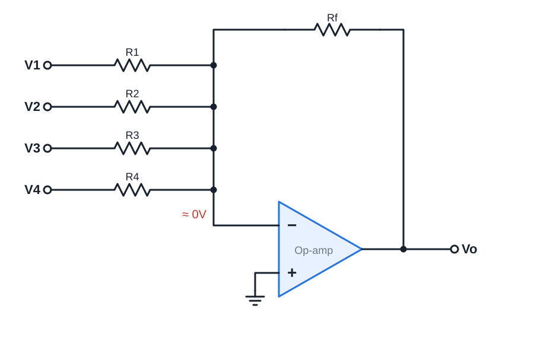
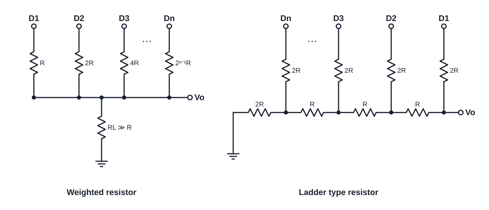
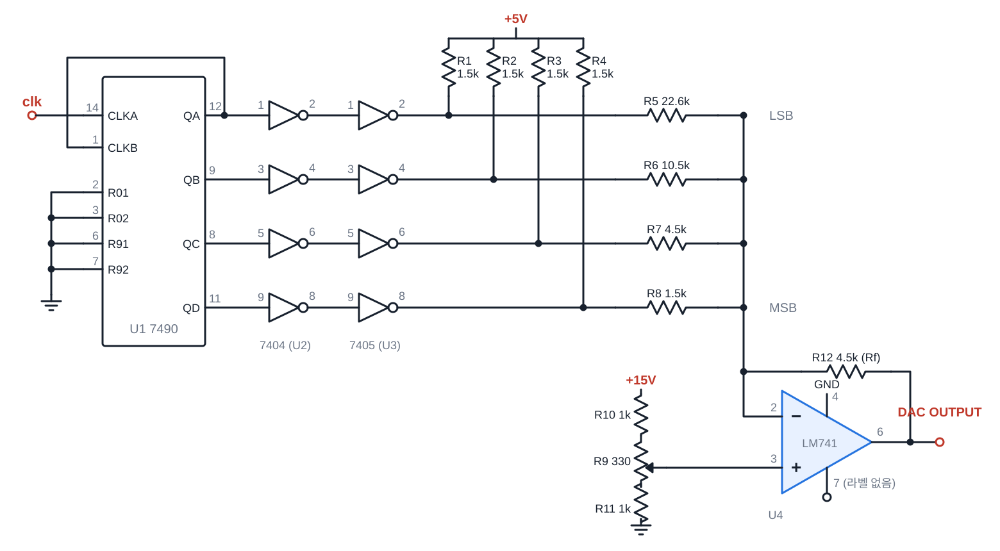
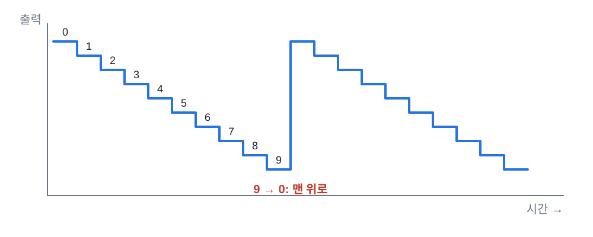

# 실험 10 · D/A & A/D Converter — 숫자를 전압으로, 전압을 숫자로 · 실험 설명

      
이번 학기 교안 기준

## 실험 이해

### 왜 이 회로를 쓰는지 먼저 알아봐요

디지털 숫자와 아날로그 전압을 서로 바꿔 줘야 해요
**DAC는 디지털 숫자를 전압으로, ADC는 전압을 디지털 숫자로 바꿔요.** 컴퓨터는 0과 1로 된 숫자만 다루는데, 소리·온도·빛 같은 바깥 세상의 신호는 끊김 없이 변하는 전압(아날로그)이에요.

마이크가 만든 소리 전압을 저장하려면 숫자로 바꾸는 ADC가, 저장한 숫자를 스피커로 들으려면 다시 전압으로 바꾸는 DAC가 필요해요(이해를 위한 예시). 교안은 DAC의 쓰임으로 디지털 데이터를 아날로그 오디오 신호로 바꾸는 일(TV, 휴대폰)을 들어요.

보충: 숫자는 복사·저장·전송해도 값이 흐려지지 않아요. 그래서 중간은 디지털로 다루고, 바깥 세상과 만나는 양 끝에서만 바꿔요.

4비트 숫자 하나를 전압으로, 전압 하나를 숫자로 바꿔 봐요
이해를 위한 예시로 한 칸(가장 낮은 비트, LSB)이 1V인 4비트 변환기를 생각해요.

| 순서 | 변환 | 입력 | 출력 | 왜 이 값인가요 |
| --- | --- | --- | --- | --- |
| ① | DAC | 0101 | 5V | 4 + 1 = 5칸 |
| ② | DAC | 1010 | 10V | 8 + 2 = 10칸 |
| **③** | **ADC** | **5.0V** | **0101** | **5칸에 해당해요** |
| **④** | **ADC** | **5.4V** | **0101** | **칸 사이 값은 아래 칸으로 잘라요(예시의 규칙)** |

색칠한 ③과 ④는 전압이 다른데 숫자가 같아요. 한 칸보다 작은 차이는 숫자로 남지 않아서, 비트 수가 많을수록 더 촘촘히 바꿀 수 있어요.

이번 실험은 카운터 숫자를 계단 전압으로 바꾸고, 비교기로 다시 읽어요
| 실험 | 칩 | 크기 | 확인할 것 |
| --- | --- | --- | --- |
| 실험 1) DAC | 7490, 74HC04, 74HC05, LM741 | 4비트 (0~9) | LED로 0~9 카운트, 출력의 계단 파형, 핀 개방·Rf·병렬 저항을 바꾼 파형 |
| 실험 2) ADC | 실험 1 회로 + LM741 비교기 | 4비트 | 기준 전압을 바꾸며 출력이 바뀌는 지점 기록 |

외울 규칙

- **해결하는 문제** → 컴퓨터의 디지털 숫자와 바깥 세상의 아날로그 전압을 서로 바꿔요
- **DAC** → 디지털 → 아날로그 (예: 저장한 소리를 스피커로)
- **ADC** → 아날로그 → 디지털 (예: 마이크 소리를 저장)
- **실험 1** → 7490 카운터 + LM741 반전 가산기 = 4비트 DAC, 계단 파형
- **실험 2** → 실험 1 출력 + 비교기 = ADC의 원리

이유

숫자는 흐려지지 않게 저장·전송할 수 있지만, 듣고 보는 신호는 연속된 전압이에요. 그래서 양 끝에서 바꿔 줘야 해요.

헷갈리지 마요

- 보고서 범위는 실험 1) DAC예요. 실험 2) ADC는 보고서에 쓰지 않지만 기출에는 나와요.
- 교안 표지는 25-1이에요.
- 표의 전압·코드는 이해를 위한 예시 값이에요. 실제 측정값이 아니에요.
- 한 칸보다 작은 전압 차이는 숫자로 남지 않아요.

이 개념으로 풀 문제: [DAC와 ADC의 역할과 쓰임](%EC%8B%A4%ED%97%9810_%EA%B8%B0%EC%B6%9C%ED%92%80%EC%9D%B4.md#q-converter-roles)

출처: [강의노트/실험10. DAC & ADC.pdf · PDF p2](../../../%EA%B0%95%EC%9D%98%EB%85%B8%ED%8A%B8/%EC%8B%A4%ED%97%9810.%20DAC%20%26%20ADC.pdf#page=2) · [강의노트/실험10. DAC & ADC.pdf · PDF p7](../../../%EA%B0%95%EC%9D%98%EB%85%B8%ED%8A%B8/%EC%8B%A4%ED%97%9810.%20DAC%20%26%20ADC.pdf#page=7) · [강의노트/실험10. DAC & ADC.pdf · PDF p13](../../../%EA%B0%95%EC%9D%98%EB%85%B8%ED%8A%B8/%EC%8B%A4%ED%97%9810.%20DAC%20%26%20ADC.pdf#page=13) · [강의노트/공지사항/2026-09-14_\[필독\]_논리회로실험_보고서_관련_공지.md](../../../%EA%B0%95%EC%9D%98%EB%85%B8%ED%8A%B8/%EA%B3%B5%EC%A7%80%EC%82%AC%ED%95%AD/2026-09-14_%5B%ED%95%84%EB%8F%85%5D_%EB%85%BC%EB%A6%AC%ED%9A%8C%EB%A1%9C%EC%8B%A4%ED%97%98_%EB%B3%B4%EA%B3%A0%EC%84%9C_%EA%B4%80%EB%A0%A8_%EA%B3%B5%EC%A7%80.md) · [보고서/실험10/체크리스트/명세.md](../../../%EB%B3%B4%EA%B3%A0%EC%84%9C/%EC%8B%A4%ED%97%9810/%EC%B2%B4%ED%81%AC%EB%A6%AC%EC%8A%A4%ED%8A%B8/%EB%AA%85%EC%84%B8.md)

교안 표지는 25-1이에요. 보고서 범위(실험 1) DAC)는 2026-09-14 공지(_350547_1)와 config.EXPERIMENT_SCOPE[10]에서 확인했어요(명세 근거와 범위). DAC 정의·쓰임은 p7, ADC 정의는 p13이에요. 디지털 저장·전송의 장점은 기출 제공 답안에 있는 일반 설명이라 보충으로 표시했어요. 4비트 예시 표는 이해를 위한 예시이고 check_values.py 가 다시 계산했어요.

### Op-Amp: 두 입력의 차이를 크게 키워요

피드백을 걸면 출력이 −(Rf/R1)배가 돼요
**반전 증폭기의 출력은 Vout = −(Rf/R1)·Vin이에요.** Op-Amp 자체는 두 입력의 차이를 수만~수백만 배로 키우지만, 출력 일부를 Rf로 반전 입력에 되돌리면 저항 두 개의 비가 증폭 정도를 정해요.

| 단자 | 이름 | 하는 일 |
| --- | --- | --- |
| V+ | 비반전 입력 (+) | 기준 쪽 입력이에요 |
| V− | 반전 입력 (−) | 신호가 들어가면 뒤집혀 나와요 |
| Vs+ · Vs− | 양·음의 전력 공급 | 출력이 넘을 수 없는 위·아래 한계예요 |
| Vout | 출력 | A(V+ − V−)를 내요 |

Vin이 R1을 지나 반전 입력(−)으로 들어가고, Rf가 출력을 같은 점으로 되돌려요(음의 피드백). 비반전 입력(+)은 GND예요.

음의 피드백이 두 입력 전압을 같게 맞춰요
$$V_{out} = A\,(V_+ - V_-)$$

A가 아주 커서, 출력이 공급 전압 안에 있으려면 V+ − V−가 거의 0이어야 해요. 그래서 V+를 GND에 두면 V−도 거의 0V가 돼요(보충: 가상 접지라고 불러요).

$$I = \frac{V_{in}}{R_1} = -\frac{V_{out}}{R_f} \;\Rightarrow\; V_{out} = -\frac{R_f}{R_1}V_{in}$$

Op-Amp 입력으로는 전류가 거의 들어가지 않아서, R1로 들어온 전류가 모두 Rf로 빠져나가요. 그래서 출력은 입력과 부호가 반대예요.

Rf가 바뀌면 같은 입력에도 출력 크기가 바뀌어요
이해를 위한 예시로 R1=1.5kΩ, 공급 ±15V인 이상 Op-Amp를 따라가요.

| 순서 | Vin | Rf | Vout | 왜 이 값인가요 |
| --- | --- | --- | --- | --- |
| **①** | **1V** | **4.5kΩ** | **−3V** | **이득 −4.5/1.5 = −3** |
| ② | 2V | 4.5kΩ | −6V | 입력이 2배라 출력도 2배 |
| **③** | **1V** | **2.7kΩ** | **−1.8V** | **이득 −2.7/1.5 = −1.8** |
| ④ | 6V | 4.5kΩ | −15V 근처에 붙어요 | 식은 −18V지만 공급 −15V를 넘지 못해요 |

색칠한 ①과 ③은 입력이 같고 Rf만 달라요. 출력 크기는 Rf에 비례해요.

출력은 공급 전압을 넘지 못해요
식이 주는 값이 공급 범위를 넘으면 출력은 한계 근처에 붙어요(포화). 그때는 Rf/R1 비례가 성립하지 않아요. 실제 LM741은 한계보다 조금 안쪽에서 멈춰요(보충).

한 단계만 풀어 봐요
R1=1kΩ, Rf=4.5kΩ인 반전 증폭기에 Vin=0.5V를 넣으면 Vout은 얼마일까요?

#### 힌트

이득 −Rf/R1부터 구해요.

#### 연습 답

−2.25V예요. 이득이 −4.5라 0.5V × (−4.5)예요.

외울 규칙

- **Op-Amp 출력** → A(V+ − V−), A는 수만~수백만
- **반전 증폭기** → Vout = −(Rf/R1)·Vin
- **음의 피드백** → V− ≈ V+ (V+=GND면 V− ≈ 0V)
- **식의 값이 공급 범위를 넘으면** → 한계 근처에 붙어요 (포화)

이유

R1로 들어온 전류가 Op-Amp 입력으로 새지 않고 모두 Rf로 빠져서 Vin/R1 = −Vout/Rf가 돼요.

헷갈리지 마요

- 반전 증폭기의 출력은 입력과 부호가 반대예요.
- 가상 접지·LM741 출력 한계는 교안 밖 보충이에요.
- 표의 값은 이상 Op-Amp로 셈한 예시예요.

이 개념으로 풀 문제: [Rf를 두 배로](%EC%8B%A4%ED%97%9810_%EA%B8%B0%EC%B6%9C%ED%92%80%EC%9D%B4.md#q-qp-e10-tf-02) · [반전 증폭기의 이득](%EC%8B%A4%ED%97%9810_%EA%B8%B0%EC%B6%9C%ED%92%80%EC%9D%B4.md#q-qp-e10-blank-02)

출처: [강의노트/실험10. DAC & ADC.pdf · PDF p3](../../../%EA%B0%95%EC%9D%98%EB%85%B8%ED%8A%B8/%EC%8B%A4%ED%97%9810.%20DAC%20%26%20ADC.pdf#page=3) · [강의노트/실험10. DAC & ADC.pdf · PDF p4](../../../%EA%B0%95%EC%9D%98%EB%85%B8%ED%8A%B8/%EC%8B%A4%ED%97%9810.%20DAC%20%26%20ADC.pdf#page=4)

p3 정의(Vout = A(V+−V−), A는 수만~수백만), p4 반전 증폭기 식과 그림을 옮겼어요. 가상 접지 용어와 LM741 출력 한계는 교안 밖 보충이에요. 추적표 값은 check_values.py 가 다시 계산했어요.

### 반전 가산증폭기: 여러 입력을 무게를 달아 더해요

Vout = −Rf(V1/R1 + V2/R2 + …)예요
**입력마다 들어오는 전류가 한 점에서 더해지고, 그 합이 Rf를 지나 출력 전압이 돼요.** 가지 저항이 작은 입력일수록 같은 전압에서 전류가 커서 무게가 커요.

V1~V4가 각자의 가지 저항 R1~R4를 지나 반전 입력(−)의 한 점에서 만나요. Rf가 출력을 그 점으로 되돌리고, 비반전 입력(+)은 GND예요.

가지 전류의 합이 모두 Rf로 빠져나가요
$$V_{out} = -\left(\frac{R_f}{R_1}V_1 + \frac{R_f}{R_2}V_2 + \frac{R_f}{R_3}V_3 + \frac{R_f}{R_4}V_4\right)$$

V−가 0V에 붙어 있어서 가지 하나의 전류는 Vi/Ri예요. 다른 가지의 전압이 이 전류를 바꾸지 않아서, 입력끼리 서로 방해하지 않고 더해져요.

가지 저항을 8:4:2:1로 고르면 출력이 이진수 값에 비례해요
이해를 위한 예시로 가지 저항을 24kΩ(QA, LSB)·12kΩ(QB)·6kΩ(QC)·3kΩ(QD, MSB), Rf=4.5kΩ, High=5V, 양전원 이상 Op-Amp로 둬요. 가장 작은 무게 한 칸은 4.5k × 5V ÷ 24k = 0.9375V예요.

| 카운트 | QD QC QB QA | Vout | 왜 이 값인가요 |
| --- | --- | --- | --- |
| 1 | 0001 | −0.9375V | QA만 High: 한 칸 |
| 2 | 0010 | −1.875V | QB 가지 12k는 전류가 두 배 |
| **7** | **0111** | **−6.5625V** | **1 + 2 + 4 = 7칸** |
| **8** | **1000** | **−7.5V** | **QD 가지 3k 하나가 8칸** |
| 9 | 1001 | −8.4375V | 8 + 1 = 9칸 |

색칠한 7과 8은 켜진 가지가 3개와 1개인데 8의 출력 크기가 더 커요. 비트마다 무게가 다르기 때문이에요.

식의 R1~R4는 회로도의 R1~R4(풀업)와 다른 저항이에요
교안 p11 식의 R1~R4는 각 비트가 가산 노드로 들어가는 가지 저항이에요. 같은 쪽 회로도의 R1~R4는 1.5kΩ 풀업이라 이름만 같아요.

출력은 음수예요. 교안 회로처럼 음전원 핀(4번)이 GND이면 이 음수를 낼 수 없어요. 그래서 실험 회로는 V+를 올려요(DAC 회로 토픽).

한 단계만 풀어 봐요
위 예시에서 카운트 5(0101)의 Vout은 얼마일까요?

#### 힌트

켜진 비트의 무게를 더하고 한 칸 0.9375V를 곱해요.

#### 연습 답

−4.6875V예요. 4 + 1 = 5칸이에요.

외울 규칙

- **반전 가산증폭기** → Vout = −Rf(V1/R1 + V2/R2 + V3/R3 + V4/R4)
- **가지 저항이 작을수록** → 무게가 커요 (전류 Vi/Ri)
- **가지 저항 8:4:2:1** → 출력 ∝ 이진수 값
- **Rf를 키우면** → 출력 크기가 Rf에 비례해 커져요

이유

V−가 0V에 붙어 있어 가지 전류가 서로 영향을 주지 않고, 그 합이 모두 Rf로 빠지니 출력이 합에 비례해요.

헷갈리지 마요

- 식의 R1~R4(가지 저항)와 회로도의 R1~R4(1.5kΩ 풀업)는 다른 저항이에요.
- 반전이라 출력은 음수예요.
- 표의 24k·12k·6k·3k는 이해를 위한 예시 값이에요.

이 개념으로 풀 문제: [반전 가산증폭기의 Vo](%EC%8B%A4%ED%97%9810_%EA%B8%B0%EC%B6%9C%ED%92%80%EC%9D%B4.md#q-summing-amp) · [가산증폭기의 Vo와 역할](%EC%8B%A4%ED%97%9810_%EA%B8%B0%EC%B6%9C%ED%92%80%EC%9D%B4.md#q-opamp-online)

출처: [강의노트/실험10. DAC & ADC.pdf · PDF p11](../../../%EA%B0%95%EC%9D%98%EB%85%B8%ED%8A%B8/%EC%8B%A4%ED%97%9810.%20DAC%20%26%20ADC.pdf#page=11) · [강의노트/실험10. DAC & ADC.pdf · PDF p4](../../../%EA%B0%95%EC%9D%98%EB%85%B8%ED%8A%B8/%EC%8B%A4%ED%97%9810.%20DAC%20%26%20ADC.pdf#page=4) · [보고서/실험10/체크리스트/명세.md](../../../%EB%B3%B4%EA%B3%A0%EC%84%9C/%EC%8B%A4%ED%97%9810/%EC%B2%B4%ED%81%AC%EB%A6%AC%EC%8A%A4%ED%8A%B8/%EB%AA%85%EC%84%B8.md)

p11 반전 가산증폭기 식을 옮겼어요. 식의 R1~R4와 회로도 R1~R4(1.5k 풀업)의 이름 겹침은 명세 토큰 표의 판독을 따랐어요. 24k·12k·6k·3k 예시는 이해를 위한 값이고 check_values.py 가 다시 계산했어요.

### Register Network: 가중 저항과 래더 저항

가중 저항은 간단하고, 래더는 R과 2R만 써서 정밀해요
**두 회로 모두 비트마다 2배씩 다른 무게를 줘요.** 가중 저항(Weighted)은 비트마다 R, 2R, 4R…처럼 다른 저항을 달고, 래더(Ladder, R-2R)는 R과 2R 두 값만 사다리처럼 이어요.

교안의 Register는 저항(resistor)을 뜻해요. 교안 그림과 식에서 D1이 가장 무거운 비트(MSB)예요.

왼쪽은 가중 저항(D1~Dn에 R·2R·4R·2ⁿ⁻¹R, 부하 RL ≫ R), 오른쪽은 래더(각 비트 2R, 사이사이 R, 끝 2R 접지)예요.

n비트일 때 분모가 2ⁿ−1과 2ⁿ으로 달라요
$$\text{가중: } V_o = V_R \times \frac{2^{n-1}D_1 + 2^{n-2}D_2 + \cdots + 2^0 D_n}{2^n - 1}$$

$$\text{래더: } V_o = V_R \times \frac{2^{n-1}D_1 + 2^{n-2}D_2 + \cdots + 2^0 D_n}{2^n}$$

이해를 위한 예시로 3비트(n=3), VR=8V를 넣어요.

| D1 D2 D3 | 가중 저항 Vo | 래더 Vo | 왜 이 값인가요 |
| --- | --- | --- | --- |
| **001** | **8/7 ≈ 1.14V** | **1V** | **분자 1** |
| 100 | 32/7 ≈ 4.57V | 4V | D1의 무게가 4 |
| **111** | **8V** | **7V** | **분자 7: 가중은 VR까지, 래더는 한 칸 아래까지** |

색칠한 001과 111을 보면 가중 저항의 가장 큰 값은 VR과 같고, 래더는 VR보다 한 칸(VR/8) 낮아요.

저항값이 넓게 퍼지면 정밀도와 속도가 떨어져요 (보충)
| 방식 | 저항 값 | 좋은 점 | 아쉬운 점 |
| --- | --- | --- | --- |
| 가중 저항 | R, 2R, 4R, …, 2ⁿ⁻¹R (n개) | 구조가 간단하고 저항 수가 적어요 | 비트가 늘면 저항값 범위가 넓어져 정밀하게 맞추기 어렵고, 큰 저항은 온도 변화·스위칭 속도에 불리해요 |
| 래더 (R-2R) | R과 2R 두 값 | 두 값만 정확히 맞추면 돼 정밀하고 빨라요. 요즘 DAC에 주로 써요 | 저항 수가 많고 연결이 조금 복잡해요 |

8비트라면 가중 저항은 R부터 128R까지 128배 범위가 필요해요. 래더는 비트가 늘어도 R과 2R뿐이에요.

이번 실험 DAC는 가중 저항 방식이에요
교안 회로는 비트마다 22.6k·10.5k·4.5k·1.5k를 달아 2⁰~2³의 비중을 줘요. 래더는 이론으로만 다뤄요.

가중 저항 그림의 RL ≫ R은 출력을 읽는 부하가 커서 회로 전압을 거의 바꾸지 않는다는 조건이에요. 이 조건에서만 위 식이 성립해요.

한 단계만 풀어 봐요
4비트 가중 저항에서 가장 작은 저항이 1kΩ이면 가장 큰 저항은 얼마일까요?

#### 힌트

가장 큰 저항은 2ⁿ⁻¹R이에요.

#### 연습 답

8kΩ이에요. 2³ × 1kΩ이에요.

외울 규칙

- **가중 저항** → R, 2R, 4R … 2ⁿ⁻¹R, Vo = V_R·(가중합)/(2ⁿ−1)
- **래더 (R-2R)** → R과 2R만, Vo = V_R·(가중합)/2ⁿ
- **가중 저항의 장단점** → 간단 / 저항값 범위가 넓어 정밀도·속도에 불리
- **래더의 장단점** → 정밀·고속 / 저항 수가 많고 복잡

이유

저항값이 넓게 퍼지면 모든 값을 같은 비율의 오차로 맞추기 어렵지만, 두 값만 쓰면 정밀하게 맞추기 쉬워요.

헷갈리지 마요

- 교안 그림에서 D1이 MSB예요.
- 가중 저항 식은 RL ≫ R일 때예요.
- 장단점(온도·속도)은 교안 본문 밖 보충이에요.
- 이번 실험 회로는 가중 저항 방식이에요.

이 개념으로 풀 문제: [가중 저항과 래더 저항의 장단점](%EC%8B%A4%ED%97%9810_%EA%B8%B0%EC%B6%9C%ED%92%80%EC%9D%B4.md#q-resistor-network) · [R-2R 래더와 가중 저항](%EC%8B%A4%ED%97%9810_%EA%B8%B0%EC%B6%9C%ED%92%80%EC%9D%B4.md#q-qp-e10-blank-03)

출처: [강의노트/실험10. DAC & ADC.pdf · PDF p6](../../../%EA%B0%95%EC%9D%98%EB%85%B8%ED%8A%B8/%EC%8B%A4%ED%97%9810.%20DAC%20%26%20ADC.pdf#page=6)

p6 그림과 두 식을 300dpi로 다시 읽어 직접 다시 그렸어요(D1이 MSB, 가중 저항 RL ≫ R, 래더 끝 2R 접지). 장단점은 교안 본문에 없고 기출 제공 답안과 일반 지식에서 가져온 보충이에요. 3비트 예시 값은 check_values.py 가 두 식과 저항망 노드 해석(가중: 밀만, 래더: 회로 해석)으로 다시 계산했어요.

### 7490: 클럭을 세어 0~9를 BCD로 내요

QD QC QB QA는 지금까지 센 클럭 수예요
**7490은 클럭 펄스를 0부터 9까지 세고 다시 0으로 돌아가는 카운터예요.** 출력 QA, QB, QC, QD는 각각 1, 2, 4, 8의 무게를 가진 BCD 코드라, 네 출력을 무게대로 더하면 센 수가 돼요.

| 핀 | 이름 | 하는 일 |
| --- | --- | --- |
| 14 | CLKA | 클럭이 들어가요 |
| 12 → 1 | QA → CLKB | QA를 둘째 단에 넣어 0~9로 세요 |
| 2 · 3 | R01 · R02 | 둘 다 1이면 0으로 (이 회로에서는 GND) |
| 6 · 7 | R91 · R92 | 둘 다 1이면 9로 (이 회로에서는 GND) |
| 12, 9, 8, 11 | QA, QB, QC, QD | 무게 1, 2, 4, 8 |
| 5 · 10 | VCC · GND | 전원 (74HC 칩의 14·7번과 달라요) |

9 다음에는 10이 아니라 0이에요
| 클럭 | QD QC QB QA | 십진수 | 왜 이 값인가요 |
| --- | --- | --- | --- |
| 0 | 0000 | 0 | 네 LED가 모두 꺼진 구간을 0으로 잡아요 |
| 1 | 0001 | 1 | QA만 1 |
| 2 | 0010 | 2 | QA가 1→0으로 떨어지며 QB가 1 |
| 3 | 0011 | 3 | 2 + 1 |
| 4 | 0100 | 4 | QC만 1 |
| 5 | 0101 | 5 | 4 + 1 |
| 6 | 0110 | 6 | 4 + 2 |
| 7 | 0111 | 7 | 4 + 2 + 1 |
| 8 | 1000 | 8 | QD만 1 |
| **9** | **1001** | **9** | **8 + 1** |
| **10번째** | **0000** | **0** | **1001 다음은 1010이 아니라 0000이에요** |

색칠한 두 행처럼 1001 다음은 1010이 아니라 0000이에요. 그래서 출력은 늘 0~9 범위의 BCD예요.

QA를 CLKB에 이어야 2진 단과 5진 단이 하나로 이어져요 (보충)
7490 안에는 2로 나누는 단(QA)과 5로 나누는 단(QB·QC·QD)이 따로 있어요. QA를 CLKB에 이으면 QA가 1에서 0으로 떨어질 때마다 둘째 단이 하나씩 세서 모두 2 × 5 = 10가지 상태를 돌아요. 이 구조는 칩 자료에서 가져온 보충이에요.

초기화 입력을 모두 GND에 두어 시작 값은 정해지지 않아요
R01·R02·R91·R92가 모두 GND라 회로에는 0으로 맞추는 입력이 없어요. 전원 직후 어느 수부터 셀지는 정해지지 않으니, 네 LED가 모두 꺼진 구간을 0으로 잡고 순서를 봐요(예상).

7490의 전원은 5번 VCC, 10번 GND예요. 74HC04·74HC05의 14·7번과 헷갈리지 않아요.

한 단계만 풀어 봐요
지금 QD QC QB QA = 0110이에요. 클럭이 두 번 더 들어오면 출력은 얼마일까요?

#### 힌트

0110을 십진수로 바꾸고 2를 더해요.

#### 연습 답

1000이에요. 6 + 2 = 8이에요.

외울 규칙

- **7490** → 클럭을 0~9로 세는 BCD 카운터
- **QA · QB · QC · QD** → 무게 2⁰ · 2¹ · 2² · 2³ (QA=LSB, QD=MSB)
- **1001 다음** → 0000 (10이 아니라 0)
- **QA → CLKB 연결** → 2진 단 + 5진 단 = 10가지 상태
- **R0 · R9를 GND에** → 초기화 없이 계속 세요

이유

둘째 단(5진)이 QA가 떨어질 때마다 하나씩 세어, 2 × 5 = 10가지 상태를 차례로 돌아요.

헷갈리지 마요

- 7490 전원은 5번 VCC, 10번 GND예요.
- 전원 직후 시작 값은 정해지지 않아요(예상).
- 2진·5진 단 구조는 칩 자료에서 가져온 보충이에요.
- 기출 문항은 74HC90이라 적었지만 교안 회로도는 7490이에요.

이 개념으로 풀 문제: [7490(74HC90)의 기능과 출력](%EC%8B%A4%ED%97%9810_%EA%B8%B0%EC%B6%9C%ED%92%80%EC%9D%B4.md#q-counter-7490) · [7490 출력의 무게](%EC%8B%A4%ED%97%9810_%EA%B8%B0%EC%B6%9C%ED%92%80%EC%9D%B4.md#q-qp-e10-blank-01) · [7490을 0~9 카운터로 작도해요](%EC%8B%A4%ED%97%9810_%EA%B8%B0%EC%B6%9C%ED%92%80%EC%9D%B4.md#q-qp-e10-board-01)

출처: [강의노트/실험10. DAC & ADC.pdf · PDF p8](../../../%EA%B0%95%EC%9D%98%EB%85%B8%ED%8A%B8/%EC%8B%A4%ED%97%9810.%20DAC%20%26%20ADC.pdf#page=8) · [강의노트/실험10. DAC & ADC.pdf · PDF p15](../../../%EA%B0%95%EC%9D%98%EB%85%B8%ED%8A%B8/%EC%8B%A4%ED%97%9810.%20DAC%20%26%20ADC.pdf#page=15) · [보고서/실험10/결선도/netlist.md](../../../%EB%B3%B4%EA%B3%A0%EC%84%9C/%EC%8B%A4%ED%97%9810/%EA%B2%B0%EC%84%A0%EB%8F%84/netlist.md)

p8 카운트 순서(0000~1001 반복), p10 LSB·MSB 표시, p8·p15·p16 회로도 핀(CLKA 14, CLKB 1, R01 2, R02 3, R91 6, R92 7, QA 12, QB 9, QC 8, QD 11)을 따랐어요. 전원 5·10번은 netlist 핀아웃 출처(TI SDLS940A, 실험08 기록 경유)예요. 2진·5진 단 구조는 칩 자료에서 가져온 보충이에요. 초기화 입력이 없어 시작 값이 정해지지 않는다는 판단은 명세를 따랐어요.

### 7404 + 7405: 비트 전압을 정확히 0V 또는 5V로 맞춰요

두 번 뒤집어 논리값은 그대로이고, 1일 때는 풀업이 5V로 맞춰요
**7405는 0일 때만 출력을 GND로 당기고, 1일 때는 출력을 놓아 버려요(오픈 컬렉터).** 그래서 1.5kΩ 풀업 저항이 출력을 +5V로 끌어올려요. 7405가 값을 뒤집으니 앞에 7404를 하나 더 두어 원래 값으로 돌려놓아요.

한 비트의 길: 7490 출력 → 7404 → 7405 → 가중 저항. 7405 출력과 +5V 사이에 1.5kΩ 풀업이 있어요.

카운터 출력이 1이면 가중 저항 앞은 5V, 0이면 0V예요
| Q (7490) | 7404 출력 | 7405 출력 | 가중 저항 앞 | 왜 이 값인가요 |
| --- | --- | --- | --- | --- |
| **0** | **1** | **당김** | **0V** | **7405 입력 1 → 출력을 GND로 당겨요** |
| **1** | **0** | **놓음** | **+5V (풀업)** | **7405 입력 0 → 출력을 놓아 풀업이 5V로 끌어올려요** |

색칠한 두 행은 Q만 다르고, 가중 저항 앞 전압이 0V와 5V로 깔끔하게 갈려요.

풀업과 가중 저항을 더하면 경로 저항이 거의 8:4:2:1이에요
교안은 “출력을 정확히 GND 또는 Vcc로 만들기 위해” 오픈 컬렉터 7405와 풀업을 쓴다고 적어요. 가중 저항 DAC는 비트 전압이 모두 같아야 무게 비가 맞아요. 보충: TTL 칩의 1 출력은 보통 5V보다 낮고 칩마다 달라서, 같은 +5V 풀업으로 맞추는 편이 정확해요.

| 비트 | 풀업 + 가중 저항 | 경로 저항 | 비 |
| --- | --- | --- | --- |
| QA (LSB) | 1.5k + 22.6k | 24.1kΩ | ≈ 8 |
| QB | 1.5k + 10.5k | 12kΩ | 4 |
| QC | 1.5k + 4.5k | 6kΩ | 2 |
| QD (MSB) | 1.5k + 1.5k | 3kΩ | 1 |

High인 비트의 전류는 +5V에서 풀업과 가중 저항을 함께 지나 가산 노드로 가요. 경로 저항이 작을수록 전류가 커서, QD가 QA의 약 8배 무게를 가져요. 이 합은 V+=GND일 때의 이상 셈이에요. 교안도 “비율은 약간의 오차가 있어도 됨”이라고 적어요.

7405 출력에 풀업이 없으면 1이 만들어지지 않아요
7405는 1을 스스로 내지 못해서, 풀업을 빼먹으면 1이어야 할 때 출력이 떠요.

회로도 표기는 7404·7405, 준비물은 74HC04·74HC05예요. 핀 번호는 같아요. 74HC05는 같은 구조를 오픈 드레인이라고 불러요(보충).

한 단계만 풀어 봐요
7404를 빼고 7490의 QA를 바로 7405에 넣었어요. QA=1일 때 QA 가중 저항 앞 전압은 얼마일까요?

#### 힌트

7405 입력이 1이면 출력은 어떻게 되나요?

#### 연습 답

0V예요. 7405가 1을 뒤집어 GND로 당겨요. 모든 비트가 뒤집혀 들어가요.

외울 규칙

- **7405 입력 1** → 출력을 GND로 당겨 0V
- **7405 입력 0** → 출력을 놓아요 → 풀업이 +5V
- **7404 + 7405** → 두 번 뒤집어 논리값 그대로
- **풀업 + 가중 저항** → 24.1k : 12k : 6k : 3k ≈ 8 : 4 : 2 : 1

이유

오픈 컬렉터는 0만 직접 내고 1은 같은 +5V 풀업이 만들어서, 모든 비트의 High 전압이 같아져요.

헷갈리지 마요

- 7405 하나만 쓰면 값이 뒤집혀요. 그래서 7404를 앞에 둬요.
- TTL 1 출력 전압 설명은 교안 밖 보충이에요.
- 경로 저항 합은 V+=GND일 때의 이상 셈이에요.
- 회로도 7404·7405와 준비물 74HC04·74HC05 표기가 달라요. 핀 번호는 같아요.

이 개념으로 풀 문제: [7404 + 7405의 논리값](%EC%8B%A4%ED%97%9810_%EA%B8%B0%EC%B6%9C%ED%92%80%EC%9D%B4.md#q-qp-e10-tf-04)

출처: [강의노트/실험10. DAC & ADC.pdf · PDF p9](../../../%EA%B0%95%EC%9D%98%EB%85%B8%ED%8A%B8/%EC%8B%A4%ED%97%9810.%20DAC%20%26%20ADC.pdf#page=9) · [강의노트/실험10. DAC & ADC.pdf · PDF p10](../../../%EA%B0%95%EC%9D%98%EB%85%B8%ED%8A%B8/%EC%8B%A4%ED%97%9810.%20DAC%20%26%20ADC.pdf#page=10) · [보고서/실험10/결선도/netlist.md](../../../%EB%B3%B4%EA%B3%A0%EC%84%9C/%EC%8B%A4%ED%97%9810/%EA%B2%B0%EC%84%A0%EB%8F%84/netlist.md) · [보고서/실험10/체크리스트/명세.md](../../../%EB%B3%B4%EA%B3%A0%EC%84%9C/%EC%8B%A4%ED%97%9810/%EC%B2%B4%ED%81%AC%EB%A6%AC%EC%8A%A4%ED%8A%B8/%EB%AA%85%EC%84%B8.md)

p9 문장(정확히 GND 또는 Vcc, Open-collector IC 05와 Pull up 저항, IC 04로 반전 피하기)과 p10 회로 값을 따랐어요. 경로 저항 합(24.1k·12k·6k·3k)은 명세에 있는 V+=GND일 때의 이상 셈이에요. TTL High 전압 설명은 보충이에요. 74HC05가 open-drain이라는 것은 netlist 핀아웃 출처(TI SCLS080F 2026-11-16 확인)예요.

### DAC 회로 전체: 카운트가 오르면 출력은 계단으로 내려가요

카운트가 1 오를 때마다 출력이 한 단씩 내려가요
**7490이 센 수가 비트 전압이 되고, 가중 저항이 무게를 달고, LM741 반전 가산기가 무게 합을 뒤집힌 전압으로 내요.** 그래서 0부터 9까지 셀 때 출력은 내림차순 계단이 되고, 9 다음 0에서 맨 위로 돌아가요.

| 단계 | 부품 | 하는 일 |
| --- | --- | --- |
| ① | 7490 | 클럭을 0~9로 세요 |
| ② | 7404 → 7405 + 1.5kΩ 풀업 | 비트를 정확한 0V · 5V로 맞춰요 |
| ③ | 22.6k · 10.5k · 4.5k · 1.5k | 2⁰~2³의 무게를 줘요 |
| ④ | LM741 + Rf (R12 4.5kΩ) | 가지 전류를 더해 전압으로 바꿔요 (반전) |
| ⑤ | +15V – 1k – 330Ω(가변) – 1k | V+를 0V보다 높게 올려요 |

교안 회로의 신호 흐름을 줄여 그렸어요. 핀 번호와 소자값은 교안 회로도 그대로예요.

V+를 GND에 두면 출력이 0V 아래로 내려갈 곳이 없어요
교안 회로의 LM741은 4번이 GND예요. 반전 가산기 식은 0 이하의 값을 주는데, 음전원이 GND라 출력은 0V 아래로 내려가지 못해요. 그래서 V+=GND(절차 2)에서는 계단 대신 바닥에 붙은 평평한 선을 예상해요(예상). 교안 p12도 “DAC Output이 음의 값(0V 이하)을 갖지 않도록” 전압 분배기를 둔다고 적어요.

전압 분배기로 V+를 올리면 가산 노드도 그 전압을 따라 올라가요. 그러면 출력은 V+보다 높은 쪽에서 움직이고, High인 가지가 무거울수록 내려가요.

$$V_{out} = V_+ + R_f \sum_i \frac{V_+ - V_i}{R_i}$$

보충(이상 Op-Amp 셈): Vi는 비트 가지 전압, Ri는 가지 저항이에요. V+=0이면 앞의 반전 가산기 식과 같아져요.

9에서 0으로 넘어갈 때만 크게 올라가요
| 클럭 | QD QC QB QA | 무게 합 | 출력 | 왜 이 값인가요 |
| --- | --- | --- | --- | --- |
| 0 | 0000 | 0 | 가장 높음 | 켜진 가지가 없어 가장 위예요 |
| 1 | 0001 | 1 | 한 단 아래 | QA 가지(무게 1)가 켜져요 |
| 2 | 0010 | 2 | 두 단 아래 | QA는 꺼지고 QB(무게 2)가 켜져요 |
| 3 | 0011 | 3 | 세 단 아래 | 1 + 2 |
| 4 | 0100 | 4 | 네 단 아래 | QC(무게 4) 하나 |
| 5 | 0101 | 5 | 다섯 단 아래 | 4 + 1 |
| 6 | 0110 | 6 | 여섯 단 아래 | 4 + 2 |
| 7 | 0111 | 7 | 일곱 단 아래 | 4 + 2 + 1 |
| 8 | 1000 | 8 | 여덟 단 아래 | QD(무게 8) 하나 |
| **9** | **1001** | **9** | **가장 낮음** | **8 + 1** |
| **다음** | **0000** | **0** | **가장 높음** | **9 다음은 0이라 아홉 단을 한 번에 올라가요** |

색칠한 두 행 사이에서만 출력이 크게 뛰어요. 10단 계단이 한 주기이고, 1.0kHz 클럭이면 한 단 1ms, 한 주기 10ms예요(셈).

이해를 위한 그림: 카운트 0~9 동안 한 단씩 내려가고 9 다음 0에서 맨 위로 돌아가요. 세로 눈금 숫자는 없어요.

각 단의 전압 값은 교안에 없어요. 교안 소자값으로 이상 셈을 하면 출력이 +15V를 넘어 사진과 맞지 않아서, 이 노트는 숫자를 정하지 않고 실측으로 확인해요.

Rf·가지 저항·연결을 바꾸면 계단 모양이 이렇게 바뀌어요
| 절차 | 바꾸는 것 | 예상 | 왜 그런가요 |
| --- | --- | --- | --- |
| 4 | 7404 출력과 7405 입력 사이를 열어요 (QA·QB·QC 자리, 한 번에 하나) | 개형을 정하지 않아요 | 7405 입력이 떠서 그 비트 값이 정해지지 않아요 |
| **5** | **Rf를 4.5kΩ → 2.7kΩ** | **단 높이가 0.6배** | **한 단 = 가지 전류 변화 × Rf** |
| **6** | **10.5kΩ(QB 가지)에 68kΩ 병렬** | **QB가 바뀌는 단의 높이가 달라져요** | **10.5k ∥ 68k ≈ 9.1k라 QB 무게가 커져요** |

색칠한 5와 6은 둘 다 저항을 바꾸지만, 5는 모든 단을 같은 비율로, 6은 QB가 바뀌는 단(1→2, 3→4, 5→6, 7→8)만 바꿔요. 이 예상은 출력이 공급 전압 안에 있을 때만 맞아요(이상 셈).

절차의 V+는 3번 핀이에요. 교안 핀 그림의 V+(7번)와 달라요
절차 문장의 “Op-Amp V+”는 비반전 입력 3번 핀이에요. p16·p17의 LM741 핀 그림은 같은 글자 V+를 7번(양전원)에 붙여요. 회로도는 U4의 7번에 전원 이름을 적지 않았으니 실험 전에 확인해요.

절차 4~6은 서로 따로 해요. 연 선은 다시 잇고, Rf는 4.5kΩ으로 되돌린 뒤 다음 절차로 가요(이 노트의 순서, 교안에는 없어요).

한 단계만 풀어 봐요
Rf=4.5kΩ일 때 한 단이 0.5V였다고 해요(예시 값). Rf를 2.7kΩ으로 바꾸면 한 단은 얼마일까요?

#### 힌트

한 단은 Rf에 비례해요.

#### 연습 답

0.3V예요. 0.5V × 2.7/4.5 = 0.3V예요.

외울 규칙

- **카운트 0 → 9** → 출력이 한 단씩 내려가요 (내림차순 계단, 10단)
- **9 → 0** → 출력이 맨 위로 돌아가요
- **V+=GND** → 음전원이 GND라 0V 아래로 못 가요 (예상: 평평한 선)
- **V+=전압 분배기** → 출력이 0V 위에서 계단으로 움직여요
- **Rf 4.5k → 2.7k** → 단 높이 0.6배
- **QB 가지에 68k 병렬** → QB 무게가 커져 단 높이가 고르지 않아요

이유

High인 가지의 무게 합이 클수록 Rf로 흐르는 전류가 바뀌어 반전 출력이 내려가요.

헷갈리지 마요

- 절차의 V+는 3번 핀(비반전 입력)이에요. 핀 그림의 V+(7번)와 달라요.
- U4 7번의 전원 라벨은 회로도에 없어요.
- 각 단의 전압 숫자는 정하지 않았어요. 교안 소자값의 이상 셈은 사진과 맞지 않아요(미확정).
- p18 두 사진이 어느 절차인지 교안이 밝히지 않아요.
- 핀을 연 비트의 출력은 정해지지 않아요.

이 개념으로 풀 문제: [DAC 회로의 동작 원리](%EC%8B%A4%ED%97%9810_%EA%B8%B0%EC%B6%9C%ED%92%80%EC%9D%B4.md#q-dac-operation) · [Rf와 DAC 출력 크기](%EC%8B%A4%ED%97%9810_%EA%B8%B0%EC%B6%9C%ED%92%80%EC%9D%B4.md#q-rf-output) · [V+에 전압 분배기를 잇는 이유](%EC%8B%A4%ED%97%9810_%EA%B8%B0%EC%B6%9C%ED%92%80%EC%9D%B4.md#q-qp-e10-short-01)

출처: [강의노트/실험10. DAC & ADC.pdf · PDF p10](../../../%EA%B0%95%EC%9D%98%EB%85%B8%ED%8A%B8/%EC%8B%A4%ED%97%9810.%20DAC%20%26%20ADC.pdf#page=10) · [강의노트/실험10. DAC & ADC.pdf · PDF p11](../../../%EA%B0%95%EC%9D%98%EB%85%B8%ED%8A%B8/%EC%8B%A4%ED%97%9810.%20DAC%20%26%20ADC.pdf#page=11) · [강의노트/실험10. DAC & ADC.pdf · PDF p12](../../../%EA%B0%95%EC%9D%98%EB%85%B8%ED%8A%B8/%EC%8B%A4%ED%97%9810.%20DAC%20%26%20ADC.pdf#page=12) · [강의노트/실험10. DAC & ADC.pdf · PDF p16](../../../%EA%B0%95%EC%9D%98%EB%85%B8%ED%8A%B8/%EC%8B%A4%ED%97%9810.%20DAC%20%26%20ADC.pdf#page=16) · [강의노트/실험10. DAC & ADC.pdf · PDF p17](../../../%EA%B0%95%EC%9D%98%EB%85%B8%ED%8A%B8/%EC%8B%A4%ED%97%9810.%20DAC%20%26%20ADC.pdf#page=17) · [강의노트/실험10. DAC & ADC.pdf · PDF p18](../../../%EA%B0%95%EC%9D%98%EB%85%B8%ED%8A%B8/%EC%8B%A4%ED%97%9810.%20DAC%20%26%20ADC.pdf#page=18) · [강의노트/실험10. DAC & ADC.pdf · PDF p19](../../../%EA%B0%95%EC%9D%98%EB%85%B8%ED%8A%B8/%EC%8B%A4%ED%97%9810.%20DAC%20%26%20ADC.pdf#page=19) · [강의노트/실험10. DAC & ADC.pdf · PDF p20](../../../%EA%B0%95%EC%9D%98%EB%85%B8%ED%8A%B8/%EC%8B%A4%ED%97%9810.%20DAC%20%26%20ADC.pdf#page=20) · [강의노트/실험10. DAC & ADC.pdf · PDF p21](../../../%EA%B0%95%EC%9D%98%EB%85%B8%ED%8A%B8/%EC%8B%A4%ED%97%9810.%20DAC%20%26%20ADC.pdf#page=21) · [보고서/실험10/결선도/netlist.md](../../../%EB%B3%B4%EA%B3%A0%EC%84%9C/%EC%8B%A4%ED%97%9810/%EA%B2%B0%EC%84%A0%EB%8F%84/netlist.md) · [보고서/실험10/체크리스트/명세.md](../../../%EB%B3%B4%EA%B3%A0%EC%84%9C/%EC%8B%A4%ED%97%9810/%EC%B2%B4%ED%81%AC%EB%A6%AC%EC%8A%A4%ED%8A%B8/%EB%AA%85%EC%84%B8.md)

p10~p12 회로, p16·p17 절차, p18 예상 결과(내림차순 계단), p19~p21 절차 4~6을 따랐어요. V+=GND에서 평평한 선 예상은 명세 T3의 판단이고, p18 두 사진의 절차 대응은 미확정이에요(netlist M13). 교안 소자값의 이상 셈이 +15V를 넘는 문제는 netlist M7, U4 7번 라벨 없음은 M3이에요(기출 예상문제 v3의 같은 회로 그림은 7번을 +15V로 적어 이 노트·명세의 +15V 연결과 맞아요), LM741 단일 전원 문제는 M11이에요. 1kHz에서 1ms·10ms, Rf 0.6배, 10.5k∥68k ≈ 9.1k는 check_values.py 셈이에요. 절차 4~6을 따로 하는 순서는 명세의 결정이에요(M9). 출력 식 V+ + Rf·Σ(V+−Vi)/Ri는 이상 Op-Amp의 KCL 셈으로 보충이에요.

### 비교기: 피드백 없이 두 입력 중 큰 쪽을 알려 줘요

V+가 V−보다 크면 Vs+, 작으면 Vs−가 나와요
**피드백이 없는 Op-Amp는 두 입력의 작은 차이도 끝까지 키워서, 출력이 위 전원(Vs+)이나 아래 전원(Vs−)에 붙어요.** 그래서 출력은 “어느 입력이 더 큰가”를 1과 0처럼 알려 줘요.

DAC OUTPUT은 2번(−), 가변저항 R13 가운데 단자는 3번(+)에 들어가요. 7번 +15V, 4번 GND예요.

실험 2 비교기는 DAC 출력이 기준보다 낮을 때 15V를 내요
교안 p22 회로는 DAC OUTPUT을 2번(−)에, 가변저항 R13(330Ω)의 가운데 단자를 3번(+)에 넣어요. 전원이 +15V와 GND라 출력은 15V 또는 0V예요.

이해를 위한 예시로 기준을 8.5V로 두고, DAC 계단이 한 단에 1V씩 내려간다고 해요.

| 카운트 | DAC 출력 (V−) | 기준 (V+) | 출력 | 왜 이 값인가요 |
| --- | --- | --- | --- | --- |
| 2 | 10V | 8.5V | 0V | V+ < V− → 아래 전원 |
| **3** | **9V** | **8.5V** | **0V** | **아직 DAC가 더 커요** |
| **4** | **8V** | **8.5V** | **15V** | **V+ > V− → 위 전원** |
| 5 | 7V | 8.5V | 15V | 계속 DAC가 작아요 |

색칠한 카운트 3과 4 사이에서 출력이 바뀌어요. 그 순간의 카운트 값이 기준 전압을 숫자로 읽은 결과예요.

가변저항은 비교 기준을 바꾸는 손잡이예요
R13을 돌리면 3번 핀 전압(기준)이 바뀌어요. 한 번에 펄스 하나씩 넣으며 출력이 바뀌는 지점의 카운트와 7405 출력 전압(8, 6, 4, 2번)을 기록하면, 아날로그 기준 전압이 어느 디지털 값에 해당하는지 알 수 있어요. 비교기 하나로 ADC의 원리를 보는 셈이에요.

교안 p5 문장은 식과 반대로 적혀 있어요
교안 p5는 “V+ 기준 Vin(V−)이 작다면 Vs−가, 크다면 Vs+가 출력됨”이라고 적어요. 같은 교안의 식 Vout = A(V+ − V−)대로면 V−가 작을 때 차이가 양수라 Vs+가 나와요. 이 노트는 식을 따랐어요.

실험 2) ADC는 보고서 범위가 아니지만 비교기 문항은 예상문제로 나와요.

한 단계만 풀어 봐요
위 예시에서 기준을 9.5V로 올리면 출력이 15V로 바뀌는 카운트는 몇일까요?

#### 힌트

DAC 출력이 처음으로 9.5V보다 낮아지는 카운트를 찾아요.

#### 연습 답

카운트 3이에요. 9V < 9.5V예요.

외울 규칙

- **V+ > V−** → 출력 Vs+ (실험 2: 15V)
- **V+ < V−** → 출력 Vs− (실험 2: 0V)
- **피드백 없음** → 작은 차이도 끝까지 키워 전원에 붙어요
- **가변저항 R13** → 기준 전압(3번 핀)을 바꿔요
- **실험 2 회로** → DAC 출력이 기준보다 낮아지는 순간 15V

이유

이득 A가 수만 배 이상이라, 피드백이 없으면 아주 작은 차이도 공급 한계까지 키워져요.

헷갈리지 마요

- 교안 p5 문장은 식과 반대예요. 식 Vout = A(V+ − V−)를 따라요.
- DAC 출력은 반전 입력(2번)에 들어가요.
- 실험 2) ADC는 보고서 범위 밖이에요.
- 표의 전압은 이해를 위한 예시 값이에요.

이 개념으로 풀 문제: [비교기와 가변저항](%EC%8B%A4%ED%97%9810_%EA%B8%B0%EC%B6%9C%ED%92%80%EC%9D%B4.md#q-comparator) · [비교기의 피드백](%EC%8B%A4%ED%97%9810_%EA%B8%B0%EC%B6%9C%ED%92%80%EC%9D%B4.md#q-qp-e10-tf-01)

출처: [강의노트/실험10. DAC & ADC.pdf · PDF p5](../../../%EA%B0%95%EC%9D%98%EB%85%B8%ED%8A%B8/%EC%8B%A4%ED%97%9810.%20DAC%20%26%20ADC.pdf#page=5) · [강의노트/실험10. DAC & ADC.pdf · PDF p22](../../../%EA%B0%95%EC%9D%98%EB%85%B8%ED%8A%B8/%EC%8B%A4%ED%97%9810.%20DAC%20%26%20ADC.pdf#page=22) · [강의노트/실험10. DAC & ADC.pdf · PDF p23](../../../%EA%B0%95%EC%9D%98%EB%85%B8%ED%8A%B8/%EC%8B%A4%ED%97%9810.%20DAC%20%26%20ADC.pdf#page=23) · [강의노트/실험10. DAC & ADC.pdf · PDF p24](../../../%EA%B0%95%EC%9D%98%EB%85%B8%ED%8A%B8/%EC%8B%A4%ED%97%9810.%20DAC%20%26%20ADC.pdf#page=24) · [보고서/실험10/체크리스트/명세.md](../../../%EB%B3%B4%EA%B3%A0%EC%84%9C/%EC%8B%A4%ED%97%9810/%EC%B2%B4%ED%81%AC%EB%A6%AC%EC%8A%A4%ED%8A%B8/%EB%AA%85%EC%84%B8.md)

p5 비교기 정의와 p22 회로(DAC OUTPUT → 2번, R13 330 가운데 단자 → 3번, 7번 +15V, 4번 0, 출력 15V 또는 0V), p23·p24 절차를 따랐어요. p5 문장(“V+ 기준 Vin(V−)이 작다면 Vs−”)은 같은 쪽 식과 반대라 식을 따랐어요(300dpi 판독). 실험 2는 보고서 범위 밖(명세)이에요. 추적표 전압은 이해를 위한 예시예요.

### ADC의 두 종류: 한꺼번에 비교하거나, 비교하며 좁혀 가요

Flash는 빠르지만 비교기가 많고, 피드백 방식은 비교기가 적지만 느려요
**Simultaneous(Flash) ADC는 피드백 경로 없이 입력을 여러 기준과 동시에 비교하고, Feedback path ADC는 비교 결과로 DAC 출력을 조절해 값을 점점 좁혀요.** Flash는 n비트에 2ⁿ−1개의 비교기가 필요해요.

저항 사다리가 기준 세 개를 만들고, 비교기 세 개가 Vin을 동시에 비교해요. 인코더가 결과를 2비트로 바꿔요.

3비트 Flash는 비교기 7개, 8비트면 255개예요
| 비트 수 n | 비교기 수 2ⁿ−1 | 왜 이 값인가요 |
| --- | --- | --- |
| 2 | 3 | 경계 3개로 4구간을 나눠요 |
| 3 | 7 | 8구간 |
| 4 | 15 | 16구간 |
| 8 | 255 | 비트가 하나 늘 때마다 거의 두 배 |

비교가 한 번에 끝나 아주 빠르지만, 비트가 늘수록 비교기가 거의 두 배씩 늘어 비경제적이에요.

SAR은 반씩 좁혀서 4비트를 비교 네 번에 정해요
이해를 위한 예시로 한 칸 1V, Vin = 6.3V인 4비트 SAR이에요. 위 비트부터 1을 넣어 보고, DAC 전압이 Vin보다 크면 그 비트를 0으로 되돌려요.

| 비교 | 시험 코드 | DAC 전압 | 판정 | 왜 이 값인가요 |
| --- | --- | --- | --- | --- |
| ① | 1000 | 8V | Vin < 8V | MSB는 0: 8보다 작아요 |
| ② | 0100 | 4V | Vin > 4V | 둘째 비트 1 |
| **③** | **0110** | **6V** | **Vin > 6V** | **셋째 비트 1** |
| **④** | **0111** | **7V** | **Vin < 7V** | **넷째 비트 0 → 결과 0110** |

색칠한 ③과 ④에서 6V는 넘고 7V는 못 넘어 결과가 0110(6)으로 정해져요. Counter type이면 0부터 하나씩 올려 7V에서 처음 넘으니 일곱 번 비교해요.

| 방식 | 하는 일 | 속도 |
| --- | --- | --- |
| Ramp | 일정 속도로 오르는 램프 전압과 Vin을 비교 | 느리고 간단해요 |
| Counter | DAC와 비교기로 DAC 출력과 Vin을 비교 | 느려요 (하나씩 올려요) |
| SAR | 이진 탐색으로 디지털 값을 정해요 | 빠르고 정확하고 경제적이에요 |

실험 2는 카운터가 만든 DAC 계단과 기준을 비교기 하나로 비교해서 Counter type과 같은 원리예요(이 노트의 해석).

Feedback path가 모두 SAR은 아니에요
피드백 경로 방식에는 Ramp, Counter, SAR이 있어요. 변환 시간이 입력과 상관없이 늘 같은 것은 n번 비교하는 SAR이에요. Counter type은 입력이 클수록 오래 걸려요(보충).

한 단계만 풀어 봐요
8비트 SAR은 비교를 몇 번 하고, 8비트 Flash는 비교기가 몇 개 필요할까요?

#### 힌트

SAR은 비트마다 한 번, Flash는 2ⁿ−1개예요.

#### 연습 답

SAR은 8번, Flash는 255개예요.

외울 규칙

- **Simultaneous (Flash)** → 피드백 없이 동시 비교 → 빠름, 비교기 2ⁿ−1개 (비경제적)
- **Feedback path** → 비교 결과로 DAC 출력을 조절해 점점 좁혀요
- **Ramp · Counter** → 느려요 (Counter는 하나씩 올려 비교)
- **SAR** → 이진 탐색, n번 비교 → 빠르고 정확·경제적

이유

Flash는 모든 경계를 비교기로 한꺼번에 보고, 피드백 방식은 비교기 하나를 여러 번 써서 시간과 부품을 맞바꿔요.

헷갈리지 마요

- n비트 Flash 비교기는 2ⁿ−1개예요.
- Counter type은 입력이 클수록 오래 걸려요(보충).
- 실험 2를 Counter type으로 본 것은 이 노트의 해석이에요.
- 표의 Vin·코드는 이해를 위한 예시 값이에요.

이 개념으로 풀 문제: [ADC의 두 가지 type](%EC%8B%A4%ED%97%9810_%EA%B8%B0%EC%B6%9C%ED%92%80%EC%9D%B4.md#q-adc-types) · [3비트 Flash의 비교기 수](%EC%8B%A4%ED%97%9810_%EA%B8%B0%EC%B6%9C%ED%92%80%EC%9D%B4.md#q-qp-e10-tf-03) · [SAR이 Counter type보다 빠른 이유](%EC%8B%A4%ED%97%9810_%EA%B8%B0%EC%B6%9C%ED%92%80%EC%9D%B4.md#q-qp-e10-short-02)

출처: [강의노트/실험10. DAC & ADC.pdf · PDF p13](../../../%EA%B0%95%EC%9D%98%EB%85%B8%ED%8A%B8/%EC%8B%A4%ED%97%9810.%20DAC%20%26%20ADC.pdf#page=13)

p13의 두 type과 세 feedback 방식(Ramp, Counter, SAR)을 옮겼어요. 2ⁿ−1은 p13을 300dpi로 읽어 확인했어요(텍스트 추출은 위첨자를 잃어 2n-1로 나와요). SAR 예시와 비교기 수는 check_values.py 가 다시 계산했어요. 실험 2를 Counter type으로 본 것과 Counter 변환 시간이 입력에 따라 달라진다는 것은 보충이에요.
